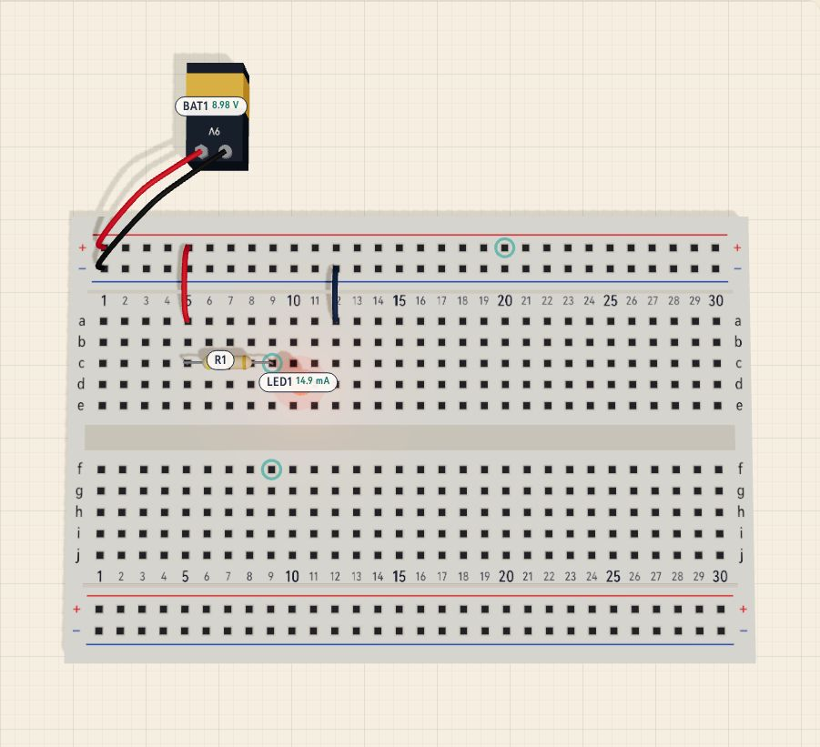
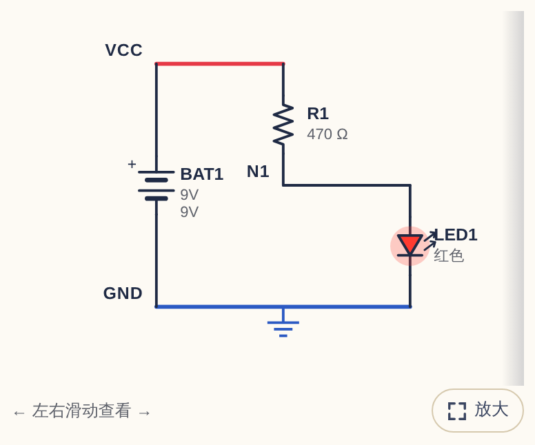
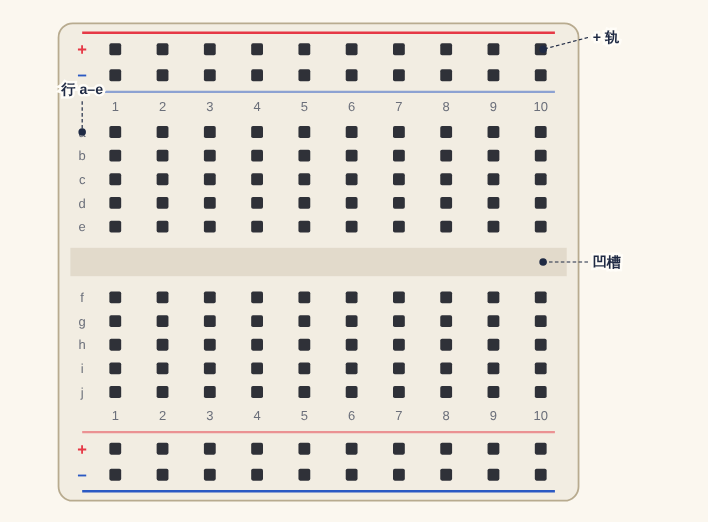
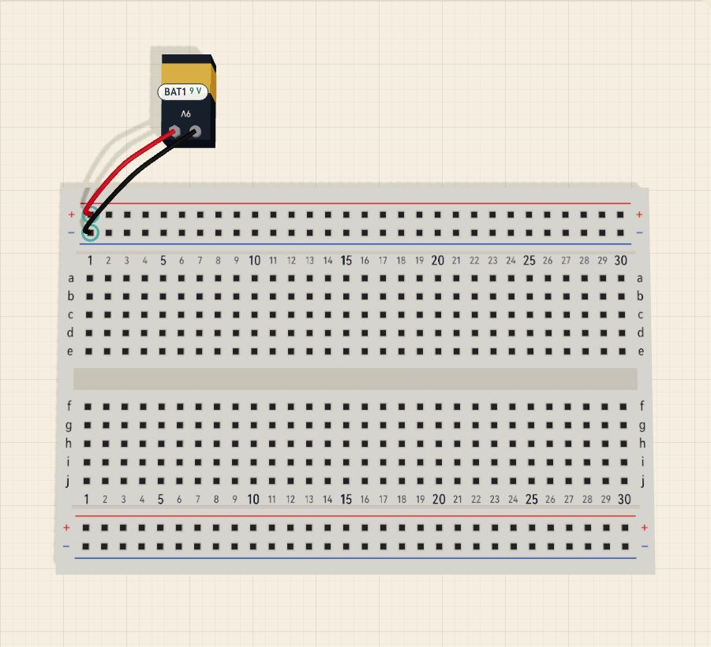
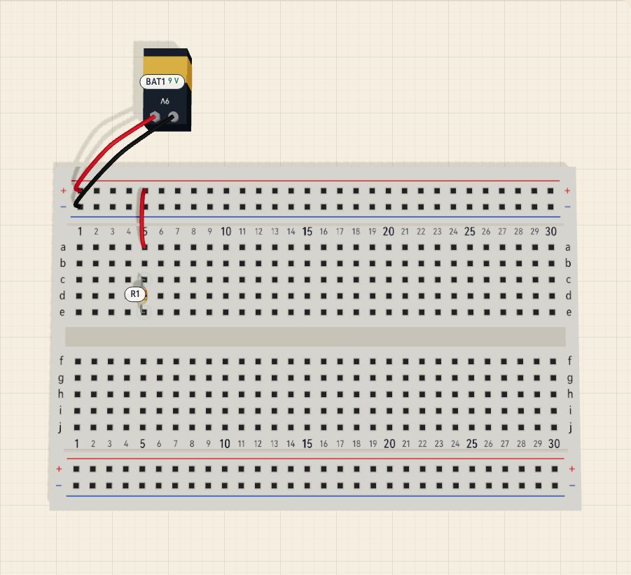
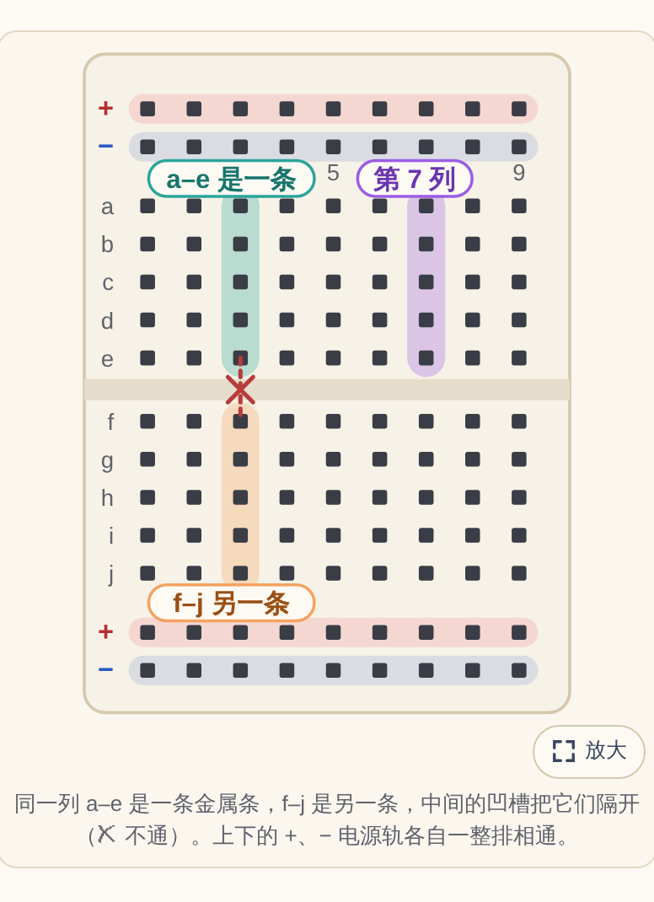
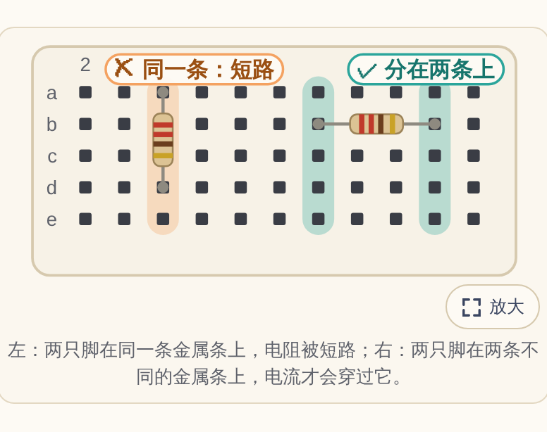
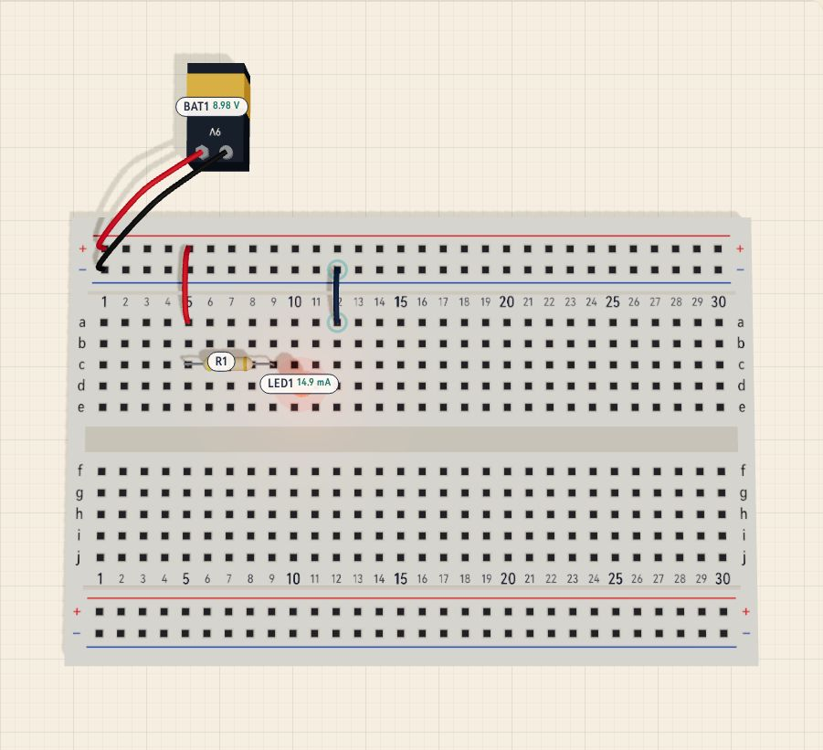
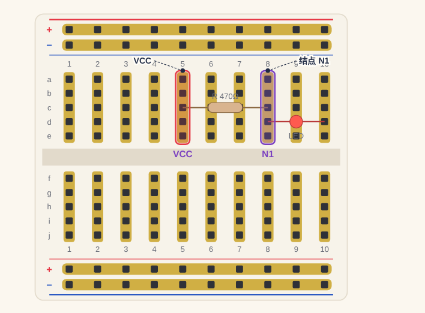

# 1.1 · 面包板：孔底下的金属条

| 项目 | 内容 |
|---|---|
| id | `lesson-breadboard-basics` |
| 文件 | `challenges/01-breadboard-basics.json` |
| 类型 | 课程（有分步，每步自动检查） · 难度 1/5 |
| 位置 | World 1 · 基础定律与直流分压 → 1.1 面包板：孔底下的金属条（本节第 1 项） |
| 右侧面板 | 手写轨道（样板课） |
| 前后 | — · 下一项 [1.2 lesson-power-and-ground](../w1/1.02-1-lesson-power-and-ground.md) |
| 先修 | — |
| 概念 | breadboard 面包板、terminal strip 金属条、power rail 电源轨、trench 中间凹槽 |

**一句话概要**：先故意插错一次，看看面包板里到底哪些孔是连着的。

## 1. 左侧工作台（3D 面包板 → 2D 俯视截图）

截图是程序里真实的 3D 面包板换成俯视角拍的；表格是同一块板的文字版（元件、参数、每只脚插在哪个孔）。

### 1.1 起点：空面包板（学生从零开始搭）

### 1.2 每一步之后的面包板

见第 2 节每个步骤下面的截图（按步骤的自动检查重建：放 / 改 / 拔元件、移动万用表表笔）。

### 1.3 参考答案（「看答案」载入的板子）

| 元件 | 类型 | 参数 | 引脚 → 孔 |
|---|---|---|---|
| BAT1 | battery | variant=9V | +→tp1 -→tn1 |
| W2 | wire |  | a→tp5 b→a5 |
| R1 | resistor | resistance=470 | 1→c5 2→c9 |
| LED1 | led | color=red | anode→d9 cathode→d12 |
| W5 | wire |  | a→a12 b→tn12 |

### 1.4 目标原理图（右侧「目标原理图」抽屉）

| 元件 | 类型 | 参数 |
|---|---|---|
| BAT1 | battery | variant=9V |
| R1 | resistor | resistance=470 |
| LED1 | led | color=red |

连接（每个结点上的引脚）：

- **VCC**：BAT1.+、R1.1
- **N1**：R1.2、LED1.anode
- **GND**：LED1.cathode、BAT1.-

## 2. 右侧面板：学生从上往下看到的内容（单轨流）

### 第 1 步 · 🔍 先看一眼：认识面包板：孔的名字

先认坐标，就像棋盘：每个孔的名字是**列号 + 行号**。今天只要会找孔，孔底下是什么，等一下自己发现。

**拆解「面包板 Breadboard：孔下面是什么」第 1 / 6 层：① 外形：一块打满小孔的塑料板**

你看到的只有塑料和孔。先认坐标，就像棋盘：
- 列号 column：1、2、3 …（真板子 30 或 60 列）
- 行号 row：a–e 在上半区，f–j 在下半区
- 中间凹槽 trench：把上下两半隔开
- 上下边缘的长排：红线 + 轨 和 蓝线 − 轨，叫 **电源轨 power rail**

每个孔有名字：**列号 + 行号**，比如 c5 = 第 5 列、c 行。电源轨的孔叫 tp / tn（top plus / top negative，上方）和 bp / bn（bottom，下方）。

| 区域 | 孔名 | 用来做什么 |
|---|---|---|
| 主区上半 | a1 … e30 | 插元件的脚 |
| 主区下半 | f1 … j30 | 插元件的脚 |
| 中间凹槽 | — | 芯片（DIP）横跨它 |
| 上方电源轨 | tp1…tp30, tn1…tn30 | + 电源、GND |
| 下方电源轨 | bp1…bp30, bn1…bn30 | + 电源、GND |

### 第 2 步 · 🔧 动手搭：先插错一次

今天的规矩：**先动手，再讲道理。**
面包板上的孔看起来一模一样，但它们下面并不是各自独立的。下面三步搭一个“错”的电路，然后看看右边的**诊断**说了什么。

**步骤 1**

左边工具栏选**「电池」**（默认 9V）。先单击 **`tp1`** 放红线（+），再单击 **`tn1`** 放黑线（−）。

自动检查（做到这些才算完成）：把电池插到 tp1–tn1
板上高亮的孔：tp1、tn1

**步骤 2**

选**「跳线」**，单击 **`tp5`** 再单击 **`a5`**：把 +9V 从电源轨引到第 5 列。亮起来的 a5–e5 五个孔现在都是 +9V。

自动检查（做到这些才算完成）：把跳线插到 tp5–a5
板上高亮的孔：tp5、a5、b5、c5、d5、e5

**步骤 3**

选**「电阻」**，两只脚都插在第 5 列：**`c5`** 和 **`e5`**。然后看右边的**诊断**：它说这个电阻怎么了？

自动检查（做到这些才算完成）：把电阻插到 c5–e5
板上高亮的孔：c5、e5

### 第 3 步 · 💡 想明白：孔底下藏着金属条

- **一列五个孔 = 一条金属条。** a5、b5、c5、d5、e5 下面是同一片金属。插在这五个孔里的脚，就像焊在了一起。
- **中间的凹槽把每一列切成两段。** a–e 是一条，f–j 是另一条，所以 e5 和 f5 **不通**。
- **边上的长排是电源轨。** 红线那排（tp、bp）当 +，蓝线那排（tn、bn）当 −，一整排都是通的。上面的轨和下面的轨互相不通。

*图 `strips`（breadboard）：同一列 a–e 是一条金属条，f–j 是另一条，中间的凹槽把它们隔开（✗ 不通）。上下的 +、− 电源轨各自一整排相通。*

刚才电阻的两只脚都在第 5 列，它们是**同一个点**。两端没有电压差，就没有电流流过——电阻被金属条**短路**了，等于没装。

*图 `short`（breadboard）：左：两只脚在同一条金属条上，电阻被短路；右：两只脚在两条不同的金属条上，电流才会穿过它。*

**规则：一个元件的两只脚，必须插在两条不同的金属条上。**

### 第 4 步 · 🔧 动手搭：挪好电阻，接成一个圈

电流要走一个**完整的圈**：从电池 + 出发，穿过电阻和 LED，再回到电池 −。少一段，就一点电流都没有。

**步骤 4**

单击选中电阻，按 **Delete** 删掉。再用「电阻」工具重新插：**`c5`** 和 **`c9`**，在右边**「属性」**里把阻值改成 **`470 Ω`**。现在它跨在第 5 列和第 9 列之间。

自动检查（做到这些才算完成）：把电阻插到 c5–c9；清空这些孔：e5
板上高亮的孔：c5、c9

**步骤 5**

选**「LED」**（红色）：**长脚**（正极）插 **`d9`**，和电阻的第二只脚在同一列；**短脚**（负极）插 **`d12`**。

自动检查（做到这些才算完成）：把LED 发光二极管插到 d9–d12
板上高亮的孔：d9、d12

**步骤 6**

选**「跳线」**，单击 **`a12`** 和 **`tn12`**：LED 的负极回到 − 轨。圈接上了，LED 应该亮了！

自动检查（做到这些才算完成）：把跳线插到 a12–tn12
板上高亮的孔：a12、tn12

**测量题 1 · `samecol`**（选择题）

> 电阻的第二只脚在 c9，LED 的长脚在 d9。它们之间要不要再接一根跳线？

- A. 不用：c9 和 d9 在同一条金属条上，本来就是同一个点 ✅（正确）
- B. 要：两个孔之间必须用跳线连起来

- 第 5 步完成后就能答

答对后显示：

> 同一列的 a–e 五个孔下面是同一条金属条，插进去就已经连上了。

### 第 5 步 · 📏 测一测：凹槽的另一边

**步骤 7**

鼠标停在一个孔上（不要点）：和它相通的孔会一起亮起来。试试 **`c9`**、**`f9`**、**`tp20`**。然后点下面的**「检查我的电路」**，回答两道小题。
板上高亮的孔：c9、f9、tp20

**测量题 2 · `trench`**（选择题）

> 如果把 LED 的长脚插在 f9（凹槽的另一边），LED 还会亮吗？

- A. 会：都是第 9 列
- B. 不会：凹槽把第 9 列切成了 a–e 和 f–j 两段，f9 和 c9 不通 ✅（正确）

- 第 6 步完成后就能答

答对后显示：

> 凹槽两边是两条不同的金属条。想跨过凹槽，要用跳线（或者像芯片那样，两排脚各插一边）。

**拆解「面包板 Breadboard：孔下面是什么」第 4 / 6 层：④ 等效电路：每条金属条 = 一个结点**

电路分析里，**结点（node）** 是“电位相同、用导线连在一起的所有点”。面包板上一条金属条正好就是一个结点。所以搭电路时，你的思路应该是：

1. 在原理图上数出有几个结点（VCC、N1、GND …）；
2. 给每个结点分配一条金属条（或一条电源轨）；
3. 把连到这个结点的每只脚插进这条金属条的任意孔。

例子（第 1 课）：第 5 列 a–e 是 VCC（用跳线接到 + 轨），电阻 从第 5 列跨到第 8 列，第 8 列 a–e 就是结点 N1，LED 的正极也插在第 8 列，所以电阻和 LED 在 N1 相连。

**最常见的错误**：把一个元件的两只脚插在同一列——两只脚在同一个结点上，元件两端电压 $V = 0$，被金属条 **短路** 了。

### 第 6 步 · 🎒 带走：带走这三句话

- **同列 a–e 相通，f–j 相通，中间的凹槽把它们隔开。**
- **一个孔只插一只脚。** 想把两样东西连起来，就插进同一条金属条的不同孔，或者用跳线接两条金属条。
- **真实面包板的坑：** 有些长面包板的电源轨在中间是**断开的**（红线中间有一个小缺口），左右两半要用跳线接起来。第一次用一块新板子，先拿万用表量一下。

下一个：电源和 GND——电流从哪里来，又回到哪里去。

## 3. 测量题一览

| # | id | 题目 | 类型 | 单位 | 状态 | 参考读数 |
|---|---|---|---|---|---|---|
| 1 | samecol | 电阻的第二只脚在 c9，LED 的长脚在 d9。它们之间要不要再接一根跳线？ | 选择 |  |  | 正确：A |
| 2 | trench | 如果把 LED 的长脚插在 f9（凹槽的另一边），LED 还会亮吗？ | 选择 |  |  | 正确：B |

### 提示按钮（依次显示）

1. 同一列的 a–e 是相通的，所以 c9 和 d9 在电气上是同一个点。
2. 电流必须走一个完整的圈：从 + 出发，经过元件，回到 −。LED 不亮时，顺着这个圈找断开的地方。

### 功能测试（「检查我的电路」时跑）

- LED 亮

## 4. 用到的拆解（全部层的文字，供改写参考）

### 拆解 `breadboard`：面包板 Breadboard：孔下面是什么

*从外形到金属夹片，再到“每条金属条就是电路里的一个结点（node）”。看懂这一层，以后任何电路都能自己插。*

**拆解「面包板 Breadboard：孔下面是什么」第 1 / 6 层：① 外形：一块打满小孔的塑料板**

你看到的只有塑料和孔。先认坐标，就像棋盘：
- 列号 column：1、2、3 …（真板子 30 或 60 列）
- 行号 row：a–e 在上半区，f–j 在下半区
- 中间凹槽 trench：把上下两半隔开
- 上下边缘的长排：红线 + 轨 和 蓝线 − 轨，叫 **电源轨 power rail**

每个孔有名字：**列号 + 行号**，比如 c5 = 第 5 列、c 行。电源轨的孔叫 tp / tn（top plus / top negative，上方）和 bp / bn（bottom，下方）。

| 区域 | 孔名 | 用来做什么 |
|---|---|---|
| 主区上半 | a1 … e30 | 插元件的脚 |
| 主区下半 | f1 … j30 | 插元件的脚 |
| 中间凹槽 | — | 芯片（DIP）横跨它 |
| 上方电源轨 | tp1…tp30, tn1…tn30 | + 电源、GND |
| 下方电源轨 | bp1…bp30, bn1…bn30 | + 电源、GND |

**拆解「面包板 Breadboard：孔下面是什么」第 2 / 6 层：② X 光：孔下面藏着金属条**

把塑料变透明，就能看到孔下面的 **金属夹片（metal strip / clip）**。规律只有三条：
1. 主区里每一 **列** 有两条竖着的金属条：a–e 一条，f–j 一条。
2. 每条 **电源轨** 是一条横着的长金属条：tp1 到 tp30 全通。
3. 金属条之间互不相连：凹槽 两边不通，相邻两列不通，红轨和蓝轨不通，上方轨和下方轨也不通。

插在 **同一条金属条** 上的两只脚，就等于用导线连在一起了——这就是面包板不用焊接的秘密。

**拆解「面包板 Breadboard：孔下面是什么」第 3 / 6 层：③ 拆出一条夹片：弹片夹住引脚**

把一条 a–e 的夹片拆出来侧着看：一块 磷青铜底板 上冲出 5 对 V 形 **弹片**，每对对应一个孔。元件的脚 插进去时把弹片撑开，弹片的回弹力 从两边夹紧它——这就是电接触。

所以：
- **一个孔只能插一只脚**。两只脚挤一个孔，会把弹片撑坏，接触变差。
- 线径要合适：0.3–0.8 mm（22–29 AWG）。太粗撑坏弹片，太细夹不紧，就会“时好时坏”。
- 插到底：脚只碰到弹片的尖端时，接触电阻会大很多。

**拆解「面包板 Breadboard：孔下面是什么」第 4 / 6 层：④ 等效电路：每条金属条 = 一个结点**

电路分析里，**结点（node）** 是“电位相同、用导线连在一起的所有点”。面包板上一条金属条正好就是一个结点。所以搭电路时，你的思路应该是：

1. 在原理图上数出有几个结点（VCC、N1、GND …）；
2. 给每个结点分配一条金属条（或一条电源轨）；
3. 把连到这个结点的每只脚插进这条金属条的任意孔。

例子（第 1 课）：第 5 列 a–e 是 VCC（用跳线接到 + 轨），电阻 从第 5 列跨到第 8 列，第 8 列 a–e 就是结点 N1，LED 的正极也插在第 8 列，所以电阻和 LED 在 N1 相连。

**最常见的错误**：把一个元件的两只脚插在同一列——两只脚在同一个结点上，元件两端电压 $V = 0$，被金属条 **短路** 了。

**拆解「面包板 Breadboard：孔下面是什么」第 5 / 6 层：⑤ 自己判断：这两个孔通不通？**

把鼠标放在表格的每一行上，图上会圈出那两个孔。先自己判断，再看答案列。

| 两个孔 | 通吗？ | 为什么 |
|---|---|---|
| a5 – e5 | ✔ 通 | 同一列、同一半：同一条金属条 |
| b7 – b8 | ✘ 不通 | 不同列：两条金属条 |
| e2 – f2 | ✘ 不通 | 隔着凹槽：上下两半是两条 |
| tp1 – tp10 | ✔ 通 | 同一条电源轨 |
| 电阻插 g9 和 i9 | ⚠ 被短路 | 两只脚在同一个结点，$V_R = 0$，$I_R = 0$ |

**拆解「面包板 Breadboard：孔下面是什么」第 6 / 6 层：⑥ 算一算：金属条不是完美导线**

做实验时把金属条当成理想导线，大多数时候没问题。但工程师要知道它“差多少”，才知道什么时候不能忽略：

- 接触电阻 每个触点约 10–50 mΩ。一个元件两只脚，串进去约 $2R_c$。接 470 Ω 电阻时误差约 $\frac{0.1}{470} ≈ 0.02 %$，完全可以忽略；但如果你用面包板测 0.1 Ω 的电流检测电阻，误差就有几十 %。
- 相邻金属条之间的寄生电容 约 2–5 pF。它的容抗 $X_C = \frac{1}{2πfC}$ 随频率下降：1 kHz 时约 50 MΩ（看不见），10 MHz 时只剩约 5 kΩ（信号会“漏”到隔壁一列）。所以 **面包板适合几 MHz 以下** 的电路。
- 电流：每条金属条一般不超过约 1 A，大电流会发热、接触变差。

- 公式 `R_{total} = R + 2R_c`：两个接触电阻串在元件两端
- 公式 `X_C = \frac{1}{2π f C}`：C = 3 pF：f = 1 kHz → 53 MΩ；f = 10 MHz → 5.3 kΩ

**一句话记住**：面包板 = 一堆 **结点**：每列的 a–e 是一个，f–j 是一个，每条电源轨是一个。搭电路就是“给原理图上的每个结点分配一条金属条”。

## 5. 这一课的计算卡片

**计算卡片 `led-resistor`：LED 限流电阻 LED series resistor**

- 公式 `R = \frac{V_s - V_F{I_F}`
- 用途：给 LED 选串联电阻，让它亮又不烧。
- 输入：Vs（电源电压，V）；VF（LED 正向压降 V_F（红 ≈ 2 V，蓝/白 ≈ 3 V），V）；IF（想要的电流（5–15 mA），A） → R（串联电阻，Ω）

LED 不是电阻：一旦导通，它两端的电压几乎固定在 $V_F$，电流却可以变得很大。所以必须串一个电阻来 **定电流**：
1. KVL：$V_s = V_R + V_F$，所以电阻上的电压 $V_R = V_s - V_F$
2. 欧姆定律：$I_F = \frac{V_R{R}$
3. 解出 $R = \frac{V_s - V_F{I_F}$，再选一个 **稍大** 的标准值（E12：330、470、680、1 k …）

例子：9 V、红 LED、15 mA：$R = \frac{9 - 2}{0.015} ≈ 467 Ω$ → 选 470 Ω（第 1 课）。

- ⚠ 忘了减 V_F：用 $\frac{V_s{I}$ 会得到偏大的电阻（不危险，只是暗）。
- ⚠ 不串电阻直接接电池：电流只受内阻限制，LED 立刻烧掉。

**计算卡片 `series-resistance-contact`：接触电阻带来的误差**

- 公式 `误差 = \frac{2R_c}{R}`
- 用途：面包板触点串进来的电阻占多大比例。
- 输入：R（元件电阻，Ω）；Rc（每个触点的接触电阻，Ω） → err（相对误差，%）

元件的两只脚各经过一个触点，相当于串联了 $2R_c$。相对误差就是 $\frac{2R_c}{R}$。几百欧以上的电阻可以忽略；测零点几欧的电阻时完全不能忽略（这时要用“四线法”）。

## 6. English（界面英文版的同一份内容）

展开英文

### Node 1 · 🔍 Look first：Meet the breadboard: hole names

Learn the coordinates first, like a chessboard: every hole is named **column + row**. For now just find the holes; what is underneath you discover in a minute.

**Teardown「The breadboard: what is under the holes」layer 1 of 6：① Outside: a plastic board full of holes**

All you can see is plastic and holes. Learn the coordinates first, like a chessboard:
- column numbers: 1, 2, 3 … (a real board has 30 or 60)
- row letters: a–e in the upper half, f–j in the lower half
- the centre trench separates the two halves
- the long rows along the edges: the red + rail and the blue − rail, called **power rails**

Every hole has a name: **column + row**, e.g. c5 = column 5, row c. Rail holes are tp / tn (top plus / top negative) and bp / bn (bottom).

| Area | Hole names | Used for |
|---|---|---|
| Upper main area | a1 … e30 | component leads |
| Lower main area | f1 … j30 | component leads |
| Centre trench | — | chips (DIP) straddle it |
| Top rails | tp1…tp30, tn1…tn30 | + supply, GND |
| Bottom rails | bp1…bp30, bn1…bn30 | + supply, GND |

### Node 2 · 🔧 Build：Get it wrong on purpose

Today's rule: **do it first, explain it after.**
Every hole on a breadboard looks the same, but they are not separate underneath. In the next three steps you build a "wrong" circuit — then see what the **diagnostics** on the right say.

**Step 1**

In the toolbar on the left pick **Battery** (9V by default). Click **`tp1`** for the red lead (+), then **`tn1`** for the black lead (−).

Checked automatically：Place the Battery at tp1–tn1
Holes highlighted：tp1、tn1

**Step 2**

Pick **Jumper** and click **`tp5`**, then **`a5`**: this brings +9V from the rail to column 5. The five lit holes a5–e5 are all at +9V now.

Checked automatically：Place the Jumper wire at tp5–a5
Holes highlighted：tp5、a5、b5、c5、d5、e5

**Step 3**

Pick **Resistor** and put both legs in column 5: **`c5`** and **`e5`**. Now look at the **diagnostics** on the right: what do they say about this resistor?

Checked automatically：Place the Resistor at c5–e5
Holes highlighted：c5、e5

### Node 3 · 💡 Why：Metal strips under the holes

- **Five holes in a column = one metal strip.** Under a5, b5, c5, d5 and e5 is one piece of metal. Leads plugged into those five holes are as good as soldered together.
- **The trench cuts every column in two.** a–e is one strip and f–j is another, so e5 and f5 are **not** connected.
- **The long rows along the edges are power rails.** The red-line row (tp, bp) is used as +, the blue-line row (tn, bn) as −, and each whole row is connected. The top rails and the bottom rails are not connected to each other.

[figure `strips`]

*Figure `strips`（breadboard）：同一列 a–e 是一条金属条，f–j 是另一条，中间的凹槽把它们隔开（✗ 不通）。上下的 +、− 电源轨各自一整排相通。*

Both legs of your resistor were in column 5, so they were **the same point**. No voltage across it means no current through it — the strip **shorted it out**; it might as well not be there.

[figure `short`]

*Figure `short`（breadboard）：左：两只脚在同一条金属条上，电阻被短路；右：两只脚在两条不同的金属条上，电流才会穿过它。*

**Rule: a part's two legs must go into two different metal strips.**

### Node 4 · 🔧 Build：Move the resistor and close the loop

Current needs a **complete loop**: out of the battery +, through the resistor and the LED, back into the battery −. Leave out one piece and no current flows at all.

**Step 4**

Click the resistor and press **Delete**. Place it again with the Resistor tool at **`c5`** and **`c9`**, and in **Properties** on the right set it to **`470 Ω`**. It now spans columns 5 and 9.

Checked automatically：Place the Resistor at c5–c9；holes empty again: e5
Holes highlighted：c5、c9

**Step 5**

Pick **LED** (red): the **long lead** (anode, +) goes in **`d9`**, in the same column as the resistor's second leg; the **short lead** (cathode, −) goes in **`d12`**.

Checked automatically：Place the LED at d9–d12
Holes highlighted：d9、d12

**Step 6**

Pick **Jumper** and click **`a12`** and **`tn12`**: the LED's cathode goes back to the − rail. The loop is closed — the LED should light up!

Checked automatically：Place the Jumper wire at a12–tn12
Holes highlighted：a12、tn12

**Question 1 · `samecol`**（multiple choice）

> The resistor's second leg is in c9 and the LED's long lead is in d9. Do they need a jumper between them?

- A. No: c9 and d9 are on the same metal strip, so they are already one point ✅ (right)
- B. Yes: two holes always need a jumper between them

- answerable after step 5

Shown once right:

> The five holes a–e of a column share one metal strip; plugging in is enough.

### Node 5 · 📏 Measure：The other side of the trench

**Step 7**

Hover over a hole without clicking: every hole connected to it lights up. Try **`c9`**, **`f9`** and **`tp20`**. Then press **Check my circuit** below.
Holes highlighted：c9、f9、tp20

**Question 2 · `trench`**（multiple choice）

> If the LED's long lead went into f9 (across the trench), would the LED still light?

- A. Yes: it is still column 9
- B. No: the trench splits column 9 into a–e and f–j, so f9 is not connected to c9 ✅ (right)

- answerable after step 6

Shown once right:

> The two sides of the trench are two different strips. To cross it, use a jumper (or, like a chip, put one row of pins on each side).

**Teardown「The breadboard: what is under the holes」layer 4 of 6：④ Equivalent circuit: every strip is one node**

In circuit analysis a **node** is "all the points joined by wire, at the same potential". One breadboard strip is exactly one node. So the way to think when you build:

1. count the nodes on the schematic (VCC, N1, GND …);
2. give every node its own strip (or a rail);
3. plug every lead that belongs to that node into any hole of that strip.

Example (lesson 1): column 5, a–e, is VCC (jumpered to the + rail), the resistor spans columns 5 to 8, column 8, a–e, is node N1, and the LED's anode is in column 8 too — so the resistor and the LED meet at N1.

**The most common mistake**: both leads of one part in the same column. Both leads are then on one node, the voltage across the part is $V = 0$: the strip **shorts it out**.

### Node 6 · 🎒 Take away：Three things to take with you

- **a–e of a column are joined, f–j are joined, and the trench keeps them apart.**
- **One lead per hole.** To connect two things, plug them into different holes of the same strip, or join two strips with a jumper.
- **A real-board trap:** on some long breadboards the power rails are **split in the middle** (a gap in the red line); join the two halves with a jumper. On a new board, check with a multimeter first.

Next: power and GND — where the current comes from and where it goes back to.

**Hints**

1. Holes a–e in the same column are connected, so c9 and d9 are electrically the same point.
2. Current needs a complete loop: out of +, through the parts, back to −. If the LED stays dark, follow that loop and find where it's broken.

