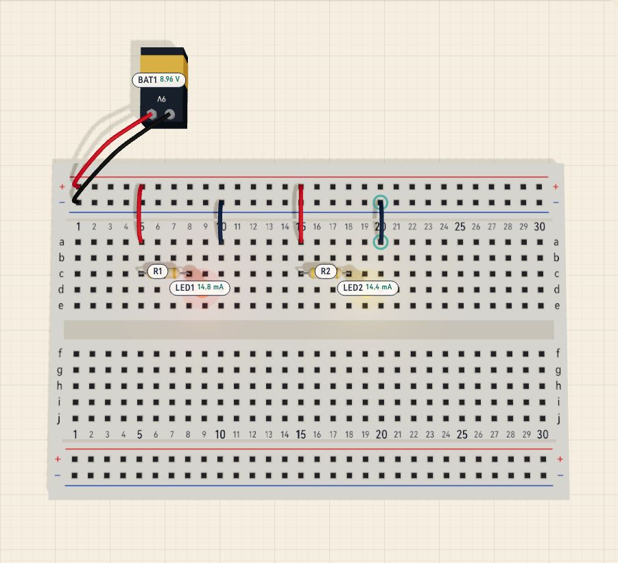
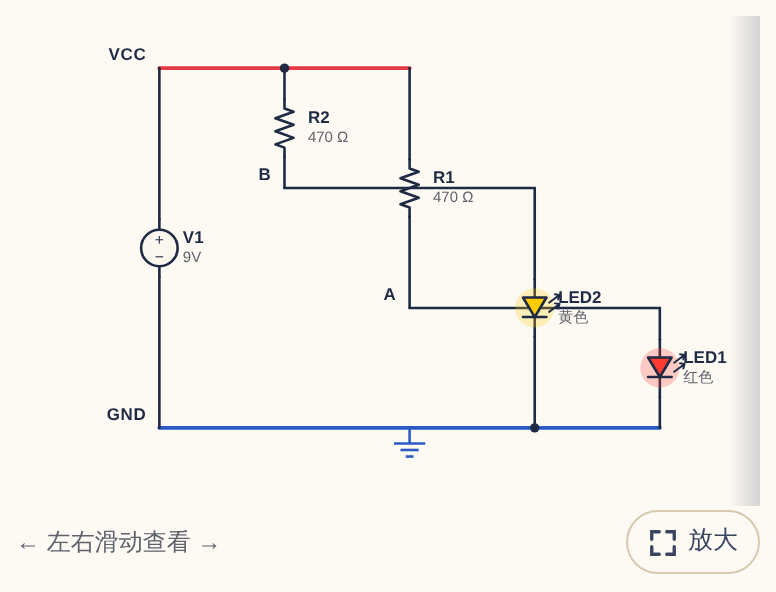
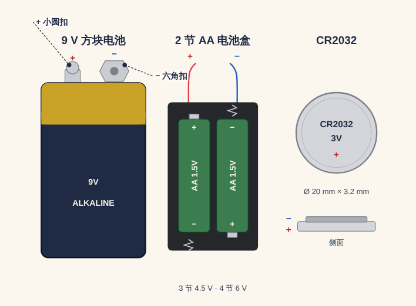
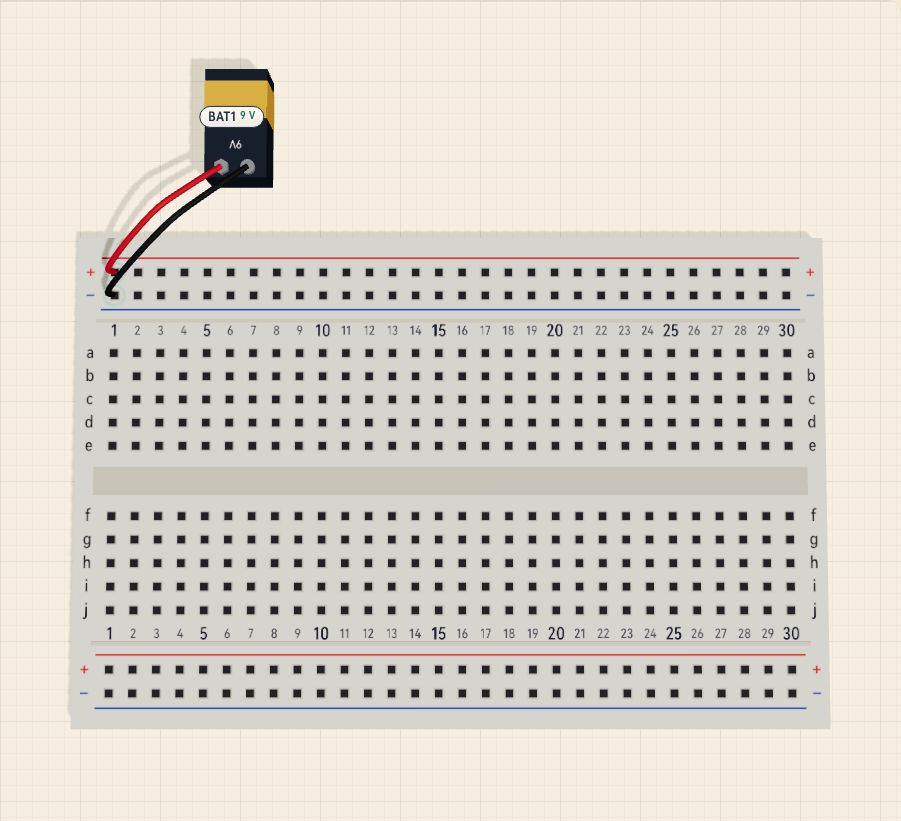
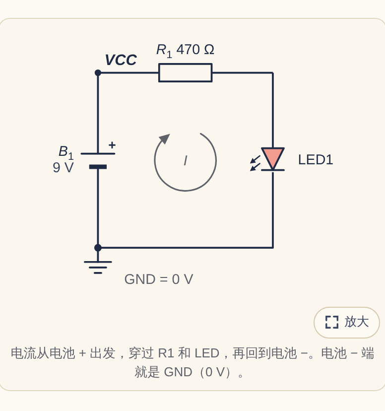
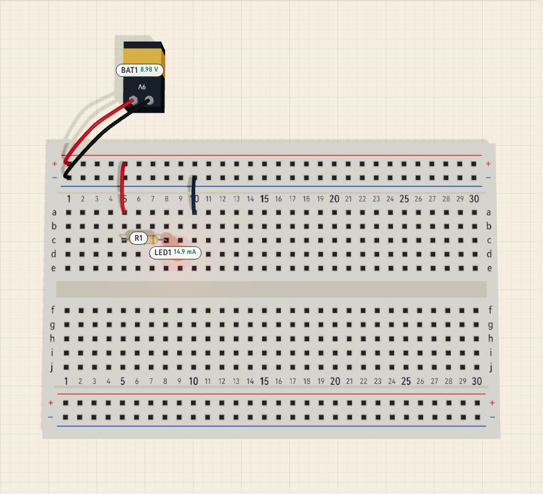
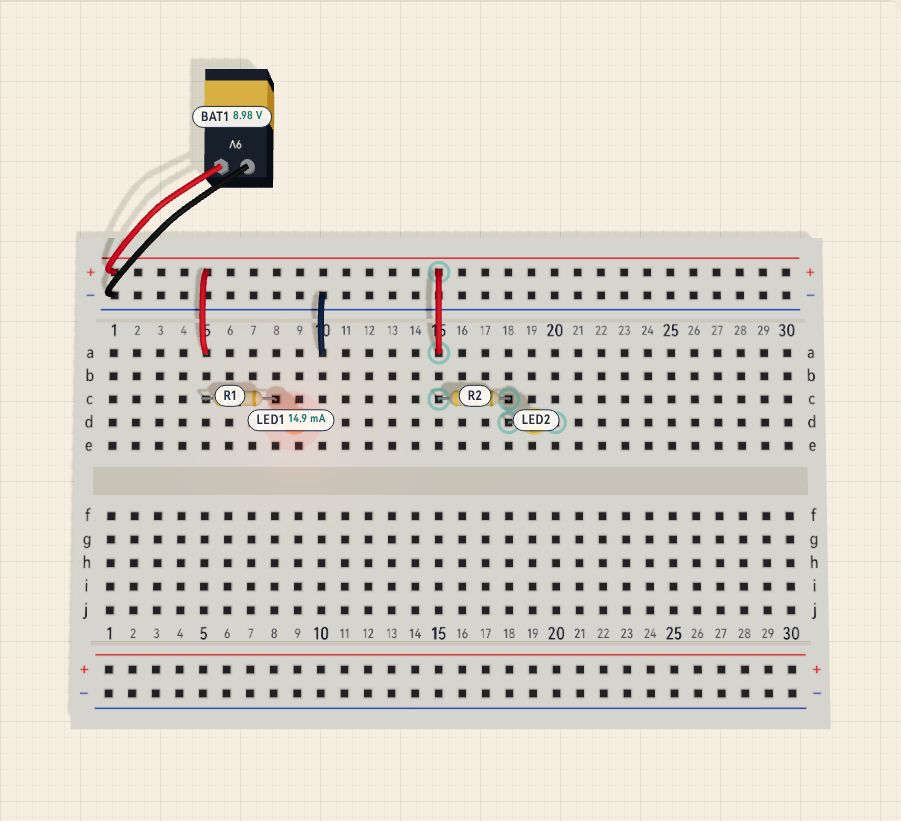
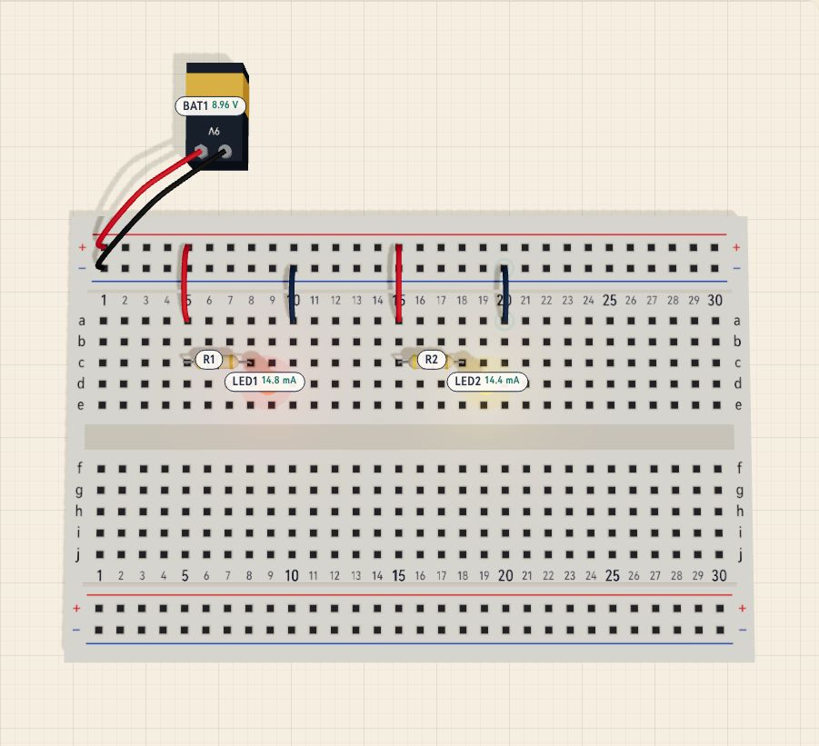

# 1.2 · 电源与 GND：电流回家的路

| 项目 | 内容 |
|---|---|
| id | `lesson-power-and-ground` |
| 文件 | `challenges/02-power-and-ground.json` |
| 类型 | 课程（有分步，每步自动检查） · 难度 1/5 |
| 位置 | World 1 · 基础定律与直流分压 → 1.2 电源与 GND：电流回家的路（本节第 1 项） |
| 右侧面板 | 轨道由旧的四张卡片自动生成（还没手工精排） |
| 前后 | 上一项 [1.1 lesson-breadboard-basics](../w1/1.01-1-lesson-breadboard-basics.md) · 下一项 [1.3 lesson-light-an-led](../w1/1.03-1-lesson-light-an-led.md) |
| 先修 | — |
| 概念 | GND / ground 地、0 V reference 参考点、VCC、return path 回路、power rail 电源轨 |

**一句话概要**：一个 LED 明明接上了电却不亮——因为电流找不到回家的路。

## 1. 左侧工作台（3D 面包板 → 2D 俯视截图）

截图是程序里真实的 3D 面包板换成俯视角拍的；表格是同一块板的文字版（元件、参数、每只脚插在哪个孔）。

### 1.1 起点：空面包板（学生从零开始搭）

### 1.2 每一步之后的面包板

见第 2 节每个步骤下面的截图（按步骤的自动检查重建：放 / 改 / 拔元件、移动万用表表笔）。

### 1.3 参考答案（「看答案」载入的板子）

| 元件 | 类型 | 参数 | 引脚 → 孔 |
|---|---|---|---|
| BAT1 | battery | variant=9V | +→tp1 -→tn1 |
| W2 | wire |  | a→tp5 b→a5 |
| R1 | resistor | resistance=470 | 1→c5 2→c8 |
| LED1 | led | color=red | anode→d8 cathode→d10 |
| W5 | wire |  | a→a10 b→tn10 |
| W6 | wire |  | a→tp15 b→a15 |
| R2 | resistor | resistance=470 | 1→c15 2→c18 |
| LED2 | led | color=yellow | anode→d18 cathode→d20 |
| W9 | wire |  | a→a20 b→tn20 |

### 1.4 目标原理图（右侧「目标原理图」抽屉）

| 元件 | 类型 | 参数 |
|---|---|---|
| V1 | dc_source | voltage=9 |
| R1 | resistor | resistance=470 |
| LED1 | led | color=red |
| R2 | resistor | resistance=470 |
| LED2 | led | color=yellow |

连接（每个结点上的引脚）：

- **VCC**：V1.+、R1.1、R2.1
- **A**：R1.2、LED1.anode
- **B**：R2.2、LED2.anode
- **GND**：LED1.cathode、LED2.cathode、V1.-

## 2. 右侧面板：学生从上往下看到的内容（单轨流）

### 第 1 步 · 🔍 先看一眼：先认识它：电池

**拆解「电池：电动势 E + 内阻 r」第 1 / 8 层：① 外形：课程里的三种电池**

在模拟器里选中一个电池，属性里可以换 **variant（型号）**。它们看起来完全不一样，但电路上都只有两个端子：+ 正极 和 − 负极。
- 9 V 方块电池：顶上两个按扣（snap）。小的圆柱形是 **+**，大的六角形是 **−**——形状不同，电池扣就插不反。
- AA 电池盒：2、3、4 节 AA 串联，得到 3 V、4.5 V、6 V；红线 +、黑线 −。
- CR2032 纽扣电池：直径 20 mm、厚 3.2 mm（名字就是这么来的：CR + 20 + 32）。刻着字的大平面是 **+**，另一面较小的圆片是 **−**。

下表是模拟器里用的数字，后面几层都会用到。注意最后一列：它们的 **内阻差了 100 倍**。

| 型号 | 里面 | E（电动势） | r（内阻） | 短路电流 E/r |
|---|---|---|---|---|
| 9 V 方块 | 6 节 1.5 V 串联 | 9 V | 1.5 Ω | 6 A |
| 2 × AA | 2 节串联 | 3 V | 0.3 Ω | 10 A |
| 3 × AA | 3 节串联 | 4.5 V | 0.45 Ω | 10 A |
| 4 × AA | 4 节串联 | 6 V | 0.6 Ω | 10 A |
| CR2032 | 1 节锂电池 | 3 V | 15 Ω | 0.2 A |

### 第 2 步 · 🔧 动手搭：LED 接上了，为什么不亮？

先搭半条支路：电池、跳线、电阻、LED 都插好了，**唯独少一根线**。
搭完看 LED：它亮不亮？再看右边**诊断**怎么说。

**步骤 1**

选**「电池」**：**`tp1`** 放红线（+），**`tn1`** 放黑线（−）。从现在起，整条红轨是 +9 V，整条蓝轨是 GND。

自动检查（做到这些才算完成）：把电池插到 tp1–tn1
板上高亮的孔：tp1、tn1

**步骤 2**

红色**跳线**：**`tp5`** → **`a5`**，把 +9 V 引到第 5 列。

自动检查（做到这些才算完成）：把跳线插到 tp5–a5
板上高亮的孔：tp5、a5

**步骤 3**

**电阻 R1**（属性里设 **`470 Ω`**）插 **`c5`**–**`c8`**；**红色 LED1** 长脚插 **`d8`**，短脚插 **`d10`**。看看 LED1 亮了没有？

自动检查（做到这些才算完成）：把电阻插到 c5–c8；把LED 发光二极管插到 d8–d10
板上高亮的孔：c5、c8、d8、d10

### 第 3 步 · 💡 想明白：电流要回家

- 电流从电池 **+** 出发，穿过元件，**必须回到电池 −**。只出不回，就一点电流都没有——LED 的短脚悬在空中，圈没有闭合。
- **电压是两点之间的差。** 说“这里是 9 V”，其实省略了“相对谁”。这个默认的参考点叫 **GND**（地），规定它是 **0 V**。
- 我们把电池的 **− 端定为 GND**：红轨 = VCC（+9 V），蓝轨 = GND（0 V）。

*图 `loop`（schematic）：电流从电池 + 出发，穿过 R1 和 LED，再回到电池 −。电池 − 端就是 GND（0 V）。*

- GND 不是大地，也不是“电流消失的地方”。电流到了 GND 还要继续流，回到电池里。

（这一步下面列着这节课的计算卡片，点开就地展开：`kvl`、`battery-terminal-voltage`，全文见第 6 节）

### 第 4 步 · 🔧 动手搭：给它一条回家的路

补上回路，再照样搭第二条支路。两条支路的“家”是**同一条蓝轨**。

**步骤 4**

蓝色**跳线**：**`a10`** → **`tn10`**。LED1 的短脚有路回到 GND 了——它亮了吗？

自动检查（做到这些才算完成）：把跳线插到 a10–tn10
板上高亮的孔：a10、tn10

**步骤 5**

第二条支路，换到右边：红跳线 **`tp15`** → **`a15`**；**R2**（**`470 Ω`**）插 **`c15`**–**`c18`**；**黄色 LED2** 长脚 **`d18`**、短脚 **`d20`**。

自动检查（做到这些才算完成）：把跳线插到 tp15–a15；把电阻插到 c15–c18；把LED 发光二极管插到 d18–d20
板上高亮的孔：tp15、a15、c15、c18、d18、d20

**步骤 6**

蓝色**跳线** **`a20`** → **`tn20`**。两个 LED 都亮了，而且它们回到的是**同一条蓝轨**。点**「检查我的电路」**。

自动检查（做到这些才算完成）：把跳线插到 a20–tn20
板上高亮的孔：a20、tn20

### 第 5 步 · 📏 测一测：测一测：读你自己的仪表

**测量题 1 · `onenode`**（选择题）

> 原理图上 LED1 和 LED2 下面各画了一个接地符号 ⏚。在面包板上，它们是：

- A. 同一个结点：两个短脚都通过跳线接到同一条蓝轨 ✅（正确）
- B. 两个不同的结点，只是画法一样

答对后显示：

> 所有接地符号都表示“接到电源 −”。它们在实物里是同一个点，所以叫同一个 GND 结点。

**测量题 2 · `pullout`**（选择题）

> 如果拔掉 a10 → tn10 那根蓝跳线，会怎样？

- A. 两个 LED 都灭
- B. 只有 LED1 灭，LED2 照样亮 ✅（正确）
- C. 只有 LED2 灭

答对后显示：

> LED2 有自己的回路（a20 → tn20），不受影响。每条支路都要有自己通往 GND 的路。

### 第 6 步 · 🎒 带走：带走

- 原理图上的接地符号 ⏚ 意思是“接到电源 −”。图上画了五个 ⏚，实物里它们全是**同一个结点**。
- **LED 不亮，先找回路**：从它的短脚出发，看能不能一路走回电池 −。
- 习惯：**红线接 +，黑线或蓝线接 −**。真实电路里这能救命——接反电源是烧板子最常见的原因。

下一个：LED 为什么一定要串电阻。

## 3. 测量题一览

| # | id | 题目 | 类型 | 单位 | 状态 | 参考读数 |
|---|---|---|---|---|---|---|
| 1 | onenode | 原理图上 LED1 和 LED2 下面各画了一个接地符号 ⏚。在面包板上，它们是： | 选择 |  |  | 正确：A |
| 2 | pullout | 如果拔掉 a10 → tn10 那根蓝跳线，会怎样？ | 选择 |  |  | 正确：B |

### 提示按钮（依次显示）

1. 红轨不需要每条支路都连回电池：整条轨道本来就是通的。
2. 某个 LED 不亮？先检查它的短脚有没有一条路通到蓝轨。

### 功能测试（「检查我的电路」时跑）

- 两个 LED 都亮，VCC 和 GND 的电压正确

## 4. 用到的拆解（全部层的文字，供改写参考）

### 拆解 `battery`：电池：电动势 E + 内阻 r

*课程里用到三种电池：9 V 方块电池、AA 电池盒、CR2032 纽扣电池。我们把它们拆开，找到每一节 cell（电芯），从化学反应得到 EMF（电动势），再画出电路课里的模型——理想电压源串一个 internal resistance（内阻）——并用它算出“带上负载以后电压为什么会掉”。*

**拆解「电池：电动势 E + 内阻 r」第 1 / 8 层：① 外形：课程里的三种电池**

在模拟器里选中一个电池，属性里可以换 **variant（型号）**。它们看起来完全不一样，但电路上都只有两个端子：+ 正极 和 − 负极。
- 9 V 方块电池：顶上两个按扣（snap）。小的圆柱形是 **+**，大的六角形是 **−**——形状不同，电池扣就插不反。
- AA 电池盒：2、3、4 节 AA 串联，得到 3 V、4.5 V、6 V；红线 +、黑线 −。
- CR2032 纽扣电池：直径 20 mm、厚 3.2 mm（名字就是这么来的：CR + 20 + 32）。刻着字的大平面是 **+**，另一面较小的圆片是 **−**。

下表是模拟器里用的数字，后面几层都会用到。注意最后一列：它们的 **内阻差了 100 倍**。

| 型号 | 里面 | E（电动势） | r（内阻） | 短路电流 E/r |
|---|---|---|---|---|
| 9 V 方块 | 6 节 1.5 V 串联 | 9 V | 1.5 Ω | 6 A |
| 2 × AA | 2 节串联 | 3 V | 0.3 Ω | 10 A |
| 3 × AA | 3 节串联 | 4.5 V | 0.45 Ω | 10 A |
| 4 × AA | 4 节串联 | 6 V | 0.6 Ω | 10 A |
| CR2032 | 1 节锂电池 | 3 V | 15 Ω | 0.2 A |

**拆解「电池：电动势 E + 内阻 r」第 2 / 8 层：② X 光：9 V 电池里是 6 节 1.5 V**

把外壳变透明：
- 9 V 方块电池 里面是 **6 节细长的 1.5 V 碱性电芯**（AAAA 尺寸），一正一反排成一排，用金属片首尾相连——一节的 − 接下一节的 +，这就是 **series（串联）**。第一节的 + 接到小圆扣，最后一节的 − 接到六角扣。
- AA 电池盒 也一样：盒底的金属片把第一节的 − 接到第二节的 +，所以 1.5 V + 1.5 V = 3 V。
- CR2032 只有 **一节**，但化学体系不同：负极是金属锂 Li，正极是二氧化锰 MnO₂，中间隔着 隔膜 separator。锂的电动势高，一节就有 3 V；但电极是薄薄的一层，面积小——这就是它内阻大（15 Ω）的原因。

**结论**：一节电芯的电压由化学决定（1.5 V、3 V……），想要更高的电压就把好几节 **串起来**。

**拆解「电池：电动势 E + 内阻 r」第 3 / 8 层：③ 电动势从哪来：化学反应把电子“推”到负极**

切开一节碱性 AA：中心是 锌膏（Zn），外圈是 二氧化锰（MnO₂），中间是浸满 KOH 电解液的 隔膜，钢壳是 + 极，中间那根铜钉连到底部的 − 极。

- 负极（anode）：锌被氧化，**放出** 电子：$Zn + 2OH^{-} → ZnO + H_{2}O + 2e^{-}$
- 正极（cathode）：二氧化锰被还原，**吃掉** 电子：$2MnO_{2} + H_{2}O + 2e^{-} → Mn_{2}O_{3} + 2OH^{-}$

两个反应的“推力”之差就是 **EMF（electromotive force，电动势）** E ≈ 1.5 V。它不是电阻上的压降，而是化学能变成电能的本事：每把 1 C 的电荷从 − 搬到 +，化学反应做 1.5 J 的功。

只有接上 外电路 反应才进行：电子 e⁻ 从锌出发，经过外电路流到正极；我们画的 **电流 I** 方向规定为正电荷方向，正好相反——从 + 出来，经负载，回到 −。

串联 时每节的 E 相加、内阻也相加：$E = n·E_{cell}$，$r = n·r_{cell}$。9 V 电池：6 × 1.5 V = 9 V，6 × 0.25 Ω = 1.5 Ω。

| 化学体系 | 每节电动势 | 例子 | 特点 |
|---|---|---|---|
| 碱性 Zn / MnO₂ | 1.5 V | AA, AAA, 9 V | 便宜，内阻中等 |
| 锂 Li / MnO₂ | 3.0 V | CR2032 | 电压高、自放电小，但内阻大 |
| 镍氢 NiMH | 1.2 V | 充电 AA | 内阻小，能给大电流 |
| 锂离子 Li-ion | 3.7 V（4.2 → 3.0 V） | 18650 | 见“稳压器”拆解：配 LDO 的坑 |

- 公式 `E = n·E_{cell}, r = n·r_{cell}`：n 节相同的电芯串联

**拆解「电池：电动势 E + 内阻 r」第 4 / 8 层：④ 等效电路：理想电压源 E 串联内阻 r**

电路课里把电池画成 虚线框里的两个元件：
1. 理想电压源 E：不管流过多少电流，它两端永远是 E——这代表化学反应的“推力”；
2. 内阻 r：电流在电解液、电极、连接片里走，都会遇到电阻。把它们合起来，就是一个和 E **串联** 的电阻。

我们在外面能摸到、能测到的只有两个端子 + 和 −，它们之间的电压叫 **terminal voltage（端电压）** V。接上 负载 R_L 以后，电流 I 流过 r，在 r 上产生压降 $I·r$——这部分电压“被电池自己吃掉了”，到不了负载。

这就是“电压源的实际模型”。它和戴维南等效电路（Thévenin equivalent）是同一个东西：$E = V_{oc}$（开路电压），$r = R_{th}$。

| 符号 | 名字 | 物理意义 | 怎么测 |
|---|---|---|---|
| E | 电动势 EMF | 化学反应的推力 | 不接负载时用电压表量 V（I = 0 → V = E） |
| r | 内阻 | 电解液 + 电极 + 连接 | 接一个已知负载，$r = \frac{E - V}{I}$ |
| V | 端电压 | 负载真正拿到的电压 | 带载时量 + 和 − |
| I | 电流 | 由负载决定 | 电流表串联 |

**拆解「电池：电动势 E + 内阻 r」第 5 / 8 层：⑤ 推公式：V = E − I·r，以及电池的外特性直线**

对上一层的回路写 KVL（Kirchhoff’s voltage law，基尔霍夫电压定律），从 − 端出发绕一圈：
1. 经过 E 升高 E，经过 r 降低 $I·r$，经过负载降低 $I·R_L$：$E - I·r - I·R_L = 0$
2. 所以电流 $I = \frac{E}{r + R_L}$
3. 端电压就是负载上的电压：$V = I·R_L = E - I·r$

$V = E - I·r$ 在 V–I 平面上是一条 斜率为 −r 的直线（右图，CR2032）：
- I = 0（开路）时 V = E = 3 V；
- 负载越重（R_L 越小、I 越大），V 越低；
- V = 0 时 I = E/r——**短路电流**，是这块电池能给出的最大电流。CR2032：3 / 15 = 0.2 A；9 V 电池：9 / 1.5 = 6 A。

**带数字**（挑战 9）：CR2032 → 47 Ω → 红色 LED（$V_f$ = 1.8 V，内阻 12 Ω）：
$$I = \frac{3 - 1.8}{15 + 47 + 12} = \frac{1.2}{74} = 16.2 mA$$
$$V = 3 - 0.0162 × 15 = 2.76 V$$
这就是 工作点，测试要求的“端电压约 2.75 V”就是它。

再看第 2 课的 9 V 电池：两条支路（470 Ω + 红 LED、470 Ω + 黄 LED）共约 29 mA，$V = 9 - 0.029 × 1.5 ≈ 8.96 V$——内阻只有 1.5 Ω，压降 0.04 V，几乎看不出来。**内阻要不要考虑，看 I·r 和 E 比起来大不大。**

最后一个点：负载从电池拿到的功率 $P = V·I = \frac{E^{2}R_L}{(r + R_L)^{2}}$，在 R_L = r 时最大，$P_{max} = \frac{E^{2}}{4r}$（CR2032：0.15 W）——这就是“最大功率传输定理”。

- 公式 `I = \frac{E}{r + R_L}`：KVL：E 被 r 和 R_L 分掉
- 公式 `V = E - I·r`：端电压：电流越大越低
- 公式 `I_{sc} = \frac{E}{r}`：短路电流 = 最大电流
- 公式 `P_{max} = \frac{E^{2}}{4r}`：R_L = r 时负载功率最大

**拆解「电池：电动势 E + 内阻 r」第 6 / 8 层：⑥ 纽扣电池能“不加电阻”点 LED？——算一算**

网上常说 CR2032 可以直接点 LED，因为它的 15 Ω 内阻 本身就在限流。这话 **一半对**：确实有一个电阻在限流，它就在电池里。但限得够不够？把 47 Ω 拿掉，回路里只剩 15 Ω + LED 的 12 Ω：
$$I = \frac{E - V_f}{r + R_{LED}} = \frac{3 - 1.8}{15 + 12} = 44 mA$$
44 mA 是普通 LED 最大电流（20 mA）的两倍多。再看电池这边：
- 内阻上发热 $I^{2}r = 0.044^{2} × 15 = 29 mW$；
- CR2032 的标称容量约 220 mAh 是在 **0.2 mA** 这种小电流下测的。几十 mA 时化学反应跟不上，电压很快塌下去，实际能放出的电量少得多。

加上 47 Ω：16 mA，LED 亮度合适，电池也轻松。

**为什么“不加电阻”有时看起来也行？** 蓝、白 LED 的 $V_f$ ≈ 3.0 V，和 E 一样大，电流本来就很小；而且电池越用 E 越低、r 越大。靠内阻限流就是靠一个 **你控制不了、会变** 的数。工程上的做法：**电流由你选的电阻决定，不由电池的内阻决定。**

| 电路 | 回路总电阻 | I | 端电压 V | 评价 |
|---|---|---|---|---|
| CR2032 + LED | 15 + 12 = 27 Ω | 44 mA | 2.33 V | LED 过流，电池过载 |
| CR2032 + 47 Ω + LED | 74 Ω | 16 mA | 2.76 V | 正好（挑战 9） |
| 9 V + LED（没电阻） | 1.5 + 12 = 13.5 Ω | 530 mA | 8.2 V | LED 立刻烧毁 |

- 公式 `I = \frac{E - V_f}{r + R + R_{LED}}`：内阻和你的电阻、LED 的电阻串在一起

**拆解「电池：电动势 E + 内阻 r」第 7 / 8 层：⑦ + 和 −，以及 GND 到底是什么**

电压永远是 **两点之间的差**：$V_{AB} = V_A - V_B$。说“某点是 5 V”时省略了“相对谁”。这个默认的参考点就是 **GND（ground，地）**，规定它是 0 V。

在电池供电的电路里，我们把 电池的 − 端 定义为 GND。于是：
- 红轨 接 +，所有点都是 9 V；
- 蓝轨 接 −，所有点都是 0 V；
- 电路里任何一点的“电压”都是它相对蓝轨的电压，例如 LED 正极 是 $1.8 + 0.0149 × 12 ≈ 1.98 V$。

原理图里画了好几个 ⏚ 地符号，意思都是“这根线接回电源 −”，它们在实物上是 **同一个结点**。GND 不是大地，也不是“电流消失的地方”：电流从 + 出来，流过负载，**全部** 从 − 回到电池里（return path，回路）。

一个常见的坑：两个电源（比如电池和开发板）一起用时，它们的 − 必须连在一起，“0 V”才是同一个 0 V。

| 名字 | 接哪 | 电压（相对 GND） | 面包板上 |
|---|---|---|---|
| + / VCC | 电池正极 | +9 V | 红轨（+） |
| − / GND | 电池负极 | 0 V（定义） | 蓝轨（−） |
| LED 正极 | 470 Ω 和 LED 之间 | ≈ 1.98 V | 某一列 |

- 公式 `V_{AB} = V_A - V_B`：V_B = GND = 0 V 时，V_AB 就是 A 点的“电压”

**拆解「电池：电动势 E + 内阻 r」第 8 / 8 层：⑧ 模型的局限：真实电池的 E 和 r 都在变**

模拟器里电池是 E 和 r 都不变 的理想模型。真实电池：
- **E 随放电下降**：碱性电芯从新的 1.6 V 慢慢降到 0.9 V 左右就算用完，9 V 电池就是 9.5 V → 5.4 V，曲线 一路往下；
- **r 随放电上升**：9 V 电池新的时候约 1.5 Ω，快没电时 5–10 Ω；所以“用电压表量没负载的电池还有 8 V”不代表它还能带得动负载——要 **带载** 量；
- **r 随温度变**：冷天内阻变大，所以冬天车钥匙、遥控器“没电”；
- **大电流放电容量变小**：容量（mAh）是在规定的小电流下测的，电流越大能放出的越少（对 CR2032 尤其明显）；
- **短路**：模拟器在电流超过限值时报警（9 V：1 A，AA：2 A，CR2032：50 mA），真实电池会发烫，锂电池甚至可能起火。

| 现象 | 模拟器 | 真实电池 |
|---|---|---|
| 电动势 E | 恒定 | 随放电下降（1.6 → 0.9 V / 节） |
| 内阻 r | 恒定 | 随放电、低温上升 |
| 容量 | 无限 | 有限，大电流时更少 |
| 短路 | 报警 | 发热，可能损坏 / 起火 |

**一句话记住**：电池 = 理想电压源 E 串联内阻 r。E 由化学决定（每节 1.5 V 或 3 V，串联相加），r 决定它能给多大电流：$V = E - I·r$，最大电流 $E/r$。I·r 和 E 比很小时（9 V + LED）可以忽略内阻；很大时（CR2032）要算进去——但限流还是要靠你自己的电阻。电池的 − 端就是电路的 GND（0 V 参考点）。

## 5. 这一课的计算卡片

**计算卡片 `kvl`：基尔霍夫电压定律 KVL**

- 公式 `Σ v = 0 ⇒ V_3 = V_s - V_1 - V_2`
- 用途：沿一个闭合回路走一圈，电压的升降加起来是 0：知道其它元件的电压，求剩下那一个。
- 输入：V_s（电源电压，V）；V_1（第一个元件上的电压，V）；V_2（第二个元件上的电压（没有就填 0），V） → V_3（最后一个元件上的电压，V）

1. 电压是两点的电位差。从一点出发沿回路走一圈回到原点，电位回到原来的值，所以一路上的电压升降之和为 0。
2. 选一个绕行方向：顺着走从 + 到 − 记为降（正），从 − 到 + 记为升（负）。
3. 只有一个未知量时直接解出：$V_3 = V_s - V_1 - V_2$。
4. KVL 只讲电压，不管元件是什么——LED 这种非线性元件也照样成立。没有电源的回路（两条并联支路）告诉你：**并联支路两端电压相同**。

例子：实验 1-2 回路③：$9.00 = 7.03 + 0.62 + V_{R3}$，所以 $V_{R3} ≈ 1.35 V$（读数 1.36 V，差在读数的末位）。第 9 课：$6.18 + 2.81 ≈ 9.0 V$。

- ⚠ 读数的符号由红黑表笔决定：写方程前先定好每个电压的参考方向。
- ⚠ 交流电路里 KVL 加的是相量，不是有效值或峰峰值（见“交流 KVL：相量相加”）。

**计算卡片 `battery-terminal-voltage`：电池的端电压 V = E − Ir**

- 公式 `V = E - I r`
- 用途：电池 = 电动势 E 串内阻 r：取的电流越大，端电压掉得越多。
- 输入：E（电动势（空载电压），V）；r（内阻（9 V 电池 1.5 Ω、AA 0.15 Ω、CR2032 15 Ω），Ω）；I（负载电流，A） → V（端电压，V）

1. 化学反应在电池里维持一个电动势 E；电流从电池内部流过时要经过电解液和电极，这部分电阻就是内阻 r。
2. 等效电路：E 串 r，KVL：$V = E - Ir$。
3. 接电阻负载 R 时先求电流：$I = \frac{E}{R + r}$，再代回去。
4. 反过来测内阻：空载读 E，带载读 V 和 I，$r = \frac{E - V}{I}$。
5. 短路电流 $\frac{E}{r}$：9 V 电池约 6 A——会发烫，别短路。

例子：挑战 9：CR2032（3 V、15 Ω）点一个红 LED，约 16 mA：$V = 3 - 0.016 × 15 ≈ 2.76 V$。第 9 课：9 V 电池只给 2.8 mA，$V = 9 - 0.0028 × 1.5 ≈ 8.996 V$，几乎看不出。

- ⚠ 空载时万用表读到的是 E，它说明不了电池还能给多大电流——要带载测。
- ⚠ 内阻会随电量下降而变大：旧电池空载电压正常，一带载就掉。

## 6. English（界面英文版的同一份内容）

展开英文

### Node 1 · 🔍 Look first：Meet it first: Battery

**Teardown「Battery: an EMF E plus an internal resistance r」layer 1 of 8：① Outside: the three batteries in the course**

Select a battery in the simulator and you can change its **variant** in the properties. They look nothing alike, but electrically each has just two terminals: + (positive) and − (negative).
- 9 V block: two snaps on top. The small round one is **+**, the bigger hexagonal one is **−** — different shapes, so the clip can't go on backwards.
- AA holder: 2, 3 or 4 AA cells in series give 3 V, 4.5 V or 6 V; red lead +, black lead −.
- CR2032 coin cell: 20 mm across, 3.2 mm thick (that's the name: CR + 20 + 32). The big flat face with the writing is **+**, the smaller disc on the other side is **−**.

The table lists the numbers the simulator uses; the next layers use them. Look at the last column: their **internal resistances differ by a factor of 100**.

| Variant | Inside | E (EMF) | r (internal R) | short-circuit E/r |
|---|---|---|---|---|
| 9 V block | 6 × 1.5 V in series | 9 V | 1.5 Ω | 6 A |
| 2 × AA | 2 in series | 3 V | 0.3 Ω | 10 A |
| 3 × AA | 3 in series | 4.5 V | 0.45 Ω | 10 A |
| 4 × AA | 4 in series | 6 V | 0.6 Ω | 10 A |
| CR2032 | 1 lithium cell | 3 V | 15 Ω | 0.2 A |

### Node 2 · 🔧 Build：It's connected — so why is it dark?

First build half a branch: battery, jumper, resistor and LED are all in place, **except for one wire**.
Then look at the LED: is it lit? And what do the **diagnostics** on the right say?

**Step 1**

Pick **Battery**: red lead (+) in **`tp1`**, black lead (−) in **`tn1`**. From now on the whole red rail is +9 V and the whole blue rail is GND.

Checked automatically：Place the Battery at tp1–tn1
Holes highlighted：tp1、tn1

**Step 2**

Red **jumper**: **`tp5`** → **`a5`**, bringing +9 V to column 5.

Checked automatically：Place the Jumper wire at tp5–a5
Holes highlighted：tp5、a5

**Step 3**

**Resistor R1** (set **`470 Ω`** in Properties) in **`c5`**–**`c8`**; **red LED1** long lead in **`d8`**, short lead in **`d10`**. Is LED1 lit?

Checked automatically：Place the Resistor at c5–c8；Place the LED at d8–d10
Holes highlighted：c5、c8、d8、d10

### Node 3 · 💡 Why：Current has to get home

- Current leaves the battery at **+**, goes through the parts and **must get back to the battery −**. Out without a way back means no current at all — the LED's short lead is hanging in the air, so the loop is open.
- **A voltage is a difference between two points.** "This point is at 9 V" leaves out "relative to what". That default reference point is called **GND** (ground) and it is **0 V** by definition.
- We make the battery's **− terminal GND**: red rail = VCC (+9 V), blue rail = GND (0 V).

[figure `loop`]

*Figure `loop`（schematic）：电流从电池 + 出发，穿过 R1 和 LED，再回到电池 −。电池 − 端就是 GND（0 V）。*

- GND is not the earth, and it is not "where current disappears". At GND the current keeps flowing, back into the battery.

(This node lists the lesson’s calculation cards: `kvl`、`battery-terminal-voltage`; full text in section 6)

### Node 4 · 🔧 Build：Give it a way home

Close the loop, then build a second branch the same way. Both branches go home to **the same blue rail**.

**Step 4**

Blue **jumper**: **`a10`** → **`tn10`**. LED1's short lead now has a way back to GND — is it lit now?

Checked automatically：Place the Jumper wire at a10–tn10
Holes highlighted：a10、tn10

**Step 5**

A second branch, further right: red jumper **`tp15`** → **`a15`**; **R2** (**`470 Ω`**) in **`c15`**–**`c18`**; **yellow LED2** long lead **`d18`**, short lead **`d20`**.

Checked automatically：Place the Jumper wire at tp15–a15；Place the Resistor at c15–c18；Place the LED at d18–d20
Holes highlighted：tp15、a15、c15、c18、d18、d20

**Step 6**

Blue **jumper** **`a20`** → **`tn20`**. Both LEDs are lit, and both go home to **the same blue rail**. Press **Check my circuit**.

Checked automatically：Place the Jumper wire at a20–tn20
Holes highlighted：a20、tn20

### Node 5 · 📏 Measure：Measure: read your own instruments

**Question 1 · `onenode`**（multiple choice）

> The schematic draws a ground symbol ⏚ under LED1 and another under LED2. On the breadboard they are:

- A. One node: both short leads go through jumpers to the same blue rail ✅ (right)
- B. Two different nodes that just look the same on paper

Shown once right:

> Every ground symbol means "connected to the supply −". They are one point in the real circuit, which is why it is called one GND node.

**Question 2 · `pullout`**（multiple choice）

> What happens if you pull out the blue jumper a10 → tn10?

- A. Both LEDs go out
- B. Only LED1 goes out; LED2 stays lit ✅ (right)
- C. Only LED2 goes out

Shown once right:

> LED2 has its own way home (a20 → tn20). Every branch needs its own path to GND.

### Node 6 · 🎒 Take away：Take away

- The ground symbol ⏚ on a schematic means "connected to the supply −". Five ⏚ symbols on a drawing are **one single node** in the real circuit.
- **LED dark? Look for the loop first**: start at its short lead and check that you can walk all the way back to the battery −.
- Habit: **red wires for +, black or blue for −**. In real circuits this saves boards — a reversed supply is the most common way to fry one.

Next: why an LED always needs a resistor.

**Hints**

1. You don't need to run each branch back to the battery on the red rail: the whole rail is already connected.
2. An LED stays dark? First check that its short lead has a path to the blue rail.

