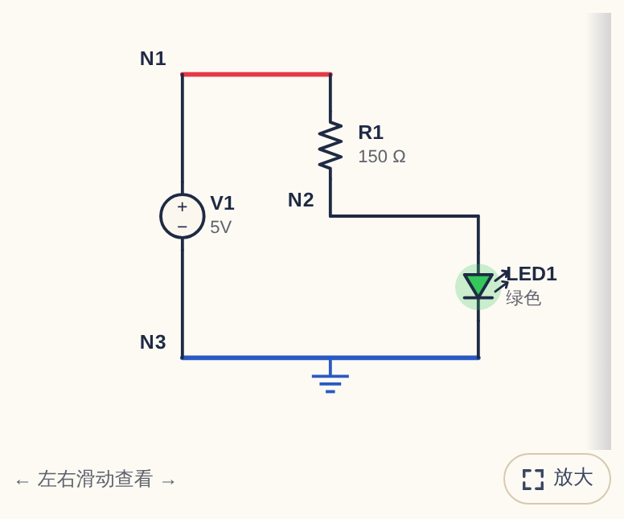
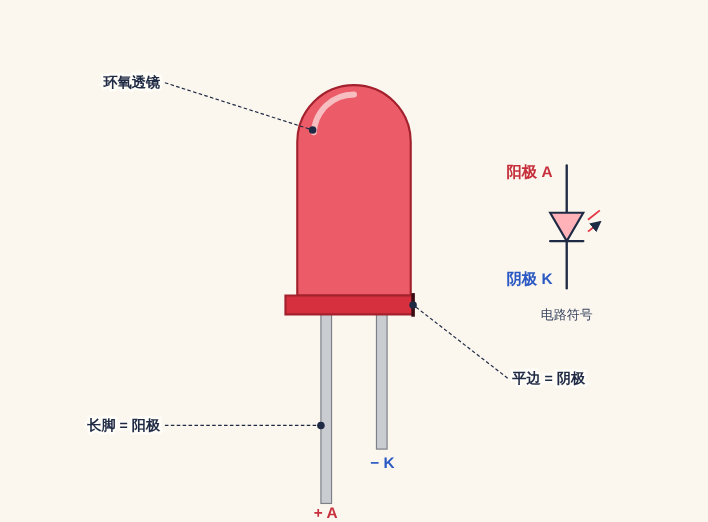
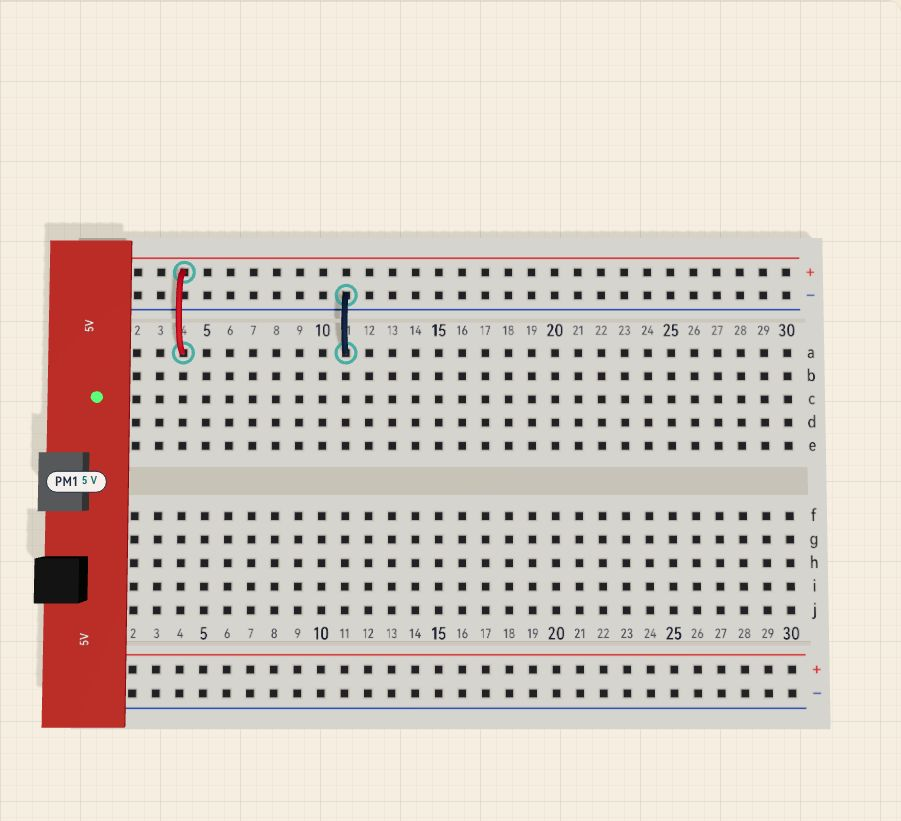
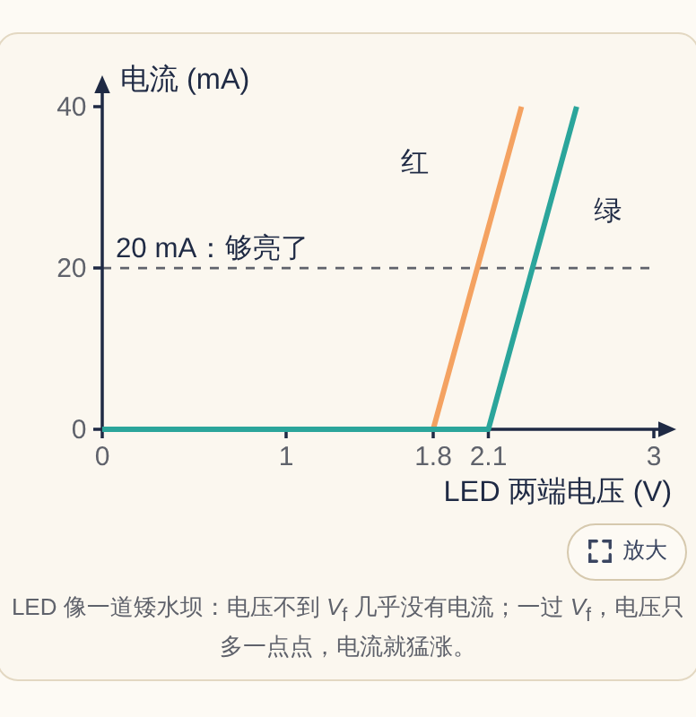
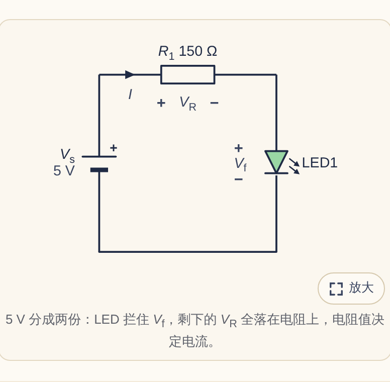

# 1.3 · LED：为什么一定要限流电阻

| 项目 | 内容 |
|---|---|
| id | `lesson-light-an-led` |
| 文件 | `challenges/03-light-an-led.json` |
| 类型 | 课程（有分步，每步自动检查） · 难度 1/5 |
| 位置 | World 1 · 基础定律与直流分压 → 1.3 LED：为什么一定要限流电阻（本节第 1 项） |
| 右侧面板 | 轨道由旧的四张卡片自动生成（还没手工精排） |
| 前后 | 上一项 [1.2 lesson-power-and-ground](../w1/1.02-1-lesson-power-and-ground.md) · 下一项 [1.4 lesson-multimeter](../w1/1.04-1-lesson-multimeter.md) |
| 先修 | — |
| 概念 | LED 发光二极管、forward voltage Vf 正向压降、current-limiting resistor 限流电阻、polarity 极性、series 串联 |

**一句话概要**：先不加电阻，让 LED 烧一次（反正是仿真）。再算出该用多大的电阻。

## 1. 左侧工作台（3D 面包板 → 2D 俯视截图）

截图是程序里真实的 3D 面包板换成俯视角拍的；表格是同一块板的文字版（元件、参数、每只脚插在哪个孔）。

### 1.1 起点：空面包板（学生从零开始搭）

### 1.2 每一步之后的面包板

见第 2 节每个步骤下面的截图（按步骤的自动检查重建：放 / 改 / 拔元件、移动万用表表笔）。

### 1.3 参考答案（「看答案」载入的板子）

| 元件 | 类型 | 参数 | 引脚 → 孔 |
|---|---|---|---|
| PM1 | power_module | voltage=5 | +t→tp1 -t→tn1 +b→bp1 -b→bn1 |
| W2 | wire |  | a→tp4 b→a4 |
| R1 | resistor | resistance=150 | 1→b4 2→b8 |
| LED1 | led | color=green | anode→c8 cathode→c11 |
| W5 | wire |  | a→a11 b→tn11 |

### 1.4 目标原理图（右侧「目标原理图」抽屉）

| 元件 | 类型 | 参数 |
|---|---|---|
| V1 | dc_source | voltage=5 |
| R1 | resistor | resistance=150 |
| LED1 | led | color=green |

连接（每个结点上的引脚）：

- **N1**：V1.+、R1.1
- **N2**：R1.2、LED1.anode
- **N3**：LED1.cathode、V1.-

## 2. 右侧面板：学生从上往下看到的内容（单轨流）

### 第 1 步 · 🔍 先看一眼：先认识它：LED 发光二极管

**拆解「LED：会发光的二极管」第 1 / 7 层：① 外形：长脚是阳极，平边是阴极**

一颗 5 mm 直插 LED：一个圆顶的 环氧树脂透镜 epoxy lens，底部一圈 凸缘 flange，下面两只脚。LED **有极性**（polarity），电流只能从一个方向流：
- 长脚 = **anode（阳极，A，+）**：接电源正极一侧；
- 短脚 = **cathode（阴极，K，−）**：接 GND 一侧；凸缘在这一侧被削出一个 平边 flat。

脚剪短以后看不出长短，就看平边；平边也磨掉了，就对着光看里面——大的那块金属是阴极（下一层）。

电路符号：三角形指向电流方向（A → K），竖线是阴极，两个小箭头表示“发出光”。和普通二极管符号只差这两个箭头——LED 就是一种二极管。

插反会怎样？没有电流，不亮。5 V 以内一般不会坏；但 LED 的反向耐压 $V_R$ 只有约 5 V，9 V 反接就超规格了。

| 脚 | 名字 | 怎么认 | 接哪 |
|---|---|---|---|
| 长脚 | anode 阳极 A（+） | 更长；里面是小的那根柱 | 电源 + 一侧（经过电阻） |
| 短脚 | cathode 阴极 K（−） | 平边一侧；里面是大的“砧座” | GND 一侧 |

### 第 2 步 · 🔧 动手搭：不加电阻，直接接

在真实世界里这一步会烧掉一颗 LED。这里是仿真，**放心烧**。
把 LED 直接接在 5 V 和 GND 之间，什么都不串，然后看右边的**诊断**。

**步骤 1**

选**「面包板电源模块」**，单击 **`tp1`**（保持 **5 V**）：它的四根针同时插进 tp1、tn1、bp1、bn1，上下两组轨道都有电了。

自动检查（做到这些才算完成）：把面包板电源模块插到 tp1–tn1–bp1–bn1
板上高亮的孔：tp1、tn1、bp1、bn1

**步骤 2**

两根**跳线**：红的 **`tp4`** → **`a4`**，蓝的 **`a11`** → **`tn11`**。第 4 列是 +5 V，第 11 列是 GND。

自动检查（做到这些才算完成）：把跳线插到 tp4–a4；把跳线插到 a11–tn11
板上高亮的孔：tp4、a4、a11、tn11

**步骤 3**

**绿色 LED**：长脚插 **`c4`**，短脚插 **`c11`**——直接跨在 5 V 和 GND 之间。看**诊断**：电流有多大？LED 怎么了？

自动检查（做到这些才算完成）：把LED 发光二极管插到 c4–c11
板上高亮的孔：c4、c11

### 第 3 步 · 💡 想明白：LED 是一道矮水坝

- LED 导通以后，两端电压几乎**固定**在它的正向压降 $V_f$：红 ≈ 1.8 V，黄 ≈ 2.0 V，**绿 ≈ 2.1 V**，蓝 / 白 ≈ 3.0 V。

*图 `iv`（plot）：LED 像一道矮水坝：电压不到 V_f 几乎没有电流；一过 V_f，电压只多一点点，电流就猛涨。*

- 电源有 5 V，LED 只“拦住”2.1 V。剩下的 2.9 V 没人拦，就全压在 LED 内部很小的电阻上——电流冲得很大，LED 烧了。
- 解决办法：**串一个电阻，让它替 LED 吃掉多出来的电压。** 串联时电流处处相同，所以：
$$R = \frac{V_s - V_f}{I}$$

*图 `budget`（schematic）：5 V 分成两份：LED 拦住 V_f，剩下的 V_R 全落在电阻上，电阻值决定电流。*

想要大约 20 mA：$R = \frac{5 - 2.1}{0.02} = 145$ Ω，取最接近的常用值 **150 Ω**。

（这一步下面列着这节课的计算卡片，点开就地展开：`ohm`、`led-resistor`、`led-current`，全文见第 6 节）

### 第 4 步 · 🔧 动手搭：加上电阻，重新搭

拔掉烧掉的 LED，在 +5 V 和 LED 之间串一个 150 Ω。

**步骤 4**

选中这颗 LED，按 **Delete** 删掉。

自动检查（做到这些才算完成）：清空这些孔：c4、c11
板上高亮的孔：c4、c11

**步骤 5**

**电阻**插 **`b4`**–**`b8`**，在**「属性」**里设成 **`150 Ω`**。电阻没有正负，哪只脚在前都行。

自动检查（做到这些才算完成）：把电阻插到 b4–b8
板上高亮的孔：b4、b8

**步骤 6**

新的**绿色 LED**：长脚插 **`c8`**（接电阻），短脚插 **`c11`**（接 GND）。长脚要朝向 + 那一侧！

自动检查（做到这些才算完成）：把LED 发光二极管插到 c8–c11
板上高亮的孔：c8、c11

**步骤 7**

LED 亮了，诊断也不报警了。点**「检查我的电路」**，然后**单击选中 LED**：右边「属性」里会显示流过它的电流。

### 第 5 步 · 📏 测一测：测一测：读你自己的仪表

**测量题 1 · `iled`**（读数题）

> 先预测，再看：选中 LED，「属性」里显示的电流是多少？

- 单位 mA · 先写预测 · 参考答案的读数 **17.89 mA** · 合理范围 [0.0165, 0.0195]

答对后显示：

> 粗算 (5 − 2.1) / 150 ≈ 19 mA；把 LED 里那 12 Ω 也算进去，(5 − 2.1) / (150 + 12) ≈ 17.9 mA。差 1 mA 左右，挑电阻时用粗算就够了。

**测量题 2 · `bigger`**（选择题）

> 把 150 Ω 换成 330 Ω，LED 会？

- A. 更亮
- B. 更暗：电阻大了，电流大约只剩一半 ✅（正确）
- C. 不变：LED 的电压是固定的

答对后显示：

> 电阻上的电压还是约 2.9 V，电阻变成两倍多，电流就变成不到一半，LED 变暗，但仍然亮。

**测量题 3 · `reverse`**（选择题）

> 如果在这个 5 V 电路里把 LED 插反，会怎样？

- A. 不亮，一般也不会坏 ✅（正确）
- B. 烧掉
- C. 照样亮

答对后显示：

> LED 只让电流从长脚流向短脚。反向时几乎没有电流；5 V 也还没有超过常见 LED 约 5 V 的反向耐压。

### 第 6 步 · 🎒 带走：带走

- **长脚是正极**（接 + 那边），短脚（灯头上有一个小平面的那边）是负极。插反了不亮。
- 5 V 下插反一般不会坏；但常见 LED 只能承受约 5 V 的**反向**电压，9 V、12 V 电路里插反就可能击穿。
- 一般 LED **5–20 mA** 就够亮，不要超过 25 mA。电阻放在 LED 前面还是后面都行：串联电路里电流处处相同。
- 粗算和实测差一点很正常：LED 的电压会随电流略微升高（本模拟器把它当成 $V_f$ 再加一个约 12 Ω 的小电阻）。

趁热练理论题：`basics`

## 3. 测量题一览

| # | id | 题目 | 类型 | 单位 | 状态 | 参考读数 |
|---|---|---|---|---|---|---|
| 1 | iled | 先预测，再看：选中 LED，「属性」里显示的电流是多少？ | current | mA |  | 17.89 mA |
| 2 | bigger | 把 150 Ω 换成 330 Ω，LED 会？ | 选择 |  |  | 正确：B |
| 3 | reverse | 如果在这个 5 V 电路里把 LED 插反，会怎样？ | 选择 |  |  | 正确：A |

### 提示按钮（依次显示）

1. LED 不亮？先看是不是插反了：长脚接电阻（+ 那侧），短脚接 GND。
2. R = (V − Vf) / I。绿色 LED 的 Vf 约 2.1 V。

### 功能测试（「检查我的电路」时跑）

- LED 亮，电阻上的电压合理

## 4. 用到的拆解（全部层的文字，供改写参考）

### 拆解 `led`：LED：会发光的二极管

*LED = Light-Emitting Diode（发光二极管）。从长短脚和平边，到环氧透镜里的反光杯和一粒小芯片，再到 PN 结里电子和空穴复合发光；最后用 I–V 曲线和 “Vf + 12 Ω” 模型推出限流电阻怎么选、为什么并联的 LED 要各配一个电阻。*

**拆解「LED：会发光的二极管」第 1 / 7 层：① 外形：长脚是阳极，平边是阴极**

一颗 5 mm 直插 LED：一个圆顶的 环氧树脂透镜 epoxy lens，底部一圈 凸缘 flange，下面两只脚。LED **有极性**（polarity），电流只能从一个方向流：
- 长脚 = **anode（阳极，A，+）**：接电源正极一侧；
- 短脚 = **cathode（阴极，K，−）**：接 GND 一侧；凸缘在这一侧被削出一个 平边 flat。

脚剪短以后看不出长短，就看平边；平边也磨掉了，就对着光看里面——大的那块金属是阴极（下一层）。

电路符号：三角形指向电流方向（A → K），竖线是阴极，两个小箭头表示“发出光”。和普通二极管符号只差这两个箭头——LED 就是一种二极管。

插反会怎样？没有电流，不亮。5 V 以内一般不会坏；但 LED 的反向耐压 $V_R$ 只有约 5 V，9 V 反接就超规格了。

| 脚 | 名字 | 怎么认 | 接哪 |
|---|---|---|---|
| 长脚 | anode 阳极 A（+） | 更长；里面是小的那根柱 | 电源 + 一侧（经过电阻） |
| 短脚 | cathode 阴极 K（−） | 平边一侧；里面是大的“砧座” | GND 一侧 |

**拆解「LED：会发光的二极管」第 2 / 7 层：② X 光：砧座、反光杯、一粒芯片、一根金线**

把环氧变透明，里面是一个精巧的小结构：
1. 砧座 anvil：阴极脚在里面变成一大块金属，顶上冲出一个 反光杯 reflector cup。
2. 芯片 die：一粒约 0.25 mm 见方的半导体晶片，粘在杯底，真正发光的就是它。它的底面通过杯子接阴极。
3. 金线 bond wire：比头发还细（约 25 µm），从芯片顶面连到 阳极柱 post。
4. 环氧透镜：既是外壳，也是透镜：圆顶把芯片发出的光收拢成一个 向上的光束（5 mm LED 常见视角 20–30°）。反光杯把往侧面跑的光也反射上去。

电流的路径：阳极脚 → 阳极柱 → 金线 → 芯片（从上往下穿过它）→ 反光杯 → 阴极脚。所以芯片里 **从上到下** 是一个 PN 结，下一层把它放大。

**拆解「LED：会发光的二极管」第 3 / 7 层：③ 芯片里：电子掉进空穴，放出光子**

芯片由两种 **doped（掺杂）** 半导体拼成：
- p 区（接阳极）：掺了缺电子的杂质，里面有很多可以移动的 **hole（空穴）**——“少了一个电子的位置”，相当于一个 + 电荷；
- n 区（接阴极）：掺了多电子的杂质，有很多可以移动的 **electron（电子）**。

两区交界叫 **PN junction（PN 结）**。加正向电压（阳极 +、阴极 −）时，空穴 被推向右、电子 被推向左，在结上相遇：电子 **掉进** 空穴，这叫 **recombination（复合）**。电子掉下的能量差 $E_g$（**band gap 禁带宽度**）以一个 **photon（光子）** 的形式放出——这就是光。

光的颜色由 禁带宽度 决定：
$$λ = \frac{hc}{E_g} ≈ \frac{1240}{E_g [eV]} nm$$
红光 AlGaInP 约 1.9 eV → 650 nm；蓝光 InGaN 约 2.7 eV → 460 nm。

**为什么不同颜色的 $V_F$ 不同**：要让电子“爬上”能跳下 $E_g$ 的高度，每个电子至少要被电源推 $E_g / q$ 伏。所以 $V_F ≈ E_g / q$：红 ≈ 1.8–2 V，蓝 ≈ 3 V。颜色越偏蓝，光子能量越大，需要的电压越高。白光 LED = 蓝光芯片 + 黄色荧光粉（phosphor），所以 $V_F$ 和蓝光一样 ≈ 3 V。

| 颜色 | 材料 | 波长 | $V_F$（仿真器） |
|---|---|---|---|
| 红 | AlGaInP | ≈ 630–650 nm | 1.8 V |
| 黄 | AlGaInP | ≈ 590 nm | 2.0 V |
| 绿 | InGaN / GaP | ≈ 525–570 nm | 2.1 V |
| 蓝 | InGaN | ≈ 460 nm | 3.0 V |
| 白 | 蓝芯片 + 荧光粉 | 宽谱 | 3.0 V |

- 公式 `V_F ≈ \frac{E_g}{q}, λ ≈ \frac{1240}{E_g [eV]} nm`：越蓝的光，$E_g$ 越大，$V_F$ 越高

**拆解「LED：会发光的二极管」第 4 / 7 层：④ I–V 曲线：一个膝点，然后几乎竖直**

把电压从 0 慢慢加上去，测电流，得到 LED 的 **I–V 特性曲线**。它和电阻的直线完全不同：
- 膝点以下：电子爬不过 PN 结的势垒，电流几乎是 0，**不亮**；
- 到了 膝点（knee） 附近的 **forward voltage（正向压降）$V_F$**，电流开始指数增长：电压每多 0.1 V，电流约翻 7 倍；
- 膝点以上曲线 **几乎竖直**：电压只要多零点几伏，电流就从几 mA 冲到几百 mA。

红色 的膝点在约 1.8–2 V，蓝色 的在约 3 V，见上面的 色表。

**这条曲线解释了为什么 LED 不能直接接电源**：竖直的那段意味着“电压几乎不变，电流可以任意大”。LED 自己不会限制电流，必须由外面的电阻来定（第 ⑥ 层）。

反向：电流几乎为 0（nA 级），直到大约 −5 V 被击穿。

规格书上的关键数字：最大连续电流 $I_F$ ≈ 20–25 mA，反向耐压 $V_R$ ≈ 5 V。亮度大致 **和电流成正比**，5–15 mA 就足够亮。

| 参数 | 典型值（5 mm） | 超过会怎样 |
|---|---|---|
| 正向压降 $V_F$ | 红 1.8–2 V，蓝/白 ≈ 3 V | （不是极限，是工作点） |
| 连续电流 $I_F$ | 20–25 mA | 发热、变暗、寿命骤减 |
| 反向电压 $V_R$ | ≈ 5 V | 反向击穿 |

- 公式 `I ≈ I_s·e^{V/(n V_T)}`：膝点附近：指数增长（$V_T$ = 26 mV，LED 的 n ≈ 2）

**拆解「LED：会发光的二极管」第 5 / 7 层：⑤ 模型：一个开关 + Vf + 12 Ω**

指数曲线不好手算。工程上用 **piecewise linear（分段线性）** 模型把它换成两段直线（图里的黑线）：
- V < $V_F$：理想开关 断开，I = 0；
- V ≥ $V_F$：开关闭合，LED = 一个 电压源 $V_F$ 串一个 小电阻 12 Ω：
$$I = \frac{V - V_F}{12 Ω}$$

本仿真器就是这样算的（红 1.8 V、黄 2.0 V、绿 2.1 V、蓝 / 白 3.0 V，都串 12 Ω）。

**带数字**：红 LED 两端 2.0 V 时，$I = \frac{2.0 - 1.8}{12} = 16.7 mA$；两端 2.1 V 时已经 25 mA。0.1 V 之差，电流差一半——这就是“几乎竖直”。

**直接接 9 V 电池会怎样**（9 V 电池内阻约 1.5 Ω）：
$$I = \frac{9 - 1.8}{1.5 + 12} ≈ 533 mA$$
是额定值的 25 倍。仿真器里 LED 平均电流超过 30 mA 会警告，超过 60 mA（或峰值 150 mA）就烧坏；真实的 LED 一闪就灭了。

|  | 真实 LED | 仿真器模型 |
|---|---|---|
| 膝点以下 | 指数，极小电流 | 0（开关断开） |
| 膝点以上 | 指数 + 体电阻 | (V − $V_F$) / 12 Ω |
| 温度 | $V_F$ 约 −2 mV/°C | 不考虑 |
| 反向击穿 | ≈ −5 V | 没有（只提示反接） |

- 公式 `I = \frac{V - V_F}{12 Ω}  (V ≥ V_F)`：红：$V_F$ = 1.8 V；蓝：3.0 V

**拆解「LED：会发光的二极管」第 6 / 7 层：⑥ 限流电阻：用 KVL 推出来**

第 1 课的电路：9 V 电池 → 470 Ω → 红 LED → 回到电池。沿回路写 **KVL（基尔霍夫电压定律）**——电源电压 = 各元件压降之和：
$$V_s = I·r_{bat} + I·R + V_F + I·12 Ω$$
解出电流：
$$I = \frac{V_s - V_F}{r_{bat} + R + 12} = \frac{9 - 1.8}{1.5 + 470 + 12} = \frac{7.2}{483.5} ≈ 14.9 mA$$
- 电阻上：$V_R = 14.9 mA × 470 Ω ≈ 7.0 V$；
- LED 上：$1.8 + 14.9 mA × 12 Ω ≈ 1.98 V$；
- 电池内阻上：$≈ 0.02 V$。加起来 9 V ✔。

**设计时反过来用**（忽略 12 Ω 和内阻就够了）：
$$R = \frac{V_s - V_F}{I}$$
9 V、红 LED、15 mA：$R = \frac{9 - 1.8}{0.015} = 480 Ω$ → 选标准值 470 Ω。

**图解：负载线（load line）**。电阻和电池这一侧要求 $I = \frac{9 - V}{471.5 Ω}$，是一条 斜直线；LED 要求 I 落在 它的曲线 上。两者同时满足的点就是 工作点。电阻越大，负载线越平，交点电流越小。

| 电路 | 计算 | I |
|---|---|---|
| 第 1 课：9 V、470 Ω、红 | (9 − 1.8) / (1.5 + 470 + 12) | 14.9 mA |
| 第 3 课：5 V、150 Ω、绿 | (5 − 2.1) / (150 + 12) | 17.9 mA |
| 蓝 LED：5 V、100 Ω | (5 − 3.0) / (100 + 12) | 17.9 mA |
| 两颗串联：9 V、220 Ω、红 + 绿 | (9 − 1.8 − 2.1) / (220 + 24) | 20.9 mA |
| 纽扣电池：3 V、47 Ω、红 | (3 − 1.8) / (15 + 47 + 12) | 16 mA |

- 公式 `R = \frac{V_s - V_F}{I}`：设计用：选稍大的标准值
- 公式 `I = \frac{V_s - V_F}{r_{bat} + R + 12 Ω}`：校核用：仿真器算出的电流

**拆解「LED：会发光的二极管」第 7 / 7 层：⑦ 为什么并联的 LED 要各配一个电阻**

想省一个电阻：5 V → 一个 150 Ω → 红、绿两颗 LED 并联 → GND。会怎样？

并联的两颗 LED 两端电压 **必须相同**。设只有红灯导通：
$$I = \frac{5 - 1.8}{150 + 12} = 19.8 mA,   V_{node} = 1.8 + 0.0198 × 12 = 2.04 V$$
结点电压 2.04 V 比绿灯的 $V_F = 2.1 V$ 还低，绿灯 **根本到不了膝点**：电流 0，不亮。$V_F$ 最低的那颗把电压“钳住”，所有电流都挤进它——两颗同色的 LED 也一样，$V_F$ 差几十 mV（生产误差），电流就会差一倍以上，而且越热 $V_F$ 越低、电流越大（**thermal runaway 热失控**）。

正确做法（第 6 课）：每颗 LED 串自己的电阻，再把这些“电阻 + LED”支路并联。每条支路自己用 KVL：
- 红：$\frac{5 - 1.8}{150 + 12} = 19.8 mA$
- 绿：$\frac{5 - 2.1}{150 + 12} = 17.9 mA$

电阻上的压降（约 3 V）远大于 $V_F$ 的差异（零点几伏），所以每条支路的电流 **由自己的电阻决定**，两颗都亮，互不干扰。

**串联** 就没有这个问题：串联电流处处相等，只要电源电压够（9 V > 1.8 + 2.1 V），一个电阻就够了。

- 公式 `I_k = \frac{V_s - V_{F,k}}{R_k + 12 Ω}`：每条支路各算各的

**一句话记住**：LED = 环氧透镜里的一粒 PN 结芯片：电子掉进空穴放出光子，颜色由禁带宽度决定，**$V_F$ ≈ $E_g$/q**（红 ≈ 1.8–2 V，蓝 ≈ 3 V）。I–V 曲线在 $V_F$ 之后几乎竖直，所以 LED 必须串电阻：$R = \frac{V_s - V_F}{I}$。仿真器把它当成“开关 + $V_F$ + 12 Ω”。并联 LED 要各配一个电阻。

## 5. 这一课的计算卡片

**计算卡片 `ohm`：欧姆定律 Ohm’s law**

- 公式 `I = \frac{V}{R}`
- 用途：知道电阻两端的电压，求流过它的电流（或反过来）。
- 输入：V（电阻两端电压，V）；R（电阻，Ω） → I（电流，A）

电阻的定义就是“电压和电流成正比”：$V = IR$。比例系数 R 越大，同样的电压推出的电流越小。
- **关联参考方向**（电流从标“+”的一端流进）时 $V = IR$；非关联时 $V = -IR$。
- 只对 **一个电阻** 用：V 必须是 **这个电阻两端** 的电压，不是电源电压（除非电阻直接接在电源上）。

例子：9 V 直接接 1 kΩ：$I = \frac{9}{1000} = 9 mA$。

- ⚠ 单位：kΩ 和 mA 搭配，V / kΩ = mA，最不容易错。
- ⚠ 电源电压 ≠ 某个电阻两端的电压（串联时要先分压）。

**计算卡片 `led-resistor`：LED 限流电阻 LED series resistor**

- 公式 `R = \frac{V_s - V_F{I_F}`
- 用途：给 LED 选串联电阻，让它亮又不烧。
- 输入：Vs（电源电压，V）；VF（LED 正向压降 V_F（红 ≈ 2 V，蓝/白 ≈ 3 V），V）；IF（想要的电流（5–15 mA），A） → R（串联电阻，Ω）

LED 不是电阻：一旦导通，它两端的电压几乎固定在 $V_F$，电流却可以变得很大。所以必须串一个电阻来 **定电流**：
1. KVL：$V_s = V_R + V_F$，所以电阻上的电压 $V_R = V_s - V_F$
2. 欧姆定律：$I_F = \frac{V_R{R}$
3. 解出 $R = \frac{V_s - V_F{I_F}$，再选一个 **稍大** 的标准值（E12：330、470、680、1 k …）

例子：9 V、红 LED、15 mA：$R = \frac{9 - 2}{0.015} ≈ 467 Ω$ → 选 470 Ω（第 1 课）。

- ⚠ 忘了减 V_F：用 $\frac{V_s{I}$ 会得到偏大的电阻（不危险，只是暗）。
- ⚠ 不串电阻直接接电池：电流只受内阻限制，LED 立刻烧掉。

**计算卡片 `led-current`：LED 回路的电流 LED loop current**

- 公式 `I = \frac{V_s - ΣV_F}{R + Σr_d + R_{int}}`
- 用途：电源、电阻和一个或几个串联 LED：LED 实际流过多少电流。
- 输入：V_s（电源电动势，V）；V_F（所有 LED 的 V_F 之和（红 1.8、绿 2.1、蓝/白 3.0），V）；R（串联电阻（含电位器），Ω）；r_d（LED 内阻之和（每个 ≈ 12 Ω），Ω）；R_int（电源内阻（模块 ≈ 0、9 V 电池 1.5 Ω、纽扣电池 15 Ω），Ω） → I（回路电流（不够 ΣV_F 时为 0），A）

1. 导通的 LED 用折线模型看：一个电压源 $V_F$ 串一个小电阻 $r_d ≈ 12 Ω$（模拟器就是这样建模的）。
2. 整个回路串联，处处是同一个电流 I。
3. KVL：$V_s = I R_{int} + I R + ΣV_F + I Σr_d$。
4. 解出 $I = \frac{V_s - ΣV_F}{R + Σr_d + R_{int}}$。
5. 如果 $V_s < ΣV_F$，LED 根本不导通，I = 0：3 V 点不亮串联的红 + 绿 LED（需要 3.9 V）。
只用 $\frac{V_s - V_F}{R}$ 估算会偏大 1–2 mA，选电阻时够用；要和读数对比时把 $r_d$ 和内阻加上。

例子：- 挑战 1：9 V、220 Ω、红 + 绿：$I = \frac{9 - 3.9}{220 + 24} ≈ 21 mA$（只用 $V_F$ 估算是 23 mA）。
- 第 3 课：5 V、150 Ω、绿：$\frac{5 - 2.1}{150 + 12} ≈ 18 mA$，电阻上 $18 mA × 150 Ω ≈ 2.7 V$。
- 挑战 9：CR2032（3 V、15 Ω）、47 Ω、红：$\frac{3 - 1.8}{47 + 12 + 15} ≈ 16 mA$；不串电阻是 $\frac{1.2}{27} ≈ 44 mA$。
- 挑战 3：电位器转到 100 %：$\frac{5 - 1.8}{220 + 10k + 12} ≈ 0.31 mA$，灯灭。

- ⚠ 两个 LED 直接并联共用一个电阻：$V_F$ 小的先导通、把电压钳住，另一个几乎不亮——每个 LED 自己串一个电阻。
- ⚠ 电位器当可变电阻用时，它的阻值也在 R 里；转到 0 时只剩保护电阻。

## 6. English（界面英文版的同一份内容）

展开英文

### Node 1 · 🔍 Look first：Meet it first: LED

**Teardown「The LED: a diode that glows」layer 1 of 7：① Outside: long leg = anode, flat edge = cathode**

A 5 mm through-hole LED: a domed epoxy lens, a flange round the bottom, two legs. An LED **has polarity**: current can only flow one way:
- the long leg = **anode (A, +)**: towards the supply’s + side;
- the short leg = **cathode (K, −)**: towards GND; the flange has a flat edge on this side.

Once the legs are trimmed, use the flat; if that is worn away, look inside against the light — the bigger piece of metal is the cathode (next layer).

The symbol: the triangle points the way current flows (A → K), the bar is the cathode, and two little arrows mean "emits light". It differs from a plain diode only by those arrows — an LED is a diode.

Plugged in backwards? No current, no light. Up to 5 V it is usually fine, but an LED’s reverse rating $V_R$ is only about 5 V, so 9 V backwards is out of spec.

| Leg | Name | How to tell | Goes to |
|---|---|---|---|
| long | anode A (+) | longer; the small post inside | the + side (via the resistor) |
| short | cathode K (−) | flat side; the big anvil inside | the GND side |

### Node 2 · 🔧 Build：Straight across, no resistor

In the real world this step costs you an LED. Here it's a simulation — **go ahead and burn it**.
Put an LED straight between 5 V and GND with nothing in series, then watch the **diagnostics** on the right.

**Step 1**

Pick **Breadboard power module** and click **`tp1`** (keep **5 V**): its four pins go into tp1, tn1, bp1 and bn1, so both pairs of rails are powered.

Checked automatically：Place the Breadboard power module at tp1–tn1–bp1–bn1
Holes highlighted：tp1、tn1、bp1、bn1

**Step 2**

Two **jumpers**: red **`tp4`** → **`a4`**, blue **`a11`** → **`tn11`**. Column 4 is +5 V and column 11 is GND.

Checked automatically：Place the Jumper wire at tp4–a4；Place the Jumper wire at a11–tn11
Holes highlighted：tp4、a4、a11、tn11

**Step 3**

**Green LED**: long lead in **`c4`**, short lead in **`c11`** — straight across 5 V and GND. Look at the **diagnostics**: how big is the current? What happened to the LED?

Checked automatically：Place the LED at c4–c11
Holes highlighted：c4、c11

### Node 3 · 💡 Why：An LED is a low dam

- Once an LED conducts, the voltage across it stays almost **fixed** at its forward voltage $V_f$: red ≈ 1.8 V, yellow ≈ 2.0 V, **green ≈ 2.1 V**, blue / white ≈ 3.0 V.

[figure `iv`]

*Figure `iv`（plot）：LED 像一道矮水坝：电压不到 V_f 几乎没有电流；一过 V_f，电压只多一点点，电流就猛涨。*

- The supply has 5 V and the LED only "holds back" 2.1 V. The other 2.9 V has nothing to stop it, so it all lands on the tiny resistance inside the LED — a huge current, and the LED is gone.
- The fix: **put a resistor in series and let it take the extra voltage.** In series the current is the same everywhere, so:
$$R = \frac{V_s - V_f}{I}$$

[figure `budget`]

*Figure `budget`（schematic）：5 V 分成两份：LED 拦住 V_f，剩下的 V_R 全落在电阻上，电阻值决定电流。*

For about 20 mA: $R = \frac{5 - 2.1}{0.02} = 145$ Ω; take the nearest standard value, **150 Ω**.

(This node lists the lesson’s calculation cards: `ohm`、`led-resistor`、`led-current`; full text in section 6)

### Node 4 · 🔧 Build：Add the resistor and rebuild

Remove the burned LED and put 150 Ω in series between +5 V and the LED.

**Step 4**

Click this LED and press **Delete**.

Checked automatically：holes empty again: c4, c11
Holes highlighted：c4、c11

**Step 5**

**Resistor** in **`b4`**–**`b8`**, set to **`150 Ω`** in **Properties**. A resistor has no polarity; either lead can go first.

Checked automatically：Place the Resistor at b4–b8
Holes highlighted：b4、b8

**Step 6**

A new **green LED**: long lead in **`c8`** (to the resistor), short lead in **`c11`** (to GND). The long lead faces the + side!

Checked automatically：Place the LED at c8–c11
Holes highlighted：c8、c11

**Step 7**

The LED is lit and the diagnostics are quiet. Press **Check my circuit**, then **click the LED**: Properties on the right show the current through it.

### Node 5 · 📏 Measure：Measure: read your own instruments

**Question 1 · `iled`**（reading）

> Predict first, then look: click the LED — what current do Properties show?

- unit mA · predict first · range [0.0165, 0.0195]

Shown once right:

> Rough estimate: (5 − 2.1) / 150 ≈ 19 mA; counting the LED's own 12 Ω, (5 − 2.1) / (150 + 12) ≈ 17.9 mA. About 1 mA apart — the rough estimate is good enough for picking a resistor.

**Question 2 · `bigger`**（multiple choice）

> Swap the 150 Ω for 330 Ω. The LED will be:

- A. Brighter
- B. Dimmer: a bigger resistor leaves roughly half the current ✅ (right)
- C. The same: the LED voltage is fixed

Shown once right:

> The resistor still takes about 2.9 V; with more than twice the resistance the current drops to under half — dimmer, but still lit.

**Question 3 · `reverse`**（multiple choice）

> What happens if you plug the LED in backwards in this 5 V circuit?

- A. It stays dark and is usually fine ✅ (right)
- B. It burns out
- C. It lights anyway

Shown once right:

> An LED only lets current flow from the long lead to the short one. Reversed, almost no current flows, and 5 V doesn't exceed a common LED's reverse rating of about 5 V.

### Node 6 · 🎒 Take away：Take away

- **The long lead is the anode** (towards +); the short lead, on the side where the LED body has a small flat, is the cathode. Reversed, it stays dark.
- At 5 V a reversed LED usually survives; but common LEDs only take about 5 V in **reverse**, so in a 9 V or 12 V circuit a reversed LED can break down.
- **5–20 mA** is bright enough for most LEDs; stay under 25 mA. The resistor can go before or after the LED: in series the current is the same everywhere.
- A small gap between the estimate and the reading is normal: an LED's voltage rises a little with current (this simulator models it as $V_f$ plus a small resistance of about 12 Ω).

Practise：`basics`

**Hints**

1. LED dark? First check its direction: long lead to the resistor (the + side), short lead to GND.
2. R = (V − Vf) / I. A green LED has Vf ≈ 2.1 V.

