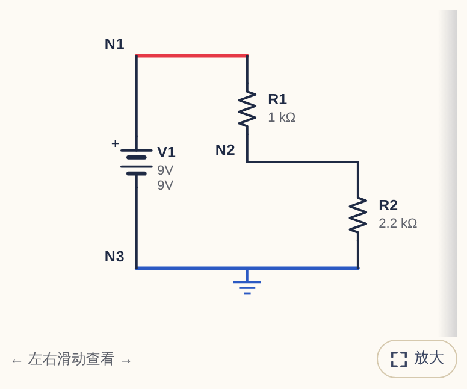
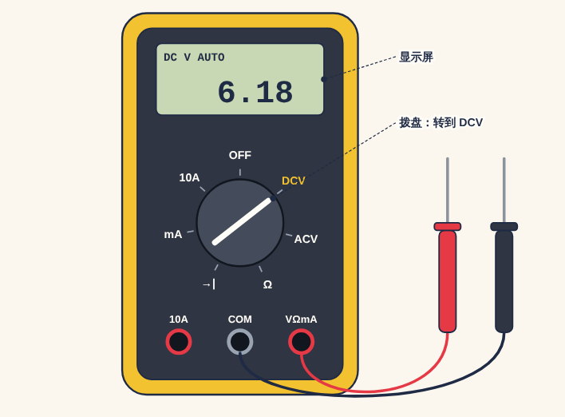
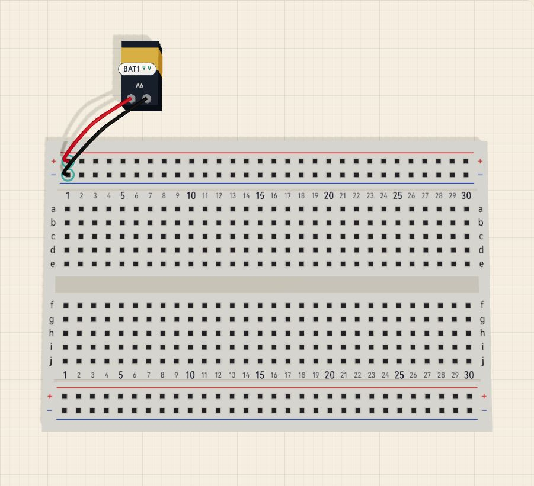
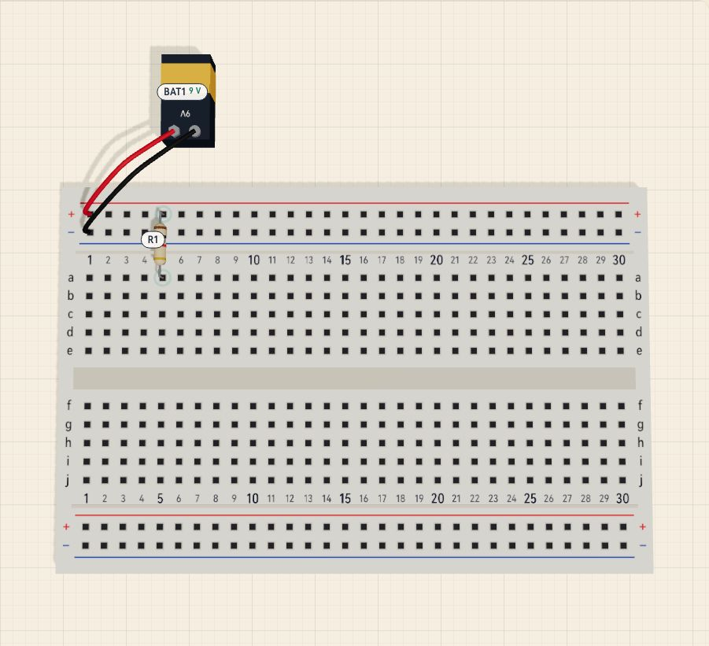
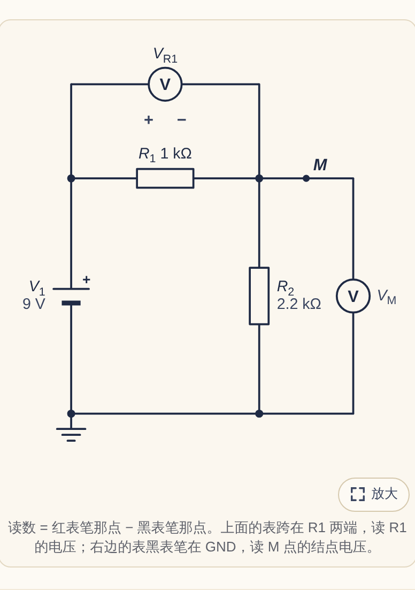
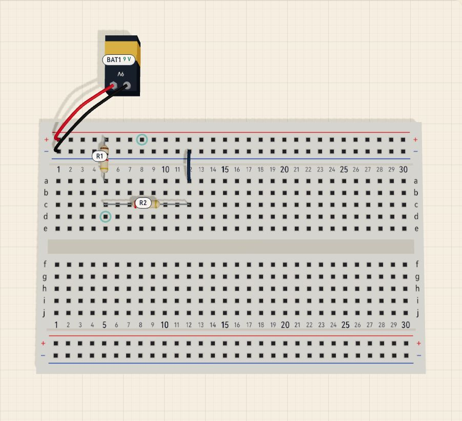

# 1.4 · 万用表：看见电压

| 项目 | 内容 |
|---|---|
| id | `lesson-multimeter` |
| 文件 | `challenges/101-lesson-multimeter.json` |
| 类型 | 课程（有分步，每步自动检查） · 难度 2/5 |
| 位置 | World 1 · 基础定律与直流分压 → 1.4 万用表：看见电压（本节第 1 项） |
| 右侧面板 | 轨道由旧的四张卡片自动生成（还没手工精排） |
| 前后 | 上一项 [1.3 lesson-light-an-led](../w1/1.03-1-lesson-light-an-led.md) · 下一项 [1.4 challenge-voltage-divider](../w1/1.04-2-challenge-voltage-divider.md) |
| 先修 | — |
| 概念 | multimeter 万用表、voltage 电压、node voltage 结点电压、reference direction 参考方向、floating 悬空 |

**一句话概要**：从这一课起，电压不再是看不见的：两支表笔放哪里，读数就是哪两点的差。

## 1. 左侧工作台（3D 面包板 → 2D 俯视截图）

截图是程序里真实的 3D 面包板换成俯视角拍的；表格是同一块板的文字版（元件、参数、每只脚插在哪个孔）。

### 1.1 起点：空面包板（学生从零开始搭）

### 1.2 每一步之后的面包板

见第 2 节每个步骤下面的截图（按步骤的自动检查重建：放 / 改 / 拔元件、移动万用表表笔）。

### 1.3 参考答案（「看答案」载入的板子）

| 元件 | 类型 | 参数 | 引脚 → 孔 |
|---|---|---|---|
| BAT1 | battery | variant=9V | +→tp1 -→tn1 |
| R1 | resistor | resistance=1000 | 1→tp5 2→a5 |
| R2 | resistor | resistance=2200 | 1→c5 2→c12 |
| W4 | wire |  | a→a12 b→tn12 |

### 1.4 目标原理图（右侧「目标原理图」抽屉）

| 元件 | 类型 | 参数 |
|---|---|---|
| V1 | battery | variant=9V |
| R1 | resistor | resistance=1000 |
| R2 | resistor | resistance=2200 |

连接（每个结点上的引脚）：

- **N1**：V1.+、R1.1
- **N2**：R1.2、R2.1
- **N3**：R2.2、V1.-

## 2. 右侧面板：学生从上往下看到的内容（单轨流）

### 第 1 步 · 🔍 先看一眼：先认识它：万用表（电压档）

**拆解「万用表（电压档）：一个 10 MΩ 的“探针”」第 1 / 7 层：① 面板：一个屏幕、一个拨盘、三个插孔、两支表笔**

拿起一块数字万用表（digital multimeter, DMM），从上往下只有四样东西：
- 显示屏（LCD）：数字 + 单位 + 模式（DC / AC、量程）；
- 拨盘（rotary switch）：选“量什么”。它其实是一个多刀多掷的机械开关，转到不同位置，里面接通的是不同的电阻和电路；
- 三个插孔（jack）：下一层细讲；
- 两支 红表笔 / 黑表笔（probe）：金属针尖碰到哪里，就是在量哪一点。

**量电压** 把拨盘转到 DCV（直流电压，DC = direct current）。下表是拨盘上每个位置的意思。注意：同一块表、同两支表笔，**拨盘的位置决定了表笔之间接的是什么**——在电压档表笔之间是 10 MΩ，在电流档表笔之间是不到 1 Ω。拨错档是烧表最常见的原因。

| 拨盘位置 | 量什么 | 表笔之间是什么 | 怎么接 |
|---|---|---|---|
| OFF | 关机 | — | — |
| DCV | 直流电压 | 10 MΩ（很大） | **并联**在两点上 |
| ACV | 交流电压有效值（RMS） | ≈ 10 MΩ + 整流 / 有效值电路 | 并联 |
| Ω | 电阻 | 表内的小电流源 | 元件 **断电**，并在两端 |
| →\| | 二极管压降 / 通断蜂鸣 | ≈ 1 mA 电流源 | 红接阳极（anode） |
| mA | 小电流 ≤ 200 mA | ≈ 1 Ω 分流电阻 + 保险丝 | **串联**（见“电流表”） |
| 10A | 大电流 ≤ 10 A | 0.01 Ω 分流电阻 | 串联，红表笔换到 10A 孔 |

### 第 2 步 · 🔧 动手搭：先量一个电池

搭一个两电阻的小电路，然后把万用表的红表笔点到 **+ 轨**上。
右上角的万用表屏幕会显示一个数。它在量什么？

**步骤 1**

选**「电池」**（9 V）：**`tp1`** 放红线（+），**`tn1`** 放黑线（−）。

自动检查（做到这些才算完成）：把电池插到 tp1–tn1
板上高亮的孔：tp1、tn1

**步骤 2**

**电阻 R1**：**`tp5`** 和 **`a5`**，「属性」里设 **`1 kΩ`**。（写完属性点「课程」标签回到这里。）

自动检查（做到这些才算完成）：把电阻插到 tp5–a5
板上高亮的孔：tp5、a5

**步骤 3**

**电阻 R2**：**`c5`** 和 **`c12`**，设 **`2.2 kΩ`**。第 5 列就是**结点 M**：R1 和 R2 在这里相连。

自动检查（做到这些才算完成）：把电阻插到 c5–c12
板上高亮的孔：c5、c12、a5、b5、d5、e5

**步骤 4**

**跳线** **`a12`** → **`tn12`**：R2 的下端接到 GND，电流有了回路。

自动检查（做到这些才算完成）：把跳线插到 a12–tn12
板上高亮的孔：a12、tn12

**步骤 5**

选**「万用表」**，单击 **`tp10`** 放红表笔。黑表笔没放 = 在 GND。看右上角：这是 + 轨对 GND 的电压，也就是电池电压。

自动检查（做到这些才算完成）：万用表红表笔点 tp10（选“万用表”工具，单击孔）
板上高亮的孔：tp10

### 第 3 步 · 💡 想明白：电压是两点之间的

- 万用表有两支表笔。**读数 = 红表笔那点 − 黑表笔那点。**
- 只放红表笔时，黑表笔默认在 **GND**，读到的就是“这一点对 GND 的电压”，叫**结点电压**。
- 两支表笔放在一个元件两端，读到的就是**这个元件两端的电压**。

*图 `probes`（schematic）：读数 = 红表笔那点 − 黑表笔那点。上面的表跨在 R1 两端，读 R1 的电压；右边的表黑表笔在 GND，读 M 点的结点电压。*

- 红黑对调，读数只变符号：电压没变，变的是你选的参考方向。
- 表笔点在什么都没接的孔上，那一点**悬空**，没有确定的电压，屏幕显示“悬空”。

（这一步下面列着这节课的计算卡片，点开就地展开：`ohm`、`kvl`、`battery-terminal-voltage`、`voltmeter-loading`，全文见第 6 节）

### 第 4 步 · 🔧 动手搭：量三个电压

电路：9 V → R1（1 kΩ）→ 结点 M（第 5 列）→ R2（2.2 kΩ）→ GND。
先用分压公式 $V_M = 9 \times \frac{2.2}{1 + 2.2}$ 预测，再去量。下面的测量题会先让你写预测。

**步骤 6**

红表笔改点 **`d5`**（结点 M）。读数是 M 对 GND 的电压——先在下面的测量题里写预测再看。

自动检查（做到这些才算完成）：万用表红表笔点 d5（选“万用表”工具，单击孔）
板上高亮的孔：d5

**步骤 7**

量 R1 两端：红表笔点 **`tp8`**，按住 **Shift** 单击 **`e5`** 放黑表笔。现在读的是 + 轨减去 M。

自动检查（做到这些才算完成）：万用表红表笔点 tp8（选“万用表”工具，单击孔）；万用表黑表笔点 e5（Shift + 单击）
板上高亮的孔：tp8、e5

**步骤 8**

对调表笔：红表笔点 **`d5`**，**Shift** + 单击 **`tp8`** 放黑表笔。读数怎么变了？

自动检查（做到这些才算完成）：万用表红表笔点 d5（选“万用表”工具，单击孔）；万用表黑表笔点 tp8（Shift + 单击）
板上高亮的孔：d5、tp8

**步骤 9**

红表笔点 **`h20`**——那一列什么都没插。屏幕显示什么？

自动检查（做到这些才算完成）：万用表红表笔点 h20（选“万用表”工具，单击孔）
板上高亮的孔：h20

**步骤 10**

点**「检查我的电路」**，按测量题的说明放好表笔，把读数填进去。

### 第 5 步 · 📏 测一测：测一测：读你自己的仪表

**测量题 1 · `ubat`**（读数题）

> 红表笔点 + 轨（红线那条），黑表笔留在 GND：电池两端的电压

- 单位 V · 参考答案的读数 **8.996 V** · 合理范围 [8.9, 9.05]

答对后显示：

> 9V 电池有 1.5 Ω 内阻，2.8 mA 的电流只让端电压低 4 mV，所以几乎正好是 9 V。

**测量题 2 · `um`**（读数题）

> 红表笔点第 5 列（结点 M），黑表笔在 GND：M 对 GND 的电压

- 单位 V · 先写预测 · 参考答案的读数 **6.185 V** · 合理范围 [6, 6.4]

答对后显示：

> 分压：9 V × 2.2k / (1k + 2.2k) ≈ 6.18 V。

**测量题 3 · `ur1`**（读数题）

> 红表笔点 + 轨，黑表笔（Shift + 单击）点第 5 列：R1 两端的电压

- 单位 V · 先写预测 · 参考答案的读数 **2.811 V** · 合理范围 [2.7, 2.95]

答对后显示：

> 1 kΩ × 2.81 mA ≈ 2.81 V；也等于 9 V − 6.18 V。

**测量题 4 · `ur1rev`**（读数题）

> 交换表笔：红表笔在第 5 列，黑表笔在 + 轨，读数是多少？（带符号）

- 单位 V · 参考答案的读数 **-2.811 V** · 合理范围 [-2.95, -2.7]

答对后显示：

> 数值一样，符号相反：电压没变，变的是参考方向（谁当“+”）。

**测量题 5 · `float`**（选择题）

> 红表笔点在空的 h20 时，万用表显示什么？

- A. “悬空”：那一列什么都没接，没有确定的电压 ✅（正确）
- B. 0 V：没接东西就是 0 V
- C. 和电池一样的电压

答对后显示：

> 没接任何东西的金属条不属于电路的任何结点。真实的表在这里会显示一个乱跳的小数——它不是 0 V，只是没意义。

### 第 6 步 · 🎒 带走：带走

- **红减黑。** 黑表笔放哪里，哪里就是“0”。
- R1 两端的电压 + M 对 GND 的电压 = 电池电压：这就是 KVL 的影子，后面会正式学。
- **真实的表**：数字万用表电压档有约 10 MΩ 的输入电阻。量 kΩ 级电路时看不出影响；量 MΩ 级的电阻时，表和电阻并联，读数会明显偏小。真实的表笔点在悬空的点上会显示一个乱跳的数，而不是“悬空”。

## 3. 测量题一览

| # | id | 题目 | 类型 | 单位 | 状态 | 参考读数 |
|---|---|---|---|---|---|---|
| 1 | ubat | 红表笔点 + 轨（红线那条），黑表笔留在 GND：电池两端的电压 | voltage | V |  | 8.996 V |
| 2 | um | 红表笔点第 5 列（结点 M），黑表笔在 GND：M 对 GND 的电压 | voltage | V |  | 6.185 V |
| 3 | ur1 | 红表笔点 + 轨，黑表笔（Shift + 单击）点第 5 列：R1 两端的电压 | voltage | V |  | 2.811 V |
| 4 | ur1rev | 交换表笔：红表笔在第 5 列，黑表笔在 + 轨，读数是多少？（带符号） | voltage | V |  | -2.811 V |
| 5 | float | 红表笔点在空的 h20 时，万用表显示什么？ | 选择 |  |  | 正确：A |

### 全部答完后显示的「对比」

**对比**：电流 I = 9 V / (1 kΩ + 2.2 kΩ) ≈ 2.81 mA（电池内阻 1.5 Ω 可以忽略）。
- 电池两端 ≈ 9.00 V；
- M 对 GND：2.2 kΩ × 2.81 mA ≈ **6.18 V**；
- R1 两端（红在 + 轨，黑在 M）：1 kΩ × 2.81 mA ≈ **2.81 V**；交换表笔后 ≈ **−2.81 V**；
- 6.18 + 2.81 ≈ 9.0：沿着回路，各段电压加起来等于电池电压（KVL）。

### 提示按钮（依次显示）

1. 先想清楚：读数是红表笔那点减去黑表笔那点。黑表笔没放时它在 GND。
2. 结点 M 是第 5 列：R1 的下端和 R2 的上端都插在这一列。量 R1 两端，表笔要分别点在 + 轨和第 5 列。
3. R1 两端的电压 + M 对 GND 的电压 = 电池电压；交换表笔后读数是原来的相反数。

### 功能测试（「检查我的电路」时跑）

- 通电：M 点电压在 0 和电池电压之间

## 4. 用到的拆解（全部层的文字，供改写参考）

### 拆解 `multimeter`：万用表（电压档）：一个 10 MΩ 的“探针”

*multimeter（万用表）= 一台小小的数字电压表 + 一组开关和电阻，拨盘换一个位置，它就变成电流表或欧姆表。这一篇只拆电压档：从面板拆到里面的分压器和 ADC，再拆成电路课里能算的模型，最后算出“表本身让读数偏多少”。*

**拆解「万用表（电压档）：一个 10 MΩ 的“探针”」第 1 / 7 层：① 面板：一个屏幕、一个拨盘、三个插孔、两支表笔**

拿起一块数字万用表（digital multimeter, DMM），从上往下只有四样东西：
- 显示屏（LCD）：数字 + 单位 + 模式（DC / AC、量程）；
- 拨盘（rotary switch）：选“量什么”。它其实是一个多刀多掷的机械开关，转到不同位置，里面接通的是不同的电阻和电路；
- 三个插孔（jack）：下一层细讲；
- 两支 红表笔 / 黑表笔（probe）：金属针尖碰到哪里，就是在量哪一点。

**量电压** 把拨盘转到 DCV（直流电压，DC = direct current）。下表是拨盘上每个位置的意思。注意：同一块表、同两支表笔，**拨盘的位置决定了表笔之间接的是什么**——在电压档表笔之间是 10 MΩ，在电流档表笔之间是不到 1 Ω。拨错档是烧表最常见的原因。

| 拨盘位置 | 量什么 | 表笔之间是什么 | 怎么接 |
|---|---|---|---|
| OFF | 关机 | — | — |
| DCV | 直流电压 | 10 MΩ（很大） | **并联**在两点上 |
| ACV | 交流电压有效值（RMS） | ≈ 10 MΩ + 整流 / 有效值电路 | 并联 |
| Ω | 电阻 | 表内的小电流源 | 元件 **断电**，并在两端 |
| →\| | 二极管压降 / 通断蜂鸣 | ≈ 1 mA 电流源 | 红接阳极（anode） |
| mA | 小电流 ≤ 200 mA | ≈ 1 Ω 分流电阻 + 保险丝 | **串联**（见“电流表”） |
| 10A | 大电流 ≤ 10 A | 0.01 Ω 分流电阻 | 串联，红表笔换到 10A 孔 |

**拆解「万用表（电压档）：一个 10 MΩ 的“探针”」第 2 / 7 层：② 三个插孔：黑笔永远在 COM，红笔看量什么**

三个插孔是表里三条电路的入口：
- COM（common，公共端）：表里的“地”，所有测量的参考点。**黑表笔永远插这里**；
- VΩmA：量电压、电阻、小电流时 红表笔 插这里；
- 10A：量大电流（> 200 mA）时红表笔改插这里。

读数的定义只有一句话：
$$V_{读数} = V_{红} - V_{黑}$$
红表笔那一点的电压 **减去** 黑表笔那一点的电压。所以“量 M 点的电压”其实是“量 M 点对黑表笔所在点（通常是 GND）的电压”。仿真里只放红表笔时，黑表笔默认接在 GND。

⚠ 量完电流以后，红表笔还插在 10A 孔里，下一次直接去量电池电压——表笔之间只有 0.01 Ω，等于把电池短路。养成习惯：**量完电流，马上把红表笔插回 VΩmA**。

| 插孔 | 接什么 | 里面通到哪 | 什么时候用 |
|---|---|---|---|
| COM | 黑表笔 | 表的地 / ADC 的参考 | 每次都用 |
| VΩmA | 红表笔 | 10 MΩ 分压器、Ω 电流源、mA 分流电阻（经保险丝） | 电压、电阻、≤ 200 mA |
| 10A | 红表笔 | 0.01 Ω 分流电阻（经 10 A 保险丝） | > 200 mA 的电流 |

- 公式 `V_{reading} = V_{red} - V_{black}`：万用表永远量的是两点之差

**拆解「万用表（电压档）：一个 10 MΩ 的“探针”」第 3 / 7 层：③ X 光：分压器 → ADC → 显示屏**

把外壳变透明，电压档里只有三块：
1. 分压器（voltage divider）+ 量程开关：一串总共 **10 MΩ** 的精密电阻，接在 VΩmA 和 COM 之间。它把被测电压缩小到 ADC 能接受的范围；
2. ADC（analog-to-digital converter，模数转换器）：真正“量”电压的芯片，但它只能量 ±200 mV 左右的小电压，输出一个数（比如 −1999 … +1999）；
3. 显示屏：把这个数乘上量程的倍数，点上小数点，再加单位。

所以万用表并不是“直接看到 6.18 V”，而是：**先按比例缩小，再数字化，再按同样的比例放大回来显示**。下一层把分压器拆开看。

| 方块 | 输入 | 输出 | 它决定了什么 |
|---|---|---|---|
| 分压器 + 量程开关 | 被测电压 V | V ÷ 1, 10, 100, 1000 | **输入电阻 10 MΩ**、量程 |
| ADC | ≤ ±200 mV | 一个整数（3½ 位：±1999） | 分辨率、精度 |
| 显示屏 | 整数 + 量程 | 6.18 V | 小数点位置 |

**拆解「万用表（电压档）：一个 10 MΩ 的“探针”」第 4 / 7 层：④ 分压器：四个电阻、四个量程，总是 10 MΩ**

经典的 3½ 位万用表里，分压器是四个电阻串联：9 MΩ + 900 kΩ + 90 kΩ + 10 kΩ = 10 MΩ。每两个电阻之间引出一个 抽头（tap），量程开关（就是拨盘的一部分，自动量程的表由芯片切换）选一个抽头送给 ADC。

抽头的分压比就是分压公式：抽头以下的电阻 ÷ 总电阻。例如 20 V 量程的抽头下面是 90 k + 10 k = 100 kΩ：
$$\frac{V_{ADC}}{V} = \frac{100 kΩ}{10 MΩ} = \frac{1}{100}$$
量 6.18 V：ADC 看到 61.8 mV，在 ±200 mV 以内，显示时乘回 100。

**关键**：不管选哪个量程，从 VΩmA 到 COM 看进去 **永远是整串 10 MΩ**（ADC 的输入几乎不取电流）。这个 10 MΩ 就是说明书上的 **输入电阻**（input resistance, $R_{in}$），下一层它要进入等效电路。

量程越小，分辨率越高（最后一位代表的电压越小），但超过满量程就显示“OL”（overload）。

| 量程 | 抽头下面的电阻 | 分压比 | 满量程显示 | 最后一位 =  |
|---|---|---|---|---|
| 200 mV | 10 MΩ | 1 | 199.9 mV | 0.1 mV |
| 2 V | 1 MΩ | 1/10 | 1.999 V | 1 mV |
| 20 V | 100 kΩ | 1/100 | 19.99 V | 10 mV |
| 200 V | 10 kΩ | 1/1000 | 199.9 V | 0.1 V |

- 公式 `\frac{V_{ADC}}{V} = \frac{R_{below}}{R_{in}}`：分压公式：抽头以下的电阻 / 总电阻
- 公式 `R_{in} = 9 M + 900 k + 90 k + 10 k = 10 MΩ`：与量程无关

**拆解「万用表（电压档）：一个 10 MΩ 的“探针”」第 5 / 7 层：⑤ 等效电路：理想电压表并联 10 MΩ——所以它要并联**

把上一层的三块“装回去”，从两个插孔看进去，电压档的万用表等效成两样东西 **并联**：
- 理想电压表（ideal voltmeter）：只读出两端电压，**不取任何电流**（$i = 0$，相当于开路）；
- 输入电阻 $R_{in}$ = 10 MΩ：真实的表必须有的那串分压电阻。

**为什么电压表要并联？** 电压是 **两点之间** 的量。想知道 M 点 对 GND 的电压，表的两个端子就必须一个碰 M、一个碰 GND——这两点正好也是 R2 的两端，所以表 **自然就和 R2 并联**。不需要拆开电路，直接点上去就行。

**接上表会改变电路吗？** 用第 9 课的电路算（9 V，R1 = 1 kΩ，R2 = 2.2 kΩ）：
1. 不接表：$I = \frac{9}{1k + 2.2k} = 2.81 mA$，$V_M = 2.2k × 2.81 mA = 6.18 V$；
2. 接上表：R2 变成 $2.2k ∥ 10M = 2199.5 Ω$，表取的电流 $i_m = \frac{6.18 V}{10 MΩ} = 0.62 µA$，只有电路电流的 0.02 %；
3. 读数变成 6.1871 V——第四位才变。所以量 kΩ 级的电路，可以放心把表当理想的。

**表笔接反**：红 在 GND、黑 在 M，读数 = $V_{GND} - V_M = -6.18 V$。电压没变，变的是 **参考方向**（reference direction）。

| 量哪里（第 9 课） | 红表笔 | 黑表笔 | 读数 |
|---|---|---|---|
| 电池两端 | + 轨 | GND | 9.00 V |
| M 对 GND（结点电压） | M | GND | 6.18 V |
| R1 两端 | + 轨 | M | 2.81 V |
| R1 两端，表笔接反 | M | + 轨 | −2.81 V |

- 公式 `R_{meter} = R_{in} ∥ ∞ = 10 MΩ`：理想电压表是开路，只剩 $R_{in}$
- 公式 `i_m = \frac{V}{R_{in}} = \frac{6.18 V}{10 MΩ} = 0.62 µA`：表从电路里“借走”的电流

**拆解「万用表（电压档）：一个 10 MΩ 的“探针”」第 6 / 7 层：⑥ 负载误差：表本身让读数偏小多少？**

一般的情况：不管电路多复杂，从表的两个表笔看进去，电路都可以用 **戴维南等效**（Thévenin equivalent）换成 一个电压源串一个电阻（$V_{th}$ 串 $R_{th}$）。$V_{th}$ 就是“不接表时那两点的真实电压”，$R_{th}$ 是从那两点看进去的电阻。

接上表，$R_{th}$ 和 表的输入电阻 $R_{in}$ 组成一个分压器，表读到的是 $R_{in}$ 上分到的那部分：
$$V_{meas} = V_{th} \frac{R_{in}}{R_{in} + R_{th}}$$
相对误差：
$$\frac{V_{meas} - V_{th}}{V_{th}} = -\frac{R_{th}}{R_{in} + R_{th}} ≈ -\frac{R_{th}}{R_{in}}$$
一步步代数字。9 V 加在两个相等的电阻上，量中点：$V_{th} = 4.5 V$，$R_{th} = R ∥ R = R/2$。

**经验规则**：$R_{th}$ 比 $R_{in}$ 小 1000 倍以上（也就是 $R_{th}$ < 10 kΩ），误差 < 0.1 %，可以忽略；电阻到了 MΩ 级，表本身就是电路的一部分了。

仿真里的万用表 **没有输入电阻**（$R_{in} = ∞$），所以永远读到 $V_{th}$；真实的表在第 3 行、第 4 行会让你“测不准”。

| 电路 | $V_{th}$ | $R_{th}$ | 表上读到 | 误差 |
|---|---|---|---|---|
| 第 9 课 M 点（1k / 2.2k） | 6.1875 V | 687.5 Ω | 6.1871 V | −0.007 % |
| 两个 100 kΩ | 4.5 V | 50 kΩ | 4.478 V | −0.5 % |
| 两个 1 MΩ | 4.5 V | 500 kΩ | 4.286 V | −4.8 % |
| 两个 10 MΩ | 4.5 V | 5 MΩ | 3.000 V | −33 % |

- 公式 `V_{meas} = V_{th} \frac{R_{in}}{R_{in} + R_{th}}`：表和电路的戴维南电阻分压
- 公式 `\frac{ΔV}{V_{th}} ≈ -\frac{R_{th}}{R_{in}}`：$R_{th} ≪ R_{in}$ 时的近似

**拆解「万用表（电压档）：一个 10 MΩ 的“探针”」第 7 / 7 层：⑦ 局限：悬空的点、分辨率和精度、仿真和真表**

**悬空点（floating node）**：表笔点在 一条什么都没接的金属条 上，那一点不属于电路的任何结点，没有确定的电压。真实的表这时 **不会显示 0**，而是一个乱跳的数。原因是一个“隐形的分压器”：墙里 220 V 的电线通过 约 1 pF 的杂散电容 耦合到金属条，再经 10 MΩ 到 COM：
$$V ≈ 220 V × \frac{10 MΩ}{3.2 GΩ} ≈ 0.69 V$$
手一靠近、线一动，杂散电容就变，读数 就跳。**看到乱跳的小读数，先怀疑那一点没接上。**仿真里的表直接告诉你“悬空”。

**分辨率和精度**：3½ 位的表最多显示 1999 个数。20 V 量程最后一位是 10 mV；精度典型为 ±(0.5 % + 2 个字)，量 6.18 V 时：
$$±(0.5 % × 6.18 + 2 × 0.01) = ±0.05 V$$
所以 6.18 V 和 6.20 V 在真实的表上是“一样的”。实验里读数和预测差 1 % 以内就是对的。

| 项目 | 真实万用表 | 仿真里的万用表 |
|---|---|---|
| 输入电阻 | ≈ 10 MΩ | ∞（不取电流） |
| 悬空点 | 乱跳的小数（几百 mV） | 显示“悬空” |
| 分辨率 | 3½ 位：1999 个字 | 3 位有效数字 |
| 精度 | ±(0.5 % + 2) | 精确（模型值） |
| 交流档 ACV | 正弦波有效值；非正弦要 True RMS 表 | 用示波器的 RMS 读数 |
| 表笔接反 | 读数带负号 | 读数带负号 |

- 公式 `|Z_C| = \frac{1}{2π f C} = \frac{1}{2π × 50 × 1 pF} ≈ 3.2 GΩ`：杂散电容在 50 Hz 的阻抗

**一句话记住**：电压档的万用表 = 理想电压表并联 10 MΩ。它量两点之差（红 − 黑），所以并联在两点上；它从电路借走 $V/R_{in}$ 的电流，读数偏小约 $R_{th}/R_{in}$——kΩ 级的电路可以忽略，MΩ 级的电路不行。

## 5. 这一课的计算卡片

**计算卡片 `ohm`：欧姆定律 Ohm’s law**

- 公式 `I = \frac{V}{R}`
- 用途：知道电阻两端的电压，求流过它的电流（或反过来）。
- 输入：V（电阻两端电压，V）；R（电阻，Ω） → I（电流，A）

电阻的定义就是“电压和电流成正比”：$V = IR$。比例系数 R 越大，同样的电压推出的电流越小。
- **关联参考方向**（电流从标“+”的一端流进）时 $V = IR$；非关联时 $V = -IR$。
- 只对 **一个电阻** 用：V 必须是 **这个电阻两端** 的电压，不是电源电压（除非电阻直接接在电源上）。

例子：9 V 直接接 1 kΩ：$I = \frac{9}{1000} = 9 mA$。

- ⚠ 单位：kΩ 和 mA 搭配，V / kΩ = mA，最不容易错。
- ⚠ 电源电压 ≠ 某个电阻两端的电压（串联时要先分压）。

**计算卡片 `kvl`：基尔霍夫电压定律 KVL**

- 公式 `Σ v = 0 ⇒ V_3 = V_s - V_1 - V_2`
- 用途：沿一个闭合回路走一圈，电压的升降加起来是 0：知道其它元件的电压，求剩下那一个。
- 输入：V_s（电源电压，V）；V_1（第一个元件上的电压，V）；V_2（第二个元件上的电压（没有就填 0），V） → V_3（最后一个元件上的电压，V）

1. 电压是两点的电位差。从一点出发沿回路走一圈回到原点，电位回到原来的值，所以一路上的电压升降之和为 0。
2. 选一个绕行方向：顺着走从 + 到 − 记为降（正），从 − 到 + 记为升（负）。
3. 只有一个未知量时直接解出：$V_3 = V_s - V_1 - V_2$。
4. KVL 只讲电压，不管元件是什么——LED 这种非线性元件也照样成立。没有电源的回路（两条并联支路）告诉你：**并联支路两端电压相同**。

例子：实验 1-2 回路③：$9.00 = 7.03 + 0.62 + V_{R3}$，所以 $V_{R3} ≈ 1.35 V$（读数 1.36 V，差在读数的末位）。第 9 课：$6.18 + 2.81 ≈ 9.0 V$。

- ⚠ 读数的符号由红黑表笔决定：写方程前先定好每个电压的参考方向。
- ⚠ 交流电路里 KVL 加的是相量，不是有效值或峰峰值（见“交流 KVL：相量相加”）。

**计算卡片 `battery-terminal-voltage`：电池的端电压 V = E − Ir**

- 公式 `V = E - I r`
- 用途：电池 = 电动势 E 串内阻 r：取的电流越大，端电压掉得越多。
- 输入：E（电动势（空载电压），V）；r（内阻（9 V 电池 1.5 Ω、AA 0.15 Ω、CR2032 15 Ω），Ω）；I（负载电流，A） → V（端电压，V）

1. 化学反应在电池里维持一个电动势 E；电流从电池内部流过时要经过电解液和电极，这部分电阻就是内阻 r。
2. 等效电路：E 串 r，KVL：$V = E - Ir$。
3. 接电阻负载 R 时先求电流：$I = \frac{E}{R + r}$，再代回去。
4. 反过来测内阻：空载读 E，带载读 V 和 I，$r = \frac{E - V}{I}$。
5. 短路电流 $\frac{E}{r}$：9 V 电池约 6 A——会发烫，别短路。

例子：挑战 9：CR2032（3 V、15 Ω）点一个红 LED，约 16 mA：$V = 3 - 0.016 × 15 ≈ 2.76 V$。第 9 课：9 V 电池只给 2.8 mA，$V = 9 - 0.0028 × 1.5 ≈ 8.996 V$，几乎看不出。

- ⚠ 空载时万用表读到的是 E，它说明不了电池还能给多大电流——要带载测。
- ⚠ 内阻会随电量下降而变大：旧电池空载电压正常，一带载就掉。

**计算卡片 `voltmeter-loading`：电压表的负载效应 Voltmeter loading**

- 公式 `V_{read} = V_{th} \frac{R_V}{R_{th} + R_V}, R_{th} = R_1 ∥ R_2`
- 用途：真实万用表约 10 MΩ：测高阻分压器时，表本身并在下电阻上，读数偏低。
- 输入：V_s（分压器电源，V）；R_1（上电阻 R₁，Ω）；R_2（下电阻 R₂（表测它两端），Ω）；R_V（电压表内阻（数字万用表 ≈ 10 MΩ），Ω） → V_read（表的读数，V）

1. 电压表不是“只看不碰”：它是一个大电阻 $R_V$，接上去就和被测元件并联。
2. 从表笔看进去，分压器是一个戴维宁源：$V_{th} = V_s\frac{R_2}{R_1 + R_2}$，$R_{th} = R_1 ∥ R_2$。
3. 表和 $R_{th}$ 再分一次压：$V_{read} = V_{th}\frac{R_V}{R_{th} + R_V}$。
4. 相对误差约 $\frac{R_{th}}{R_V}$：只要 $R_{th}$ 比表的内阻小 1000 倍，误差就在 0.1 % 以内。
模拟器里的万用表是理想的（不取电流）；示波器探头 ×1 档约 1 MΩ，影响更大。

例子：1 MΩ + 1 MΩ 分 9 V：应为 4.5 V，10 MΩ 的表读 $4.5 × \frac{10}{10.5} ≈ 4.29 V$（低 4.8 %）。第 9 课的 1 k / 2.2 k：$R_{th} ≈ 688 Ω$，误差只有 0.007 %，看不出。

- ⚠ 误差看的是戴维宁电阻 R₁ ∥ R₂，不是 R₂ 一个。

## 6. English（界面英文版的同一份内容）

展开英文

### Node 1 · 🔍 Look first：Meet it first: Multimeter (volts)

**Teardown「Multimeter (volts): a 10 MΩ probe」layer 1 of 7：① Front: a display, a dial, three jacks, two probes**

A digital multimeter (DMM) has only four things on its front, top to bottom:
- the display (LCD): digits, unit and mode (DC / AC, range);
- the dial (rotary switch): chooses *what* to measure. It is a mechanical many-pole switch: each position connects a different set of resistors and circuits inside;
- three jacks: next layer;
- two probes, red and black: wherever the metal tip touches is the point you measure.

**To measure voltage** turn the dial to DCV (direct-current volts). The table lists every dial position. Note: same meter, same two probes — **the dial decides what sits between the probes**. On volts it is 10 MΩ; on amps it is less than 1 Ω. The wrong range is the most common way to blow a meter.

| Dial | Measures | Between the probes | How to connect |
|---|---|---|---|
| OFF | off | — | — |
| DCV | DC voltage | 10 MΩ (huge) | **in parallel** across two points |
| ACV | AC voltage, RMS | ≈ 10 MΩ + RMS converter | in parallel |
| Ω | resistance | a small current source inside | part **unpowered**, across it |
| →\| | diode drop / continuity beep | ≈ 1 mA current source | red on the anode |
| mA | small current ≤ 200 mA | ≈ 1 Ω shunt + fuse | **in series** (see “Ammeter”) |
| 10A | large current ≤ 10 A | 0.01 Ω shunt | in series, red lead in the 10A jack |

### Node 2 · 🔧 Build：Measure a battery first

Build a small two-resistor circuit, then touch the multimeter's red probe to the **+ rail**.
The meter display in the top right shows a number. What is it measuring?

**Step 1**

Pick **Battery** (9 V): red lead (+) in **`tp1`**, black lead (−) in **`tn1`**.

Checked automatically：Place the Battery at tp1–tn1
Holes highlighted：tp1、tn1

**Step 2**

**Resistor R1**: **`tp5`** and **`a5`**, set to **`1 kΩ`** in Properties. (Then click the Lesson tab to come back here.)

Checked automatically：Place the Resistor at tp5–a5
Holes highlighted：tp5、a5

**Step 3**

**Resistor R2**: **`c5`** and **`c12`**, set to **`2.2 kΩ`**. Column 5 is **node M**: R1 and R2 meet here.

Checked automatically：Place the Resistor at c5–c12
Holes highlighted：c5、c12、a5、b5、d5、e5

**Step 4**

**Jumper** **`a12`** → **`tn12`**: R2's lower end goes to GND and the current has a loop.

Checked automatically：Place the Jumper wire at a12–tn12
Holes highlighted：a12、tn12

**Step 5**

Pick **Multimeter** and click **`tp10`** for the red probe. The black probe not placed = on GND. Look at the top right: that is the + rail relative to GND — the battery voltage.

Checked automatically：Multimeter red probe on tp10 (pick the Multimeter tool, click the hole)
Holes highlighted：tp10

### Node 3 · 💡 Why：A voltage is between two points

- A multimeter has two probes. **Reading = the red probe's point − the black probe's point.**
- With only the red probe placed, the black one sits on **GND** by default: you read "this point relative to GND", called a **node voltage**.
- With the probes on the two ends of one part, you read **the voltage across that part**.

[figure `probes`]

*Figure `probes`（schematic）：读数 = 红表笔那点 − 黑表笔那点。上面的表跨在 R1 两端，读 R1 的电压；右边的表黑表笔在 GND，读 M 点的结点电压。*

- Swap red and black and only the sign changes: the voltage is the same, your chosen reference direction is not.
- A probe on a hole with nothing in it touches a **floating** point with no defined voltage; the display shows "floating".

(This node lists the lesson’s calculation cards: `ohm`、`kvl`、`battery-terminal-voltage`、`voltmeter-loading`; full text in section 6)

### Node 4 · 🔧 Build：Measure three voltages

Circuit: 9 V → R1 (1 kΩ) → node M (column 5) → R2 (2.2 kΩ) → GND.
Predict with the divider formula $V_M = 9 \times \frac{2.2}{1 + 2.2}$ first, then measure. The questions below ask for your prediction before the reading.

**Step 6**

Move the red probe to **`d5`** (node M). The reading is M's voltage to GND — write your prediction in the questions below before you look.

Checked automatically：Multimeter red probe on d5 (pick the Multimeter tool, click the hole)
Holes highlighted：d5

**Step 7**

Across R1: red probe on **`tp8`**, hold **Shift** and click **`e5`** for the black probe. Now you read the + rail minus M.

Checked automatically：Multimeter red probe on tp8 (pick the Multimeter tool, click the hole)；Multimeter black probe on e5 (Shift + click)
Holes highlighted：tp8、e5

**Step 8**

Swap the probes: red probe on **`d5`**, **Shift** + click **`tp8`** for the black probe. How did the reading change?

Checked automatically：Multimeter red probe on d5 (pick the Multimeter tool, click the hole)；Multimeter black probe on tp8 (Shift + click)
Holes highlighted：d5、tp8

**Step 9**

Red probe on **`h20`** — nothing is plugged into that column. What does the display say?

Checked automatically：Multimeter red probe on h20 (pick the Multimeter tool, click the hole)
Holes highlighted：h20

**Step 10**

Press **Check my circuit**, place the probes as each question says and type in your readings.

### Node 5 · 📏 Measure：Measure: read your own instruments

**Question 1 · `ubat`**（reading）

> Red probe on the + rail (red line), black left on GND: the voltage across the battery

- unit V · range [8.9, 9.05]

Shown once right:

> The 9V battery has 1.5 Ω inside; 2.8 mA lowers its terminal voltage by only 4 mV, so you read almost exactly 9 V.

**Question 2 · `um`**（reading）

> Red probe on column 5 (node M), black on GND: the voltage of M to GND

- unit V · predict first · range [6, 6.4]

Shown once right:

> Divider: 9 V × 2.2k / (1k + 2.2k) ≈ 6.18 V.

**Question 3 · `ur1`**（reading）

> Red probe on the + rail, black probe (Shift + click) on column 5: the voltage across R1

- unit V · predict first · range [2.7, 2.95]

Shown once right:

> 1 kΩ × 2.81 mA ≈ 2.81 V; also 9 V − 6.18 V.

**Question 4 · `ur1rev`**（reading）

> Swap the probes: red on column 5, black on the + rail. What does it read? (with its sign)

- unit V · range [-2.95, -2.7]

Shown once right:

> Same size, opposite sign: the voltage didn't change, the reference direction (which point counts as +) did.

**Question 5 · `float`**（multiple choice）

> With the red probe on the empty hole h20, what does the meter show?

- A. "Floating": nothing is connected to that column, it has no defined voltage ✅ (right)
- B. 0 V: nothing connected means 0 V
- C. the battery voltage

Shown once right:

> An empty strip is not part of any node of the circuit. A real meter shows a small wandering number there — it isn't 0 V, it just means nothing.

### Node 6 · 🎒 Take away：Take away

- **Red minus black.** Wherever the black probe sits is "zero".
- The voltage across R1 plus M's voltage to GND equals the battery voltage — a first glimpse of KVL, which comes properly later.
- **Real meters**: a digital multimeter on volts has about 10 MΩ of input resistance. In kΩ circuits you won't notice it; across MΩ resistors the meter sits in parallel and reads noticeably low. On a floating point a real meter shows a wandering number, not "floating".

**Compare**

**Compare**: current I = 9 V / (1 kΩ + 2.2 kΩ) ≈ 2.81 mA (the battery's 1.5 Ω is negligible).
- Across the battery ≈ 9.00 V;
- M to GND: 2.2 kΩ × 2.81 mA ≈ **6.18 V**;
- Across R1 (red on the + rail, black on M): 1 kΩ × 2.81 mA ≈ **2.81 V**; with the probes swapped ≈ **−2.81 V**;
- 6.18 + 2.81 ≈ 9.0: around the loop the voltages add up to the battery voltage (KVL).

**Hints**

1. Think it through: the reading is the red probe's point minus the black probe's point. With the black probe not placed, it is on GND.
2. Node M is column 5: the lower end of R1 and the upper end of R2 are both in that column. To measure across R1, put one probe on the + rail and the other on column 5.
3. The voltage across R1 plus M's voltage to GND equals the battery voltage; swapping the probes gives the negative of the reading.

