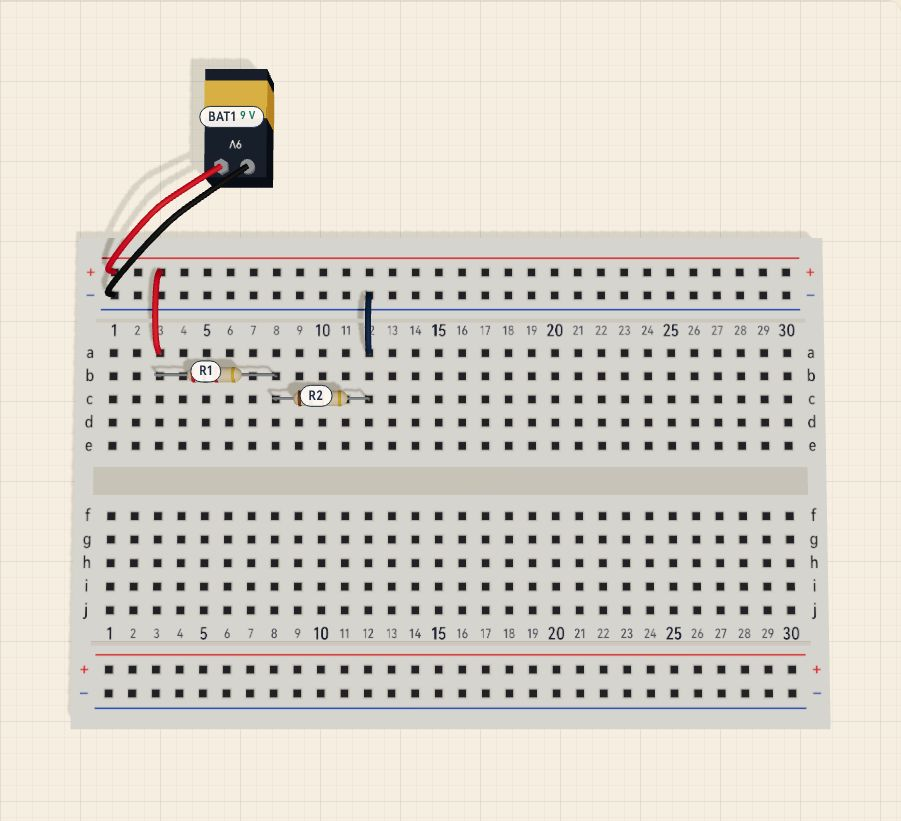
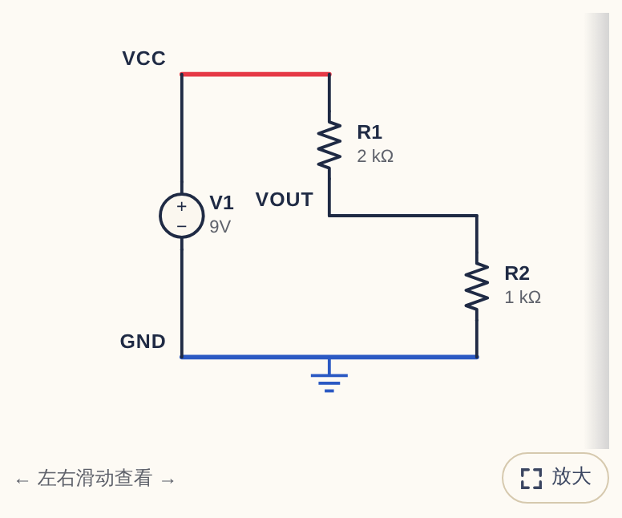

# 1.4 · 分压器：从 9 V 得到 3 V

| 项目 | 内容 |
|---|---|
| id | `challenge-voltage-divider` |
| 文件 | `challenges/10-voltage-divider.json` |
| 类型 | 实验 / 挑战（没有分步，照目标电路图搭） · 难度 2/5 |
| 位置 | World 1 · 基础定律与直流分压 → 1.4 万用表：看见电压（本节第 2 项） |
| 右侧面板 | 轨道由旧的四张卡片自动生成（还没手工精排） |
| 前后 | 上一项 [1.4 lesson-multimeter](../w1/1.04-1-lesson-multimeter.md) · 下一项 [1.5 lesson-ammeter](../w1/1.05-1-lesson-ammeter.md) |
| 先修 | — |
| 概念 | voltage divider 分压器、series 串联、multimeter 万用表 |

**一句话概要**：手上只有 9 V 电池，电路却要 3 V。两个电阻就能做到——自己搭，自己量。

## 1. 左侧工作台（3D 面包板 → 2D 俯视截图）

截图是程序里真实的 3D 面包板换成俯视角拍的；表格是同一块板的文字版（元件、参数、每只脚插在哪个孔）。

### 1.1 起点：空面包板（学生从零开始搭）

### 1.3 参考答案（「看答案」载入的板子）

| 元件 | 类型 | 参数 | 引脚 → 孔 |
|---|---|---|---|
| BAT1 | battery | variant=9V | +→tp1 -→tn1 |
| W2 | wire |  | a→tp3 b→a3 |
| R1 | resistor | resistance=2000 | 1→b3 2→b8 |
| R2 | resistor | resistance=1000 | 1→c8 2→c12 |
| W5 | wire |  | a→a12 b→tn12 |

### 1.4 目标原理图（右侧「目标原理图」抽屉）

| 元件 | 类型 | 参数 |
|---|---|---|
| V1 | dc_source | voltage=9 |
| R1 | resistor | resistance=2000 |
| R2 | resistor | resistance=1000 |

连接（每个结点上的引脚）：

- **VCC**：V1.+、R1.1
- **VOUT**：R1.2、R2.1
- **GND**：R2.2、V1.-

## 2. 右侧面板：学生从上往下看到的内容（单轨流）

### 第 1 步 · 🔧 动手搭：9 V 变 3 V

这一题没有步骤，**看右下角的目标电路图自己搭**。
上一课你已经搭过一个两电阻电路，它的中间点电压介于 0 和 9 V 之间。这次要把中间点**设计**成 3 V。

### 第 2 步 · 💡 想明白：分压公式

两个电阻串联，电流相同，所以**电压按电阻的比例分**：大电阻分得多，小电阻分得少。
$$V_{out} = V_{in} \times \frac{R_2}{R_1 + R_2}$$
想要 9 V 的三分之一，就让下面的 R2 占总电阻的三分之一：R1 = 2 kΩ，R2 = 1 kΩ。

（这一步下面列着这节课的计算卡片，点开就地展开：`voltage-divider`，全文见第 6 节）

### 第 3 步 · 🔧 动手搭：搭好，再用万用表量

- **R1（2 kΩ）** 一端接 +9 V，另一端是结点 **VOUT**；**R2（1 kΩ）** 从 VOUT 接到 GND。
- 搭完点「检查我的电路」，再用万用表回答下面的题。

### 第 4 步 · 📏 测一测：测一测：读你自己的仪表

**测量题 1 · `vout`**（读数题）

> 红表笔点结点 VOUT，黑表笔在 GND：VOUT 的电压

- 单位 V · 先写预测 · 参考答案的读数 **2.998 V** · 合理范围 [2.9, 3.1]

答对后显示：

> 9 V × 1 kΩ / (2 kΩ + 1 kΩ) = 3 V。电池的 1.5 Ω 内阻只让它低几毫伏。

**测量题 2 · `vr1`**（读数题）

> 红表笔点 R1 接 +9 V 的那一端，黑表笔（Shift + 单击）点 VOUT：R1 两端的电压

- 单位 V · 先写预测 · 参考答案的读数 **5.997 V** · 合理范围 [5.8, 6.1]

答对后显示：

> R1 是 R2 的两倍，分到的电压也是两倍：9 V × 2/3 = 6 V。两段加起来正好是电池电压。

**测量题 3 · `load`**（选择题）

> 在 VOUT 和 GND 之间再接一个 1 kΩ 的“负载”，VOUT 会？

- A. 不变
- B. 变低：负载和 R2 并联，下半截电阻变小 ✅（正确）
- C. 变高

答对后显示：

> 1 kΩ ∥ 1 kΩ = 500 Ω，VOUT 变成 9 × 0.5 / 2.5 = 1.8 V。分压器只在空载时才是公式算的那个值。

### 第 5 步 · 🎒 带走：带走

- 分压器的输出**一接负载就会变**：负载和 R2 并联，下半截的电阻变小，VOUT 就掉下去了（第 2 世界会专门做这个实验）。
- 所以分压器适合给**几乎不取电流**的东西提供电压：比如单片机的 ADC 输入、op-amp（运算放大器）的输入、一个参考电压。
- 只看比例的话，20 kΩ 和 10 kΩ 也能分出 3 V，而且更省电；代价是更“软”，更怕负载。

趁热练理论题：`equivalence`

## 3. 测量题一览

| # | id | 题目 | 类型 | 单位 | 状态 | 参考读数 |
|---|---|---|---|---|---|---|
| 1 | vout | 红表笔点结点 VOUT，黑表笔在 GND：VOUT 的电压 | voltage | V |  | 2.998 V |
| 2 | vr1 | 红表笔点 R1 接 +9 V 的那一端，黑表笔（Shift + 单击）点 VOUT：R1 两端的电压 | voltage | V |  | 5.997 V |
| 3 | load | 在 VOUT 和 GND 之间再接一个 1 kΩ 的“负载”，VOUT 会？ | 选择 |  |  | 正确：B |

### 提示按钮（依次显示）

1. Vout = Vin × R2 / (R1 + R2)：要得到 Vin 的 1/3，R2 应该占总电阻的 1/3。
2. 结点 VOUT 就是 R1 和 R2 相连的那一列；R2 的另一端要接到 GND。

### 功能测试（「检查我的电路」时跑）

- VOUT 在目标范围内

## 5. 这一课的计算卡片

**计算卡片 `voltage-divider`：分压器 Voltage divider**

- 公式 `V_{out} = V_s \frac{R_2}{R_1 + R_2}`
- 用途：用两个串联电阻从一个大电压里取出一个小电压。
- 输入：Vs（电源电压，V）；R1（上面的电阻 R₁，Ω）；R2（下面的电阻 R₂，Ω） → V_out（R₂ 上的电压，V）

三步推出来：
1. 串联：$I = \frac{V_s{R_1 + R_2}$
2. 欧姆定律用在 R₂ 上：$V_{out} = I R_2$
3. 代入：$V_{out} = V_s \frac{R_2}{R_1 + R_2}$

**前提**：R₁ 和 R₂ 流过 **同一个电流**——输出端不接负载（或负载电流远小于 I）。接了负载 R_L，下面的电阻就变成 $R_2 ∥ R_L$，输出会 **降低**（实验 1-3、2-5）。

例子：9 V，R₁ = 20 kΩ，R₂ = 10 kΩ：$V_{out} = 9 × \frac{10}{30} = 3 V$（挑战 2）。

- ⚠ 分子是 **输出所在的那个** 电阻（R₂），不是 R₁。
- ⚠ 接了负载以后公式里的 R₂ 要换成 R₂ ∥ R_L。

## 6. English（界面英文版的同一份内容）

展开英文

### Node 1 · 🔧 Build：9 V into 3 V

This one has no steps — **build it from the target schematic** at the bottom right.
In the last lesson you built a two-resistor circuit whose middle point sat somewhere between 0 and 9 V. This time you **design** the middle point to be 3 V.

### Node 2 · 💡 Why：The divider formula

Two resistors in series carry the same current, so **the voltage is shared in proportion to the resistances**: the bigger resistor gets more, the smaller one less.
$$V_{out} = V_{in} \times \frac{R_2}{R_1 + R_2}$$
For a third of 9 V, make the lower resistor R2 a third of the total: R1 = 2 kΩ, R2 = 1 kΩ.

(This node lists the lesson’s calculation cards: `voltage-divider`; full text in section 6)

### Node 3 · 🔧 Build：Build it, then measure it

- **R1 (2 kΩ)** from +9 V to the node **VOUT**; **R2 (1 kΩ)** from VOUT to GND.
- Press Check my circuit, then answer the questions below with the multimeter.

### Node 4 · 📏 Measure：Measure: read your own instruments

**Question 1 · `vout`**（reading）

> Red probe on the node VOUT, black probe on GND: the voltage at VOUT

- unit V · predict first · range [2.9, 3.1]

Shown once right:

> 9 V × 1 kΩ / (2 kΩ + 1 kΩ) = 3 V. The battery's 1.5 Ω internal resistance takes off only a few millivolts.

**Question 2 · `vr1`**（reading）

> Red probe on the +9 V end of R1, black probe (Shift + click) on VOUT: the voltage across R1

- unit V · predict first · range [5.8, 6.1]

Shown once right:

> R1 is twice R2, so it gets twice the voltage: 9 V × 2/3 = 6 V. The two together add up to the battery voltage.

**Question 3 · `load`**（multiple choice）

> Connect another 1 kΩ "load" between VOUT and GND. VOUT will:

- A. Stay the same
- B. Drop: the load is in parallel with R2, so the lower half gets smaller ✅ (right)
- C. Rise

Shown once right:

> 1 kΩ ∥ 1 kΩ = 500 Ω, so VOUT becomes 9 × 0.5 / 2.5 = 1.8 V. A divider gives the formula value only with no load.

### Node 5 · 🎒 Take away：Take away

- A divider's output **changes as soon as you load it**: the load sits in parallel with R2, the lower half gets smaller and VOUT drops (World 2 has a whole lab on this).
- So a divider is for things that draw **almost no current**: a microcontroller's ADC input, an op-amp input, a reference voltage.
- Only the ratio matters for the voltage: 20 kΩ and 10 kΩ also give 3 V and waste less current — at the price of being "softer", easier to pull down with a load.

Practise：`equivalence`

**Hints**

1. Vout = Vin × R2 / (R1 + R2): for 1/3 of Vin, R2 must be 1/3 of the total resistance.
2. Node VOUT is the column where R1 and R2 meet; the other end of R2 goes to GND.

