# 1.5 · 电流表：串联才能测电流

| 项目 | 内容 |
|---|---|
| id | `lesson-ammeter` |
| 文件 | `challenges/102-lesson-ammeter.json` |
| 类型 | 课程（有分步，每步自动检查） · 难度 2/5 |
| 位置 | World 1 · 基础定律与直流分压 → 1.5 电流表：串联才能测电流（本节第 1 项） |
| 右侧面板 | 手写轨道（样板课） |
| 前后 | 上一项 [1.4 challenge-voltage-divider](../w1/1.04-2-challenge-voltage-divider.md) · 下一项 [1.6 lesson-schematic-to-breadboard](../w1/1.06-1-lesson-schematic-to-breadboard.md) |
| 先修 | — |
| 概念 | ammeter 电流表、series 串联、burden resistance 内阻、short circuit 短路、reference direction 参考方向 |

**一句话概要**：先把电流表接错一次，看它把 LED 短路；再断开电路，把表接进断口。

## 1. 左侧工作台（3D 面包板 → 2D 俯视截图）

截图是程序里真实的 3D 面包板换成俯视角拍的；表格是同一块板的文字版（元件、参数、每只脚插在哪个孔）。

### 1.1 起点：空面包板（学生从零开始搭）

### 1.2 每一步之后的面包板

见第 2 节每个步骤下面的截图（按步骤的自动检查重建：放 / 改 / 拔元件、移动万用表表笔）。

### 1.3 参考答案（「看答案」载入的板子）

| 元件 | 类型 | 参数 | 引脚 → 孔 |
|---|---|---|---|
| BAT1 | battery | variant=9V | +→tp1 -→tn1 |
| AM1 | ammeter |  | +→tp5 -→a5 |
| R1 | resistor | resistance=1000 | 1→c5 2→c10 |
| LED1 | led | color=red | anode→d10 cathode→d13 |
| W5 | wire |  | a→a13 b→tn13 |

### 1.4 目标原理图（右侧「目标原理图」抽屉）

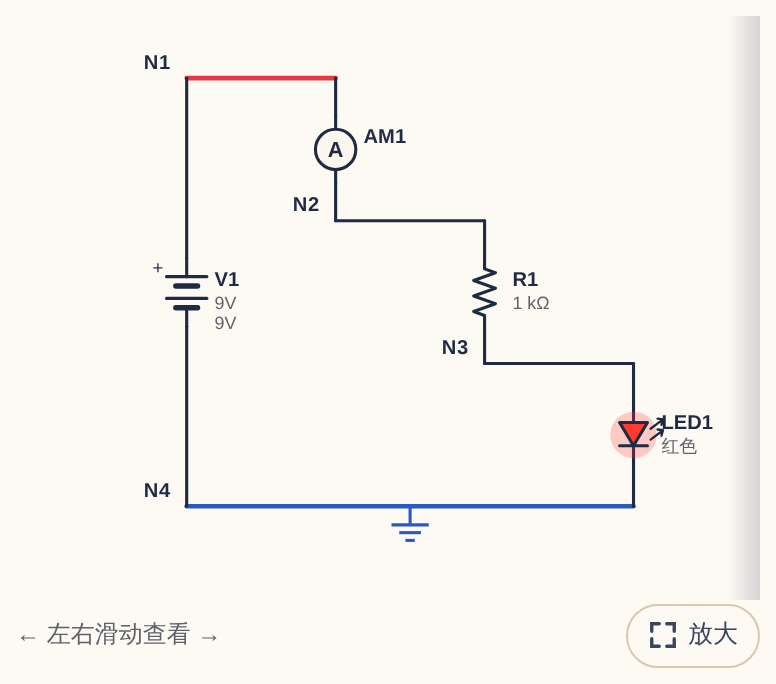

| 元件 | 类型 | 参数 |
|---|---|---|
| V1 | battery | variant=9V |
| AM1 | ammeter |  |
| R1 | resistor | resistance=1000 |
| LED1 | led | color=red |

连接（每个结点上的引脚）：

- **N1**：V1.+、AM1.+
- **N2**：AM1.-、R1.1
- **N3**：R1.2、LED1.anode
- **N4**：LED1.cathode、V1.-

## 2. 右侧面板：学生从上往下看到的内容（单轨流）

### 第 1 步 · 🔍 先看一眼：认识电流表：一个很小的电阻

电流表就是万用表拨到 mA 档。两支表笔：电流从**红表笔**流进去，从黑表笔流出来。

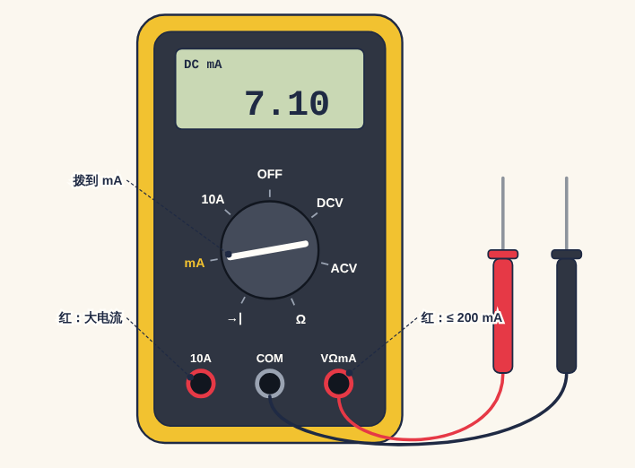

**拆解「电流表：一个很小的电阻 + 一块毫伏表」第 1 / 7 层：① 面板：拨到 mA，红表笔看电流大小选插孔**

还是那块万用表，只改两件事：
1. 拨盘转到 mA（或 10A）；
2. 红表笔插对插孔：电流 ≤ 200 mA 插 VΩmA，更大的电流插 10A。黑表笔照旧在 COM。

显示屏 上的数是 **从红表笔流进表、从黑表笔流出的电流**。

不知道电流有多大时，**先用 10A 孔和 10A 档**，读数小于 200 mA 再换到 mA。顺序反过来，几安培的电流会直接冲进 mA 档，熔断里面的保险丝。

本课程的实验电流都是几 mA 到几十 mA，用 mA 档。仿真里的电流表是一个单独的元件（AM1、AM2 …），相当于一块固定在 mA 档的表。

| 拨盘 | 红表笔插 | 最大电流 | 里面的分流电阻 | 保护 |
|---|---|---|---|---|
| mA | VΩmA | 200 mA | 1 Ω … 100 Ω（看量程） | 200 mA 快熔保险丝 |
| 10A | 10A | 10 A | 0.01 Ω | 10 A 保险丝；> 2 A 时每次 ≤ 10 s |
| DCV（量完记得换回） | VΩmA | — | 10 MΩ 分压器 | — |

### 第 2 步 · 🔧 动手搭：先点亮一颗 LED

一个 9 V 电池、一个 `1 kΩ`、一颗红色 LED，接成一个圈。

**步骤 1**

选**「电池」**（9 V）：**`tp1`**（+）、**`tn1`**（−）。

自动检查（做到这些才算完成）：把电池插到 tp1–tn1
板上高亮的孔：tp1、tn1

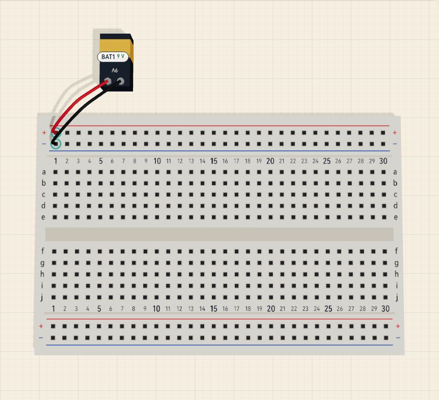

**步骤 2**

**跳线** **`tp5`** → **`a5`**。电流从 + 轨经过它进入电路——待会儿电流表就接在这里。

自动检查（做到这些才算完成）：把跳线插到 tp5–a5
板上高亮的孔：tp5、a5

**步骤 3**

**R1**：**`c5`** 和 **`c10`**，设 **`1 kΩ`**。

自动检查（做到这些才算完成）：把电阻插到 c5–c10
板上高亮的孔：c5、c10

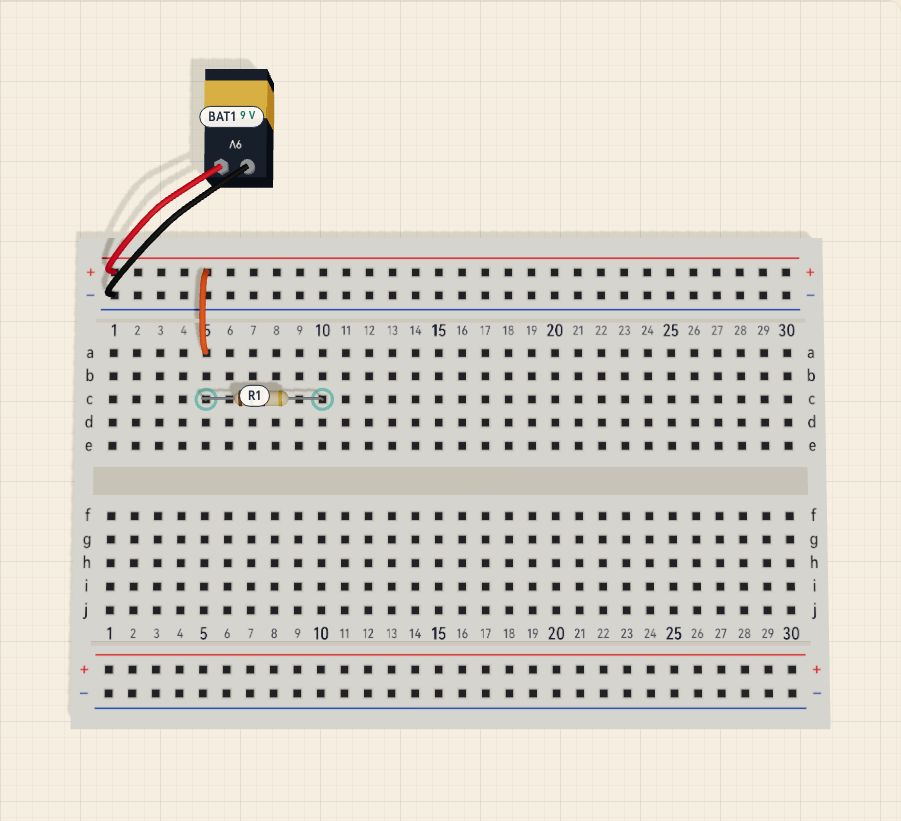

**步骤 4**

**红色 LED**：长脚 **`d10`**，短脚 **`d13`**。

自动检查（做到这些才算完成）：把LED 发光二极管插到 d10–d13
板上高亮的孔：d10、d13

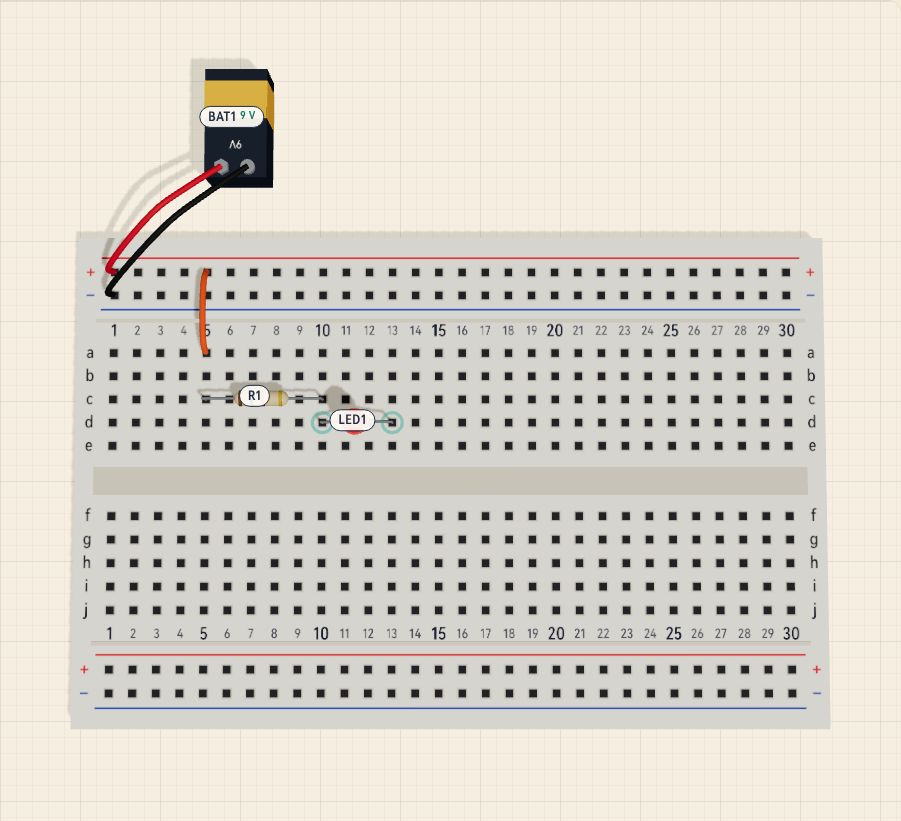

**步骤 5**

**跳线** **`a13`** → **`tn13`** 回到 GND。LED 亮了。

自动检查（做到这些才算完成）：把跳线插到 a13–tn13
板上高亮的孔：a13、tn13

### 第 3 步 · 📏 测一测：故意接错：把电流表并在 LED 两端

像量电压那样，把电流表的两支表笔点在 **LED 两端**。看 LED，再看**诊断**。

**步骤 6**

**故意接错**：选**「电流表」**，红表笔单击 **`b10`**，黑表笔单击 **`b13`**——电流表**并联**在 LED 两端。LED 怎么了？看看「诊断」。

自动检查（做到这些才算完成）：把电流表插到 b10–b13
板上高亮的孔：b10、b13

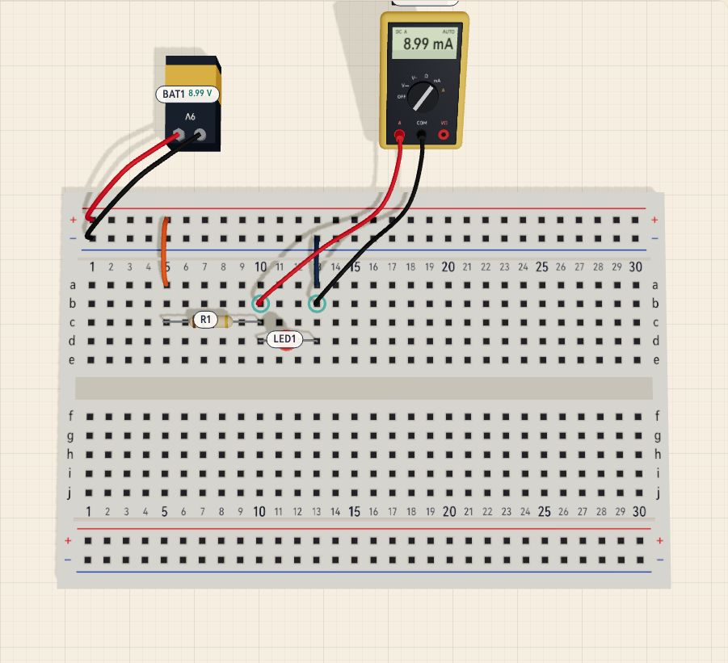

**测量题 1 · `par`**（选择题）

> 电流表并在 LED 两端时，LED 怎样？

- A. 灭了：电流从电流表抄近路走了 ✅（正确）
- B. 更亮了：多了一条路
- C. 没变化

- 第 6 步完成后就能答

答对后显示：

> 电流表的内阻只有 0.1 Ω，几乎是一根导线。并在 LED 两端，电流全走它，LED 被短路。

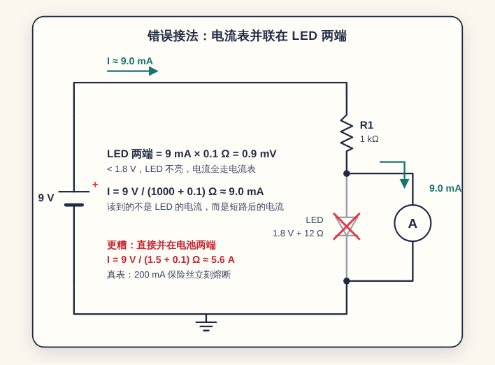

**拆解「电流表：一个很小的电阻 + 一块毫伏表」第 6 / 7 层：⑥ 并联会怎样：0.1 Ω 把元件短路了**

第 10 课故意做一次错误示范：把 电流表 并在 LED 两端。用等效电路就能算出会发生什么：
1. LED 和 0.1 Ω 并联。要让 LED 导通，它两端至少要 1.8 V；而 0.1 Ω 两端只要有 1.8 V，就要流 18 A——不可能。所以 **电流全走电流表**，LED 两端只剩
$$V = 9 mA × 0.1 Ω = 0.9 mV < 1.8 V$$
LED 熄灭；
2. 回路里只剩 R1 和 0.1 Ω：
$$I = \frac{9 V}{1000 Ω + 0.1 Ω} ≈ 9.0 mA$$
3. 表读到 9.0 mA——这 **不是** LED 原来的电流（7.1 mA），而是“LED 被短路以后”的电流。

**更危险的情况**：直接并在电池两端，回路里只有电池内阻 1.5 Ω 和表的 0.1 Ω：
$$I = \frac{9 V}{1.5 Ω + 0.1 Ω} ≈ 5.6 A;  P_{R_{sh}} = I^{2} R_{sh} = 5.6^{2} × 0.1 ≈ 3.2 W$$
真实的表：200 mA 保险丝瞬间熔断（没有保险丝，分流电阻就烧了）。仿真里不会烧，只会把元件短路，诊断面板会提醒你。

| 接法 | LED | 表的读数 | 意义 |
|---|---|---|---|
| 串在跳线处（正确） | 亮 | 7.1 mA | LED 的电流 |
| 串联，红黑对调 | 亮 | −7.1 mA | 同一电流，参考方向反 |
| 并在 LED 两端（错） | 灭 | 9.0 mA | 短路后的电流 |
| 并在电池两端（危险） | — | 5.6 A | 烧保险丝 |

### 第 4 步 · 💡 想明白：电压表并联，电流表串联

- **电压**是两点之间的：万用表并联在两点上，自己几乎不取电流。
- **电流**是流过一条路的：要知道多少水流过一根管子，就得把管子**切开**，让水全部从表里流过。电流表要**串联**进电路。

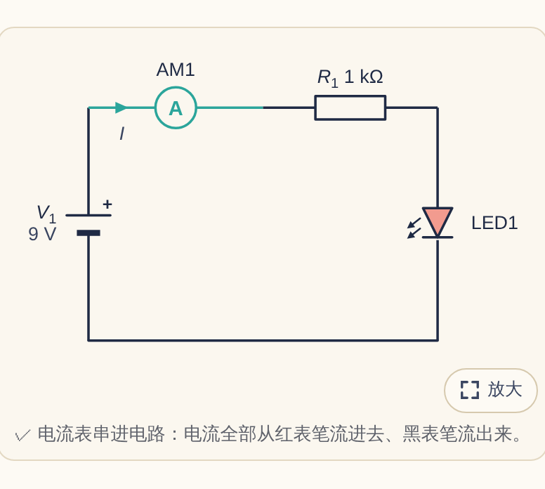

*图 `series`（schematic）：✓ 电流表串进电路：电流全部从红表笔流进去、黑表笔流出来。*

- 电流表的内阻很小，这里只有 **0.1 Ω**，几乎就是一根导线。把它并联在 LED 两端，电流全从它身上抄近路走了——LED 被**短路**，所以灭了。

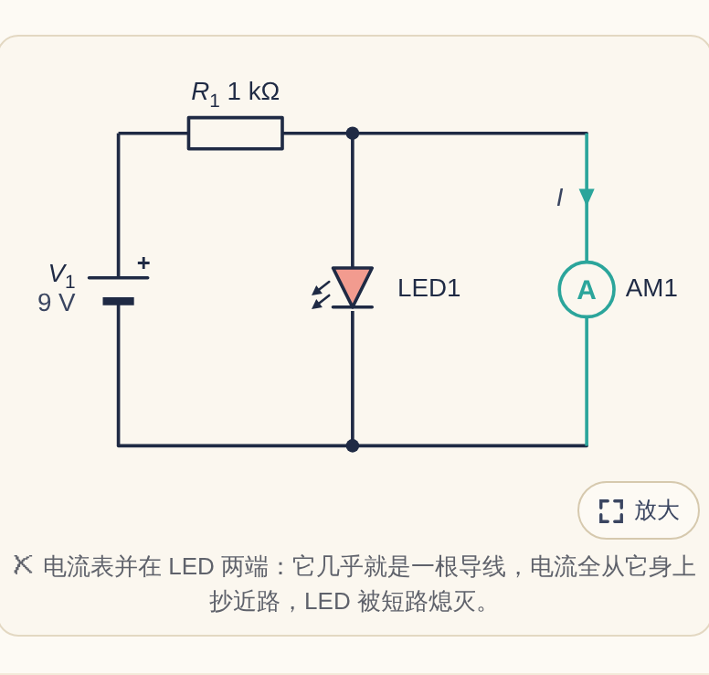

*图 `parallel`（schematic）：✗ 电流表并在 LED 两端：它几乎就是一根导线，电流全从它身上抄近路，LED 被短路熄灭。*

- 读数是“**从红表笔流进去**的电流”。红黑接反，读数变成负数——电流没变，变的是参考方向。

### 第 5 步 · 🔧 动手搭：断开，再把表接进断口

把错的表拿掉，在 + 轨和电路之间**切一个口**，让电流表来补上这个口。

**步骤 7**

删掉这块电流表：单击它，按 **Delete**。

自动检查（做到这些才算完成）：清空这些孔：b10、b13
板上高亮的孔：b10、b13

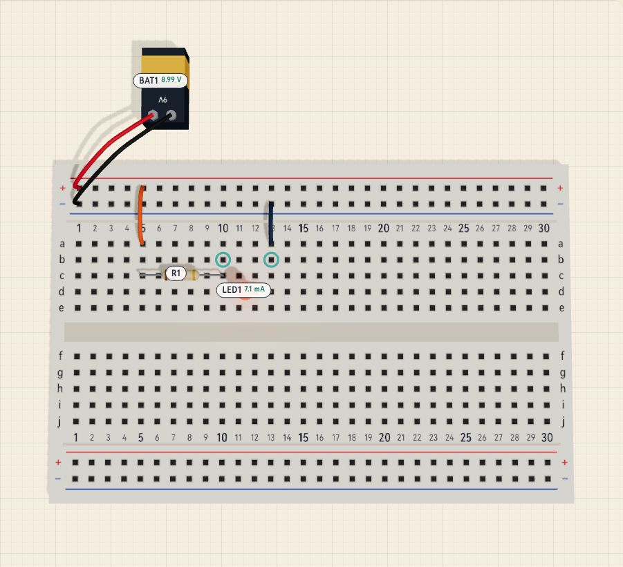

**步骤 8**

**切一个口**：删掉 **`tp5`** → **`a5`** 那根跳线。LED 灭了——电流没路可走。

自动检查（做到这些才算完成）：清空这些孔：tp5、a5
板上高亮的孔：tp5、a5

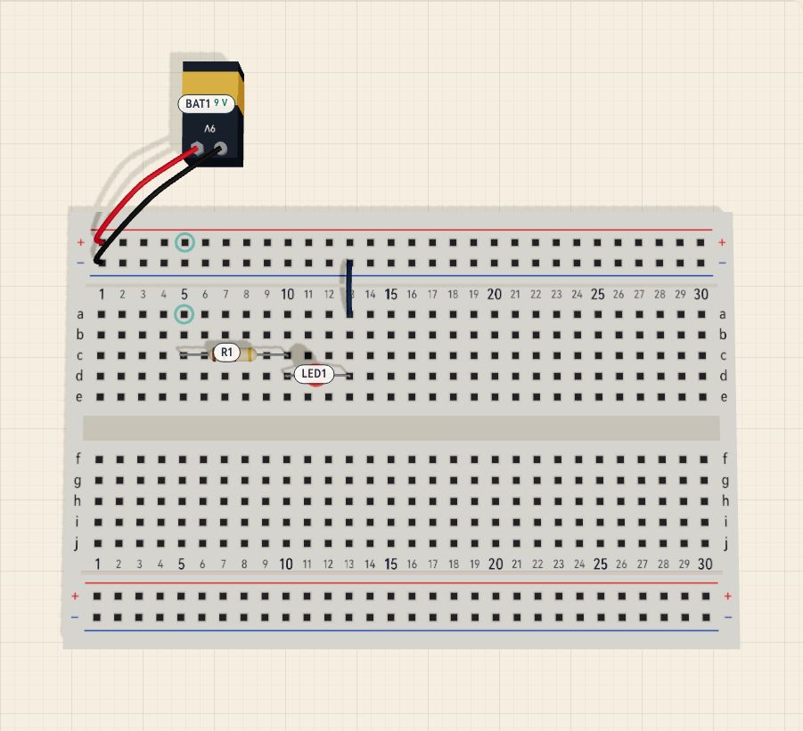

**步骤 9**

**把电流表接进断口**：红表笔 **`tp5`**（电流从这边来），黑表笔 **`a5`**。LED 又亮了，表上显示流过整个回路的电流。

自动检查（做到这些才算完成）：把电流表插到 tp5–a5
板上高亮的孔：tp5、a5

### 第 6 步 · 📏 测一测：读电流，再量电流表两端的电压

读数要在完整的电路上读：先点一次「检查我的电路」，读数框就会打开。

**测量题 2 · `i`**（读数题）

> 先用 LED 压降约 1.8 V 预测，再读：电流表 AM1 的读数（红表笔在 + 轨一侧）

- 单位 mA · 先写预测 · 参考答案的读数 **7.103 mA** · 合理范围 [0.0068, 0.0074]

答对后显示：

> (9 − 1.8) V / (1 kΩ + 12 Ω) ≈ 7.1 mA。

**测量题 3 · `uam`**（读数题）

> 万用表：红表笔点 + 轨上电流表红表笔那一侧，黑表笔（Shift）点第 5 列：电流表两端的电压

- 单位 mV · 参考答案的读数 **0.7103 mV** · 合理范围 [0.0006, 0.0008]

答对后显示：

> 0.1 Ω × 7.1 mA ≈ 0.71 mV——比电路里其他电压小一万倍。

**推导 `rb`：电流表自己的电阻怎么算**（一次揭开一行）

1. 电流表也是一个元件：它两端有一点电压 $V_{AM}$，流过它的就是你刚读到的电流 $I$。
2. 欧姆定律倒过来用：$$R = \frac{V_{AM}}{I}$$
3. 单位小心：mV ÷ mA = Ω。用你自己的两个读数代进去。

**测量题 4 · `rb`**（计算题（用自己的读数算））

> 用你的两个读数算电流表的内阻：R = 电流表两端电压 / 电流

- 单位 Ω · 参考答案的读数 **0.1 Ω** · 合理范围 [0.095, 0.105] · 公式 `uam / i`

答对后显示：

> 0.1 Ω：几乎是一根导线，所以它必须串联。

### 第 7 步 · 📏 测一测：红黑对调：读数怎么变

**步骤 10**

对调试试：删掉电流表重新放，红表笔 **`a5`**、黑表笔 **`tp5`**。读数怎么变？LED 呢？

自动检查（做到这些才算完成）：把电流表插到 a5–tp5
板上高亮的孔：a5、tp5

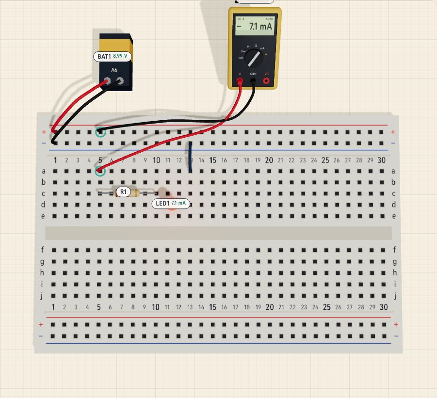

**步骤 11**

再换回来：红表笔 **`tp5`**、黑表笔 **`a5`**。

自动检查（做到这些才算完成）：把电流表插到 tp5–a5
板上高亮的孔：tp5、a5

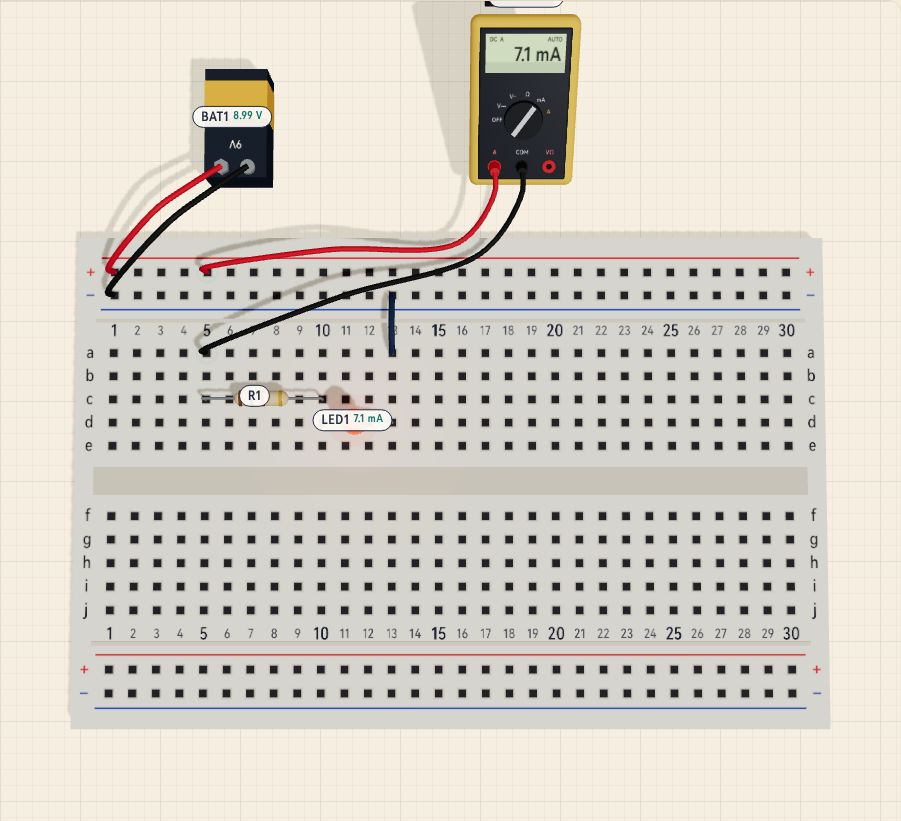

**测量题 5 · `swap`**（选择题）

> 把电流表的红黑表笔对调时，读数怎么变？

- A. 读数不变
- B. 数值一样，变成负数 ✅（正确）
- C. 变成 0，LED 熄灭

- 第 10 步完成后就能答

答对后显示：

> 电流没变，LED 照样亮；读数是“从红表笔流进去的电流”，方向反了就是负数。

### 第 8 步 · 🎒 带走：带走

- **量电流三步：断开 → 串进去 → 红进黑出。**
- 电流表并联在电源两端，真实的表会**烧保险丝**，严重时烧表。这里只会把元件短路，并给出诊断。
- 真实万用表 mA 档的内阻是几欧到十几欧（说明书里叫“负担电压”），在低电压电路里会让电流明显变小；10 A 档内阻小，但读不准小电流。

从现在起，你能“看见”电压和电流了。接下来用它们去拆解串联和并联。

## 3. 测量题一览

| # | id | 题目 | 类型 | 单位 | 状态 | 参考读数 |
|---|---|---|---|---|---|---|
| 1 | par | 电流表并在 LED 两端时，LED 怎样？ | 选择 |  |  | 正确：A |
| 2 | i | 先用 LED 压降约 1.8 V 预测，再读：电流表 AM1 的读数（红表笔在 + 轨一侧） | current | mA |  | 7.103 mA |
| 3 | uam | 万用表：红表笔点 + 轨上电流表红表笔那一侧，黑表笔（Shift）点第 5 列：电流表两端的电压 | voltage | mV |  | 0.7103 mV |
| 4 | rb | 用你的两个读数算电流表的内阻：R = 电流表两端电压 / 电流 | formula | Ω |  | 0.1 Ω |
| 5 | swap | 把电流表的红黑表笔对调时，读数怎么变？ | 选择 |  |  | 正确：B |

### 全部答完后显示的「对比」

**对比**：I = (9 V − 1.8 V) / (1 kΩ + LED 内阻 12 Ω) ≈ **7.1 mA**。
- 电流表两端的电压 = 0.1 Ω × 7.1 mA ≈ **0.71 mV**，所以它几乎不改变电路；
- 表笔接反时读数 ≈ −7.1 mA；
- 并联在 LED 两端时，LED 被短路熄灭，电流表读到的是 9 V / 1 kΩ ≈ 9 mA——这不是 LED 的电流，而是“被短路以后”的电流。

### 提示按钮（依次显示）

1. 电流表要串进电路：先断开要测的地方，再让电流从红表笔流进、黑表笔流出。
2. 读数是负的？红黑表笔接反了。电流方向没变，只是参考方向反了。

### 功能测试（「检查我的电路」时跑）

- 电流表串在电路里，LED 亮

## 4. 用到的拆解（全部层的文字，供改写参考）

### 拆解 `ammeter`：电流表：一个很小的电阻 + 一块毫伏表

*ammeter（电流表）不是另一台仪器，而是同一块万用表拨到电流档。它里面没有“直接数电子”的东西：电流流过一个已知的小电阻，表量这个电阻两端的电压，再用欧姆定律换算成电流。从这一点出发，就能推出“为什么必须串联”和“并联为什么会短路”。*

**拆解「电流表：一个很小的电阻 + 一块毫伏表」第 1 / 7 层：① 面板：拨到 mA，红表笔看电流大小选插孔**

还是那块万用表，只改两件事：
1. 拨盘转到 mA（或 10A）；
2. 红表笔插对插孔：电流 ≤ 200 mA 插 VΩmA，更大的电流插 10A。黑表笔照旧在 COM。

显示屏 上的数是 **从红表笔流进表、从黑表笔流出的电流**。

不知道电流有多大时，**先用 10A 孔和 10A 档**，读数小于 200 mA 再换到 mA。顺序反过来，几安培的电流会直接冲进 mA 档，熔断里面的保险丝。

本课程的实验电流都是几 mA 到几十 mA，用 mA 档。仿真里的电流表是一个单独的元件（AM1、AM2 …），相当于一块固定在 mA 档的表。

| 拨盘 | 红表笔插 | 最大电流 | 里面的分流电阻 | 保护 |
|---|---|---|---|---|
| mA | VΩmA | 200 mA | 1 Ω … 100 Ω（看量程） | 200 mA 快熔保险丝 |
| 10A | 10A | 10 A | 0.01 Ω | 10 A 保险丝；> 2 A 时每次 ≤ 10 s |
| DCV（量完记得换回） | VΩmA | — | 10 MΩ 分压器 | — |

**拆解「电流表：一个很小的电阻 + 一块毫伏表」第 2 / 7 层：② X 光：保险丝 → 分流电阻 → COM，ADC 量电阻两端**

电流档里，电流走的路是一条实实在在的金属通路：
VΩmA → 保险丝 F 0.2 A → 分流电阻（shunt） → COM。

**分流电阻**（shunt resistor）是一个阻值很准、温度变化小的小电阻（锰铜合金）。电流流过它，两端出现一个小电压，**还是那颗 ±200 mV 的 ADC** 去量它——和电压档用的是同一颗芯片。

10A 插孔有自己的一条路：10 A 保险丝 → 0.01 Ω 的粗分流电阻 → COM。

保险丝 是为“接错”准备的：如果把电流档直接并到电源上，几安培的电流会烧坏分流电阻和电路板，保险丝先断开，保护表。真实的表保险丝断了以后，电流档读数永远是 0——量电流读到 0 而电路明明在工作，先查保险丝。

| 部件 | 作用 | 典型值 |
|---|---|---|
| 保险丝（mA 路） | 过流时熔断，保护表 | 200 mA / 250 V, ≈ 0.5 Ω |
| 分流电阻 $R_{sh}$ | 把电流变成电压 | 1 Ω … 100 Ω |
| ADC | 量 $R_{sh}$ 两端的毫伏 | ±200 mV |
| 10 A 分流电阻 | 大电流用的粗电阻 | 0.01 Ω |

**拆解「电流表：一个很小的电阻 + 一块毫伏表」第 3 / 7 层：③ 原理：I = V / R，倒过来用欧姆定律**

表并不直接量电流，它做的是：
1. 让被测电流 $I$ 全部流过 一个已知电阻 $R_{sh}$；
2. 用 毫伏表（ADC） 量出 $R_{sh}$ 两端的电压 $V_{sh}$；
3. 显示 $I = \frac{V_{sh}}{R_{sh}}$。

用第 10 课的电流代数字（20 mA 量程，$R_{sh}$ = 10 Ω）：
$$V_{sh} = I R_{sh} = 7.1 mA × 10 Ω = 71 mV$$
ADC 读到 71 mV，显示屏 显示 $\frac{71 mV}{10 Ω} = 7.10 mA$。

**量程是怎么来的**：ADC 满量程是 200 mV，所以每个量程的分流电阻都选成“满量程电流 × $R_{sh}$ = 200 mV”。量程越大，$R_{sh}$ 越小：

| 量程 | 分流电阻 $R_{sh}$ | 满量程时 $V_{sh}$ | 7.1 mA 时 $V_{sh}$ |
|---|---|---|---|
| 2 mA | 100 Ω | 200 mV | 超量程 OL |
| 20 mA | 10 Ω | 200 mV | 71 mV |
| 200 mA | 1 Ω | 200 mV | 7.1 mV |
| 10 A | 0.01 Ω | 100 mV | 0.071 mV |

- 公式 `I = \frac{V_{sh}}{R_{sh}}`：电流表的全部原理
- 公式 `R_{sh} = \frac{200 mV}{I_{full scale}}`：每个量程的分流电阻

**拆解「电流表：一个很小的电阻 + 一块毫伏表」第 4 / 7 层：④ 等效电路：理想电流表串联一个小电阻**

把上一层装回去，从两个表笔看进去，电流档的表等效为 **串联** 的两样东西：
- 理想电流表（ideal ammeter）：读出流过它的电流，**自身电阻为 0**（相当于一根导线）；
- 分流电阻 $R_{sh}$（加上保险丝和表笔的电阻）：真实的表必须有的那一点电阻。仿真里固定为 **0.1 Ω**。

和电压表正好相反（右边对比）：电压表 希望自己的电阻 **无穷大**，这样并上去不分走电流；电流表 希望自己的电阻 **为 0**，这样串进去不分走电压。

电流表两端的电压叫 **负担电压**（burden voltage）：
$$V_{burden} = I R_{sh} = 7.1 mA × 0.1 Ω = 0.71 mV$$
第 10 课让你用万用表量这个电压、再用 $R = \frac{V}{I}$ 反算出 0.1 Ω——这就是在“量电流表的等效电路”。

真实万用表的 mA 档 $R_{sh}$ 加保险丝有几欧到十几欧。比如 10 Ω：负担电压 71 mV，电流变成 $\frac{7.2 V}{1022 Ω} = 7.05 mA$，比不接表时小 1 %。

|  | 电流表 | 电压表 |
|---|---|---|
| 量什么 | 流过一条路径的电流 | 两点之间的电压 |
| 怎么接 | **串联**：断开、插入 | **并联**：直接点上 |
| 理想内阻 | 0 | ∞ |
| 仿真 / 真实 | 0.1 Ω / 1–15 Ω | ∞ / 10 MΩ |
| 接错会怎样 | 并联 → 短路被测元件 | 串联 → 电路几乎断开 |

- 公式 `V_{burden} = I R_{sh}`：电流表“吃掉”的电压
- 公式 `I_{with meter} = \frac{V_s - V_{LED}}{R_1 + R_{LED} + R_{sh}}`：第 10 课：$R_{sh}$ 串进了回路

**拆解「电流表：一个很小的电阻 + 一块毫伏表」第 5 / 7 层：⑤ 为什么必须串联：电流要“全部”流过表**

表只量 **流过自己** 的电流。要量一条支路的电流，就得让这条支路的电流 **一点不少地全部** 走进表——唯一的办法是：
1. 在要测的地方 **断开** 电路（第 10 课：拔掉那根黄色跳线）；
2. 把表的两个表笔 **接进断口**：红表笔 接电流来的那一边（电池 + 那边），黑表笔 接电流去的那一边（R1 那边）；
3. 这时电流只有一条路：电池 → 红表笔 → 表 → 黑表笔 → R1 → LED → GND。

一步步算 这条回路的电流（LED 模型 = 1.8 V + 12 Ω）：
$$I = \frac{9 V - 1.8 V}{1000 Ω + 12 Ω + 0.1 Ω} = \frac{7.2 V}{1012.1 Ω} ≈ 7.1 mA$$
有表和没表只差 0.1 Ω，电流从 7.1146 mA 变成 7.1139 mA——看不出来。

**方向 / 符号**：读数的定义是“从红表笔流进去的电流”。把红黑对调，电流还是从电池 + 流出，但它现在从黑表笔流进表，读数变成 **−7.1 mA**。负号不是错，是在告诉你：实际电流方向和你选的 **参考方向**（reference direction）相反。

- 公式 `I = \frac{V_{bat} - V_{F}}{R_1 + R_{LED} + R_{sh}} = \frac{9 - 1.8}{1012.1} ≈ 7.1 mA`：第 10 课的电流，$R_{sh}$ 只占 0.01 %

**拆解「电流表：一个很小的电阻 + 一块毫伏表」第 6 / 7 层：⑥ 并联会怎样：0.1 Ω 把元件短路了**

第 10 课故意做一次错误示范：把 电流表 并在 LED 两端。用等效电路就能算出会发生什么：
1. LED 和 0.1 Ω 并联。要让 LED 导通，它两端至少要 1.8 V；而 0.1 Ω 两端只要有 1.8 V，就要流 18 A——不可能。所以 **电流全走电流表**，LED 两端只剩
$$V = 9 mA × 0.1 Ω = 0.9 mV < 1.8 V$$
LED 熄灭；
2. 回路里只剩 R1 和 0.1 Ω：
$$I = \frac{9 V}{1000 Ω + 0.1 Ω} ≈ 9.0 mA$$
3. 表读到 9.0 mA——这 **不是** LED 原来的电流（7.1 mA），而是“LED 被短路以后”的电流。

**更危险的情况**：直接并在电池两端，回路里只有电池内阻 1.5 Ω 和表的 0.1 Ω：
$$I = \frac{9 V}{1.5 Ω + 0.1 Ω} ≈ 5.6 A;  P_{R_{sh}} = I^{2} R_{sh} = 5.6^{2} × 0.1 ≈ 3.2 W$$
真实的表：200 mA 保险丝瞬间熔断（没有保险丝，分流电阻就烧了）。仿真里不会烧，只会把元件短路，诊断面板会提醒你。

| 接法 | LED | 表的读数 | 意义 |
|---|---|---|---|
| 串在跳线处（正确） | 亮 | 7.1 mA | LED 的电流 |
| 串联，红黑对调 | 亮 | −7.1 mA | 同一电流，参考方向反 |
| 并在 LED 两端（错） | 灭 | 9.0 mA | 短路后的电流 |
| 并在电池两端（危险） | — | 5.6 A | 烧保险丝 |

**拆解「电流表：一个很小的电阻 + 一块毫伏表」第 7 / 7 层：⑦ 一个结点三块表（KCL），以及真实电流表的局限**

实验 201 在结点 N 的三条支路里各串一块表：AM1 量流进 N 的电流，AM2、AM3 量流出的电流。先算：
1. $R_2 ∥ R_3 = \frac{1k × 2.2k}{3.2k} = 687.5 Ω$，总电阻 $330 + 687.5 = 1017.5 Ω$；
2. $I_1 = \frac{9 V}{1017.5 Ω} ≈ 8.84 mA$，$V_N = 8.84 mA × 687.5 Ω ≈ 6.08 V$；
3. $I_2 = \frac{6.08 V}{1 kΩ} = 6.08 mA$，$I_3 = \frac{6.08 V}{2.2 kΩ} = 2.76 mA$；
4. 6.08 + 2.76 = 8.84：流进 = 流出（KCL）。

每条路径上串了两块表，只多了 0.2 Ω，相对 1017.5 Ω 是 0.02 %，可以忽略。**表多不怕，只要每块都串在自己的支路里。**某块表读到负数，说明它的红黑和实际电流方向相反——KCL 写成代数和照样成立：$-I_1 + I_2 + I_3 = 0$。

真实电流表比仿真多出的几件事，见下表。

| 项目 | 真实万用表 | 仿真 |
|---|---|---|
| 内阻 / 负担电压 | mA 档 1–15 Ω，几十到几百 mV | 0.1 Ω |
| 并联在电源上 | 保险丝熔断 | 元件被短路 + 诊断提示 |
| 10 A 档 | 内阻小，但小电流读不准（最后一位 10 mA） | — |
| 换档 | 换档时电路会短暂断开 | — |
| 交流电流 | 有效值，频率有限 | 直流读数 |

- 公式 `-I_1 + I_2 + I_3 = 0`：KCL，读数带符号

**一句话记住**：电流表 = 理想电流表串联一个小电阻 $R_{sh}$（仿真 0.1 Ω）。它量的是 $R_{sh}$ 两端的毫伏，再算 $I = V_{sh}/R_{sh}$。因为电阻小，它必须串进断口；并联就等于用导线把元件短路。读数是“从红表笔流进去的电流”，接反为负。

## 5. 这一课的计算卡片

**计算卡片 `led-current`：LED 回路的电流 LED loop current**

- 公式 `I = \frac{V_s - ΣV_F}{R + Σr_d + R_{int}}`
- 用途：电源、电阻和一个或几个串联 LED：LED 实际流过多少电流。
- 输入：V_s（电源电动势，V）；V_F（所有 LED 的 V_F 之和（红 1.8、绿 2.1、蓝/白 3.0），V）；R（串联电阻（含电位器），Ω）；r_d（LED 内阻之和（每个 ≈ 12 Ω），Ω）；R_int（电源内阻（模块 ≈ 0、9 V 电池 1.5 Ω、纽扣电池 15 Ω），Ω） → I（回路电流（不够 ΣV_F 时为 0），A）

1. 导通的 LED 用折线模型看：一个电压源 $V_F$ 串一个小电阻 $r_d ≈ 12 Ω$（模拟器就是这样建模的）。
2. 整个回路串联，处处是同一个电流 I。
3. KVL：$V_s = I R_{int} + I R + ΣV_F + I Σr_d$。
4. 解出 $I = \frac{V_s - ΣV_F}{R + Σr_d + R_{int}}$。
5. 如果 $V_s < ΣV_F$，LED 根本不导通，I = 0：3 V 点不亮串联的红 + 绿 LED（需要 3.9 V）。
只用 $\frac{V_s - V_F}{R}$ 估算会偏大 1–2 mA，选电阻时够用；要和读数对比时把 $r_d$ 和内阻加上。

例子：- 挑战 1：9 V、220 Ω、红 + 绿：$I = \frac{9 - 3.9}{220 + 24} ≈ 21 mA$（只用 $V_F$ 估算是 23 mA）。
- 第 3 课：5 V、150 Ω、绿：$\frac{5 - 2.1}{150 + 12} ≈ 18 mA$，电阻上 $18 mA × 150 Ω ≈ 2.7 V$。
- 挑战 9：CR2032（3 V、15 Ω）、47 Ω、红：$\frac{3 - 1.8}{47 + 12 + 15} ≈ 16 mA$；不串电阻是 $\frac{1.2}{27} ≈ 44 mA$。
- 挑战 3：电位器转到 100 %：$\frac{5 - 1.8}{220 + 10k + 12} ≈ 0.31 mA$，灯灭。

- ⚠ 两个 LED 直接并联共用一个电阻：$V_F$ 小的先导通、把电压钳住，另一个几乎不亮——每个 LED 自己串一个电阻。
- ⚠ 电位器当可变电阻用时，它的阻值也在 R 里；转到 0 时只剩保护电阻。

**计算卡片 `ammeter-burden`：电流表的内阻（负担电压）Ammeter burden**

- 公式 `误差 = \frac{R_A}{R + R_A}, $V_A$ = I $R_A$`
- 用途：电流表串进回路会多出 R_A：电流变小多少？表上压降多大？
- 输入：R（回路里其余的电阻（含 LED、电源内阻），Ω）；R_A（电流表内阻（模拟 0.1 Ω，真实 mA 档几欧到十几欧），Ω） → err（电流读数偏小，%）

1. 电流表要 **串联**：电流必须从它里面流过。它里面是一个很小的分流电阻 $R_A$（加上保险丝）。
2. 回路电阻从 R 变成 $R + R_A$，电流从 $\frac{V}{R}$ 变成 $\frac{V}{R + R_A}$。
3. 相对误差：$1 - \frac{R}{R + R_A} = \frac{R_A}{R + R_A}$。
4. 表两端的压降（负担电压）$V_A = IR_A$；反过来 $R_A = \frac{V_A}{I}$——第 10 课就这样量内阻。
5. 电流表 **并联** 到元件上 = 用 $R_A$ 把它短路。

例子：第 10 课：回路 1012 Ω，0.1 Ω 的表让电流小 0.01 %，表上压降 $0.1 × 7.1 mA ≈ 0.71 mV$。换成 10 Ω 的真实 mA 档：小约 1 %。实验 2-2 的短路电流：$\frac{10}{1158 + 10} ≈ 0.86 %$，$R_eq$ 偏大这么多。

- ⚠ 把电流表并在电源两端：真实表会烧保险丝。
- ⚠ 低电压、低电阻的回路里负担电压最要命（几百 mV 就能让 LED 电流明显变小）。

## 6. English（界面英文版的同一份内容）

展开英文

### Node 1 · 🔍 Look first：Meet the ammeter: a very small resistor

An ammeter is a multimeter switched to its mA range. Two probes: the current flows **in at the red probe** and out at the black one.

**Teardown「Ammeter: a tiny resistor plus a millivoltmeter」layer 1 of 7：① Front: dial on mA, the red lead’s jack depends on the size of the current**

The same multimeter, with two changes:
1. turn the dial to mA (or 10A);
2. put the red lead in the right jack: ≤ 200 mA in VΩmA, anything larger in 10A. The black lead stays in COM.

The number on the display is **the current flowing into the meter at the red lead and out at the black lead**.

If you don't know how big the current is, **start with the 10A jack and the 10A range**, and move to mA only if it reads below 200 mA. The other way round, amps rush into the mA range and blow its fuse.

The labs in this course draw a few mA to a few tens of mA — the mA range. In the simulator the ammeter is a part of its own (AM1, AM2 …), like a meter fixed on mA.

| Dial | Red lead in | Max current | Shunt inside | Protection |
|---|---|---|---|---|
| mA | VΩmA | 200 mA | 1 Ω … 100 Ω (per range) | 200 mA fast fuse |
| 10A | 10A | 10 A | 0.01 Ω | 10 A fuse; above 2 A, ≤ 10 s at a time |
| DCV (switch back after!) | VΩmA | — | 10 MΩ divider | — |

### Node 2 · 🔧 Build：Light an LED first

A 9 V battery, a `1 kΩ` resistor and a red LED in one loop.

**Step 1**

Pick **Battery** (9 V): **`tp1`** (+), **`tn1`** (−).

Checked automatically：Place the Battery at tp1–tn1
Holes highlighted：tp1、tn1

**Step 2**

**Jumper** **`tp5`** → **`a5`**. The current enters the circuit from the + rail through it — this is where the ammeter will go.

Checked automatically：Place the Jumper wire at tp5–a5
Holes highlighted：tp5、a5

**Step 3**

**R1**: **`c5`** and **`c10`**, set to **`1 kΩ`**.

Checked automatically：Place the Resistor at c5–c10
Holes highlighted：c5、c10

**Step 4**

**Red LED**: long lead **`d10`**, short lead **`d13`**.

Checked automatically：Place the LED at d10–d13
Holes highlighted：d10、d13

**Step 5**

**Jumper** **`a13`** → **`tn13`** back to GND. The LED lights.

Checked automatically：Place the Jumper wire at a13–tn13
Holes highlighted：a13、tn13

### Node 3 · 📏 Measure：Wrong on purpose: the ammeter across the LED

Touch the ammeter's two probes **across the LED**, the way you would measure a voltage. Look at the LED, then at the **diagnostics**.

**Step 6**

**Wrong on purpose**: pick **Ammeter**, red probe on **`b10`**, black probe on **`b13`** — the ammeter is **across** the LED. What happened to the LED? Check the Diagnostics.

Checked automatically：Place the Ammeter at b10–b13
Holes highlighted：b10、b13

**Question 1 · `par`**（multiple choice）

> With the ammeter across the LED, what does the LED do?

- A. it goes dark: the current takes the shortcut through the meter ✅ (right)
- B. it gets brighter: there is one more path
- C. nothing changes

- answerable after step 6

Shown once right:

> The ammeter's resistance is only 0.1 Ω, practically a wire. Across the LED, all the current goes through it and the LED is shorted out.

**Teardown「Ammeter: a tiny resistor plus a millivoltmeter」layer 6 of 7：⑥ What parallel does: 0.1 Ω shorts the part**

Lesson 10 makes the mistake on purpose: the ammeter across the LED. The equivalent circuit tells you what happens:
1. the LED is in parallel with 0.1 Ω. To conduct, the LED needs at least 1.8 V; 1.8 V across 0.1 Ω would mean 18 A — impossible. So **all the current goes through the meter** and the LED is left with
$$V = 9 mA × 0.1 Ω = 0.9 mV < 1.8 V$$
— it goes dark;
2. the loop is now just R1 and 0.1 Ω:
$$I = \frac{9 V}{1000 Ω + 0.1 Ω} ≈ 9.0 mA$$
3. the meter reads 9.0 mA — **not** the LED's current (7.1 mA) but the current after the LED was shorted.

**Worse**: straight across the battery, the loop holds only the battery's 1.5 Ω and the meter's 0.1 Ω:
$$I = \frac{9 V}{1.5 Ω + 0.1 Ω} ≈ 5.6 A;  P_{R_{sh}} = I^{2} R_{sh} = 5.6^{2} × 0.1 ≈ 3.2 W$$
A real meter: the 200 mA fuse blows instantly (without a fuse, the shunt burns). The simulator burns nothing; it shorts the part and the diagnostics warn you.

| Connection | LED | Reading | Meaning |
|---|---|---|---|
| in the jumper gap (right) | on | 7.1 mA | the LED current |
| series, leads swapped | on | −7.1 mA | same current, reversed reference |
| across the LED (wrong) | off | 9.0 mA | current after the short |
| across the battery (danger) | — | 5.6 A | blows the fuse |

### Node 4 · 💡 Why：Voltmeter across, ammeter in series

- **Voltage** is between two points: the multimeter sits across the two points and takes almost no current.
- **Current** flows along a path: to know how much water goes through a pipe you have to **cut the pipe** and send all of it through the meter. An ammeter goes **in series**.

[figure `series`]

*Figure `series`（schematic）：✓ 电流表串进电路：电流全部从红表笔流进去、黑表笔流出来。*

- An ammeter has a tiny resistance, here just **0.1 Ω** — practically a wire. Across the LED, all the current takes the shortcut through the meter: the LED is **shorted out**, so it goes dark.

[figure `parallel`]

*Figure `parallel`（schematic）：✗ 电流表并在 LED 两端：它几乎就是一根导线，电流全从它身上抄近路，LED 被短路熄灭。*

- The reading is the current **flowing in at the red probe**. Swap red and black and it turns negative — same current, opposite reference direction.

### Node 5 · 🔧 Build：Break the circuit, put the meter in the gap

Remove the wrong meter, **cut a gap** between the + rail and the circuit, and let the ammeter close it.

**Step 7**

Delete this ammeter: click it and press **Delete**.

Checked automatically：holes empty again: b10, b13
Holes highlighted：b10、b13

**Step 8**

**Cut a gap**: delete the jumper **`tp5`** → **`a5`**. The LED goes out — the current has no path.

Checked automatically：holes empty again: tp5, a5
Holes highlighted：tp5、a5

**Step 9**

**Put the ammeter in the gap**: red probe on **`tp5`** (where the current comes from), black probe on **`a5`**. The LED lights again and the meter shows the current through the whole loop.

Checked automatically：Place the Ammeter at tp5–a5
Holes highlighted：tp5、a5

### Node 6 · 📏 Measure：Read the current, then the voltage across the meter

Readings are taken on the whole circuit: press **Check my circuit** once and the reading boxes open.

**Question 2 · `i`**（reading）

> Predict with the LED's drop of about 1.8 V, then read: ammeter AM1's reading (red probe on the + rail side)

- unit mA · predict first · range [0.0068, 0.0074]

Shown once right:

> (9 − 1.8) V / (1 kΩ + 12 Ω) ≈ 7.1 mA.

**Question 3 · `uam`**（reading）

> Multimeter: red probe on the + rail next to the ammeter's red probe, black probe (Shift) on column 5: the voltage across the ammeter

- unit mV · range [0.0006, 0.0008]

Shown once right:

> 0.1 Ω × 7.1 mA ≈ 0.71 mV — ten thousand times smaller than the other voltages in the circuit.

**Derivation `rb`：Working out the ammeter's own resistance**（revealed one line at a time）

1. The ammeter is a part too: there is a small voltage $V_{AM}$ across it, and the current through it is the $I$ you just read.
2. Ohm's law, used backwards: $$R = \frac{V_{AM}}{I}$$
3. Mind the units: mV ÷ mA = Ω. Put in your own two readings.

**Question 4 · `rb`**（calculation from own readings）

> Work out the ammeter's resistance from your two readings: R = voltage across the ammeter / current

- unit Ω · range [0.095, 0.105] · formula `uam / i`

Shown once right:

> 0.1 Ω: practically a wire, which is why it must go in series.

### Node 7 · 📏 Measure：Swap red and black: what does the reading do?

**Step 10**

Swap it: delete the ammeter and place it again with the red probe on **`a5`** and the black probe on **`tp5`**. How does the reading change? And the LED?

Checked automatically：Place the Ammeter at a5–tp5
Holes highlighted：a5、tp5

**Step 11**

Back again: red probe on **`tp5`**, black probe on **`a5`**.

Checked automatically：Place the Ammeter at tp5–a5
Holes highlighted：tp5、a5

**Question 5 · `swap`**（multiple choice）

> When you swap the ammeter's red and black probes, the reading:

- A. Stays the same
- B. Keeps its size but turns negative ✅ (right)
- C. Drops to 0 and the LED goes out

- answerable after step 10

Shown once right:

> The current is the same and the LED stays lit; the reading is the current flowing in at the red probe, so the reversed direction shows as a minus sign.

### Node 8 · 🎒 Take away：Take away

- **Measuring current in three steps: break → put it in → red in, black out.**
- A real ammeter across a supply **blows its fuse**, or worse. Here it only shorts the part out and the diagnostics tell you.
- A real multimeter's mA range has a few ohms to a dozen ohms of resistance (the "burden voltage" in its manual) and can noticeably reduce the current in low-voltage circuits; the 10 A range has less resistance but reads small currents poorly.

From now on you can "see" voltage and current. Next you use them to take series and parallel circuits apart.

**Compare**

**Compare**: I = (9 V − 1.8 V) / (1 kΩ + the LED's 12 Ω) ≈ **7.1 mA**.
- Voltage across the ammeter = 0.1 Ω × 7.1 mA ≈ **0.71 mV**, so it hardly changes the circuit;
- with the leads swapped it reads ≈ −7.1 mA;
- across the LED, the LED is shorted and goes dark, and the meter reads 9 V / 1 kΩ ≈ 9 mA — not the LED's current, but the current after the short.

**Hints**

1. An ammeter goes into the circuit: break it where you want to measure, then let the current flow in at the red probe and out at the black one.
2. Negative reading? Red and black are swapped. The current did not change direction; your reference did.

