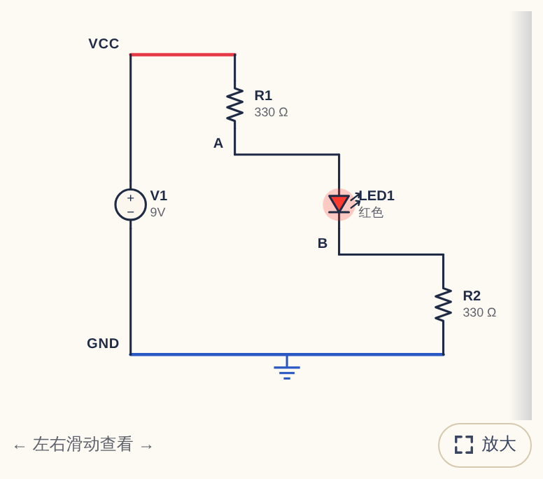
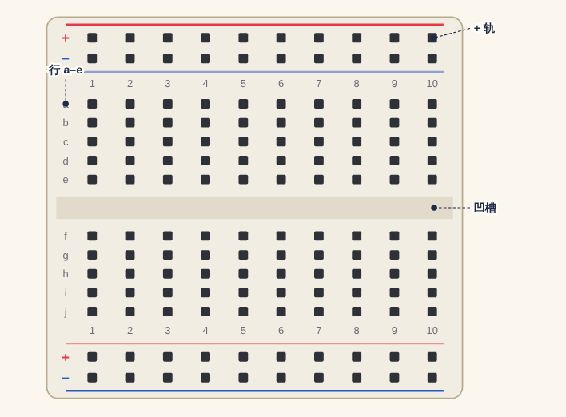
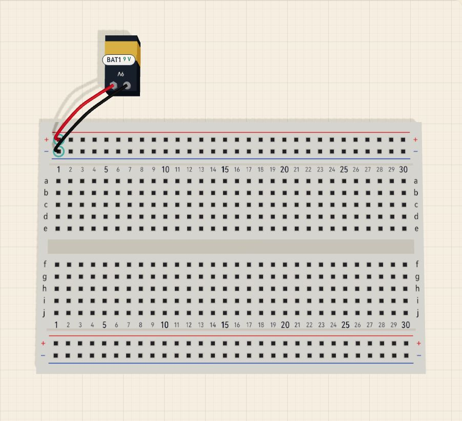
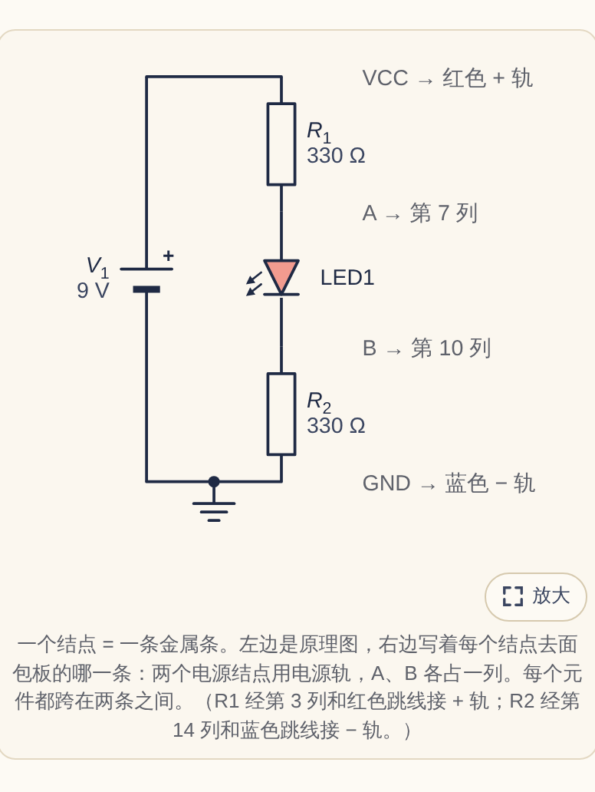
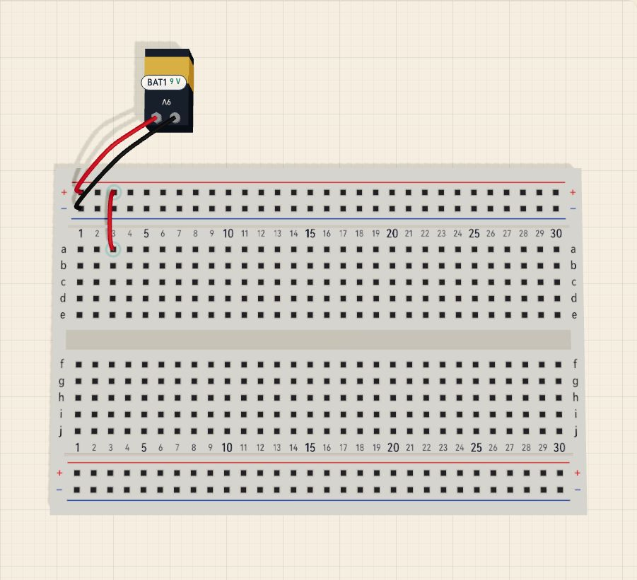
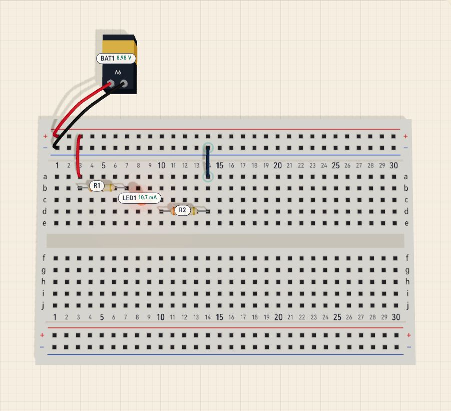

# 1.6 · 从原理图到面包板

| 项目 | 内容 |
|---|---|
| id | `lesson-schematic-to-breadboard` |
| 文件 | `challenges/04-schematic-to-breadboard.json` |
| 类型 | 课程（有分步，每步自动检查） · 难度 2/5 |
| 位置 | World 1 · 基础定律与直流分压 → 1.6 从原理图到面包板（本节第 1 项） |
| 右侧面板 | 轨道由旧的四张卡片自动生成（还没手工精排） |
| 前后 | 上一项 [1.5 lesson-ammeter](../w1/1.05-1-lesson-ammeter.md) · 下一项 [1.7 lesson-series](../w1/1.07-1-lesson-series.md) |
| 先修 | — |
| 概念 | schematic 原理图、node 结点、terminal strip 金属条、node voltage 结点电压 |

**一句话概要**：原理图上的一个结点 = 面包板上的一条金属条。先数结点，再动手。

## 1. 左侧工作台（3D 面包板 → 2D 俯视截图）

截图是程序里真实的 3D 面包板换成俯视角拍的；表格是同一块板的文字版（元件、参数、每只脚插在哪个孔）。

### 1.1 起点：空面包板（学生从零开始搭）

### 1.2 每一步之后的面包板

见第 2 节每个步骤下面的截图（按步骤的自动检查重建：放 / 改 / 拔元件、移动万用表表笔）。

### 1.3 参考答案（「看答案」载入的板子）

| 元件 | 类型 | 参数 | 引脚 → 孔 |
|---|---|---|---|
| BAT1 | battery | variant=9V | +→tp1 -→tn1 |
| W2 | wire |  | a→tp3 b→a3 |
| R1 | resistor | resistance=330 | 1→b3 2→b7 |
| LED1 | led | color=red | anode→c7 cathode→c10 |
| R2 | resistor | resistance=330 | 1→d10 2→d14 |
| W6 | wire |  | a→a14 b→tn14 |

### 1.4 目标原理图（右侧「目标原理图」抽屉）

| 元件 | 类型 | 参数 |
|---|---|---|
| V1 | dc_source | voltage=9 |
| R1 | resistor | resistance=330 |
| LED1 | led | color=red |
| R2 | resistor | resistance=330 |

连接（每个结点上的引脚）：

- **VCC**：V1.+、R1.1
- **A**：R1.2、LED1.anode
- **B**：LED1.cathode、R2.1
- **GND**：R2.2、V1.-

## 2. 右侧面板：学生从上往下看到的内容（单轨流）

### 第 1 步 · 🔍 先看一眼：先认识它：面包板

**拆解「面包板 Breadboard：孔下面是什么」第 1 / 6 层：① 外形：一块打满小孔的塑料板**

你看到的只有塑料和孔。先认坐标，就像棋盘：
- 列号 column：1、2、3 …（真板子 30 或 60 列）
- 行号 row：a–e 在上半区，f–j 在下半区
- 中间凹槽 trench：把上下两半隔开
- 上下边缘的长排：红线 + 轨 和 蓝线 − 轨，叫 **电源轨 power rail**

每个孔有名字：**列号 + 行号**，比如 c5 = 第 5 列、c 行。电源轨的孔叫 tp / tn（top plus / top negative，上方）和 bp / bn（bottom，下方）。

| 区域 | 孔名 | 用来做什么 |
|---|---|---|
| 主区上半 | a1 … e30 | 插元件的脚 |
| 主区下半 | f1 … j30 | 插元件的脚 |
| 中间凹槽 | — | 芯片（DIP）横跨它 |
| 上方电源轨 | tp1…tp30, tn1…tn30 | + 电源、GND |
| 下方电源轨 | bp1…bp30, bn1…bn30 | + 电源、GND |

### 第 2 步 · 🔧 动手搭：先别动手：数一数结点

打开下面的**目标电路图**。用手指沿着导线走：被导线直接连在一起的所有点，算**一个结点**。
这个图里一共有几个结点？先数，再放电池。

**步骤 1**

结点 VCC 和 GND：**电池** + 接 **`tp1`**，− 接 **`tn1`**。

自动检查（做到这些才算完成）：把电池插到 tp1–tn1
板上高亮的孔：tp1、tn1

### 第 3 步 · 💡 想明白：五步法

1. **在图上给每个结点起名**：VCC、A、B、GND。
2. **一个结点 = 一条金属条**（或一条电源轨）：VCC 和 GND 用电源轨，A、B 各占一列。
3. **元件跨在两条金属条之间**：它连哪两个结点，两只脚就插哪两列。
4. 一列不够用时，用**跳线**把两条金属条接成同一个结点。
5. 搭完**逐个结点核对**：每一列上插的脚，是不是正好是图上这个结点连的那些？

*图 `nodes`（schematic）：一个结点 = 一条金属条。左边是原理图，右边写着每个结点去面包板的哪一条：两个电源结点用电源轨，A、B 各占一列。每个元件都跨在两条之间。（R1 经第 3 列和红色跳线接 + 轨；R2 经第 14 列和蓝色跳线接 − 轨。）*

### 第 4 步 · 🔧 动手搭：照着结点搭

结点 A = 第 7 列，结点 B = 第 10 列。搭完用万用表量 A 和 B 对 GND 的电压。

**步骤 2**

给 R1 分一段 VCC：红色**跳线** **`tp3`** → **`a3`**，第 3 列（a–e）现在属于 VCC 结点。

自动检查（做到这些才算完成）：把跳线插到 tp3–a3
板上高亮的孔：tp3、a3

**步骤 3**

**R1**（**`330 Ω`**）：一只脚 **`b3`**（VCC），一只脚 **`b7`**（结点 A）。

自动检查（做到这些才算完成）：把电阻插到 b3–b7
板上高亮的孔：b3、b7

**步骤 4**

**红色 LED**：长脚 **`c7`**（A），短脚 **`c10`**（结点 B）。

自动检查（做到这些才算完成）：把LED 发光二极管插到 c7–c10
板上高亮的孔：c7、c10

**步骤 5**

**R2**（**`330 Ω`**）从结点 B 跨到新的一列：**`d10`** – **`d14`**。

自动检查（做到这些才算完成）：把电阻插到 d10–d14
板上高亮的孔：d10、d14

**步骤 6**

第 14 列接 GND：蓝色**跳线** **`a14`** → **`tn14`**。对照原理图逐个结点核对，然后点**「检查我的电路」**，用万用表量 A、B。

自动检查（做到这些才算完成）：把跳线插到 a14–tn14
板上高亮的孔：a14、tn14

### 第 5 步 · 📏 测一测：测一测：读你自己的仪表

**测量题 1 · `nodes`**（选择题）

> 目标电路图里一共有几个结点？

- A. 3 个
- B. 4 个：VCC、A、B、GND ✅（正确）
- C. 5 个：每个元件一个

答对后显示：

> 电池 + 和 R1 上端连在一起是 VCC；R1 下端和 LED 长脚是 A；LED 短脚和 R2 上端是 B；R2 下端和电池 − 是 GND。

**测量题 2 · `va`**（读数题）

> 万用表：红表笔点结点 A（第 7 列），黑表笔在 GND

- 单位 V · 先写预测 · 参考答案的读数 **5.456 V** · 合理范围 [5.1, 5.8]

答对后显示：

> 电流 ≈ (9 − 1.8) / (330 + 330 + 12) ≈ 10.7 mA，R1 上掉约 3.5 V，所以 A ≈ 5.5 V。

**测量题 3 · `vb`**（读数题）

> 万用表：红表笔点结点 B（第 10 列），黑表笔在 GND

- 单位 V · 先写预测 · 参考答案的读数 **3.528 V** · 合理范围 [3.2, 3.9]

答对后显示：

> 同样的电流流过 R2：10.7 mA × 330 Ω ≈ 3.5 V。A 和 B 之差就是 LED 两端的电压，约 2 V。

### 第 6 步 · 🎒 带走：带走

- 原理图只说**谁和谁连在一起**，不规定插哪个孔。只要每个结点对得上，怎么摆都算对。
- 排错时也按结点查：拿万用表一列一列地量结点电压，和你预测的比，哪里不对就是哪里断了。
- 电流从 VCC 往 GND 走，每经过一个元件电压就往下掉一截：A 比 VCC 低，B 又比 A 低。

趁热练理论题：`basics`

## 3. 测量题一览

| # | id | 题目 | 类型 | 单位 | 状态 | 参考读数 |
|---|---|---|---|---|---|---|
| 1 | nodes | 目标电路图里一共有几个结点？ | 选择 |  |  | 正确：B |
| 2 | va | 万用表：红表笔点结点 A（第 7 列），黑表笔在 GND | voltage | V |  | 5.456 V |
| 3 | vb | 万用表：红表笔点结点 B（第 10 列），黑表笔在 GND | voltage | V |  | 3.528 V |

### 提示按钮（依次显示）

1. 一个结点只需要一条金属条：R1 的下端和 LED 的长脚要在同一列。
2. LED 的短脚和 R2 的一端组成结点 B，也要在同一列。

### 功能测试（「检查我的电路」时跑）

- LED 亮，结点 A、B 的电压合理

## 4. 用到的拆解（全部层的文字，供改写参考）

### 拆解 `breadboard`：面包板 Breadboard：孔下面是什么

*从外形到金属夹片，再到“每条金属条就是电路里的一个结点（node）”。看懂这一层，以后任何电路都能自己插。*

**拆解「面包板 Breadboard：孔下面是什么」第 1 / 6 层：① 外形：一块打满小孔的塑料板**

你看到的只有塑料和孔。先认坐标，就像棋盘：
- 列号 column：1、2、3 …（真板子 30 或 60 列）
- 行号 row：a–e 在上半区，f–j 在下半区
- 中间凹槽 trench：把上下两半隔开
- 上下边缘的长排：红线 + 轨 和 蓝线 − 轨，叫 **电源轨 power rail**

每个孔有名字：**列号 + 行号**，比如 c5 = 第 5 列、c 行。电源轨的孔叫 tp / tn（top plus / top negative，上方）和 bp / bn（bottom，下方）。

| 区域 | 孔名 | 用来做什么 |
|---|---|---|
| 主区上半 | a1 … e30 | 插元件的脚 |
| 主区下半 | f1 … j30 | 插元件的脚 |
| 中间凹槽 | — | 芯片（DIP）横跨它 |
| 上方电源轨 | tp1…tp30, tn1…tn30 | + 电源、GND |
| 下方电源轨 | bp1…bp30, bn1…bn30 | + 电源、GND |

**拆解「面包板 Breadboard：孔下面是什么」第 2 / 6 层：② X 光：孔下面藏着金属条**

把塑料变透明，就能看到孔下面的 **金属夹片（metal strip / clip）**。规律只有三条：
1. 主区里每一 **列** 有两条竖着的金属条：a–e 一条，f–j 一条。
2. 每条 **电源轨** 是一条横着的长金属条：tp1 到 tp30 全通。
3. 金属条之间互不相连：凹槽 两边不通，相邻两列不通，红轨和蓝轨不通，上方轨和下方轨也不通。

插在 **同一条金属条** 上的两只脚，就等于用导线连在一起了——这就是面包板不用焊接的秘密。

**拆解「面包板 Breadboard：孔下面是什么」第 3 / 6 层：③ 拆出一条夹片：弹片夹住引脚**

把一条 a–e 的夹片拆出来侧着看：一块 磷青铜底板 上冲出 5 对 V 形 **弹片**，每对对应一个孔。元件的脚 插进去时把弹片撑开，弹片的回弹力 从两边夹紧它——这就是电接触。

所以：
- **一个孔只能插一只脚**。两只脚挤一个孔，会把弹片撑坏，接触变差。
- 线径要合适：0.3–0.8 mm（22–29 AWG）。太粗撑坏弹片，太细夹不紧，就会“时好时坏”。
- 插到底：脚只碰到弹片的尖端时，接触电阻会大很多。

**拆解「面包板 Breadboard：孔下面是什么」第 4 / 6 层：④ 等效电路：每条金属条 = 一个结点**

电路分析里，**结点（node）** 是“电位相同、用导线连在一起的所有点”。面包板上一条金属条正好就是一个结点。所以搭电路时，你的思路应该是：

1. 在原理图上数出有几个结点（VCC、N1、GND …）；
2. 给每个结点分配一条金属条（或一条电源轨）；
3. 把连到这个结点的每只脚插进这条金属条的任意孔。

例子（第 1 课）：第 5 列 a–e 是 VCC（用跳线接到 + 轨），电阻 从第 5 列跨到第 8 列，第 8 列 a–e 就是结点 N1，LED 的正极也插在第 8 列，所以电阻和 LED 在 N1 相连。

**最常见的错误**：把一个元件的两只脚插在同一列——两只脚在同一个结点上，元件两端电压 $V = 0$，被金属条 **短路** 了。

**拆解「面包板 Breadboard：孔下面是什么」第 5 / 6 层：⑤ 自己判断：这两个孔通不通？**

把鼠标放在表格的每一行上，图上会圈出那两个孔。先自己判断，再看答案列。

| 两个孔 | 通吗？ | 为什么 |
|---|---|---|
| a5 – e5 | ✔ 通 | 同一列、同一半：同一条金属条 |
| b7 – b8 | ✘ 不通 | 不同列：两条金属条 |
| e2 – f2 | ✘ 不通 | 隔着凹槽：上下两半是两条 |
| tp1 – tp10 | ✔ 通 | 同一条电源轨 |
| 电阻插 g9 和 i9 | ⚠ 被短路 | 两只脚在同一个结点，$V_R = 0$，$I_R = 0$ |

**拆解「面包板 Breadboard：孔下面是什么」第 6 / 6 层：⑥ 算一算：金属条不是完美导线**

做实验时把金属条当成理想导线，大多数时候没问题。但工程师要知道它“差多少”，才知道什么时候不能忽略：

- 接触电阻 每个触点约 10–50 mΩ。一个元件两只脚，串进去约 $2R_c$。接 470 Ω 电阻时误差约 $\frac{0.1}{470} ≈ 0.02 %$，完全可以忽略；但如果你用面包板测 0.1 Ω 的电流检测电阻，误差就有几十 %。
- 相邻金属条之间的寄生电容 约 2–5 pF。它的容抗 $X_C = \frac{1}{2πfC}$ 随频率下降：1 kHz 时约 50 MΩ（看不见），10 MHz 时只剩约 5 kΩ（信号会“漏”到隔壁一列）。所以 **面包板适合几 MHz 以下** 的电路。
- 电流：每条金属条一般不超过约 1 A，大电流会发热、接触变差。

- 公式 `R_{total} = R + 2R_c`：两个接触电阻串在元件两端
- 公式 `X_C = \frac{1}{2π f C}`：C = 3 pF：f = 1 kHz → 53 MΩ；f = 10 MHz → 5.3 kΩ

**一句话记住**：面包板 = 一堆 **结点**：每列的 a–e 是一个，f–j 是一个，每条电源轨是一个。搭电路就是“给原理图上的每个结点分配一条金属条”。

## 6. English（界面英文版的同一份内容）

展开英文

### Node 1 · 🔍 Look first：Meet it first: Breadboard

**Teardown「The breadboard: what is under the holes」layer 1 of 6：① Outside: a plastic board full of holes**

All you can see is plastic and holes. Learn the coordinates first, like a chessboard:
- column numbers: 1, 2, 3 … (a real board has 30 or 60)
- row letters: a–e in the upper half, f–j in the lower half
- the centre trench separates the two halves
- the long rows along the edges: the red + rail and the blue − rail, called **power rails**

Every hole has a name: **column + row**, e.g. c5 = column 5, row c. Rail holes are tp / tn (top plus / top negative) and bp / bn (bottom).

| Area | Hole names | Used for |
|---|---|---|
| Upper main area | a1 … e30 | component leads |
| Lower main area | f1 … j30 | component leads |
| Centre trench | — | chips (DIP) straddle it |
| Top rails | tp1…tp30, tn1…tn30 | + supply, GND |
| Bottom rails | bp1…bp30, bn1…bn30 | + supply, GND |

### Node 2 · 🔧 Build：Hands off for a moment: count the nodes

Open the **target schematic** below. Trace the wires with your finger: every set of points joined directly by wire is **one node**.
How many nodes does this drawing have? Count first, then place the battery.

**Step 1**

Nodes VCC and GND: **battery** + in **`tp1`**, − in **`tn1`**.

Checked automatically：Place the Battery at tp1–tn1
Holes highlighted：tp1、tn1

### Node 3 · 💡 Why：Five steps

1. **Name every node on the drawing**: VCC, A, B, GND.
2. **One node = one metal strip** (or one rail): VCC and GND use the rails, A and B get a column each.
3. **Each part bridges two strips**: whichever two nodes it connects, its two legs go into those two columns.
4. If one column is not enough, join two strips into one node with a **jumper**.
5. When you are done, **check node by node**: are the legs in each column exactly the ones this node connects on the drawing?

[figure `nodes`]

*Figure `nodes`（schematic）：一个结点 = 一条金属条。左边是原理图，右边写着每个结点去面包板的哪一条：两个电源结点用电源轨，A、B 各占一列。每个元件都跨在两条之间。（R1 经第 3 列和红色跳线接 + 轨；R2 经第 14 列和蓝色跳线接 − 轨。）*

### Node 4 · 🔧 Build：Build it node by node

Node A = column 7, node B = column 10. When it is built, measure A and B relative to GND.

**Step 2**

A piece of VCC for R1: red **jumper** **`tp3`** → **`a3`**; column 3 (a–e) now belongs to the VCC node.

Checked automatically：Place the Jumper wire at tp3–a3
Holes highlighted：tp3、a3

**Step 3**

**R1** (**`330 Ω`**): one leg in **`b3`** (VCC), the other in **`b7`** (node A).

Checked automatically：Place the Resistor at b3–b7
Holes highlighted：b3、b7

**Step 4**

**Red LED**: long lead **`c7`** (A), short lead **`c10`** (node B).

Checked automatically：Place the LED at c7–c10
Holes highlighted：c7、c10

**Step 5**

**R2** (**`330 Ω`**) from node B to a new column: **`d10`** – **`d14`**.

Checked automatically：Place the Resistor at d10–d14
Holes highlighted：d10、d14

**Step 6**

Column 14 goes to GND: blue **jumper** **`a14`** → **`tn14`**. Check node by node against the schematic, then press **Check my circuit** and measure A and B.

Checked automatically：Place the Jumper wire at a14–tn14
Holes highlighted：a14、tn14

### Node 5 · 📏 Measure：Measure: read your own instruments

**Question 1 · `nodes`**（multiple choice）

> How many nodes does the target schematic have?

- A. 3
- B. 4: VCC, A, B, GND ✅ (right)
- C. 5: one per part

Shown once right:

> Battery + and R1's top are VCC; R1's bottom and the LED's long lead are A; the LED's short lead and R2's top are B; R2's bottom and battery − are GND.

**Question 2 · `va`**（reading）

> Multimeter: red probe on node A (column 7), black probe on GND

- unit V · predict first · range [5.1, 5.8]

Shown once right:

> Current ≈ (9 − 1.8) / (330 + 330 + 12) ≈ 10.7 mA; R1 drops about 3.5 V, so A ≈ 5.5 V.

**Question 3 · `vb`**（reading）

> Multimeter: red probe on node B (column 10), black probe on GND

- unit V · predict first · range [3.2, 3.9]

Shown once right:

> The same current flows through R2: 10.7 mA × 330 Ω ≈ 3.5 V. The difference between A and B is the voltage across the LED, about 2 V.

### Node 6 · 🎒 Take away：Take away

- A schematic only says **what connects to what**, not which hole. Any layout whose nodes match is correct.
- Fault-finding goes by nodes too: measure node voltages column by column and compare with your prediction — where they disagree is where it is broken.
- Current flows from VCC to GND and the voltage steps down at every part: A is below VCC, and B is below A.

Practise：`basics`

**Hints**

1. A node needs only one strip: R1's lower end and the LED's long lead go in the same column.
2. The LED's short lead and one end of R2 form node B — same column for them too.

