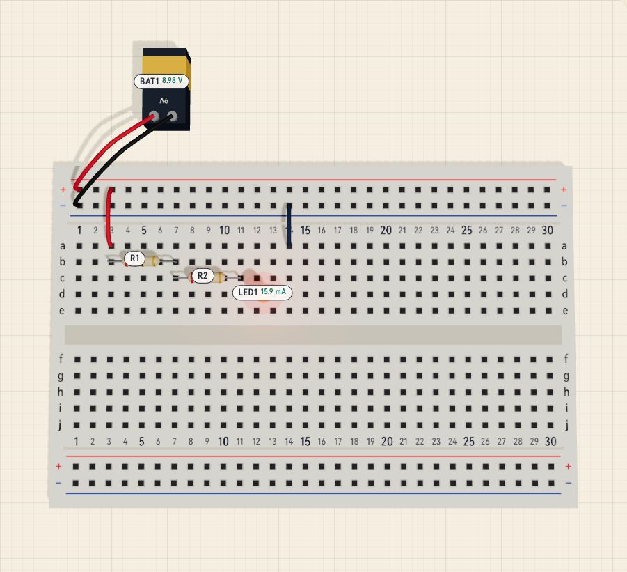
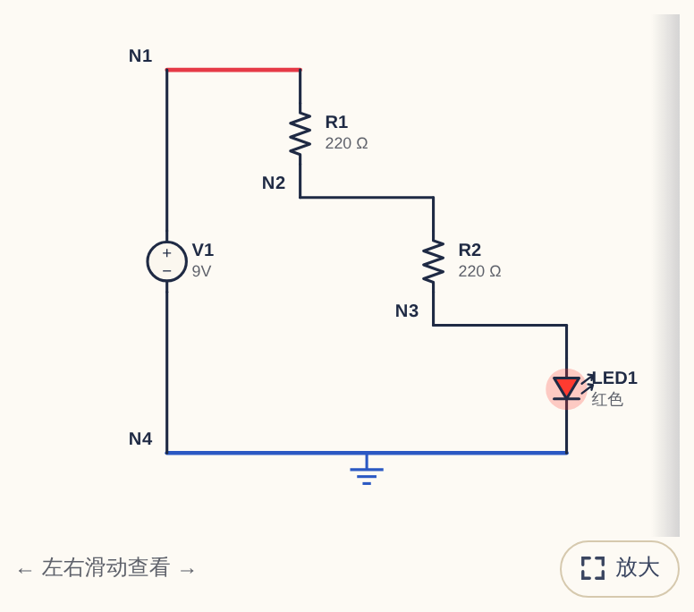
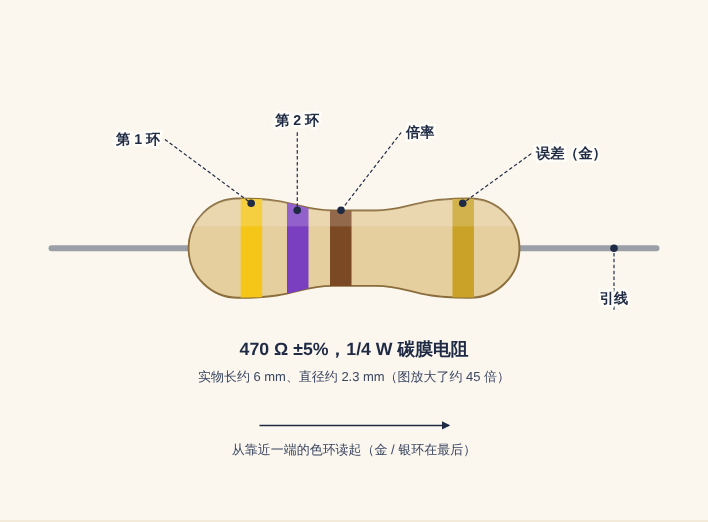
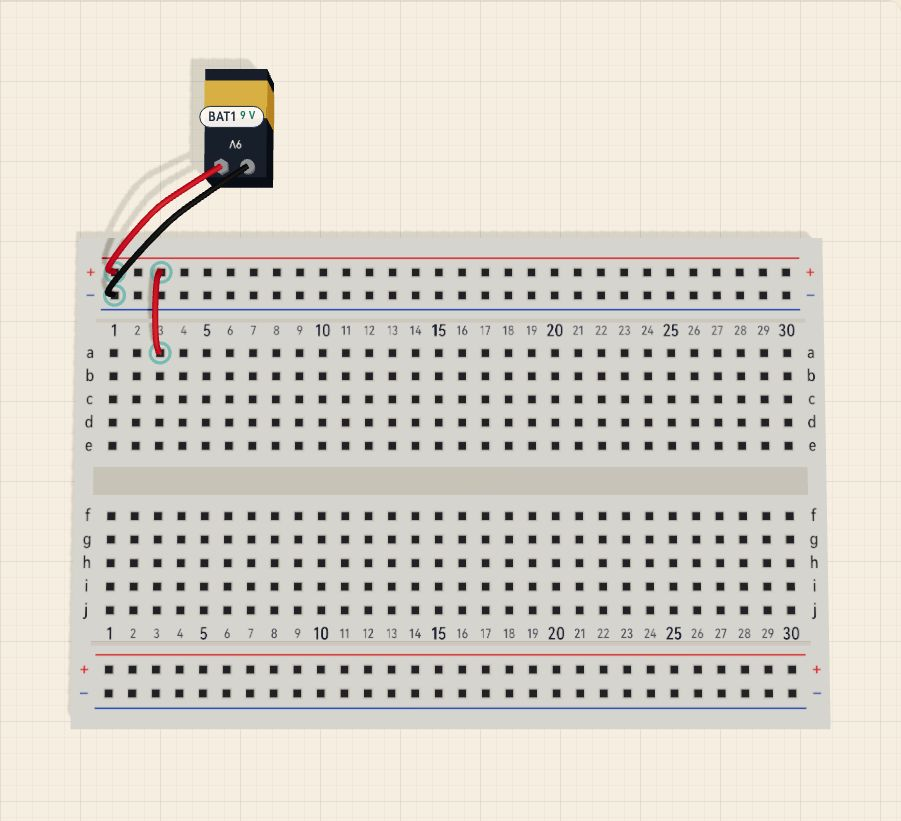
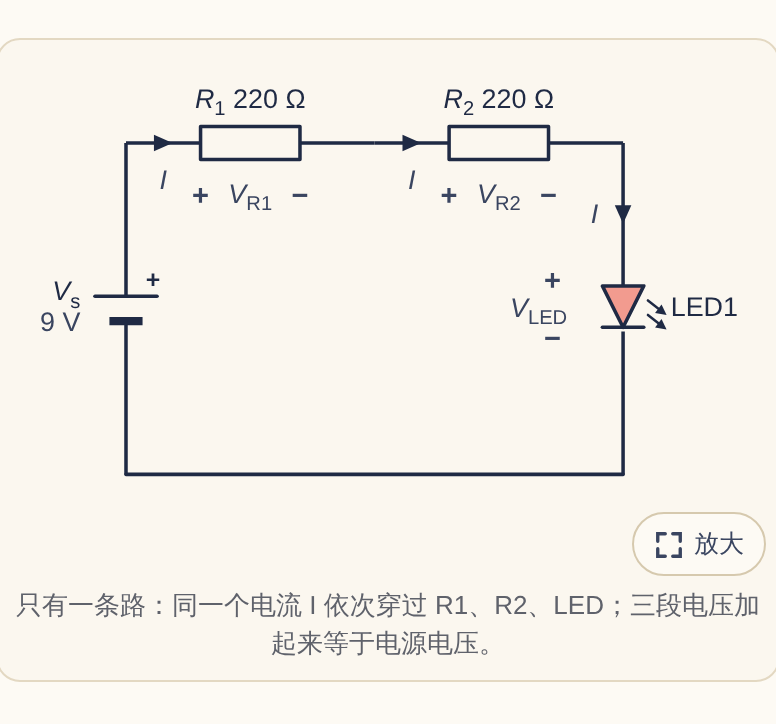

# 1.7 · 串联：只有一条路

| 项目 | 内容 |
|---|---|
| id | `lesson-series` |
| 文件 | `challenges/05-series-resistors.json` |
| 类型 | 课程（有分步，每步自动检查） · 难度 2/5 |
| 位置 | World 1 · 基础定律与直流分压 → 1.7 串联与 KVL（本节第 1 项） |
| 右侧面板 | 轨道由旧的四张卡片自动生成（还没手工精排） |
| 前后 | 上一项 [1.6 lesson-schematic-to-breadboard](../w1/1.06-1-lesson-schematic-to-breadboard.md) · 下一项 [1.7 challenge-two-leds-series](../w1/1.07-2-challenge-two-leds-series.md) |
| 先修 | — |
| 概念 | series 串联、equivalent resistance 等效电阻、voltage division 分压、KVL |

**一句话概要**：两个电阻首尾相接：电流只有一条路可走，电压被它们分掉。

## 1. 左侧工作台（3D 面包板 → 2D 俯视截图）

截图是程序里真实的 3D 面包板换成俯视角拍的；表格是同一块板的文字版（元件、参数、每只脚插在哪个孔）。

### 1.1 起点：空面包板（学生从零开始搭）

### 1.2 每一步之后的面包板

见第 2 节每个步骤下面的截图（按步骤的自动检查重建：放 / 改 / 拔元件、移动万用表表笔）。

### 1.3 参考答案（「看答案」载入的板子）

| 元件 | 类型 | 参数 | 引脚 → 孔 |
|---|---|---|---|
| BAT1 | battery | variant=9V | +→tp1 -→tn1 |
| W2 | wire |  | a→tp3 b→a3 |
| R1 | resistor | resistance=220 | 1→b3 2→b7 |
| R2 | resistor | resistance=220 | 1→c7 2→c11 |
| LED1 | led | color=red | anode→d11 cathode→d14 |
| W6 | wire |  | a→a14 b→tn14 |

### 1.4 目标原理图（右侧「目标原理图」抽屉）

| 元件 | 类型 | 参数 |
|---|---|---|
| V1 | dc_source | voltage=9 |
| R1 | resistor | resistance=220 |
| R2 | resistor | resistance=220 |
| LED1 | led | color=red |

连接（每个结点上的引脚）：

- **N1**：V1.+、R1.1
- **N2**：R1.2、R2.1
- **N3**：R2.2、LED1.anode
- **N4**：LED1.cathode、V1.-

## 2. 右侧面板：学生从上往下看到的内容（单轨流）

### 第 1 步 · 🔍 先看一眼：先认识它：电阻

**拆解「电阻 Resistor：一圈碳膜决定的数字」第 1 / 7 层：① 外形：两只脚、一段带色环的小棒**

这是课程里最常见的 **axial resistor（轴向引线电阻）**：一段 米黄色的小棒，两头各伸出一根 镀锡铜引线 lead。它 **没有极性**（polarity）：两只脚完全一样，怎么插都行。

小棒上印的不是数字，而是 4 条 **colour band（色环）**：
- 前两条 第 1 环、第 2 环 是阻值的两位 **有效数字**；
- 第 3 环 是 **倍率**（multiplier），即乘以 10 的几次方；
- 和其他环隔开一点的 第 4 环 是 **误差**（tolerance），金色 = ±5%。

为什么不直接印数字？电阻是圆柱，印的字转过去就看不见，而且只有几毫米长；色环 **从任何方向都能读**。大小则决定了它能承受的 **功率**：这种 6 mm 长的是 **1/4 W**（0.25 W），后面第 ⑥ 层会算它。

| 部位 | 是什么 | 图上这只（470 Ω） |
|---|---|---|
| 第 1 环 | 第一位有效数字 | 黄 = 4 |
| 第 2 环 | 第二位有效数字 | 紫 = 7 |
| 第 3 环 | 倍率 ×10ⁿ | 棕 = ×10¹ |
| 第 4 环 | 误差 | 金 = ±5% |
| 引线 | 镀锡铜线，无极性 | 插进面包板两条不同的金属条 |

### 第 2 步 · 🔧 动手搭：先猜：电流会变大还是变小？

先只放电源和两个电阻，**首尾相接**。
猜一下：和只用一个 220 Ω 相比，两个串起来以后，LED 的电流会变大、变小，还是不变？把你的猜测记在心里。

**步骤 1**

**电池** + 接 **`tp1`**，− 接 **`tn1`**；红色**跳线** **`tp3`** → **`a3`**。

自动检查（做到这些才算完成）：把电池插到 tp1–tn1；把跳线插到 tp3–a3
板上高亮的孔：tp1、tn1、tp3、a3

**步骤 2**

**R1**（**`220 Ω`**）插 **`b3`** – **`b7`**。

自动检查（做到这些才算完成）：把电阻插到 b3–b7
板上高亮的孔：b3、b7

**步骤 3**

**R2**（**`220 Ω`**）插 **`c7`** – **`c11`**：它的第一只脚和 R1 的第二只脚都在第 7 列，首尾相接。

自动检查（做到这些才算完成）：把电阻插到 c7–c11
板上高亮的孔：c7、c11

**步骤 4**

看一眼：从 + 到第 11 列只有一条路，中间没有任何岔口。这就是串联。点「下一步」。
板上高亮的孔：a3、b3、b7、c7、c11

### 第 3 步 · 💡 想明白：一条路，同一个电流

- **串联 = 只有一条路。** 电流从 + 出发，必须依次穿过 R1、R2、LED，没有岔路，所以**流过每个元件的电流都一样**。

*图 `series`（schematic）：只有一条路：同一个电流 I 依次穿过 R1、R2、LED；三段电压加起来等于电源电压。*

- 电阻串联，总电阻**相加**：$R_{eq} = R_1 + R_2$。路越长越难走，电流变小。
- 电压按电阻的比例**分**掉：两个一样的电阻，各分到一样多。所有元件的电压加起来正好等于电源电压——这就是 **KVL**（基尔霍夫电压定律）。
$$I = \frac{V_s - V_f}{R_1 + R_2}$$

（这一步下面列着这节课的计算卡片，点开就地展开：`series-resistance`、`kvl`、`led-current`，全文见第 6 节）

### 第 4 步 · 🔧 动手搭：接上 LED，量一量

把 LED 和回到 GND 的跳线接上，然后用万用表分别量 R1、R2、LED 两端的电压。

**步骤 5**

**红色 LED**：长脚 **`d11`**，短脚 **`d14`**。

自动检查（做到这些才算完成）：把LED 发光二极管插到 d11–d14
板上高亮的孔：d11、d14

**步骤 6**

蓝色**跳线** **`a14`** → **`tn14`** 回到 GND。整条路：+ → R1 → R2 → LED → GND。

自动检查（做到这些才算完成）：把跳线插到 a14–tn14
板上高亮的孔：a14、tn14

**步骤 7**

点**「检查我的电路」**，然后用万用表（红表笔一端，Shift + 单击放黑表笔另一端）量三段电压，填进测量题。

### 第 5 步 · 📏 测一测：测一测：读你自己的仪表

**测量题 1 · `ur1`**（读数题）

> R1 两端的电压（红表笔在靠电源的一端）

- 单位 V · 先写预测 · 参考答案的读数 **3.493 V** · 合理范围 [3.3, 3.75]

答对后显示：

> 电流 ≈ (9 − 1.8) / (220 + 220 + 12) ≈ 15.9 mA，220 Ω × 15.9 mA ≈ 3.5 V。

**测量题 2 · `ur2`**（读数题）

> R2 两端的电压（红表笔在靠 R1 的一端）

- 单位 V · 参考答案的读数 **3.493 V** · 合理范围 [3.3, 3.75]

答对后显示：

> 同一个电流、同样的电阻，电压也一样。

**测量题 3 · `uled`**（读数题）

> LED 两端的电压（红表笔在长脚）

- 单位 V · 参考答案的读数 **1.991 V** · 合理范围 [1.85, 2.1]

答对后显示：

> 1.8 V 再加上 12 Ω × 15.9 mA ≈ 0.19 V。

**测量题 4 · `kvl`**（计算题（用自己的读数算））

> 用你的三个读数算：V_R1 + V_R2 + V_LED =

- 单位 V · 参考答案的读数 **8.976 V** · 合理范围 [8.85, 9.05] · 公式 `ur1 + ur2 + uled`

答对后显示：

> 三段加起来就是电池电压：沿着这一圈，电源抬高多少，元件就降下多少（KVL）。

### 第 6 步 · 🎒 带走：带走

- 串联：**电流处处相同**，**电阻相加**，**电压按比例分**。
- 用两个电阻串联，可以凑出手边没有的阻值：220 Ω + 220 Ω = 440 Ω。
- 串联电路的缺点：一个元件断了，整条路都断——老式圣诞灯串一颗坏了全串都灭，就是这个原因。

趁热练理论题：`basics`、`equivalence`

## 3. 测量题一览

| # | id | 题目 | 类型 | 单位 | 状态 | 参考读数 |
|---|---|---|---|---|---|---|
| 1 | ur1 | R1 两端的电压（红表笔在靠电源的一端） | voltage | V |  | 3.493 V |
| 2 | ur2 | R2 两端的电压（红表笔在靠 R1 的一端） | voltage | V |  | 3.493 V |
| 3 | uled | LED 两端的电压（红表笔在长脚） | voltage | V |  | 1.991 V |
| 4 | kvl | 用你的三个读数算：V_R1 + V_R2 + V_LED = | formula | V |  | 8.976 V |

### 提示按钮（依次显示）

1. R1 的第二只脚和 R2 的第一只脚必须在同一列，否则它们没有连上。
2. 串联电路中间不要接到电源轨上：整个电路只有一条路径。

### 功能测试（「检查我的电路」时跑）

- LED 亮，两个电阻上的电压合理

## 4. 用到的拆解（全部层的文字，供改写参考）

### 拆解 `resistor`：电阻 Resistor：一圈碳膜决定的数字

*从色环读数，到陶瓷棒上的碳膜（carbon film）和激光切出的螺旋，再到 R = ρL/A、欧姆定律的直线、额定功率和误差。看完你就知道“470 Ω”这个数字是怎么做出来的，以及它在什么时候不再可信。*

**拆解「电阻 Resistor：一圈碳膜决定的数字」第 1 / 7 层：① 外形：两只脚、一段带色环的小棒**

这是课程里最常见的 **axial resistor（轴向引线电阻）**：一段 米黄色的小棒，两头各伸出一根 镀锡铜引线 lead。它 **没有极性**（polarity）：两只脚完全一样，怎么插都行。

小棒上印的不是数字，而是 4 条 **colour band（色环）**：
- 前两条 第 1 环、第 2 环 是阻值的两位 **有效数字**；
- 第 3 环 是 **倍率**（multiplier），即乘以 10 的几次方；
- 和其他环隔开一点的 第 4 环 是 **误差**（tolerance），金色 = ±5%。

为什么不直接印数字？电阻是圆柱，印的字转过去就看不见，而且只有几毫米长；色环 **从任何方向都能读**。大小则决定了它能承受的 **功率**：这种 6 mm 长的是 **1/4 W**（0.25 W），后面第 ⑥ 层会算它。

| 部位 | 是什么 | 图上这只（470 Ω） |
|---|---|---|
| 第 1 环 | 第一位有效数字 | 黄 = 4 |
| 第 2 环 | 第二位有效数字 | 紫 = 7 |
| 第 3 环 | 倍率 ×10ⁿ | 棕 = ×10¹ |
| 第 4 环 | 误差 | 金 = ±5% |
| 引线 | 镀锡铜线，无极性 | 插进面包板两条不同的金属条 |

**拆解「电阻 Resistor：一圈碳膜决定的数字」第 2 / 7 层：② 读色环：470 Ω 和 10 kΩ**

规则只有一句：**阻值 = (第 1 环)(第 2 环) × 10^(第 3 环)**。每种颜色对应一个数字，见下表和 图下方的色卡。

**例 1**：黄 紫 棕 金（第 1 课、第 3 课用的那只）
$$R = 47 × 10^{1} = 470 Ω，误差 ±5% → 446.5 … 493.5 Ω$$
**例 2**：棕 黑 橙 金（电位器、分压实验里常见）
$$R = 10 × 10^{3} = 10 000 Ω = 10 kΩ，误差 ±5% → 9.5 … 10.5 kΩ$$

**从哪头读？** 金、银环一定在最后；第 1 环更靠近端头。拿不准时就两头都读一遍，读出的值不在标准系列（E12 / E24，见第 ⑦ 层）里的那个方向就是反的。

**蓝色身体、5 条环** 的是 **metal film resistor（金属膜电阻）**：前三条是有效数字，第 4 条是倍率，第 5 条是误差（棕 = ±1%）。例如 470 Ω ±1% = 黄 紫 黑 黑 棕（470 × 10⁰）。

记颜色的顺序：黑棕红橙黄绿蓝紫灰白，正好是彩虹（红→紫）夹在“黑棕”和“灰白”之间。

| 颜色 | 数字 | 倍率 | 误差 |
|---|---|---|---|
| 黑 | 0 | ×1 | — |
| 棕 | 1 | ×10 | ±1% |
| 红 | 2 | ×100 | ±2% |
| 橙 | 3 | ×1 k | — |
| 黄 | 4 | ×10 k | — |
| 绿 | 5 | ×100 k | ±0.5% |
| 蓝 | 6 | ×1 M | ±0.25% |
| 紫 | 7 | ×10 M | ±0.1% |
| 灰 | 8 | — | — |
| 白 | 9 | — | — |
| 金 | — | ×0.1 | ±5% |
| 银 | — | ×0.01 | ±10% |

- 公式 `R = (d_1 d_2) × 10^{m}`：黄紫棕：47 × 10¹ = 470 Ω；棕黑橙：10 × 10³ = 10 kΩ

**拆解「电阻 Resistor：一圈碳膜决定的数字」第 3 / 7 层：③ X 光：陶瓷棒、一层膜、一道螺旋槽**

把那层米黄色的 **epoxy paint（环氧漆）** 变透明，里面只有四样东西：
1. 陶瓷棒 ceramic core：绝缘、耐热，只是个“骨架”，电流不走它。
2. 导电膜 film：棒外面镀的一层很薄的膜，**电流全部从这层膜里流过**。碳膜电阻（carbon film，米黄色身体）镀的是碳，约 1 µm 厚；金属膜电阻（metal film，蓝色身体）镀的是镍铬合金（NiCr），只有几十 nm 厚。
3. 螺旋槽 spiral cut：工厂用激光沿螺旋线把膜切开，电流只能 **沿着螺旋绕圈** 从一头走到另一头。
4. 金属端帽 end cap：压在两端，把膜和 引线 连起来。

**阻值就是由这道螺旋决定的**：切得越密、绕的圈越多，电阻越大。生产时一边切一边测，测到 470 Ω 就停——这叫 **laser trimming（激光修调）**。下一层用公式解释为什么。

**拆解「电阻 Resistor：一圈碳膜决定的数字」第 4 / 7 层：④ 为什么螺旋决定阻值：R = ρL/A**

一段均匀导体的电阻由三件事决定：材料的 **resistivity（电阻率）ρ**、长度 L、截面积 A：
$$R = \frac{ρL}{A}$$
- 越 长，电子要走的路越远 → R ∝ L；
- 越 粗，并排能走的路越多 → R ∝ 1/A。

膜很薄（厚度 t），截面积 $A = w·t$（w 是膜的宽度），所以 $R = \frac{ρ}{t}·\frac{L}{w}$。$R_□ = \frac{ρ}{t}$ 叫 **sheet resistance（方块电阻）**，单位 Ω/□：一块 **正方形** 膜（L = w）不管多大，电阻都是 $R_□$。于是阻值 = $R_□$ × “这条膜有几个方块长”。

**带数字算一遍**（碳膜：ρ ≈ 3×10⁻⁵ Ω·m，t ≈ 1 µm → $R_□ ≈ 30 Ω/□$；棒长 6 mm，周长 6.3 mm）：
- 不切：电流沿 6 mm 长、6.3 mm 宽的一整张膜走，$R = 30 × \frac{6}{6.3} ≈ 29 Ω$；
- 螺旋切成 0.5 mm 宽、绕 12 圈：膜变成一条 12 × 6.3 ≈ 75 mm 长、0.5 mm 宽的窄带，$R = 30 × \frac{75}{0.5} = 30 × 150 = 4.5 kΩ$。

同一根棒、同一种膜，只靠切法就从 29 Ω 变到 4.5 kΩ——这就是 激光螺旋 的作用。要 MΩ 级就换 $R_□$ 更大的膜，要几 Ω 就用更厚的膜或金属丝绕（wirewound）。

- 公式 `R = \frac{ρL}{A} = R_□ · \frac{L}{w}`：$R_□$ = ρ / t：方块电阻
- 公式 `R = 30 Ω × \frac{75 mm}{0.5 mm} = 4.5 kΩ`：螺旋切后的膜：150 个方块

**拆解「电阻 Resistor：一圈碳膜决定的数字」第 5 / 7 层：⑤ 等效电路：一个 R，一条过原点的直线**

在电路里，电阻就是 一个参数 R（ANSI 画锯齿，IEC 画方框）。它的全部行为是 **Ohm’s law（欧姆定律）**：
$$V = R·I ⇔ I = \frac{V}{R}$$
注意参考方向：电流 I 从 V 的 + 端 流进（**关联参考方向** passive sign convention），这样公式里没有负号。

把它画成 **V–I 图**：每个电阻是一条 **过原点的直线**，斜率是 $\frac{1}{R}$（也叫 **conductance 电导** G，单位 S）：
- 470 Ω：9 V 时 $I = \frac{9}{470} = 19.1 mA$；
- 1 kΩ：9 V 时 9 mA；
- 10 kΩ：9 V 时只有 0.9 mA，线几乎贴着横轴。

“直线”是电阻最重要的性质——**linear（线性）**：电压加倍，电流也加倍；正反两个方向一样。后面的 LED、二极管就 **不是** 直线，这正是它们需要单独拆开讲的原因。

- 公式 `V = R·I`：关联参考方向（电流从 + 端流入）
- 公式 `G = \frac{1}{R} = \frac{1}{470 Ω} = 2.13 mS`：V–I 图里直线的斜率

**拆解「电阻 Resistor：一圈碳膜决定的数字」第 6 / 7 层：⑥ 电阻会发热：功率和 1/4 W 额定值**

电流流过膜时，电子不断撞上原子，电能全部变成 **热**（焦耳热 Joule heating）。每秒变成热的能量就是功率：
$$P = V·I = I^{2}R = \frac{V^{2}}{R}$$
三个式子是同一件事，用欧姆定律互换。哪个量已知就用哪个。

**第 1 课的 470 Ω**：9 V 电池、红 LED，电流约 14.9 mA，电阻两端约 7.0 V：
$$P = I^{2}R = (0.0149)^{2} × 470 ≈ 0.104 W$$
小于 额定值 0.25 W，安全。这时它比室温高约 $0.104 × 250 ≈ 26 °C$（250 °C/W 是这种小电阻的 **thermal resistance 热阻**）——摸上去温温的，正常。

**危险的情况**：把一个 220 Ω 直接接在 9 V 上，$P = \frac{81}{220} = 0.37 W$，超过额定值，会烫手、变色、冒烟，阻值永久漂移。100 Ω 直接接 9 V 是 0.81 W，几秒就烧焦。

**反过来算**：1/4 W 的 470 Ω 两端最多能加 $V = \sqrt{P·R} = \sqrt{0.25 × 470} ≈ 10.8 V$。经验是只用到额定值的一半，即 ≤ 0.125 W。

| 情况 | V | I | P | 1/4 W 行吗 |
|---|---|---|---|---|
| 第 1 课 470 Ω | 7.0 V | 14.9 mA | 0.10 W | ✔ 温温的 |
| 串联课 220 Ω | 3.5 V | 16 mA | 0.056 W | ✔ |
| 220 Ω 直接接 9 V | 9 V | 41 mA | 0.37 W | ✘ 过热 |
| 100 Ω 直接接 9 V | 9 V | 90 mA | 0.81 W | ✘ 烧焦 |

- 公式 `P = V·I = I^{2}R = \frac{V^{2}}{R}`：单位 W（瓦）= V·A
- 公式 `V_{max} = \sqrt{P_{rated}·R} = \sqrt{0.25 × 470} ≈ 10.8 V`

**拆解「电阻 Resistor：一圈碳膜决定的数字」第 7 / 7 层：⑦ 真实电阻差多少：误差、温漂、寄生参数**

**误差 tolerance**：金环 ±5% 的 470 Ω，真实值在 446.5–493.5 Ω 之间任何地方。所以电阻只做成 **标准值系列**：E12（±10%，每十倍 12 个值：10、12、15、18、22、27、33、39、47、56、68、82）和 E24（±5%，再插进 11、13、16、20、24、30、36、43、51、62、75、91）。相邻值的 误差带刚好接上，任何阻值都能找到一个“误差范围内”的标准件。算出 467 Ω → 选 470 Ω。

**温漂 temperature coefficient**：$R(T) = R_0(1 + α·ΔT)$。碳膜 α ≈ −300 ppm/°C（变热时阻值 **下降**），金属膜约 ±50 ppm/°C。前面那只热了 26 °C 的 470 Ω 只变了约 $470 × 300×10^{-6} × 26 ≈ 3.7 Ω$，比误差小得多。

**寄生参数 parasitics**：螺旋膜本身就是一个小 **线圈**，带来 串联电感 $L_s$ 几 nH；两个端帽像两块极板，带来 并联电容 $C_p$ 零点几 pF。它们只有在几十 MHz 以上才显出来；本课程最高到几百 kHz，可以忽略。

**仿真器里**：电阻是 理想的 R——精确等于标称值、没有误差、不发热、**不检查功率**。所以仿真里 100 Ω 接 9 V 不会冒烟，但真实的 1/4 W 电阻会。每次接线前都用上一层的 $P = \frac{V^{2}}{R}$ 检查一遍。

| 性质 | 碳膜（米黄） | 金属膜（蓝） | 仿真器 |
|---|---|---|---|
| 误差 | ±5% | ±1% | 0 |
| 温漂 α | ≈ −300 ppm/°C | ≈ ±50 ppm/°C | 0 |
| 额定功率 | 1/4 W | 1/4 W | 不检查 |
| 寄生 L / C | ≈ 5 nH / 0.3 pF | ≈ 5 nH / 0.3 pF | 无 |

- 公式 `R(T) = R_0 (1 + α·ΔT)`：碳膜 470 Ω、热 26 °C：约 −3.7 Ω

**一句话记住**：电阻 = 陶瓷棒上一层被螺旋切开的膜；**螺旋越长越窄，R = ρL/A 越大**。电路里它就是一条过原点的直线 $V = RI$，代价是发热 $P = I^{2}R$——1/4 W 的电阻要留一半余量。色环告诉你标称值和误差，仿真器把它当成精确、不会烧的理想电阻。

## 5. 这一课的计算卡片

**计算卡片 `series-resistance`：串联电阻 Series resistors**

- 公式 `R_{eq} = R_1 + R_2 + R_3`
- 用途：几个电阻首尾相连、流过同一个电流时，求总电阻。
- 输入：R1（R₁，Ω）；R2（R₂，Ω）；R3（R₃（没有就填 0），Ω） → R_eq（等效电阻，Ω）

串联 = 同一个电流 I 依次流过每个电阻。由 KVL，总电压是各段电压之和：
$$V = IR_1 + IR_2 + IR_3 = I(R_1 + R_2 + R_3)$$
所以对外看，它们等于一个 $R_{eq} = R_1 + R_2 + R_3$ 的电阻。串联总电阻 **一定比其中最大的还大**。

- ⚠ “首尾相连”不够：中间结点不能再接别的支路，否则就不是串联。

**计算卡片 `kvl`：基尔霍夫电压定律 KVL**

- 公式 `Σ v = 0 ⇒ V_3 = V_s - V_1 - V_2`
- 用途：沿一个闭合回路走一圈，电压的升降加起来是 0：知道其它元件的电压，求剩下那一个。
- 输入：V_s（电源电压，V）；V_1（第一个元件上的电压，V）；V_2（第二个元件上的电压（没有就填 0），V） → V_3（最后一个元件上的电压，V）

1. 电压是两点的电位差。从一点出发沿回路走一圈回到原点，电位回到原来的值，所以一路上的电压升降之和为 0。
2. 选一个绕行方向：顺着走从 + 到 − 记为降（正），从 − 到 + 记为升（负）。
3. 只有一个未知量时直接解出：$V_3 = V_s - V_1 - V_2$。
4. KVL 只讲电压，不管元件是什么——LED 这种非线性元件也照样成立。没有电源的回路（两条并联支路）告诉你：**并联支路两端电压相同**。

例子：实验 1-2 回路③：$9.00 = 7.03 + 0.62 + V_{R3}$，所以 $V_{R3} ≈ 1.35 V$（读数 1.36 V，差在读数的末位）。第 9 课：$6.18 + 2.81 ≈ 9.0 V$。

- ⚠ 读数的符号由红黑表笔决定：写方程前先定好每个电压的参考方向。
- ⚠ 交流电路里 KVL 加的是相量，不是有效值或峰峰值（见“交流 KVL：相量相加”）。

**计算卡片 `led-current`：LED 回路的电流 LED loop current**

- 公式 `I = \frac{V_s - ΣV_F}{R + Σr_d + R_{int}}`
- 用途：电源、电阻和一个或几个串联 LED：LED 实际流过多少电流。
- 输入：V_s（电源电动势，V）；V_F（所有 LED 的 V_F 之和（红 1.8、绿 2.1、蓝/白 3.0），V）；R（串联电阻（含电位器），Ω）；r_d（LED 内阻之和（每个 ≈ 12 Ω），Ω）；R_int（电源内阻（模块 ≈ 0、9 V 电池 1.5 Ω、纽扣电池 15 Ω），Ω） → I（回路电流（不够 ΣV_F 时为 0），A）

1. 导通的 LED 用折线模型看：一个电压源 $V_F$ 串一个小电阻 $r_d ≈ 12 Ω$（模拟器就是这样建模的）。
2. 整个回路串联，处处是同一个电流 I。
3. KVL：$V_s = I R_{int} + I R + ΣV_F + I Σr_d$。
4. 解出 $I = \frac{V_s - ΣV_F}{R + Σr_d + R_{int}}$。
5. 如果 $V_s < ΣV_F$，LED 根本不导通，I = 0：3 V 点不亮串联的红 + 绿 LED（需要 3.9 V）。
只用 $\frac{V_s - V_F}{R}$ 估算会偏大 1–2 mA，选电阻时够用；要和读数对比时把 $r_d$ 和内阻加上。

例子：- 挑战 1：9 V、220 Ω、红 + 绿：$I = \frac{9 - 3.9}{220 + 24} ≈ 21 mA$（只用 $V_F$ 估算是 23 mA）。
- 第 3 课：5 V、150 Ω、绿：$\frac{5 - 2.1}{150 + 12} ≈ 18 mA$，电阻上 $18 mA × 150 Ω ≈ 2.7 V$。
- 挑战 9：CR2032（3 V、15 Ω）、47 Ω、红：$\frac{3 - 1.8}{47 + 12 + 15} ≈ 16 mA$；不串电阻是 $\frac{1.2}{27} ≈ 44 mA$。
- 挑战 3：电位器转到 100 %：$\frac{5 - 1.8}{220 + 10k + 12} ≈ 0.31 mA$，灯灭。

- ⚠ 两个 LED 直接并联共用一个电阻：$V_F$ 小的先导通、把电压钳住，另一个几乎不亮——每个 LED 自己串一个电阻。
- ⚠ 电位器当可变电阻用时，它的阻值也在 R 里；转到 0 时只剩保护电阻。

## 6. English（界面英文版的同一份内容）

展开英文

### Node 1 · 🔍 Look first：Meet it first: Resistor

**Teardown「The resistor: a number set by a spiral of film」layer 1 of 7：① Outside: two leads and a little rod with coloured bands**

This is the most common resistor in the course, an **axial resistor**: a little beige rod with a tinned copper lead at each end. It has **no polarity**: the two leads are identical, plug it in either way.

The rod carries no digits but 4 **colour bands**:
- the first two, band 1 and band 2, are the two **significant digits** of the value;
- band 3 is the **multiplier**, the power of ten;
- band 4, set a little apart, is the **tolerance** — gold = ±5 %.

Why not print digits? A resistor is a cylinder a few millimetres long — printed text would be hidden on the far side. Bands **read from any angle**. The size sets the **power** it can take: this 6 mm one is a **1/4 W** (0.25 W) part, which layer ⑥ calculates with.

| Part | What it is | This one (470 Ω) |
|---|---|---|
| Band 1 | first digit | yellow = 4 |
| Band 2 | second digit | violet = 7 |
| Band 3 | multiplier ×10ⁿ | brown = ×10¹ |
| Band 4 | tolerance | gold = ±5 % |
| Leads | tinned copper, no polarity | into two different breadboard strips |

### Node 2 · 🔧 Build：Guess first: more current or less?

Place just the supply and two resistors, **end to end**.
Guess: compared with a single 220 Ω, will the LED current with two in a row be bigger, smaller or the same? Keep your guess in mind.

**Step 1**

**Battery** + in **`tp1`**, − in **`tn1`**; red **jumper** **`tp3`** → **`a3`**.

Checked automatically：Place the Battery at tp1–tn1；Place the Jumper wire at tp3–a3
Holes highlighted：tp1、tn1、tp3、a3

**Step 2**

**R1** (**`220 Ω`**) in **`b3`** – **`b7`**.

Checked automatically：Place the Resistor at b3–b7
Holes highlighted：b3、b7

**Step 3**

**R2** (**`220 Ω`**) in **`c7`** – **`c11`**: its first leg and R1's second leg are both in column 7, end to end.

Checked automatically：Place the Resistor at c7–c11
Holes highlighted：c7、c11

**Step 4**

Take a look: from + to column 11 there is one path with no junction anywhere. That is series. Press Next.
Holes highlighted：a3、b3、b7、c7、c11

### Node 3 · 💡 Why：One path, one current

- **Series = one path.** The current leaves + and has to pass R1, R2 and the LED in turn; there is no side road, so **every part carries the same current**.

[figure `series`]

*Figure `series`（schematic）：只有一条路：同一个电流 I 依次穿过 R1、R2、LED；三段电压加起来等于电源电压。*

- In series the resistances **add**: $R_{eq} = R_1 + R_2$. A longer road is harder to travel, so the current drops.
- The voltage is **shared** in proportion to the resistances: two equal resistors get equal shares. All the parts' voltages add up to exactly the supply voltage — that is **KVL** (Kirchhoff's voltage law).
$$I = \frac{V_s - V_f}{R_1 + R_2}$$

(This node lists the lesson’s calculation cards: `series-resistance`、`kvl`、`led-current`; full text in section 6)

### Node 4 · 🔧 Build：Add the LED and measure

Connect the LED and the jumper back to GND, then measure the voltages across R1, R2 and the LED with the multimeter.

**Step 5**

**Red LED**: long lead **`d11`**, short lead **`d14`**.

Checked automatically：Place the LED at d11–d14
Holes highlighted：d11、d14

**Step 6**

Blue **jumper** **`a14`** → **`tn14`** back to GND. The whole path: + → R1 → R2 → LED → GND.

Checked automatically：Place the Jumper wire at a14–tn14
Holes highlighted：a14、tn14

**Step 7**

Press **Check my circuit**, then measure the three voltages with the multimeter (red probe on one end, Shift + click for the black probe on the other) and fill in the questions.

### Node 5 · 📏 Measure：Measure: read your own instruments

**Question 1 · `ur1`**（reading）

> Voltage across R1 (red probe on the end nearer the supply)

- unit V · predict first · range [3.3, 3.75]

Shown once right:

> Current ≈ (9 − 1.8) / (220 + 220 + 12) ≈ 15.9 mA; 220 Ω × 15.9 mA ≈ 3.5 V.

**Question 2 · `ur2`**（reading）

> Voltage across R2 (red probe on the end next to R1)

- unit V · range [3.3, 3.75]

Shown once right:

> Same current, same resistance, same voltage.

**Question 3 · `uled`**（reading）

> Voltage across the LED (red probe on the long lead)

- unit V · range [1.85, 2.1]

Shown once right:

> 1.8 V plus 12 Ω × 15.9 mA ≈ 0.19 V.

**Question 4 · `kvl`**（calculation from own readings）

> From your three readings: V_R1 + V_R2 + V_LED =

- unit V · range [8.85, 9.05] · formula `ur1 + ur2 + uled`

Shown once right:

> The three add up to the battery voltage: around this loop, whatever the source raises the parts drop again (KVL).

### Node 6 · 🎒 Take away：Take away

- Series: **same current everywhere**, **resistances add**, **voltage shared in proportion**.
- Two resistors in series give you values you don't have in the drawer: 220 Ω + 220 Ω = 440 Ω.
- The catch: one broken part breaks the whole path — why one dead bulb used to darken a whole string of old-style fairy lights.

Practise：`basics`、`equivalence`

**Hints**

1. R1's second leg and R2's first leg must share a column, or they are not connected.
2. Do not connect the middle of a series circuit to a rail: the whole circuit is one single path.

