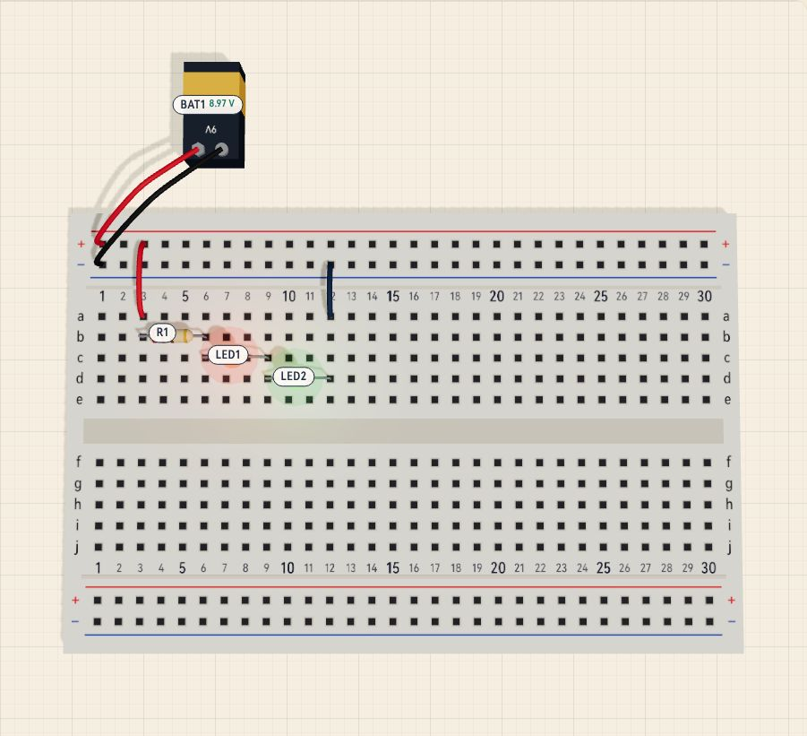
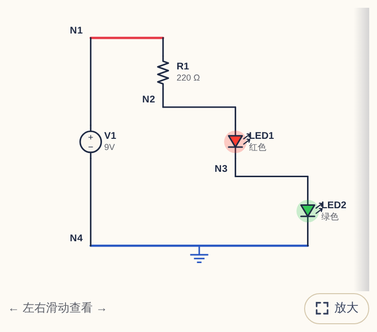
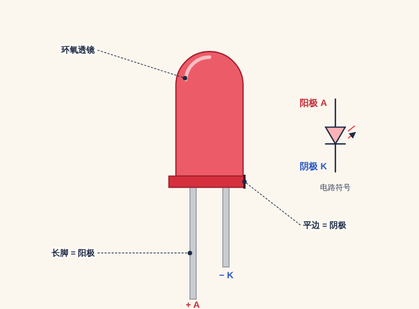

# 1.7 · 两颗 LED 串联

| 项目 | 内容 |
|---|---|
| id | `challenge-two-leds-series` |
| 文件 | `challenges/09-two-leds-series.json` |
| 类型 | 实验 / 挑战（没有分步，照目标电路图搭） · 难度 2/5 |
| 位置 | World 1 · 基础定律与直流分压 → 1.7 串联与 KVL（本节第 2 项） |
| 右侧面板 | 轨道由旧的四张卡片自动生成（还没手工精排） |
| 前后 | 上一项 [1.7 lesson-series](../w1/1.07-1-lesson-series.md) · 下一项 [1.7 exp-kvl-loops](../w1/1.07-3-exp-kvl-loops.md) |
| 先修 | — |
| 概念 | series 串联、forward voltage 正向压降、KVL |

**一句话概要**：一个电阻点亮两颗串联的 LED：它们的压降叠在一起。

## 1. 左侧工作台（3D 面包板 → 2D 俯视截图）

截图是程序里真实的 3D 面包板换成俯视角拍的；表格是同一块板的文字版（元件、参数、每只脚插在哪个孔）。

### 1.1 起点：空面包板（学生从零开始搭）

### 1.3 参考答案（「看答案」载入的板子）

| 元件 | 类型 | 参数 | 引脚 → 孔 |
|---|---|---|---|
| BAT1 | battery | variant=9V | +→tp1 -→tn1 |
| W2 | wire |  | a→tp3 b→a3 |
| R1 | resistor | resistance=220 | 1→b3 2→b6 |
| LED1 | led | color=red | anode→c6 cathode→c9 |
| LED2 | led | color=green | anode→d9 cathode→d12 |
| W6 | wire |  | a→a12 b→tn12 |

### 1.4 目标原理图（右侧「目标原理图」抽屉）

| 元件 | 类型 | 参数 |
|---|---|---|
| V1 | dc_source | voltage=9 |
| R1 | resistor | resistance=220 |
| LED1 | led | color=red |
| LED2 | led | color=green |

连接（每个结点上的引脚）：

- **N1**：V1.+、R1.1
- **N2**：R1.2、LED1.anode
- **N3**：LED1.cathode、LED2.anode
- **N4**：LED2.cathode、V1.-

## 2. 右侧面板：学生从上往下看到的内容（单轨流）

### 第 1 步 · 🔍 先看一眼：先认识它：LED 发光二极管

**拆解「LED：会发光的二极管」第 1 / 7 层：① 外形：长脚是阳极，平边是阴极**

一颗 5 mm 直插 LED：一个圆顶的 环氧树脂透镜 epoxy lens，底部一圈 凸缘 flange，下面两只脚。LED **有极性**（polarity），电流只能从一个方向流：
- 长脚 = **anode（阳极，A，+）**：接电源正极一侧；
- 短脚 = **cathode（阴极，K，−）**：接 GND 一侧；凸缘在这一侧被削出一个 平边 flat。

脚剪短以后看不出长短，就看平边；平边也磨掉了，就对着光看里面——大的那块金属是阴极（下一层）。

电路符号：三角形指向电流方向（A → K），竖线是阴极，两个小箭头表示“发出光”。和普通二极管符号只差这两个箭头——LED 就是一种二极管。

插反会怎样？没有电流，不亮。5 V 以内一般不会坏；但 LED 的反向耐压 $V_R$ 只有约 5 V，9 V 反接就超规格了。

| 脚 | 名字 | 怎么认 | 接哪 |
|---|---|---|---|
| 长脚 | anode 阳极 A（+） | 更长；里面是小的那根柱 | 电源 + 一侧（经过电阻） |
| 短脚 | cathode 阴极 K（−） | 平边一侧；里面是大的“砧座” | GND 一侧 |

### 第 2 步 · 🔧 动手搭：两颗灯，一个电阻

这一题没有步骤，**照目标电路图自己搭**：一个 220 Ω，后面依次串红色和绿色两颗 LED。
两颗灯“排队”通过同一个电流。它们会一样亮吗？

### 第 3 步 · 💡 想明白：压降叠在一起

- 两颗 LED 串联，它们的正向压降**相加**：$1.8 + 2.1 = 3.9$ V。
- 电阻上剩下 $9 - 3.9 = 5.1$ V，电流由它决定：
$$I \approx \frac{9 - 1.8 - 2.1}{220} \approx 23\ \text{mA}$$
- 再算上每颗 LED 里约 12 Ω 的小电阻，实际会稍小一点。

（这一步下面列着这节课的计算卡片，点开就地展开：`led-current`，全文见第 6 节）

### 第 4 步 · 🔧 动手搭：搭好，量三段电压

- 红色 LED 的**短脚**和绿色 LED 的**长脚**要在同一列（首尾相接）。
- 两颗都要长脚朝 + 那一侧。中间不要接到电源轨上。

### 第 5 步 · 📏 测一测：测一测：读你自己的仪表

**测量题 1 · `ur`**（读数题）

> 电阻两端的电压（红表笔在靠 +9 V 的一端）

- 单位 V · 先写预测 · 参考答案的读数 **4.57 V** · 合理范围 [4.4, 4.9]

答对后显示：

> 电流 ≈ (9 − 3.9) / (220 + 12 + 12) ≈ 20.9 mA，220 Ω × 20.9 mA ≈ 4.6 V。

**测量题 2 · `ured`**（读数题）

> 红色 LED 两端的电压（红表笔在长脚）

- 单位 V · 参考答案的读数 **2.049 V** · 合理范围 [1.95, 2.15]

答对后显示：

> 1.8 V + 12 Ω × 20.9 mA ≈ 2.05 V。

**测量题 3 · `ugreen`**（读数题）

> 绿色 LED 两端的电压（红表笔在长脚）

- 单位 V · 参考答案的读数 **2.349 V** · 合理范围 [2.25, 2.45]

答对后显示：

> 2.1 V + 12 Ω × 20.9 mA ≈ 2.35 V。

**测量题 4 · `three`**（选择题）

> 如果电源换成 3 V，会怎样？

- A. 两颗都亮，只是暗一点
- B. 两颗都不亮：3 V 不够两颗 LED 的压降之和 ✅（正确）
- C. 只有红色亮

答对后显示：

> 要让两颗都导通，至少要 1.8 + 2.1 = 3.9 V。电压不够时串联电路里一点电流都没有。

### 第 6 步 · 🎒 带走：带走

- 串联 LED 只要**一个电阻**，省电又省元件：同一个电流流过所有灯。
- 代价：电源电压必须**大于所有压降之和**。3 V 的电源连两颗 LED 都点不亮（3 V < 3.9 V）。
- 白光、蓝光 LED 的压降约 3 V，所以 12 V 电源大约只能串三颗。

趁热练理论题：`basics`

## 3. 测量题一览

| # | id | 题目 | 类型 | 单位 | 状态 | 参考读数 |
|---|---|---|---|---|---|---|
| 1 | ur | 电阻两端的电压（红表笔在靠 +9 V 的一端） | voltage | V |  | 4.57 V |
| 2 | ured | 红色 LED 两端的电压（红表笔在长脚） | voltage | V |  | 2.049 V |
| 3 | ugreen | 绿色 LED 两端的电压（红表笔在长脚） | voltage | V |  | 2.349 V |
| 4 | three | 如果电源换成 3 V，会怎样？ | 选择 |  |  | 正确：B |

### 提示按钮（依次显示）

1. LED1 的短脚（负极）和 LED2 的长脚（正极）要在同一条金属条上。
2. 两个 LED 方向要一致：都是长脚朝 + 那一侧。
3. 整个电路只有一条路径，中间不要接到电源轨上。

### 功能测试（「检查我的电路」时跑）

- 两个 LED 都亮

## 4. 用到的拆解（全部层的文字，供改写参考）

### 拆解 `led`：LED：会发光的二极管

*LED = Light-Emitting Diode（发光二极管）。从长短脚和平边，到环氧透镜里的反光杯和一粒小芯片，再到 PN 结里电子和空穴复合发光；最后用 I–V 曲线和 “Vf + 12 Ω” 模型推出限流电阻怎么选、为什么并联的 LED 要各配一个电阻。*

**拆解「LED：会发光的二极管」第 1 / 7 层：① 外形：长脚是阳极，平边是阴极**

一颗 5 mm 直插 LED：一个圆顶的 环氧树脂透镜 epoxy lens，底部一圈 凸缘 flange，下面两只脚。LED **有极性**（polarity），电流只能从一个方向流：
- 长脚 = **anode（阳极，A，+）**：接电源正极一侧；
- 短脚 = **cathode（阴极，K，−）**：接 GND 一侧；凸缘在这一侧被削出一个 平边 flat。

脚剪短以后看不出长短，就看平边；平边也磨掉了，就对着光看里面——大的那块金属是阴极（下一层）。

电路符号：三角形指向电流方向（A → K），竖线是阴极，两个小箭头表示“发出光”。和普通二极管符号只差这两个箭头——LED 就是一种二极管。

插反会怎样？没有电流，不亮。5 V 以内一般不会坏；但 LED 的反向耐压 $V_R$ 只有约 5 V，9 V 反接就超规格了。

| 脚 | 名字 | 怎么认 | 接哪 |
|---|---|---|---|
| 长脚 | anode 阳极 A（+） | 更长；里面是小的那根柱 | 电源 + 一侧（经过电阻） |
| 短脚 | cathode 阴极 K（−） | 平边一侧；里面是大的“砧座” | GND 一侧 |

**拆解「LED：会发光的二极管」第 2 / 7 层：② X 光：砧座、反光杯、一粒芯片、一根金线**

把环氧变透明，里面是一个精巧的小结构：
1. 砧座 anvil：阴极脚在里面变成一大块金属，顶上冲出一个 反光杯 reflector cup。
2. 芯片 die：一粒约 0.25 mm 见方的半导体晶片，粘在杯底，真正发光的就是它。它的底面通过杯子接阴极。
3. 金线 bond wire：比头发还细（约 25 µm），从芯片顶面连到 阳极柱 post。
4. 环氧透镜：既是外壳，也是透镜：圆顶把芯片发出的光收拢成一个 向上的光束（5 mm LED 常见视角 20–30°）。反光杯把往侧面跑的光也反射上去。

电流的路径：阳极脚 → 阳极柱 → 金线 → 芯片（从上往下穿过它）→ 反光杯 → 阴极脚。所以芯片里 **从上到下** 是一个 PN 结，下一层把它放大。

**拆解「LED：会发光的二极管」第 3 / 7 层：③ 芯片里：电子掉进空穴，放出光子**

芯片由两种 **doped（掺杂）** 半导体拼成：
- p 区（接阳极）：掺了缺电子的杂质，里面有很多可以移动的 **hole（空穴）**——“少了一个电子的位置”，相当于一个 + 电荷；
- n 区（接阴极）：掺了多电子的杂质，有很多可以移动的 **electron（电子）**。

两区交界叫 **PN junction（PN 结）**。加正向电压（阳极 +、阴极 −）时，空穴 被推向右、电子 被推向左，在结上相遇：电子 **掉进** 空穴，这叫 **recombination（复合）**。电子掉下的能量差 $E_g$（**band gap 禁带宽度**）以一个 **photon（光子）** 的形式放出——这就是光。

光的颜色由 禁带宽度 决定：
$$λ = \frac{hc}{E_g} ≈ \frac{1240}{E_g [eV]} nm$$
红光 AlGaInP 约 1.9 eV → 650 nm；蓝光 InGaN 约 2.7 eV → 460 nm。

**为什么不同颜色的 $V_F$ 不同**：要让电子“爬上”能跳下 $E_g$ 的高度，每个电子至少要被电源推 $E_g / q$ 伏。所以 $V_F ≈ E_g / q$：红 ≈ 1.8–2 V，蓝 ≈ 3 V。颜色越偏蓝，光子能量越大，需要的电压越高。白光 LED = 蓝光芯片 + 黄色荧光粉（phosphor），所以 $V_F$ 和蓝光一样 ≈ 3 V。

| 颜色 | 材料 | 波长 | $V_F$（仿真器） |
|---|---|---|---|
| 红 | AlGaInP | ≈ 630–650 nm | 1.8 V |
| 黄 | AlGaInP | ≈ 590 nm | 2.0 V |
| 绿 | InGaN / GaP | ≈ 525–570 nm | 2.1 V |
| 蓝 | InGaN | ≈ 460 nm | 3.0 V |
| 白 | 蓝芯片 + 荧光粉 | 宽谱 | 3.0 V |

- 公式 `V_F ≈ \frac{E_g}{q}, λ ≈ \frac{1240}{E_g [eV]} nm`：越蓝的光，$E_g$ 越大，$V_F$ 越高

**拆解「LED：会发光的二极管」第 4 / 7 层：④ I–V 曲线：一个膝点，然后几乎竖直**

把电压从 0 慢慢加上去，测电流，得到 LED 的 **I–V 特性曲线**。它和电阻的直线完全不同：
- 膝点以下：电子爬不过 PN 结的势垒，电流几乎是 0，**不亮**；
- 到了 膝点（knee） 附近的 **forward voltage（正向压降）$V_F$**，电流开始指数增长：电压每多 0.1 V，电流约翻 7 倍；
- 膝点以上曲线 **几乎竖直**：电压只要多零点几伏，电流就从几 mA 冲到几百 mA。

红色 的膝点在约 1.8–2 V，蓝色 的在约 3 V，见上面的 色表。

**这条曲线解释了为什么 LED 不能直接接电源**：竖直的那段意味着“电压几乎不变，电流可以任意大”。LED 自己不会限制电流，必须由外面的电阻来定（第 ⑥ 层）。

反向：电流几乎为 0（nA 级），直到大约 −5 V 被击穿。

规格书上的关键数字：最大连续电流 $I_F$ ≈ 20–25 mA，反向耐压 $V_R$ ≈ 5 V。亮度大致 **和电流成正比**，5–15 mA 就足够亮。

| 参数 | 典型值（5 mm） | 超过会怎样 |
|---|---|---|
| 正向压降 $V_F$ | 红 1.8–2 V，蓝/白 ≈ 3 V | （不是极限，是工作点） |
| 连续电流 $I_F$ | 20–25 mA | 发热、变暗、寿命骤减 |
| 反向电压 $V_R$ | ≈ 5 V | 反向击穿 |

- 公式 `I ≈ I_s·e^{V/(n V_T)}`：膝点附近：指数增长（$V_T$ = 26 mV，LED 的 n ≈ 2）

**拆解「LED：会发光的二极管」第 5 / 7 层：⑤ 模型：一个开关 + Vf + 12 Ω**

指数曲线不好手算。工程上用 **piecewise linear（分段线性）** 模型把它换成两段直线（图里的黑线）：
- V < $V_F$：理想开关 断开，I = 0；
- V ≥ $V_F$：开关闭合，LED = 一个 电压源 $V_F$ 串一个 小电阻 12 Ω：
$$I = \frac{V - V_F}{12 Ω}$$

本仿真器就是这样算的（红 1.8 V、黄 2.0 V、绿 2.1 V、蓝 / 白 3.0 V，都串 12 Ω）。

**带数字**：红 LED 两端 2.0 V 时，$I = \frac{2.0 - 1.8}{12} = 16.7 mA$；两端 2.1 V 时已经 25 mA。0.1 V 之差，电流差一半——这就是“几乎竖直”。

**直接接 9 V 电池会怎样**（9 V 电池内阻约 1.5 Ω）：
$$I = \frac{9 - 1.8}{1.5 + 12} ≈ 533 mA$$
是额定值的 25 倍。仿真器里 LED 平均电流超过 30 mA 会警告，超过 60 mA（或峰值 150 mA）就烧坏；真实的 LED 一闪就灭了。

|  | 真实 LED | 仿真器模型 |
|---|---|---|
| 膝点以下 | 指数，极小电流 | 0（开关断开） |
| 膝点以上 | 指数 + 体电阻 | (V − $V_F$) / 12 Ω |
| 温度 | $V_F$ 约 −2 mV/°C | 不考虑 |
| 反向击穿 | ≈ −5 V | 没有（只提示反接） |

- 公式 `I = \frac{V - V_F}{12 Ω}  (V ≥ V_F)`：红：$V_F$ = 1.8 V；蓝：3.0 V

**拆解「LED：会发光的二极管」第 6 / 7 层：⑥ 限流电阻：用 KVL 推出来**

第 1 课的电路：9 V 电池 → 470 Ω → 红 LED → 回到电池。沿回路写 **KVL（基尔霍夫电压定律）**——电源电压 = 各元件压降之和：
$$V_s = I·r_{bat} + I·R + V_F + I·12 Ω$$
解出电流：
$$I = \frac{V_s - V_F}{r_{bat} + R + 12} = \frac{9 - 1.8}{1.5 + 470 + 12} = \frac{7.2}{483.5} ≈ 14.9 mA$$
- 电阻上：$V_R = 14.9 mA × 470 Ω ≈ 7.0 V$；
- LED 上：$1.8 + 14.9 mA × 12 Ω ≈ 1.98 V$；
- 电池内阻上：$≈ 0.02 V$。加起来 9 V ✔。

**设计时反过来用**（忽略 12 Ω 和内阻就够了）：
$$R = \frac{V_s - V_F}{I}$$
9 V、红 LED、15 mA：$R = \frac{9 - 1.8}{0.015} = 480 Ω$ → 选标准值 470 Ω。

**图解：负载线（load line）**。电阻和电池这一侧要求 $I = \frac{9 - V}{471.5 Ω}$，是一条 斜直线；LED 要求 I 落在 它的曲线 上。两者同时满足的点就是 工作点。电阻越大，负载线越平，交点电流越小。

| 电路 | 计算 | I |
|---|---|---|
| 第 1 课：9 V、470 Ω、红 | (9 − 1.8) / (1.5 + 470 + 12) | 14.9 mA |
| 第 3 课：5 V、150 Ω、绿 | (5 − 2.1) / (150 + 12) | 17.9 mA |
| 蓝 LED：5 V、100 Ω | (5 − 3.0) / (100 + 12) | 17.9 mA |
| 两颗串联：9 V、220 Ω、红 + 绿 | (9 − 1.8 − 2.1) / (220 + 24) | 20.9 mA |
| 纽扣电池：3 V、47 Ω、红 | (3 − 1.8) / (15 + 47 + 12) | 16 mA |

- 公式 `R = \frac{V_s - V_F}{I}`：设计用：选稍大的标准值
- 公式 `I = \frac{V_s - V_F}{r_{bat} + R + 12 Ω}`：校核用：仿真器算出的电流

**拆解「LED：会发光的二极管」第 7 / 7 层：⑦ 为什么并联的 LED 要各配一个电阻**

想省一个电阻：5 V → 一个 150 Ω → 红、绿两颗 LED 并联 → GND。会怎样？

并联的两颗 LED 两端电压 **必须相同**。设只有红灯导通：
$$I = \frac{5 - 1.8}{150 + 12} = 19.8 mA,   V_{node} = 1.8 + 0.0198 × 12 = 2.04 V$$
结点电压 2.04 V 比绿灯的 $V_F = 2.1 V$ 还低，绿灯 **根本到不了膝点**：电流 0，不亮。$V_F$ 最低的那颗把电压“钳住”，所有电流都挤进它——两颗同色的 LED 也一样，$V_F$ 差几十 mV（生产误差），电流就会差一倍以上，而且越热 $V_F$ 越低、电流越大（**thermal runaway 热失控**）。

正确做法（第 6 课）：每颗 LED 串自己的电阻，再把这些“电阻 + LED”支路并联。每条支路自己用 KVL：
- 红：$\frac{5 - 1.8}{150 + 12} = 19.8 mA$
- 绿：$\frac{5 - 2.1}{150 + 12} = 17.9 mA$

电阻上的压降（约 3 V）远大于 $V_F$ 的差异（零点几伏），所以每条支路的电流 **由自己的电阻决定**，两颗都亮，互不干扰。

**串联** 就没有这个问题：串联电流处处相等，只要电源电压够（9 V > 1.8 + 2.1 V），一个电阻就够了。

- 公式 `I_k = \frac{V_s - V_{F,k}}{R_k + 12 Ω}`：每条支路各算各的

**一句话记住**：LED = 环氧透镜里的一粒 PN 结芯片：电子掉进空穴放出光子，颜色由禁带宽度决定，**$V_F$ ≈ $E_g$/q**（红 ≈ 1.8–2 V，蓝 ≈ 3 V）。I–V 曲线在 $V_F$ 之后几乎竖直，所以 LED 必须串电阻：$R = \frac{V_s - V_F}{I}$。仿真器把它当成“开关 + $V_F$ + 12 Ω”。并联 LED 要各配一个电阻。

## 5. 这一课的计算卡片

**计算卡片 `led-current`：LED 回路的电流 LED loop current**

- 公式 `I = \frac{V_s - ΣV_F}{R + Σr_d + R_{int}}`
- 用途：电源、电阻和一个或几个串联 LED：LED 实际流过多少电流。
- 输入：V_s（电源电动势，V）；V_F（所有 LED 的 V_F 之和（红 1.8、绿 2.1、蓝/白 3.0），V）；R（串联电阻（含电位器），Ω）；r_d（LED 内阻之和（每个 ≈ 12 Ω），Ω）；R_int（电源内阻（模块 ≈ 0、9 V 电池 1.5 Ω、纽扣电池 15 Ω），Ω） → I（回路电流（不够 ΣV_F 时为 0），A）

1. 导通的 LED 用折线模型看：一个电压源 $V_F$ 串一个小电阻 $r_d ≈ 12 Ω$（模拟器就是这样建模的）。
2. 整个回路串联，处处是同一个电流 I。
3. KVL：$V_s = I R_{int} + I R + ΣV_F + I Σr_d$。
4. 解出 $I = \frac{V_s - ΣV_F}{R + Σr_d + R_{int}}$。
5. 如果 $V_s < ΣV_F$，LED 根本不导通，I = 0：3 V 点不亮串联的红 + 绿 LED（需要 3.9 V）。
只用 $\frac{V_s - V_F}{R}$ 估算会偏大 1–2 mA，选电阻时够用；要和读数对比时把 $r_d$ 和内阻加上。

例子：- 挑战 1：9 V、220 Ω、红 + 绿：$I = \frac{9 - 3.9}{220 + 24} ≈ 21 mA$（只用 $V_F$ 估算是 23 mA）。
- 第 3 课：5 V、150 Ω、绿：$\frac{5 - 2.1}{150 + 12} ≈ 18 mA$，电阻上 $18 mA × 150 Ω ≈ 2.7 V$。
- 挑战 9：CR2032（3 V、15 Ω）、47 Ω、红：$\frac{3 - 1.8}{47 + 12 + 15} ≈ 16 mA$；不串电阻是 $\frac{1.2}{27} ≈ 44 mA$。
- 挑战 3：电位器转到 100 %：$\frac{5 - 1.8}{220 + 10k + 12} ≈ 0.31 mA$，灯灭。

- ⚠ 两个 LED 直接并联共用一个电阻：$V_F$ 小的先导通、把电压钳住，另一个几乎不亮——每个 LED 自己串一个电阻。
- ⚠ 电位器当可变电阻用时，它的阻值也在 R 里；转到 0 时只剩保护电阻。

## 6. English（界面英文版的同一份内容）

展开英文

### Node 1 · 🔍 Look first：Meet it first: LED

**Teardown「The LED: a diode that glows」layer 1 of 7：① Outside: long leg = anode, flat edge = cathode**

A 5 mm through-hole LED: a domed epoxy lens, a flange round the bottom, two legs. An LED **has polarity**: current can only flow one way:
- the long leg = **anode (A, +)**: towards the supply’s + side;
- the short leg = **cathode (K, −)**: towards GND; the flange has a flat edge on this side.

Once the legs are trimmed, use the flat; if that is worn away, look inside against the light — the bigger piece of metal is the cathode (next layer).

The symbol: the triangle points the way current flows (A → K), the bar is the cathode, and two little arrows mean "emits light". It differs from a plain diode only by those arrows — an LED is a diode.

Plugged in backwards? No current, no light. Up to 5 V it is usually fine, but an LED’s reverse rating $V_R$ is only about 5 V, so 9 V backwards is out of spec.

| Leg | Name | How to tell | Goes to |
|---|---|---|---|
| long | anode A (+) | longer; the small post inside | the + side (via the resistor) |
| short | cathode K (−) | flat side; the big anvil inside | the GND side |

### Node 2 · 🔧 Build：Two lights, one resistor

No steps here — **build it from the target schematic**: one 220 Ω, then a red and a green LED in a row.
The two lights queue up for the same current. Will they be equally bright?

### Node 3 · 💡 Why：The drops stack up

- In series the two forward voltages **add**: $1.8 + 2.1 = 3.9$ V.
- That leaves $9 - 3.9 = 5.1$ V for the resistor, which sets the current:
$$I \approx \frac{9 - 1.8 - 2.1}{220} \approx 23\ \text{mA}$$
- Counting the small resistance of about 12 Ω inside each LED, it comes out a bit lower.

(This node lists the lesson’s calculation cards: `led-current`; full text in section 6)

### Node 4 · 🔧 Build：Build it, measure three voltages

- The red LED's **short lead** and the green LED's **long lead** share a column (end to end).
- Both long leads face the + side. Nothing in the middle goes to a rail.

### Node 5 · 📏 Measure：Measure: read your own instruments

**Question 1 · `ur`**（reading）

> Voltage across the resistor (red probe on the +9 V end)

- unit V · predict first · range [4.4, 4.9]

Shown once right:

> Current ≈ (9 − 3.9) / (220 + 12 + 12) ≈ 20.9 mA; 220 Ω × 20.9 mA ≈ 4.6 V.

**Question 2 · `ured`**（reading）

> Voltage across the red LED (red probe on the long lead)

- unit V · range [1.95, 2.15]

Shown once right:

> 1.8 V + 12 Ω × 20.9 mA ≈ 2.05 V.

**Question 3 · `ugreen`**（reading）

> Voltage across the green LED (red probe on the long lead)

- unit V · range [2.25, 2.45]

Shown once right:

> 2.1 V + 12 Ω × 20.9 mA ≈ 2.35 V.

**Question 4 · `three`**（multiple choice）

> What happens with a 3 V supply instead?

- A. Both light, just dimmer
- B. Neither lights: 3 V is less than the two LEDs' drops added up ✅ (right)
- C. Only the red one lights

Shown once right:

> Both need at least 1.8 + 2.1 = 3.9 V to conduct. Below that, no current flows anywhere in the series circuit.

### Node 6 · 🎒 Take away：Take away

- LEDs in series need **one resistor**, which saves current and parts: the same current runs through every light.
- The price: the supply must be **above the sum of all the drops**. A 3 V supply cannot light even these two (3 V < 3.9 V).
- White and blue LEDs drop about 3 V each, so 12 V runs about three in series.

Practise：`basics`

**Hints**

1. LED1's short lead (cathode) and LED2's long lead (anode) go on the same metal strip.
2. Both LEDs point the same way: long lead towards the + side.
3. The whole circuit is one single path; nothing in the middle goes to a rail.

