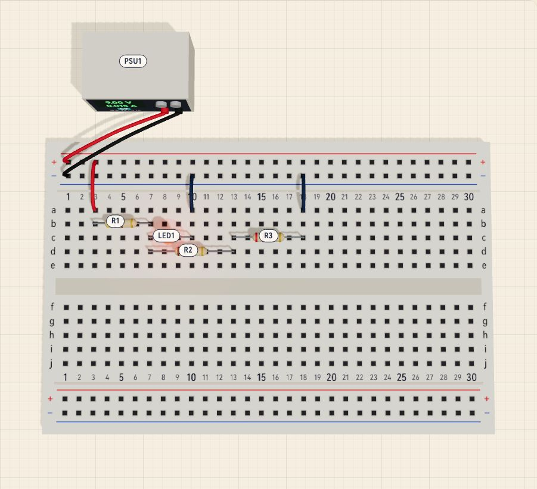
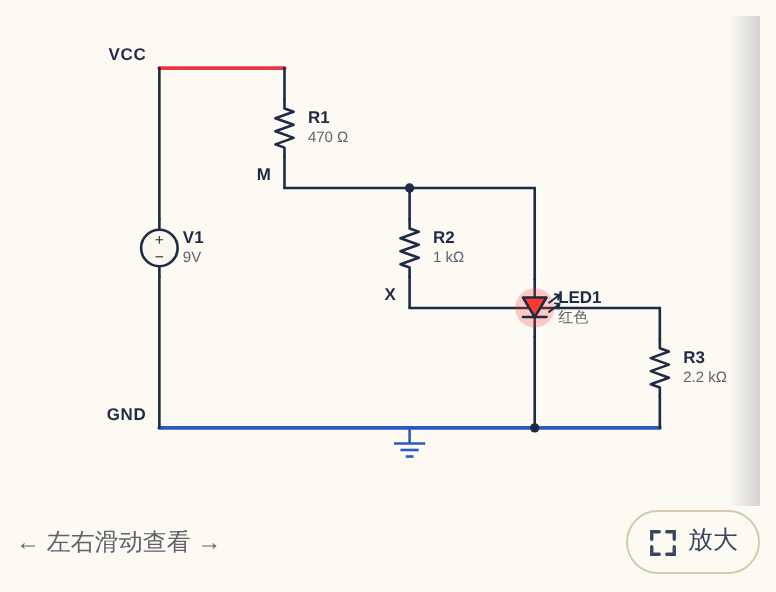
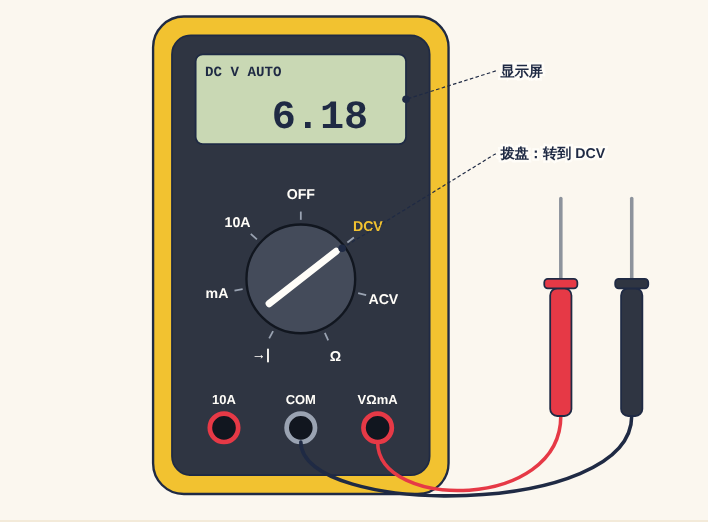
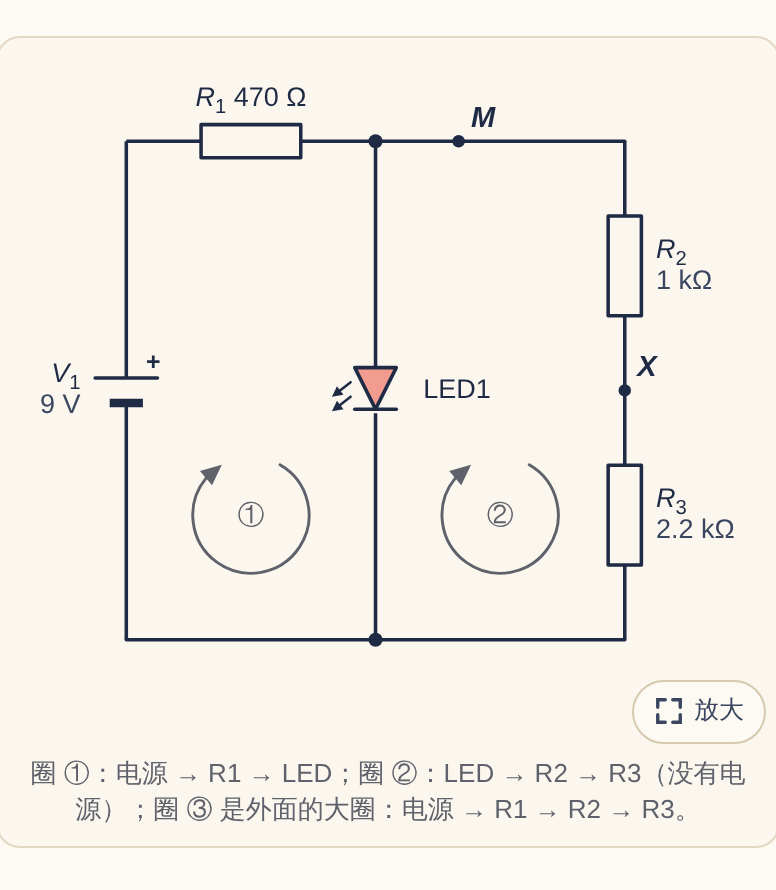

# 1.7 · KVL：绕一圈，电压加起来是 0

| 项目 | 内容 |
|---|---|
| id | `exp-kvl-loops` |
| 文件 | `challenges/202-kvl-loops.json` |
| 类型 | 实验 / 挑战（没有分步，照目标电路图搭） · 难度 2/5 |
| 位置 | World 1 · 基础定律与直流分压 → 1.7 串联与 KVL（本节第 3 项） |
| 右侧面板 | 轨道由旧的四张卡片自动生成（还没手工精排） |
| 前后 | 上一项 [1.7 challenge-two-leds-series](../w1/1.07-2-challenge-two-leds-series.md) · 下一项 [1.8 lesson-parallel](../w1/1.08-1-lesson-parallel.md) |
| 先修 | lesson-multimeter |
| 概念 | KVL 基尔霍夫电压定律、loop 回路、multimeter 万用表、voltage drop 电压降 |

**一句话概要**：一个电源、三个电阻和一颗 LED 组成三个回路：沿任意回路走一圈，电压的代数和都是 0。

## 1. 左侧工作台（3D 面包板 → 2D 俯视截图）

截图是程序里真实的 3D 面包板换成俯视角拍的；表格是同一块板的文字版（元件、参数、每只脚插在哪个孔）。

### 1.1 起点：空面包板（学生从零开始搭）

### 1.3 参考答案（「看答案」载入的板子）

| 元件 | 类型 | 参数 | 引脚 → 孔 |
|---|---|---|---|
| PSU1 | bench_supply | voltage=9, currentLimit=0.1 | +→tp1 -→tn1 |
| W2 | wire |  | a→tp3 b→a3 |
| R1 | resistor | resistance=470 | 1→b3 2→b7 |
| LED1 | led | color=red | anode→c7 cathode→c10 |
| W5 | wire |  | a→a10 b→tn10 |
| R2 | resistor | resistance=1000 | 1→d7 2→d13 |
| R3 | resistor | resistance=2200 | 1→c13 2→c18 |
| W8 | wire |  | a→a18 b→tn18 |

### 1.4 目标原理图（右侧「目标原理图」抽屉）

| 元件 | 类型 | 参数 |
|---|---|---|
| V1 | dc_source | voltage=9 |
| R1 | resistor | resistance=470 |
| LED1 | led | color=red |
| R2 | resistor | resistance=1000 |
| R3 | resistor | resistance=2200 |

连接（每个结点上的引脚）：

- **VCC**：V1.+、R1.1
- **M**：R1.2、LED1.anode、R2.1
- **X**：R2.2、R3.1
- **GND**：LED1.cathode、R3.2、V1.-

## 2. 右侧面板：学生从上往下看到的内容（单轨流）

### 第 1 步 · 🔍 先看一眼：先认识它：万用表（电压档）

**拆解「万用表（电压档）：一个 10 MΩ 的“探针”」第 1 / 7 层：① 面板：一个屏幕、一个拨盘、三个插孔、两支表笔**

拿起一块数字万用表（digital multimeter, DMM），从上往下只有四样东西：
- 显示屏（LCD）：数字 + 单位 + 模式（DC / AC、量程）；
- 拨盘（rotary switch）：选“量什么”。它其实是一个多刀多掷的机械开关，转到不同位置，里面接通的是不同的电阻和电路；
- 三个插孔（jack）：下一层细讲；
- 两支 红表笔 / 黑表笔（probe）：金属针尖碰到哪里，就是在量哪一点。

**量电压** 把拨盘转到 DCV（直流电压，DC = direct current）。下表是拨盘上每个位置的意思。注意：同一块表、同两支表笔，**拨盘的位置决定了表笔之间接的是什么**——在电压档表笔之间是 10 MΩ，在电流档表笔之间是不到 1 Ω。拨错档是烧表最常见的原因。

| 拨盘位置 | 量什么 | 表笔之间是什么 | 怎么接 |
|---|---|---|---|
| OFF | 关机 | — | — |
| DCV | 直流电压 | 10 MΩ（很大） | **并联**在两点上 |
| ACV | 交流电压有效值（RMS） | ≈ 10 MΩ + 整流 / 有效值电路 | 并联 |
| Ω | 电阻 | 表内的小电流源 | 元件 **断电**，并在两端 |
| →\| | 二极管压降 / 通断蜂鸣 | ≈ 1 mA 电流源 | 红接阳极（anode） |
| mA | 小电流 ≤ 200 mA | ≈ 1 Ω 分流电阻 + 保险丝 | **串联**（见“电流表”） |
| 10A | 大电流 ≤ 10 A | 0.01 Ω 分流电阻 | 串联，红表笔换到 10A 孔 |

### 第 2 步 · 🔧 动手搭：找出三个圈

先照目标电路图搭好：+9 V → **R1** → 结点 **M**；从 M 到 GND 有两条路——一颗 **LED**，以及 **R2 → X → R3**。
不急着量。用手指在图上找：从一个点出发、沿导线和元件走一圈回到原点，这样的**圈**有几个？

### 第 3 步 · 💡 想明白：KVL：上山的高度 = 下山的高度

- 把电压想成**高度**。沿着一个圈走，经过电源是“上山”，经过电阻、LED 是“下山”。回到原点时，高度一定和出发时一样。
- 所以：**沿任何闭合回路，电压的代数和为 0**。这就是基尔霍夫电压定律（KVL）。
- 这里有三个圈：① 电源 → R1 → LED；② LED 和 R2、R3 组成的圈（里面**没有电源**）；③ 电源 → R1 → R2 → R3。

*图 `loops`（schematic）：圈 ①：电源 → R1 → LED；圈 ②：LED → R2 → R3（没有电源）；圈 ③ 是外面的大圈：电源 → R1 → R2 → R3。*

- 动手之前，先把三个圈的 KVL 方程写下来。想一想：LED 两端会正好是 1.8 V 吗？

（这一步下面列着这节课的计算卡片，点开就地展开：`kvl`、`led-current`，全文见第 6 节）

### 第 4 步 · 🔧 动手搭：量五段电压

- 万用表红表笔点一个元件的一端，**Shift + 单击**把黑表笔放在另一端，读数 = V(红) − V(黑)。
- 依次量电源、R1、LED、R2、R3。电路检查通过后，把读数填进测量题，再代入你的三个方程。

### 第 5 步 · 📏 测一测：测一测：读你自己的仪表

**测量题 1 · `ur1`**（读数题）

> R1 两端的电压 V_R1（红表笔接 R1 靠电源的一端，黑表笔接 M）

- 单位 V · 先写预测 · 参考答案的读数 **7.028 V** · 合理范围 [6.9, 7.3]

**测量题 2 · `uled`**（读数题）

> LED 两端的电压 V_LED（红表笔接长脚）

- 单位 V · 先写预测 · 参考答案的读数 **1.972 V** · 合理范围 [1.9, 2.05]

答对后显示：

> 不是 1.8 V：LED 模型是 1.8 V 加 12 Ω 内阻，约 14.3 mA × 12 Ω ≈ 0.17 V。

**测量题 3 · `ur2`**（读数题）

> R2 两端的电压 V_R2（红表笔在 M 一侧）

- 单位 V · 参考答案的读数 **0.6163 V** · 合理范围 [0.58, 0.65]

**测量题 4 · `ur3`**（读数题）

> R3 两端的电压 V_R3（红表笔在 X 一侧）

- 单位 V · 参考答案的读数 **1.356 V** · 合理范围 [1.3, 1.4]

**测量题 5 · `loop2`**（计算题（用自己的读数算））

> 回路 ②（没有电源）：用你自己的三个读数算 V_LED − V_R2 − V_R3 =

- 单位 V · 参考答案的读数 **-6.002e-13 V** · 合理范围 [-0.02, 0.02] · 公式 `uled - ur2 - ur3`

答对后显示：

> 绕回路一圈，电压的代数和为 0——KVL 对 LED 这种非线性元件同样成立。剩下的几毫伏来自读数的位数。

### 第 6 步 · 🎒 带走：带走

- KVL 对 LED 这种**非线性**元件同样成立：它只管电压，不管元件的伏安特性。
- 回路 ② 说明：**并联的两条支路，两端电压一定相等**——这一点马上在并联里用到。
- 方程对不上时，先查两件事：表笔方向（读数的正负）、是不是量到了同一个元件的两端。

趁热练理论题：`basics`

## 3. 测量题一览

| # | id | 题目 | 类型 | 单位 | 状态 | 参考读数 |
|---|---|---|---|---|---|---|
| 1 | ur1 | R1 两端的电压 V_R1（红表笔接 R1 靠电源的一端，黑表笔接 M） | voltage | V |  | 7.028 V |
| 2 | uled | LED 两端的电压 V_LED（红表笔接长脚） | voltage | V |  | 1.972 V |
| 3 | ur2 | R2 两端的电压 V_R2（红表笔在 M 一侧） | voltage | V |  | 0.6163 V |
| 4 | ur3 | R3 两端的电压 V_R3（红表笔在 X 一侧） | voltage | V |  | 1.356 V |
| 5 | loop2 | 回路 ②（没有电源）：用你自己的三个读数算 V_LED − V_R2 − V_R3 = | formula | V |  | -6.002e-13 V |

### 全部答完后显示的「对比」

**对比**（模拟器读数）：
- 电源：9.00 V
- R1：≈ 7.03 V（电流 ≈ 14.95 mA）
- LED：≈ 1.97 V（不是 1.8 V：LED 模型 = 1.8 V + 12Ω 内阻，14.3 mA × 12Ω ≈ 0.17 V）
- R2：≈ 0.62 V，R3：≈ 1.36 V（这条支路电流只有 0.62 mA）

三个回路：① 9.00 = 7.03 + 1.97；② 1.97 = 0.62 + 1.36，绕一圈 1.97 − 0.62 − 1.36 = 0；③ 9.00 = 7.03 + 0.62 + 1.36。方程对不上时，先检查表笔方向（读数的正负）和是不是量到了同一个元件的两端。

### 提示按钮（依次显示）

1. M 是一个结点：R1 的一端、LED 的长脚和 R2 的一端要在同一列（同一条金属条）。
2. LED 的短脚（cathode）和 R3 的另一端都要接到 GND（蓝轨）。
3. 测 R2 的电压：红表笔点 R2 靠 M 的那只脚，Shift + 点击放黑表笔在 R2 靠 X 的那只脚。

### 功能测试（「检查我的电路」时跑）

- LED 亮；回路 1：电源电压 = R1 上的电压 + LED 上的电压
- 回路 2（无电源）：LED 上的电压 = R2 上的电压 + R3 上的电压

## 4. 用到的拆解（全部层的文字，供改写参考）

### 拆解 `multimeter`：万用表（电压档）：一个 10 MΩ 的“探针”

*multimeter（万用表）= 一台小小的数字电压表 + 一组开关和电阻，拨盘换一个位置，它就变成电流表或欧姆表。这一篇只拆电压档：从面板拆到里面的分压器和 ADC，再拆成电路课里能算的模型，最后算出“表本身让读数偏多少”。*

**拆解「万用表（电压档）：一个 10 MΩ 的“探针”」第 1 / 7 层：① 面板：一个屏幕、一个拨盘、三个插孔、两支表笔**

拿起一块数字万用表（digital multimeter, DMM），从上往下只有四样东西：
- 显示屏（LCD）：数字 + 单位 + 模式（DC / AC、量程）；
- 拨盘（rotary switch）：选“量什么”。它其实是一个多刀多掷的机械开关，转到不同位置，里面接通的是不同的电阻和电路；
- 三个插孔（jack）：下一层细讲；
- 两支 红表笔 / 黑表笔（probe）：金属针尖碰到哪里，就是在量哪一点。

**量电压** 把拨盘转到 DCV（直流电压，DC = direct current）。下表是拨盘上每个位置的意思。注意：同一块表、同两支表笔，**拨盘的位置决定了表笔之间接的是什么**——在电压档表笔之间是 10 MΩ，在电流档表笔之间是不到 1 Ω。拨错档是烧表最常见的原因。

| 拨盘位置 | 量什么 | 表笔之间是什么 | 怎么接 |
|---|---|---|---|
| OFF | 关机 | — | — |
| DCV | 直流电压 | 10 MΩ（很大） | **并联**在两点上 |
| ACV | 交流电压有效值（RMS） | ≈ 10 MΩ + 整流 / 有效值电路 | 并联 |
| Ω | 电阻 | 表内的小电流源 | 元件 **断电**，并在两端 |
| →\| | 二极管压降 / 通断蜂鸣 | ≈ 1 mA 电流源 | 红接阳极（anode） |
| mA | 小电流 ≤ 200 mA | ≈ 1 Ω 分流电阻 + 保险丝 | **串联**（见“电流表”） |
| 10A | 大电流 ≤ 10 A | 0.01 Ω 分流电阻 | 串联，红表笔换到 10A 孔 |

**拆解「万用表（电压档）：一个 10 MΩ 的“探针”」第 2 / 7 层：② 三个插孔：黑笔永远在 COM，红笔看量什么**

三个插孔是表里三条电路的入口：
- COM（common，公共端）：表里的“地”，所有测量的参考点。**黑表笔永远插这里**；
- VΩmA：量电压、电阻、小电流时 红表笔 插这里；
- 10A：量大电流（> 200 mA）时红表笔改插这里。

读数的定义只有一句话：
$$V_{读数} = V_{红} - V_{黑}$$
红表笔那一点的电压 **减去** 黑表笔那一点的电压。所以“量 M 点的电压”其实是“量 M 点对黑表笔所在点（通常是 GND）的电压”。仿真里只放红表笔时，黑表笔默认接在 GND。

⚠ 量完电流以后，红表笔还插在 10A 孔里，下一次直接去量电池电压——表笔之间只有 0.01 Ω，等于把电池短路。养成习惯：**量完电流，马上把红表笔插回 VΩmA**。

| 插孔 | 接什么 | 里面通到哪 | 什么时候用 |
|---|---|---|---|
| COM | 黑表笔 | 表的地 / ADC 的参考 | 每次都用 |
| VΩmA | 红表笔 | 10 MΩ 分压器、Ω 电流源、mA 分流电阻（经保险丝） | 电压、电阻、≤ 200 mA |
| 10A | 红表笔 | 0.01 Ω 分流电阻（经 10 A 保险丝） | > 200 mA 的电流 |

- 公式 `V_{reading} = V_{red} - V_{black}`：万用表永远量的是两点之差

**拆解「万用表（电压档）：一个 10 MΩ 的“探针”」第 3 / 7 层：③ X 光：分压器 → ADC → 显示屏**

把外壳变透明，电压档里只有三块：
1. 分压器（voltage divider）+ 量程开关：一串总共 **10 MΩ** 的精密电阻，接在 VΩmA 和 COM 之间。它把被测电压缩小到 ADC 能接受的范围；
2. ADC（analog-to-digital converter，模数转换器）：真正“量”电压的芯片，但它只能量 ±200 mV 左右的小电压，输出一个数（比如 −1999 … +1999）；
3. 显示屏：把这个数乘上量程的倍数，点上小数点，再加单位。

所以万用表并不是“直接看到 6.18 V”，而是：**先按比例缩小，再数字化，再按同样的比例放大回来显示**。下一层把分压器拆开看。

| 方块 | 输入 | 输出 | 它决定了什么 |
|---|---|---|---|
| 分压器 + 量程开关 | 被测电压 V | V ÷ 1, 10, 100, 1000 | **输入电阻 10 MΩ**、量程 |
| ADC | ≤ ±200 mV | 一个整数（3½ 位：±1999） | 分辨率、精度 |
| 显示屏 | 整数 + 量程 | 6.18 V | 小数点位置 |

**拆解「万用表（电压档）：一个 10 MΩ 的“探针”」第 4 / 7 层：④ 分压器：四个电阻、四个量程，总是 10 MΩ**

经典的 3½ 位万用表里，分压器是四个电阻串联：9 MΩ + 900 kΩ + 90 kΩ + 10 kΩ = 10 MΩ。每两个电阻之间引出一个 抽头（tap），量程开关（就是拨盘的一部分，自动量程的表由芯片切换）选一个抽头送给 ADC。

抽头的分压比就是分压公式：抽头以下的电阻 ÷ 总电阻。例如 20 V 量程的抽头下面是 90 k + 10 k = 100 kΩ：
$$\frac{V_{ADC}}{V} = \frac{100 kΩ}{10 MΩ} = \frac{1}{100}$$
量 6.18 V：ADC 看到 61.8 mV，在 ±200 mV 以内，显示时乘回 100。

**关键**：不管选哪个量程，从 VΩmA 到 COM 看进去 **永远是整串 10 MΩ**（ADC 的输入几乎不取电流）。这个 10 MΩ 就是说明书上的 **输入电阻**（input resistance, $R_{in}$），下一层它要进入等效电路。

量程越小，分辨率越高（最后一位代表的电压越小），但超过满量程就显示“OL”（overload）。

| 量程 | 抽头下面的电阻 | 分压比 | 满量程显示 | 最后一位 =  |
|---|---|---|---|---|
| 200 mV | 10 MΩ | 1 | 199.9 mV | 0.1 mV |
| 2 V | 1 MΩ | 1/10 | 1.999 V | 1 mV |
| 20 V | 100 kΩ | 1/100 | 19.99 V | 10 mV |
| 200 V | 10 kΩ | 1/1000 | 199.9 V | 0.1 V |

- 公式 `\frac{V_{ADC}}{V} = \frac{R_{below}}{R_{in}}`：分压公式：抽头以下的电阻 / 总电阻
- 公式 `R_{in} = 9 M + 900 k + 90 k + 10 k = 10 MΩ`：与量程无关

**拆解「万用表（电压档）：一个 10 MΩ 的“探针”」第 5 / 7 层：⑤ 等效电路：理想电压表并联 10 MΩ——所以它要并联**

把上一层的三块“装回去”，从两个插孔看进去，电压档的万用表等效成两样东西 **并联**：
- 理想电压表（ideal voltmeter）：只读出两端电压，**不取任何电流**（$i = 0$，相当于开路）；
- 输入电阻 $R_{in}$ = 10 MΩ：真实的表必须有的那串分压电阻。

**为什么电压表要并联？** 电压是 **两点之间** 的量。想知道 M 点 对 GND 的电压，表的两个端子就必须一个碰 M、一个碰 GND——这两点正好也是 R2 的两端，所以表 **自然就和 R2 并联**。不需要拆开电路，直接点上去就行。

**接上表会改变电路吗？** 用第 9 课的电路算（9 V，R1 = 1 kΩ，R2 = 2.2 kΩ）：
1. 不接表：$I = \frac{9}{1k + 2.2k} = 2.81 mA$，$V_M = 2.2k × 2.81 mA = 6.18 V$；
2. 接上表：R2 变成 $2.2k ∥ 10M = 2199.5 Ω$，表取的电流 $i_m = \frac{6.18 V}{10 MΩ} = 0.62 µA$，只有电路电流的 0.02 %；
3. 读数变成 6.1871 V——第四位才变。所以量 kΩ 级的电路，可以放心把表当理想的。

**表笔接反**：红 在 GND、黑 在 M，读数 = $V_{GND} - V_M = -6.18 V$。电压没变，变的是 **参考方向**（reference direction）。

| 量哪里（第 9 课） | 红表笔 | 黑表笔 | 读数 |
|---|---|---|---|
| 电池两端 | + 轨 | GND | 9.00 V |
| M 对 GND（结点电压） | M | GND | 6.18 V |
| R1 两端 | + 轨 | M | 2.81 V |
| R1 两端，表笔接反 | M | + 轨 | −2.81 V |

- 公式 `R_{meter} = R_{in} ∥ ∞ = 10 MΩ`：理想电压表是开路，只剩 $R_{in}$
- 公式 `i_m = \frac{V}{R_{in}} = \frac{6.18 V}{10 MΩ} = 0.62 µA`：表从电路里“借走”的电流

**拆解「万用表（电压档）：一个 10 MΩ 的“探针”」第 6 / 7 层：⑥ 负载误差：表本身让读数偏小多少？**

一般的情况：不管电路多复杂，从表的两个表笔看进去，电路都可以用 **戴维南等效**（Thévenin equivalent）换成 一个电压源串一个电阻（$V_{th}$ 串 $R_{th}$）。$V_{th}$ 就是“不接表时那两点的真实电压”，$R_{th}$ 是从那两点看进去的电阻。

接上表，$R_{th}$ 和 表的输入电阻 $R_{in}$ 组成一个分压器，表读到的是 $R_{in}$ 上分到的那部分：
$$V_{meas} = V_{th} \frac{R_{in}}{R_{in} + R_{th}}$$
相对误差：
$$\frac{V_{meas} - V_{th}}{V_{th}} = -\frac{R_{th}}{R_{in} + R_{th}} ≈ -\frac{R_{th}}{R_{in}}$$
一步步代数字。9 V 加在两个相等的电阻上，量中点：$V_{th} = 4.5 V$，$R_{th} = R ∥ R = R/2$。

**经验规则**：$R_{th}$ 比 $R_{in}$ 小 1000 倍以上（也就是 $R_{th}$ < 10 kΩ），误差 < 0.1 %，可以忽略；电阻到了 MΩ 级，表本身就是电路的一部分了。

仿真里的万用表 **没有输入电阻**（$R_{in} = ∞$），所以永远读到 $V_{th}$；真实的表在第 3 行、第 4 行会让你“测不准”。

| 电路 | $V_{th}$ | $R_{th}$ | 表上读到 | 误差 |
|---|---|---|---|---|
| 第 9 课 M 点（1k / 2.2k） | 6.1875 V | 687.5 Ω | 6.1871 V | −0.007 % |
| 两个 100 kΩ | 4.5 V | 50 kΩ | 4.478 V | −0.5 % |
| 两个 1 MΩ | 4.5 V | 500 kΩ | 4.286 V | −4.8 % |
| 两个 10 MΩ | 4.5 V | 5 MΩ | 3.000 V | −33 % |

- 公式 `V_{meas} = V_{th} \frac{R_{in}}{R_{in} + R_{th}}`：表和电路的戴维南电阻分压
- 公式 `\frac{ΔV}{V_{th}} ≈ -\frac{R_{th}}{R_{in}}`：$R_{th} ≪ R_{in}$ 时的近似

**拆解「万用表（电压档）：一个 10 MΩ 的“探针”」第 7 / 7 层：⑦ 局限：悬空的点、分辨率和精度、仿真和真表**

**悬空点（floating node）**：表笔点在 一条什么都没接的金属条 上，那一点不属于电路的任何结点，没有确定的电压。真实的表这时 **不会显示 0**，而是一个乱跳的数。原因是一个“隐形的分压器”：墙里 220 V 的电线通过 约 1 pF 的杂散电容 耦合到金属条，再经 10 MΩ 到 COM：
$$V ≈ 220 V × \frac{10 MΩ}{3.2 GΩ} ≈ 0.69 V$$
手一靠近、线一动，杂散电容就变，读数 就跳。**看到乱跳的小读数，先怀疑那一点没接上。**仿真里的表直接告诉你“悬空”。

**分辨率和精度**：3½ 位的表最多显示 1999 个数。20 V 量程最后一位是 10 mV；精度典型为 ±(0.5 % + 2 个字)，量 6.18 V 时：
$$±(0.5 % × 6.18 + 2 × 0.01) = ±0.05 V$$
所以 6.18 V 和 6.20 V 在真实的表上是“一样的”。实验里读数和预测差 1 % 以内就是对的。

| 项目 | 真实万用表 | 仿真里的万用表 |
|---|---|---|
| 输入电阻 | ≈ 10 MΩ | ∞（不取电流） |
| 悬空点 | 乱跳的小数（几百 mV） | 显示“悬空” |
| 分辨率 | 3½ 位：1999 个字 | 3 位有效数字 |
| 精度 | ±(0.5 % + 2) | 精确（模型值） |
| 交流档 ACV | 正弦波有效值；非正弦要 True RMS 表 | 用示波器的 RMS 读数 |
| 表笔接反 | 读数带负号 | 读数带负号 |

- 公式 `|Z_C| = \frac{1}{2π f C} = \frac{1}{2π × 50 × 1 pF} ≈ 3.2 GΩ`：杂散电容在 50 Hz 的阻抗

**一句话记住**：电压档的万用表 = 理想电压表并联 10 MΩ。它量两点之差（红 − 黑），所以并联在两点上；它从电路借走 $V/R_{in}$ 的电流，读数偏小约 $R_{th}/R_{in}$——kΩ 级的电路可以忽略，MΩ 级的电路不行。

## 5. 这一课的计算卡片

**计算卡片 `kvl`：基尔霍夫电压定律 KVL**

- 公式 `Σ v = 0 ⇒ V_3 = V_s - V_1 - V_2`
- 用途：沿一个闭合回路走一圈，电压的升降加起来是 0：知道其它元件的电压，求剩下那一个。
- 输入：V_s（电源电压，V）；V_1（第一个元件上的电压，V）；V_2（第二个元件上的电压（没有就填 0），V） → V_3（最后一个元件上的电压，V）

1. 电压是两点的电位差。从一点出发沿回路走一圈回到原点，电位回到原来的值，所以一路上的电压升降之和为 0。
2. 选一个绕行方向：顺着走从 + 到 − 记为降（正），从 − 到 + 记为升（负）。
3. 只有一个未知量时直接解出：$V_3 = V_s - V_1 - V_2$。
4. KVL 只讲电压，不管元件是什么——LED 这种非线性元件也照样成立。没有电源的回路（两条并联支路）告诉你：**并联支路两端电压相同**。

例子：实验 1-2 回路③：$9.00 = 7.03 + 0.62 + V_{R3}$，所以 $V_{R3} ≈ 1.35 V$（读数 1.36 V，差在读数的末位）。第 9 课：$6.18 + 2.81 ≈ 9.0 V$。

- ⚠ 读数的符号由红黑表笔决定：写方程前先定好每个电压的参考方向。
- ⚠ 交流电路里 KVL 加的是相量，不是有效值或峰峰值（见“交流 KVL：相量相加”）。

**计算卡片 `led-current`：LED 回路的电流 LED loop current**

- 公式 `I = \frac{V_s - ΣV_F}{R + Σr_d + R_{int}}`
- 用途：电源、电阻和一个或几个串联 LED：LED 实际流过多少电流。
- 输入：V_s（电源电动势，V）；V_F（所有 LED 的 V_F 之和（红 1.8、绿 2.1、蓝/白 3.0），V）；R（串联电阻（含电位器），Ω）；r_d（LED 内阻之和（每个 ≈ 12 Ω），Ω）；R_int（电源内阻（模块 ≈ 0、9 V 电池 1.5 Ω、纽扣电池 15 Ω），Ω） → I（回路电流（不够 ΣV_F 时为 0），A）

1. 导通的 LED 用折线模型看：一个电压源 $V_F$ 串一个小电阻 $r_d ≈ 12 Ω$（模拟器就是这样建模的）。
2. 整个回路串联，处处是同一个电流 I。
3. KVL：$V_s = I R_{int} + I R + ΣV_F + I Σr_d$。
4. 解出 $I = \frac{V_s - ΣV_F}{R + Σr_d + R_{int}}$。
5. 如果 $V_s < ΣV_F$，LED 根本不导通，I = 0：3 V 点不亮串联的红 + 绿 LED（需要 3.9 V）。
只用 $\frac{V_s - V_F}{R}$ 估算会偏大 1–2 mA，选电阻时够用；要和读数对比时把 $r_d$ 和内阻加上。

例子：- 挑战 1：9 V、220 Ω、红 + 绿：$I = \frac{9 - 3.9}{220 + 24} ≈ 21 mA$（只用 $V_F$ 估算是 23 mA）。
- 第 3 课：5 V、150 Ω、绿：$\frac{5 - 2.1}{150 + 12} ≈ 18 mA$，电阻上 $18 mA × 150 Ω ≈ 2.7 V$。
- 挑战 9：CR2032（3 V、15 Ω）、47 Ω、红：$\frac{3 - 1.8}{47 + 12 + 15} ≈ 16 mA$；不串电阻是 $\frac{1.2}{27} ≈ 44 mA$。
- 挑战 3：电位器转到 100 %：$\frac{5 - 1.8}{220 + 10k + 12} ≈ 0.31 mA$，灯灭。

- ⚠ 两个 LED 直接并联共用一个电阻：$V_F$ 小的先导通、把电压钳住，另一个几乎不亮——每个 LED 自己串一个电阻。
- ⚠ 电位器当可变电阻用时，它的阻值也在 R 里；转到 0 时只剩保护电阻。

## 6. English（界面英文版的同一份内容）

展开英文

### Node 1 · 🔍 Look first：Meet it first: Multimeter (volts)

**Teardown「Multimeter (volts): a 10 MΩ probe」layer 1 of 7：① Front: a display, a dial, three jacks, two probes**

A digital multimeter (DMM) has only four things on its front, top to bottom:
- the display (LCD): digits, unit and mode (DC / AC, range);
- the dial (rotary switch): chooses *what* to measure. It is a mechanical many-pole switch: each position connects a different set of resistors and circuits inside;
- three jacks: next layer;
- two probes, red and black: wherever the metal tip touches is the point you measure.

**To measure voltage** turn the dial to DCV (direct-current volts). The table lists every dial position. Note: same meter, same two probes — **the dial decides what sits between the probes**. On volts it is 10 MΩ; on amps it is less than 1 Ω. The wrong range is the most common way to blow a meter.

| Dial | Measures | Between the probes | How to connect |
|---|---|---|---|
| OFF | off | — | — |
| DCV | DC voltage | 10 MΩ (huge) | **in parallel** across two points |
| ACV | AC voltage, RMS | ≈ 10 MΩ + RMS converter | in parallel |
| Ω | resistance | a small current source inside | part **unpowered**, across it |
| →\| | diode drop / continuity beep | ≈ 1 mA current source | red on the anode |
| mA | small current ≤ 200 mA | ≈ 1 Ω shunt + fuse | **in series** (see “Ammeter”) |
| 10A | large current ≤ 10 A | 0.01 Ω shunt | in series, red lead in the 10A jack |

### Node 2 · 🔧 Build：Find the three loops

Build it from the target schematic: +9 V → **R1** → node **M**; from M to GND there are two paths — an **LED**, and **R2 → X → R3**.
No measuring yet. With your finger on the drawing: starting at a point and following wires and parts back to the same point, how many such **loops** are there?

### Node 3 · 💡 Why：KVL: up the hill = down the hill

- Think of voltage as **height**. Walking around a loop, a source takes you "uphill" and resistors and LEDs take you "downhill". Back at the start, you are at the same height you left.
- So: **around any closed loop the voltages add up to zero**. That is Kirchhoff's voltage law (KVL).
- There are three loops here: ① source → R1 → LED; ② the LED with R2 and R3 (**no source** in it); ③ source → R1 → R2 → R3.

[figure `loops`]

*Figure `loops`（schematic）：圈 ①：电源 → R1 → LED；圈 ②：LED → R2 → R3（没有电源）；圈 ③ 是外面的大圈：电源 → R1 → R2 → R3。*

- Before you measure, write the KVL equation of each loop. And think: will the LED show exactly 1.8 V?

(This node lists the lesson’s calculation cards: `kvl`、`led-current`; full text in section 6)

### Node 4 · 🔧 Build：Measure five voltages

- Red probe on one end of a part, **Shift + click** to put the black probe on the other end; reading = V(red) − V(black).
- Measure the source, R1, the LED, R2 and R3. Once the circuit check passes, fill in the questions and plug the readings into your three equations.

### Node 5 · 📏 Measure：Measure: read your own instruments

**Question 1 · `ur1`**（reading）

> Voltage across R1, V_R1 (red lead on R1's supply end, black lead on M)

- unit V · predict first · range [6.9, 7.3]

**Question 2 · `uled`**（reading）

> Voltage across the LED, V_LED (red lead on the long leg)

- unit V · predict first · range [1.9, 2.05]

Shown once right:

> Not 1.8 V: the LED model is 1.8 V plus 12 Ω, and about 14.3 mA × 12 Ω ≈ 0.17 V.

**Question 3 · `ur2`**（reading）

> Voltage across R2, V_R2 (red lead on the M side)

- unit V · range [0.58, 0.65]

**Question 4 · `ur3`**（reading）

> Voltage across R3, V_R3 (red lead on the X side)

- unit V · range [1.3, 1.4]

**Question 5 · `loop2`**（calculation from own readings）

> Loop ② (no source): with your own three readings, V_LED − V_R2 − V_R3 =

- unit V · range [-0.02, 0.02] · formula `uled - ur2 - ur3`

Shown once right:

> Round a loop the voltages add up to 0 — KVL holds for a non-linear part like the LED too. The few millivolts left over come from the digits of the readings.

### Node 6 · 🎒 Take away：Take away

- KVL holds for a **nonlinear** part like an LED too: it is only about voltages, not about the part's voltage–current curve.
- Loop ② says **two branches in parallel always have the same voltage across them** — you will use that right away in parallel circuits.
- If an equation doesn't add up, check two things first: the probe direction (the sign of the reading) and that you measured across the same part.

Practise：`basics`

**Compare**

**Compare** (simulator readings):
- supply: 9.00 V
- R1: ≈ 7.03 V (current ≈ 14.95 mA)
- LED: ≈ 1.97 V (not 1.8 V: the LED model is 1.8 V plus 12Ω, and 14.3 mA × 12Ω ≈ 0.17 V)
- R2: ≈ 0.62 V, R3: ≈ 1.36 V (only 0.62 mA flows in this branch)

The three loops: ① 9.00 = 7.03 + 1.97; ② 1.97 = 0.62 + 1.36, i.e. once around, 1.97 − 0.62 − 1.36 = 0; ③ 9.00 = 7.03 + 0.62 + 1.36. If an equation does not balance, check the probe direction (the sign of the reading) and that you measured across the two ends of the same part.

**Hints**

1. M is a node: one end of R1, the LED's long lead and one end of R2 must share a column (one metal strip).
2. The LED's short lead (cathode) and the far end of R3 both go to GND (the blue rail).
3. To measure R2: click the red probe onto R2's lead at M, then Shift + click the black probe onto R2's lead at X.

