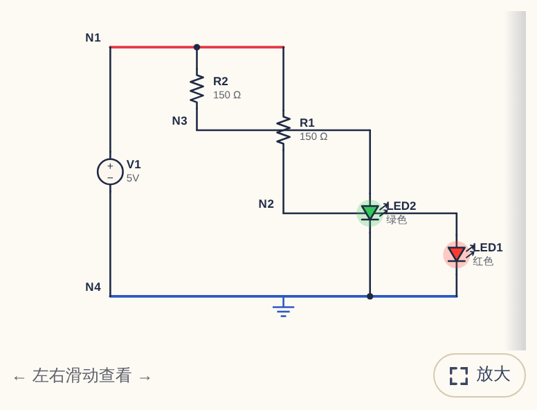
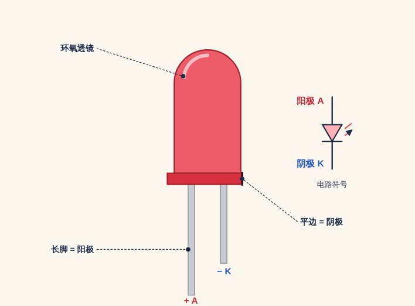
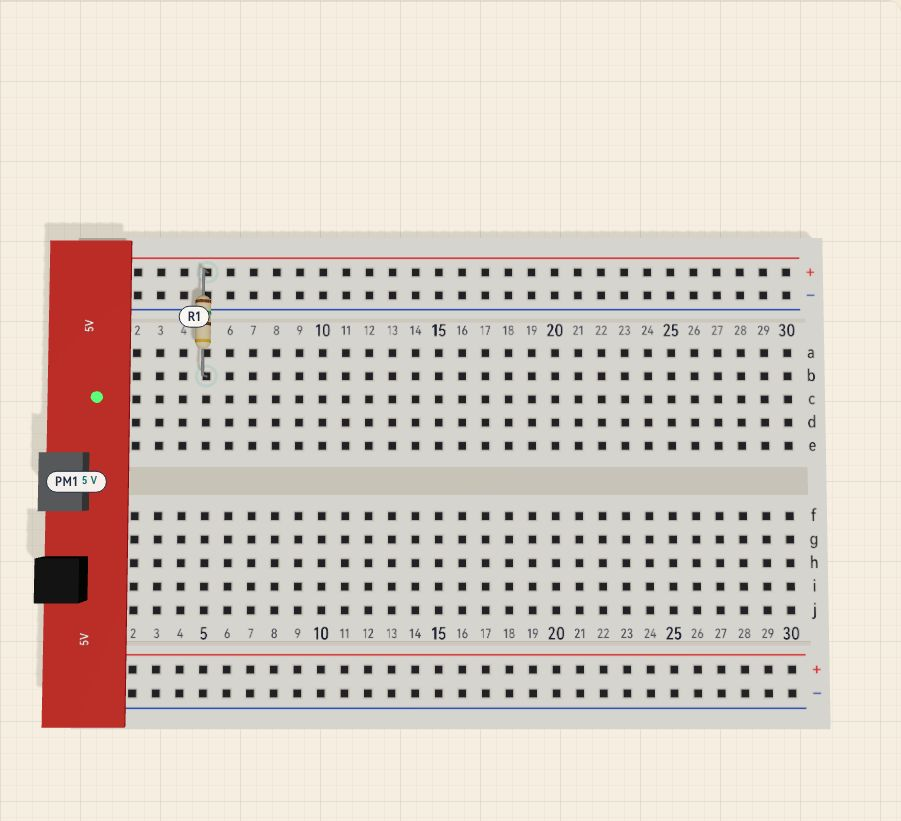
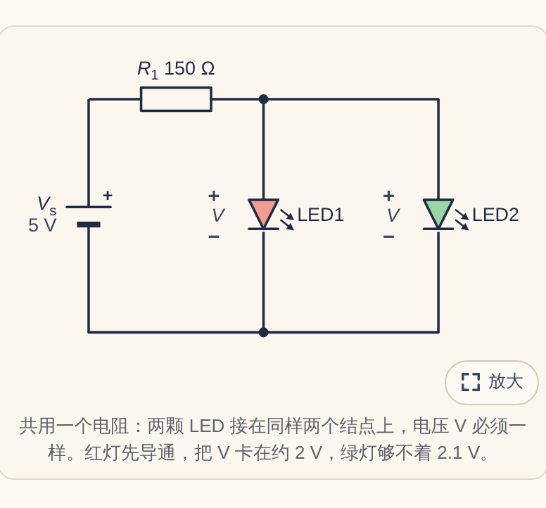
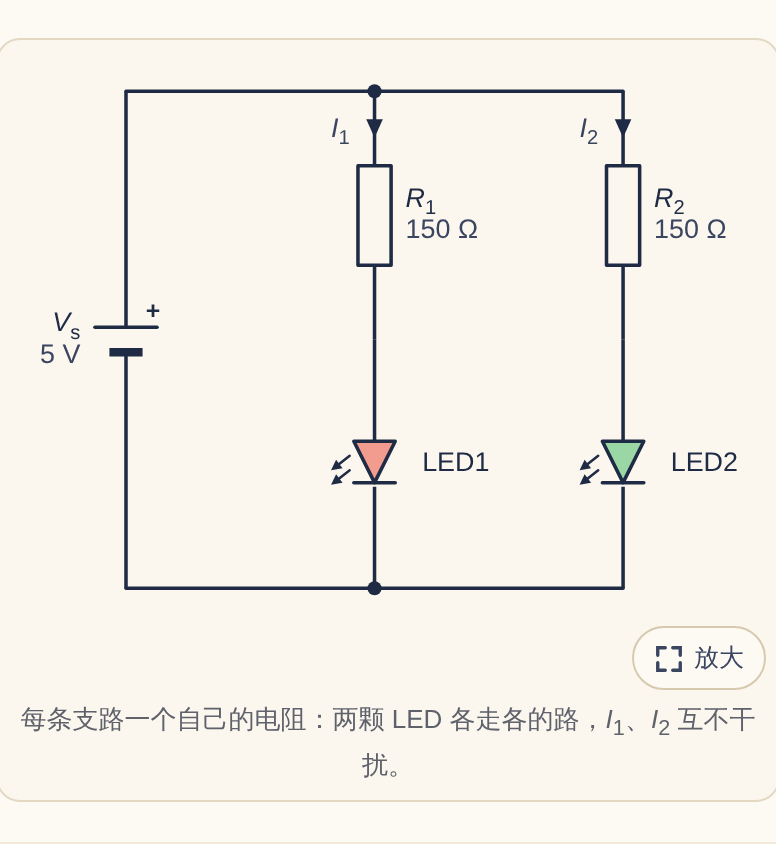
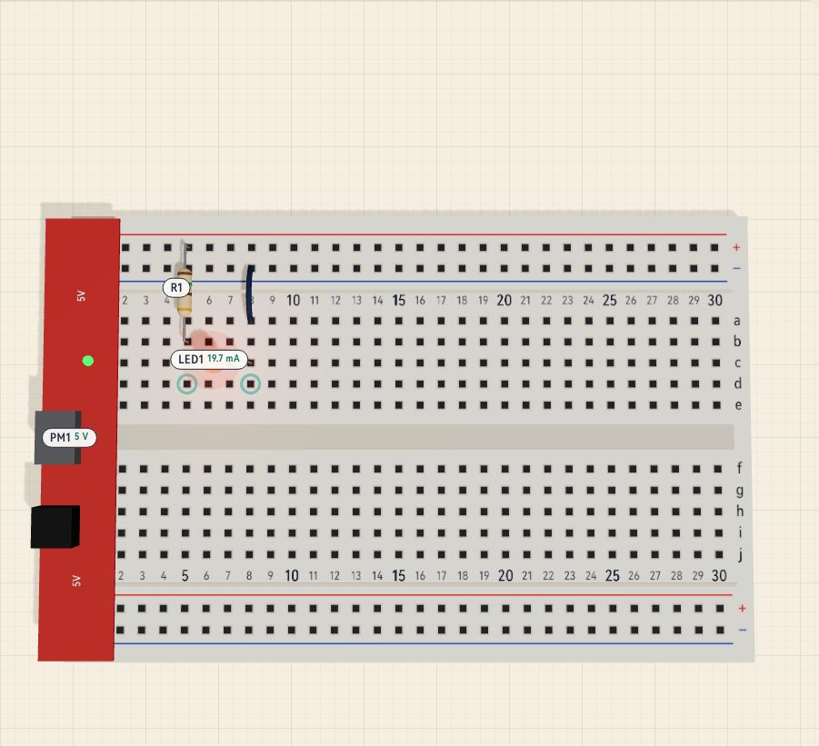
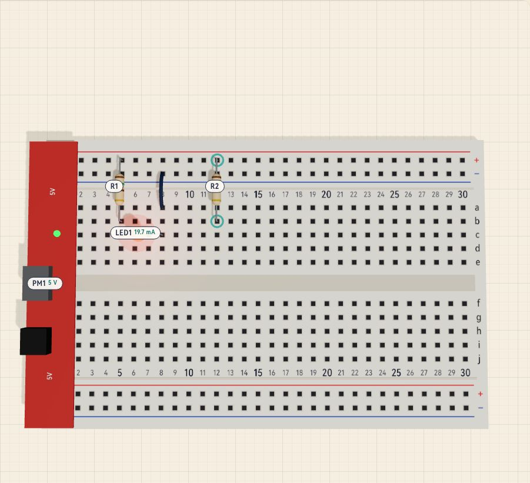
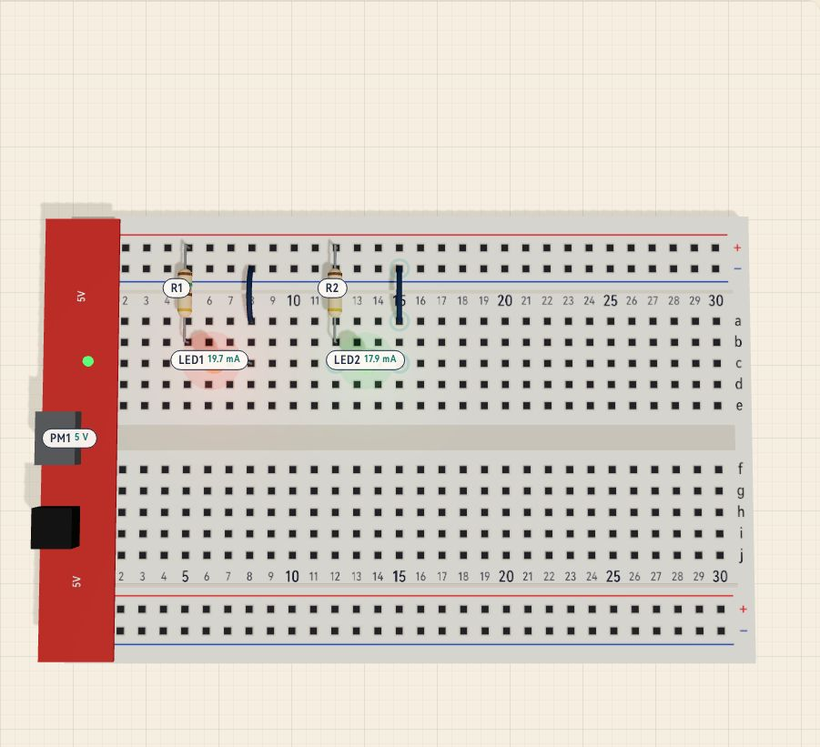

# 1.8 · 并联：每条路有自己的电流

| 项目 | 内容 |
|---|---|
| id | `lesson-parallel` |
| 文件 | `challenges/06-parallel-leds.json` |
| 类型 | 课程（有分步，每步自动检查） · 难度 2/5 |
| 位置 | World 1 · 基础定律与直流分压 → 1.8 并联与 KCL（本节第 1 项） |
| 右侧面板 | 轨道由旧的四张卡片自动生成（还没手工精排） |
| 前后 | 上一项 [1.7 exp-kvl-loops](../w1/1.07-3-exp-kvl-loops.md) · 下一项 [1.8 exp-kcl-ammeters](../w1/1.08-2-exp-kcl-ammeters.md) |
| 先修 | — |
| 概念 | parallel 并联、branch 支路、same voltage 两端电压相同、KCL |

**一句话概要**：两颗不同颜色的 LED 共用一个电阻，绿色的不亮。为什么？给每条支路一个自己的电阻就好了。

## 1. 左侧工作台（3D 面包板 → 2D 俯视截图）

截图是程序里真实的 3D 面包板换成俯视角拍的；表格是同一块板的文字版（元件、参数、每只脚插在哪个孔）。

### 1.1 起点：空面包板（学生从零开始搭）

### 1.2 每一步之后的面包板

见第 2 节每个步骤下面的截图（按步骤的自动检查重建：放 / 改 / 拔元件、移动万用表表笔）。

### 1.3 参考答案（「看答案」载入的板子）

| 元件 | 类型 | 参数 | 引脚 → 孔 |
|---|---|---|---|
| PM1 | power_module | voltage=5 | +t→tp1 -t→tn1 +b→bp1 -b→bn1 |
| R1 | resistor | resistance=150 | 1→tp5 2→b5 |
| LED1 | led | color=red | anode→c5 cathode→c8 |
| W4 | wire |  | a→a8 b→tn8 |
| R2 | resistor | resistance=150 | 1→tp12 2→b12 |
| LED2 | led | color=green | anode→c12 cathode→c15 |
| W7 | wire |  | a→a15 b→tn15 |

### 1.4 目标原理图（右侧「目标原理图」抽屉）

| 元件 | 类型 | 参数 |
|---|---|---|
| V1 | dc_source | voltage=5 |
| R1 | resistor | resistance=150 |
| LED1 | led | color=red |
| R2 | resistor | resistance=150 |
| LED2 | led | color=green |

连接（每个结点上的引脚）：

- **N1**：V1.+、R1.1、R2.1
- **N2**：R1.2、LED1.anode
- **N3**：R2.2、LED2.anode
- **N4**：LED1.cathode、LED2.cathode、V1.-

## 2. 右侧面板：学生从上往下看到的内容（单轨流）

### 第 1 步 · 🔍 先看一眼：先认识它：LED 发光二极管

**拆解「LED：会发光的二极管」第 1 / 7 层：① 外形：长脚是阳极，平边是阴极**

一颗 5 mm 直插 LED：一个圆顶的 环氧树脂透镜 epoxy lens，底部一圈 凸缘 flange，下面两只脚。LED **有极性**（polarity），电流只能从一个方向流：
- 长脚 = **anode（阳极，A，+）**：接电源正极一侧；
- 短脚 = **cathode（阴极，K，−）**：接 GND 一侧；凸缘在这一侧被削出一个 平边 flat。

脚剪短以后看不出长短，就看平边；平边也磨掉了，就对着光看里面——大的那块金属是阴极（下一层）。

电路符号：三角形指向电流方向（A → K），竖线是阴极，两个小箭头表示“发出光”。和普通二极管符号只差这两个箭头——LED 就是一种二极管。

插反会怎样？没有电流，不亮。5 V 以内一般不会坏；但 LED 的反向耐压 $V_R$ 只有约 5 V，9 V 反接就超规格了。

| 脚 | 名字 | 怎么认 | 接哪 |
|---|---|---|---|
| 长脚 | anode 阳极 A（+） | 更长；里面是小的那根柱 | 电源 + 一侧（经过电阻） |
| 短脚 | cathode 阴极 K（−） | 平边一侧；里面是大的“砧座” | GND 一侧 |

### 第 2 步 · 🔧 动手搭：两颗灯共用一个电阻

先搭红色 LED 和它的 150 Ω 电阻。然后把一颗**绿色** LED **并联**在红色 LED 旁边，共用同一个电阻。
看看两颗灯：哪颗亮，哪颗不亮？

**步骤 1**

**面包板电源模块**插 **`tp1`**，保持 **5 V**。

自动检查（做到这些才算完成）：把面包板电源模块插到 tp1–tn1–bp1–bn1
板上高亮的孔：tp1、tn1、bp1、bn1

**步骤 2**

**R1**（**`150 Ω`**）：一只脚直接插红轨 **`tp5`**，另一只脚插 **`b5`**。

自动检查（做到这些才算完成）：把电阻插到 tp5–b5
板上高亮的孔：tp5、b5

**步骤 3**

**红色 LED1**：长脚 **`c5`**、短脚 **`c8`**；蓝色**跳线** **`a8`** → **`tn8`**。红灯亮了。

自动检查（做到这些才算完成）：把LED 发光二极管插到 c5–c8；把跳线插到 a8–tn8
板上高亮的孔：c5、c8、a8、tn8

**步骤 4**

**绿色 LED**：长脚 **`d5`**、短脚 **`d8`**——和红灯插在同样的两列里，共用 R1。两颗灯都亮了吗？

自动检查（做到这些才算完成）：把LED 发光二极管插到 d5–d8
板上高亮的孔：d5、d8

### 第 3 步 · 💡 想明白：并联：两端电压一样

- **并联**的两颗 LED 两端接在**同样的两个结点**上，所以它们两端的电压**必须相等**（还记得 KVL 实验里的回路 ② 吗）。
- 红色 LED 在 1.8 V 左右就导通，把这两个结点之间的电压**卡在约 2 V**。绿色 LED 要 2.1 V 才开始导通——电压不够，它就不亮。

*图 `shared`（schematic）：共用一个电阻：两颗 LED 接在同样两个结点上，电压 V 必须一样。红灯先导通，把 V 卡在约 2 V，绿灯够不着 2.1 V。*

- 解决办法：**每条支路一个自己的电阻**。这样每颗 LED 的电压由自己的支路决定，互不干扰：

*图 `own`（schematic）：每条支路一个自己的电阻：两颗 LED 各走各的路，I_1、I_2 互不干扰。*

$$I_1 = \frac{5 - 1.8}{150 + 12}, \quad I_2 = \frac{5 - 2.1}{150 + 12}$$

（这一步下面列着这节课的计算卡片，点开就地展开：`parallel-resistance`、`kcl`、`led-current`，全文见第 6 节）

### 第 4 步 · 🔧 动手搭：每条支路一个电阻

拿掉共用电阻的绿色 LED，给它单独搭一条支路。

**步骤 5**

选中**绿色 LED**，按 **Delete** 删掉。

自动检查（做到这些才算完成）：清空这些孔：d5、d8
板上高亮的孔：d5、d8

**步骤 6**

第二条支路：**R2**（**`150 Ω`**）一只脚插 **`tp12`**，另一只脚插 **`b12`**。

自动检查（做到这些才算完成）：把电阻插到 tp12–b12
板上高亮的孔：tp12、b12

**步骤 7**

**绿色 LED2**：长脚 **`c12`**、短脚 **`c15`**；蓝色**跳线** **`a15`** → **`tn15`**。两条支路的上端都在红轨、下端都在蓝轨：并联完成。

自动检查（做到这些才算完成）：把LED 发光二极管插到 c12–c15；把跳线插到 a15–tn15
板上高亮的孔：c12、c15、a15、tn15

**步骤 8**

两颗都亮了。点**「检查我的电路」**，然后**单击每颗 LED**，在「属性」里读它的电流。

### 第 5 步 · 📏 测一测：测一测：读你自己的仪表

**测量题 1 · `shared`**（选择题）

> 第 4 步里两颗 LED 共用一个电阻时，为什么绿色的不亮？

- A. 绿色 LED 坏了
- B. 并联时两颗灯两端电压相同，红灯把它卡在约 2 V，不够绿灯导通 ✅（正确）
- C. 电阻太小了

答对后显示：

> 并联元件两端电压相同。红灯的压降低，先导通，把电压限住；绿灯需要的 2.1 V 永远到不了。

**测量题 2 · `i1`**（读数题）

> 单击红色 LED1：「属性」里显示的电流

- 单位 mA · 先写预测 · 参考答案的读数 **19.73 mA** · 合理范围 [0.018, 0.0215]

答对后显示：

> (5 − 1.8) / (150 + 12) ≈ 19.8 mA。

**测量题 3 · `i2`**（读数题）

> 单击绿色 LED2：「属性」里显示的电流

- 单位 mA · 先写预测 · 参考答案的读数 **17.88 mA** · 合理范围 [0.0165, 0.0195]

答对后显示：

> (5 − 2.1) / (150 + 12) ≈ 17.9 mA。两条支路电压一样，压降不同，电流就不同。

**测量题 4 · `total`**（计算题（用自己的读数算））

> 用你的两个读数算：电源模块一共送出多少电流？

- 单位 mA · 参考答案的读数 **37.61 mA** · 合理范围 [0.0345, 0.041] · 公式 `i1 + i2`

答对后显示：

> 两条支路的电流在红轨汇合，总电流就是两者之和——这就是 KCL。

### 第 6 步 · 🎒 带走：带走

- 并联：**两端电压相同**，电流各走各的，**总电流 = 各支路电流之和**（这就是 KCL，下一个实验专门测它）。
- 家里的插座全是并联的：每个电器都拿到同样的 220 V（或 120 V），关掉一个不影响别的。
- 并联 LED 规则：**一颗 LED，一个电阻**。同颜色同型号的 LED 共用电阻也不保险——压降稍有差别，电流就会偏向一颗。

趁热练理论题：`basics`、`equivalence`

## 3. 测量题一览

| # | id | 题目 | 类型 | 单位 | 状态 | 参考读数 |
|---|---|---|---|---|---|---|
| 1 | shared | 第 4 步里两颗 LED 共用一个电阻时，为什么绿色的不亮？ | 选择 |  |  | 正确：B |
| 2 | i1 | 单击红色 LED1：「属性」里显示的电流 | current | mA |  | 19.73 mA |
| 3 | i2 | 单击绿色 LED2：「属性」里显示的电流 | current | mA |  | 17.88 mA |
| 4 | total | 用你的两个读数算：电源模块一共送出多少电流？ | formula | mA |  | 37.61 mA |

### 提示按钮（依次显示）

1. 每条支路都要从红轨出发、回到蓝轨：电阻上端插红轨，LED 短脚用跳线接蓝轨。
2. 绿色 LED 不亮？看看它是不是还和红色 LED 共用一个电阻。

### 功能测试（「检查我的电路」时跑）

- 两个 LED 都亮

## 4. 用到的拆解（全部层的文字，供改写参考）

### 拆解 `led`：LED：会发光的二极管

*LED = Light-Emitting Diode（发光二极管）。从长短脚和平边，到环氧透镜里的反光杯和一粒小芯片，再到 PN 结里电子和空穴复合发光；最后用 I–V 曲线和 “Vf + 12 Ω” 模型推出限流电阻怎么选、为什么并联的 LED 要各配一个电阻。*

**拆解「LED：会发光的二极管」第 1 / 7 层：① 外形：长脚是阳极，平边是阴极**

一颗 5 mm 直插 LED：一个圆顶的 环氧树脂透镜 epoxy lens，底部一圈 凸缘 flange，下面两只脚。LED **有极性**（polarity），电流只能从一个方向流：
- 长脚 = **anode（阳极，A，+）**：接电源正极一侧；
- 短脚 = **cathode（阴极，K，−）**：接 GND 一侧；凸缘在这一侧被削出一个 平边 flat。

脚剪短以后看不出长短，就看平边；平边也磨掉了，就对着光看里面——大的那块金属是阴极（下一层）。

电路符号：三角形指向电流方向（A → K），竖线是阴极，两个小箭头表示“发出光”。和普通二极管符号只差这两个箭头——LED 就是一种二极管。

插反会怎样？没有电流，不亮。5 V 以内一般不会坏；但 LED 的反向耐压 $V_R$ 只有约 5 V，9 V 反接就超规格了。

| 脚 | 名字 | 怎么认 | 接哪 |
|---|---|---|---|
| 长脚 | anode 阳极 A（+） | 更长；里面是小的那根柱 | 电源 + 一侧（经过电阻） |
| 短脚 | cathode 阴极 K（−） | 平边一侧；里面是大的“砧座” | GND 一侧 |

**拆解「LED：会发光的二极管」第 2 / 7 层：② X 光：砧座、反光杯、一粒芯片、一根金线**

把环氧变透明，里面是一个精巧的小结构：
1. 砧座 anvil：阴极脚在里面变成一大块金属，顶上冲出一个 反光杯 reflector cup。
2. 芯片 die：一粒约 0.25 mm 见方的半导体晶片，粘在杯底，真正发光的就是它。它的底面通过杯子接阴极。
3. 金线 bond wire：比头发还细（约 25 µm），从芯片顶面连到 阳极柱 post。
4. 环氧透镜：既是外壳，也是透镜：圆顶把芯片发出的光收拢成一个 向上的光束（5 mm LED 常见视角 20–30°）。反光杯把往侧面跑的光也反射上去。

电流的路径：阳极脚 → 阳极柱 → 金线 → 芯片（从上往下穿过它）→ 反光杯 → 阴极脚。所以芯片里 **从上到下** 是一个 PN 结，下一层把它放大。

**拆解「LED：会发光的二极管」第 3 / 7 层：③ 芯片里：电子掉进空穴，放出光子**

芯片由两种 **doped（掺杂）** 半导体拼成：
- p 区（接阳极）：掺了缺电子的杂质，里面有很多可以移动的 **hole（空穴）**——“少了一个电子的位置”，相当于一个 + 电荷；
- n 区（接阴极）：掺了多电子的杂质，有很多可以移动的 **electron（电子）**。

两区交界叫 **PN junction（PN 结）**。加正向电压（阳极 +、阴极 −）时，空穴 被推向右、电子 被推向左，在结上相遇：电子 **掉进** 空穴，这叫 **recombination（复合）**。电子掉下的能量差 $E_g$（**band gap 禁带宽度**）以一个 **photon（光子）** 的形式放出——这就是光。

光的颜色由 禁带宽度 决定：
$$λ = \frac{hc}{E_g} ≈ \frac{1240}{E_g [eV]} nm$$
红光 AlGaInP 约 1.9 eV → 650 nm；蓝光 InGaN 约 2.7 eV → 460 nm。

**为什么不同颜色的 $V_F$ 不同**：要让电子“爬上”能跳下 $E_g$ 的高度，每个电子至少要被电源推 $E_g / q$ 伏。所以 $V_F ≈ E_g / q$：红 ≈ 1.8–2 V，蓝 ≈ 3 V。颜色越偏蓝，光子能量越大，需要的电压越高。白光 LED = 蓝光芯片 + 黄色荧光粉（phosphor），所以 $V_F$ 和蓝光一样 ≈ 3 V。

| 颜色 | 材料 | 波长 | $V_F$（仿真器） |
|---|---|---|---|
| 红 | AlGaInP | ≈ 630–650 nm | 1.8 V |
| 黄 | AlGaInP | ≈ 590 nm | 2.0 V |
| 绿 | InGaN / GaP | ≈ 525–570 nm | 2.1 V |
| 蓝 | InGaN | ≈ 460 nm | 3.0 V |
| 白 | 蓝芯片 + 荧光粉 | 宽谱 | 3.0 V |

- 公式 `V_F ≈ \frac{E_g}{q}, λ ≈ \frac{1240}{E_g [eV]} nm`：越蓝的光，$E_g$ 越大，$V_F$ 越高

**拆解「LED：会发光的二极管」第 4 / 7 层：④ I–V 曲线：一个膝点，然后几乎竖直**

把电压从 0 慢慢加上去，测电流，得到 LED 的 **I–V 特性曲线**。它和电阻的直线完全不同：
- 膝点以下：电子爬不过 PN 结的势垒，电流几乎是 0，**不亮**；
- 到了 膝点（knee） 附近的 **forward voltage（正向压降）$V_F$**，电流开始指数增长：电压每多 0.1 V，电流约翻 7 倍；
- 膝点以上曲线 **几乎竖直**：电压只要多零点几伏，电流就从几 mA 冲到几百 mA。

红色 的膝点在约 1.8–2 V，蓝色 的在约 3 V，见上面的 色表。

**这条曲线解释了为什么 LED 不能直接接电源**：竖直的那段意味着“电压几乎不变，电流可以任意大”。LED 自己不会限制电流，必须由外面的电阻来定（第 ⑥ 层）。

反向：电流几乎为 0（nA 级），直到大约 −5 V 被击穿。

规格书上的关键数字：最大连续电流 $I_F$ ≈ 20–25 mA，反向耐压 $V_R$ ≈ 5 V。亮度大致 **和电流成正比**，5–15 mA 就足够亮。

| 参数 | 典型值（5 mm） | 超过会怎样 |
|---|---|---|
| 正向压降 $V_F$ | 红 1.8–2 V，蓝/白 ≈ 3 V | （不是极限，是工作点） |
| 连续电流 $I_F$ | 20–25 mA | 发热、变暗、寿命骤减 |
| 反向电压 $V_R$ | ≈ 5 V | 反向击穿 |

- 公式 `I ≈ I_s·e^{V/(n V_T)}`：膝点附近：指数增长（$V_T$ = 26 mV，LED 的 n ≈ 2）

**拆解「LED：会发光的二极管」第 5 / 7 层：⑤ 模型：一个开关 + Vf + 12 Ω**

指数曲线不好手算。工程上用 **piecewise linear（分段线性）** 模型把它换成两段直线（图里的黑线）：
- V < $V_F$：理想开关 断开，I = 0；
- V ≥ $V_F$：开关闭合，LED = 一个 电压源 $V_F$ 串一个 小电阻 12 Ω：
$$I = \frac{V - V_F}{12 Ω}$$

本仿真器就是这样算的（红 1.8 V、黄 2.0 V、绿 2.1 V、蓝 / 白 3.0 V，都串 12 Ω）。

**带数字**：红 LED 两端 2.0 V 时，$I = \frac{2.0 - 1.8}{12} = 16.7 mA$；两端 2.1 V 时已经 25 mA。0.1 V 之差，电流差一半——这就是“几乎竖直”。

**直接接 9 V 电池会怎样**（9 V 电池内阻约 1.5 Ω）：
$$I = \frac{9 - 1.8}{1.5 + 12} ≈ 533 mA$$
是额定值的 25 倍。仿真器里 LED 平均电流超过 30 mA 会警告，超过 60 mA（或峰值 150 mA）就烧坏；真实的 LED 一闪就灭了。

|  | 真实 LED | 仿真器模型 |
|---|---|---|
| 膝点以下 | 指数，极小电流 | 0（开关断开） |
| 膝点以上 | 指数 + 体电阻 | (V − $V_F$) / 12 Ω |
| 温度 | $V_F$ 约 −2 mV/°C | 不考虑 |
| 反向击穿 | ≈ −5 V | 没有（只提示反接） |

- 公式 `I = \frac{V - V_F}{12 Ω}  (V ≥ V_F)`：红：$V_F$ = 1.8 V；蓝：3.0 V

**拆解「LED：会发光的二极管」第 6 / 7 层：⑥ 限流电阻：用 KVL 推出来**

第 1 课的电路：9 V 电池 → 470 Ω → 红 LED → 回到电池。沿回路写 **KVL（基尔霍夫电压定律）**——电源电压 = 各元件压降之和：
$$V_s = I·r_{bat} + I·R + V_F + I·12 Ω$$
解出电流：
$$I = \frac{V_s - V_F}{r_{bat} + R + 12} = \frac{9 - 1.8}{1.5 + 470 + 12} = \frac{7.2}{483.5} ≈ 14.9 mA$$
- 电阻上：$V_R = 14.9 mA × 470 Ω ≈ 7.0 V$；
- LED 上：$1.8 + 14.9 mA × 12 Ω ≈ 1.98 V$；
- 电池内阻上：$≈ 0.02 V$。加起来 9 V ✔。

**设计时反过来用**（忽略 12 Ω 和内阻就够了）：
$$R = \frac{V_s - V_F}{I}$$
9 V、红 LED、15 mA：$R = \frac{9 - 1.8}{0.015} = 480 Ω$ → 选标准值 470 Ω。

**图解：负载线（load line）**。电阻和电池这一侧要求 $I = \frac{9 - V}{471.5 Ω}$，是一条 斜直线；LED 要求 I 落在 它的曲线 上。两者同时满足的点就是 工作点。电阻越大，负载线越平，交点电流越小。

| 电路 | 计算 | I |
|---|---|---|
| 第 1 课：9 V、470 Ω、红 | (9 − 1.8) / (1.5 + 470 + 12) | 14.9 mA |
| 第 3 课：5 V、150 Ω、绿 | (5 − 2.1) / (150 + 12) | 17.9 mA |
| 蓝 LED：5 V、100 Ω | (5 − 3.0) / (100 + 12) | 17.9 mA |
| 两颗串联：9 V、220 Ω、红 + 绿 | (9 − 1.8 − 2.1) / (220 + 24) | 20.9 mA |
| 纽扣电池：3 V、47 Ω、红 | (3 − 1.8) / (15 + 47 + 12) | 16 mA |

- 公式 `R = \frac{V_s - V_F}{I}`：设计用：选稍大的标准值
- 公式 `I = \frac{V_s - V_F}{r_{bat} + R + 12 Ω}`：校核用：仿真器算出的电流

**拆解「LED：会发光的二极管」第 7 / 7 层：⑦ 为什么并联的 LED 要各配一个电阻**

想省一个电阻：5 V → 一个 150 Ω → 红、绿两颗 LED 并联 → GND。会怎样？

并联的两颗 LED 两端电压 **必须相同**。设只有红灯导通：
$$I = \frac{5 - 1.8}{150 + 12} = 19.8 mA,   V_{node} = 1.8 + 0.0198 × 12 = 2.04 V$$
结点电压 2.04 V 比绿灯的 $V_F = 2.1 V$ 还低，绿灯 **根本到不了膝点**：电流 0，不亮。$V_F$ 最低的那颗把电压“钳住”，所有电流都挤进它——两颗同色的 LED 也一样，$V_F$ 差几十 mV（生产误差），电流就会差一倍以上，而且越热 $V_F$ 越低、电流越大（**thermal runaway 热失控**）。

正确做法（第 6 课）：每颗 LED 串自己的电阻，再把这些“电阻 + LED”支路并联。每条支路自己用 KVL：
- 红：$\frac{5 - 1.8}{150 + 12} = 19.8 mA$
- 绿：$\frac{5 - 2.1}{150 + 12} = 17.9 mA$

电阻上的压降（约 3 V）远大于 $V_F$ 的差异（零点几伏），所以每条支路的电流 **由自己的电阻决定**，两颗都亮，互不干扰。

**串联** 就没有这个问题：串联电流处处相等，只要电源电压够（9 V > 1.8 + 2.1 V），一个电阻就够了。

- 公式 `I_k = \frac{V_s - V_{F,k}}{R_k + 12 Ω}`：每条支路各算各的

**一句话记住**：LED = 环氧透镜里的一粒 PN 结芯片：电子掉进空穴放出光子，颜色由禁带宽度决定，**$V_F$ ≈ $E_g$/q**（红 ≈ 1.8–2 V，蓝 ≈ 3 V）。I–V 曲线在 $V_F$ 之后几乎竖直，所以 LED 必须串电阻：$R = \frac{V_s - V_F}{I}$。仿真器把它当成“开关 + $V_F$ + 12 Ω”。并联 LED 要各配一个电阻。

## 5. 这一课的计算卡片

**计算卡片 `parallel-resistance`：并联电阻 Parallel resistors**

- 公式 `R_1 ∥ R_2 = \frac{R_1 R_2}{R_1 + R_2}`
- 用途：两个电阻接在同一对结点之间（两端电压相同）时，求总电阻。
- 输入：R1（R₁，Ω）；R2（R₂，Ω） → R_eq（等效电阻，Ω）

并联 = 两端是同一个电压 V。由 KCL，总电流是两条支路电流之和：
$$I = \frac{V}{R_1} + \frac{V}{R_2} = V(\frac{1}{R_1} + \frac{1}{R_2})$$
所以 $\frac{1}{R_{eq}} = \frac{1}{R_1} + \frac{1}{R_2}$，两个电阻时化简成“积除以和”。用 **电导** $G = \frac{1}{R}$ 想更直观：并联时电导相加。
**快速估算**：并联总电阻 **一定比最小的还小**；10 kΩ ∥ 1 kΩ ≈ 0.91 kΩ，大电阻几乎不起作用。

- ⚠ “积除以和”只适用于两个电阻；三个以上用倒数和。

**计算卡片 `kcl`：基尔霍夫电流定律 KCL**

- 公式 `Σ i_{in} = Σ i_{out}`
- 用途：一个结点上流进的电流之和等于流出的电流之和：知道几条支路，求剩下那一条。
- 输入：I_1（流进结点的电流，A）；I_2（流出的另一条支路，A） → I_3（剩下那条支路流出的电流，A）

1. 电荷不会在结点上堆起来，也不会凭空出现：每一时刻流进多少就流出多少。
2. 先给每条支路选一个 **参考方向**（画箭头），再写代数和，比如“流出为正”：$-I_1 + I_2 + I_3 = 0$。
3. 只剩一个未知量时直接解：$I_3 = I_1 - I_2$。
4. 算出负数不是算错：它说明真实电流和你画的箭头方向相反。

例子：实验 1-1：$I_1 = \frac{9 V}{330 + 1k ∥ 2.2k} = \frac{9}{1017.5} ≈ 8.84 mA$，$I_2 = \frac{6.08 V}{1 kΩ} ≈ 6.08 mA$，所以 $I_3 = 8.84 - 6.08 = 2.76 mA$——正好等于 $\frac{6.08 V}{2.2 kΩ}$。实验 1-8：电流源的 10 mA 里有 3.2 mA 进了负载，$R_N$ 分到 10 − 3.2 = 6.8 mA。

- ⚠ 电流表接反读数是负的：代进 KCL 时要连符号一起代。
- ⚠ 同一条支路上串联的几个元件电流相同，它们之间的连接点不算新的 KCL 方程。

**计算卡片 `led-current`：LED 回路的电流 LED loop current**

- 公式 `I = \frac{V_s - ΣV_F}{R + Σr_d + R_{int}}`
- 用途：电源、电阻和一个或几个串联 LED：LED 实际流过多少电流。
- 输入：V_s（电源电动势，V）；V_F（所有 LED 的 V_F 之和（红 1.8、绿 2.1、蓝/白 3.0），V）；R（串联电阻（含电位器），Ω）；r_d（LED 内阻之和（每个 ≈ 12 Ω），Ω）；R_int（电源内阻（模块 ≈ 0、9 V 电池 1.5 Ω、纽扣电池 15 Ω），Ω） → I（回路电流（不够 ΣV_F 时为 0），A）

1. 导通的 LED 用折线模型看：一个电压源 $V_F$ 串一个小电阻 $r_d ≈ 12 Ω$（模拟器就是这样建模的）。
2. 整个回路串联，处处是同一个电流 I。
3. KVL：$V_s = I R_{int} + I R + ΣV_F + I Σr_d$。
4. 解出 $I = \frac{V_s - ΣV_F}{R + Σr_d + R_{int}}$。
5. 如果 $V_s < ΣV_F$，LED 根本不导通，I = 0：3 V 点不亮串联的红 + 绿 LED（需要 3.9 V）。
只用 $\frac{V_s - V_F}{R}$ 估算会偏大 1–2 mA，选电阻时够用；要和读数对比时把 $r_d$ 和内阻加上。

例子：- 挑战 1：9 V、220 Ω、红 + 绿：$I = \frac{9 - 3.9}{220 + 24} ≈ 21 mA$（只用 $V_F$ 估算是 23 mA）。
- 第 3 课：5 V、150 Ω、绿：$\frac{5 - 2.1}{150 + 12} ≈ 18 mA$，电阻上 $18 mA × 150 Ω ≈ 2.7 V$。
- 挑战 9：CR2032（3 V、15 Ω）、47 Ω、红：$\frac{3 - 1.8}{47 + 12 + 15} ≈ 16 mA$；不串电阻是 $\frac{1.2}{27} ≈ 44 mA$。
- 挑战 3：电位器转到 100 %：$\frac{5 - 1.8}{220 + 10k + 12} ≈ 0.31 mA$，灯灭。

- ⚠ 两个 LED 直接并联共用一个电阻：$V_F$ 小的先导通、把电压钳住，另一个几乎不亮——每个 LED 自己串一个电阻。
- ⚠ 电位器当可变电阻用时，它的阻值也在 R 里；转到 0 时只剩保护电阻。

## 6. English（界面英文版的同一份内容）

展开英文

### Node 1 · 🔍 Look first：Meet it first: LED

**Teardown「The LED: a diode that glows」layer 1 of 7：① Outside: long leg = anode, flat edge = cathode**

A 5 mm through-hole LED: a domed epoxy lens, a flange round the bottom, two legs. An LED **has polarity**: current can only flow one way:
- the long leg = **anode (A, +)**: towards the supply’s + side;
- the short leg = **cathode (K, −)**: towards GND; the flange has a flat edge on this side.

Once the legs are trimmed, use the flat; if that is worn away, look inside against the light — the bigger piece of metal is the cathode (next layer).

The symbol: the triangle points the way current flows (A → K), the bar is the cathode, and two little arrows mean "emits light". It differs from a plain diode only by those arrows — an LED is a diode.

Plugged in backwards? No current, no light. Up to 5 V it is usually fine, but an LED’s reverse rating $V_R$ is only about 5 V, so 9 V backwards is out of spec.

| Leg | Name | How to tell | Goes to |
|---|---|---|---|
| long | anode A (+) | longer; the small post inside | the + side (via the resistor) |
| short | cathode K (−) | flat side; the big anvil inside | the GND side |

### Node 2 · 🔧 Build：Two lights, one resistor

First build the red LED with its 150 Ω resistor. Then put a **green** LED **in parallel** with the red one, sharing the same resistor.
Look at both: which one lights, and which one does not?

**Step 1**

**Breadboard power module** in **`tp1`**, keep **5 V**.

Checked automatically：Place the Breadboard power module at tp1–tn1–bp1–bn1
Holes highlighted：tp1、tn1、bp1、bn1

**Step 2**

**R1** (**`150 Ω`**): one leg straight into the red rail at **`tp5`**, the other in **`b5`**.

Checked automatically：Place the Resistor at tp5–b5
Holes highlighted：tp5、b5

**Step 3**

**Red LED1**: long lead **`c5`**, short lead **`c8`**; blue **jumper** **`a8`** → **`tn8`**. The red LED is lit.

Checked automatically：Place the LED at c5–c8；Place the Jumper wire at a8–tn8
Holes highlighted：c5、c8、a8、tn8

**Step 4**

**Green LED**: long lead **`d5`**, short lead **`d8`** — the same two columns as the red one, sharing R1. Are both lit?

Checked automatically：Place the LED at d5–d8
Holes highlighted：d5、d8

### Node 3 · 💡 Why：Parallel: the same voltage across

- Two LEDs **in parallel** connect to **the same two nodes**, so the voltage across them **must be equal** (remember loop ② in the KVL lab).
- The red LED conducts from about 1.8 V and **clamps the voltage between those nodes at about 2 V**. The green LED needs 2.1 V to start — not enough voltage, no light.

[figure `shared`]

*Figure `shared`（schematic）：共用一个电阻：两颗 LED 接在同样两个结点上，电压 V 必须一样。红灯先导通，把 V 卡在约 2 V，绿灯够不着 2.1 V。*

- The fix: **each branch gets its own resistor**. Then each LED's voltage is set by its own branch and they no longer interfere:

[figure `own`]

*Figure `own`（schematic）：每条支路一个自己的电阻：两颗 LED 各走各的路，I_1、I_2 互不干扰。*

$$I_1 = \frac{5 - 1.8}{150 + 12}, \quad I_2 = \frac{5 - 2.1}{150 + 12}$$

(This node lists the lesson’s calculation cards: `parallel-resistance`、`kcl`、`led-current`; full text in section 6)

### Node 4 · 🔧 Build：One resistor per branch

Remove the green LED that shares the resistor and give it a branch of its own.

**Step 5**

Click the **green LED** and press **Delete**.

Checked automatically：holes empty again: d5, d8
Holes highlighted：d5、d8

**Step 6**

Second branch: **R2** (**`150 Ω`**) with one leg in **`tp12`** and the other in **`b12`**.

Checked automatically：Place the Resistor at tp12–b12
Holes highlighted：tp12、b12

**Step 7**

**Green LED2**: long lead **`c12`**, short lead **`c15`**; blue **jumper** **`a15`** → **`tn15`**. Both branches start at the red rail and end at the blue rail: parallel.

Checked automatically：Place the LED at c12–c15；Place the Jumper wire at a15–tn15
Holes highlighted：c12、c15、a15、tn15

**Step 8**

Both are lit. Press **Check my circuit**, then **click each LED** and read its current in Properties.

### Node 5 · 📏 Measure：Measure: read your own instruments

**Question 1 · `shared`**（multiple choice）

> In step 4, with both LEDs sharing one resistor, why did the green one stay dark?

- A. The green LED is broken
- B. In parallel both see the same voltage; the red one clamps it at about 2 V, too little for green ✅ (right)
- C. The resistor is too small

Shown once right:

> Parts in parallel share the same voltage. The red LED has the lower drop, conducts first and holds the voltage down; the 2.1 V the green one needs never arrives.

**Question 2 · `i1`**（reading）

> Click the red LED1: the current in Properties

- unit mA · predict first · range [0.018, 0.0215]

Shown once right:

> (5 − 1.8) / (150 + 12) ≈ 19.8 mA.

**Question 3 · `i2`**（reading）

> Click the green LED2: the current in Properties

- unit mA · predict first · range [0.0165, 0.0195]

Shown once right:

> (5 − 2.1) / (150 + 12) ≈ 17.9 mA. Same voltage on both branches, different drops, different currents.

**Question 4 · `total`**（calculation from own readings）

> From your two readings: how much current does the power module deliver in total?

- unit mA · range [0.0345, 0.041] · formula `i1 + i2`

Shown once right:

> The two branch currents meet at the red rail, so the total is their sum — that is KCL.

### Node 6 · 🎒 Take away：Take away

- Parallel: **same voltage across**, each current goes its own way, **total current = sum of the branch currents** (that is KCL — the next lab measures it).
- The sockets in your home are all in parallel: every appliance gets the same mains voltage, and switching one off does not affect the others.
- Rule for parallel LEDs: **one LED, one resistor**. Even identical LEDs should not share one — a slight difference in their drops sends most of the current through one of them.

Practise：`basics`、`equivalence`

**Hints**

1. Each branch starts at the red rail and ends at the blue rail: the resistor's top leg in the red rail, the LED's short lead jumpered to the blue rail.
2. Green LED dark? Check whether it still shares a resistor with the red one.

