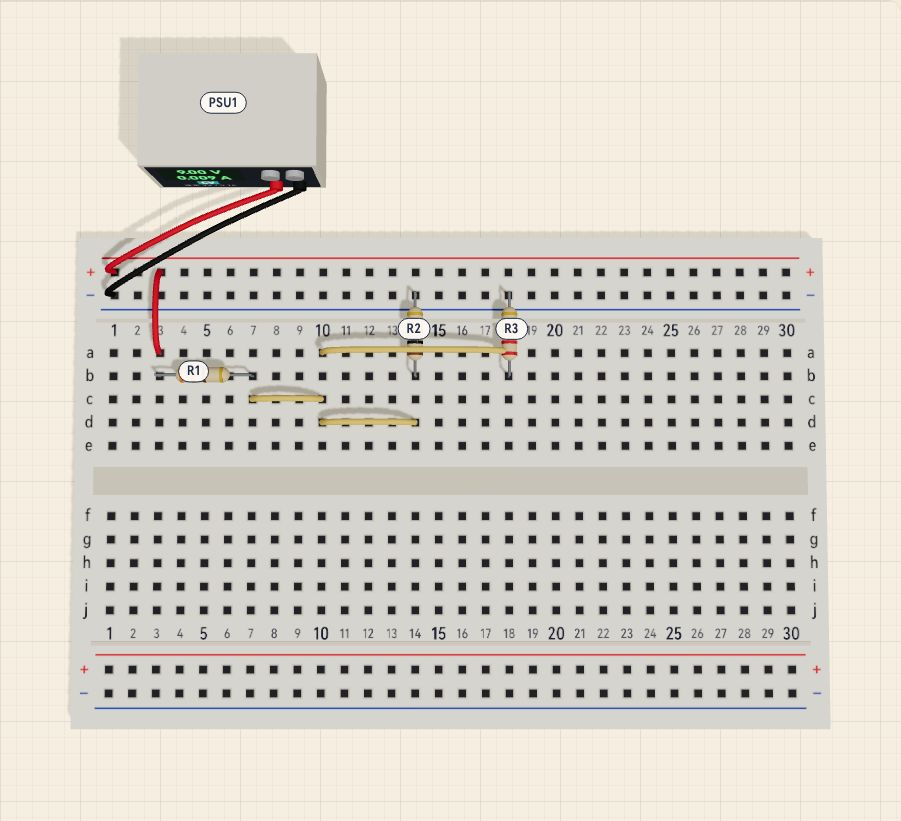
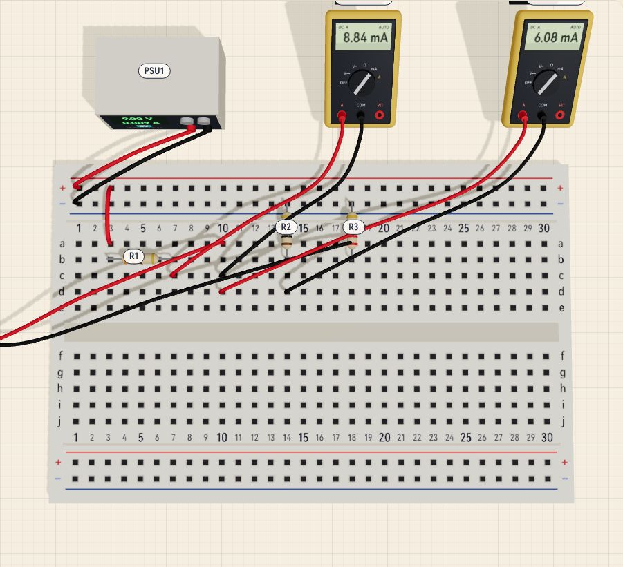
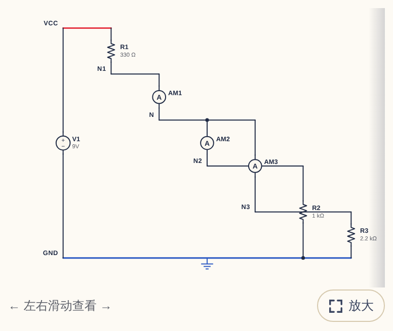
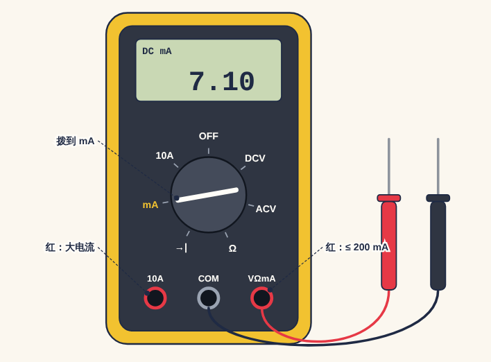
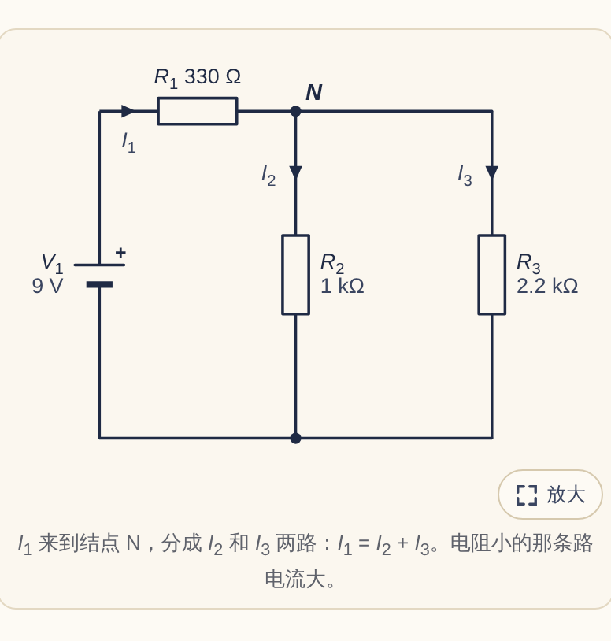

# 1.8 · KCL：流进结点的 = 流出结点的

| 项目 | 内容 |
|---|---|
| id | `exp-kcl-ammeters` |
| 文件 | `challenges/201-kcl-ammeters.json` |
| 类型 | 实验 / 挑战（没有分步，照目标电路图搭） · 难度 3/5 |
| 位置 | World 1 · 基础定律与直流分压 → 1.8 并联与 KCL（本节第 2 项） |
| 右侧面板 | 轨道由旧的四张卡片自动生成（还没手工精排） |
| 前后 | 上一项 [1.8 lesson-parallel](../w1/1.08-1-lesson-parallel.md) · 下一项 [1.9 lesson-pushbutton](../w1/1.09-1-lesson-pushbutton.md) |
| 先修 | lesson-ammeter、lesson-multimeter |
| 概念 | KCL 基尔霍夫电流定律、ammeter 电流表、node 结点、reference direction 参考方向 |

**一句话概要**：在一个结点的三条支路里各串一块电流表：流进来的电流，等于流出去的电流之和。

## 1. 左侧工作台（3D 面包板 → 2D 俯视截图）

截图是程序里真实的 3D 面包板换成俯视角拍的；表格是同一块板的文字版（元件、参数、每只脚插在哪个孔）。

### 1.1 起点：打开这一课时板上已经有的

右侧显示的「起点」说明：

> **只测量**：电源和 R1、R2、R3 已经接好，三处要测电流的地方先用**跳线**连着。**为什么**：电路本身是第 5、6 课的串并联，这里要学的是把电流表接进支路。**你要做**：把三根跳线（c7–c10、d10–d14、a10–a18）各换成一块电流表（红 + 朝电流流进的一侧），再读数。

| 元件 | 类型 | 参数 | 引脚 → 孔 |
|---|---|---|---|
| PSU1 | bench_supply | voltage=9, currentLimit=0.1 | +→tp1 -→tn1 |
| W2 | wire |  | a→tp3 b→a3 |
| R1 | resistor | resistance=330 | 1→b3 2→b7 |
| W4 | wire |  | a→c7 b→c10 |
| R2 | resistor | resistance=1000 | 1→b14 2→tn14 |
| W6 | wire |  | a→d10 b→d14 |
| R3 | resistor | resistance=2200 | 1→b18 2→tn18 |
| W8 | wire |  | a→a10 b→a18 |

### 1.3 参考答案（「看答案」载入的板子）

| 元件 | 类型 | 参数 | 引脚 → 孔 |
|---|---|---|---|
| PSU1 | bench_supply | voltage=9, currentLimit=0.1 | +→tp1 -→tn1 |
| W2 | wire |  | a→tp3 b→a3 |
| R1 | resistor | resistance=330 | 1→b3 2→b7 |
| AM1 | ammeter |  | +→c7 -→c10 |
| AM2 | ammeter |  | +→d10 -→d14 |
| R2 | resistor | resistance=1000 | 1→b14 2→tn14 |
| AM3 | ammeter |  | +→a10 -→a18 |
| R3 | resistor | resistance=2200 | 1→b18 2→tn18 |

### 1.4 目标原理图（右侧「目标原理图」抽屉）

| 元件 | 类型 | 参数 |
|---|---|---|
| V1 | dc_source | voltage=9 |
| R1 | resistor | resistance=330 |
| AM1 | ammeter |  |
| AM2 | ammeter |  |
| AM3 | ammeter |  |
| R2 | resistor | resistance=1000 |
| R3 | resistor | resistance=2200 |

连接（每个结点上的引脚）：

- **VCC**：V1.+、R1.1
- **N1**：R1.2、AM1.+
- **N**：AM1.-、AM2.+、AM3.+
- **N2**：AM2.-、R2.1
- **N3**：AM3.-、R3.1
- **GND**：R2.2、R3.2、V1.-

## 2. 右侧面板：学生从上往下看到的内容（单轨流）

### 第 1 步 · 🔍 先看一眼：先认识它：电流表

**拆解「电流表：一个很小的电阻 + 一块毫伏表」第 1 / 7 层：① 面板：拨到 mA，红表笔看电流大小选插孔**

还是那块万用表，只改两件事：
1. 拨盘转到 mA（或 10A）；
2. 红表笔插对插孔：电流 ≤ 200 mA 插 VΩmA，更大的电流插 10A。黑表笔照旧在 COM。

显示屏 上的数是 **从红表笔流进表、从黑表笔流出的电流**。

不知道电流有多大时，**先用 10A 孔和 10A 档**，读数小于 200 mA 再换到 mA。顺序反过来，几安培的电流会直接冲进 mA 档，熔断里面的保险丝。

本课程的实验电流都是几 mA 到几十 mA，用 mA 档。仿真里的电流表是一个单独的元件（AM1、AM2 …），相当于一块固定在 mA 档的表。

| 拨盘 | 红表笔插 | 最大电流 | 里面的分流电阻 | 保护 |
|---|---|---|---|---|
| mA | VΩmA | 200 mA | 1 Ω … 100 Ω（看量程） | 200 mA 快熔保险丝 |
| 10A | 10A | 10 A | 0.01 Ω | 10 A 保险丝；> 2 A 时每次 ≤ 10 s |
| DCV（量完记得换回） | VΩmA | — | 10 MΩ 分压器 | — |

### 第 2 步 · 🔧 动手搭：电流在岔路口怎么分？

面包板上已经搭好了：电流经过 R1 来到结点 **N**，在这里分成两路，一路走 R2，一路走 R3。
猜一猜：走 1 kΩ 那条路的电流多，还是走 2.2 kΩ 那条路的多？两条加起来，和来的时候比呢？

### 第 3 步 · 💡 想明白：KCL：结点不存电荷

- 结点只是几根导线的交汇点，它**不能存电荷，也不能造电荷**。所以每一秒流进来多少，就得流出去多少。
- 写成式子：$I_1 = I_2 + I_3$，或者把流出记为正、流进记为负：$-I_1 + I_2 + I_3 = 0$。这就是**基尔霍夫电流定律（KCL）**。

*图 `node`（schematic）：I_1 来到结点 N，分成 I_2 和 I_3 两路：I_1 = I_2 + I_3。电阻小的那条路电流大。*

- 两条支路两端电压一样（都是 N 对 GND），所以**电阻小的那条电流大**：$I_2 = \frac{V_N}{R_2}$，$I_3 = \frac{V_N}{R_3}$。
- 接表之前，先自己算出 I1、I2、I3 和 N 点电压：R2 ∥ R3 再和 R1 串联，得到总电阻和 I1。

（这一步下面列着这节课的计算卡片，点开就地展开：`current-divider`、`kcl`、`node-voltage`、`ammeter-burden`，全文见第 6 节）

### 第 4 步 · 🔧 动手搭：换上三块电流表

- 电流表要**串联**：拔掉一根黄色跳线，把电流表的两支表笔插进它空出来的两个孔。
- **红表笔朝电流来的方向**：AM1 的红表笔在 R1 一侧；AM2、AM3 的红表笔都在结点 N（第 10 列）一侧。
- 检查通过后，把三块表的读数和 N 点对 GND 的电压填进测量题。

### 第 5 步 · 📏 测一测：测一测：读你自己的仪表

**测量题 1 · `i1`**（读数题）

> 电流表 AM1 的读数 I1（流进结点 N 的总电流）

- 单位 mA · 先写预测 · 参考答案的读数 **8.844 mA** · 合理范围 [0.0084, 0.0093]

答对后显示：

> I1 = 9 V / (R1 + R2 ∥ R3)：R2 ∥ R3 = 687.5 Ω，总电阻 1017.5 Ω，约 8.84 mA。

**测量题 2 · `i2`**（读数题）

> 电流表 AM2 的读数 I2（流过 R2）

- 单位 mA · 先写预测 · 参考答案的读数 **6.08 mA** · 合理范围 [0.0058, 0.0064]

答对后显示：

> I2 = V_N / R2 ≈ 6.08 V / 1 kΩ ≈ 6.08 mA。

**测量题 3 · `i3`**（读数题）

> 电流表 AM3 的读数 I3（流过 R3）

- 单位 mA · 先写预测 · 参考答案的读数 **2.764 mA** · 合理范围 [0.00263, 0.00291]

答对后显示：

> I3 = V_N / R3 ≈ 6.08 V / 2.2 kΩ ≈ 2.76 mA。

**测量题 4 · `un`**（读数题）

> 万用表：结点 N 对 GND 的电压 V_N（红表笔接 N，黑表笔接 GND）

- 单位 V · 先写预测 · 参考答案的读数 **6.081 V** · 合理范围 [5.8, 6.4]

答对后显示：

> V_N = I1 × (R2 ∥ R3) ≈ 8.84 mA × 687.5 Ω ≈ 6.08 V。

**测量题 5 · `kcl`**（选择题）

> 用你的三个读数算 I2 + I3，和 I1 比较：

- A. I2 + I3 = I1（差别在读数误差以内）：流进 N 的电流等于流出的电流 ✅（正确）
- B. I2 + I3 比 I1 小：有一部分电流在结点 N “消失”了
- C. I2 + I3 比 I1 大：结点 N 自己产生了电流

答对后显示：

> 结点上电荷既不会堆积也不会凭空产生，所以 −I1 + I2 + I3 = 0（KCL）。读数之间的小差别来自读数的位数，不是电流丢了。

### 第 6 步 · 🎒 带走：带走

- **KCL：流进 = 流出。** 用代数和写，$-I_1 + I_2 + I_3 = 0$，不管表笔怎么接，代数和永远是 0。
- 某块表读数是负的？只是表笔接反了：电流没变，参考方向和实际方向相反。
- 真实万用表 mA 档有几欧到十几欧的负担电阻，三块表都接上时读数会比计算值小一点；被测电路电阻越小，误差越明显。

趁热练理论题：`basics`、`equivalence`

## 3. 测量题一览

| # | id | 题目 | 类型 | 单位 | 状态 | 参考读数 |
|---|---|---|---|---|---|---|
| 1 | i1 | 电流表 AM1 的读数 I1（流进结点 N 的总电流） | current | mA |  | 8.844 mA |
| 2 | i2 | 电流表 AM2 的读数 I2（流过 R2） | current | mA |  | 6.08 mA |
| 3 | i3 | 电流表 AM3 的读数 I3（流过 R3） | current | mA |  | 2.764 mA |
| 4 | un | 万用表：结点 N 对 GND 的电压 V_N（红表笔接 N，黑表笔接 GND） | voltage | V |  | 6.081 V |
| 5 | kcl | 用你的三个读数算 I2 + I3，和 I1 比较： | 选择 |  |  | 正确：A |

### 全部答完后显示的「对比」

**对比**：R2 ∥ R3 = 1k × 2.2k / 3.2k = 687.5Ω，总电阻 1017.5Ω，所以 I1 = 9 / 1017.5 ≈ 8.84 mA，N 点 ≈ 8.84 mA × 687.5Ω ≈ 6.08 V，I2 ≈ 6.08 mA，I3 ≈ 2.76 mA，而 6.08 + 2.76 = 8.84。读数和预测差得多时，先看有没有负读数（表笔接反）、电流表是不是串在了正确的位置。

**想一想**：如果把 AM3 的表笔接反，它会显示 −2.76 mA。电流并没有变，只是你选的参考方向（reference direction）和实际方向相反。KCL 用代数和来写就是 −I1 + I2 + I3 = 0，不管表笔怎么接，代数和永远是 0。（判分要求按上面说的方向接。）

### 提示按钮（依次显示）

1. 拔掉一根黄色跳线，把电流表的两个表笔插进它空出来的两个孔：这就是“串联进电路”。
2. 红表笔朝电流来的方向：AM1 的红表笔在 R1 那一侧，AM2 和 AM3 的红表笔都在结点 N（第 10 列）那一侧。
3. 读数是负数说明表笔接反了：把这块表的两个表笔对调。

### 功能测试（「检查我的电路」时跑）

- 三块电流表串在各自的支路里、方向正确；N 点电压合理

## 4. 用到的拆解（全部层的文字，供改写参考）

### 拆解 `ammeter`：电流表：一个很小的电阻 + 一块毫伏表

*ammeter（电流表）不是另一台仪器，而是同一块万用表拨到电流档。它里面没有“直接数电子”的东西：电流流过一个已知的小电阻，表量这个电阻两端的电压，再用欧姆定律换算成电流。从这一点出发，就能推出“为什么必须串联”和“并联为什么会短路”。*

**拆解「电流表：一个很小的电阻 + 一块毫伏表」第 1 / 7 层：① 面板：拨到 mA，红表笔看电流大小选插孔**

还是那块万用表，只改两件事：
1. 拨盘转到 mA（或 10A）；
2. 红表笔插对插孔：电流 ≤ 200 mA 插 VΩmA，更大的电流插 10A。黑表笔照旧在 COM。

显示屏 上的数是 **从红表笔流进表、从黑表笔流出的电流**。

不知道电流有多大时，**先用 10A 孔和 10A 档**，读数小于 200 mA 再换到 mA。顺序反过来，几安培的电流会直接冲进 mA 档，熔断里面的保险丝。

本课程的实验电流都是几 mA 到几十 mA，用 mA 档。仿真里的电流表是一个单独的元件（AM1、AM2 …），相当于一块固定在 mA 档的表。

| 拨盘 | 红表笔插 | 最大电流 | 里面的分流电阻 | 保护 |
|---|---|---|---|---|
| mA | VΩmA | 200 mA | 1 Ω … 100 Ω（看量程） | 200 mA 快熔保险丝 |
| 10A | 10A | 10 A | 0.01 Ω | 10 A 保险丝；> 2 A 时每次 ≤ 10 s |
| DCV（量完记得换回） | VΩmA | — | 10 MΩ 分压器 | — |

**拆解「电流表：一个很小的电阻 + 一块毫伏表」第 2 / 7 层：② X 光：保险丝 → 分流电阻 → COM，ADC 量电阻两端**

电流档里，电流走的路是一条实实在在的金属通路：
VΩmA → 保险丝 F 0.2 A → 分流电阻（shunt） → COM。

**分流电阻**（shunt resistor）是一个阻值很准、温度变化小的小电阻（锰铜合金）。电流流过它，两端出现一个小电压，**还是那颗 ±200 mV 的 ADC** 去量它——和电压档用的是同一颗芯片。

10A 插孔有自己的一条路：10 A 保险丝 → 0.01 Ω 的粗分流电阻 → COM。

保险丝 是为“接错”准备的：如果把电流档直接并到电源上，几安培的电流会烧坏分流电阻和电路板，保险丝先断开，保护表。真实的表保险丝断了以后，电流档读数永远是 0——量电流读到 0 而电路明明在工作，先查保险丝。

| 部件 | 作用 | 典型值 |
|---|---|---|
| 保险丝（mA 路） | 过流时熔断，保护表 | 200 mA / 250 V, ≈ 0.5 Ω |
| 分流电阻 $R_{sh}$ | 把电流变成电压 | 1 Ω … 100 Ω |
| ADC | 量 $R_{sh}$ 两端的毫伏 | ±200 mV |
| 10 A 分流电阻 | 大电流用的粗电阻 | 0.01 Ω |

**拆解「电流表：一个很小的电阻 + 一块毫伏表」第 3 / 7 层：③ 原理：I = V / R，倒过来用欧姆定律**

表并不直接量电流，它做的是：
1. 让被测电流 $I$ 全部流过 一个已知电阻 $R_{sh}$；
2. 用 毫伏表（ADC） 量出 $R_{sh}$ 两端的电压 $V_{sh}$；
3. 显示 $I = \frac{V_{sh}}{R_{sh}}$。

用第 10 课的电流代数字（20 mA 量程，$R_{sh}$ = 10 Ω）：
$$V_{sh} = I R_{sh} = 7.1 mA × 10 Ω = 71 mV$$
ADC 读到 71 mV，显示屏 显示 $\frac{71 mV}{10 Ω} = 7.10 mA$。

**量程是怎么来的**：ADC 满量程是 200 mV，所以每个量程的分流电阻都选成“满量程电流 × $R_{sh}$ = 200 mV”。量程越大，$R_{sh}$ 越小：

| 量程 | 分流电阻 $R_{sh}$ | 满量程时 $V_{sh}$ | 7.1 mA 时 $V_{sh}$ |
|---|---|---|---|
| 2 mA | 100 Ω | 200 mV | 超量程 OL |
| 20 mA | 10 Ω | 200 mV | 71 mV |
| 200 mA | 1 Ω | 200 mV | 7.1 mV |
| 10 A | 0.01 Ω | 100 mV | 0.071 mV |

- 公式 `I = \frac{V_{sh}}{R_{sh}}`：电流表的全部原理
- 公式 `R_{sh} = \frac{200 mV}{I_{full scale}}`：每个量程的分流电阻

**拆解「电流表：一个很小的电阻 + 一块毫伏表」第 4 / 7 层：④ 等效电路：理想电流表串联一个小电阻**

把上一层装回去，从两个表笔看进去，电流档的表等效为 **串联** 的两样东西：
- 理想电流表（ideal ammeter）：读出流过它的电流，**自身电阻为 0**（相当于一根导线）；
- 分流电阻 $R_{sh}$（加上保险丝和表笔的电阻）：真实的表必须有的那一点电阻。仿真里固定为 **0.1 Ω**。

和电压表正好相反（右边对比）：电压表 希望自己的电阻 **无穷大**，这样并上去不分走电流；电流表 希望自己的电阻 **为 0**，这样串进去不分走电压。

电流表两端的电压叫 **负担电压**（burden voltage）：
$$V_{burden} = I R_{sh} = 7.1 mA × 0.1 Ω = 0.71 mV$$
第 10 课让你用万用表量这个电压、再用 $R = \frac{V}{I}$ 反算出 0.1 Ω——这就是在“量电流表的等效电路”。

真实万用表的 mA 档 $R_{sh}$ 加保险丝有几欧到十几欧。比如 10 Ω：负担电压 71 mV，电流变成 $\frac{7.2 V}{1022 Ω} = 7.05 mA$，比不接表时小 1 %。

|  | 电流表 | 电压表 |
|---|---|---|
| 量什么 | 流过一条路径的电流 | 两点之间的电压 |
| 怎么接 | **串联**：断开、插入 | **并联**：直接点上 |
| 理想内阻 | 0 | ∞ |
| 仿真 / 真实 | 0.1 Ω / 1–15 Ω | ∞ / 10 MΩ |
| 接错会怎样 | 并联 → 短路被测元件 | 串联 → 电路几乎断开 |

- 公式 `V_{burden} = I R_{sh}`：电流表“吃掉”的电压
- 公式 `I_{with meter} = \frac{V_s - V_{LED}}{R_1 + R_{LED} + R_{sh}}`：第 10 课：$R_{sh}$ 串进了回路

**拆解「电流表：一个很小的电阻 + 一块毫伏表」第 5 / 7 层：⑤ 为什么必须串联：电流要“全部”流过表**

表只量 **流过自己** 的电流。要量一条支路的电流，就得让这条支路的电流 **一点不少地全部** 走进表——唯一的办法是：
1. 在要测的地方 **断开** 电路（第 10 课：拔掉那根黄色跳线）；
2. 把表的两个表笔 **接进断口**：红表笔 接电流来的那一边（电池 + 那边），黑表笔 接电流去的那一边（R1 那边）；
3. 这时电流只有一条路：电池 → 红表笔 → 表 → 黑表笔 → R1 → LED → GND。

一步步算 这条回路的电流（LED 模型 = 1.8 V + 12 Ω）：
$$I = \frac{9 V - 1.8 V}{1000 Ω + 12 Ω + 0.1 Ω} = \frac{7.2 V}{1012.1 Ω} ≈ 7.1 mA$$
有表和没表只差 0.1 Ω，电流从 7.1146 mA 变成 7.1139 mA——看不出来。

**方向 / 符号**：读数的定义是“从红表笔流进去的电流”。把红黑对调，电流还是从电池 + 流出，但它现在从黑表笔流进表，读数变成 **−7.1 mA**。负号不是错，是在告诉你：实际电流方向和你选的 **参考方向**（reference direction）相反。

- 公式 `I = \frac{V_{bat} - V_{F}}{R_1 + R_{LED} + R_{sh}} = \frac{9 - 1.8}{1012.1} ≈ 7.1 mA`：第 10 课的电流，$R_{sh}$ 只占 0.01 %

**拆解「电流表：一个很小的电阻 + 一块毫伏表」第 6 / 7 层：⑥ 并联会怎样：0.1 Ω 把元件短路了**

第 10 课故意做一次错误示范：把 电流表 并在 LED 两端。用等效电路就能算出会发生什么：
1. LED 和 0.1 Ω 并联。要让 LED 导通，它两端至少要 1.8 V；而 0.1 Ω 两端只要有 1.8 V，就要流 18 A——不可能。所以 **电流全走电流表**，LED 两端只剩
$$V = 9 mA × 0.1 Ω = 0.9 mV < 1.8 V$$
LED 熄灭；
2. 回路里只剩 R1 和 0.1 Ω：
$$I = \frac{9 V}{1000 Ω + 0.1 Ω} ≈ 9.0 mA$$
3. 表读到 9.0 mA——这 **不是** LED 原来的电流（7.1 mA），而是“LED 被短路以后”的电流。

**更危险的情况**：直接并在电池两端，回路里只有电池内阻 1.5 Ω 和表的 0.1 Ω：
$$I = \frac{9 V}{1.5 Ω + 0.1 Ω} ≈ 5.6 A;  P_{R_{sh}} = I^{2} R_{sh} = 5.6^{2} × 0.1 ≈ 3.2 W$$
真实的表：200 mA 保险丝瞬间熔断（没有保险丝，分流电阻就烧了）。仿真里不会烧，只会把元件短路，诊断面板会提醒你。

| 接法 | LED | 表的读数 | 意义 |
|---|---|---|---|
| 串在跳线处（正确） | 亮 | 7.1 mA | LED 的电流 |
| 串联，红黑对调 | 亮 | −7.1 mA | 同一电流，参考方向反 |
| 并在 LED 两端（错） | 灭 | 9.0 mA | 短路后的电流 |
| 并在电池两端（危险） | — | 5.6 A | 烧保险丝 |

**拆解「电流表：一个很小的电阻 + 一块毫伏表」第 7 / 7 层：⑦ 一个结点三块表（KCL），以及真实电流表的局限**

实验 201 在结点 N 的三条支路里各串一块表：AM1 量流进 N 的电流，AM2、AM3 量流出的电流。先算：
1. $R_2 ∥ R_3 = \frac{1k × 2.2k}{3.2k} = 687.5 Ω$，总电阻 $330 + 687.5 = 1017.5 Ω$；
2. $I_1 = \frac{9 V}{1017.5 Ω} ≈ 8.84 mA$，$V_N = 8.84 mA × 687.5 Ω ≈ 6.08 V$；
3. $I_2 = \frac{6.08 V}{1 kΩ} = 6.08 mA$，$I_3 = \frac{6.08 V}{2.2 kΩ} = 2.76 mA$；
4. 6.08 + 2.76 = 8.84：流进 = 流出（KCL）。

每条路径上串了两块表，只多了 0.2 Ω，相对 1017.5 Ω 是 0.02 %，可以忽略。**表多不怕，只要每块都串在自己的支路里。**某块表读到负数，说明它的红黑和实际电流方向相反——KCL 写成代数和照样成立：$-I_1 + I_2 + I_3 = 0$。

真实电流表比仿真多出的几件事，见下表。

| 项目 | 真实万用表 | 仿真 |
|---|---|---|
| 内阻 / 负担电压 | mA 档 1–15 Ω，几十到几百 mV | 0.1 Ω |
| 并联在电源上 | 保险丝熔断 | 元件被短路 + 诊断提示 |
| 10 A 档 | 内阻小，但小电流读不准（最后一位 10 mA） | — |
| 换档 | 换档时电路会短暂断开 | — |
| 交流电流 | 有效值，频率有限 | 直流读数 |

- 公式 `-I_1 + I_2 + I_3 = 0`：KCL，读数带符号

**一句话记住**：电流表 = 理想电流表串联一个小电阻 $R_{sh}$（仿真 0.1 Ω）。它量的是 $R_{sh}$ 两端的毫伏，再算 $I = V_{sh}/R_{sh}$。因为电阻小，它必须串进断口；并联就等于用导线把元件短路。读数是“从红表笔流进去的电流”，接反为负。

## 5. 这一课的计算卡片

**计算卡片 `current-divider`：分流 Current divider**

- 公式 `I_1 = I \frac{R_2}{R_1 + R_2}`
- 用途：总电流流进两条并联支路，每条分到多少。
- 输入：I（总电流，A）；R1（R₁，Ω）；R2（R₂，Ω） → I_1（流过 R₁ 的电流，A）

并联两端电压相同：$V = I (R_1 ∥ R_2)$，于是 $I_1 = \frac{V}{R_1} = I \frac{R_2}{R_1 + R_2}$。
注意分子是 **另一条** 支路的电阻：电流更愿意走电阻小的路，R₁ 越小 I₁ 越大。

- ⚠ 和分压公式正好“反过来”：分子是对面那条支路。

**计算卡片 `kcl`：基尔霍夫电流定律 KCL**

- 公式 `Σ i_{in} = Σ i_{out}`
- 用途：一个结点上流进的电流之和等于流出的电流之和：知道几条支路，求剩下那一条。
- 输入：I_1（流进结点的电流，A）；I_2（流出的另一条支路，A） → I_3（剩下那条支路流出的电流，A）

1. 电荷不会在结点上堆起来，也不会凭空出现：每一时刻流进多少就流出多少。
2. 先给每条支路选一个 **参考方向**（画箭头），再写代数和，比如“流出为正”：$-I_1 + I_2 + I_3 = 0$。
3. 只剩一个未知量时直接解：$I_3 = I_1 - I_2$。
4. 算出负数不是算错：它说明真实电流和你画的箭头方向相反。

例子：实验 1-1：$I_1 = \frac{9 V}{330 + 1k ∥ 2.2k} = \frac{9}{1017.5} ≈ 8.84 mA$，$I_2 = \frac{6.08 V}{1 kΩ} ≈ 6.08 mA$，所以 $I_3 = 8.84 - 6.08 = 2.76 mA$——正好等于 $\frac{6.08 V}{2.2 kΩ}$。实验 1-8：电流源的 10 mA 里有 3.2 mA 进了负载，$R_N$ 分到 10 − 3.2 = 6.8 mA。

- ⚠ 电流表接反读数是负的：代进 KCL 时要连符号一起代。
- ⚠ 同一条支路上串联的几个元件电流相同，它们之间的连接点不算新的 KCL 方程。

**计算卡片 `node-voltage`：结点电压法（一个结点）Node voltage**

- 公式 `V_N = \frac{\frac{V_1}{R_1} + \frac{V_2}{R_2} + I_s}{\frac{1}{R_1} + \frac{1}{R_2} + \frac{1}{R_3}}`
- 用途：几条支路汇到一个结点：一条 KCL 方程直接求出这个结点的电压。
- 输入：V_1（电源 1（经 R₁ 接到 N），V）；R_1（R₁，Ω）；V_2（电源 2（经 R₂ 接到 N，没有就填 0），V）；R_2（R₂，Ω）；R_3（N 到地的电阻 R₃，Ω）；I_s（流进 N 的电流源（没有就填 0），A） → V_N（结点 N 的电压，V）

1. 选 GND 做参考结点，未知量只剩 $V_N$。
2. 对 N 写 KCL，每条支路电流都写成“从 N 流出”：$\frac{V_N - V_1}{R_1} + \frac{V_N - V_2}{R_2} + \frac{V_N}{R_3} - I_s = 0$。
3. 把含 $V_N$ 的项合并：左边系数是接在 N 上所有电导之和（**自电导**），右边是每个“电压源 ÷ 串联电阻”加上流进的电流源（**注入电流**）。
4. 解出 $V_N$，再用欧姆定律求每条支路的电流，比如 $I_3 = \frac{V_N}{R_3}$。
单位技巧：用 V、kΩ、mA，电导就是 mS。

例子：实验 2-1（两个电源都接上）：$V_N = \frac{9/1 + 5/2.2}{1 + 0.4545 + 0.3030} = \frac{11.27}{1.7576} ≈ 6.41 V$，$I_3 = \frac{6.41}{3.3} ≈ 1.94 mA$。

- ⚠ 电流源：流进结点为正，流出为负。
- ⚠ 和电流源串联的电阻不进自电导（它不影响电流源送进来的电流）。

**计算卡片 `ammeter-burden`：电流表的内阻（负担电压）Ammeter burden**

- 公式 `误差 = \frac{R_A}{R + R_A}, $V_A$ = I $R_A$`
- 用途：电流表串进回路会多出 R_A：电流变小多少？表上压降多大？
- 输入：R（回路里其余的电阻（含 LED、电源内阻），Ω）；R_A（电流表内阻（模拟 0.1 Ω，真实 mA 档几欧到十几欧），Ω） → err（电流读数偏小，%）

1. 电流表要 **串联**：电流必须从它里面流过。它里面是一个很小的分流电阻 $R_A$（加上保险丝）。
2. 回路电阻从 R 变成 $R + R_A$，电流从 $\frac{V}{R}$ 变成 $\frac{V}{R + R_A}$。
3. 相对误差：$1 - \frac{R}{R + R_A} = \frac{R_A}{R + R_A}$。
4. 表两端的压降（负担电压）$V_A = IR_A$；反过来 $R_A = \frac{V_A}{I}$——第 10 课就这样量内阻。
5. 电流表 **并联** 到元件上 = 用 $R_A$ 把它短路。

例子：第 10 课：回路 1012 Ω，0.1 Ω 的表让电流小 0.01 %，表上压降 $0.1 × 7.1 mA ≈ 0.71 mV$。换成 10 Ω 的真实 mA 档：小约 1 %。实验 2-2 的短路电流：$\frac{10}{1158 + 10} ≈ 0.86 %$，$R_eq$ 偏大这么多。

- ⚠ 把电流表并在电源两端：真实表会烧保险丝。
- ⚠ 低电压、低电阻的回路里负担电压最要命（几百 mV 就能让 LED 电流明显变小）。

## 6. English（界面英文版的同一份内容）

展开英文

### Node 1 · 🔍 Look first：Meet it first: Ammeter

**Teardown「Ammeter: a tiny resistor plus a millivoltmeter」layer 1 of 7：① Front: dial on mA, the red lead’s jack depends on the size of the current**

The same multimeter, with two changes:
1. turn the dial to mA (or 10A);
2. put the red lead in the right jack: ≤ 200 mA in VΩmA, anything larger in 10A. The black lead stays in COM.

The number on the display is **the current flowing into the meter at the red lead and out at the black lead**.

If you don't know how big the current is, **start with the 10A jack and the 10A range**, and move to mA only if it reads below 200 mA. The other way round, amps rush into the mA range and blow its fuse.

The labs in this course draw a few mA to a few tens of mA — the mA range. In the simulator the ammeter is a part of its own (AM1, AM2 …), like a meter fixed on mA.

| Dial | Red lead in | Max current | Shunt inside | Protection |
|---|---|---|---|---|
| mA | VΩmA | 200 mA | 1 Ω … 100 Ω (per range) | 200 mA fast fuse |
| 10A | 10A | 10 A | 0.01 Ω | 10 A fuse; above 2 A, ≤ 10 s at a time |
| DCV (switch back after!) | VΩmA | — | 10 MΩ divider | — |

### Node 2 · 🔧 Build：How does current split at a fork?

The board is already built: current comes through R1 to node **N** and splits there, one part through R2, the other through R3.
Guess: does more current take the 1 kΩ path or the 2.2 kΩ path? And the two together, compared with what arrived?

### Node 3 · 💡 Why：KCL: a node stores no charge

- A node is just where wires meet; it **cannot store charge or make charge**. So whatever flows in each second must flow out.
- As an equation: $I_1 = I_2 + I_3$, or with outgoing currents positive and incoming negative: $-I_1 + I_2 + I_3 = 0$. That is **Kirchhoff's current law (KCL)**.

[figure `node`]

*Figure `node`（schematic）：I_1 来到结点 N，分成 I_2 和 I_3 两路：I_1 = I_2 + I_3。电阻小的那条路电流大。*

- Both branches have the same voltage across them (N to GND), so **the branch with the smaller resistance carries more**: $I_2 = \frac{V_N}{R_2}$, $I_3 = \frac{V_N}{R_3}$.
- Before you connect the meters, work out I1, I2, I3 and the voltage at N yourself: R2 ∥ R3 in series with R1 gives the total resistance and I1.

(This node lists the lesson’s calculation cards: `current-divider`、`kcl`、`node-voltage`、`ammeter-burden`; full text in section 6)

### Node 4 · 🔧 Build：Swap in three ammeters

- An ammeter goes **in series**: pull out a yellow jumper and put the ammeter's two probes into the two holes it leaves.
- **Red probe towards where the current comes from**: AM1's red probe on the R1 side; AM2's and AM3's red probes both on node N's side (column 10).
- When the check passes, type the three readings and N's voltage to GND into the questions.

### Node 5 · 📏 Measure：Measure: read your own instruments

**Question 1 · `i1`**（reading）

> Ammeter AM1 reading I1 (the total current into node N)

- unit mA · predict first · range [0.0084, 0.0093]

Shown once right:

> I1 = 9 V / (R1 + R2 ∥ R3): R2 ∥ R3 = 687.5 Ω, total 1017.5 Ω, about 8.84 mA.

**Question 2 · `i2`**（reading）

> Ammeter AM2 reading I2 (through R2)

- unit mA · predict first · range [0.0058, 0.0064]

Shown once right:

> I2 = V_N / R2 ≈ 6.08 V / 1 kΩ ≈ 6.08 mA.

**Question 3 · `i3`**（reading）

> Ammeter AM3 reading I3 (through R3)

- unit mA · predict first · range [0.00263, 0.00291]

Shown once right:

> I3 = V_N / R3 ≈ 6.08 V / 2.2 kΩ ≈ 2.76 mA.

**Question 4 · `un`**（reading）

> Multimeter: voltage V_N from node N to GND (red lead on N, black on GND)

- unit V · predict first · range [5.8, 6.4]

Shown once right:

> V_N = I1 × (R2 ∥ R3) ≈ 8.84 mA × 687.5 Ω ≈ 6.08 V.

**Question 5 · `kcl`**（multiple choice）

> Work out I2 + I3 from your readings and compare it with I1:

- A. I2 + I3 = I1 (within the reading error): the current into N equals the current out ✅ (right)
- B. I2 + I3 is smaller than I1: some current "disappears" at node N
- C. I2 + I3 is larger than I1: node N produces current

Shown once right:

> Charge neither piles up at a node nor appears from nowhere, so −I1 + I2 + I3 = 0 (KCL). Small differences between readings come from the digits shown, not from lost current.

### Node 6 · 🎒 Take away：Take away

- **KCL: in = out.** As an algebraic sum, $-I_1 + I_2 + I_3 = 0$, and however the probes are connected the sum stays 0.
- A negative reading? The probes are swapped: same current, reference direction opposite to the real one.
- A real multimeter's mA range has a few ohms to a dozen ohms of burden resistance; with three meters in, the readings come out a little below the calculation, more so in low-resistance circuits.

Practise：`basics`、`equivalence`

**Compare**

**Compare**: R2 ∥ R3 = 1k × 2.2k / 3.2k = 687.5Ω, total 1017.5Ω, so I1 = 9 / 1017.5 ≈ 8.84 mA, N ≈ 8.84 mA × 687.5Ω ≈ 6.08 V, I2 ≈ 6.08 mA, I3 ≈ 2.76 mA, and 6.08 + 2.76 = 8.84. If a reading is far from your prediction, look for a negative reading (leads swapped) and check that the ammeter sits in the right place in series.

**Think about it**: if you swap AM3's leads it shows −2.76 mA. The current hasn't changed; the reference direction you picked is simply opposite to the real one. Written as an algebraic sum, KCL is −I1 + I2 + I3 = 0, and that sum is always 0 however the leads are connected. (The checker wants the directions described above.)

**Hints**

1. Pull out one yellow jumper and plug the ammeter's two leads into the two free holes. That is what "in series" means.
2. Red lead toward where the current comes from: AM1's red lead on the R1 side; AM2's and AM3's red leads on the node N side (column 10).
3. A negative reading means the leads are reversed: swap that meter's two leads.

