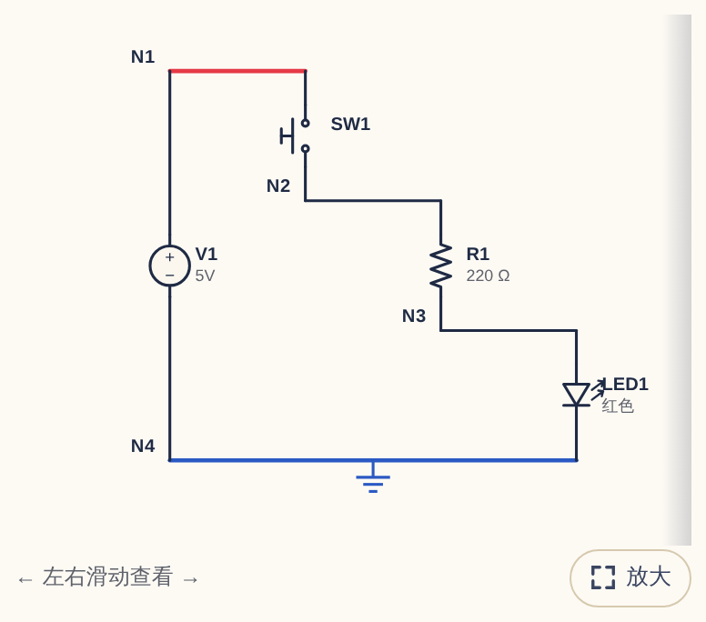
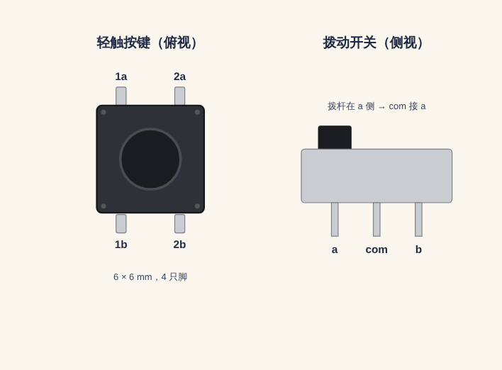
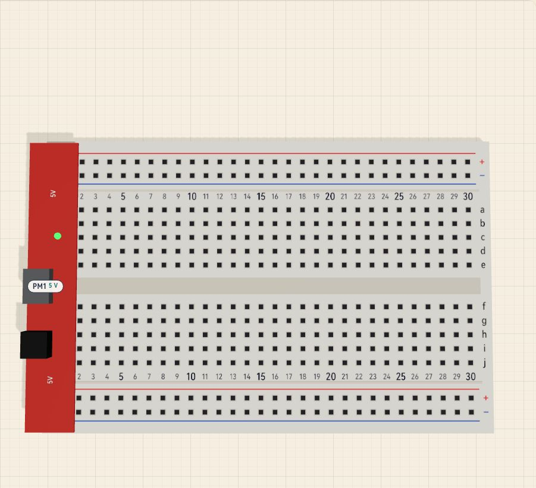
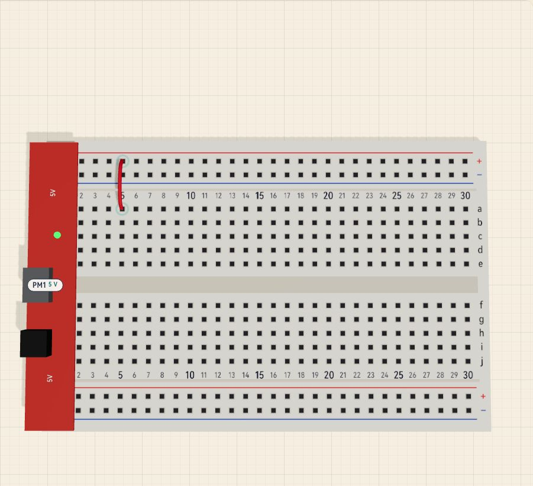
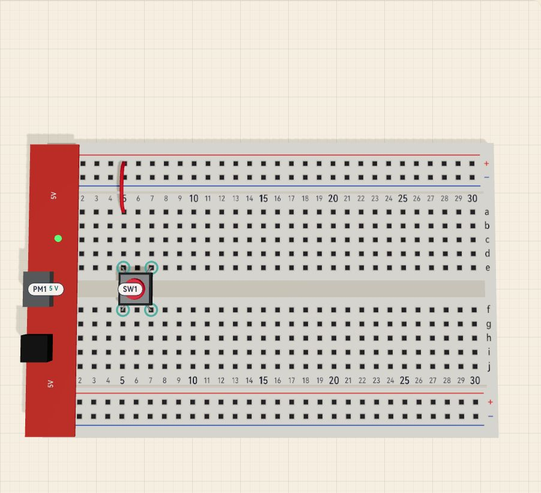
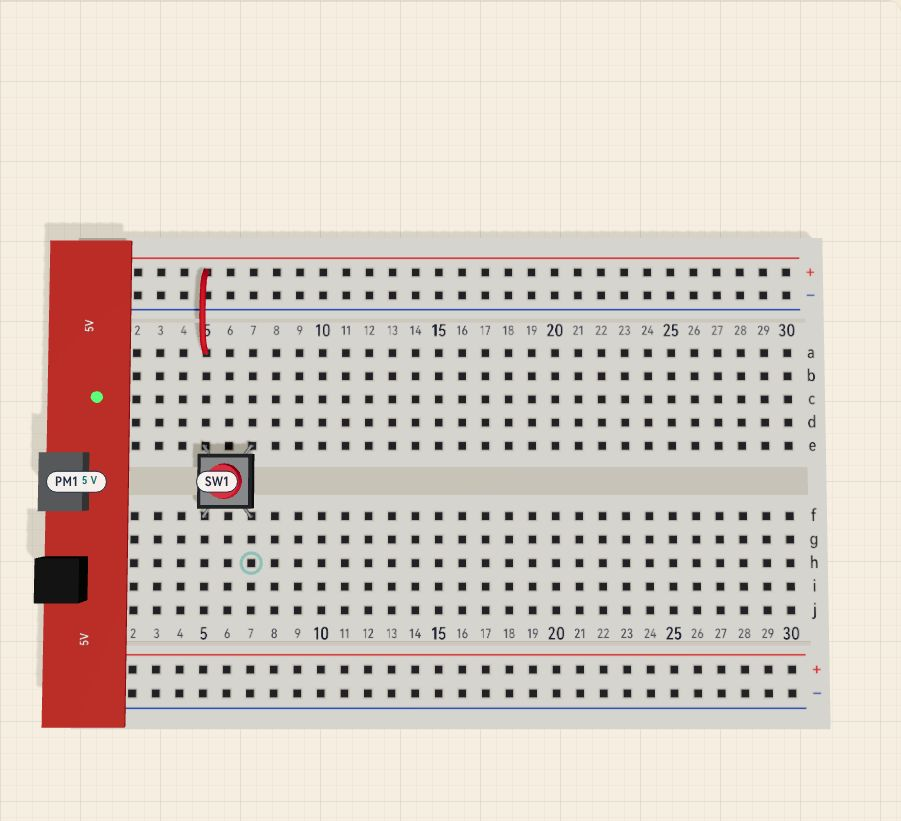
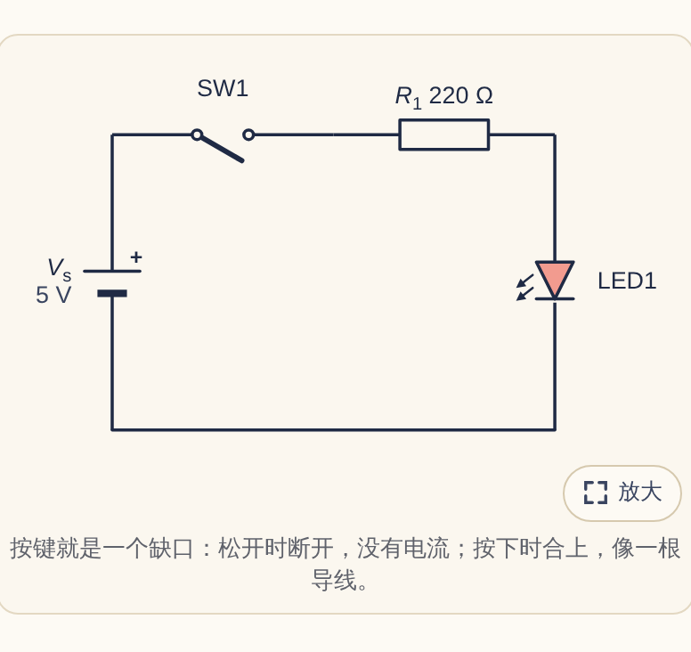
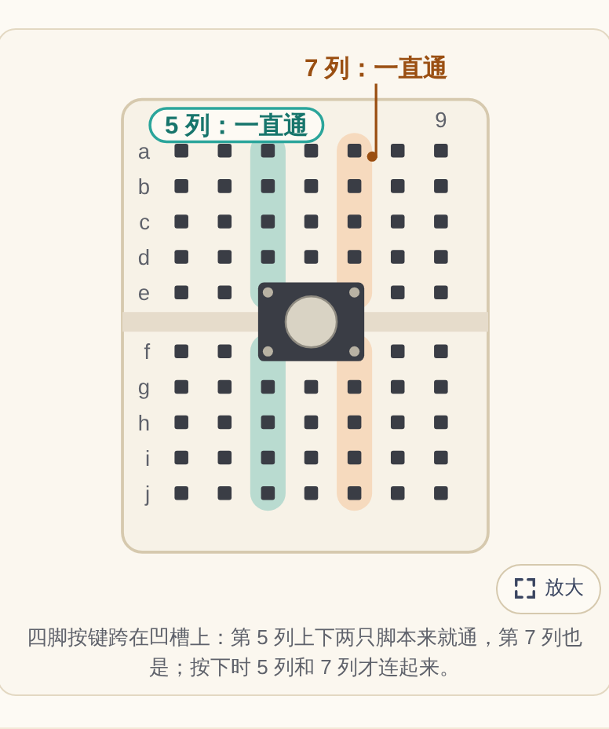
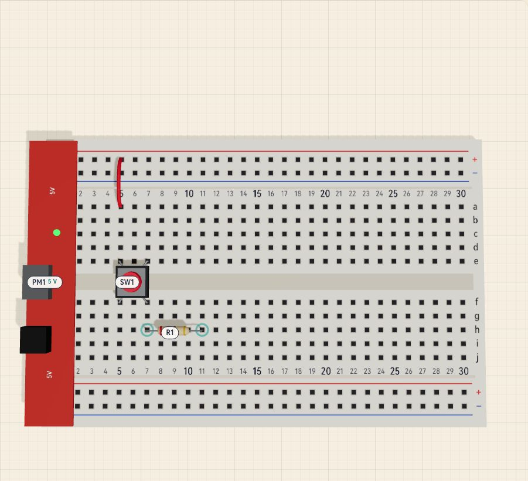
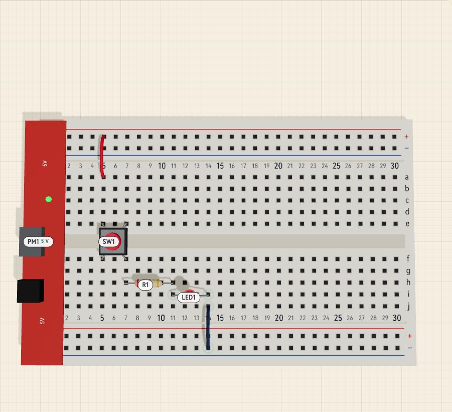

# 1.9 · 按键：一个能合上的缺口

| 项目 | 内容 |
|---|---|
| id | `lesson-pushbutton` |
| 文件 | `challenges/07-pushbutton.json` |
| 类型 | 课程（有分步，每步自动检查） · 难度 2/5 |
| 位置 | World 1 · 基础定律与直流分压 → 1.9 开关、按键与电位器（本节第 1 项） |
| 右侧面板 | 轨道由旧的四张卡片自动生成（还没手工精排） |
| 前后 | 上一项 [1.8 exp-kcl-ammeters](../w1/1.08-2-exp-kcl-ammeters.md) · 下一项 [1.9 challenge-pot-dimmer](../w1/1.09-2-challenge-pot-dimmer.md) |
| 先修 | — |
| 概念 | push button 按键、switch 开关、open / closed 断开 / 接通、floating 悬空 |

**一句话概要**：开关就是电路里的一个缺口：松开时断开，按下时接通。先用万用表看它，再让它控制 LED。

## 1. 左侧工作台（3D 面包板 → 2D 俯视截图）

截图是程序里真实的 3D 面包板换成俯视角拍的；表格是同一块板的文字版（元件、参数、每只脚插在哪个孔）。

### 1.1 起点：空面包板（学生从零开始搭）

### 1.2 每一步之后的面包板

见第 2 节每个步骤下面的截图（按步骤的自动检查重建：放 / 改 / 拔元件、移动万用表表笔）。

### 1.3 参考答案（「看答案」载入的板子）

| 元件 | 类型 | 参数 | 引脚 → 孔 |
|---|---|---|---|
| PM1 | power_module | voltage=5 | +t→tp1 -t→tn1 +b→bp1 -b→bn1 |
| W2 | wire |  | a→tp5 b→a5 |
| SW1 | pushbutton | pressed=false | 1a→e5 2a→e7 1b→f5 2b→f7 |
| R1 | resistor | resistance=220 | 1→h7 2→h11 |
| LED1 | led | color=red | anode→i11 cathode→i14 |
| W6 | wire |  | a→j14 b→bn14 |

### 1.4 目标原理图（右侧「目标原理图」抽屉）

| 元件 | 类型 | 参数 |
|---|---|---|
| V1 | dc_source | voltage=5 |
| SW1 | pushbutton |  |
| R1 | resistor | resistance=220 |
| LED1 | led | color=red |

连接（每个结点上的引脚）：

- **N1**：V1.+、SW1.1
- **N2**：SW1.2、R1.1
- **N3**：R1.2、LED1.anode
- **N4**：LED1.cathode、V1.-

## 2. 右侧面板：学生从上往下看到的内容（单轨流）

### 第 1 步 · 🔍 先看一眼：先认识它：按键与拨动开关

**拆解「按键与拨动开关：4 只脚里哪两只是一体的」第 1 / 7 层：① 外形：4 只脚的按键，3 只脚的拨动开关**

课程里用两种开关：
- tactile push button（轻触按键）：6 × 6 mm 的黑色方块，中间一个 圆形按帽，四个角伸出 4 只脚。按下接通，松手自动弹开——**momentary（瞬时）**、**normally open（常开）**。
- slide switch（拨动开关）：上面一个 拨杆，下面一排 3 只脚 a、com、b。拨到哪边就停在哪边——**latching（自锁）**。

按键的脚名字是模拟器里用的：数字 1 / 2 表示 **电气端子**，字母 a / b 表示同一个端子的两只脚。所以 4 只脚只有 **两个** 端子——这一点下一层用 X 光看。

| 脚 | 属于 | 内部永远连着 | 第 7 课插在 |
|---|---|---|---|
| 1a | 按键 | 1b | e5 |
| 1b | 按键 | 1a | f5 |
| 2a | 按键 | 2b | e7 |
| 2b | 按键 | 2a | f7 |
| a | 拨动开关 | 拨杆在 a 侧时接 com | 左边一列 |
| com | 拨动开关 | a 或 b（公共端 common） | 中间一列 |
| b | 拨动开关 | 拨杆在 b 侧时接 com | 右边一列 |

### 第 2 步 · 🔧 动手搭：按下去，看表

先放一个按键，在它输出那一侧放上万用表的红表笔。**单击按键**按下、再单击松开，盯着读数。
松开和按下时，读数各是什么？

**步骤 1**

**面包板电源模块**插 **`tp1`**，保持 **5 V**：上下四条轨都有电了。

自动检查（做到这些才算完成）：把面包板电源模块插到 tp1–tn1–bp1–bn1
板上高亮的孔：tp1、tn1、bp1、bn1

**步骤 2**

红色**跳线** **`tp5`** → **`a5`**：第 5 列上半段 = +5 V。

自动检查（做到这些才算完成）：把跳线插到 tp5–a5
板上高亮的孔：tp5、a5

**步骤 3**

**按键**放在 **`e5`**，横跨凹槽：四只脚在 e5、e7、f5、f7。第 5 列是输入端，第 7 列是输出端。

自动检查（做到这些才算完成）：把按键开关插到 e5–e7–f5–f7
板上高亮的孔：e5、e7、f5、f7

**步骤 4**

选**「万用表」**，红表笔点 **`h7`**（输出端的下半段）。然后**单击按键**按下、再单击松开，看读数怎么变。

自动检查（做到这些才算完成）：万用表红表笔点 h7（选“万用表”工具，单击孔）
板上高亮的孔：h7

### 第 3 步 · 💡 想明白：开关 = 能合上的缺口

- 开关就是电路里一个**可以合上的缺口**。松开：缺口张开，没有电流（**断开**）；按下：缺口合上，像一根导线（**接通**）。

*图 `switch`（schematic）：按键就是一个缺口：松开时断开，没有电流；按下时合上，像一根导线。*

- 松开时，第 7 列什么都没连上，万用表显示**悬空**：它不是 0 V，只是没有确定的电压。
- 四脚按键横跨凹槽放：**同一列的上下两只脚本来就通**（第 5 列一对、第 7 列一对），按下时第 5 列和第 7 列才接通。

*图 `legs`（breadboard）：四脚按键跨在凹槽上：第 5 列上下两只脚本来就通，第 7 列也是；按下时 5 列和 7 列才连起来。*

（这一步下面列着这节课的计算卡片，点开就地展开：`led-current`，全文见第 6 节）

### 第 4 步 · 🔧 动手搭：让按键控制 LED

在按键的输出（第 7 列下半段）后面接电阻和 LED，回到下方的 − 轨。

**步骤 5**

**R1**（**`220 Ω`**）从第 7 列下半段出发：**`h7`** – **`h11`**。

自动检查（做到这些才算完成）：把电阻插到 h7–h11
板上高亮的孔：h7、h11

**步骤 6**

**红色 LED**：长脚 **`i11`**、短脚 **`i14`**；蓝色**跳线** **`j14`** → **`bn14`**（下方 − 轨）。

自动检查（做到这些才算完成）：把LED 发光二极管插到 i11–i14；把跳线插到 j14–bn14
板上高亮的孔：i11、i14、j14、bn14

**步骤 7**

单击按键试试：按下 → LED 亮，松开 → 灭。然后点**「检查我的电路」**。

### 第 5 步 · 📏 测一测：测一测：读你自己的仪表

**测量题 1 · `open`**（选择题）

> 在第 4 步（还没接电阻时），松开按键，万用表在第 7 列上显示什么？

- A. 悬空：第 7 列什么都没连，没有确定的电压 ✅（正确）
- B. 0 V
- C. 5 V

答对后显示：

> 按键断开时第 7 列和电源断开，又没有别的元件把它接到 GND，所以它是悬空的。

**测量题 2 · `iled`**（读数题）

> 按下按键，单击 LED：「属性」里的电流

- 单位 mA · 先写预测 · 状态：按下 SW1 · 参考答案的读数 **13.79 mA** · 合理范围 [0.0125, 0.015]

答对后显示：

> (5 − 1.8) / (220 + 12) ≈ 13.8 mA。按键接通时几乎没有电阻。

### 第 6 步 · 🎒 带走：带走

- 开关**串**在要控制的那条路上：它断开，整条路就断了。
- 悬空的点不是 0 V。以后接单片机时，没接东西的输入脚会“乱读”，要用上拉、下拉电阻给它一个确定的电压（第 5 世界）。
- 真实按键按下的瞬间会**抖动**几毫秒（接通、断开好几次）。点灯看不出来，但单片机能数出好几次按下——这个以后再解决。

## 3. 测量题一览

| # | id | 题目 | 类型 | 单位 | 状态 | 参考读数 |
|---|---|---|---|---|---|---|
| 1 | open | 在第 4 步（还没接电阻时），松开按键，万用表在第 7 列上显示什么？ | 选择 |  |  | 正确：A |
| 2 | iled | 按下按键，单击 LED：「属性」里的电流 | current | mA | 按下 SW1 | 13.79 mA |

### 提示按钮（依次显示）

1. 按键要横跨中间的凹槽，四只脚分别在凹槽两边。
2. 输出端是第 7 列：电阻要从第 7 列出发，而不是第 5 列。

### 功能测试（「检查我的电路」时跑）

- 松开按键：LED 灭
- 按下按键：LED 亮

## 4. 用到的拆解（全部层的文字，供改写参考）

### 拆解 `switches`：按键与拨动开关：4 只脚里哪两只是一体的

*开关是最简单的元件：要么是导线，要么是断路。但 4 只脚的 tactile button（轻触按键）只有 2 个电气端子，SPDT slide switch（单刀双掷拨动开关）有 3 个——先看清里面的金属怎么连，再看怎样插面包板、它的等效电路，以及真实开关的触点弹跳。*

**拆解「按键与拨动开关：4 只脚里哪两只是一体的」第 1 / 7 层：① 外形：4 只脚的按键，3 只脚的拨动开关**

课程里用两种开关：
- tactile push button（轻触按键）：6 × 6 mm 的黑色方块，中间一个 圆形按帽，四个角伸出 4 只脚。按下接通，松手自动弹开——**momentary（瞬时）**、**normally open（常开）**。
- slide switch（拨动开关）：上面一个 拨杆，下面一排 3 只脚 a、com、b。拨到哪边就停在哪边——**latching（自锁）**。

按键的脚名字是模拟器里用的：数字 1 / 2 表示 **电气端子**，字母 a / b 表示同一个端子的两只脚。所以 4 只脚只有 **两个** 端子——这一点下一层用 X 光看。

| 脚 | 属于 | 内部永远连着 | 第 7 课插在 |
|---|---|---|---|
| 1a | 按键 | 1b | e5 |
| 1b | 按键 | 1a | f5 |
| 2a | 按键 | 2b | e7 |
| 2b | 按键 | 2a | f7 |
| a | 拨动开关 | 拨杆在 a 侧时接 com | 左边一列 |
| com | 拨动开关 | a 或 b（公共端 common） | 中间一列 |
| b | 拨动开关 | 拨杆在 b 侧时接 com | 右边一列 |

**拆解「按键与拨动开关：4 只脚里哪两只是一体的」第 2 / 7 层：② X 光：两片金属框，1a–1b 一片，2a–2b 一片**

把外壳变透明，按键里只有两片冲压出来的 **金属框（lead frame）**：
- 左边一片：1a 和 1b 是同一片金属的两头，所以它们 **永远相通**，跟按不按无关。它在底座里连到一个 外圈触点。
- 右边一片：2a 和 2b 同理，它连到正中间的 中心触点。
- 两片之间隔着空气，上面盖着一片 拱形金属弹片（snap dome）。弹片的边一直压在外圈上（也就是结点 1），中间悬在中心触点上方。

所以“4 只脚的开关”在电路上是：**结点 1（1a、1b）** 和 **结点 2（2a、2b）**，中间一个开关。为什么做 4 只脚？机械上更稳（四角焊在电路板上不会晃），布线上也方便——每个端子两边都能接线。

**拆解「按键与拨动开关：4 只脚里哪两只是一体的」第 3 / 7 层：③ 内部结构：按下时弹片“咔哒”一下接通**

侧面剖开看：
1. 松开时，弹片 拱起，只有边缘压在 外圈触点 上，和 中心触点 之间有空气——**断开**；
2. 用约 1.6 N 的力按 按帽，弹片突然翻转（所以手上有“咔哒”的手感），中间压到中心触点上——电流从外圈经弹片流到中心，**接通**；
3. 松手，弹片自己弹回去，又断开。

弹片既是 **导体**，又是 **弹簧**。行程只有约 0.25 mm。这种按键是给“信号”用的，不是给“功率”用的：额定只有约 12 V、50 mA。

| 参数 | 典型值（6 × 6 mm） | 意思 |
|---|---|---|
| 操作力 | ≈ 1.6 N (160 gf) | 按下去要的力 |
| 行程 | ≈ 0.25 mm | 按帽走多远 |
| 接触电阻 | ≤ 100 mΩ | 接通时的电阻（仿真 0.02 Ω） |
| 额定 | 12 V DC, 50 mA | 只适合小信号 |
| 寿命 | 约 10 万次 | 弹片会疲劳 |

**拆解「按键与拨动开关：4 只脚里哪两只是一体的」第 4 / 7 层：④ 等效电路：两个结点 + 一个开关**

把前两层合起来，按键的等效电路就是：结点 1（1a、1b）——一个常开开关——结点 2（2a、2b）。
- 按下：开关 = 一根导线，电阻约 0（模拟器 0.02 Ω）；
- 松开：开关 = 断路，电阻无穷大（模拟器 1 GΩ）。

**第 7 课**：+5 V → SW1 → 220 Ω → 红色 LED → GND。按下时用 KVL：
$$I = \frac{5 - V_f}{R + R_{LED} + R_{SW}} = \frac{5 - 1.8}{220 + 12 + 0.02} ≈ 13.8 mA$$
开关的 0.02 Ω 和 232 Ω 比完全可以忽略——这就是“理想开关”可以当成导线的原因。

松开时 I ≈ 0，电阻上没有压降，于是 **电源电压几乎全部落在断开的开关两端**（再减去 LED 上那一点点）。用万用表量一个断开的开关，看到的就是电源电压——这是排查电路时很有用的一招。

| 状态 | 开关电阻 | I | 开关两端电压 | LED |
|---|---|---|---|---|
| 按下 | 0.02 Ω | 13.8 mA | ≈ 0.3 mV | 亮 |
| 松开 | 1 GΩ | ≈ 0 | 接近 5 V | 灭 |

- 公式 `I = \frac{V_s - V_f}{R + R_{LED}}`：开关闭合时它的电阻可以忽略

**拆解「按键与拨动开关：4 只脚里哪两只是一体的」第 5 / 7 层：⑤ 怎么插：让按键横跨中间的凹槽**

面包板每一列的 5 个孔下面是一条金属条（凹槽 上下各一条，互不相通）。规则只有一条：**开关的两个端子（1 和 2）必须插在不同的金属条上**，否则金属条把开关短路了。

正确做法（第 7 课）：按键放在 e/f 两行、横跨凹槽，四只脚在 e5、f5、e7、f7：
- 1a（e5）和 1b（f5）在第 5 列的上下两条——它们本来就在内部相连，所以第 5 列上下两半 **都** 是结点 1；
- 2a、2b 在第 7 列——第 7 列上下两半都是结点 2；
- 两列之间只有按键里的开关。好处：上下两半都能接线，第 7 列的下半（f–j）可以直接接电阻和 LED。

错误做法：按键转了 90° 插在同一半（c5、c7、e5、e7）。这时按键内部相连的是左右两只脚（c5–c7、e5–e7），而 **开关的两端 c5 和 e5 落在同一条金属条上**——开关被短路，LED 一直亮，按不按都一样。

判断方法：先用上一层的“两个结点”想清楚哪两只脚是开关的两端，再看它们是不是在同一条金属条上。

| 摆法 | 脚在 | 开关两端在 | 结果 |
|---|---|---|---|
| 横跨凹槽 | e5 f5 e7 f7 | 第 5 列 / 第 7 列 | ✓ 按下才通 |
| 转 90°，同一半 | c5 c7 e5 e7 | 都在第 5 列上半 | ✗ 永远通 |

**拆解「按键与拨动开关：4 只脚里哪两只是一体的」第 6 / 7 层：⑥ 拨动开关 SPDT：com 接 a，或者接 b**

**SPDT = single pole, double throw（单刀双掷）**：一个“刀”（公共端 com），两个“掷”（a 和 b）。

X 光：拨杆 带着滑块走，滑块下面是一片 铜桥，它总是同时压在 **两只相邻的脚** 上：
- 拨杆在 a 侧：铜桥压住 a 和 com → **com–a 接通**，b 悬空；
- 拨杆在 b 侧：铜桥 压住 com 和 b → **com–b 接通**，a 悬空。

移动的过程中，铜桥先离开 a 再碰到 b，叫 **break-before-make（先断后通）**——a 和 b 永远不会被同时接通。

**等效电路**：一个单刀双掷开关，com 是转轴，刀片指向 a 或 b。

**挑战 4**：+5 V 接 com，a → 220 Ω → 红 LED，b → 220 Ω → 绿 LED。拨到 a 红亮，拨到 b 绿亮：每次只有一条支路有电流，$I = \frac{5 - 1.8}{220 + 12} ≈ 13.8 mA$（绿灯 $V_f$ = 2.1 V，≈ 12.5 mA）。

只用 com 和一边（比如 com、a），它就是一个普通的通 / 断开关（SPST）。

| 拨杆位置 | com–a | com–b | 挑战 4 |
|---|---|---|---|
| a | 通（0.02 Ω） | 断 | 红亮、绿灭 |
| b | 断 | 通（0.02 Ω） | 绿亮、红灭 |

**拆解「按键与拨动开关：4 只脚里哪两只是一体的」第 7 / 7 层：⑦ 局限：真实开关会“抖”，模拟器不会**

模拟器里的开关是理想的：按下的那一刻电阻从 1 GΩ 跳到 0.02 Ω，一步到位。

真实的金属触点是有弹性的：两片金属撞在一起时会 **弹开、再碰上、再弹开**，持续约 1–5 ms（有的开关到 10 ms）才稳定。这叫 **contact bounce（触点抖动）**。在示波器上看，一次按下变成了好几个脉冲。

- 点 LED：人眼看不出几毫秒的闪烁，无所谓；
- 接到单片机的 GPIO：它每秒能读几百万次，会把一次按下数成 3、4 次——计数器、开关菜单就会乱跳。

两种 **debounce（消抖）** 办法：
1. **软件**：第一次检测到变化后，等 10–20 ms 再读一次，状态还一样才算数；
2. **硬件**：RC 低通，例如 10 kΩ 和 100 nF，$τ = RC = 10^{4} × 10^{-7} = 1 ms$。毫秒级的弹跳被电容“抹平”，最好再接一个 Schmitt trigger（施密特触发器）输入，让缓慢上升的电压只翻转一次。

| 现象 | 模拟器 | 真实开关 |
|---|---|---|
| 接通过程 | 瞬间，没有抖动 | 1–5 ms 的抖动 |
| 接触电阻 | 0.02 Ω | 几十 mΩ，随氧化变大 |
| 断开电阻 | 1 GΩ | > 100 MΩ |
| 电流 | 不限 | 按键约 50 mA |

- 公式 `τ = RC = 10 kΩ × 100 nF = 1 ms`：硬件消抖：τ 要比弹跳时间长

**一句话记住**：4 只脚的按键只有 2 个结点：1a–1b 是一片金属，2a–2b 是另一片，按下时弹片把两片接通。横跨凹槽插，第 5 列和第 7 列就是开关的两端。SPDT 拨动开关：com 接 a 或接 b，先断后通。理想开关 = 导线或断路；真实开关会抖动几毫秒，接单片机时要消抖。

## 5. 这一课的计算卡片

**计算卡片 `led-current`：LED 回路的电流 LED loop current**

- 公式 `I = \frac{V_s - ΣV_F}{R + Σr_d + R_{int}}`
- 用途：电源、电阻和一个或几个串联 LED：LED 实际流过多少电流。
- 输入：V_s（电源电动势，V）；V_F（所有 LED 的 V_F 之和（红 1.8、绿 2.1、蓝/白 3.0），V）；R（串联电阻（含电位器），Ω）；r_d（LED 内阻之和（每个 ≈ 12 Ω），Ω）；R_int（电源内阻（模块 ≈ 0、9 V 电池 1.5 Ω、纽扣电池 15 Ω），Ω） → I（回路电流（不够 ΣV_F 时为 0），A）

1. 导通的 LED 用折线模型看：一个电压源 $V_F$ 串一个小电阻 $r_d ≈ 12 Ω$（模拟器就是这样建模的）。
2. 整个回路串联，处处是同一个电流 I。
3. KVL：$V_s = I R_{int} + I R + ΣV_F + I Σr_d$。
4. 解出 $I = \frac{V_s - ΣV_F}{R + Σr_d + R_{int}}$。
5. 如果 $V_s < ΣV_F$，LED 根本不导通，I = 0：3 V 点不亮串联的红 + 绿 LED（需要 3.9 V）。
只用 $\frac{V_s - V_F}{R}$ 估算会偏大 1–2 mA，选电阻时够用；要和读数对比时把 $r_d$ 和内阻加上。

例子：- 挑战 1：9 V、220 Ω、红 + 绿：$I = \frac{9 - 3.9}{220 + 24} ≈ 21 mA$（只用 $V_F$ 估算是 23 mA）。
- 第 3 课：5 V、150 Ω、绿：$\frac{5 - 2.1}{150 + 12} ≈ 18 mA$，电阻上 $18 mA × 150 Ω ≈ 2.7 V$。
- 挑战 9：CR2032（3 V、15 Ω）、47 Ω、红：$\frac{3 - 1.8}{47 + 12 + 15} ≈ 16 mA$；不串电阻是 $\frac{1.2}{27} ≈ 44 mA$。
- 挑战 3：电位器转到 100 %：$\frac{5 - 1.8}{220 + 10k + 12} ≈ 0.31 mA$，灯灭。

- ⚠ 两个 LED 直接并联共用一个电阻：$V_F$ 小的先导通、把电压钳住，另一个几乎不亮——每个 LED 自己串一个电阻。
- ⚠ 电位器当可变电阻用时，它的阻值也在 R 里；转到 0 时只剩保护电阻。

## 6. English（界面英文版的同一份内容）

展开英文

### Node 1 · 🔍 Look first：Meet it first: Push button & slide switch

**Teardown「Push button and slide switch: which legs are one piece」layer 1 of 7：① Outside: a 4-leg button and a 3-pin slide switch**

The course uses two kinds of switch:
- tactile push button: a 6 × 6 mm black square with a round cap in the middle and 4 legs at the corners. Pressed it connects, released it springs open — **momentary** and **normally open**.
- slide switch: a lever on top and a row of 3 pins a, com, b underneath. It stays wherever you push it — **latching**.

The button's leg names are the simulator's: the number 1 / 2 is the **electrical terminal**, the letter a / b tells the two legs of the same terminal apart. So 4 legs are only **two** terminals — the next layer shows why, by X-ray.

| Leg | Part | Always joined inside to | Lesson 7 hole |
|---|---|---|---|
| 1a | button | 1b | e5 |
| 1b | button | 1a | f5 |
| 2a | button | 2b | e7 |
| 2b | button | 2a | f7 |
| a | slide switch | com, when the lever is on the a side | left column |
| com | slide switch | a or b (the common terminal) | middle column |
| b | slide switch | com, when the lever is on the b side | right column |

### Node 2 · 🔧 Build：Press it and watch the meter

Place a button and put the multimeter's red probe on its output side. **Click the button** to press it, click again to release, and watch the reading.
What does it read released, and what pressed?

**Step 1**

**Breadboard power module** in **`tp1`**, keep **5 V**: all four rails are powered.

Checked automatically：Place the Breadboard power module at tp1–tn1–bp1–bn1
Holes highlighted：tp1、tn1、bp1、bn1

**Step 2**

Red **jumper** **`tp5`** → **`a5`**: the top half of column 5 = +5 V.

Checked automatically：Place the Jumper wire at tp5–a5
Holes highlighted：tp5、a5

**Step 3**

**Push button** at **`e5`**, across the trench: its four pins are in e5, e7, f5 and f7. Column 5 is the input, column 7 the output.

Checked automatically：Place the Push button at e5–e7–f5–f7
Holes highlighted：e5、e7、f5、f7

**Step 4**

Pick **Multimeter** and put the red probe on **`h7`** (the lower half of the output column). Then **click the button** to press it, click again to release, and watch the reading.

Checked automatically：Multimeter red probe on h7 (pick the Multimeter tool, click the hole)
Holes highlighted：h7

### Node 3 · 💡 Why：A switch = a gap you can close

- A switch is **a gap in the circuit that you can close**. Released, the gap is open and no current flows (**open**); pressed, it closes and acts like a wire (**closed**).

[figure `switch`]

*Figure `switch`（schematic）：按键就是一个缺口：松开时断开，没有电流；按下时合上，像一根导线。*

- Released, column 7 is connected to nothing, so the multimeter shows **floating**: not 0 V, just no defined voltage at all.
- A four-pin button straddles the trench: **the two pins in the same column are always connected** (a pair in column 5, a pair in column 7); pressing joins column 5 to column 7.

[figure `legs`]

*Figure `legs`（breadboard）：四脚按键跨在凹槽上：第 5 列上下两只脚本来就通，第 7 列也是；按下时 5 列和 7 列才连起来。*

(This node lists the lesson’s calculation cards: `led-current`; full text in section 6)

### Node 4 · 🔧 Build：Let the button control an LED

After the button's output (the lower half of column 7) add the resistor and the LED, back to the lower − rail.

**Step 5**

**R1** (**`220 Ω`**) from the lower half of column 7: **`h7`** – **`h11`**.

Checked automatically：Place the Resistor at h7–h11
Holes highlighted：h7、h11

**Step 6**

**Red LED**: long lead **`i11`**, short lead **`i14`**; blue **jumper** **`j14`** → **`bn14`** (the lower − rail).

Checked automatically：Place the LED at i11–i14；Place the Jumper wire at j14–bn14
Holes highlighted：i11、i14、j14、bn14

**Step 7**

Click the button: pressed → LED on, released → off. Then press **Check my circuit**.

### Node 5 · 📏 Measure：Measure: read your own instruments

**Question 1 · `open`**（multiple choice）

> In step 4 (before the resistor), with the button released, what does the multimeter show on column 7?

- A. Floating: nothing is connected to column 7, so it has no defined voltage ✅ (right)
- B. 0 V
- C. 5 V

Shown once right:

> With the button open, column 7 is cut off from the supply, and nothing else connects it to GND — so it floats.

**Question 2 · `iled`**（reading）

> Press the button and click the LED: the current in Properties

- unit mA · predict first · state：SW1 is pressed · range [0.0125, 0.015]

Shown once right:

> (5 − 1.8) / (220 + 12) ≈ 13.8 mA. A closed button has almost no resistance.

### Node 6 · 🎒 Take away：Take away

- A switch goes **in series** with what it controls: open the switch and the whole path is open.
- A floating point is not 0 V. Later, a microcontroller input left unconnected reads garbage; pull-up and pull-down resistors give it a defined voltage (World 5).
- A real button **bounces** for a few milliseconds when pressed (closing and opening several times). You cannot see it on an LED, but a microcontroller can count several presses — a problem for later.

**Hints**

1. The button straddles the trench in the middle, with its pins on both sides.
2. The output is column 7: the resistor starts from column 7, not column 5.

