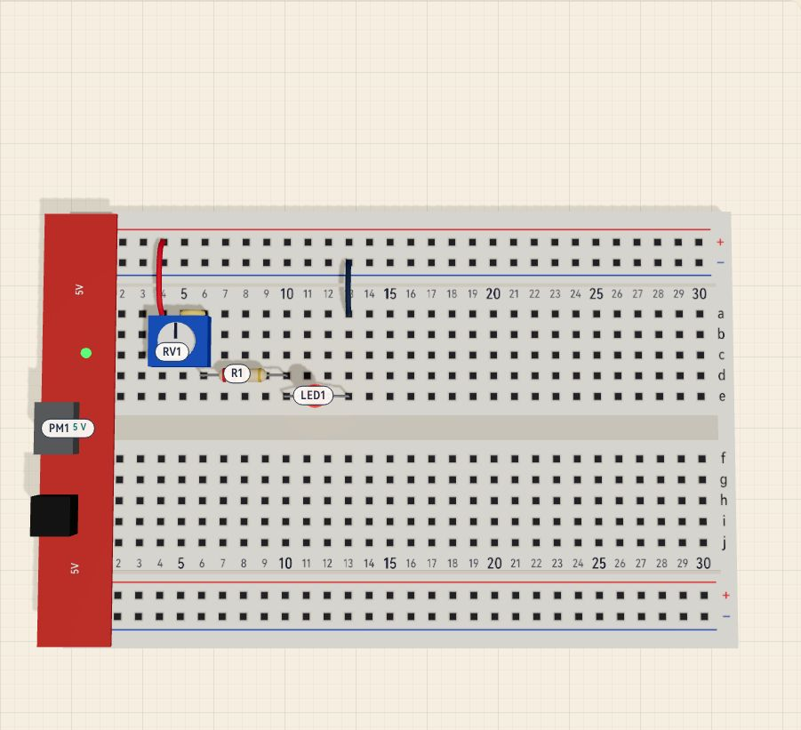
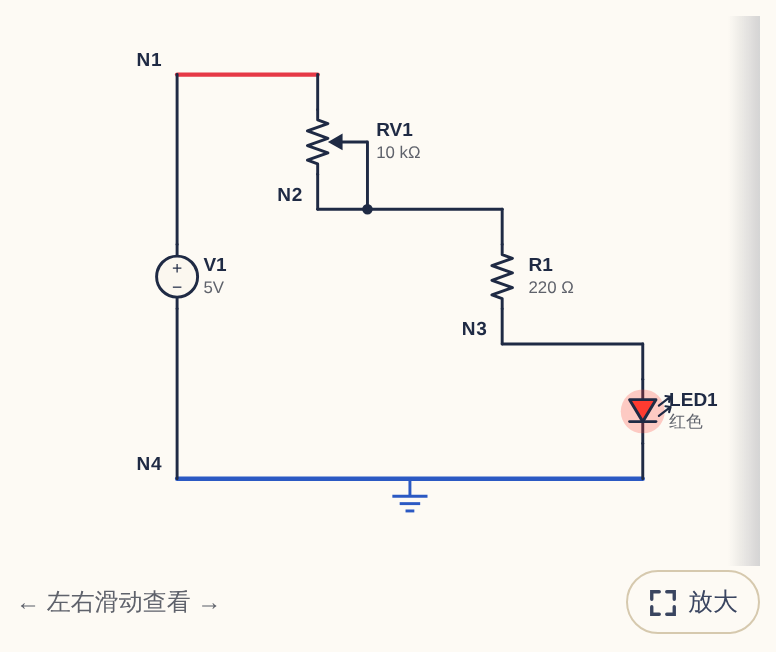
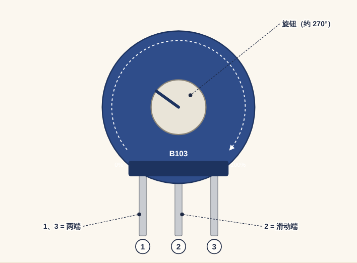
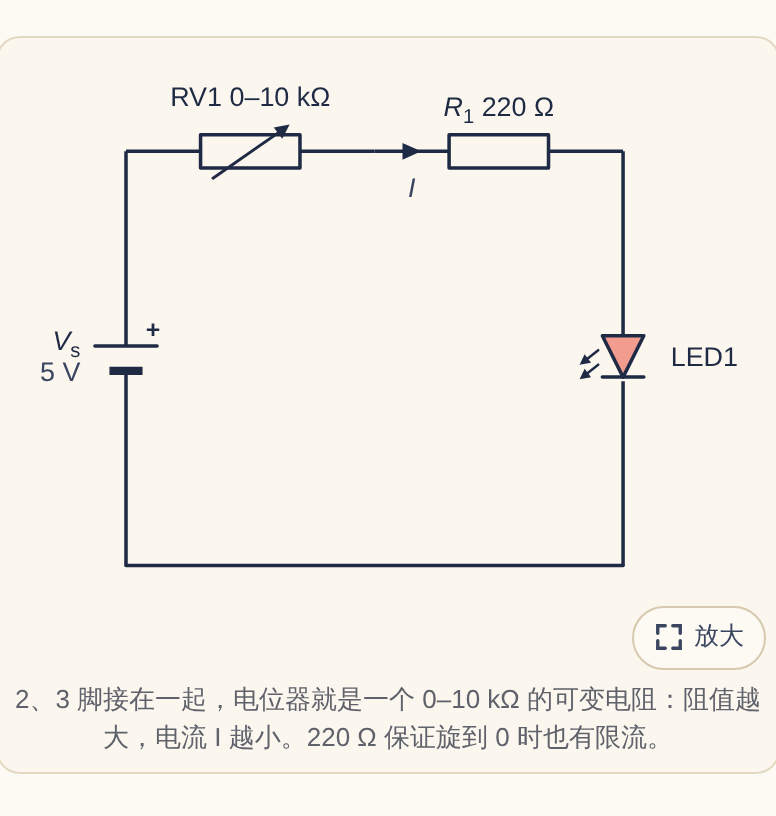

# 1.9 · 电位器调光

| 项目 | 内容 |
|---|---|
| id | `challenge-pot-dimmer` |
| 文件 | `challenges/11-pot-dimmer.json` |
| 类型 | 实验 / 挑战（没有分步，照目标电路图搭） · 难度 3/5 |
| 位置 | World 1 · 基础定律与直流分压 → 1.9 开关、按键与电位器（本节第 2 项） |
| 右侧面板 | 轨道由旧的四张卡片自动生成（还没手工精排） |
| 前后 | 上一项 [1.9 lesson-pushbutton](../w1/1.09-1-lesson-pushbutton.md) · 下一项 [1.9 challenge-spdt-selector](../w1/1.09-3-challenge-spdt-selector.md) |
| 先修 | — |
| 概念 | potentiometer 电位器、rheostat 可变电阻、wiper 滑动端、protective resistor 保护电阻 |

**一句话概要**：把电位器当可变电阻，转动旋钮改变 LED 亮度。

## 1. 左侧工作台（3D 面包板 → 2D 俯视截图）

截图是程序里真实的 3D 面包板换成俯视角拍的；表格是同一块板的文字版（元件、参数、每只脚插在哪个孔）。

### 1.1 起点：空面包板（学生从零开始搭）

### 1.3 参考答案（「看答案」载入的板子）

| 元件 | 类型 | 参数 | 引脚 → 孔 |
|---|---|---|---|
| PM1 | power_module | voltage=5 | +t→tp1 -t→tn1 +b→bp1 -b→bn1 |
| W2 | wire |  | a→tp4 b→a4 |
| RV1 | potentiometer | resistance=10000, wiper=0.5 | 1→c4 2→c5 3→c6 |
| W4 | wire |  | a→a5 b→a6 |
| R1 | resistor | resistance=220 | 1→d6 2→d10 |
| LED1 | led | color=red | anode→e10 cathode→e13 |
| W7 | wire |  | a→a13 b→tn13 |

### 1.4 目标原理图（右侧「目标原理图」抽屉）

| 元件 | 类型 | 参数 |
|---|---|---|
| V1 | dc_source | voltage=5 |
| RV1 | potentiometer | resistance=10000 |
| R1 | resistor | resistance=220 |
| LED1 | led | color=red |

连接（每个结点上的引脚）：

- **N1**：V1.+、RV1.1
- **N2**：RV1.2、RV1.3、R1.1
- **N3**：R1.2、LED1.anode
- **N4**：LED1.cathode、V1.-

## 2. 右侧面板：学生从上往下看到的内容（单轨流）

### 第 1 步 · 🔍 先看一眼：先认识它：电位器

**拆解「电位器 Potentiometer：一个可以滑动的分压器」第 1 / 7 层：① 外形：一个旋钮、三只脚**

**potentiometer（电位器，常简称 pot）** 是一个可以调的电阻。从外面看：一个能转约 270° 的 旋钮 knob，下面三只排成一排的脚：
- 1 脚 和 3 脚：碳道的 **两端**，它们之间的电阻 **固定**，就是标称值（这里 10 kΩ）；
- 2 脚（中间）：**wiper（滑动端）**，跟着旋钮在碳道上移动。

旋钮位置用 **x** 表示（0 … 1，也就是 0% … 100%）：本课程（和仿真器）规定 x 是 **从 1 脚量起** 的比例。x = 0 时滑动端就在 1 脚上；x = 1 时在 3 脚上。

外壳 上印着 **B103**：B 表示线性，103 表示 10 kΩ（第 ⑦ 层解释）。在面包板上三只脚各占一列，绝对不能插在同一列里——那样三只脚被短接，电位器就没用了。

| 脚 | 名字 | 接在碳道哪里 | 对其他脚的电阻 |
|---|---|---|---|
| 1 | 端点 A（end） | 碳道起点（x = 0） | 到 3：R；到 2：R·x |
| 2 | 滑动端（wiper） | 跟着旋钮走 | 到 1：R·x；到 3：R·(1−x) |
| 3 | 端点 B（end） | 碳道终点（x = 1） | 到 1：R；到 2：R·(1−x) |

### 第 2 步 · 🔧 动手搭：转一转，灯会变

这一题没有步骤，**照目标电路图自己搭**。搭好后单击电位器，在「属性」里拖动**旋钮**，看 LED 怎么变。

### 第 3 步 · 💡 想明白：电位器是一根能滑动的电阻条

- 1、3 两脚之间是一整条 10 kΩ 的电阻，2 脚是在上面**滑动的触点**。旋钮在 1 脚那头时，1–2 之间≈0；在 3 脚那头时≈10 kΩ。
- 把 2、3 脚连起来，电位器就成了一个 **0–10 kΩ 的可变电阻**，串在 LED 的路上。电阻越大，电流越小，灯越暗。

*图 `rheostat`（schematic）：2、3 脚接在一起，电位器就是一个 0–10 kΩ 的可变电阻：阻值越大，电流 I 越小。220 Ω 保证旋到 0 时也有限流。*

- **为什么还要 220 Ω？** 旋钮转到 0 时电位器一点电阻都没有，没有它，LED 就直接接在 5 V 上了（第 1.3 课你见过后果）。

（这一步下面列着这节课的计算卡片，点开就地展开：`voltage-divider`、`led-current`，全文见第 6 节）

### 第 4 步 · 🔧 动手搭：搭好，再用 LED 的电流验证

- 电位器三只脚占三个相邻的列，中间那列是滑动端。用一根短跳线把 2 脚那列和 3 脚那列连起来。
- **+5 V 接 1 脚**（最左边那列）：旋钮在 0% 时电阻最小，灯最亮。

### 第 5 步 · 📏 测一测：测一测：读你自己的仪表

**测量题 1 · `i0`**（读数题）

> 旋钮在 0%：单击 LED，「属性」里的电流

- 单位 mA · 先写预测 · 状态：把 RV1 旋到 0% · 参考答案的读数 **13.73 mA** · 合理范围 [0.0125, 0.015]

答对后显示：

> 电位器接近 0 Ω，只剩 220 Ω：(5 − 1.8) / (220 + 12) ≈ 13.8 mA。

**测量题 2 · `i100`**（读数题）

> 旋钮在 100%：LED 的电流

- 单位 mA · 先写预测 · 状态：把 RV1 旋到 100% · 参考答案的读数 **0.3127 mA** · 合理范围 [0.00025, 0.00036]

答对后显示：

> 多了 10 kΩ：(5 − 1.8) / (10 220 + 12) ≈ 0.31 mA，暗到看不见。

### 第 6 步 · 🎒 带走：带走

- 同一个电位器两种接法：**三只脚都用**，它是分压器（中间脚输出一个可调电压）；**只用两只脚**，它是可变电阻。
- 用可变电阻调光很浪费：多出来的电压全变成了电位器里的热。以后学了 PWM（第 5 世界），会用开关得飞快的方法调光，几乎不发热。

## 3. 测量题一览

| # | id | 题目 | 类型 | 单位 | 状态 | 参考读数 |
|---|---|---|---|---|---|---|
| 1 | i0 | 旋钮在 0%：单击 LED，「属性」里的电流 | current | mA | 把 RV1 旋到 0% | 13.73 mA |
| 2 | i100 | 旋钮在 100%：LED 的电流 | current | mA | 把 RV1 旋到 100% | 0.3127 mA |

### 提示按钮（依次显示）

1. 电位器三只脚占三个相邻的列；中间那列是滑动端 2 脚。
2. 用一根短跳线把 2 脚所在的列和 3 脚所在的列连起来。
3. +5 V 接 1 脚（最左边那列）。

### 功能测试（「检查我的电路」时跑）

- 旋到 0%：LED 亮
- 旋到 100%：LED 灭

## 4. 用到的拆解（全部层的文字，供改写参考）

### 拆解 `potentiometer`：电位器 Potentiometer：一个可以滑动的分压器

*三只脚、一条马蹄形碳道、一个在上面滑动的触点。拆开后它就是两个电阻 R·x 和 R·(1−x)。接法不同，它可以当分压器（输出可调电压），也可以当可变电阻（rheostat，调电流）。*

**拆解「电位器 Potentiometer：一个可以滑动的分压器」第 1 / 7 层：① 外形：一个旋钮、三只脚**

**potentiometer（电位器，常简称 pot）** 是一个可以调的电阻。从外面看：一个能转约 270° 的 旋钮 knob，下面三只排成一排的脚：
- 1 脚 和 3 脚：碳道的 **两端**，它们之间的电阻 **固定**，就是标称值（这里 10 kΩ）；
- 2 脚（中间）：**wiper（滑动端）**，跟着旋钮在碳道上移动。

旋钮位置用 **x** 表示（0 … 1，也就是 0% … 100%）：本课程（和仿真器）规定 x 是 **从 1 脚量起** 的比例。x = 0 时滑动端就在 1 脚上；x = 1 时在 3 脚上。

外壳 上印着 **B103**：B 表示线性，103 表示 10 kΩ（第 ⑦ 层解释）。在面包板上三只脚各占一列，绝对不能插在同一列里——那样三只脚被短接，电位器就没用了。

| 脚 | 名字 | 接在碳道哪里 | 对其他脚的电阻 |
|---|---|---|---|
| 1 | 端点 A（end） | 碳道起点（x = 0） | 到 3：R；到 2：R·x |
| 2 | 滑动端（wiper） | 跟着旋钮走 | 到 1：R·x；到 3：R·(1−x) |
| 3 | 端点 B（end） | 碳道终点（x = 1） | 到 1：R；到 2：R·(1−x) |

**拆解「电位器 Potentiometer：一个可以滑动的分压器」第 2 / 7 层：② X 光：马蹄形碳道和一个滑动触点**

把外壳变透明：
1. 碳道 resistive track：印在绝缘底板上的一条 **马蹄形** 碳膜（270° 的圆弧）。它的两端分别接 1 脚 和 3 脚。它就是一个 **被弯成弧形的电阻**：和上一个拆解里的螺旋膜一样，$R = \frac{ρL}{A}$，整条碳道 10 kΩ。
2. 滑动触点 wiper：一片铜弹片，固定在旋钮轴上，压在碳道表面。转旋钮，它就沿碳道滑动。
3. 集电环 collector ring：轴周围的一圈金属，滑片的另一端一直压着它；它接 2 脚。这样不管滑片转到哪，2 脚都和触点相连。

所以：从 1 脚走到触点，电流要走过碳道的 **x** 那一段；从触点走到 3 脚，走过剩下的 **1 − x**。电阻和长度成正比 → 下一层的等效电路。

**拆解「电位器 Potentiometer：一个可以滑动的分压器」第 3 / 7 层：③ 等效电路：两个电阻 R·x 和 R·(1−x)**

把碳道拉直，电阻和长度成正比（$R ∝ L$），所以滑动端把总电阻 R 切成两段：
$$R_{12} = R·x,   R_{23} = R·(1-x)$$
- 1–2 之间：$R·x$；
- 2–3 之间：$R·(1-x)$；
- 两段之和永远是 R：$R_{12} + R_{23} = R$。

**带数字**：10 kΩ、旋钮在 x = 0.3：$R_{12} = 3 kΩ$，$R_{23} = 7 kΩ$。转到 x = 0.9：$R_{12} = 9 kΩ$，$R_{23} = 1 kΩ$。

所以电位器 **不是** 一种新元件——它是两个串联电阻，中间那个结点（2 脚）引了出来，而且两个电阻的比例可以调。后面两层是它的两种用法：三只脚都用（分压器），或只用两只脚（可变电阻）。

- 公式 `R_{12} = R·x, R_{23} = R·(1-x)`：x 从 1 脚量起，0 … 1

**拆解「电位器 Potentiometer：一个可以滑动的分压器」第 4 / 7 层：④ 用法一：三只脚都接——可调的分压器**

1 脚接 +5 V，3 脚接 GND，从 2 脚取 输出电压。这就是 **voltage divider（分压器）**：两个串联电阻，取中间结点的电压。

推导（2 脚不接负载，没有电流流出）：
1. 两个电阻串联，电流相同：$I = \frac{V_s}{R·x + R(1-x)} = \frac{V_s}{R}$
2. 输出电压就是 下面那段 上的电压：$V_{out} = I·R(1-x)$
3. 代入：
$$V_{out} = V_s·\frac{R_{23}}{R_{12}+R_{23}} = V_s·(1-x)$$
**带数字**：$V_s = 5 V$，x = 0.3 → $V_{out} = 5 × 0.7 = 3.5 V$。x 从 0 转到 1，输出从 5 V **线性地** 降到 0 V（右图的直线）。想让顺时针转电压升高，就把 1、3 两只脚对调。

注意结果 **和 R 无关**：1 kΩ 还是 100 kΩ 的电位器，空载时输出一样。R 决定的是电位器自己耗多少电流：$\frac{5 V}{10 kΩ} = 0.5 mA$。

- 公式 `V_{out} = V_s·\frac{R_{23}}{R_{12} + R_{23}} = V_s·(1-x)`：空载（2 脚不取电流）
- 公式 `V_{out} = 5 V × (1 - 0.3) = 3.5 V`

**拆解「电位器 Potentiometer：一个可以滑动的分压器」第 5 / 7 层：⑤ 用法二：只用两只脚——可变电阻（调光实验）**

调光实验（challenge-pot-dimmer）这样接：+5 V → 1 脚；2 脚和 3 脚连在一起；再串 220 Ω 和 红色 LED 到 GND。

2、3 短接后，$R_{23}$ 被短路，只剩 $R_{12} = R·x$——电位器变成一个 **rheostat（可变电阻）**，从 0 调到 10 kΩ。为什么要把 2、3 连起来，而不是让 3 脚空着？如果滑片接触不良（旧电位器常见），电流还能走 3 脚，电阻最多是 R，**不会突然断路**。

用 LED 模型（红：1.8 V + 12 Ω）写 KVL：
$$I = \frac{V_s - V_F}{R·x + 220 + 12} = \frac{3.2 V}{232 Ω + 10 kΩ·x}$$
- x = 0：$I = \frac{3.2}{232} = 13.8 mA$，最亮；
- x = 0.1：2.6 mA；x = 0.25：1.17 mA；x = 0.5：0.61 mA；
- x = 1：$I = \frac{3.2}{10232} = 0.31 mA$，几乎灭。

曲线是 双曲线：大部分亮度变化挤在 x < 0.2 那一小段（这就是调光要用对数电位器的原因，见第 ⑦ 层）。**220 Ω 为什么不能省**：x = 0 时电位器是 0 Ω，没有它 LED 直接接在 5 V 上：$\frac{3.2}{12} ≈ 270 mA$，立刻烧掉。

最大功率实验（exp-max-power）用的是同一种接法：2.2 kΩ 电位器当负载 $R_L = 2.2 kΩ·x$，$R_L = R_{eq} = 1158 Ω$（x ≈ 53%）时负载功率最大。

| x | 电位器 R·x | 总电阻 | LED 电流 |
|---|---|---|---|
| 0 | 0 Ω | 232 Ω | 13.8 mA |
| 0.1 | 1 kΩ | 1.23 kΩ | 2.6 mA |
| 0.25 | 2.5 kΩ | 2.73 kΩ | 1.17 mA |
| 0.5 | 5 kΩ | 5.23 kΩ | 0.61 mA |
| 1 | 10 kΩ | 10.2 kΩ | 0.31 mA |

- 公式 `I = \frac{V_s - V_F}{R·x + R_{series} + 12 Ω}`：2、3 短接的可变电阻 + LED

**拆解「电位器 Potentiometer：一个可以滑动的分压器」第 6 / 7 层：⑥ 分压器接上负载，电压就掉**

第 ④ 层的 $V_{out} = V_s(1-x)$ 有个前提：**2 脚不取电流**。接上一个 负载 $R_L$，它和下面那段 $R_{23}$ **并联**，下面那段的等效电阻变小，输出就下降。

**例**：9 V，10 kΩ 电位器转到中间（5 k / 5 k），空载 4.5 V。
- $R_L = 100 kΩ$：$5k ∥ 100k = 4.76 kΩ$，$V_{out} = 9 × \frac{4.76}{5 + 4.76} = 4.39 V$（只掉 2%）；
- $R_L = 10 kΩ$：$5k ∥ 10k = 3.33 kΩ$，$V_{out} = 3.6 V$（掉 20%）；
- $R_L = 1 kΩ$：$5k ∥ 1k = 0.83 kΩ$，$V_{out} = 1.29 V$（掉 71%）！

**更快的看法：戴维宁（Thévenin）**。从 2 脚看进去，电位器等于 一个电压源串一个电阻：
$$V_{th} = V_s(1-x),   R_{th} = R_{12} ∥ R_{23} = R·x(1-x)$$
x = 0.5 时 $R_{th}$ 最大，$= \frac{R}{4} = 2.5 kΩ$。于是 $V_{out} = V_{th}·\frac{R_L}{R_{th}+R_L}$，一眼就能看出：**$R_L$ 要比 $R_th$ 大 10 倍以上**，误差才 < 10%。

所以电位器分压适合给“几乎不取电流”的输入（op-amp 输入、ADC、示波器）提供电压；要带 1 kΩ 这种重负载，要么换小阻值电位器，要么在后面加一个 op-amp 跟随器（voltage follower）。

- 公式 `R_{th} = R·x(1-x) ≤ \frac{R}{4}`：10 kΩ 电位器最多 2.5 kΩ
- 公式 `V_{out} = V_{th}·\frac{R_L}{R_{th} + R_L}`：$R_L$ = 1 kΩ：4.5 × 1 / 3.5 = 1.29 V

**拆解「电位器 Potentiometer：一个可以滑动的分压器」第 7 / 7 层：⑦ 型号、阻值曲线和真实电位器的局限**

**读型号**：B103——字母是 **taper（阻值曲线）**，数字是阻值：前两位是有效数字，第三位是 10 的几次方：103 = 10 × 10³ Ω = 10 kΩ，502 = 5 kΩ，104 = 100 kΩ。

**两种曲线**：
- B = 线性（linear）：$R_{12}$ 和转角成正比，本课程和仿真器都用这种；
- A = 对数（logarithmic / audio）：开始变得很慢，最后很快。人耳和人眼对强度的感觉是 **对数** 的，所以音量、调光用 A 型，转起来感觉才“均匀”。

**真实电位器的局限**：
- 滑片电流：所有电流都挤过一个小接触点，一般不超过几 mA；接触不良时会“沙沙”响、读数跳动（noise）。
- 额定功率 0.1–0.25 W 指的是 **整条碳道** 均匀发热。当可变电阻用、x 很小时，同样的电流只流过一小段碳道，那一小段会局部过热。所以调光电路一定要串保护电阻。
- 端点残余电阻：转到头也不是精确的 0 Ω，常有几 Ω 到几十 Ω；误差一般 ±20%。
- 寿命：碳膜电位器约 1 万次旋转。

**仿真器里**：电位器是理想的线性电位器：$R_{12} = R·x$ 精确成立，x 可以连续取 0 … 1，没有残余电阻、噪声和功率限制。

| 参数 | 常见真实值 | 仿真器 |
|---|---|---|
| 阻值误差 | ±20% | 0 |
| 曲线 | A（对数）或 B（线性） | B（线性） |
| 额定功率 | 0.1–0.25 W | 不检查 |
| 滑片电流 | ≤ 几 mA | 不限 |
| 端点残余电阻 | 几 Ω – 几十 Ω | 0 |

**一句话记住**：电位器 = 一条碳道 + 一个滑片 = **两个串联电阻 R·x 和 R·(1−x)**，中间结点引出来。三只脚都接是分压器 $V_{out} = V_s(1-x)$（只在空载时准，$R_L ≫ R_{th} = R·x(1-x)$）；2、3 短接是可变电阻 $R·x$，一定要串保护电阻。

## 5. 这一课的计算卡片

**计算卡片 `voltage-divider`：分压器 Voltage divider**

- 公式 `V_{out} = V_s \frac{R_2}{R_1 + R_2}`
- 用途：用两个串联电阻从一个大电压里取出一个小电压。
- 输入：Vs（电源电压，V）；R1（上面的电阻 R₁，Ω）；R2（下面的电阻 R₂，Ω） → V_out（R₂ 上的电压，V）

三步推出来：
1. 串联：$I = \frac{V_s{R_1 + R_2}$
2. 欧姆定律用在 R₂ 上：$V_{out} = I R_2$
3. 代入：$V_{out} = V_s \frac{R_2}{R_1 + R_2}$

**前提**：R₁ 和 R₂ 流过 **同一个电流**——输出端不接负载（或负载电流远小于 I）。接了负载 R_L，下面的电阻就变成 $R_2 ∥ R_L$，输出会 **降低**（实验 1-3、2-5）。

例子：9 V，R₁ = 20 kΩ，R₂ = 10 kΩ：$V_{out} = 9 × \frac{10}{30} = 3 V$（挑战 2）。

- ⚠ 分子是 **输出所在的那个** 电阻（R₂），不是 R₁。
- ⚠ 接了负载以后公式里的 R₂ 要换成 R₂ ∥ R_L。

**计算卡片 `led-current`：LED 回路的电流 LED loop current**

- 公式 `I = \frac{V_s - ΣV_F}{R + Σr_d + R_{int}}`
- 用途：电源、电阻和一个或几个串联 LED：LED 实际流过多少电流。
- 输入：V_s（电源电动势，V）；V_F（所有 LED 的 V_F 之和（红 1.8、绿 2.1、蓝/白 3.0），V）；R（串联电阻（含电位器），Ω）；r_d（LED 内阻之和（每个 ≈ 12 Ω），Ω）；R_int（电源内阻（模块 ≈ 0、9 V 电池 1.5 Ω、纽扣电池 15 Ω），Ω） → I（回路电流（不够 ΣV_F 时为 0），A）

1. 导通的 LED 用折线模型看：一个电压源 $V_F$ 串一个小电阻 $r_d ≈ 12 Ω$（模拟器就是这样建模的）。
2. 整个回路串联，处处是同一个电流 I。
3. KVL：$V_s = I R_{int} + I R + ΣV_F + I Σr_d$。
4. 解出 $I = \frac{V_s - ΣV_F}{R + Σr_d + R_{int}}$。
5. 如果 $V_s < ΣV_F$，LED 根本不导通，I = 0：3 V 点不亮串联的红 + 绿 LED（需要 3.9 V）。
只用 $\frac{V_s - V_F}{R}$ 估算会偏大 1–2 mA，选电阻时够用；要和读数对比时把 $r_d$ 和内阻加上。

例子：- 挑战 1：9 V、220 Ω、红 + 绿：$I = \frac{9 - 3.9}{220 + 24} ≈ 21 mA$（只用 $V_F$ 估算是 23 mA）。
- 第 3 课：5 V、150 Ω、绿：$\frac{5 - 2.1}{150 + 12} ≈ 18 mA$，电阻上 $18 mA × 150 Ω ≈ 2.7 V$。
- 挑战 9：CR2032（3 V、15 Ω）、47 Ω、红：$\frac{3 - 1.8}{47 + 12 + 15} ≈ 16 mA$；不串电阻是 $\frac{1.2}{27} ≈ 44 mA$。
- 挑战 3：电位器转到 100 %：$\frac{5 - 1.8}{220 + 10k + 12} ≈ 0.31 mA$，灯灭。

- ⚠ 两个 LED 直接并联共用一个电阻：$V_F$ 小的先导通、把电压钳住，另一个几乎不亮——每个 LED 自己串一个电阻。
- ⚠ 电位器当可变电阻用时，它的阻值也在 R 里；转到 0 时只剩保护电阻。

## 6. English（界面英文版的同一份内容）

展开英文

### Node 1 · 🔍 Look first：Meet it first: Potentiometer

**Teardown「The potentiometer: a voltage divider you can slide」layer 1 of 7：① Outside: one knob, three legs**

A **potentiometer** (pot) is an adjustable resistor. From outside: a knob that turns about 270°, and three legs in a row:
- leg 1 and leg 3: the **two ends** of the track; the resistance between them is **fixed** — the nominal value (here 10 kΩ);
- leg 2 (middle): the **wiper**, which moves along the track with the knob.

The knob position is called **x** (0 … 1, i.e. 0 % … 100 %). In this course (and in the simulator) x is measured **from leg 1**: at x = 0 the wiper sits on leg 1; at x = 1 on leg 3.

The case says **B103**: B means linear, 103 means 10 kΩ (layer ⑦). On the breadboard each leg gets its own column — never put them in one column, which would short all three and make the pot useless.

| Leg | Name | Where on the track | Resistance to other legs |
|---|---|---|---|
| 1 | end A | start of the track (x = 0) | to 3: R; to 2: R·x |
| 2 | wiper | moves with the knob | to 1: R·x; to 3: R·(1−x) |
| 3 | end B | end of the track (x = 1) | to 1: R; to 2: R·(1−x) |

### Node 2 · 🔧 Build：Turn it and the light changes

No steps here — **build it from the target schematic**. Then click the potentiometer and drag its **knob** in Properties; watch the LED.

### Node 3 · 💡 Why：A pot is a resistor strip with a slider

- Between pins 1 and 3 is one strip of 10 kΩ; pin 2 is a **contact that slides along it**. With the knob at pin 1's end, 1–2 is ≈ 0; at pin 3's end, ≈ 10 kΩ.
- Join pins 2 and 3 and the pot becomes a **0–10 kΩ variable resistor** in the LED's path. More resistance, less current, dimmer light.

[figure `rheostat`]

*Figure `rheostat`（schematic）：2、3 脚接在一起，电位器就是一个 0–10 kΩ 的可变电阻：阻值越大，电流 I 越小。220 Ω 保证旋到 0 时也有限流。*

- **Why the 220 Ω as well?** At 0 the pot has no resistance at all; without it the LED would sit straight across 5 V (you saw the result in 1.3).

(This node lists the lesson’s calculation cards: `voltage-divider`、`led-current`; full text in section 6)

### Node 4 · 🔧 Build：Build it, then check with the LED current

- The pot takes three neighbouring columns; the middle one is the wiper. Join the wiper column and the pin-3 column with a short jumper.
- **+5 V goes to pin 1** (the leftmost column): at 0% the resistance is lowest and the LED brightest.

### Node 5 · 📏 Measure：Measure: read your own instruments

**Question 1 · `i0`**（reading）

> Knob at 0%: click the LED — the current in Properties

- unit mA · predict first · state：RV1 is turned to 0% · range [0.0125, 0.015]

Shown once right:

> The pot is close to 0 Ω, leaving only 220 Ω: (5 − 1.8) / (220 + 12) ≈ 13.8 mA.

**Question 2 · `i100`**（reading）

> Knob at 100%: the LED current

- unit mA · predict first · state：RV1 is turned to 100% · range [0.00025, 0.00036]

Shown once right:

> With 10 kΩ more: (5 − 1.8) / (10 220 + 12) ≈ 0.31 mA — too dim to see.

### Node 6 · 🎒 Take away：Take away

- One pot, two uses: **all three pins**, it is a divider (the middle pin outputs an adjustable voltage); **two pins**, it is a variable resistor.
- Dimming with a variable resistor wastes power: the extra voltage turns into heat in the pot. With PWM (World 5) you will dim by switching very fast instead, with almost no heat.

**Hints**

1. The pot's three pins take three neighbouring columns; the middle one is the wiper, pin 2.
2. Join pin 2's column and pin 3's column with a short jumper.
3. +5 V goes to pin 1 (the leftmost column).

