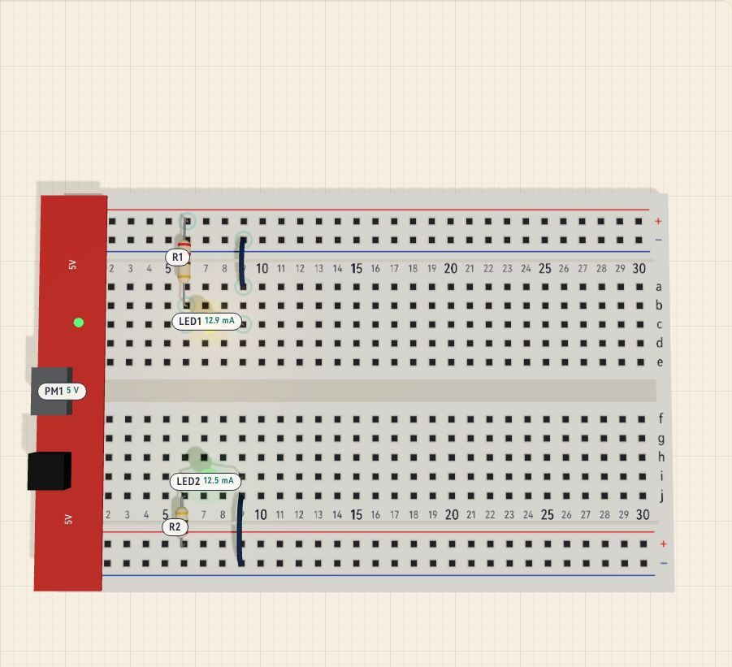
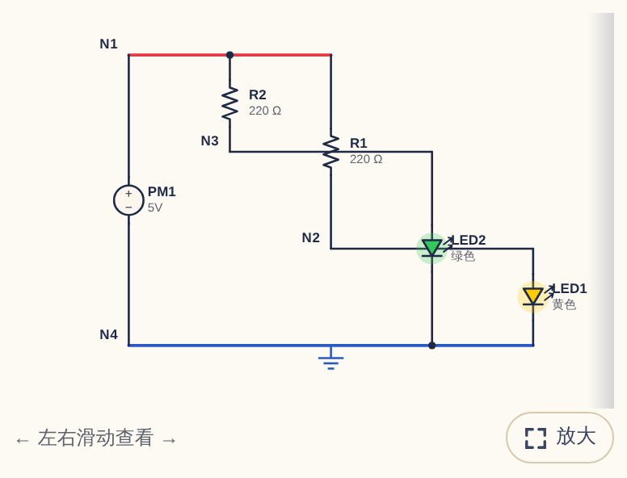
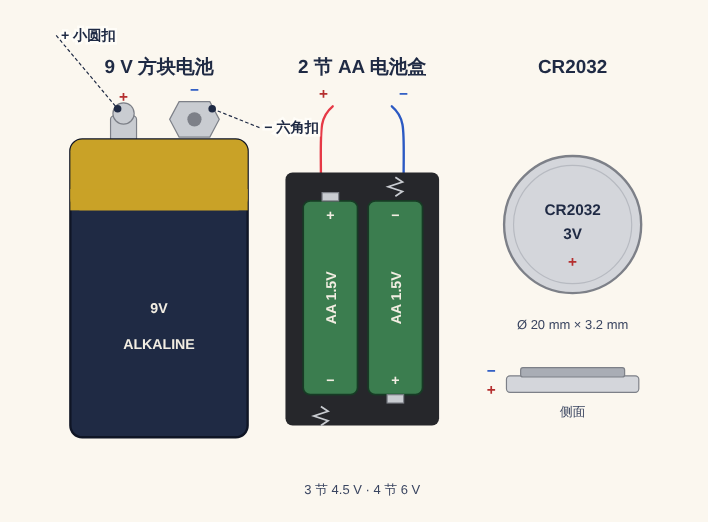
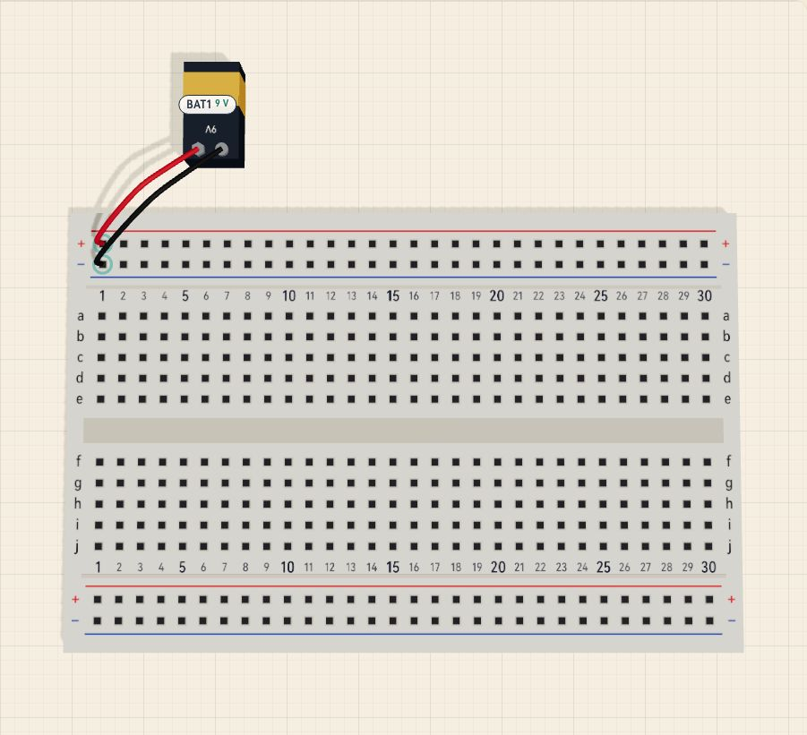
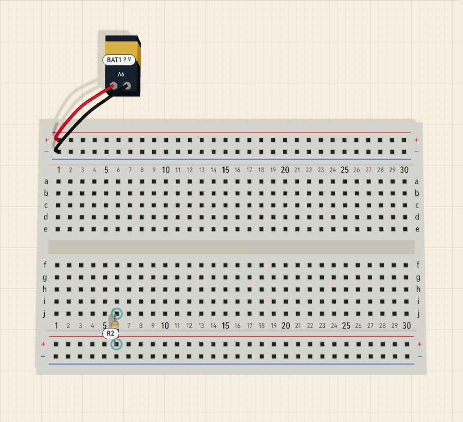
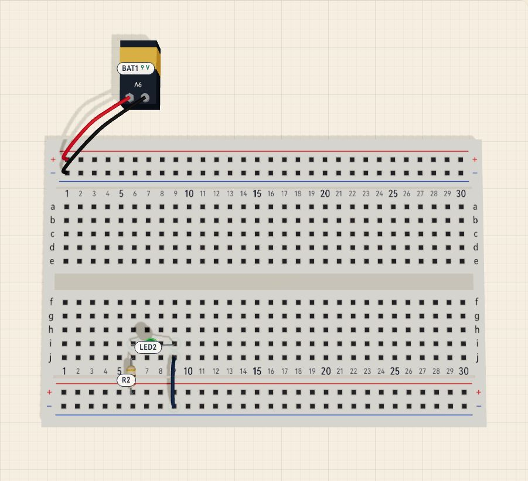
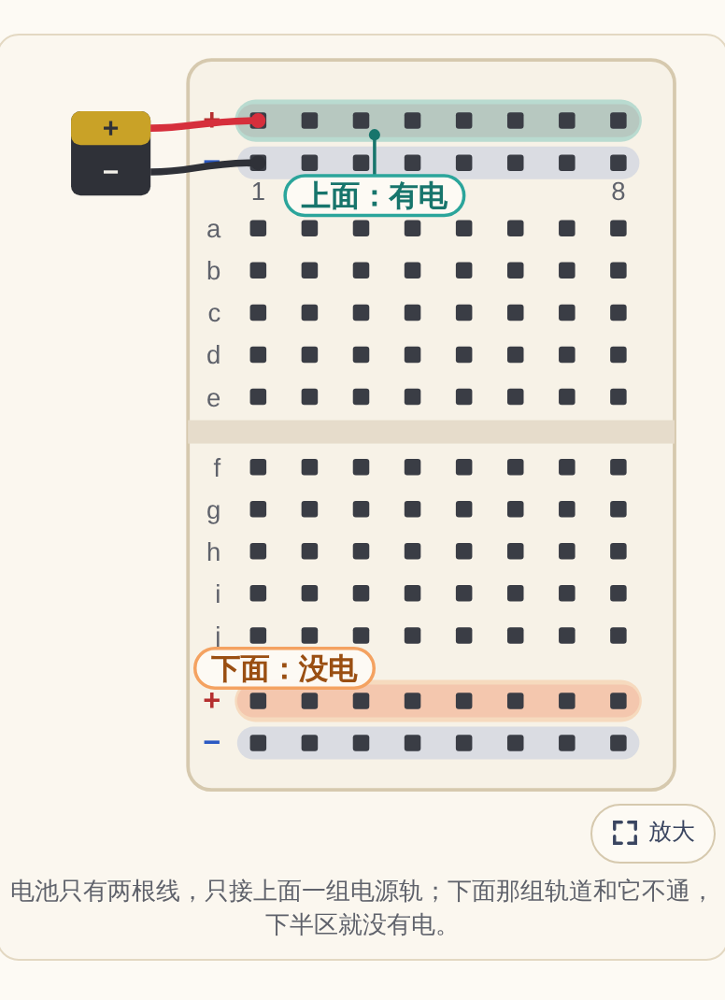
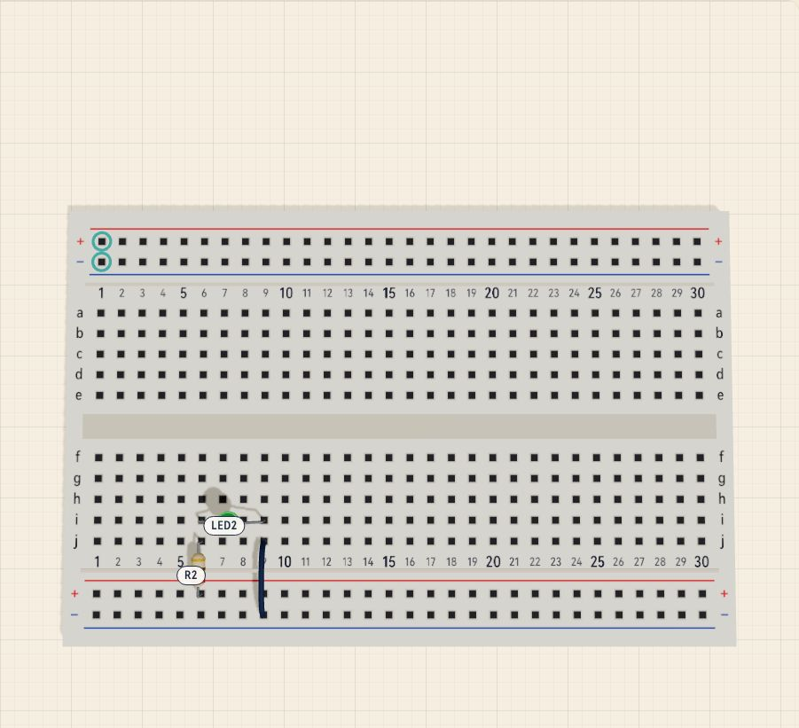
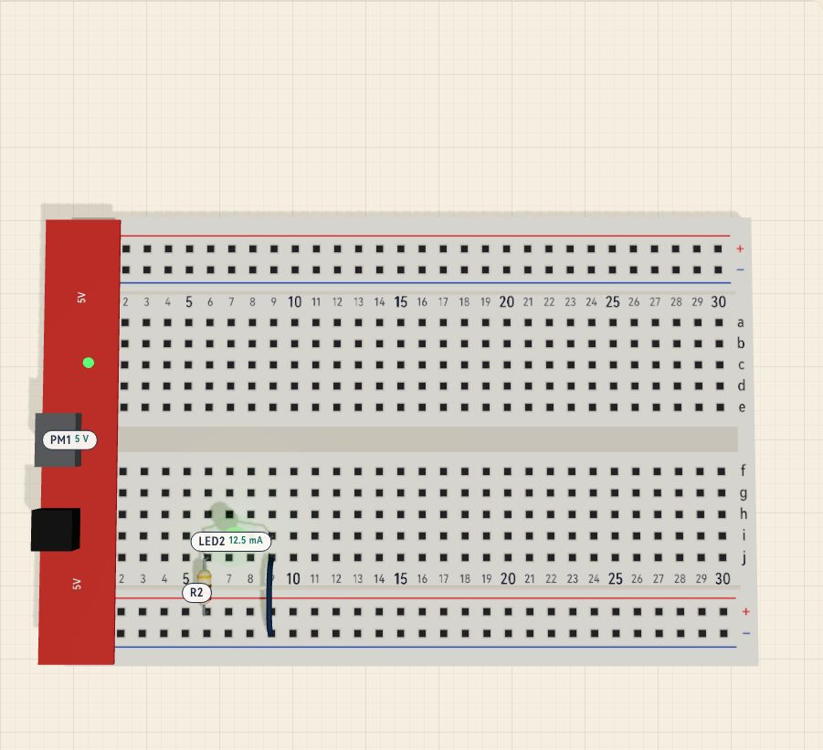

# 1.10 · 电源大比较：电池、电源模块、稳压电源

| 项目 | 内容 |
|---|---|
| id | `lesson-power-supplies` |
| 文件 | `challenges/08-power-supplies.json` |
| 类型 | 课程（有分步，每步自动检查） · 难度 2/5 |
| 位置 | World 1 · 基础定律与直流分压 → 1.10 真实的电源：内阻、模块、稳压电源（本节第 1 项） |
| 右侧面板 | 轨道由旧的四张卡片自动生成（还没手工精排） |
| 前后 | 上一项 [1.9 challenge-button-parallel](../w1/1.09-4-challenge-button-parallel.md) · 下一项 [1.10 challenge-coin-cell](../w1/1.10-2-challenge-coin-cell.md) |
| 先修 | — |
| 概念 | battery 电池、internal resistance 内阻、power module 电源模块、bench supply 稳压电源、power rail 电源轨 |

**一句话概要**：电池只给一组电源轨供电，下半区的 LED 就不亮。换成电源模块，上下两组轨道同时有电。

## 1. 左侧工作台（3D 面包板 → 2D 俯视截图）

截图是程序里真实的 3D 面包板换成俯视角拍的；表格是同一块板的文字版（元件、参数、每只脚插在哪个孔）。

### 1.1 起点：空面包板（学生从零开始搭）

### 1.2 每一步之后的面包板

见第 2 节每个步骤下面的截图（按步骤的自动检查重建：放 / 改 / 拔元件、移动万用表表笔）。

### 1.3 参考答案（「看答案」载入的板子）

| 元件 | 类型 | 参数 | 引脚 → 孔 |
|---|---|---|---|
| PM1 | power_module | voltage=5 | +t→tp1 -t→tn1 +b→bp1 -b→bn1 |
| R1 | resistor | resistance=220 | 1→tp6 2→b6 |
| LED1 | led | color=yellow | anode→c6 cathode→c9 |
| W4 | wire |  | a→a9 b→tn9 |
| R2 | resistor | resistance=220 | 1→bp6 2→j6 |
| LED2 | led | color=green | anode→i6 cathode→i9 |
| W7 | wire |  | a→j9 b→bn9 |

### 1.4 目标原理图（右侧「目标原理图」抽屉）

| 元件 | 类型 | 参数 |
|---|---|---|
| PM1 | power_module | voltage=5 |
| R1 | resistor | resistance=220 |
| LED1 | led | color=yellow |
| R2 | resistor | resistance=220 |
| LED2 | led | color=green |

连接（每个结点上的引脚）：

- **N1**：PM1.+、R1.1、R2.1
- **N2**：R1.2、LED1.anode
- **N3**：R2.2、LED2.anode
- **N4**：LED1.cathode、LED2.cathode、PM1.-

## 2. 右侧面板：学生从上往下看到的内容（单轨流）

### 第 1 步 · 🔍 先看一眼：先认识它：电池

**拆解「电池：电动势 E + 内阻 r」第 1 / 8 层：① 外形：课程里的三种电池**

在模拟器里选中一个电池，属性里可以换 **variant（型号）**。它们看起来完全不一样，但电路上都只有两个端子：+ 正极 和 − 负极。
- 9 V 方块电池：顶上两个按扣（snap）。小的圆柱形是 **+**，大的六角形是 **−**——形状不同，电池扣就插不反。
- AA 电池盒：2、3、4 节 AA 串联，得到 3 V、4.5 V、6 V；红线 +、黑线 −。
- CR2032 纽扣电池：直径 20 mm、厚 3.2 mm（名字就是这么来的：CR + 20 + 32）。刻着字的大平面是 **+**，另一面较小的圆片是 **−**。

下表是模拟器里用的数字，后面几层都会用到。注意最后一列：它们的 **内阻差了 100 倍**。

| 型号 | 里面 | E（电动势） | r（内阻） | 短路电流 E/r |
|---|---|---|---|---|
| 9 V 方块 | 6 节 1.5 V 串联 | 9 V | 1.5 Ω | 6 A |
| 2 × AA | 2 节串联 | 3 V | 0.3 Ω | 10 A |
| 3 × AA | 3 节串联 | 4.5 V | 0.45 Ω | 10 A |
| 4 × AA | 4 节串联 | 6 V | 0.6 Ω | 10 A |
| CR2032 | 1 节锂电池 | 3 V | 15 Ω | 0.2 A |

### 第 2 步 · 🔧 动手搭：下半区的灯为什么不亮？

先用**电池**供电，电池接在**上方**的电源轨。然后在面包板的**下半区**搭一条 LED 支路，接在**下方**的电源轨上。
LED 亮了吗？

**步骤 1**

**电池**（9 V）：+ 接 **`tp1`**，− 接 **`tn1`**——只接了**上方**那组轨道。

自动检查（做到这些才算完成）：把电池插到 tp1–tn1
板上高亮的孔：tp1、tn1

**步骤 2**

下半区：**R2**（**`220 Ω`**）从下方红轨 **`bp6`** 接到 **`j6`**。

自动检查（做到这些才算完成）：把电阻插到 bp6–j6
板上高亮的孔：bp6、j6

**步骤 3**

**绿色 LED2**：长脚 **`i6`**、短脚 **`i9`**；蓝色**跳线** **`j9`** → **`bn9`**（下方 − 轨）。LED2 亮了吗？

自动检查（做到这些才算完成）：把LED 发光二极管插到 i6–i9；把跳线插到 j9–bn9
板上高亮的孔：i6、i9、j9、bn9

**步骤 4**

选「万用表」，红表笔点 **`bp10`**（下方红轨）。读数是什么？

自动检查（做到这些才算完成）：万用表红表笔点 bp10（选“万用表”工具，单击孔）
板上高亮的孔：bp10

### 第 3 步 · 💡 想明白：三种电源，各有脾气

- **电池**：电压由化学决定（9 V 方块、AA 每节 1.5 V、CR2032 纽扣 3 V）。有**内阻**：电流越大，端电压越低。只有两根线，**只给一组轨道供电**——上下两组电源轨之间并不相通。

*图 `rails`（breadboard）：电池只有两根线，只接上面一组电源轨；下面那组轨道和它不通，下半区就没有电。*

- **面包板电源模块**（如 MB102）：用 USB 取电，跳线帽选 5 V 或 3.3 V。它的针脚**同时插进上下两组电源轨**，所以哪一半都能就近取电。
- **实验室稳压电源**：电压连续可调，还能设定**限流**，接错线时能保护电路（第 1.10d 课专门讲）。

（这一步下面列着这节课的计算卡片，点开就地展开：`thevenin`、`battery-terminal-voltage`、`cc-current-source`，全文见第 6 节）

### 第 4 步 · 🔧 动手搭：换成电源模块

拿掉电池，插上电源模块，再在上半区也搭一条支路。

**步骤 5**

选中电池，按 **Delete** 删掉。

自动检查（做到这些才算完成）：清空这些孔：tp1、tn1
板上高亮的孔：tp1、tn1

**步骤 6**

**面包板电源模块**插 **`tp1`**，保持 **5 V**：四根针进入 tp1、tn1、bp1、bn1。LED2 亮了！

自动检查（做到这些才算完成）：把面包板电源模块插到 tp1–tn1–bp1–bn1
板上高亮的孔：tp1、tn1、bp1、bn1

**步骤 7**

上半区：**R1**（**`220 Ω`**）**`tp6`** – **`b6`**；**黄色 LED1** 长脚 **`c6`**、短脚 **`c9`**；蓝色**跳线** **`a9`** → **`tn9`**。点**「检查我的电路」**。

自动检查（做到这些才算完成）：把电阻插到 tp6–b6；把LED 发光二极管插到 c6–c9；把跳线插到 a9–tn9
板上高亮的孔：tp6、b6、c6、c9、a9、tn9

### 第 5 步 · 📏 测一测：测一测：读你自己的仪表

**测量题 1 · `why`**（选择题）

> 用电池供电时，下半区的 LED2 为什么不亮？

- A. 电池电压不够
- B. 上下两组电源轨不相通，电池只接了上方的轨道，下方轨道悬空 ✅（正确）
- C. LED2 插反了

答对后显示：

> 面包板上下两组电源轨是分开的金属条。电池只有两根线，只能给一组轨道供电；要么用跳线把两组接起来，要么用同时插两组的电源模块。

**测量题 2 · `iyel`**（读数题）

> 单击黄色 LED1：「属性」里的电流

- 单位 mA · 先写预测 · 参考答案的读数 **12.92 mA** · 合理范围 [0.0117, 0.014]

答对后显示：

> (5 − 2.0) / (220 + 12) ≈ 12.9 mA。

**测量题 3 · `igrn`**（读数题）

> 单击绿色 LED2：「属性」里的电流

- 单位 mA · 先写预测 · 参考答案的读数 **12.49 mA** · 合理范围 [0.0113, 0.0137]

答对后显示：

> (5 − 2.1) / (220 + 12) ≈ 12.5 mA：下半区的电来自同一个模块。

### 第 6 步 · 🎒 带走：带走

- 用电池或稳压电源时，**下半区要用电，就用跳线把 tp↔bp、tn↔bn 连起来**。
- 电源模块的 + 要对准**红线**那条轨道，插反了等于把电源接反。
- 调试新电路时，能用稳压电源就用稳压电源，并把限流设小一点（如 50–100 mA）：接错了它会先“认输”，元件就安全。

## 3. 测量题一览

| # | id | 题目 | 类型 | 单位 | 状态 | 参考读数 |
|---|---|---|---|---|---|---|
| 1 | why | 用电池供电时，下半区的 LED2 为什么不亮？ | 选择 |  |  | 正确：B |
| 2 | iyel | 单击黄色 LED1：「属性」里的电流 | current | mA |  | 12.92 mA |
| 3 | igrn | 单击绿色 LED2：「属性」里的电流 | current | mA |  | 12.49 mA |

### 提示按钮（依次显示）

1. 上下两组电源轨互相不通：电池只接上方时，下方轨道没有电。
2. 电源模块要插在第 1 列，它的 + 对准红线轨道。

### 功能测试（「检查我的电路」时跑）

- 上下两个 LED 都亮，模块输出正常

## 4. 用到的拆解（全部层的文字，供改写参考）

### 拆解 `battery`：电池：电动势 E + 内阻 r

*课程里用到三种电池：9 V 方块电池、AA 电池盒、CR2032 纽扣电池。我们把它们拆开，找到每一节 cell（电芯），从化学反应得到 EMF（电动势），再画出电路课里的模型——理想电压源串一个 internal resistance（内阻）——并用它算出“带上负载以后电压为什么会掉”。*

**拆解「电池：电动势 E + 内阻 r」第 1 / 8 层：① 外形：课程里的三种电池**

在模拟器里选中一个电池，属性里可以换 **variant（型号）**。它们看起来完全不一样，但电路上都只有两个端子：+ 正极 和 − 负极。
- 9 V 方块电池：顶上两个按扣（snap）。小的圆柱形是 **+**，大的六角形是 **−**——形状不同，电池扣就插不反。
- AA 电池盒：2、3、4 节 AA 串联，得到 3 V、4.5 V、6 V；红线 +、黑线 −。
- CR2032 纽扣电池：直径 20 mm、厚 3.2 mm（名字就是这么来的：CR + 20 + 32）。刻着字的大平面是 **+**，另一面较小的圆片是 **−**。

下表是模拟器里用的数字，后面几层都会用到。注意最后一列：它们的 **内阻差了 100 倍**。

| 型号 | 里面 | E（电动势） | r（内阻） | 短路电流 E/r |
|---|---|---|---|---|
| 9 V 方块 | 6 节 1.5 V 串联 | 9 V | 1.5 Ω | 6 A |
| 2 × AA | 2 节串联 | 3 V | 0.3 Ω | 10 A |
| 3 × AA | 3 节串联 | 4.5 V | 0.45 Ω | 10 A |
| 4 × AA | 4 节串联 | 6 V | 0.6 Ω | 10 A |
| CR2032 | 1 节锂电池 | 3 V | 15 Ω | 0.2 A |

**拆解「电池：电动势 E + 内阻 r」第 2 / 8 层：② X 光：9 V 电池里是 6 节 1.5 V**

把外壳变透明：
- 9 V 方块电池 里面是 **6 节细长的 1.5 V 碱性电芯**（AAAA 尺寸），一正一反排成一排，用金属片首尾相连——一节的 − 接下一节的 +，这就是 **series（串联）**。第一节的 + 接到小圆扣，最后一节的 − 接到六角扣。
- AA 电池盒 也一样：盒底的金属片把第一节的 − 接到第二节的 +，所以 1.5 V + 1.5 V = 3 V。
- CR2032 只有 **一节**，但化学体系不同：负极是金属锂 Li，正极是二氧化锰 MnO₂，中间隔着 隔膜 separator。锂的电动势高，一节就有 3 V；但电极是薄薄的一层，面积小——这就是它内阻大（15 Ω）的原因。

**结论**：一节电芯的电压由化学决定（1.5 V、3 V……），想要更高的电压就把好几节 **串起来**。

**拆解「电池：电动势 E + 内阻 r」第 3 / 8 层：③ 电动势从哪来：化学反应把电子“推”到负极**

切开一节碱性 AA：中心是 锌膏（Zn），外圈是 二氧化锰（MnO₂），中间是浸满 KOH 电解液的 隔膜，钢壳是 + 极，中间那根铜钉连到底部的 − 极。

- 负极（anode）：锌被氧化，**放出** 电子：$Zn + 2OH^{-} → ZnO + H_{2}O + 2e^{-}$
- 正极（cathode）：二氧化锰被还原，**吃掉** 电子：$2MnO_{2} + H_{2}O + 2e^{-} → Mn_{2}O_{3} + 2OH^{-}$

两个反应的“推力”之差就是 **EMF（electromotive force，电动势）** E ≈ 1.5 V。它不是电阻上的压降，而是化学能变成电能的本事：每把 1 C 的电荷从 − 搬到 +，化学反应做 1.5 J 的功。

只有接上 外电路 反应才进行：电子 e⁻ 从锌出发，经过外电路流到正极；我们画的 **电流 I** 方向规定为正电荷方向，正好相反——从 + 出来，经负载，回到 −。

串联 时每节的 E 相加、内阻也相加：$E = n·E_{cell}$，$r = n·r_{cell}$。9 V 电池：6 × 1.5 V = 9 V，6 × 0.25 Ω = 1.5 Ω。

| 化学体系 | 每节电动势 | 例子 | 特点 |
|---|---|---|---|
| 碱性 Zn / MnO₂ | 1.5 V | AA, AAA, 9 V | 便宜，内阻中等 |
| 锂 Li / MnO₂ | 3.0 V | CR2032 | 电压高、自放电小，但内阻大 |
| 镍氢 NiMH | 1.2 V | 充电 AA | 内阻小，能给大电流 |
| 锂离子 Li-ion | 3.7 V（4.2 → 3.0 V） | 18650 | 见“稳压器”拆解：配 LDO 的坑 |

- 公式 `E = n·E_{cell}, r = n·r_{cell}`：n 节相同的电芯串联

**拆解「电池：电动势 E + 内阻 r」第 4 / 8 层：④ 等效电路：理想电压源 E 串联内阻 r**

电路课里把电池画成 虚线框里的两个元件：
1. 理想电压源 E：不管流过多少电流，它两端永远是 E——这代表化学反应的“推力”；
2. 内阻 r：电流在电解液、电极、连接片里走，都会遇到电阻。把它们合起来，就是一个和 E **串联** 的电阻。

我们在外面能摸到、能测到的只有两个端子 + 和 −，它们之间的电压叫 **terminal voltage（端电压）** V。接上 负载 R_L 以后，电流 I 流过 r，在 r 上产生压降 $I·r$——这部分电压“被电池自己吃掉了”，到不了负载。

这就是“电压源的实际模型”。它和戴维南等效电路（Thévenin equivalent）是同一个东西：$E = V_{oc}$（开路电压），$r = R_{th}$。

| 符号 | 名字 | 物理意义 | 怎么测 |
|---|---|---|---|
| E | 电动势 EMF | 化学反应的推力 | 不接负载时用电压表量 V（I = 0 → V = E） |
| r | 内阻 | 电解液 + 电极 + 连接 | 接一个已知负载，$r = \frac{E - V}{I}$ |
| V | 端电压 | 负载真正拿到的电压 | 带载时量 + 和 − |
| I | 电流 | 由负载决定 | 电流表串联 |

**拆解「电池：电动势 E + 内阻 r」第 5 / 8 层：⑤ 推公式：V = E − I·r，以及电池的外特性直线**

对上一层的回路写 KVL（Kirchhoff’s voltage law，基尔霍夫电压定律），从 − 端出发绕一圈：
1. 经过 E 升高 E，经过 r 降低 $I·r$，经过负载降低 $I·R_L$：$E - I·r - I·R_L = 0$
2. 所以电流 $I = \frac{E}{r + R_L}$
3. 端电压就是负载上的电压：$V = I·R_L = E - I·r$

$V = E - I·r$ 在 V–I 平面上是一条 斜率为 −r 的直线（右图，CR2032）：
- I = 0（开路）时 V = E = 3 V；
- 负载越重（R_L 越小、I 越大），V 越低；
- V = 0 时 I = E/r——**短路电流**，是这块电池能给出的最大电流。CR2032：3 / 15 = 0.2 A；9 V 电池：9 / 1.5 = 6 A。

**带数字**（挑战 9）：CR2032 → 47 Ω → 红色 LED（$V_f$ = 1.8 V，内阻 12 Ω）：
$$I = \frac{3 - 1.8}{15 + 47 + 12} = \frac{1.2}{74} = 16.2 mA$$
$$V = 3 - 0.0162 × 15 = 2.76 V$$
这就是 工作点，测试要求的“端电压约 2.75 V”就是它。

再看第 2 课的 9 V 电池：两条支路（470 Ω + 红 LED、470 Ω + 黄 LED）共约 29 mA，$V = 9 - 0.029 × 1.5 ≈ 8.96 V$——内阻只有 1.5 Ω，压降 0.04 V，几乎看不出来。**内阻要不要考虑，看 I·r 和 E 比起来大不大。**

最后一个点：负载从电池拿到的功率 $P = V·I = \frac{E^{2}R_L}{(r + R_L)^{2}}$，在 R_L = r 时最大，$P_{max} = \frac{E^{2}}{4r}$（CR2032：0.15 W）——这就是“最大功率传输定理”。

- 公式 `I = \frac{E}{r + R_L}`：KVL：E 被 r 和 R_L 分掉
- 公式 `V = E - I·r`：端电压：电流越大越低
- 公式 `I_{sc} = \frac{E}{r}`：短路电流 = 最大电流
- 公式 `P_{max} = \frac{E^{2}}{4r}`：R_L = r 时负载功率最大

**拆解「电池：电动势 E + 内阻 r」第 6 / 8 层：⑥ 纽扣电池能“不加电阻”点 LED？——算一算**

网上常说 CR2032 可以直接点 LED，因为它的 15 Ω 内阻 本身就在限流。这话 **一半对**：确实有一个电阻在限流，它就在电池里。但限得够不够？把 47 Ω 拿掉，回路里只剩 15 Ω + LED 的 12 Ω：
$$I = \frac{E - V_f}{r + R_{LED}} = \frac{3 - 1.8}{15 + 12} = 44 mA$$
44 mA 是普通 LED 最大电流（20 mA）的两倍多。再看电池这边：
- 内阻上发热 $I^{2}r = 0.044^{2} × 15 = 29 mW$；
- CR2032 的标称容量约 220 mAh 是在 **0.2 mA** 这种小电流下测的。几十 mA 时化学反应跟不上，电压很快塌下去，实际能放出的电量少得多。

加上 47 Ω：16 mA，LED 亮度合适，电池也轻松。

**为什么“不加电阻”有时看起来也行？** 蓝、白 LED 的 $V_f$ ≈ 3.0 V，和 E 一样大，电流本来就很小；而且电池越用 E 越低、r 越大。靠内阻限流就是靠一个 **你控制不了、会变** 的数。工程上的做法：**电流由你选的电阻决定，不由电池的内阻决定。**

| 电路 | 回路总电阻 | I | 端电压 V | 评价 |
|---|---|---|---|---|
| CR2032 + LED | 15 + 12 = 27 Ω | 44 mA | 2.33 V | LED 过流，电池过载 |
| CR2032 + 47 Ω + LED | 74 Ω | 16 mA | 2.76 V | 正好（挑战 9） |
| 9 V + LED（没电阻） | 1.5 + 12 = 13.5 Ω | 530 mA | 8.2 V | LED 立刻烧毁 |

- 公式 `I = \frac{E - V_f}{r + R + R_{LED}}`：内阻和你的电阻、LED 的电阻串在一起

**拆解「电池：电动势 E + 内阻 r」第 7 / 8 层：⑦ + 和 −，以及 GND 到底是什么**

电压永远是 **两点之间的差**：$V_{AB} = V_A - V_B$。说“某点是 5 V”时省略了“相对谁”。这个默认的参考点就是 **GND（ground，地）**，规定它是 0 V。

在电池供电的电路里，我们把 电池的 − 端 定义为 GND。于是：
- 红轨 接 +，所有点都是 9 V；
- 蓝轨 接 −，所有点都是 0 V；
- 电路里任何一点的“电压”都是它相对蓝轨的电压，例如 LED 正极 是 $1.8 + 0.0149 × 12 ≈ 1.98 V$。

原理图里画了好几个 ⏚ 地符号，意思都是“这根线接回电源 −”，它们在实物上是 **同一个结点**。GND 不是大地，也不是“电流消失的地方”：电流从 + 出来，流过负载，**全部** 从 − 回到电池里（return path，回路）。

一个常见的坑：两个电源（比如电池和开发板）一起用时，它们的 − 必须连在一起，“0 V”才是同一个 0 V。

| 名字 | 接哪 | 电压（相对 GND） | 面包板上 |
|---|---|---|---|
| + / VCC | 电池正极 | +9 V | 红轨（+） |
| − / GND | 电池负极 | 0 V（定义） | 蓝轨（−） |
| LED 正极 | 470 Ω 和 LED 之间 | ≈ 1.98 V | 某一列 |

- 公式 `V_{AB} = V_A - V_B`：V_B = GND = 0 V 时，V_AB 就是 A 点的“电压”

**拆解「电池：电动势 E + 内阻 r」第 8 / 8 层：⑧ 模型的局限：真实电池的 E 和 r 都在变**

模拟器里电池是 E 和 r 都不变 的理想模型。真实电池：
- **E 随放电下降**：碱性电芯从新的 1.6 V 慢慢降到 0.9 V 左右就算用完，9 V 电池就是 9.5 V → 5.4 V，曲线 一路往下；
- **r 随放电上升**：9 V 电池新的时候约 1.5 Ω，快没电时 5–10 Ω；所以“用电压表量没负载的电池还有 8 V”不代表它还能带得动负载——要 **带载** 量；
- **r 随温度变**：冷天内阻变大，所以冬天车钥匙、遥控器“没电”；
- **大电流放电容量变小**：容量（mAh）是在规定的小电流下测的，电流越大能放出的越少（对 CR2032 尤其明显）；
- **短路**：模拟器在电流超过限值时报警（9 V：1 A，AA：2 A，CR2032：50 mA），真实电池会发烫，锂电池甚至可能起火。

| 现象 | 模拟器 | 真实电池 |
|---|---|---|
| 电动势 E | 恒定 | 随放电下降（1.6 → 0.9 V / 节） |
| 内阻 r | 恒定 | 随放电、低温上升 |
| 容量 | 无限 | 有限，大电流时更少 |
| 短路 | 报警 | 发热，可能损坏 / 起火 |

**一句话记住**：电池 = 理想电压源 E 串联内阻 r。E 由化学决定（每节 1.5 V 或 3 V，串联相加），r 决定它能给多大电流：$V = E - I·r$，最大电流 $E/r$。I·r 和 E 比很小时（9 V + LED）可以忽略内阻；很大时（CR2032）要算进去——但限流还是要靠你自己的电阻。电池的 − 端就是电路的 GND（0 V 参考点）。

## 5. 这一课的计算卡片

**计算卡片 `thevenin`：戴维宁等效：开路电压 + 短路电流**

- 公式 `R_{eq} = \frac{V_{oc}}{I_{sc}}`
- 用途：测出（或算出）端口的开路电压和短路电流，就得到整个网络的等效电阻。
- 输入：V_oc（开路电压，V）；I_sc（短路电流，A） → R_eq（等效电阻，Ω）

1. 任何含源线性二端网络，对外都等效成一个电压源 $V_{oc}$ 串一个电阻 $R_{eq}$。
2. 端口开路：没有电流流过 $R_{eq}$，它上面没有压降，端口电压就是 $V_{oc}$。
3. 端口短路：$I_{sc} = \frac{V_{oc}}{R_{eq}}$。
4. 两个测量相除：$R_{eq} = \frac{V_{oc}}{I_{sc}}$。（另一条路：把独立源置零，从端口看进去算电阻——见“戴维宁等效电阻”。）
5. 用法：接上负载 $R_L$，$V_L = V_{oc}\frac{R_L}{R_{eq} + R_L}$，一步就出来，不用再解整个网络。

例子：实验 2-2：$V_{oc} = 9 × \frac{2.2}{3.2} ≈ 6.19 V$，$I_{sc} ≈ 5.345 mA$，$R_{eq} ≈ 1158 Ω$ = $470 + 1k ∥ 2.2k$ ✔。实验 1-3 的分压器从 VOUT 看是“4.5 V 串 5 kΩ”：接 1 kΩ，$V = 4.5 × \frac{1}{6} = 0.75 V$。

- ⚠ 短路法只适合短路电流很小的网络——绝不要把电池或电源输出直接短路。
- ⚠ 真实电流表有几欧内阻，“短路”不彻底：$I_sc$ 偏小，算出的 $R_eq$ 偏大约 1 %。

**计算卡片 `battery-terminal-voltage`：电池的端电压 V = E − Ir**

- 公式 `V = E - I r`
- 用途：电池 = 电动势 E 串内阻 r：取的电流越大，端电压掉得越多。
- 输入：E（电动势（空载电压），V）；r（内阻（9 V 电池 1.5 Ω、AA 0.15 Ω、CR2032 15 Ω），Ω）；I（负载电流，A） → V（端电压，V）

1. 化学反应在电池里维持一个电动势 E；电流从电池内部流过时要经过电解液和电极，这部分电阻就是内阻 r。
2. 等效电路：E 串 r，KVL：$V = E - Ir$。
3. 接电阻负载 R 时先求电流：$I = \frac{E}{R + r}$，再代回去。
4. 反过来测内阻：空载读 E，带载读 V 和 I，$r = \frac{E - V}{I}$。
5. 短路电流 $\frac{E}{r}$：9 V 电池约 6 A——会发烫，别短路。

例子：挑战 9：CR2032（3 V、15 Ω）点一个红 LED，约 16 mA：$V = 3 - 0.016 × 15 ≈ 2.76 V$。第 9 课：9 V 电池只给 2.8 mA，$V = 9 - 0.0028 × 1.5 ≈ 8.996 V$，几乎看不出。

- ⚠ 空载时万用表读到的是 E，它说明不了电池还能给多大电流——要带载测。
- ⚠ 内阻会随电量下降而变大：旧电池空载电压正常，一带载就掉。

**计算卡片 `cc-current-source`：稳压电源的 CV / CC：当电流源用**

- 公式 `I_{want} = \frac{V_{set} - V_F}{R} > I_{lim} ⇒ V = V_F + I_{lim} R`
- 用途：判断稳压电源工作在 CV 还是 CC，并算出它实际输出的电压。
- 输入：V_set（电压设定，V）；I_lim（限流设定，A）；R（负载电阻（含 LED 内阻），Ω）；V_F（负载里 LED 的 V_F（没有就填 0），V） → V（电源实际输出电压，V）

1. 稳压电源有两个“上限”：电压不超过 $V_{set}$，电流不超过 $I_{lim}$。哪个先碰到，哪个说了算。
2. 先假设 CV：输出 $V_{set}$，负载想要的电流 $I_{want} = \frac{V_{set} - V_F}{R}$。
3. $I_{want} ≤ I_{lim}$：确实是 CV，电压 = 设定，电流由负载决定。
4. $I_{want} > I_{lim}$：切到 CC，电流 = $I_{lim}$，电压降到刚好推动这个电流：$V = V_F + I_{lim}R$。
5. 当电流源用：限流设成想要的电流，电压设高一些（留余量）。它能带的最大负载是 $R_{max} = \frac{V_{set} - V_F}{I_{lim}}$，超过就退回 CV。

例子：- 第 11 课：12 V、10 mA、470 Ω：想要 25.5 mA > 10 mA → CC，$V = 10 mA × 470 = 4.70 V$；限流 20 mA → 9.4 V；100 mA → CV，12 V、25.5 mA。
- 实验 1-4：$1.8 + 10 mA × (470 + 12) ≈ 6.6 V$（CC）；RV1 = 1 kΩ 时需要 16.6 V > 12 V → CV，$I = \frac{12 - 1.8}{1482} ≈ 6.9 mA$。
- 挑战 10 电阻被短路：$6 V + 50 mA × 24 Ω = 7.2 V$，电源限住 50 mA。

- ⚠ 屏幕上小字 “SET …” 是旋钮设定，大字才是实际输出——CC 时两者不一样。
- ⚠ 电流源也有“顶”：负载太大时它给不出设定的电流（实验 1-4 的 100 %）。

## 6. English（界面英文版的同一份内容）

展开英文

### Node 1 · 🔍 Look first：Meet it first: Battery

**Teardown「Battery: an EMF E plus an internal resistance r」layer 1 of 8：① Outside: the three batteries in the course**

Select a battery in the simulator and you can change its **variant** in the properties. They look nothing alike, but electrically each has just two terminals: + (positive) and − (negative).
- 9 V block: two snaps on top. The small round one is **+**, the bigger hexagonal one is **−** — different shapes, so the clip can't go on backwards.
- AA holder: 2, 3 or 4 AA cells in series give 3 V, 4.5 V or 6 V; red lead +, black lead −.
- CR2032 coin cell: 20 mm across, 3.2 mm thick (that's the name: CR + 20 + 32). The big flat face with the writing is **+**, the smaller disc on the other side is **−**.

The table lists the numbers the simulator uses; the next layers use them. Look at the last column: their **internal resistances differ by a factor of 100**.

| Variant | Inside | E (EMF) | r (internal R) | short-circuit E/r |
|---|---|---|---|---|
| 9 V block | 6 × 1.5 V in series | 9 V | 1.5 Ω | 6 A |
| 2 × AA | 2 in series | 3 V | 0.3 Ω | 10 A |
| 3 × AA | 3 in series | 4.5 V | 0.45 Ω | 10 A |
| 4 × AA | 4 in series | 6 V | 0.6 Ω | 10 A |
| CR2032 | 1 lithium cell | 3 V | 15 Ω | 0.2 A |

### Node 2 · 🔧 Build：Why is the lower LED dark?

Power the board from a **battery** connected to the **top** rails. Then build an LED branch on the **lower half** of the board, on the **lower** rails.
Is the LED lit?

**Step 1**

**Battery** (9 V): + in **`tp1`**, − in **`tn1`** — only the **top** pair of rails.

Checked automatically：Place the Battery at tp1–tn1
Holes highlighted：tp1、tn1

**Step 2**

Lower half: **R2** (**`220 Ω`**) from the lower red rail **`bp6`** to **`j6`**.

Checked automatically：Place the Resistor at bp6–j6
Holes highlighted：bp6、j6

**Step 3**

**Green LED2**: long lead **`i6`**, short lead **`i9`**; blue **jumper** **`j9`** → **`bn9`** (the lower − rail). Is LED2 lit?

Checked automatically：Place the LED at i6–i9；Place the Jumper wire at j9–bn9
Holes highlighted：i6、i9、j9、bn9

**Step 4**

Pick Multimeter and put the red probe on **`bp10`** (the lower red rail). What does it read?

Checked automatically：Multimeter red probe on bp10 (pick the Multimeter tool, click the hole)
Holes highlighted：bp10

### Node 3 · 💡 Why：Three supplies, three tempers

- **Battery**: chemistry sets the voltage (9 V block, 1.5 V per AA, 3 V CR2032 coin cell). It has **internal resistance**: the more current, the lower its terminal voltage. Two wires only, so it **powers one pair of rails** — the top and bottom rails are not connected to each other.

[figure `rails`]

*Figure `rails`（breadboard）：电池只有两根线，只接上面一组电源轨；下面那组轨道和它不通，下半区就没有电。*

- **Breadboard power module** (such as an MB102): powered from USB, a jumper selects 5 V or 3.3 V. Its pins go **into the top and bottom rails at once**, so both halves can draw power nearby.
- **Lab bench supply**: continuously adjustable voltage plus a **current limit** that protects the circuit when something is wired wrong (lesson 1.10d is all about it).

(This node lists the lesson’s calculation cards: `thevenin`、`battery-terminal-voltage`、`cc-current-source`; full text in section 6)

### Node 4 · 🔧 Build：Switch to the power module

Remove the battery, plug in the power module, and add a branch on the top half too.

**Step 5**

Click the battery and press **Delete**.

Checked automatically：holes empty again: tp1, tn1
Holes highlighted：tp1、tn1

**Step 6**

**Breadboard power module** in **`tp1`**, keep **5 V**: its four pins go into tp1, tn1, bp1 and bn1. LED2 lights up!

Checked automatically：Place the Breadboard power module at tp1–tn1–bp1–bn1
Holes highlighted：tp1、tn1、bp1、bn1

**Step 7**

Top half: **R1** (**`220 Ω`**) **`tp6`** – **`b6`**; **yellow LED1** long lead **`c6`**, short lead **`c9`**; blue **jumper** **`a9`** → **`tn9`**. Press **Check my circuit**.

Checked automatically：Place the Resistor at tp6–b6；Place the LED at c6–c9；Place the Jumper wire at a9–tn9
Holes highlighted：tp6、b6、c6、c9、a9、tn9

### Node 5 · 📏 Measure：Measure: read your own instruments

**Question 1 · `why`**（multiple choice）

> With the battery, why did LED2 on the lower half stay dark?

- A. The battery's voltage was too low
- B. The top and bottom rails are not connected; the battery fed only the top ones, so the lower rails floated ✅ (right)
- C. LED2 was backwards

Shown once right:

> The top and bottom rail pairs are separate strips. A battery has two wires and can feed only one pair; join the pairs with jumpers, or use a power module that plugs into both.

**Question 2 · `iyel`**（reading）

> Click the yellow LED1: the current in Properties

- unit mA · predict first · range [0.0117, 0.014]

Shown once right:

> (5 − 2.0) / (220 + 12) ≈ 12.9 mA.

**Question 3 · `igrn`**（reading）

> Click the green LED2: the current in Properties

- unit mA · predict first · range [0.0113, 0.0137]

Shown once right:

> (5 − 2.1) / (220 + 12) ≈ 12.5 mA: the lower half is powered by the same module.

### Node 6 · 🎒 Take away：Take away

- With a battery or a bench supply, **power the lower half with jumpers tp↔bp and tn↔bn**.
- The power module's + must line up with the rail with the **red line**; reversed, it reverses your supply.
- Debugging a new circuit? Use a bench supply if you have one, with a low current limit (say 50–100 mA): if something is wrong it gives up first and your parts survive.

**Hints**

1. The top and bottom rails are not connected: with the battery on the top rails only, the bottom rails have no power.
2. The power module goes in column 1, with its + lined up with the red-line rail.

