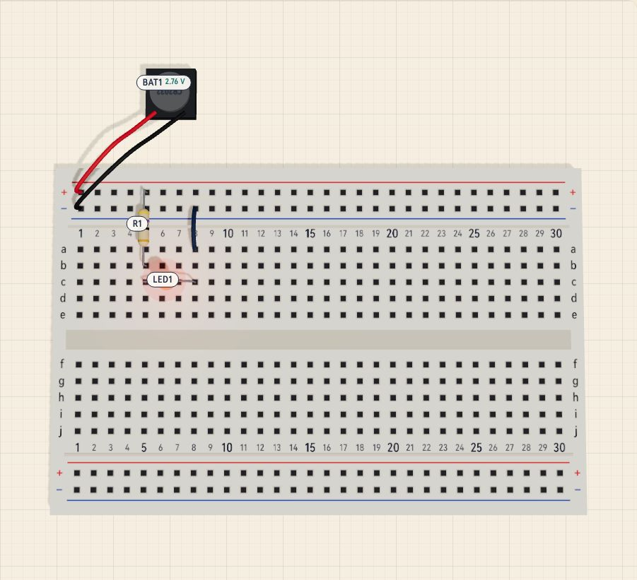
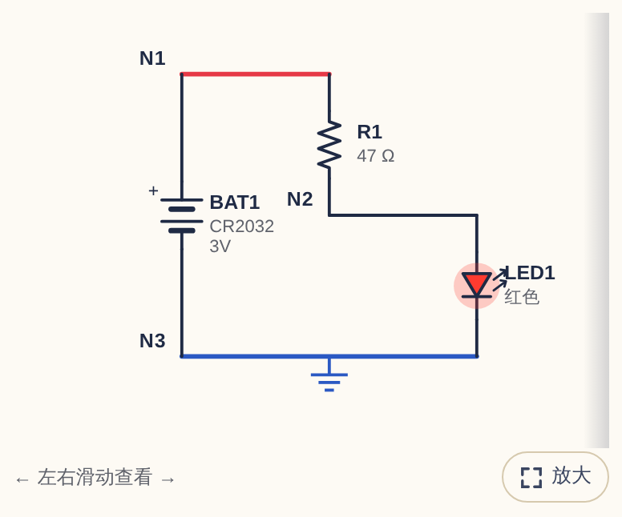
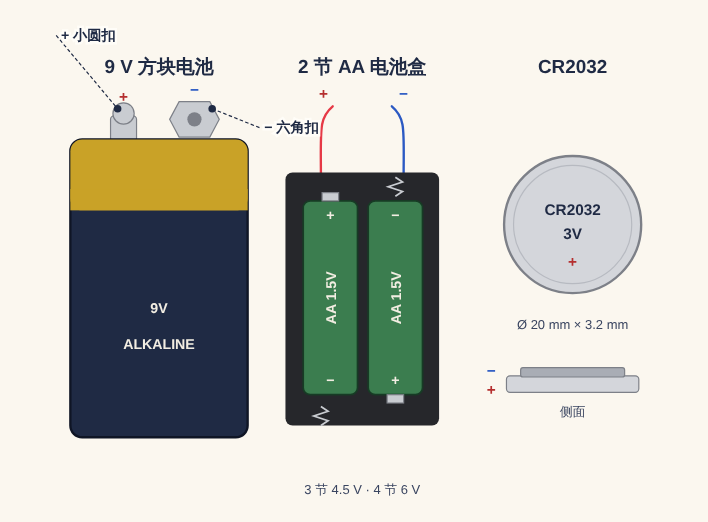
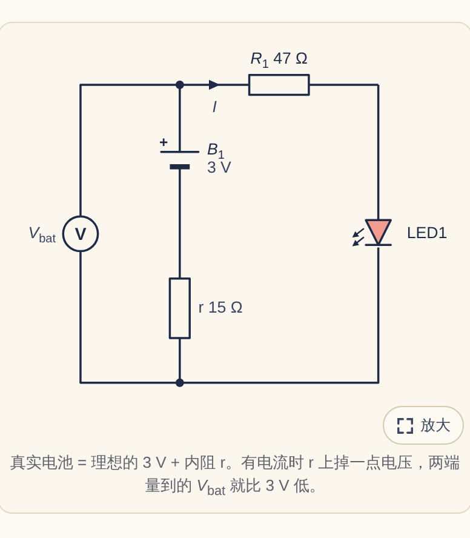
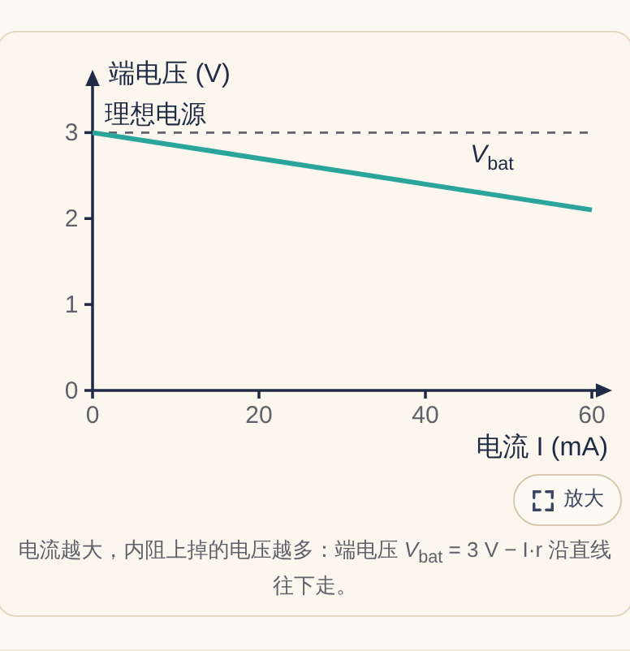

# 1.10 · 纽扣电池：内阻看得见

| 项目 | 内容 |
|---|---|
| id | `challenge-coin-cell` |
| 文件 | `challenges/17-coin-cell.json` |
| 类型 | 实验 / 挑战（没有分步，照目标电路图搭） · 难度 3/5 |
| 位置 | World 1 · 基础定律与直流分压 → 1.10 真实的电源：内阻、模块、稳压电源（本节第 2 项） |
| 右侧面板 | 轨道由旧的四张卡片自动生成（还没手工精排） |
| 前后 | 上一项 [1.10 lesson-power-supplies](../w1/1.10-1-lesson-power-supplies.md) · 下一项 [1.10 challenge-module-blue-led](../w1/1.10-3-challenge-module-blue-led.md) |
| 先修 | — |
| 概念 | internal resistance 内阻、terminal voltage 端电压、coin cell 纽扣电池 |

**一句话概要**：CR2032 有约 15 Ω 内阻：一取电流，端电压就往下掉。但这不是省掉限流电阻的理由。

## 1. 左侧工作台（3D 面包板 → 2D 俯视截图）

截图是程序里真实的 3D 面包板换成俯视角拍的；表格是同一块板的文字版（元件、参数、每只脚插在哪个孔）。

### 1.1 起点：空面包板（学生从零开始搭）

### 1.3 参考答案（「看答案」载入的板子）

| 元件 | 类型 | 参数 | 引脚 → 孔 |
|---|---|---|---|
| BAT1 | battery | variant=CR2032 | +→tp1 -→tn1 |
| R1 | resistor | resistance=47 | 1→tp5 2→b5 |
| LED1 | led | color=red | anode→c5 cathode→c8 |
| W4 | wire |  | a→a8 b→tn8 |

### 1.4 目标原理图（右侧「目标原理图」抽屉）

| 元件 | 类型 | 参数 |
|---|---|---|
| BAT1 | battery | variant=CR2032 |
| R1 | resistor | resistance=47 |
| LED1 | led | color=red |

连接（每个结点上的引脚）：

- **N1**：BAT1.+、R1.1
- **N2**：R1.2、LED1.anode
- **N3**：LED1.cathode、BAT1.-

## 2. 右侧面板：学生从上往下看到的内容（单轨流）

### 第 1 步 · 🔍 先看一眼：先认识它：电池

**拆解「电池：电动势 E + 内阻 r」第 1 / 8 层：① 外形：课程里的三种电池**

在模拟器里选中一个电池，属性里可以换 **variant（型号）**。它们看起来完全不一样，但电路上都只有两个端子：+ 正极 和 − 负极。
- 9 V 方块电池：顶上两个按扣（snap）。小的圆柱形是 **+**，大的六角形是 **−**——形状不同，电池扣就插不反。
- AA 电池盒：2、3、4 节 AA 串联，得到 3 V、4.5 V、6 V；红线 +、黑线 −。
- CR2032 纽扣电池：直径 20 mm、厚 3.2 mm（名字就是这么来的：CR + 20 + 32）。刻着字的大平面是 **+**，另一面较小的圆片是 **−**。

下表是模拟器里用的数字，后面几层都会用到。注意最后一列：它们的 **内阻差了 100 倍**。

| 型号 | 里面 | E（电动势） | r（内阻） | 短路电流 E/r |
|---|---|---|---|---|
| 9 V 方块 | 6 节 1.5 V 串联 | 9 V | 1.5 Ω | 6 A |
| 2 × AA | 2 节串联 | 3 V | 0.3 Ω | 10 A |
| 3 × AA | 3 节串联 | 4.5 V | 0.45 Ω | 10 A |
| 4 × AA | 4 节串联 | 6 V | 0.6 Ω | 10 A |
| CR2032 | 1 节锂电池 | 3 V | 15 Ω | 0.2 A |

### 第 2 步 · 🔧 动手搭：电池也会“累”

这一题没有步骤，**照目标电路图自己搭**。先选「电池」，在「属性」里把型号改成 **CR2032**。搭好后用万用表量电池两端。

### 第 3 步 · 💡 想明白：真实电池 = 理想电源 + 内阻

- 把电池想成一个**理想的 3 V 电源，里面串着一个小电阻**（内阻 $r$）。

*图 `model`（schematic）：真实电池 = 理想的 3 V + 内阻 r。有电流时 r 上掉一点电压，两端量到的 V_bat 就比 3 V 低。*

- 有电流时，内阻上会掉一点电压，所以电池两端的**端电压**比 3 V 低：
$$V_{bat} = 3\ \text{V} - I \cdot r$$

*图 `droop`（plot）：电流越大，内阻上掉的电压越多：端电压 V_bat = 3 V − I·r 沿直线往下走。*

- 网上常说“纽扣电池可以直接点 LED，不用电阻”。算一算：不加电阻时 $I \approx \frac{3 - 1.8}{15 + 12} \approx 44$ mA——比 LED 的 20 mA 大一倍多，纽扣电池也吃不消。加 47 Ω 就合适了。

（这一步下面列着这节课的计算卡片，点开就地展开：`led-resistor`、`led-current`、`battery-terminal-voltage`，全文见第 6 节）

### 第 4 步 · 🔧 动手搭：搭好，量三个数

- 47 Ω 电阻的一只脚可以直接插红轨。
- 用万用表量电池两端，再单击 LED 读电流。最后用这两个数**算出内阻**。

### 第 5 步 · 📏 测一测：测一测：读你自己的仪表

**测量题 1 · `vbat`**（读数题）

> 万用表：电池两端的电压（红表笔在 + 轨）

- 单位 V · 先写预测 · 参考答案的读数 **2.757 V** · 合理范围 [2.65, 2.85]

答对后显示：

> I ≈ (3 − 1.8) / (15 + 47 + 12) ≈ 16.2 mA，内阻上掉 15 Ω × 16.2 mA ≈ 0.24 V，所以约 2.76 V。

**测量题 2 · `iled`**（读数题）

> 单击 LED：「属性」里的电流

- 单位 mA · 参考答案的读数 **16.22 mA** · 合理范围 [0.0152, 0.0172]

答对后显示：

> 约 16.2 mA。

**测量题 3 · `rint`**（计算题（用自己的读数算））

> 用你的两个读数算电池内阻：r = (3 V − 端电压) / 电流

- 单位 Ω · 参考答案的读数 **15 Ω** · 合理范围 [13.5, 16.5] · 公式 `(3 - vbat) / iled`

答对后显示：

> 约 15 Ω：这就是 CR2032 的内阻。

### 第 6 步 · 🎒 带走：带走

- 每种电池都有内阻：9 V 方块约 1.5 Ω，AA 每节约 0.15 Ω，CR2032 约 15 Ω。**内阻越大，越带不动大电流。**
- 用“端电压随电流下降多少”就能测出内阻——你刚才做的就是这件事。
- 电池快没电时内阻会变大，所以“空载量着还有 3 V”的旧电池，一接负载电压就塌。

趁热练理论题：`basics`

## 3. 测量题一览

| # | id | 题目 | 类型 | 单位 | 状态 | 参考读数 |
|---|---|---|---|---|---|---|
| 1 | vbat | 万用表：电池两端的电压（红表笔在 + 轨） | voltage | V |  | 2.757 V |
| 2 | iled | 单击 LED：「属性」里的电流 | current | mA |  | 16.22 mA |
| 3 | rint | 用你的两个读数算电池内阻：r = (3 V − 端电压) / 电流 | formula | Ω |  | 15 Ω |

### 提示按钮（依次显示）

1. 选中电池，在属性里把型号改成 CR2032。
2. 47 Ω 电阻的一只脚可以直接插红轨。

### 功能测试（「检查我的电路」时跑）

- LED 亮，电池端电压被内阻拉低

## 4. 用到的拆解（全部层的文字，供改写参考）

### 拆解 `battery`：电池：电动势 E + 内阻 r

*课程里用到三种电池：9 V 方块电池、AA 电池盒、CR2032 纽扣电池。我们把它们拆开，找到每一节 cell（电芯），从化学反应得到 EMF（电动势），再画出电路课里的模型——理想电压源串一个 internal resistance（内阻）——并用它算出“带上负载以后电压为什么会掉”。*

**拆解「电池：电动势 E + 内阻 r」第 1 / 8 层：① 外形：课程里的三种电池**

在模拟器里选中一个电池，属性里可以换 **variant（型号）**。它们看起来完全不一样，但电路上都只有两个端子：+ 正极 和 − 负极。
- 9 V 方块电池：顶上两个按扣（snap）。小的圆柱形是 **+**，大的六角形是 **−**——形状不同，电池扣就插不反。
- AA 电池盒：2、3、4 节 AA 串联，得到 3 V、4.5 V、6 V；红线 +、黑线 −。
- CR2032 纽扣电池：直径 20 mm、厚 3.2 mm（名字就是这么来的：CR + 20 + 32）。刻着字的大平面是 **+**，另一面较小的圆片是 **−**。

下表是模拟器里用的数字，后面几层都会用到。注意最后一列：它们的 **内阻差了 100 倍**。

| 型号 | 里面 | E（电动势） | r（内阻） | 短路电流 E/r |
|---|---|---|---|---|
| 9 V 方块 | 6 节 1.5 V 串联 | 9 V | 1.5 Ω | 6 A |
| 2 × AA | 2 节串联 | 3 V | 0.3 Ω | 10 A |
| 3 × AA | 3 节串联 | 4.5 V | 0.45 Ω | 10 A |
| 4 × AA | 4 节串联 | 6 V | 0.6 Ω | 10 A |
| CR2032 | 1 节锂电池 | 3 V | 15 Ω | 0.2 A |

**拆解「电池：电动势 E + 内阻 r」第 2 / 8 层：② X 光：9 V 电池里是 6 节 1.5 V**

把外壳变透明：
- 9 V 方块电池 里面是 **6 节细长的 1.5 V 碱性电芯**（AAAA 尺寸），一正一反排成一排，用金属片首尾相连——一节的 − 接下一节的 +，这就是 **series（串联）**。第一节的 + 接到小圆扣，最后一节的 − 接到六角扣。
- AA 电池盒 也一样：盒底的金属片把第一节的 − 接到第二节的 +，所以 1.5 V + 1.5 V = 3 V。
- CR2032 只有 **一节**，但化学体系不同：负极是金属锂 Li，正极是二氧化锰 MnO₂，中间隔着 隔膜 separator。锂的电动势高，一节就有 3 V；但电极是薄薄的一层，面积小——这就是它内阻大（15 Ω）的原因。

**结论**：一节电芯的电压由化学决定（1.5 V、3 V……），想要更高的电压就把好几节 **串起来**。

**拆解「电池：电动势 E + 内阻 r」第 3 / 8 层：③ 电动势从哪来：化学反应把电子“推”到负极**

切开一节碱性 AA：中心是 锌膏（Zn），外圈是 二氧化锰（MnO₂），中间是浸满 KOH 电解液的 隔膜，钢壳是 + 极，中间那根铜钉连到底部的 − 极。

- 负极（anode）：锌被氧化，**放出** 电子：$Zn + 2OH^{-} → ZnO + H_{2}O + 2e^{-}$
- 正极（cathode）：二氧化锰被还原，**吃掉** 电子：$2MnO_{2} + H_{2}O + 2e^{-} → Mn_{2}O_{3} + 2OH^{-}$

两个反应的“推力”之差就是 **EMF（electromotive force，电动势）** E ≈ 1.5 V。它不是电阻上的压降，而是化学能变成电能的本事：每把 1 C 的电荷从 − 搬到 +，化学反应做 1.5 J 的功。

只有接上 外电路 反应才进行：电子 e⁻ 从锌出发，经过外电路流到正极；我们画的 **电流 I** 方向规定为正电荷方向，正好相反——从 + 出来，经负载，回到 −。

串联 时每节的 E 相加、内阻也相加：$E = n·E_{cell}$，$r = n·r_{cell}$。9 V 电池：6 × 1.5 V = 9 V，6 × 0.25 Ω = 1.5 Ω。

| 化学体系 | 每节电动势 | 例子 | 特点 |
|---|---|---|---|
| 碱性 Zn / MnO₂ | 1.5 V | AA, AAA, 9 V | 便宜，内阻中等 |
| 锂 Li / MnO₂ | 3.0 V | CR2032 | 电压高、自放电小，但内阻大 |
| 镍氢 NiMH | 1.2 V | 充电 AA | 内阻小，能给大电流 |
| 锂离子 Li-ion | 3.7 V（4.2 → 3.0 V） | 18650 | 见“稳压器”拆解：配 LDO 的坑 |

- 公式 `E = n·E_{cell}, r = n·r_{cell}`：n 节相同的电芯串联

**拆解「电池：电动势 E + 内阻 r」第 4 / 8 层：④ 等效电路：理想电压源 E 串联内阻 r**

电路课里把电池画成 虚线框里的两个元件：
1. 理想电压源 E：不管流过多少电流，它两端永远是 E——这代表化学反应的“推力”；
2. 内阻 r：电流在电解液、电极、连接片里走，都会遇到电阻。把它们合起来，就是一个和 E **串联** 的电阻。

我们在外面能摸到、能测到的只有两个端子 + 和 −，它们之间的电压叫 **terminal voltage（端电压）** V。接上 负载 R_L 以后，电流 I 流过 r，在 r 上产生压降 $I·r$——这部分电压“被电池自己吃掉了”，到不了负载。

这就是“电压源的实际模型”。它和戴维南等效电路（Thévenin equivalent）是同一个东西：$E = V_{oc}$（开路电压），$r = R_{th}$。

| 符号 | 名字 | 物理意义 | 怎么测 |
|---|---|---|---|
| E | 电动势 EMF | 化学反应的推力 | 不接负载时用电压表量 V（I = 0 → V = E） |
| r | 内阻 | 电解液 + 电极 + 连接 | 接一个已知负载，$r = \frac{E - V}{I}$ |
| V | 端电压 | 负载真正拿到的电压 | 带载时量 + 和 − |
| I | 电流 | 由负载决定 | 电流表串联 |

**拆解「电池：电动势 E + 内阻 r」第 5 / 8 层：⑤ 推公式：V = E − I·r，以及电池的外特性直线**

对上一层的回路写 KVL（Kirchhoff’s voltage law，基尔霍夫电压定律），从 − 端出发绕一圈：
1. 经过 E 升高 E，经过 r 降低 $I·r$，经过负载降低 $I·R_L$：$E - I·r - I·R_L = 0$
2. 所以电流 $I = \frac{E}{r + R_L}$
3. 端电压就是负载上的电压：$V = I·R_L = E - I·r$

$V = E - I·r$ 在 V–I 平面上是一条 斜率为 −r 的直线（右图，CR2032）：
- I = 0（开路）时 V = E = 3 V；
- 负载越重（R_L 越小、I 越大），V 越低；
- V = 0 时 I = E/r——**短路电流**，是这块电池能给出的最大电流。CR2032：3 / 15 = 0.2 A；9 V 电池：9 / 1.5 = 6 A。

**带数字**（挑战 9）：CR2032 → 47 Ω → 红色 LED（$V_f$ = 1.8 V，内阻 12 Ω）：
$$I = \frac{3 - 1.8}{15 + 47 + 12} = \frac{1.2}{74} = 16.2 mA$$
$$V = 3 - 0.0162 × 15 = 2.76 V$$
这就是 工作点，测试要求的“端电压约 2.75 V”就是它。

再看第 2 课的 9 V 电池：两条支路（470 Ω + 红 LED、470 Ω + 黄 LED）共约 29 mA，$V = 9 - 0.029 × 1.5 ≈ 8.96 V$——内阻只有 1.5 Ω，压降 0.04 V，几乎看不出来。**内阻要不要考虑，看 I·r 和 E 比起来大不大。**

最后一个点：负载从电池拿到的功率 $P = V·I = \frac{E^{2}R_L}{(r + R_L)^{2}}$，在 R_L = r 时最大，$P_{max} = \frac{E^{2}}{4r}$（CR2032：0.15 W）——这就是“最大功率传输定理”。

- 公式 `I = \frac{E}{r + R_L}`：KVL：E 被 r 和 R_L 分掉
- 公式 `V = E - I·r`：端电压：电流越大越低
- 公式 `I_{sc} = \frac{E}{r}`：短路电流 = 最大电流
- 公式 `P_{max} = \frac{E^{2}}{4r}`：R_L = r 时负载功率最大

**拆解「电池：电动势 E + 内阻 r」第 6 / 8 层：⑥ 纽扣电池能“不加电阻”点 LED？——算一算**

网上常说 CR2032 可以直接点 LED，因为它的 15 Ω 内阻 本身就在限流。这话 **一半对**：确实有一个电阻在限流，它就在电池里。但限得够不够？把 47 Ω 拿掉，回路里只剩 15 Ω + LED 的 12 Ω：
$$I = \frac{E - V_f}{r + R_{LED}} = \frac{3 - 1.8}{15 + 12} = 44 mA$$
44 mA 是普通 LED 最大电流（20 mA）的两倍多。再看电池这边：
- 内阻上发热 $I^{2}r = 0.044^{2} × 15 = 29 mW$；
- CR2032 的标称容量约 220 mAh 是在 **0.2 mA** 这种小电流下测的。几十 mA 时化学反应跟不上，电压很快塌下去，实际能放出的电量少得多。

加上 47 Ω：16 mA，LED 亮度合适，电池也轻松。

**为什么“不加电阻”有时看起来也行？** 蓝、白 LED 的 $V_f$ ≈ 3.0 V，和 E 一样大，电流本来就很小；而且电池越用 E 越低、r 越大。靠内阻限流就是靠一个 **你控制不了、会变** 的数。工程上的做法：**电流由你选的电阻决定，不由电池的内阻决定。**

| 电路 | 回路总电阻 | I | 端电压 V | 评价 |
|---|---|---|---|---|
| CR2032 + LED | 15 + 12 = 27 Ω | 44 mA | 2.33 V | LED 过流，电池过载 |
| CR2032 + 47 Ω + LED | 74 Ω | 16 mA | 2.76 V | 正好（挑战 9） |
| 9 V + LED（没电阻） | 1.5 + 12 = 13.5 Ω | 530 mA | 8.2 V | LED 立刻烧毁 |

- 公式 `I = \frac{E - V_f}{r + R + R_{LED}}`：内阻和你的电阻、LED 的电阻串在一起

**拆解「电池：电动势 E + 内阻 r」第 7 / 8 层：⑦ + 和 −，以及 GND 到底是什么**

电压永远是 **两点之间的差**：$V_{AB} = V_A - V_B$。说“某点是 5 V”时省略了“相对谁”。这个默认的参考点就是 **GND（ground，地）**，规定它是 0 V。

在电池供电的电路里，我们把 电池的 − 端 定义为 GND。于是：
- 红轨 接 +，所有点都是 9 V；
- 蓝轨 接 −，所有点都是 0 V；
- 电路里任何一点的“电压”都是它相对蓝轨的电压，例如 LED 正极 是 $1.8 + 0.0149 × 12 ≈ 1.98 V$。

原理图里画了好几个 ⏚ 地符号，意思都是“这根线接回电源 −”，它们在实物上是 **同一个结点**。GND 不是大地，也不是“电流消失的地方”：电流从 + 出来，流过负载，**全部** 从 − 回到电池里（return path，回路）。

一个常见的坑：两个电源（比如电池和开发板）一起用时，它们的 − 必须连在一起，“0 V”才是同一个 0 V。

| 名字 | 接哪 | 电压（相对 GND） | 面包板上 |
|---|---|---|---|
| + / VCC | 电池正极 | +9 V | 红轨（+） |
| − / GND | 电池负极 | 0 V（定义） | 蓝轨（−） |
| LED 正极 | 470 Ω 和 LED 之间 | ≈ 1.98 V | 某一列 |

- 公式 `V_{AB} = V_A - V_B`：V_B = GND = 0 V 时，V_AB 就是 A 点的“电压”

**拆解「电池：电动势 E + 内阻 r」第 8 / 8 层：⑧ 模型的局限：真实电池的 E 和 r 都在变**

模拟器里电池是 E 和 r 都不变 的理想模型。真实电池：
- **E 随放电下降**：碱性电芯从新的 1.6 V 慢慢降到 0.9 V 左右就算用完，9 V 电池就是 9.5 V → 5.4 V，曲线 一路往下；
- **r 随放电上升**：9 V 电池新的时候约 1.5 Ω，快没电时 5–10 Ω；所以“用电压表量没负载的电池还有 8 V”不代表它还能带得动负载——要 **带载** 量；
- **r 随温度变**：冷天内阻变大，所以冬天车钥匙、遥控器“没电”；
- **大电流放电容量变小**：容量（mAh）是在规定的小电流下测的，电流越大能放出的越少（对 CR2032 尤其明显）；
- **短路**：模拟器在电流超过限值时报警（9 V：1 A，AA：2 A，CR2032：50 mA），真实电池会发烫，锂电池甚至可能起火。

| 现象 | 模拟器 | 真实电池 |
|---|---|---|
| 电动势 E | 恒定 | 随放电下降（1.6 → 0.9 V / 节） |
| 内阻 r | 恒定 | 随放电、低温上升 |
| 容量 | 无限 | 有限，大电流时更少 |
| 短路 | 报警 | 发热，可能损坏 / 起火 |

**一句话记住**：电池 = 理想电压源 E 串联内阻 r。E 由化学决定（每节 1.5 V 或 3 V，串联相加），r 决定它能给多大电流：$V = E - I·r$，最大电流 $E/r$。I·r 和 E 比很小时（9 V + LED）可以忽略内阻；很大时（CR2032）要算进去——但限流还是要靠你自己的电阻。电池的 − 端就是电路的 GND（0 V 参考点）。

## 5. 这一课的计算卡片

**计算卡片 `led-resistor`：LED 限流电阻 LED series resistor**

- 公式 `R = \frac{V_s - V_F{I_F}`
- 用途：给 LED 选串联电阻，让它亮又不烧。
- 输入：Vs（电源电压，V）；VF（LED 正向压降 V_F（红 ≈ 2 V，蓝/白 ≈ 3 V），V）；IF（想要的电流（5–15 mA），A） → R（串联电阻，Ω）

LED 不是电阻：一旦导通，它两端的电压几乎固定在 $V_F$，电流却可以变得很大。所以必须串一个电阻来 **定电流**：
1. KVL：$V_s = V_R + V_F$，所以电阻上的电压 $V_R = V_s - V_F$
2. 欧姆定律：$I_F = \frac{V_R{R}$
3. 解出 $R = \frac{V_s - V_F{I_F}$，再选一个 **稍大** 的标准值（E12：330、470、680、1 k …）

例子：9 V、红 LED、15 mA：$R = \frac{9 - 2}{0.015} ≈ 467 Ω$ → 选 470 Ω（第 1 课）。

- ⚠ 忘了减 V_F：用 $\frac{V_s{I}$ 会得到偏大的电阻（不危险，只是暗）。
- ⚠ 不串电阻直接接电池：电流只受内阻限制，LED 立刻烧掉。

**计算卡片 `led-current`：LED 回路的电流 LED loop current**

- 公式 `I = \frac{V_s - ΣV_F}{R + Σr_d + R_{int}}`
- 用途：电源、电阻和一个或几个串联 LED：LED 实际流过多少电流。
- 输入：V_s（电源电动势，V）；V_F（所有 LED 的 V_F 之和（红 1.8、绿 2.1、蓝/白 3.0），V）；R（串联电阻（含电位器），Ω）；r_d（LED 内阻之和（每个 ≈ 12 Ω），Ω）；R_int（电源内阻（模块 ≈ 0、9 V 电池 1.5 Ω、纽扣电池 15 Ω），Ω） → I（回路电流（不够 ΣV_F 时为 0），A）

1. 导通的 LED 用折线模型看：一个电压源 $V_F$ 串一个小电阻 $r_d ≈ 12 Ω$（模拟器就是这样建模的）。
2. 整个回路串联，处处是同一个电流 I。
3. KVL：$V_s = I R_{int} + I R + ΣV_F + I Σr_d$。
4. 解出 $I = \frac{V_s - ΣV_F}{R + Σr_d + R_{int}}$。
5. 如果 $V_s < ΣV_F$，LED 根本不导通，I = 0：3 V 点不亮串联的红 + 绿 LED（需要 3.9 V）。
只用 $\frac{V_s - V_F}{R}$ 估算会偏大 1–2 mA，选电阻时够用；要和读数对比时把 $r_d$ 和内阻加上。

例子：- 挑战 1：9 V、220 Ω、红 + 绿：$I = \frac{9 - 3.9}{220 + 24} ≈ 21 mA$（只用 $V_F$ 估算是 23 mA）。
- 第 3 课：5 V、150 Ω、绿：$\frac{5 - 2.1}{150 + 12} ≈ 18 mA$，电阻上 $18 mA × 150 Ω ≈ 2.7 V$。
- 挑战 9：CR2032（3 V、15 Ω）、47 Ω、红：$\frac{3 - 1.8}{47 + 12 + 15} ≈ 16 mA$；不串电阻是 $\frac{1.2}{27} ≈ 44 mA$。
- 挑战 3：电位器转到 100 %：$\frac{5 - 1.8}{220 + 10k + 12} ≈ 0.31 mA$，灯灭。

- ⚠ 两个 LED 直接并联共用一个电阻：$V_F$ 小的先导通、把电压钳住，另一个几乎不亮——每个 LED 自己串一个电阻。
- ⚠ 电位器当可变电阻用时，它的阻值也在 R 里；转到 0 时只剩保护电阻。

**计算卡片 `battery-terminal-voltage`：电池的端电压 V = E − Ir**

- 公式 `V = E - I r`
- 用途：电池 = 电动势 E 串内阻 r：取的电流越大，端电压掉得越多。
- 输入：E（电动势（空载电压），V）；r（内阻（9 V 电池 1.5 Ω、AA 0.15 Ω、CR2032 15 Ω），Ω）；I（负载电流，A） → V（端电压，V）

1. 化学反应在电池里维持一个电动势 E；电流从电池内部流过时要经过电解液和电极，这部分电阻就是内阻 r。
2. 等效电路：E 串 r，KVL：$V = E - Ir$。
3. 接电阻负载 R 时先求电流：$I = \frac{E}{R + r}$，再代回去。
4. 反过来测内阻：空载读 E，带载读 V 和 I，$r = \frac{E - V}{I}$。
5. 短路电流 $\frac{E}{r}$：9 V 电池约 6 A——会发烫，别短路。

例子：挑战 9：CR2032（3 V、15 Ω）点一个红 LED，约 16 mA：$V = 3 - 0.016 × 15 ≈ 2.76 V$。第 9 课：9 V 电池只给 2.8 mA，$V = 9 - 0.0028 × 1.5 ≈ 8.996 V$，几乎看不出。

- ⚠ 空载时万用表读到的是 E，它说明不了电池还能给多大电流——要带载测。
- ⚠ 内阻会随电量下降而变大：旧电池空载电压正常，一带载就掉。

## 6. English（界面英文版的同一份内容）

展开英文

### Node 1 · 🔍 Look first：Meet it first: Battery

**Teardown「Battery: an EMF E plus an internal resistance r」layer 1 of 8：① Outside: the three batteries in the course**

Select a battery in the simulator and you can change its **variant** in the properties. They look nothing alike, but electrically each has just two terminals: + (positive) and − (negative).
- 9 V block: two snaps on top. The small round one is **+**, the bigger hexagonal one is **−** — different shapes, so the clip can't go on backwards.
- AA holder: 2, 3 or 4 AA cells in series give 3 V, 4.5 V or 6 V; red lead +, black lead −.
- CR2032 coin cell: 20 mm across, 3.2 mm thick (that's the name: CR + 20 + 32). The big flat face with the writing is **+**, the smaller disc on the other side is **−**.

The table lists the numbers the simulator uses; the next layers use them. Look at the last column: their **internal resistances differ by a factor of 100**.

| Variant | Inside | E (EMF) | r (internal R) | short-circuit E/r |
|---|---|---|---|---|
| 9 V block | 6 × 1.5 V in series | 9 V | 1.5 Ω | 6 A |
| 2 × AA | 2 in series | 3 V | 0.3 Ω | 10 A |
| 3 × AA | 3 in series | 4.5 V | 0.45 Ω | 10 A |
| 4 × AA | 4 in series | 6 V | 0.6 Ω | 10 A |
| CR2032 | 1 lithium cell | 3 V | 15 Ω | 0.2 A |

### Node 2 · 🔧 Build：Batteries get "tired" too

No steps here — **build it from the target schematic**. Pick Battery and set its type to **CR2032** in Properties. Then measure across the battery with the multimeter.

### Node 3 · 💡 Why：Real battery = ideal source + internal resistance

- Think of the battery as an **ideal 3 V source with a small resistor inside** (the internal resistance $r$).

[figure `model`]

*Figure `model`（schematic）：真实电池 = 理想的 3 V + 内阻 r。有电流时 r 上掉一点电压，两端量到的 V_bat 就比 3 V 低。*

- With current flowing, the internal resistance takes a little voltage, so the battery's **terminal voltage** is below 3 V:
$$V_{bat} = 3\ \text{V} - I \cdot r$$

[figure `droop`]

*Figure `droop`（plot）：电流越大，内阻上掉的电压越多：端电压 V_bat = 3 V − I·r 沿直线往下走。*

- You will read online that "a coin cell can drive an LED without a resistor". Do the sum: with no resistor $I \approx \frac{3 - 1.8}{15 + 12} \approx 44$ mA — more than twice an LED's 20 mA, and too much for a coin cell. 47 Ω gets it right.

(This node lists the lesson’s calculation cards: `led-resistor`、`led-current`、`battery-terminal-voltage`; full text in section 6)

### Node 4 · 🔧 Build：Build it, measure three numbers

- One leg of the 47 Ω resistor can go straight into the red rail.
- Measure across the battery with the multimeter, then click the LED for its current. Finally **work out the internal resistance** from the two.

### Node 5 · 📏 Measure：Measure: read your own instruments

**Question 1 · `vbat`**（reading）

> Multimeter: the voltage across the battery (red probe on the + rail)

- unit V · predict first · range [2.65, 2.85]

Shown once right:

> I ≈ (3 − 1.8) / (15 + 47 + 12) ≈ 16.2 mA; the internal resistance takes 15 Ω × 16.2 mA ≈ 0.24 V, leaving about 2.76 V.

**Question 2 · `iled`**（reading）

> Click the LED: the current in Properties

- unit mA · range [0.0152, 0.0172]

Shown once right:

> About 16.2 mA.

**Question 3 · `rint`**（calculation from own readings）

> From your two readings, the internal resistance: r = (3 V − terminal voltage) / current

- unit Ω · range [13.5, 16.5] · formula `(3 - vbat) / iled`

Shown once right:

> About 15 Ω: the internal resistance of a CR2032.

### Node 6 · 🎒 Take away：Take away

- Every battery has internal resistance: about 1.5 Ω for a 9 V block, 0.15 Ω per AA cell, 15 Ω for a CR2032. **The bigger it is, the less current the battery can deliver.**
- How far the terminal voltage drops with current tells you the internal resistance — exactly what you just did.
- A nearly flat battery has a bigger internal resistance, which is why an old cell that "still reads 3 V" with nothing connected collapses as soon as you load it.

Practise：`basics`

**Hints**

1. Click the battery and set its type to CR2032 in Properties.
2. One leg of the 47 Ω resistor can go straight into the red rail.

