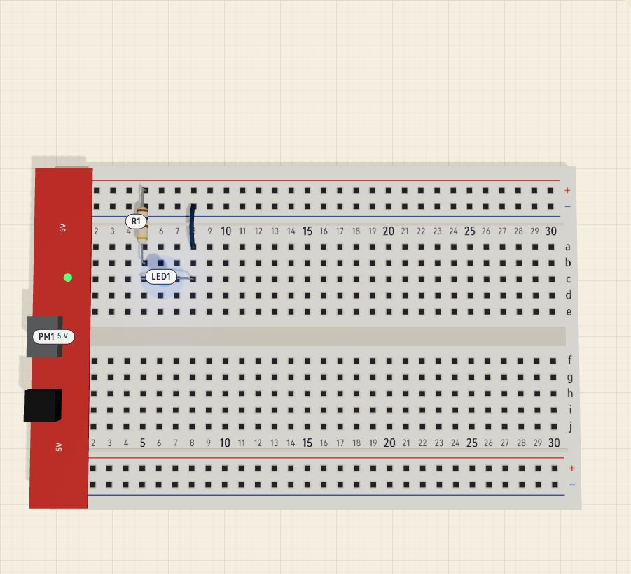
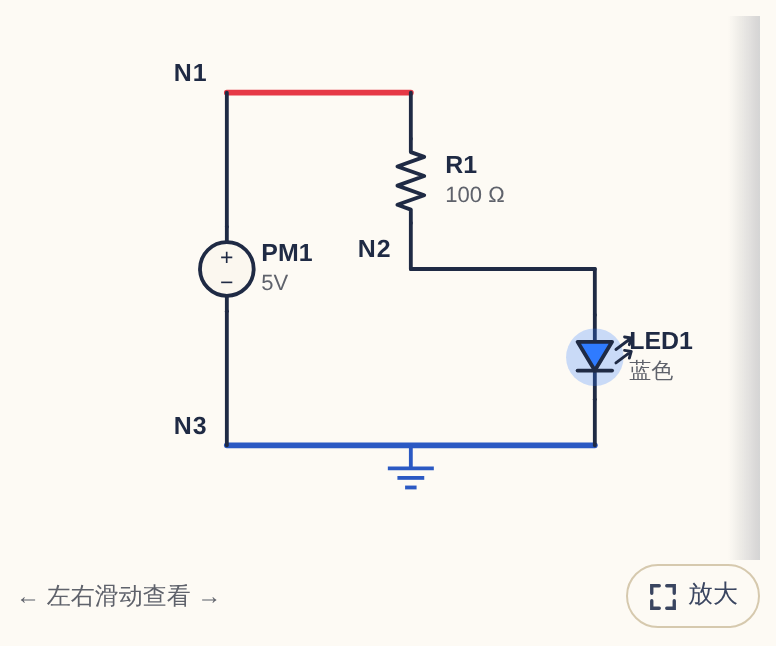
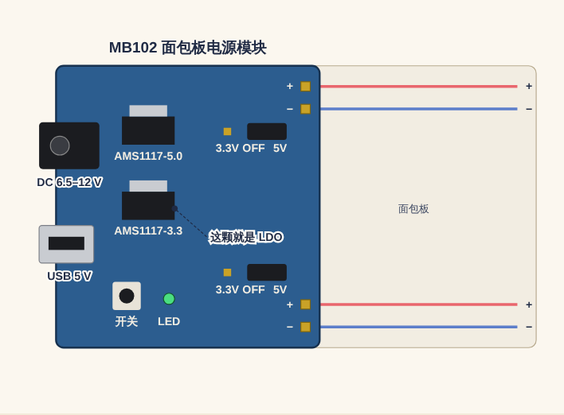
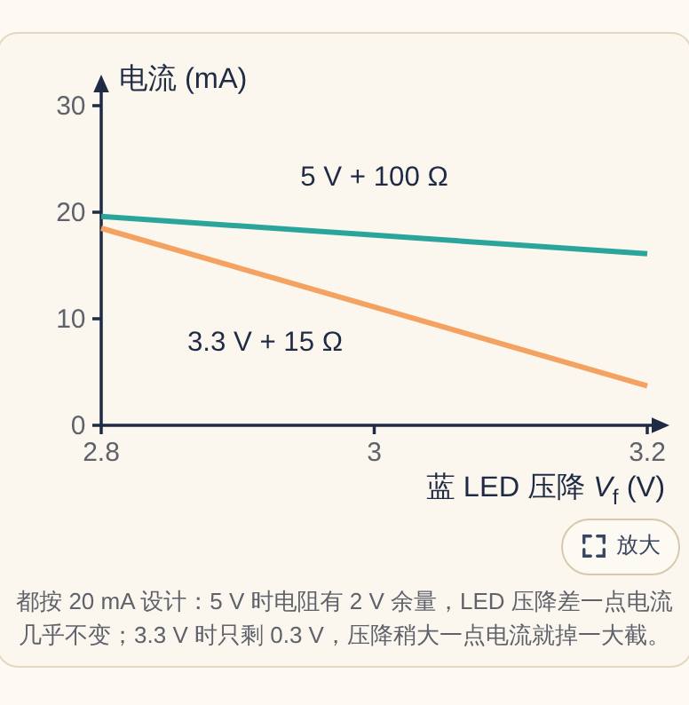

# 1.10 · 蓝色 LED：3.3 V 还是 5 V？

| 项目 | 内容 |
|---|---|
| id | `challenge-module-blue-led` |
| 文件 | `challenges/16-module-5v-blue-led.json` |
| 类型 | 实验 / 挑战（没有分步，照目标电路图搭） · 难度 3/5 |
| 位置 | World 1 · 基础定律与直流分压 → 1.10 真实的电源：内阻、模块、稳压电源（本节第 3 项） |
| 右侧面板 | 轨道由旧的四张卡片自动生成（还没手工精排） |
| 前后 | 上一项 [1.10 challenge-coin-cell](../w1/1.10-2-challenge-coin-cell.md) · 下一项 [1.10 lesson-bench-supply](../w1/1.10-4-lesson-bench-supply.md) |
| 先修 | — |
| 概念 | forward voltage 正向压降、headroom 电压余量、power module 电源模块 |

**一句话概要**：蓝色 LED 的压降约 3 V，用 3.3 V 供电几乎没有余量。选对电源模块的电压。

## 1. 左侧工作台（3D 面包板 → 2D 俯视截图）

截图是程序里真实的 3D 面包板换成俯视角拍的；表格是同一块板的文字版（元件、参数、每只脚插在哪个孔）。

### 1.1 起点：空面包板（学生从零开始搭）

### 1.3 参考答案（「看答案」载入的板子）

| 元件 | 类型 | 参数 | 引脚 → 孔 |
|---|---|---|---|
| PM1 | power_module | voltage=5 | +t→tp1 -t→tn1 +b→bp1 -b→bn1 |
| R1 | resistor | resistance=100 | 1→tp5 2→b5 |
| LED1 | led | color=blue | anode→c5 cathode→c8 |
| W4 | wire |  | a→a8 b→tn8 |

### 1.4 目标原理图（右侧「目标原理图」抽屉）

| 元件 | 类型 | 参数 |
|---|---|---|
| PM1 | power_module | voltage=5 |
| R1 | resistor | resistance=100 |
| LED1 | led | color=blue |

连接（每个结点上的引脚）：

- **N1**：PM1.+、R1.1
- **N2**：R1.2、LED1.anode
- **N3**：LED1.cathode、PM1.-

## 2. 右侧面板：学生从上往下看到的内容（单轨流）

### 第 1 步 · 🔍 先看一眼：先认识它：稳压器 / 电源模块

**拆解「电源模块和 LDO 稳压器」第 1 / 7 层：① 外形：MB102 面包板电源模块**

MB102 插在面包板的一端，底下的 4 根针 同时插进 **上下两组** 电源轨：上面的 + / −、下面的 + / −。所以第 7、8 课里，上半区和下半区都能直接取电——这是它和电池、稳压电源（只接一组轨道）最大的不同。

取电有两条路：DC 插座（6.5–12 V）或 USB（5 V）。开关 打开后 指示灯 亮。

每组轨道各有一个 跳线帽：插在 “5V” 一边，这组轨道是 5 V；插在 “3.3V” 一边就是 3.3 V；拔掉（OFF）这组轨道没电。所以真实模块上 **上下两组可以是不同电压**。模拟器简化了：一个 voltage 属性同时决定两组，内阻 0.1 Ω，超过约 0.5 A 报过载。

**挑战 8（蓝色 LED）**：蓝 LED 的 $V_f$ ≈ 3.0 V。选 3.3 V：$I = \frac{3.3 - 3.0}{100 + 12} ≈ 2.7 mA$，很暗；选 5 V：$I = \frac{5 - 3.0}{112} ≈ 18 mA$。电压余量（headroom）要够。

| 部件 | 作用 | 数字 |
|---|---|---|
| DC 插座 | 外接电源适配器 | 6.5–12 V |
| USB | 从电脑 / 充电器取 5 V | 5 V，约 500 mA |
| 开关 + LED | 总开关、电源指示 | — |
| AMS1117-5.0 | DC 输入 → 5 V | 最大约 1 A（实际受发热限制） |
| AMS1117-3.3 | 5 V → 3.3 V | 同上 |
| 跳线帽 ×2 | 每组轨道选 5 V / 3.3 V / OFF | 上下两组各一个 |
| 针脚 ×4 | 插进上下两组 + / − 轨 | + 要对准红线 |

### 第 2 步 · 🔧 动手搭：先试 3.3 V

这一题没有步骤，**照目标电路图自己搭**。搭好后，先在电源模块的「属性」里选 **3.3 V**，看蓝灯有多亮；再换成 **5 V**。

### 第 3 步 · 💡 想明白：电压余量（headroom）

- 限流电阻能稳住电流，靠的是它两端有**足够的电压**。
- 3.3 V 时电阻只分到 $3.3 - 3.0 = 0.3$ V：电流小，而且 LED 的压降稍微大一点点，电流就会大幅变化，甚至完全不亮。

*图 `headroom`（plot）：都按 20 mA 设计：5 V 时电阻有 2 V 余量，LED 压降差一点电流几乎不变；3.3 V 时只剩 0.3 V，压降稍大一点电流就掉一大截。*

- 5 V 时电阻分到 2 V：$R = \frac{5 - 3.0}{0.02} = 100$ Ω，亮度合适也稳定。

（这一步下面列着这节课的计算卡片，点开就地展开：`led-current`，全文见第 6 节）

### 第 4 步 · 🔧 动手搭：选 5 V，量电流

- 选中电源模块，把电压设成 **5 V**。
- 搭好后单击 LED，读电流；再把模块临时改成 3.3 V 对比一下。

### 第 5 步 · 📏 测一测：测一测：读你自己的仪表

**测量题 1 · `i5`**（读数题）

> 模块 5 V：单击 LED，「属性」里的电流

- 单位 mA · 先写预测 · 参考答案的读数 **17.84 mA** · 合理范围 [0.0165, 0.0195]

答对后显示：

> (5 − 3.0) / (100 + 12) ≈ 17.9 mA。

**测量题 2 · `i33`**（读数题）

> 把模块改成 3.3 V：LED 的电流

- 单位 mA · 先写预测 · 状态：PM1 设为 3.3 V · 参考答案的读数 **2.676 mA** · 合理范围 [0.0022, 0.0032]

答对后显示：

> (3.3 − 3.0) / (100 + 12) ≈ 2.7 mA：只有 5 V 时的七分之一左右。

### 第 6 步 · 🎒 带走：带走

- 白光、蓝光、绿光（部分）LED 的压降约 3 V：**3.3 V 电源点它们很勉强**。ESP32 这类 3.3 V 单片机直接驱动蓝灯时要特别小心。
- 规律：**电源电压要比 LED 压降高出一截**，留给电阻去稳住电流。

## 3. 测量题一览

| # | id | 题目 | 类型 | 单位 | 状态 | 参考读数 |
|---|---|---|---|---|---|---|
| 1 | i5 | 模块 5 V：单击 LED，「属性」里的电流 | current | mA |  | 17.84 mA |
| 2 | i33 | 把模块改成 3.3 V：LED 的电流 | current | mA | PM1 设为 3.3 V | 2.676 mA |

### 提示按钮（依次显示）

1. 选中电源模块，在属性里把电压改成 5 V。
2. R = (5 − 3.0) / 0.02 = 100 Ω。

### 功能测试（「检查我的电路」时跑）

- 蓝色 LED 亮，模块输出 5 V

## 4. 用到的拆解（全部层的文字，供改写参考）

### 拆解 `regulator`：电源模块和 LDO 稳压器

*MB102 面包板电源模块能输出稳稳的 5 V 或 3.3 V，靠的是上面两颗 AMS1117 linear regulator（线性稳压器）。我们先看模块，再拆开稳压器：reference（基准）、error amplifier（误差放大器）、pass transistor（调整管）、feedback divider（反馈分压）；然后用它算 dropout（压差）和发热，最后解释“锂电池 + AMS1117-3.3”为什么会出问题。*

**拆解「电源模块和 LDO 稳压器」第 1 / 7 层：① 外形：MB102 面包板电源模块**

MB102 插在面包板的一端，底下的 4 根针 同时插进 **上下两组** 电源轨：上面的 + / −、下面的 + / −。所以第 7、8 课里，上半区和下半区都能直接取电——这是它和电池、稳压电源（只接一组轨道）最大的不同。

取电有两条路：DC 插座（6.5–12 V）或 USB（5 V）。开关 打开后 指示灯 亮。

每组轨道各有一个 跳线帽：插在 “5V” 一边，这组轨道是 5 V；插在 “3.3V” 一边就是 3.3 V；拔掉（OFF）这组轨道没电。所以真实模块上 **上下两组可以是不同电压**。模拟器简化了：一个 voltage 属性同时决定两组，内阻 0.1 Ω，超过约 0.5 A 报过载。

**挑战 8（蓝色 LED）**：蓝 LED 的 $V_f$ ≈ 3.0 V。选 3.3 V：$I = \frac{3.3 - 3.0}{100 + 12} ≈ 2.7 mA$，很暗；选 5 V：$I = \frac{5 - 3.0}{112} ≈ 18 mA$。电压余量（headroom）要够。

| 部件 | 作用 | 数字 |
|---|---|---|
| DC 插座 | 外接电源适配器 | 6.5–12 V |
| USB | 从电脑 / 充电器取 5 V | 5 V，约 500 mA |
| 开关 + LED | 总开关、电源指示 | — |
| AMS1117-5.0 | DC 输入 → 5 V | 最大约 1 A（实际受发热限制） |
| AMS1117-3.3 | 5 V → 3.3 V | 同上 |
| 跳线帽 ×2 | 每组轨道选 5 V / 3.3 V / OFF | 上下两组各一个 |
| 针脚 ×4 | 插进上下两组 + / − 轨 | + 要对准红线 |

**拆解「电源模块和 LDO 稳压器」第 2 / 7 层：② X 光：模块的电路——两颗稳压器串起来**

把模块“画成原理图”：
1. DC 插座 → 二极管（防反接：插头极性反了它不导通，保护后面）→ 开关 → AMS1117-5.0 → 5 V 母线；
2. 用 USB 供电时，USB 本来就是 5 V，直接接到 5 V 母线，**不经过** 5 V 稳压器；
3. 5 V 母线再喂给 AMS1117-3.3，得到 3.3 V 母线；
4. 上排跳线、下排跳线 各自从 5 V 或 3.3 V 里选一个送到轨道的 +；
5. 所有的 GND 连在一起，接到 上下两条 − 轨。

注意第 2 点：USB 供电时“5 V”其实就是 USB 的电压（4.75–5.25 V 都算合格），不是稳压器给的。

**拆解「电源模块和 LDO 稳压器」第 3 / 7 层：③ 稳压器本身：3 只脚 IN、GND、OUT**

MB102 上用的是贴片封装 **SOT-223** 的 AMS1117；第 5 期实验（291）里用的是直插 **TO-220** 的 LM1117（印字面朝你，从左到右 GND、OUT、IN）。两者电路上完全一样，3 只脚：
- IN：接较高的输入电压；
- OUT：输出稳定的 3.3 V（或 5 V）。注意 **散热片（tab）也是 OUT**——别让它碰到别的金属；
- GND / ADJ：固定电压版接 GND；可调版（ADJ）接反馈电阻。

外面还要两颗 电容：IN 到 GND 10 µF，OUT 到 GND 10 µF。OUT 的电容是稳压器 **稳定性** 的一部分：没有它，内部的反馈环可能自激振荡，输出变成一串高频波。

| 脚 | SOT-223 | TO-220（仿真） | 接哪 | 仿真参数 |
|---|---|---|---|---|
| GND / ADJ | 1 | 左 | GND | 静态电流 I_q = 5 mA 从这里流出 |
| OUT | 2 + 散热片 | 中 | 负载 + 10 µF | 3.3 V，限流 800 mA |
| IN | 3 | 右 | 输入 + 10 µF | ≥ V_out + 1.1 V |

**拆解「电源模块和 LDO 稳压器」第 4 / 7 层：④ 内部：基准 + 误差放大器 + 调整管 + 分压反馈**

稳压器是一个 **负反馈** 系统，和 LM358 拆解里的同相放大器是同一个结构：
1. 基准电压 V_ref：一个 bandgap reference（带隙基准），不管输入、温度怎么变都稳定在 1.25 V；
2. 分压电阻 R_1、R_2 把输出分一部分回来：$V_{FB} = V_{out}\frac{R_2}{R_1 + R_2}$；
3. 误差放大器 比较 $V_{FB}$ 和 $V_{ref}$：$V_{FB}$ 偏低 → 输出升高 → 把 调整管 打开一点，更多电流流向 OUT；偏高则关小；
4. 平衡时（虚短）$V_{FB} = V_{ref}$，所以
$$V_{out} = V_{ref}(1 + \frac{R_1}{R_2})$$
3.3 V 版：$\frac{R_1}{R_2} = \frac{3.3}{1.25} - 1 = 1.64$。

调整管串在 IN 和 OUT 之间，**所有** 负载电流都从它身上流过，它两端的电压 $V_{in} - V_{out}$ 就落在它身上——这一层解释了下面两层的“压差”和“发热”。

（可调版 LM1117-ADJ：1.25 V 在 OUT 和 ADJ 之间，数据手册写作 $V_{out} = 1.25 V × (1 + \frac{R_2}{R_1})$，常用 R_1 = 120 Ω、R_2 = 200 Ω → 3.33 V，名字和这里的图正好反过来。）

| 方块 | 作用 | 类比 |
|---|---|---|
| 基准 V_ref | 一个不变的 1.25 V | 同相放大器的 v_in |
| 分压 R_1、R_2 | 把 V_out 缩小送回 | β = R_2/(R_1 + R_2) |
| 误差放大器 | 放大 V_ref − V_FB | op-amp |
| 调整管 | 可变“阀门”，吃掉多余电压 | op-amp 的输出级 |

- 公式 `V_{out} = V_{ref}(1 + \frac{R_1}{R_2})`：V_ref = 1.25 V；和同相放大器 1 + R_f/R_1 同一个式子

**拆解「电源模块和 LDO 稳压器」第 5 / 7 层：⑤ 等效电路：一个自动调节的电阻，以及压差**

从外面看，线性稳压器就是一个串在 IN 和 OUT 之间的 自动调节的电阻 R_pass，再加一点流到 GND 的 静态电流 I_q。

**稳压区**：反馈环把 $R_{pass}$ 调到正好 $R_{pass} = \frac{V_{in} - 3.3}{I}$。例如 5 V、56 mA：$R_{pass} = \frac{1.7}{0.056} ≈ 30 Ω$。

**压差区**：输入降低，$R_{pass}$ 就得变小……但调整管再怎么全开，也要留一个最小压降——**dropout voltage（压差）**。LM1117 / AMS1117 约 1.1 V（它的调整管是 NPN，基极驱动要再多一个 $V_{BE}$，所以不算真正的“低”压差）。于是：
$$V_{in} ≥ V_{out} + V_{dropout} = 3.3 + 1.1 = 4.4 V$$
不满足时 输出跟着输入往下掉。仿真模型：$V_{out} = V_{in} - 1.1 V - 0.2 Ω × I$。

**实验 291 的数字**（负载 56 mA，拐点 $1.1 + 0.2 × 0.056 + 3.3 = 4.41 V$）：
- 5 V、9 V：稳压，3.30 V；
- 4.0 V：$4.0 - 1.11 = 2.89 V$——已经不是 3.3 V，但 ESP32 还在跑；
- 3.7 V：2.59 V；
- 3.4 V：2.29 V，低于 欠压阈值 2.5 V，ESP32 复位，LED 灭。

| V_in | 模式 | V_out | ESP32 |
|---|---|---|---|
| 9 V | 稳压 | 3.30 V | 运行（但很热） |
| 5 V | 稳压 | 3.30 V | 运行 |
| 4.0 V | 压差 | 2.89 V | 运行（低于 3.0 V 规格） |
| 3.7 V | 压差 | 2.59 V | 勉强 |
| 3.4 V | 压差 | 2.29 V | 欠压复位 |

- 公式 `V_{in} ≥ V_{out} + V_{dropout}`：稳压的条件；LM1117 / AMS1117：V_dropout ≈ 1.1 V
- 公式 `V_{out} = V_{in} - 1.1 V - 0.2 Ω × I`：压差区（仿真模型）

**拆解「电源模块和 LDO 稳压器」第 6 / 7 层：⑥ 发热和效率：多出来的电压全变成热**

线性稳压器 **不能** 把多出来的电压“换成”电流：输入电流 ≈ 输出电流（再加 $I_q$）。功率守恒：
1. 输入功率：$P_{in} = V_{in}(I + I_q)$
2. 给负载的：$P_{out} = V_{out}·I$
3. 差值全部在调整管上变成热：$P = (V_{in} - V_{out})·I + V_{in}·I_q$
4. 效率：$η = \frac{P_{out}}{P_{in}} ≈ \frac{V_{out}}{V_{in}}$

**实验 291**（I = 56 mA，$I_q$ = 5 mA）：
- 5 V：$(5 - 3.3) × 0.056 = 95 mW$，加上 $I_q$ 的 25 mW 约 120 mW，η ≈ 61%；
- 9 V：$(9 - 3.3) × 0.056 = 319 mW$，加 45 mW 约 364 mW，η ≈ 34%——2/3 的能量变成热。

温度怎么估：$ΔT = P × θ_{JA}$。SOT-223 焊在小板上 $θ_{JA}$ ≈ 90 °C/W：0.36 W → 温升约 33 °C，摸上去烫手但还行。12 V → 3.3 V、500 mA 就是 4.35 W，根本不可能——要用 **buck（降压）开关电源**，效率 85–95%。

MB102 也一样：DC 插座接 12 V、5 V 轨上拉 200 mA，AMS1117-5.0 要发热 $(12 - 5) × 0.2 = 1.4 W$。所以 **DC 输入用 7–9 V 最好**，够压差、又不太热。

| 情况 | 发热 P | 效率 η | 温升（90 °C/W） |
|---|---|---|---|
| 5 V → 3.3 V, 56 mA | ≈ 0.12 W | 61% | ≈ 11 °C |
| 9 V → 3.3 V, 56 mA | ≈ 0.36 W | 34% | ≈ 33 °C |
| 12 V → 5 V, 200 mA (MB102) | 1.4 W | 42% | ≈ 126 °C：过热保护 |
| 12 V → 3.3 V, 500 mA | 4.35 W | 28% | 不可能 |

- 公式 `P = (V_{in} - V_{out})·I`：调整管的发热（忽略 I_q）
- 公式 `η ≈ \frac{V_{out}}{V_{in}}`：线性稳压器效率的上限

**拆解「电源模块和 LDO 稳压器」第 7 / 7 层：⑦ 为什么“锂电池 + AMS1117-3.3”会出问题**

一节锂离子电池满电 4.2 V、标称 3.7 V、放完 3.0 V，大部分时间在 3.6–3.9 V。把它接到 AMS1117-3.3 的 IN：
- 稳压需要 V_in ≥ 4.4 V——**整条曲线都在它下面**，连满电的 4.2 V 都不够；
- 所以稳压器一直在压差区，输出 = V_bat − 1.11 V：满电 3.09 V，标称 2.6 V，已经低于 ESP32 的 3.0 V 规格下限；
- 再一开 Wi-Fi（电流尖峰几百 mA），$0.2 Ω × I$ 再往下拉，碰到 欠压阈值 就复位，然后又启动、又复位……

**正确做法**：
- 选真正的 low-dropout（低压差）LDO：ME6211、HT7333、XC6220、RT9080，压差 0.1–0.25 V，只要约 3.45 V 就能稳压，几乎用完整节电池；
- 或者用 buck-boost（升降压）开关电源，电池从 4.2 V 到 3.0 V 都能输出 3.3 V；
- ESP32-DevKitC 板上就是 AMS1117：用锂电池时不要接 5V 脚，接到 3V3 脚并在前面用低压差 LDO。

**这一层的局限也一并列出**：仿真的 LDO 没有输出电容的稳定性问题、没有温度和热关断，压差是一个固定的 1.1 V + 0.2 Ω。

| 稳压器 | 压差 | 锂电池可用到 | 效率 |
|---|---|---|---|
| AMS1117 / LM1117 | 1.1 V | 4.4 V（一点都用不了） | V_out / V_in |
| ME6211 / HT7333 | 0.1–0.25 V | ≈ 3.45 V | V_out / V_in |
| Buck-boost 开关电源 | — | ≈ 2.5 V | 85–95% |

**一句话记住**：MB102 = DC 插座 → AMS1117-5.0 → 5 V，再 → AMS1117-3.3 → 3.3 V，跳线帽给上下两组轨道各选一个电压。LDO 内部是带负反馈的“自动可变电阻”：$V_{out} = V_{ref}(1 + R_1/R_2)$；要稳压必须 $V_{in} ≥ V_{out} + V_{dropout}$（AMS1117 约 1.1 V）；多出来的电压全变成热 $P = (V_{in} - V_{out})·I$。锂电池配 AMS1117-3.3 永远在压差区——换真正的低压差 LDO 或开关电源。

## 5. 这一课的计算卡片

**计算卡片 `led-current`：LED 回路的电流 LED loop current**

- 公式 `I = \frac{V_s - ΣV_F}{R + Σr_d + R_{int}}`
- 用途：电源、电阻和一个或几个串联 LED：LED 实际流过多少电流。
- 输入：V_s（电源电动势，V）；V_F（所有 LED 的 V_F 之和（红 1.8、绿 2.1、蓝/白 3.0），V）；R（串联电阻（含电位器），Ω）；r_d（LED 内阻之和（每个 ≈ 12 Ω），Ω）；R_int（电源内阻（模块 ≈ 0、9 V 电池 1.5 Ω、纽扣电池 15 Ω），Ω） → I（回路电流（不够 ΣV_F 时为 0），A）

1. 导通的 LED 用折线模型看：一个电压源 $V_F$ 串一个小电阻 $r_d ≈ 12 Ω$（模拟器就是这样建模的）。
2. 整个回路串联，处处是同一个电流 I。
3. KVL：$V_s = I R_{int} + I R + ΣV_F + I Σr_d$。
4. 解出 $I = \frac{V_s - ΣV_F}{R + Σr_d + R_{int}}$。
5. 如果 $V_s < ΣV_F$，LED 根本不导通，I = 0：3 V 点不亮串联的红 + 绿 LED（需要 3.9 V）。
只用 $\frac{V_s - V_F}{R}$ 估算会偏大 1–2 mA，选电阻时够用；要和读数对比时把 $r_d$ 和内阻加上。

例子：- 挑战 1：9 V、220 Ω、红 + 绿：$I = \frac{9 - 3.9}{220 + 24} ≈ 21 mA$（只用 $V_F$ 估算是 23 mA）。
- 第 3 课：5 V、150 Ω、绿：$\frac{5 - 2.1}{150 + 12} ≈ 18 mA$，电阻上 $18 mA × 150 Ω ≈ 2.7 V$。
- 挑战 9：CR2032（3 V、15 Ω）、47 Ω、红：$\frac{3 - 1.8}{47 + 12 + 15} ≈ 16 mA$；不串电阻是 $\frac{1.2}{27} ≈ 44 mA$。
- 挑战 3：电位器转到 100 %：$\frac{5 - 1.8}{220 + 10k + 12} ≈ 0.31 mA$，灯灭。

- ⚠ 两个 LED 直接并联共用一个电阻：$V_F$ 小的先导通、把电压钳住，另一个几乎不亮——每个 LED 自己串一个电阻。
- ⚠ 电位器当可变电阻用时，它的阻值也在 R 里；转到 0 时只剩保护电阻。

## 6. English（界面英文版的同一份内容）

展开英文

### Node 1 · 🔍 Look first：Meet it first: Regulator / power module

**Teardown「The power module and the LDO regulator」layer 1 of 7：① Outside: the MB102 breadboard power module**

The MB102 plugs into one end of the breadboard; its 4 pins go into **both** pairs of rails at once: top + / − and bottom + / −. That's why in lessons 7 and 8 both halves of the board have power — the big difference from a battery or a bench supply, which feed only one pair.

Power comes in one of two ways: the DC jack (6.5–12 V) or USB (5 V). Turn the switch on and the LED lights.

Each rail pair has its own jumper cap: on the "5V" side that pair is 5 V; on the "3.3V" side it is 3.3 V; removed (OFF) that pair is dead. So on a real module **the two pairs can be at different voltages**. The simulator simplifies: one voltage property sets both, internal resistance 0.1 Ω, overload flagged above about 0.5 A.

**Challenge 8 (blue LED)**: a blue LED has $V_f$ ≈ 3.0 V. At 3.3 V: $I = \frac{3.3 - 3.0}{100 + 12} ≈ 2.7 mA$, dim; at 5 V: $I = \frac{5 - 3.0}{112} ≈ 18 mA$. You need enough headroom.

| Part | What it does | Numbers |
|---|---|---|
| DC jack | wall adapter in | 6.5–12 V |
| USB | 5 V from a computer / charger | 5 V, ≈ 500 mA |
| switch + LED | on/off, power indicator | — |
| AMS1117-5.0 | DC input → 5 V | ≤ 1 A (heat-limited) |
| AMS1117-3.3 | 5 V → 3.3 V | same |
| jumper caps ×2 | per rail pair: 5 V / 3.3 V / OFF | one per pair |
| pins ×4 | into both pairs of + / − rails | + must face the red line |

### Node 2 · 🔧 Build：Try 3.3 V first

No steps here — **build it from the target schematic**. Then choose **3.3 V** in the power module's Properties and see how bright the blue LED is; then switch to **5 V**.

### Node 3 · 💡 Why：Headroom

- A current-limiting resistor can only hold the current steady if it has **enough voltage across it**.
- At 3.3 V the resistor gets just $3.3 - 3.0 = 0.3$ V: little current, and a tiny change in the LED's drop changes the current a lot — or the LED doesn't light at all.

[figure `headroom`]

*Figure `headroom`（plot）：都按 20 mA 设计：5 V 时电阻有 2 V 余量，LED 压降差一点电流几乎不变；3.3 V 时只剩 0.3 V，压降稍大一点电流就掉一大截。*

- At 5 V the resistor gets 2 V: $R = \frac{5 - 3.0}{0.02} = 100$ Ω, bright enough and steady.

(This node lists the lesson’s calculation cards: `led-current`; full text in section 6)

### Node 4 · 🔧 Build：Choose 5 V, measure the current

- Click the power module and set it to **5 V**.
- Then click the LED and read its current; switch the module to 3.3 V for a moment to compare.

### Node 5 · 📏 Measure：Measure: read your own instruments

**Question 1 · `i5`**（reading）

> Module at 5 V: click the LED — the current in Properties

- unit mA · predict first · range [0.0165, 0.0195]

Shown once right:

> (5 − 3.0) / (100 + 12) ≈ 17.9 mA.

**Question 2 · `i33`**（reading）

> Switch the module to 3.3 V: the LED current

- unit mA · predict first · state：PM1 is set to 3.3 V · range [0.0022, 0.0032]

Shown once right:

> (3.3 − 3.0) / (100 + 12) ≈ 2.7 mA: about a seventh of the 5 V current.

### Node 6 · 🎒 Take away：Take away

- White, blue and some green LEDs drop about 3 V: **a 3.3 V supply barely lights them**. Take care when a 3.3 V microcontroller like the ESP32 drives a blue LED directly.
- Rule: **the supply should sit well above the LED drop**, leaving voltage for the resistor to steady the current.

**Hints**

1. Click the power module and set its voltage to 5 V in Properties.
2. R = (5 − 3.0) / 0.02 = 100 Ω.

