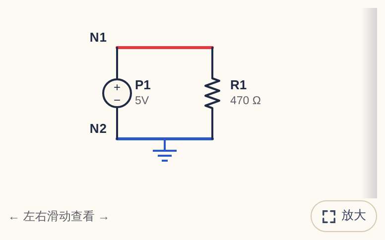
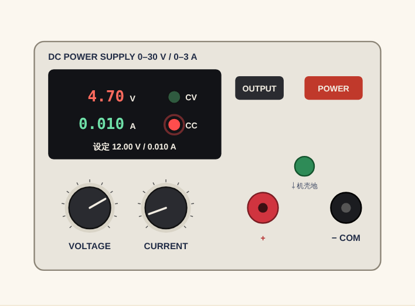
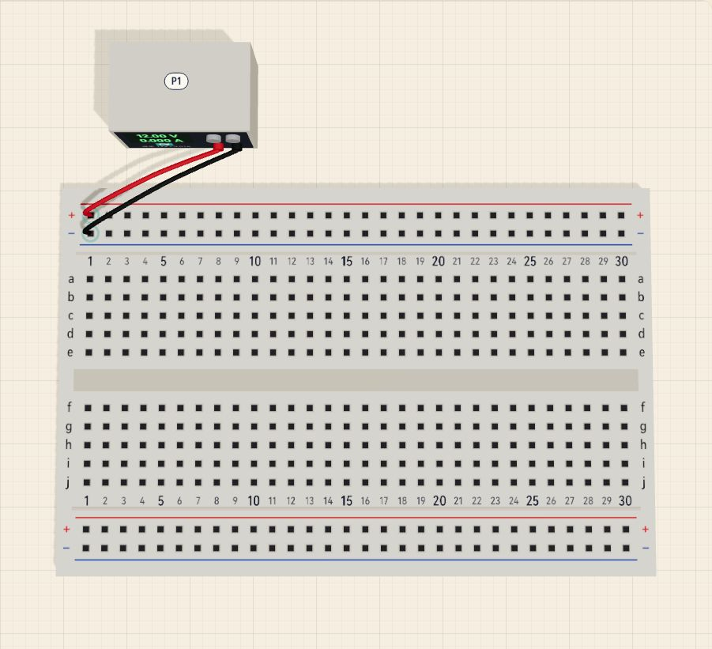
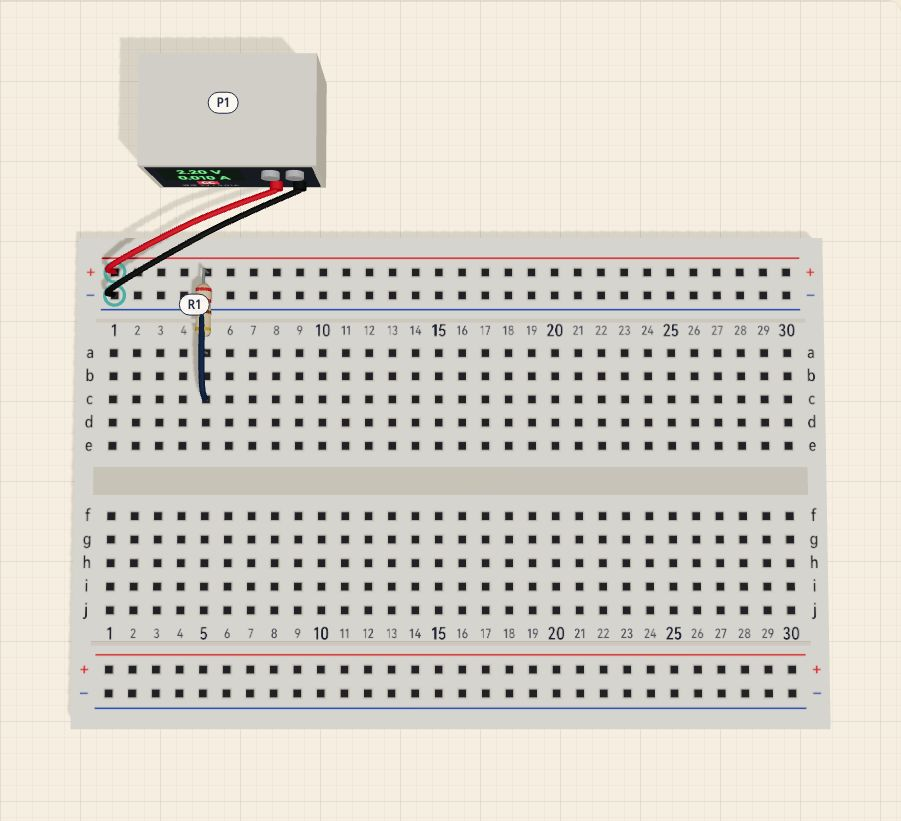
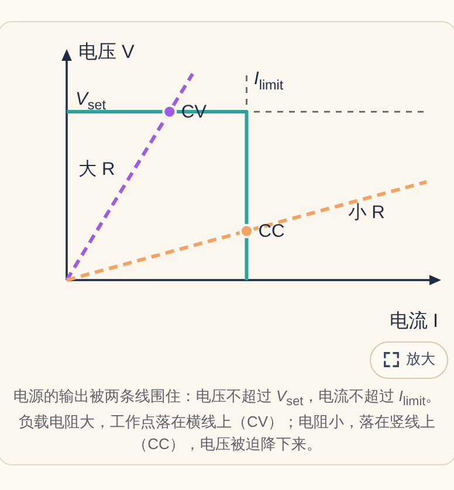
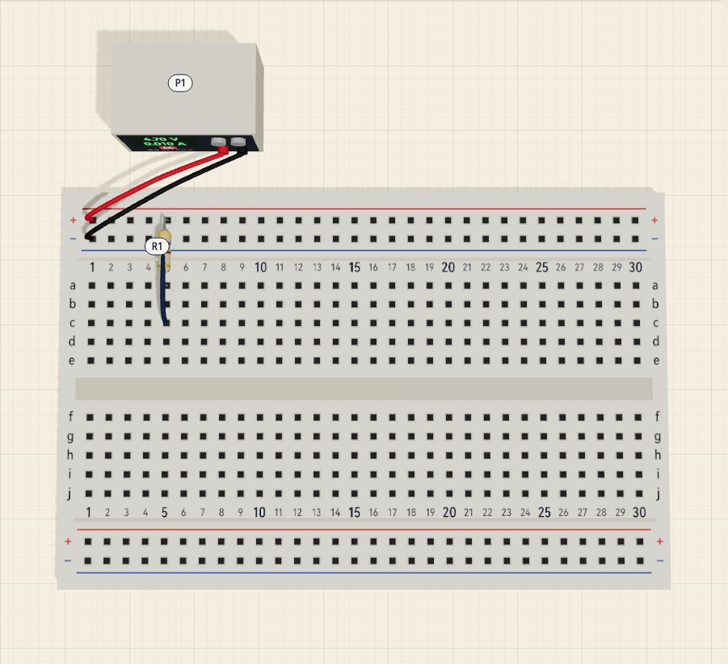

# 1.10 · 稳压电源：恒压、恒流和限流

| 项目 | 内容 |
|---|---|
| id | `lesson-bench-supply` |
| 文件 | `challenges/103-lesson-bench-supply.json` |
| 类型 | 课程（有分步，每步自动检查） · 难度 2/5 |
| 位置 | World 1 · 基础定律与直流分压 → 1.10 真实的电源：内阻、模块、稳压电源（本节第 4 项） |
| 右侧面板 | 轨道由旧的四张卡片自动生成（还没手工精排） |
| 前后 | 上一项 [1.10 challenge-module-blue-led](../w1/1.10-3-challenge-module-blue-led.md) · 下一项 [1.10 challenge-bench-supply](../w1/1.10-5-challenge-bench-supply.md) |
| 先修 | — |
| 概念 | bench power supply 稳压电源、CV 恒压、CC 恒流、current limit 限流、current source 电流源 |

**一句话概要**：稳压电源有两个旋钮：电压和限流。负载要的电流没到限流值时恒压（CV），到了就恒流（CC）——可以当电流源用。

## 1. 左侧工作台（3D 面包板 → 2D 俯视截图）

截图是程序里真实的 3D 面包板换成俯视角拍的；表格是同一块板的文字版（元件、参数、每只脚插在哪个孔）。

### 1.1 起点：空面包板（学生从零开始搭）

### 1.2 每一步之后的面包板

见第 2 节每个步骤下面的截图（按步骤的自动检查重建：放 / 改 / 拔元件、移动万用表表笔）。

### 1.3 参考答案（「看答案」载入的板子）

| 元件 | 类型 | 参数 | 引脚 → 孔 |
|---|---|---|---|
| P1 | bench_supply | voltage=12, currentLimit=0.01 | +→tp1 -→tn1 |
| R1 | resistor | resistance=470 | 1→tp5 2→a5 |
| W3 | wire |  | a→c5 b→tn5 |

### 1.4 目标原理图（右侧「目标原理图」抽屉）

| 元件 | 类型 | 参数 |
|---|---|---|
| P1 | bench_supply |  |
| R1 | resistor | resistance=470 |

连接（每个结点上的引脚）：

- **N1**：P1.+、R1.1
- **N2**：R1.2、P1.-

## 2. 右侧面板：学生从上往下看到的内容（单轨流）

### 第 1 步 · 🔍 先看一眼：先认识它：稳压电源 CV / CC

**拆解「直流稳压电源：CV 和 CC 谁说了算」第 1 / 7 层：① 面板：两个旋钮、两盏灯、一块表**

第 11 课（lesson 103）的电源调到 12 V、限流 10 mA，接一个 470 Ω：面板就是图上这样。先认清每个东西：
- 显示屏 的大字是 **实际输出** 的电压和电流（4.70 V、0.010 A），下面一行小字 设定 12.00 V / 0.010 A 是旋钮的位置。**设定值 ≠ 实际值**，这是新手最常看错的地方。
- VOLTAGE 旋钮设电压上限，CURRENT 旋钮设电流上限。
- CV 灯 亮 = 恒压，CC 灯 亮 = 恒流。图上 CC 亮：负载“想要”12 V / 470 Ω = 25.5 mA，超过了 10 mA，电源把电流卡在 10 mA，电压降到 10 mA × 470 Ω = 4.7 V。
- 红色 + 和 黑色 − / COM 是输出；绿色 ⏚ 接机壳和插头的地线，平时不用接。
- OUTPUT 键开 / 关输出：先调好再打开。

| 部件 | 作用 | 仿真里 |
|---|---|---|
| 显示屏（大字） | 实际输出 V、I | 同 |
| 设定行（小字） | 旋钮的设定值 | 属性 voltage、currentLimit |
| VOLTAGE | 电压上限 V_set | 0–30 V |
| CURRENT | 电流上限 I_set | 默认 0.1 A |
| CV 灯 | 恒压模式 | CV 时内阻 0.02 Ω |
| CC 灯 | 恒流（限流）模式 | I 正好等于 I_set |
| + / − COM | 输出端子 | 红夹子 / 黑夹子 |

### 第 2 步 · 🔧 动手搭：把限流调小，看电压掉下来

接一个电阻当负载，先看电源屏幕。然后**把限流旋钮调到比负载要的电流还小**——屏幕上的电压会怎样？

**步骤 1**

选**「直流稳压电源」**：红夹子（+）**`tp1`**，黑夹子（−）**`tn1`**。

自动检查（做到这些才算完成）：把直流稳压电源插到 tp1–tn1
板上高亮的孔：tp1、tn1

**步骤 2**

看屏幕：没接负载时电流是 0，绿色 **CV** 表示恒压；下面一行是两个旋钮的位置。在「属性」里先保持 **5 V**、限流 **100 mA**。

自动检查（做到这些才算完成）：把直流稳压电源插到 tp1–tn1
板上高亮的孔：tp1、tn1

**步骤 3**

**R1**：**`tp5`** 和 **`a5`**，设 **`220 Ω`**。

自动检查（做到这些才算完成）：把电阻插到 tp5–a5
板上高亮的孔：tp5、a5

**步骤 4**

**跳线** **`c5`** → **`tn5`**，R1 接到 GND。看屏幕：电流约 23 mA，还是 CV——负载要的电流没到 100 mA 的限流。

自动检查（做到这些才算完成）：把跳线插到 c5–tn5
板上高亮的孔：c5、tn5

**步骤 5**

单击电源，在「属性」里把**限流**调到 **10 mA**。指示变成红色 **CC**：电流被卡在 10 mA，电压掉下来了。

自动检查（做到这些才算完成）：把直流稳压电源插到 tp1–tn1
板上高亮的孔：tp1、tn1

### 第 3 步 · 💡 想明白：两个旋钮都是“上限”

- **电压旋钮**：输出电压最多到这里。**限流旋钮**：输出电流最多到这里。
- 负载想要的电流 $\frac{V}{R}$ 没到限流值：电源输出设定电压，显示 **CV**（恒压，绿色）。
- 负载想要的电流超过限流值：电源把电流**卡在限流值**，电压自己降到 $I \times R$，显示 **CC**（恒流，红色）。

*图 `cvcc`（plot）：电源的输出被两条线围住：电压不超过 V_set，电流不超过 I_limit。负载电阻大，工作点落在横线上（CV）；电阻小，落在竖线上（CC），电压被迫降下来。*

- 屏幕上大字是**实际输出**，下面一行小字是**旋钮位置**。设定值不等于实际值——这是新手最常看错的地方。

（这一步下面列着这节课的计算卡片，点开就地展开：`cc-current-source`，全文见第 6 节）

### 第 4 步 · 🔧 动手搭：把它当成电流源

限流调到想要的电流，电压设定调高一些留出余量：不管负载怎么变，电流都不变，变的是电压。

**步骤 6**

**电流源**：单击 R1，把阻值改成 **`470 Ω`**。还是 CC：电流还是 10 mA，电压跟着负载变了。

自动检查（做到这些才算完成）：把电阻插到 tp5–a5
板上高亮的孔：tp5、a5

**步骤 7**

单击电源，把**电压设定**调到 **12 V**。屏幕上的实际电压一点没变：还在 CC，设定电压只是“上限”。这个余量让负载再大一些它也能维持 10 mA。

自动检查（做到这些才算完成）：把直流稳压电源插到 tp1–tn1
板上高亮的孔：tp1、tn1

**步骤 8**

点**「检查我的电路」**，读电源屏幕完成测量题（有的题要先调限流，题目下面写着要的“状态”）。

### 第 5 步 · 📏 测一测：测一测：读你自己的仪表

**测量题 1 · `icc`**（读数题）

> 电源显示的电流（CC 模式，R1 = 470 Ω）

- 单位 mA · 状态：P1 设为 12 V、P1 限流 10 mA · 参考答案的读数 **9.995 mA** · 合理范围 [0.0099, 0.0101]

答对后显示：

> CC 模式下电流就是限流设定值。

**测量题 2 · `ucc`**（读数题）

> 电源显示的电压（同一状态）。设定是 12 V，实际是多少？

- 单位 V · 先写预测 · 状态：P1 设为 12 V、P1 限流 10 mA · 参考答案的读数 **4.698 V** · 合理范围 [4.6, 4.8]

答对后显示：

> V = I × R = 10 mA × 470 Ω = 4.70 V：电压由负载决定，12 V 只是上限。

**测量题 3 · `u20`**（读数题）

> 把限流调到 20 mA（电压设定还是 12 V）：电源显示的电压

- 单位 V · 先写预测 · 状态：P1 设为 12 V、P1 限流 20 mA · 参考答案的读数 **9.396 V** · 合理范围 [9.2, 9.6]

答对后显示：

> 12 V / 470 Ω ≈ 25.5 mA 还是大于 20 mA，所以仍是 CC：V = 20 mA × 470 Ω = 9.4 V。电流源的电流由限流旋钮决定。

**测量题 4 · `icv`**（读数题）

> R1 = 470 Ω，把限流调回 100 mA：电源显示的电流（看看它变回了 CV）

- 单位 mA · 先写预测 · 状态：P1 设为 12 V、P1 限流 100 mA · 参考答案的读数 **25.53 mA** · 合理范围 [0.0245, 0.0265]

答对后显示：

> 12 V / 470 Ω ≈ 25.5 mA，小于 100 mA，所以是 CV：电压等于设定值，电流由负载决定。

### 第 6 步 · 🎒 带走：带走

- **CV：电压是你定的，电流由负载决定。CC：电流是你定的，电压由负载决定。**
- 调试新电路：先把限流设小（50–100 mA），接错了电源会进入 CC，元件就安全。
- 真实电源常用的设限流方法：先把输出端短路，看着电流表调限流旋钮，再拆掉短路线接负载。

## 3. 测量题一览

| # | id | 题目 | 类型 | 单位 | 状态 | 参考读数 |
|---|---|---|---|---|---|---|
| 1 | icc | 电源显示的电流（CC 模式，R1 = 470 Ω） | current | mA | P1 设为 12 V、P1 限流 10 mA | 9.995 mA |
| 2 | ucc | 电源显示的电压（同一状态）。设定是 12 V，实际是多少？ | voltage | V | P1 设为 12 V、P1 限流 10 mA | 4.698 V |
| 3 | u20 | 把限流调到 20 mA（电压设定还是 12 V）：电源显示的电压 | voltage | V | P1 设为 12 V、P1 限流 20 mA | 9.396 V |
| 4 | icv | R1 = 470 Ω，把限流调回 100 mA：电源显示的电流（看看它变回了 CV） | current | mA | P1 设为 12 V、P1 限流 100 mA | 25.53 mA |

### 全部答完后显示的「对比」

**对比**：
- 5 V、限流 100 mA、R1 = 220 Ω：想要 5 / 220 ≈ 22.7 mA < 100 mA → CV，显示 5.00 V、0.023 A；
- 限流 10 mA、R1 = 220 Ω：想要 22.7 mA > 10 mA → CC，电压 = 10 mA × 220 Ω = **2.20 V**；
- 设定 12 V、限流 10 mA、R1 = 470 Ω：想要 25.5 mA > 10 mA → 还是 CC，电压 = 10 mA × 470 Ω = **4.70 V**，电流仍是 **10 mA**；
- 限流 20 mA：想要 25.5 mA > 20 mA → 还是 CC，电压 = 20 mA × 470 Ω = **9.4 V**；
- 限流调回 100 mA：想要 25.5 mA < 100 mA → CV，电压 12 V，电流 ≈ **25.5 mA**。
电流源能维持 10 mA 的最大负载是 12 V / 10 mA = 1.2 kΩ；负载再大，电压到顶，电源回到 CV。

### 提示按钮（依次显示）

1. 先判断模式：负载想要的电流 V设定 / R 和限流值比，哪个小？
2. CC 模式下，电流 = 限流设定，电压由 I × R 决定；CV 模式下，电压 = 设定值，电流由 V / R 决定。
3. 10 mA 限流时，220 Ω 和 470 Ω 上的电压分别是 10 mA 乘以它们。

### 功能测试（「检查我的电路」时跑）

- 限流模式：电流等于限流设定

## 4. 用到的拆解（全部层的文字，供改写参考）

### 拆解 `bench-supply`：直流稳压电源：CV 和 CC 谁说了算

*实验室的 bench power supply（直流稳压电源）有两个旋钮：电压和限流。它里面有两个 control loop（控制环），一个想让电压等于设定值（CV，constant voltage，恒压），一个想让电流不超过设定值（CC，constant current，恒流）。负载决定哪个环说了算——我们用 V–I 平面上的负载线把这件事画清楚。*

**拆解「直流稳压电源：CV 和 CC 谁说了算」第 1 / 7 层：① 面板：两个旋钮、两盏灯、一块表**

第 11 课（lesson 103）的电源调到 12 V、限流 10 mA，接一个 470 Ω：面板就是图上这样。先认清每个东西：
- 显示屏 的大字是 **实际输出** 的电压和电流（4.70 V、0.010 A），下面一行小字 设定 12.00 V / 0.010 A 是旋钮的位置。**设定值 ≠ 实际值**，这是新手最常看错的地方。
- VOLTAGE 旋钮设电压上限，CURRENT 旋钮设电流上限。
- CV 灯 亮 = 恒压，CC 灯 亮 = 恒流。图上 CC 亮：负载“想要”12 V / 470 Ω = 25.5 mA，超过了 10 mA，电源把电流卡在 10 mA，电压降到 10 mA × 470 Ω = 4.7 V。
- 红色 + 和 黑色 − / COM 是输出；绿色 ⏚ 接机壳和插头的地线，平时不用接。
- OUTPUT 键开 / 关输出：先调好再打开。

| 部件 | 作用 | 仿真里 |
|---|---|---|
| 显示屏（大字） | 实际输出 V、I | 同 |
| 设定行（小字） | 旋钮的设定值 | 属性 voltage、currentLimit |
| VOLTAGE | 电压上限 V_set | 0–30 V |
| CURRENT | 电流上限 I_set | 默认 0.1 A |
| CV 灯 | 恒压模式 | CV 时内阻 0.02 Ω |
| CC 灯 | 恒流（限流）模式 | I 正好等于 I_set |
| + / − COM | 输出端子 | 红夹子 / 黑夹子 |

**拆解「直流稳压电源：CV 和 CC 谁说了算」第 2 / 7 层：② X 光：一个调整管，两个误差放大器**

一台线性稳压电源里面：
1. 市电 经 变压器 降压，整流 + 滤波电容 变成不太稳的约 35 V 直流；
2. 调整管 串在输出 + 上，像一个可调的阀门，吃掉多余的电压——和“稳压器”拆解里的 LDO 是同一个原理，只是大得多；
3. 输出电压经 分压电阻 送到 CV 误差放大器，和 V_set 比较；
4. 负载电流全部流过回路里的 采样电阻 R_s（零点几欧），它上面的电压 $I × R_s$ 送到 CC 误差放大器，和 I_set 比较；
5. 两个放大器的输出经二极管接到同一根驱动线上：谁的输出低就听谁的（低选，minimum selector）。哪个二极管导通，面板上就亮哪盏灯。

“谁低听谁”的意思：两个环都 **只会往小了拧** 调整管。电压到了 V_set，CV 环拦住；电流到了 I_set，CC 环拦住。先碰到哪个限制，哪个就接管。

**拆解「直流稳压电源：CV 和 CC 谁说了算」第 3 / 7 层：③ 两个控制环：各管一个量**

把两条反馈路径画出来：
- CV 环：输出电压 → 分压 → CV 放大器 → 调整管 → 输出电压。它和同相放大器一样是 **负反馈**：输出偏高，放大器把调整管关小，输出回落。平衡时 $V_{out} = V_{set}$。
- CC 环：负载电流 → R_s 上的电压 → CC 放大器 → 调整管 → 负载电流。平衡时 $I × R_s = I_{set} × R_s$，即 $I = I_{set}$。

两个环不能同时“平衡”（除非负载正好在分界点上）：
- 负载轻（R 大）：电流还没到 I_set，CC 放大器的输出很高、二极管截止，**只有 CV 环在工作**；
- 负载重（R 小）：要维持 V_set 就得超过 I_set，CC 放大器的输出先降下来接管，CV 放大器“想要”更高的电压但被二极管隔开，**只有 CC 环在工作**，电压被迫降下来。

仿真里电源的判断就是这么简单：先按 CV 算，如果算出来 $I > I_{set}$，就改成 CC。

| 环 | 测什么 | 和谁比 | 保持 | 什么时候接管 |
|---|---|---|---|---|
| CV | 输出电压（分压后） | V_set | $V = V_{set}$ | $\frac{V_{set}}{R} < I_{set}$ |
| CC | $I × R_s$ | $I_{set} × R_s$ | $I = I_{set}$ | $\frac{V_{set}}{R} > I_{set}$ |

**拆解「直流稳压电源：CV 和 CC 谁说了算」第 4 / 7 层：④ 等效电路：要么是电压源，要么是电流源**

从输出端看进去，电源只可能是两种理想元件之一：
- **CV 模式** = 理想电压源 V_set（串一个很小的内阻，仿真 0.02 Ω）。电压固定，电流由负载决定：$I = \frac{V_{set}}{R}$。
- **CC 模式** = 理想电流源 I_set。电流固定，电压由负载决定：$V = I_{set} × R$。

哪一个？把两个条件放在一起：
1. 假设 CV：$I = \frac{V_{set}}{R}$，要求 $I ≤ I_{set}$，即 $R ≥ \frac{V_{set}}{I_{set}}$；
2. 假设 CC：$V = I_{set}R$，要求 $V ≤ V_{set}$，即 $R ≤ \frac{V_{set}}{I_{set}}$。

所以分界就是一个电阻值：
$$R_c = \frac{V_{set}}{I_{set}}$$
负载 比 R_c 大 → CV；比 R_c 小 → CC。lesson 103：$R_c = \frac{12 V}{10 mA} = 1.2 kΩ$，470 Ω < 1.2 kΩ，所以是 CC，$V = 10 mA × 470 Ω = 4.7 V$。

这就是电路课里“实际电源”的两种模型在实验桌上的样子：电路理论里的理想电流源，在实验室里就是“调高电压、调低限流”的稳压电源。

- 公式 `R_c = \frac{V_{set}}{I_{set}}`：R > R_c：CV；R < R_c：CC
- 公式 `CV: I = \frac{V_{set}}{R}    CC: V = I_{set}·R`：固定一个量，另一个由负载决定

**拆解「直流稳压电源：CV 和 CC 谁说了算」第 5 / 7 层：⑤ 画出来：电源的“直角”和负载线**

在 V–I 平面上（横轴 I、纵轴 V）：
- 电源能输出的所有点是一个 **直角**：一条水平线 V = 12 V（CV，I 从 0 到 10 mA），接 一条竖直线 I = 10 mA（CC，V 从 12 V 往下）；
- 一个电阻负载的所有点是一条过原点的直线 $V = I·R$——**负载线**（load line），斜率就是 R。

两条线的交点就是 **工作点**：
- 2.2 kΩ：负载线陡，先碰到水平线 → CV，12 V、$\frac{12}{2200}$ = 5.45 mA；
- 470 Ω：负载线平，先碰到竖直线 → CC，10 mA、4.7 V；
- 1.2 kΩ：正好穿过直角的拐角——这就是 $R_c$。

这幅图把“CV 还是 CC”变成了一个几何问题：负载线穿过直角的哪一条边。

| 负载 R | 想要的电流 V_set/R | 模式 | V | I |
|---|---|---|---|---|
| 2.2 kΩ | 5.45 mA | CV | 12 V | 5.45 mA |
| 1.2 kΩ | 10 mA | 拐点 | 12 V | 10 mA |
| 470 Ω | 25.5 mA | CC | 4.7 V | 10 mA |

**拆解「直流稳压电源：CV 和 CC 谁说了算」第 6 / 7 层：⑥ 课程里的数字：负载线不过原点时**

**实验 204（CC 当电流源）**：12 V、限流 10 mA，负载是红 LED（1.8 V + 12 Ω）+ 470 Ω + 电位器 RV（0–1 kΩ）。LED 让负载线 从 1.8 V 起步：$V = 1.8 + I(482 + R_{RV})$。维持 10 mA 需要的电压：
- RV = 0%：$1.8 + 0.01 × 482 = 6.62 V$ < 12 V → CC，10 mA；
- RV = 40%（400 Ω）：$1.8 + 0.01 × 882 = 10.62 V$ → 还是 CC，10 mA，电压升高了；
- RV = 100%（1 kΩ）：需要 $1.8 + 0.01 × 1482 = 16.62 V$ > 12 V，做不到 → 退回 CV，$I = \frac{12 - 1.8}{1482} = 6.88 mA$。

前两档就是“电流源”的定义：负载变了，电流不变，变的是电压。第三档说明电流源有 **compliance voltage（输出电压上限）**，这里就是 V_set = 12 V。

**挑战 18（限流当保护）**：12 V、限流 50 mA，330 Ω + 两颗白 LED（各 3.0 V + 12 Ω）。正常时 $I = \frac{12 - 6}{330 + 24} ≈ 17 mA$，CV。如果电阻被短路：不限流时 $\frac{12 - 6}{24} = 250 mA$，LED 烧掉；有限流时电源进入 CC，50 mA，电压降到 $6 + 0.05 × 24 = 7.2 V$。

| 情况 | 需要的电压 | 模式 | V | I |
|---|---|---|---|---|
| 204 · RV 0% | 6.62 V | CC | 6.62 V | 10 mA |
| 204 · RV 40% | 10.62 V | CC | 10.62 V | 10 mA |
| 204 · RV 100% | 16.62 V | CV | 12 V | 6.88 mA |
| 18 · 正常 | — | CV | 12 V | 17 mA |
| 18 · 电阻短路 | 7.2 V | CC | 7.2 V | 50 mA |

- 公式 `V_{need} = V_f + I_{set}·R_{load}`：V_need < V_set → CC 维持得住；否则退回 CV

**拆解「直流稳压电源：CV 和 CC 谁说了算」第 7 / 7 层：⑦ 真实电源和理想模型的差别**

模拟器里的电源是理想的：CV 时 0.02 Ω，CC 时电流正好等于设定值，切换瞬间完成。真实电源要注意：
- **怎么设限流**：限流旋钮的刻度不准。常用办法是 把输出短路，看着电流表把 CURRENT 转到想要的值（短路时一定是 CC，显示的电流就是限流值），再拆掉短路线接电路。新手调试建议 50–100 mA。
- **输出电容**：输出端有几百 µF 的电容，充到 V_set。接上负载（或短路）的一瞬间，电容先放电，电流尖峰 远超限流值，几十微秒后 CC 环才追上。对 LED 这种怕过流的器件，先接好电路再打开 OUTPUT。仿真里 没有这个尖峰。
- **调整管发热**：线性电源里调整管的功耗 $P = (V_{raw} - V_{out})·I$。35 V 内部电压、输出 5 V、1 A：30 W——所以电源有散热片和风扇，有的还会按输出电压切换变压器抽头。
- **显示精度**：一般只有 3–4 位，0.010 A 也许实际是 9.6 mA；精确测量还是要用万用表。

| 项目 | 模拟器 | 真实电源 |
|---|---|---|
| CV 内阻 | 0.02 Ω | 毫欧级（引线还有几十 mΩ） |
| CC 电流 | 正好等于 I_set | 旋钮刻度不准，要短路设定 |
| 模式切换 | 瞬间，无过冲 | 输出电容放电，有电流尖峰 |
| 发热 | 不计 | $(V_{raw} - V_{out})·I$ |

**一句话记住**：稳压电源 = 一个调整管 + 两个“谁低听谁”的控制环。CV 时它是理想电压源（V = V_set），CC 时是理想电流源（I = I_set）。负载电阻和 $R_c = V_{set}/I_{set}$ 比：大则 CV，小则 CC；在 V–I 平面上就是负载线穿过直角的哪一条边。把电压调高、限流调到想要的电流，它就是一个有 compliance voltage 的电流源。

## 5. 这一课的计算卡片

**计算卡片 `cc-current-source`：稳压电源的 CV / CC：当电流源用**

- 公式 `I_{want} = \frac{V_{set} - V_F}{R} > I_{lim} ⇒ V = V_F + I_{lim} R`
- 用途：判断稳压电源工作在 CV 还是 CC，并算出它实际输出的电压。
- 输入：V_set（电压设定，V）；I_lim（限流设定，A）；R（负载电阻（含 LED 内阻），Ω）；V_F（负载里 LED 的 V_F（没有就填 0），V） → V（电源实际输出电压，V）

1. 稳压电源有两个“上限”：电压不超过 $V_{set}$，电流不超过 $I_{lim}$。哪个先碰到，哪个说了算。
2. 先假设 CV：输出 $V_{set}$，负载想要的电流 $I_{want} = \frac{V_{set} - V_F}{R}$。
3. $I_{want} ≤ I_{lim}$：确实是 CV，电压 = 设定，电流由负载决定。
4. $I_{want} > I_{lim}$：切到 CC，电流 = $I_{lim}$，电压降到刚好推动这个电流：$V = V_F + I_{lim}R$。
5. 当电流源用：限流设成想要的电流，电压设高一些（留余量）。它能带的最大负载是 $R_{max} = \frac{V_{set} - V_F}{I_{lim}}$，超过就退回 CV。

例子：- 第 11 课：12 V、10 mA、470 Ω：想要 25.5 mA > 10 mA → CC，$V = 10 mA × 470 = 4.70 V$；限流 20 mA → 9.4 V；100 mA → CV，12 V、25.5 mA。
- 实验 1-4：$1.8 + 10 mA × (470 + 12) ≈ 6.6 V$（CC）；RV1 = 1 kΩ 时需要 16.6 V > 12 V → CV，$I = \frac{12 - 1.8}{1482} ≈ 6.9 mA$。
- 挑战 10 电阻被短路：$6 V + 50 mA × 24 Ω = 7.2 V$，电源限住 50 mA。

- ⚠ 屏幕上小字 “SET …” 是旋钮设定，大字才是实际输出——CC 时两者不一样。
- ⚠ 电流源也有“顶”：负载太大时它给不出设定的电流（实验 1-4 的 100 %）。

## 6. English（界面英文版的同一份内容）

展开英文

### Node 1 · 🔍 Look first：Meet it first: Bench supply CV / CC

**Teardown「Bench supply: when CV rules and when CC rules」layer 1 of 7：① The front panel: two knobs, two lights, one display**

Lesson 11 (lesson 103) sets the supply to 12 V, limit 10 mA, with a 470 Ω load: the panel looks like this. Get to know each piece:
- the display's big digits are the **actual output** voltage and current (4.70 V, 0.010 A); the small line SET 12.00 V / 0.010 A shows the knob settings. **Setting ≠ actual** — the most common beginner misreading.
- the VOLTAGE knob sets the voltage ceiling, the CURRENT knob the current ceiling.
- CV lit = constant voltage, CC lit = constant current. Here CC is lit: the load "wants" 12 V / 470 Ω = 25.5 mA, more than 10 mA, so the supply holds the current at 10 mA and the voltage drops to 10 mA × 470 Ω = 4.7 V.
- red + and black − / COM are the output; the green ⏚ is the chassis / mains earth, normally left unconnected.
- the OUTPUT key switches the output on and off: set it up first, then switch on.

| Item | What it does | In the simulator |
|---|---|---|
| display (big digits) | actual output V, I | same |
| set line (small) | the knob settings | properties voltage, currentLimit |
| VOLTAGE | voltage ceiling V_set | 0–30 V |
| CURRENT | current ceiling I_set | default 0.1 A |
| CV light | constant-voltage mode | CV: 0.02 Ω inside |
| CC light | constant-current (limiting) mode | I exactly I_set |
| + / − COM | output terminals | red / black clip |

### Node 2 · 🔧 Build：Turn the limit down and watch the voltage drop

Use one resistor as the load and look at the supply's display. Then **turn the current limit below what the load wants** — what does the voltage on the display do?

**Step 1**

Pick **Bench power supply**: red clip (+) on **`tp1`**, black clip (−) on **`tn1`**.

Checked automatically：Place the Bench power supply at tp1–tn1
Holes highlighted：tp1、tn1

**Step 2**

Look at the display: with no load the current is 0 and green **CV** means constant voltage; the line below shows the two knobs. Keep **5 V** and a **100 mA** limit in Properties for now.

Checked automatically：Place the Bench power supply at tp1–tn1
Holes highlighted：tp1、tn1

**Step 3**

**R1**: **`tp5`** and **`a5`**, set to **`220 Ω`**.

Checked automatically：Place the Resistor at tp5–a5
Holes highlighted：tp5、a5

**Step 4**

**Jumper** **`c5`** → **`tn5`**: R1 goes to GND. The display: about 23 mA, still CV — the load wants less than the 100 mA limit.

Checked automatically：Place the Jumper wire at c5–tn5
Holes highlighted：c5、tn5

**Step 5**

Click the supply and turn the **current limit** down to **10 mA** in Properties. It turns red **CC**: the current is held at 10 mA and the voltage has dropped.

Checked automatically：Place the Bench power supply at tp1–tn1
Holes highlighted：tp1、tn1

### Node 3 · 💡 Why：Both knobs are limits

- **Voltage knob**: the output voltage goes up to here at most. **Current-limit knob**: the output current goes up to here at most.
- The load wants $\frac{V}{R}$, which is below the limit: the supply outputs the set voltage and shows **CV** (constant voltage, green).
- The load wants more than the limit: the supply **holds the current at the limit** and the voltage drops by itself to $I \times R$; it shows **CC** (constant current, red).

[figure `cvcc`]

*Figure `cvcc`（plot）：电源的输出被两条线围住：电压不超过 V_set，电流不超过 I_limit。负载电阻大，工作点落在横线上（CV）；电阻小，落在竖线上（CC），电压被迫降下来。*

- The big digits are the **actual output**, the small line below is **where the knobs are**. Setting is not output — the most common beginner mistake.

(This node lists the lesson’s calculation cards: `cc-current-source`; full text in section 6)

### Node 4 · 🔧 Build：Use it as a current source

Set the limit to the current you want and the voltage a bit higher for headroom: whatever the load does, the current stays put and the voltage follows.

**Step 6**

**Current source**: click R1 and change it to **`470 Ω`**. Still CC: still 10 mA, and the voltage moved with the load.

Checked automatically：Place the Resistor at tp5–a5
Holes highlighted：tp5、a5

**Step 7**

Click the supply and set the **voltage** to **12 V**. The actual voltage on the display does not move at all: still CC, the set voltage is only a ceiling. That headroom lets it hold 10 mA into a bigger load too.

Checked automatically：Place the Bench power supply at tp1–tn1
Holes highlighted：tp1、tn1

**Step 8**

Press **Check my circuit** and read the supply's display for the questions (some need the limit changed first — the state each one needs is written under it).

### Node 5 · 📏 Measure：Measure: read your own instruments

**Question 1 · `icc`**（reading）

> The current on the supply's display (CC mode, R1 = 470 Ω)

- unit mA · state：P1 is set to 12 V and P1 current limit 10 mA · range [0.0099, 0.0101]

Shown once right:

> In CC mode the current is the limit setting.

**Question 2 · `ucc`**（reading）

> The voltage on the supply's display (same state). It is set to 12 V — what is it actually?

- unit V · predict first · state：P1 is set to 12 V and P1 current limit 10 mA · range [4.6, 4.8]

Shown once right:

> V = I × R = 10 mA × 470 Ω = 4.70 V: the load decides the voltage; 12 V is only the ceiling.

**Question 3 · `u20`**（reading）

> Turn the limit up to 20 mA (voltage still set to 12 V): the voltage on the supply's display

- unit V · predict first · state：P1 is set to 12 V and P1 current limit 20 mA · range [9.2, 9.6]

Shown once right:

> 12 V / 470 Ω ≈ 25.5 mA is still above 20 mA, so still CC: V = 20 mA × 470 Ω = 9.4 V. The current knob sets the source's current.

**Question 4 · `icv`**（reading）

> With R1 = 470 Ω, turn the limit back up to 100 mA: the current on the supply's display (see it switch back to CV)

- unit mA · predict first · state：P1 is set to 12 V and P1 current limit 100 mA · range [0.0245, 0.0265]

Shown once right:

> 12 V / 470 Ω ≈ 25.5 mA, below 100 mA, so CV: the voltage is the setting and the load decides the current.

### Node 6 · 🎒 Take away：Take away

- **CV: you set the voltage, the load sets the current. CC: you set the current, the load sets the voltage.**
- Debugging a new circuit: set a low limit first (50–100 mA); if something is wired wrong the supply goes into CC and your parts are safe.
- A common way to set a real supply's limit: short its output, adjust the limit knob while watching the current, then remove the short and connect the load.

**Compare**

**Compare**:
- 5 V, 100 mA limit, R1 = 220 Ω: wants 5 / 220 ≈ 22.7 mA < 100 mA → CV, shows 5.00 V, 0.023 A;
- 10 mA limit, R1 = 220 Ω: wants 22.7 mA > 10 mA → CC, voltage = 10 mA × 220 Ω = **2.20 V**;
- 12 V set, 10 mA limit, R1 = 470 Ω: wants 25.5 mA > 10 mA → still CC, voltage = 10 mA × 470 Ω = **4.70 V**, current still **10 mA**;
- 20 mA limit: wants 25.5 mA > 20 mA → still CC, voltage = 20 mA × 470 Ω = **9.4 V**;
- limit back to 100 mA: wants 25.5 mA < 100 mA → CV, 12 V, current ≈ **25.5 mA**.
The largest load this 10 mA source can drive is 12 V / 10 mA = 1.2 kΩ; above that the voltage hits the ceiling and the supply goes back to CV.

**Hints**

1. Decide the mode first: compare the current the load wants, V(set) / R, with the limit. Which is smaller?
2. In CC the current is the limit and the voltage is I × R; in CV the voltage is the setting and the current is V / R.
3. With a 10 mA limit, the voltage on 220 Ω and on 470 Ω is 10 mA times each.

