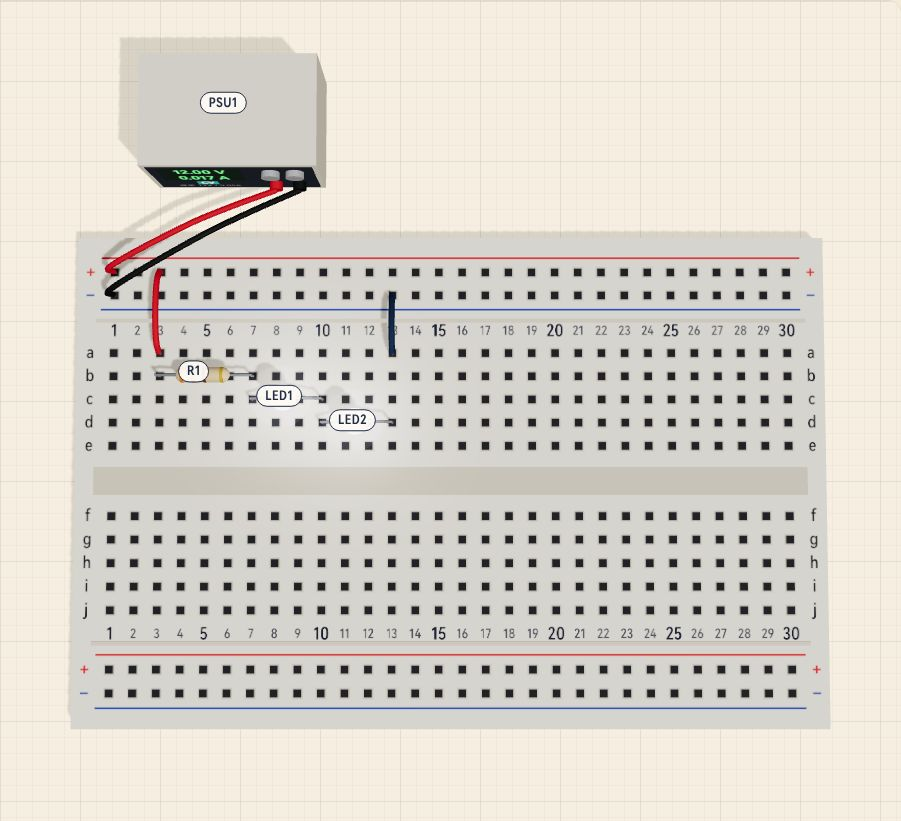
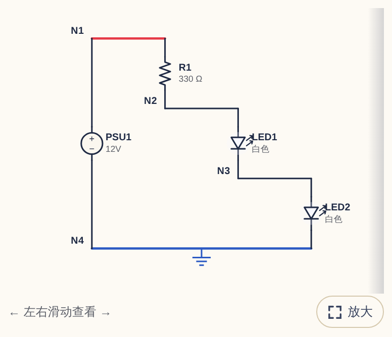
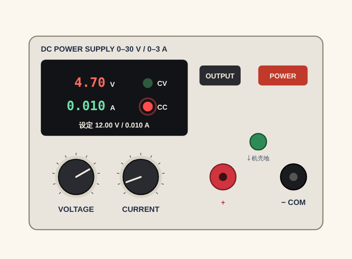
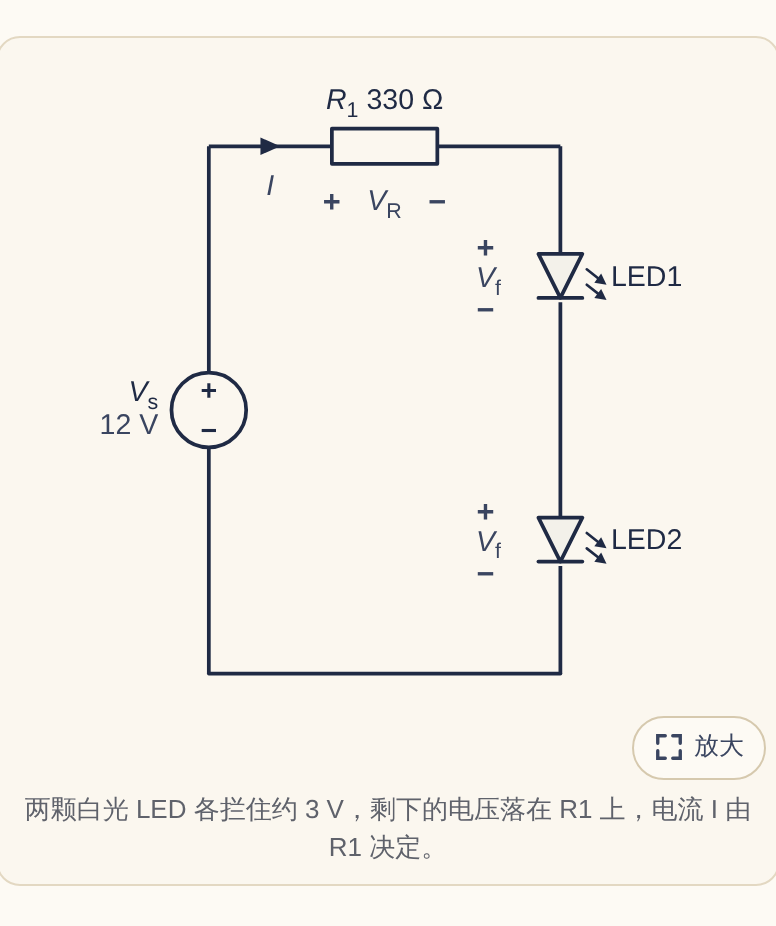

# 1.10 · 稳压电源 12 V 点亮两颗白光 LED

| 项目 | 内容 |
|---|---|
| id | `challenge-bench-supply` |
| 文件 | `challenges/18-bench-supply-12v.json` |
| 类型 | 实验 / 挑战（没有分步，照目标电路图搭） · 难度 3/5 |
| 位置 | World 1 · 基础定律与直流分压 → 1.10 真实的电源：内阻、模块、稳压电源（本节第 5 项） |
| 右侧面板 | 轨道由旧的四张卡片自动生成（还没手工精排） |
| 前后 | 上一项 [1.10 lesson-bench-supply](../w1/1.10-4-lesson-bench-supply.md) · 下一项 [1.11 exp-cc-current-source](../w1/1.11-1-exp-cc-current-source.md) |
| 先修 | lesson-bench-supply |
| 概念 | bench supply 稳压电源、current limit 限流、series LEDs 串联 LED |

**一句话概要**：把稳压电源调到 12 V、限流 50 mA，串联点亮两颗白光 LED；再想想电阻短路时限流怎么救场。

## 1. 左侧工作台（3D 面包板 → 2D 俯视截图）

截图是程序里真实的 3D 面包板换成俯视角拍的；表格是同一块板的文字版（元件、参数、每只脚插在哪个孔）。

### 1.1 起点：空面包板（学生从零开始搭）

### 1.3 参考答案（「看答案」载入的板子）

| 元件 | 类型 | 参数 | 引脚 → 孔 |
|---|---|---|---|
| PSU1 | bench_supply | voltage=12, currentLimit=0.05 | +→tp1 -→tn1 |
| W2 | wire |  | a→tp3 b→a3 |
| R1 | resistor | resistance=330 | 1→b3 2→b7 |
| LED1 | led | color=white | anode→c7 cathode→c10 |
| LED2 | led | color=white | anode→d10 cathode→d13 |
| W6 | wire |  | a→a13 b→tn13 |

### 1.4 目标原理图（右侧「目标原理图」抽屉）

| 元件 | 类型 | 参数 |
|---|---|---|
| PSU1 | bench_supply | voltage=12 |
| R1 | resistor | resistance=330 |
| LED1 | led | color=white |
| LED2 | led | color=white |

连接（每个结点上的引脚）：

- **N1**：PSU1.+、R1.1
- **N2**：R1.2、LED1.anode
- **N3**：LED1.cathode、LED2.anode
- **N4**：LED2.cathode、PSU1.-

## 2. 右侧面板：学生从上往下看到的内容（单轨流）

### 第 1 步 · 🔍 先看一眼：先认识它：稳压电源 CV / CC

**拆解「直流稳压电源：CV 和 CC 谁说了算」第 1 / 7 层：① 面板：两个旋钮、两盏灯、一块表**

第 11 课（lesson 103）的电源调到 12 V、限流 10 mA，接一个 470 Ω：面板就是图上这样。先认清每个东西：
- 显示屏 的大字是 **实际输出** 的电压和电流（4.70 V、0.010 A），下面一行小字 设定 12.00 V / 0.010 A 是旋钮的位置。**设定值 ≠ 实际值**，这是新手最常看错的地方。
- VOLTAGE 旋钮设电压上限，CURRENT 旋钮设电流上限。
- CV 灯 亮 = 恒压，CC 灯 亮 = 恒流。图上 CC 亮：负载“想要”12 V / 470 Ω = 25.5 mA，超过了 10 mA，电源把电流卡在 10 mA，电压降到 10 mA × 470 Ω = 4.7 V。
- 红色 + 和 黑色 − / COM 是输出；绿色 ⏚ 接机壳和插头的地线，平时不用接。
- OUTPUT 键开 / 关输出：先调好再打开。

| 部件 | 作用 | 仿真里 |
|---|---|---|
| 显示屏（大字） | 实际输出 V、I | 同 |
| 设定行（小字） | 旋钮的设定值 | 属性 voltage、currentLimit |
| VOLTAGE | 电压上限 V_set | 0–30 V |
| CURRENT | 电流上限 I_set | 默认 0.1 A |
| CV 灯 | 恒压模式 | CV 时内阻 0.02 Ω |
| CC 灯 | 恒流（限流）模式 | I 正好等于 I_set |
| + / − COM | 输出端子 | 红夹子 / 黑夹子 |

### 第 2 步 · 🔧 动手搭：12 V 和两颗白灯

这一题没有步骤，**照目标电路图自己搭**。先选「直流稳压电源」，在「属性」里设 **12 V**、限流 **0.05 A**。

### 第 3 步 · 💡 想明白：为什么限流设 50 mA

- 两颗白光 LED 各约 3 V，共 6 V；电阻上 $12 - 6 = 6$ V，$I \approx \frac{6}{330} \approx 18$ mA（算上两颗 LED 的小电阻，再稍小一点）。远低于 50 mA，电源一直是 **CV**。

*图 `chain`（schematic）：两颗白光 LED 各拦住约 3 V，剩下的电压落在 R1 上，电流 I 由 R1 决定。*

- 万一电阻被短路（比如两只脚插进了同一列）：只剩两颗 LED，电流会冲到几百毫安，两颗都烧。
- 有了 50 mA 限流：电源进入 **CC**，把电流卡在 50 mA，电压自己降下来。50 mA 对 LED 仍然偏大，但不会立刻烧掉——这就是限流保护。

（这一步下面列着这节课的计算卡片，点开就地展开：`led-current`、`cc-current-source`，全文见第 6 节）

### 第 4 步 · 🔧 动手搭：搭好，看电源屏幕

- 红色鳄鱼夹（+）接红轨，黑色（COM）接蓝轨。
- 两颗 LED 串联：LED1 的短脚和 LED2 的长脚在同一列。

### 第 5 步 · 📏 测一测：测一测：读你自己的仪表

**测量题 1 · `i`**（读数题）

> 电源屏幕上显示的电流

- 单位 mA · 先写预测 · 参考答案的读数 **16.95 mA** · 合理范围 [0.0155, 0.0185]

答对后显示：

> (12 − 6) / (330 + 12 + 12) ≈ 17 mA。

**测量题 2 · `short`**（选择题）

> 如果 R1 被短路，限流 50 mA 的电源会怎样？

- A. 进入 CC，把电流卡在 50 mA，输出电压降下来 ✅（正确）
- B. 保持 12 V，电流冲到几百毫安
- C. 自动关机

答对后显示：

> 负载想要的电流超过限流值，电源就进入恒流：电流 = 50 mA，电压降到两颗 LED 在 50 mA 时的压降，大约 7 V 多。

### 第 6 步 · 🎒 带走：带走

- 稳压电源 + 合理的限流 = 调试时的安全网。
- 12 V 串两颗白光 LED 留了 6 V 给电阻：余量足，电流稳。想串三颗，余量就只剩约 3 V 了。

## 3. 测量题一览

| # | id | 题目 | 类型 | 单位 | 状态 | 参考读数 |
|---|---|---|---|---|---|---|
| 1 | i | 电源屏幕上显示的电流 | current | mA |  | 16.95 mA |
| 2 | short | 如果 R1 被短路，限流 50 mA 的电源会怎样？ | 选择 |  |  | 正确：A |

### 提示按钮（依次显示）

1. 选中稳压电源，把电压设为 12 V，限流设为 0.05 A。
2. 红色鳄鱼夹（+）接红轨，黑色（COM）接蓝轨。
3. 两颗 LED 串联：LED1 的短脚和 LED2 的长脚在同一列。

### 功能测试（「检查我的电路」时跑）

- 两颗白光 LED 亮，电源保持 12 V（CV 模式）

## 4. 用到的拆解（全部层的文字，供改写参考）

### 拆解 `bench-supply`：直流稳压电源：CV 和 CC 谁说了算

*实验室的 bench power supply（直流稳压电源）有两个旋钮：电压和限流。它里面有两个 control loop（控制环），一个想让电压等于设定值（CV，constant voltage，恒压），一个想让电流不超过设定值（CC，constant current，恒流）。负载决定哪个环说了算——我们用 V–I 平面上的负载线把这件事画清楚。*

**拆解「直流稳压电源：CV 和 CC 谁说了算」第 1 / 7 层：① 面板：两个旋钮、两盏灯、一块表**

第 11 课（lesson 103）的电源调到 12 V、限流 10 mA，接一个 470 Ω：面板就是图上这样。先认清每个东西：
- 显示屏 的大字是 **实际输出** 的电压和电流（4.70 V、0.010 A），下面一行小字 设定 12.00 V / 0.010 A 是旋钮的位置。**设定值 ≠ 实际值**，这是新手最常看错的地方。
- VOLTAGE 旋钮设电压上限，CURRENT 旋钮设电流上限。
- CV 灯 亮 = 恒压，CC 灯 亮 = 恒流。图上 CC 亮：负载“想要”12 V / 470 Ω = 25.5 mA，超过了 10 mA，电源把电流卡在 10 mA，电压降到 10 mA × 470 Ω = 4.7 V。
- 红色 + 和 黑色 − / COM 是输出；绿色 ⏚ 接机壳和插头的地线，平时不用接。
- OUTPUT 键开 / 关输出：先调好再打开。

| 部件 | 作用 | 仿真里 |
|---|---|---|
| 显示屏（大字） | 实际输出 V、I | 同 |
| 设定行（小字） | 旋钮的设定值 | 属性 voltage、currentLimit |
| VOLTAGE | 电压上限 V_set | 0–30 V |
| CURRENT | 电流上限 I_set | 默认 0.1 A |
| CV 灯 | 恒压模式 | CV 时内阻 0.02 Ω |
| CC 灯 | 恒流（限流）模式 | I 正好等于 I_set |
| + / − COM | 输出端子 | 红夹子 / 黑夹子 |

**拆解「直流稳压电源：CV 和 CC 谁说了算」第 2 / 7 层：② X 光：一个调整管，两个误差放大器**

一台线性稳压电源里面：
1. 市电 经 变压器 降压，整流 + 滤波电容 变成不太稳的约 35 V 直流；
2. 调整管 串在输出 + 上，像一个可调的阀门，吃掉多余的电压——和“稳压器”拆解里的 LDO 是同一个原理，只是大得多；
3. 输出电压经 分压电阻 送到 CV 误差放大器，和 V_set 比较；
4. 负载电流全部流过回路里的 采样电阻 R_s（零点几欧），它上面的电压 $I × R_s$ 送到 CC 误差放大器，和 I_set 比较；
5. 两个放大器的输出经二极管接到同一根驱动线上：谁的输出低就听谁的（低选，minimum selector）。哪个二极管导通，面板上就亮哪盏灯。

“谁低听谁”的意思：两个环都 **只会往小了拧** 调整管。电压到了 V_set，CV 环拦住；电流到了 I_set，CC 环拦住。先碰到哪个限制，哪个就接管。

**拆解「直流稳压电源：CV 和 CC 谁说了算」第 3 / 7 层：③ 两个控制环：各管一个量**

把两条反馈路径画出来：
- CV 环：输出电压 → 分压 → CV 放大器 → 调整管 → 输出电压。它和同相放大器一样是 **负反馈**：输出偏高，放大器把调整管关小，输出回落。平衡时 $V_{out} = V_{set}$。
- CC 环：负载电流 → R_s 上的电压 → CC 放大器 → 调整管 → 负载电流。平衡时 $I × R_s = I_{set} × R_s$，即 $I = I_{set}$。

两个环不能同时“平衡”（除非负载正好在分界点上）：
- 负载轻（R 大）：电流还没到 I_set，CC 放大器的输出很高、二极管截止，**只有 CV 环在工作**；
- 负载重（R 小）：要维持 V_set 就得超过 I_set，CC 放大器的输出先降下来接管，CV 放大器“想要”更高的电压但被二极管隔开，**只有 CC 环在工作**，电压被迫降下来。

仿真里电源的判断就是这么简单：先按 CV 算，如果算出来 $I > I_{set}$，就改成 CC。

| 环 | 测什么 | 和谁比 | 保持 | 什么时候接管 |
|---|---|---|---|---|
| CV | 输出电压（分压后） | V_set | $V = V_{set}$ | $\frac{V_{set}}{R} < I_{set}$ |
| CC | $I × R_s$ | $I_{set} × R_s$ | $I = I_{set}$ | $\frac{V_{set}}{R} > I_{set}$ |

**拆解「直流稳压电源：CV 和 CC 谁说了算」第 4 / 7 层：④ 等效电路：要么是电压源，要么是电流源**

从输出端看进去，电源只可能是两种理想元件之一：
- **CV 模式** = 理想电压源 V_set（串一个很小的内阻，仿真 0.02 Ω）。电压固定，电流由负载决定：$I = \frac{V_{set}}{R}$。
- **CC 模式** = 理想电流源 I_set。电流固定，电压由负载决定：$V = I_{set} × R$。

哪一个？把两个条件放在一起：
1. 假设 CV：$I = \frac{V_{set}}{R}$，要求 $I ≤ I_{set}$，即 $R ≥ \frac{V_{set}}{I_{set}}$；
2. 假设 CC：$V = I_{set}R$，要求 $V ≤ V_{set}$，即 $R ≤ \frac{V_{set}}{I_{set}}$。

所以分界就是一个电阻值：
$$R_c = \frac{V_{set}}{I_{set}}$$
负载 比 R_c 大 → CV；比 R_c 小 → CC。lesson 103：$R_c = \frac{12 V}{10 mA} = 1.2 kΩ$，470 Ω < 1.2 kΩ，所以是 CC，$V = 10 mA × 470 Ω = 4.7 V$。

这就是电路课里“实际电源”的两种模型在实验桌上的样子：电路理论里的理想电流源，在实验室里就是“调高电压、调低限流”的稳压电源。

- 公式 `R_c = \frac{V_{set}}{I_{set}}`：R > R_c：CV；R < R_c：CC
- 公式 `CV: I = \frac{V_{set}}{R}    CC: V = I_{set}·R`：固定一个量，另一个由负载决定

**拆解「直流稳压电源：CV 和 CC 谁说了算」第 5 / 7 层：⑤ 画出来：电源的“直角”和负载线**

在 V–I 平面上（横轴 I、纵轴 V）：
- 电源能输出的所有点是一个 **直角**：一条水平线 V = 12 V（CV，I 从 0 到 10 mA），接 一条竖直线 I = 10 mA（CC，V 从 12 V 往下）；
- 一个电阻负载的所有点是一条过原点的直线 $V = I·R$——**负载线**（load line），斜率就是 R。

两条线的交点就是 **工作点**：
- 2.2 kΩ：负载线陡，先碰到水平线 → CV，12 V、$\frac{12}{2200}$ = 5.45 mA；
- 470 Ω：负载线平，先碰到竖直线 → CC，10 mA、4.7 V；
- 1.2 kΩ：正好穿过直角的拐角——这就是 $R_c$。

这幅图把“CV 还是 CC”变成了一个几何问题：负载线穿过直角的哪一条边。

| 负载 R | 想要的电流 V_set/R | 模式 | V | I |
|---|---|---|---|---|
| 2.2 kΩ | 5.45 mA | CV | 12 V | 5.45 mA |
| 1.2 kΩ | 10 mA | 拐点 | 12 V | 10 mA |
| 470 Ω | 25.5 mA | CC | 4.7 V | 10 mA |

**拆解「直流稳压电源：CV 和 CC 谁说了算」第 6 / 7 层：⑥ 课程里的数字：负载线不过原点时**

**实验 204（CC 当电流源）**：12 V、限流 10 mA，负载是红 LED（1.8 V + 12 Ω）+ 470 Ω + 电位器 RV（0–1 kΩ）。LED 让负载线 从 1.8 V 起步：$V = 1.8 + I(482 + R_{RV})$。维持 10 mA 需要的电压：
- RV = 0%：$1.8 + 0.01 × 482 = 6.62 V$ < 12 V → CC，10 mA；
- RV = 40%（400 Ω）：$1.8 + 0.01 × 882 = 10.62 V$ → 还是 CC，10 mA，电压升高了；
- RV = 100%（1 kΩ）：需要 $1.8 + 0.01 × 1482 = 16.62 V$ > 12 V，做不到 → 退回 CV，$I = \frac{12 - 1.8}{1482} = 6.88 mA$。

前两档就是“电流源”的定义：负载变了，电流不变，变的是电压。第三档说明电流源有 **compliance voltage（输出电压上限）**，这里就是 V_set = 12 V。

**挑战 18（限流当保护）**：12 V、限流 50 mA，330 Ω + 两颗白 LED（各 3.0 V + 12 Ω）。正常时 $I = \frac{12 - 6}{330 + 24} ≈ 17 mA$，CV。如果电阻被短路：不限流时 $\frac{12 - 6}{24} = 250 mA$，LED 烧掉；有限流时电源进入 CC，50 mA，电压降到 $6 + 0.05 × 24 = 7.2 V$。

| 情况 | 需要的电压 | 模式 | V | I |
|---|---|---|---|---|
| 204 · RV 0% | 6.62 V | CC | 6.62 V | 10 mA |
| 204 · RV 40% | 10.62 V | CC | 10.62 V | 10 mA |
| 204 · RV 100% | 16.62 V | CV | 12 V | 6.88 mA |
| 18 · 正常 | — | CV | 12 V | 17 mA |
| 18 · 电阻短路 | 7.2 V | CC | 7.2 V | 50 mA |

- 公式 `V_{need} = V_f + I_{set}·R_{load}`：V_need < V_set → CC 维持得住；否则退回 CV

**拆解「直流稳压电源：CV 和 CC 谁说了算」第 7 / 7 层：⑦ 真实电源和理想模型的差别**

模拟器里的电源是理想的：CV 时 0.02 Ω，CC 时电流正好等于设定值，切换瞬间完成。真实电源要注意：
- **怎么设限流**：限流旋钮的刻度不准。常用办法是 把输出短路，看着电流表把 CURRENT 转到想要的值（短路时一定是 CC，显示的电流就是限流值），再拆掉短路线接电路。新手调试建议 50–100 mA。
- **输出电容**：输出端有几百 µF 的电容，充到 V_set。接上负载（或短路）的一瞬间，电容先放电，电流尖峰 远超限流值，几十微秒后 CC 环才追上。对 LED 这种怕过流的器件，先接好电路再打开 OUTPUT。仿真里 没有这个尖峰。
- **调整管发热**：线性电源里调整管的功耗 $P = (V_{raw} - V_{out})·I$。35 V 内部电压、输出 5 V、1 A：30 W——所以电源有散热片和风扇，有的还会按输出电压切换变压器抽头。
- **显示精度**：一般只有 3–4 位，0.010 A 也许实际是 9.6 mA；精确测量还是要用万用表。

| 项目 | 模拟器 | 真实电源 |
|---|---|---|
| CV 内阻 | 0.02 Ω | 毫欧级（引线还有几十 mΩ） |
| CC 电流 | 正好等于 I_set | 旋钮刻度不准，要短路设定 |
| 模式切换 | 瞬间，无过冲 | 输出电容放电，有电流尖峰 |
| 发热 | 不计 | $(V_{raw} - V_{out})·I$ |

**一句话记住**：稳压电源 = 一个调整管 + 两个“谁低听谁”的控制环。CV 时它是理想电压源（V = V_set），CC 时是理想电流源（I = I_set）。负载电阻和 $R_c = V_{set}/I_{set}$ 比：大则 CV，小则 CC；在 V–I 平面上就是负载线穿过直角的哪一条边。把电压调高、限流调到想要的电流，它就是一个有 compliance voltage 的电流源。

## 5. 这一课的计算卡片

**计算卡片 `led-current`：LED 回路的电流 LED loop current**

- 公式 `I = \frac{V_s - ΣV_F}{R + Σr_d + R_{int}}`
- 用途：电源、电阻和一个或几个串联 LED：LED 实际流过多少电流。
- 输入：V_s（电源电动势，V）；V_F（所有 LED 的 V_F 之和（红 1.8、绿 2.1、蓝/白 3.0），V）；R（串联电阻（含电位器），Ω）；r_d（LED 内阻之和（每个 ≈ 12 Ω），Ω）；R_int（电源内阻（模块 ≈ 0、9 V 电池 1.5 Ω、纽扣电池 15 Ω），Ω） → I（回路电流（不够 ΣV_F 时为 0），A）

1. 导通的 LED 用折线模型看：一个电压源 $V_F$ 串一个小电阻 $r_d ≈ 12 Ω$（模拟器就是这样建模的）。
2. 整个回路串联，处处是同一个电流 I。
3. KVL：$V_s = I R_{int} + I R + ΣV_F + I Σr_d$。
4. 解出 $I = \frac{V_s - ΣV_F}{R + Σr_d + R_{int}}$。
5. 如果 $V_s < ΣV_F$，LED 根本不导通，I = 0：3 V 点不亮串联的红 + 绿 LED（需要 3.9 V）。
只用 $\frac{V_s - V_F}{R}$ 估算会偏大 1–2 mA，选电阻时够用；要和读数对比时把 $r_d$ 和内阻加上。

例子：- 挑战 1：9 V、220 Ω、红 + 绿：$I = \frac{9 - 3.9}{220 + 24} ≈ 21 mA$（只用 $V_F$ 估算是 23 mA）。
- 第 3 课：5 V、150 Ω、绿：$\frac{5 - 2.1}{150 + 12} ≈ 18 mA$，电阻上 $18 mA × 150 Ω ≈ 2.7 V$。
- 挑战 9：CR2032（3 V、15 Ω）、47 Ω、红：$\frac{3 - 1.8}{47 + 12 + 15} ≈ 16 mA$；不串电阻是 $\frac{1.2}{27} ≈ 44 mA$。
- 挑战 3：电位器转到 100 %：$\frac{5 - 1.8}{220 + 10k + 12} ≈ 0.31 mA$，灯灭。

- ⚠ 两个 LED 直接并联共用一个电阻：$V_F$ 小的先导通、把电压钳住，另一个几乎不亮——每个 LED 自己串一个电阻。
- ⚠ 电位器当可变电阻用时，它的阻值也在 R 里；转到 0 时只剩保护电阻。

**计算卡片 `cc-current-source`：稳压电源的 CV / CC：当电流源用**

- 公式 `I_{want} = \frac{V_{set} - V_F}{R} > I_{lim} ⇒ V = V_F + I_{lim} R`
- 用途：判断稳压电源工作在 CV 还是 CC，并算出它实际输出的电压。
- 输入：V_set（电压设定，V）；I_lim（限流设定，A）；R（负载电阻（含 LED 内阻），Ω）；V_F（负载里 LED 的 V_F（没有就填 0），V） → V（电源实际输出电压，V）

1. 稳压电源有两个“上限”：电压不超过 $V_{set}$，电流不超过 $I_{lim}$。哪个先碰到，哪个说了算。
2. 先假设 CV：输出 $V_{set}$，负载想要的电流 $I_{want} = \frac{V_{set} - V_F}{R}$。
3. $I_{want} ≤ I_{lim}$：确实是 CV，电压 = 设定，电流由负载决定。
4. $I_{want} > I_{lim}$：切到 CC，电流 = $I_{lim}$，电压降到刚好推动这个电流：$V = V_F + I_{lim}R$。
5. 当电流源用：限流设成想要的电流，电压设高一些（留余量）。它能带的最大负载是 $R_{max} = \frac{V_{set} - V_F}{I_{lim}}$，超过就退回 CV。

例子：- 第 11 课：12 V、10 mA、470 Ω：想要 25.5 mA > 10 mA → CC，$V = 10 mA × 470 = 4.70 V$；限流 20 mA → 9.4 V；100 mA → CV，12 V、25.5 mA。
- 实验 1-4：$1.8 + 10 mA × (470 + 12) ≈ 6.6 V$（CC）；RV1 = 1 kΩ 时需要 16.6 V > 12 V → CV，$I = \frac{12 - 1.8}{1482} ≈ 6.9 mA$。
- 挑战 10 电阻被短路：$6 V + 50 mA × 24 Ω = 7.2 V$，电源限住 50 mA。

- ⚠ 屏幕上小字 “SET …” 是旋钮设定，大字才是实际输出——CC 时两者不一样。
- ⚠ 电流源也有“顶”：负载太大时它给不出设定的电流（实验 1-4 的 100 %）。

## 6. English（界面英文版的同一份内容）

展开英文

### Node 1 · 🔍 Look first：Meet it first: Bench supply CV / CC

**Teardown「Bench supply: when CV rules and when CC rules」layer 1 of 7：① The front panel: two knobs, two lights, one display**

Lesson 11 (lesson 103) sets the supply to 12 V, limit 10 mA, with a 470 Ω load: the panel looks like this. Get to know each piece:
- the display's big digits are the **actual output** voltage and current (4.70 V, 0.010 A); the small line SET 12.00 V / 0.010 A shows the knob settings. **Setting ≠ actual** — the most common beginner misreading.
- the VOLTAGE knob sets the voltage ceiling, the CURRENT knob the current ceiling.
- CV lit = constant voltage, CC lit = constant current. Here CC is lit: the load "wants" 12 V / 470 Ω = 25.5 mA, more than 10 mA, so the supply holds the current at 10 mA and the voltage drops to 10 mA × 470 Ω = 4.7 V.
- red + and black − / COM are the output; the green ⏚ is the chassis / mains earth, normally left unconnected.
- the OUTPUT key switches the output on and off: set it up first, then switch on.

| Item | What it does | In the simulator |
|---|---|---|
| display (big digits) | actual output V, I | same |
| set line (small) | the knob settings | properties voltage, currentLimit |
| VOLTAGE | voltage ceiling V_set | 0–30 V |
| CURRENT | current ceiling I_set | default 0.1 A |
| CV light | constant-voltage mode | CV: 0.02 Ω inside |
| CC light | constant-current (limiting) mode | I exactly I_set |
| + / − COM | output terminals | red / black clip |

### Node 2 · 🔧 Build：12 V and two white LEDs

No steps here — **build it from the target schematic**. Pick Bench power supply and set **12 V** and a **0.05 A** limit in Properties.

### Node 3 · 💡 Why：Why a 50 mA limit

- Two white LEDs at about 3 V each make 6 V; the resistor gets $12 - 6 = 6$ V, $I \approx \frac{6}{330} \approx 18$ mA (a bit less with the LEDs' small resistances). Far below 50 mA, so the supply stays in **CV**.

[figure `chain`]

*Figure `chain`（schematic）：两颗白光 LED 各拦住约 3 V，剩下的电压落在 R1 上，电流 I 由 R1 决定。*

- If the resistor were shorted (say both legs in the same column), only the two LEDs would be left and the current would jump to hundreds of milliamps — both LEDs gone.
- With a 50 mA limit the supply goes into **CC**, holds the current at 50 mA and lets its voltage drop. 50 mA is still a lot for an LED, but not instant death — that is current-limit protection.

(This node lists the lesson’s calculation cards: `led-current`、`cc-current-source`; full text in section 6)

### Node 4 · 🔧 Build：Build it, watch the display

- Red alligator clip (+) to the red rail, black (COM) to the blue rail.
- The two LEDs in series: LED1's short lead and LED2's long lead share a column.

### Node 5 · 📏 Measure：Measure: read your own instruments

**Question 1 · `i`**（reading）

> The current on the supply's display

- unit mA · predict first · range [0.0155, 0.0185]

Shown once right:

> (12 − 6) / (330 + 12 + 12) ≈ 17 mA.

**Question 2 · `short`**（multiple choice）

> If R1 were shorted, what would the supply with a 50 mA limit do?

- A. Go into CC, hold the current at 50 mA and let its voltage drop ✅ (right)
- B. Stay at 12 V while the current jumps to hundreds of mA
- C. Switch itself off

Shown once right:

> The load wants more than the limit, so the supply holds the current: 50 mA, with the voltage down to what two LEDs drop at 50 mA — a little over 7 V.

### Node 6 · 🎒 Take away：Take away

- A bench supply with a sensible current limit is a safety net while debugging.
- Two white LEDs on 12 V leave 6 V for the resistor: plenty of headroom, a steady current. Three in series would leave only about 3 V.

**Hints**

1. Click the bench supply and set 12 V and a 0.05 A limit.
2. Red alligator clip (+) to the red rail, black (COM) to the blue rail.
3. Two LEDs in series: LED1's short lead and LED2's long lead in the same column.

