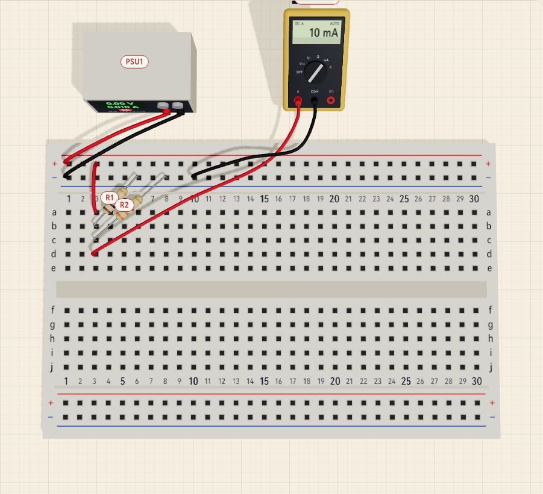
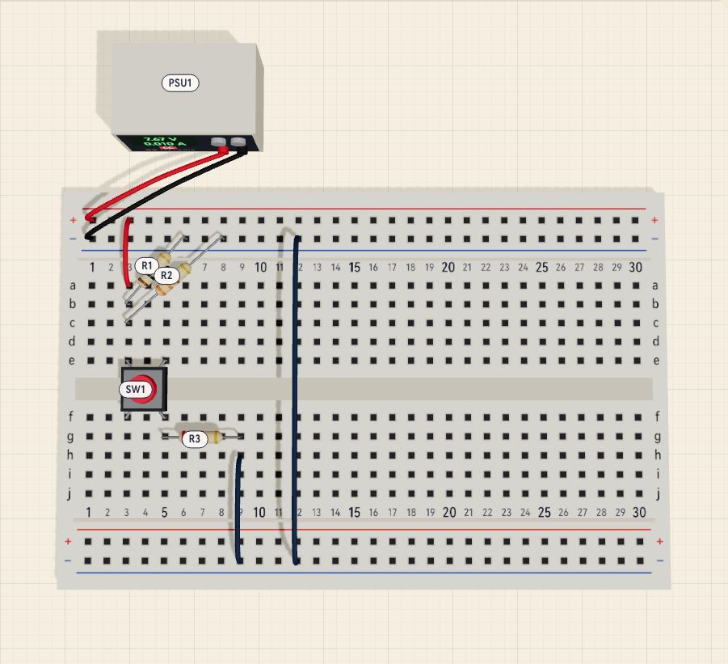
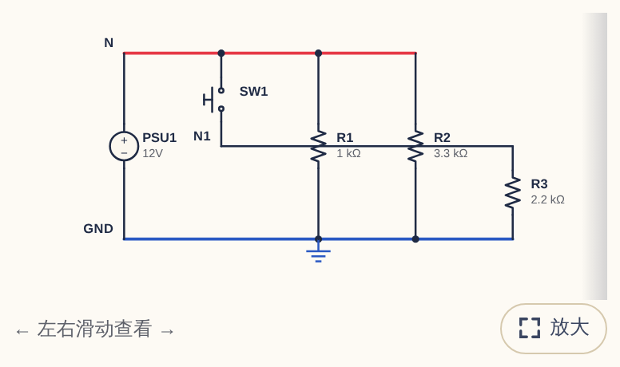
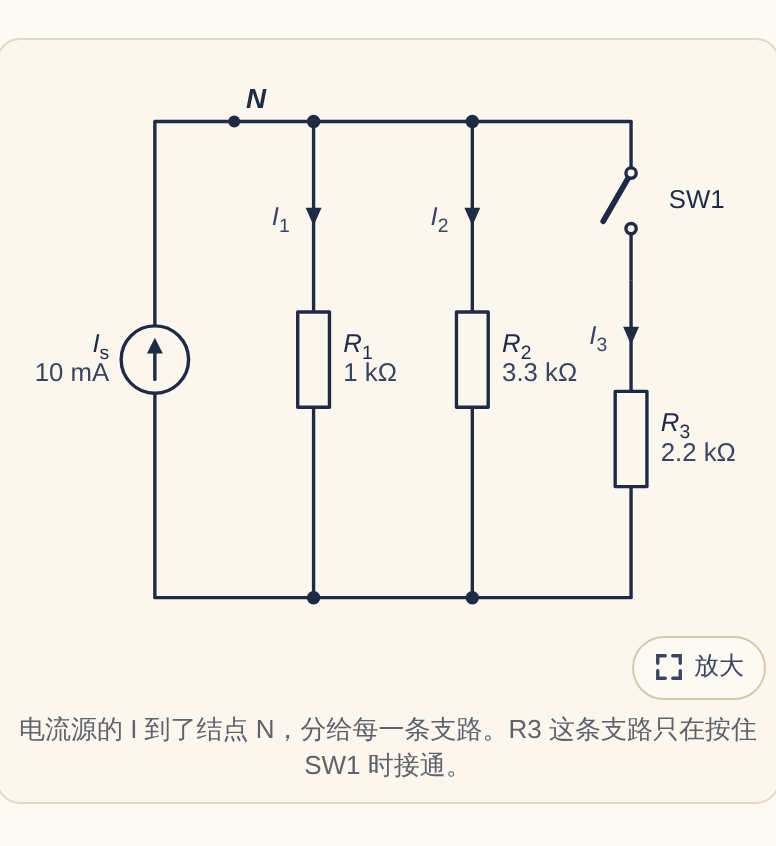

# 1.11 · 分流：10 mA 怎么分给几条支路

| 项目 | 内容 |
|---|---|
| id | `exp-current-divider` |
| 文件 | `challenges/205-current-divider.json` |
| 类型 | 实验 / 挑战（没有分步，照目标电路图搭） · 难度 3/5 |
| 位置 | World 1 · 基础定律与直流分压 → 1.11 电流源与分流（本节第 2 项） |
| 右侧面板 | 轨道由旧的四张卡片自动生成（还没手工精排） |
| 前后 | 上一项 [1.11 exp-cc-current-source](../w1/1.11-1-exp-cc-current-source.md) · 下一项 [1.12 challenge-fix-the-circuit](../w1/1.12-1-challenge-fix-the-circuit.md) |
| 先修 | lesson-ammeter |
| 概念 | current divider 分流、conductance 电导、parallel 并联、ammeter in parallel 电流表并联（错误） |

**一句话概要**：电流源灌进 10 mA，看它在 1 kΩ、3.3 kΩ（再加 2.2 kΩ）之间怎么分。板上有块电流表接错了，先看它闹出了什么事。

## 1. 左侧工作台（3D 面包板 → 2D 俯视截图）

截图是程序里真实的 3D 面包板换成俯视角拍的；表格是同一块板的文字版（元件、参数、每只脚插在哪个孔）。

### 1.1 起点：打开这一课时板上已经有的

右侧显示的「起点」说明：

> **找错 + 搭完**：电源（CC 10 mA）、R1、R2 已经接好，但板上的电流表接错了（并联在 N 和 GND 之间）。**为什么**：先认出“电流表并联 = 短路”这个最常见的错误。**你要做**：拿掉或改串这块电流表，再加上按键 SW1、R3（2.2kΩ）和它们的跳线。

| 元件 | 类型 | 参数 | 引脚 → 孔 |
|---|---|---|---|
| PSU1 | bench_supply | voltage=12, currentLimit=0.01 | +→tp1 -→tn1 |
| W2 | wire |  | a→tp3 b→a3 |
| R1 | resistor | resistance=1000 | 1→b3 2→tn6 |
| R2 | resistor | resistance=3300 | 1→c3 2→tn8 |
| AM1 | ammeter |  | +→d3 -→tn10 |

### 1.3 参考答案（「看答案」载入的板子）

| 元件 | 类型 | 参数 | 引脚 → 孔 |
|---|---|---|---|
| PSU1 | bench_supply | voltage=12, currentLimit=0.01 | +→tp1 -→tn1 |
| W2 | wire |  | a→tp3 b→a3 |
| R1 | resistor | resistance=1000 | 1→b3 2→tn6 |
| R2 | resistor | resistance=3300 | 1→c3 2→tn8 |
| SW1 | pushbutton | pressed=false | 1a→e3 2a→e5 1b→f3 2b→f5 |
| R3 | resistor | resistance=2200 | 1→g5 2→g9 |
| W7 | wire |  | a→h9 b→bn9 |
| W8 | wire |  | a→tn12 b→bn12 |

### 1.4 目标原理图（右侧「目标原理图」抽屉）

| 元件 | 类型 | 参数 |
|---|---|---|
| PSU1 | bench_supply | voltage=12, currentLimit=0.01 |
| R1 | resistor | resistance=1000 |
| R2 | resistor | resistance=3300 |
| SW1 | pushbutton |  |
| R3 | resistor | resistance=2200 |

连接（每个结点上的引脚）：

- **N**：PSU1.+、R1.1、R2.1、SW1.1
- **N1**：SW1.2、R3.1
- **GND**：R1.2、R2.2、R3.2、PSU1.-

## 2. 右侧面板：学生从上往下看到的内容（单轨流）

### 第 1 步 · 🔧 动手搭：10 mA 去哪儿了？

板上已经有：恒流模式的电源（`12 V`、限流 `0.01 A`），给并排的 **R1** `1 kΩ` 和 **R2** `3.3 kΩ` 供电。还有人把电流表 **AM1** 直接接在了结点 N 和 GND 之间。
**读 AM1**。再用万用表**测 N 对 GND 的电压**。
两个电阻都还插着。10 mA 里，它们分到了多少？

### 第 2 步 · 💡 想明白：岔路口：路越宽，车越多

- 电流到了结点，会**同时**走每一条路，就像车到了岔路口：路越宽，走的车越多。
- 对支路来说，“宽”就是**电导** $G = 1/R$ 大。每条支路按比例分走总电流：
$$I_k = I\,\frac{G_k}{G_1 + G_2 + \dots}$$
- 电流表只有 0.1 Ω，$G = 10$ S；R1 只有 0.001 S。R1 分到 $10\text{ mA} × \frac{0.001}{10.0013} ≈ 1$ µA，几乎全被表抢走了。

*图 `split`（schematic）：电流源的 I 到了结点 N，分给每一条支路。R3 这条支路只在按住 SW1 时接通。*

- 现在自己预测真正的分法：按键松开时两条支路，按住时三条。第三条支路加进来，总电流会变吗？

（这一步下面列着这节课的计算卡片，点开就地展开：`current-divider`、`kcl`、`source-transformation`、`current-divider-g`、`ammeter-burden`、`cc-current-source`，全文见第 6 节）

### 第 3 步 · 🔧 动手搭：把表串进支路

- **把 AM1 从 N–GND 上拿下来。** 电流表要**串联**：把某个电阻靠 N 的那只脚拔出来，电流表接在空出来的两点之间，**红表笔在 N 一侧**。判分时串联的电流表算一根导线。
- 加第三条支路：**SW1** 一侧接 N，另一侧接 **R3** `2.2 kΩ`，R3 的另一端接 GND。
- 先**松开** SW1、再**按住**，分别读每条支路。电路检查通过后填测量题。

### 第 4 步 · 📏 测一测：测一测：读你自己的仪表

**测量题 1 · `a1`**（读数题）

> 按键松开：电流表串在 R1 支路里，读 I1

- 单位 mA · 先写预测 · 状态：松开 SW1 · 参考答案的读数 **7.669 mA** · 合理范围 [0.00729, 0.00805]

答对后显示：

> 两条支路：I1 = 10 mA × R2 / (R1 + R2) = 10 × 3.3 / 4.3 ≈ 7.67 mA。

**测量题 2 · `a2`**（读数题）

> 按键松开：把电流表换到 R2 支路，读 I2

- 单位 mA · 先写预测 · 状态：松开 SW1 · 参考答案的读数 **2.324 mA** · 合理范围 [0.00221, 0.00244]

答对后显示：

> I2 = 10 × 1 / 4.3 ≈ 2.33 mA。电阻小的 R1 分得多。

**测量题 3 · `b1`**（读数题）

> 按住按键（三条支路）：I1

- 单位 mA · 先写预测 · 状态：按下 SW1 · 参考答案的读数 **5.686 mA** · 合理范围 [0.0054, 0.00597]

答对后显示：

> I1 = 10 mA × G1 / ΣG = 10 × 1 / 1.758 ≈ 5.69 mA。

**测量题 4 · `b3`**（读数题）

> 按住按键：R3 支路的电流 I3

- 单位 mA · 先写预测 · 状态：按下 SW1 · 参考答案的读数 **2.585 mA** · 合理范围 [0.00246, 0.00271]

答对后显示：

> I3 = 10 × 0.455 / 1.758 ≈ 2.58 mA。

**测量题 5 · `total`**（选择题）

> 按住按键时再读一下 I2，把三条支路加起来，和松开时的 I1 + I2 比较。总电流：

- A. 和松开时一样，还是 10 mA：电流源的电流不随负载变 ✅（正确）
- B. 变大了：多了一条路，电流就多了
- C. 变小了：并联的支路越多，电流越小

答对后显示：

> 电流源的电流固定，加一条支路只是改变“份额”，N 点电压从约 7.67 V 降到约 5.69 V。换成电压源，总电流就会变大。

### 第 5 步 · 🎒 带走：带走

- **电流按电导分**：电阻最小的那条分得最多。两条支路时：$I_1 = I\,\frac{R_2}{R_1 + R_2}$。
- 电流源供电时，加一条支路不改变总电流，只是重新分份额，结点电压随之降低。
- 坑：把电流表接在结点和 GND 之间，它就是全电路最小的电阻。真实万用表的保险丝会烧掉。

趁热练理论题：`equivalence`、`methods`

## 3. 测量题一览

| # | id | 题目 | 类型 | 单位 | 状态 | 参考读数 |
|---|---|---|---|---|---|---|
| 1 | a1 | 按键松开：电流表串在 R1 支路里，读 I1 | current | mA | 松开 SW1 | 7.669 mA |
| 2 | a2 | 按键松开：把电流表换到 R2 支路，读 I2 | current | mA | 松开 SW1 | 2.324 mA |
| 3 | b1 | 按住按键（三条支路）：I1 | current | mA | 按下 SW1 | 5.686 mA |
| 4 | b3 | 按住按键：R3 支路的电流 I3 | current | mA | 按下 SW1 | 2.585 mA |
| 5 | total | 按住按键时再读一下 I2，把三条支路加起来，和松开时的 I1 + I2 比较。总电流： | 选择 |  |  | 正确：A |

### 全部答完后显示的「对比」

**对比**：
- 两条支路（按键松开）：I1 = 10 × 3.3 / 4.3 ≈ **7.67 mA**，I2 = 10 × 1 / 4.3 ≈ **2.33 mA**；N 点电压 = 10 mA × (1k ∥ 3.3k = 767 Ω) ≈ 7.67 V。
- 三条支路（按下按键）：G1 = 1 mS，G2 = 0.303 mS，G3 = 0.455 mS，ΣG = 1.758 mS；I1 ≈ **5.69 mA**，I2 ≈ **1.72 mA**，I3 ≈ **2.58 mA**，加起来还是 10 mA；N 点电压降到 10 / 1.758 ≈ 5.69 V。

读数几乎为零、或 N 点电压接近 0 时，检查是不是还有电流表接在 N 和 GND 之间。

### 提示按钮（依次显示）

1. 电流表接在 N 和 GND 之间，等于把电路短路。先拿掉它；想测哪条支路，就把那条支路断开，再把电流表串进去。
2. 电源：12 V、限流 0.01 A。
3. 按键横跨凹槽：一边接 N，另一边接 R3，R3 的另一端回 GND。

### 功能测试（「检查我的电路」时跑）

- 两条支路：按电导分 10 mA
- 按下按键，加上第三条支路：三条支路重新分 10 mA，N 点电压下降

## 5. 这一课的计算卡片

**计算卡片 `current-divider`：分流 Current divider**

- 公式 `I_1 = I \frac{R_2}{R_1 + R_2}`
- 用途：总电流流进两条并联支路，每条分到多少。
- 输入：I（总电流，A）；R1（R₁，Ω）；R2（R₂，Ω） → I_1（流过 R₁ 的电流，A）

并联两端电压相同：$V = I (R_1 ∥ R_2)$，于是 $I_1 = \frac{V}{R_1} = I \frac{R_2}{R_1 + R_2}$。
注意分子是 **另一条** 支路的电阻：电流更愿意走电阻小的路，R₁ 越小 I₁ 越大。

- ⚠ 和分压公式正好“反过来”：分子是对面那条支路。

**计算卡片 `kcl`：基尔霍夫电流定律 KCL**

- 公式 `Σ i_{in} = Σ i_{out}`
- 用途：一个结点上流进的电流之和等于流出的电流之和：知道几条支路，求剩下那一条。
- 输入：I_1（流进结点的电流，A）；I_2（流出的另一条支路，A） → I_3（剩下那条支路流出的电流，A）

1. 电荷不会在结点上堆起来，也不会凭空出现：每一时刻流进多少就流出多少。
2. 先给每条支路选一个 **参考方向**（画箭头），再写代数和，比如“流出为正”：$-I_1 + I_2 + I_3 = 0$。
3. 只剩一个未知量时直接解：$I_3 = I_1 - I_2$。
4. 算出负数不是算错：它说明真实电流和你画的箭头方向相反。

例子：实验 1-1：$I_1 = \frac{9 V}{330 + 1k ∥ 2.2k} = \frac{9}{1017.5} ≈ 8.84 mA$，$I_2 = \frac{6.08 V}{1 kΩ} ≈ 6.08 mA$，所以 $I_3 = 8.84 - 6.08 = 2.76 mA$——正好等于 $\frac{6.08 V}{2.2 kΩ}$。实验 1-8：电流源的 10 mA 里有 3.2 mA 进了负载，$R_N$ 分到 10 − 3.2 = 6.8 mA。

- ⚠ 电流表接反读数是负的：代进 KCL 时要连符号一起代。
- ⚠ 同一条支路上串联的几个元件电流相同，它们之间的连接点不算新的 KCL 方程。

**计算卡片 `source-transformation`：电源等效变换 Norton ⇄ Thevenin**

- 公式 `V_s = I_s R ⇔ I_s = \frac{V_s}{R}`
- 用途：电流源并电阻 ⇄ 电压源串同一个电阻：对外完全一样。计算器给出负载上的电压。
- 输入：I_s（诺顿电流源，A）；R（并联 / 串联电阻，Ω）；R_L（负载，Ω） → V_L（负载电压（两种接法一样），V）

1. 诺顿网络：端口电压 V 时，R 里流 $\frac{V}{R}$，端口电流 $I = I_s - \frac{V}{R}$。
2. 戴维宁网络：$V = V_s - IR$，也就是 $I = \frac{V_s}{R} - \frac{V}{R}$。
3. 两个式子完全相同的条件：$V_s = I_s R$，电阻相同。端口的 V–I 关系一样，接什么负载结果都一样。
4. 负载电压：诺顿看是 $I_s (R ∥ R_L)$，戴维宁看是 $V_s \frac{R_L}{R + R_L}$——同一个数。
5. 但 **内部不等效**：诺顿的 R 一直在耗电（空载时最多），戴维宁空载时一点不耗。

例子：实验 1-8：$V_s = 10 mA × 470 Ω = 4.7 V$。接 1 kΩ：$10 mA × (470 ∥ 1000) = 10 × 0.3197 ≈ 3.20 V$ = $4.7 × \frac{1000}{1470}$。内部：$R_N$ 流 6.8 mA、耗 21.7 mW；$R_T$ 只流 3.2 mA、耗 4.8 mW；空载时 $R_N$ 一直耗 47 mW。

- ⚠ 电流源箭头指向的那一端 = 等效电压源的 + 端。
- ⚠ 理想电压源（没有串联电阻）不能变成电流源，理想电流源也不能变成电压源。

**计算卡片 `current-divider-g`：分流（三条支路，用电导）**

- 公式 `I_k = I \frac{G_k}{G_1 + G_2 + G_3}, G = \frac{1}{R}`
- 用途：一个电流分给三条（或更多）并联支路，每条分到多少。
- 输入：I（总电流，A）；R_1（要求的那条支路 R₁，Ω）；R_2（R₂，Ω）；R_3（R₃（没有就填 0），Ω） → I_1（R₁ 支路的电流，A）

1. 并联支路两端是同一个电压：$V = \frac{I}{G_1 + G_2 + G_3}$（并联时电导相加）。
2. 每条支路：$I_k = G_k V$。
3. 合起来：$I_k = I\frac{G_k}{ΣG}$——电导越大（电阻越小）分得越多。
4. 只有两条时就是熟悉的 $I_1 = I\frac{R_2}{R_1 + R_2}$。
总电流由电流源定死时，加一条支路只改变分配和电压；如果是电压源，总电流会变大。

例子：实验 1-5（按键按下）：$G = 1 + 0.303 + 0.455 = 1.758 mS$，$I_1 = 10 × \frac{1}{1.758} ≈ 5.69 mA$，$I_2 ≈ 1.72 mA$，$I_3 ≈ 2.58 mA$，N 点 $\frac{10}{1.758} ≈ 5.69 V$。松开（R₃ 填 0）：$I_1 ≈ 7.67 mA$。

- ⚠ 电流表并在 N 和地之间 = 用 0.1 Ω 把电路短路：所有电流都走电流表。

**计算卡片 `ammeter-burden`：电流表的内阻（负担电压）Ammeter burden**

- 公式 `误差 = \frac{R_A}{R + R_A}, $V_A$ = I $R_A$`
- 用途：电流表串进回路会多出 R_A：电流变小多少？表上压降多大？
- 输入：R（回路里其余的电阻（含 LED、电源内阻），Ω）；R_A（电流表内阻（模拟 0.1 Ω，真实 mA 档几欧到十几欧），Ω） → err（电流读数偏小，%）

1. 电流表要 **串联**：电流必须从它里面流过。它里面是一个很小的分流电阻 $R_A$（加上保险丝）。
2. 回路电阻从 R 变成 $R + R_A$，电流从 $\frac{V}{R}$ 变成 $\frac{V}{R + R_A}$。
3. 相对误差：$1 - \frac{R}{R + R_A} = \frac{R_A}{R + R_A}$。
4. 表两端的压降（负担电压）$V_A = IR_A$；反过来 $R_A = \frac{V_A}{I}$——第 10 课就这样量内阻。
5. 电流表 **并联** 到元件上 = 用 $R_A$ 把它短路。

例子：第 10 课：回路 1012 Ω，0.1 Ω 的表让电流小 0.01 %，表上压降 $0.1 × 7.1 mA ≈ 0.71 mV$。换成 10 Ω 的真实 mA 档：小约 1 %。实验 2-2 的短路电流：$\frac{10}{1158 + 10} ≈ 0.86 %$，$R_eq$ 偏大这么多。

- ⚠ 把电流表并在电源两端：真实表会烧保险丝。
- ⚠ 低电压、低电阻的回路里负担电压最要命（几百 mV 就能让 LED 电流明显变小）。

**计算卡片 `cc-current-source`：稳压电源的 CV / CC：当电流源用**

- 公式 `I_{want} = \frac{V_{set} - V_F}{R} > I_{lim} ⇒ V = V_F + I_{lim} R`
- 用途：判断稳压电源工作在 CV 还是 CC，并算出它实际输出的电压。
- 输入：V_set（电压设定，V）；I_lim（限流设定，A）；R（负载电阻（含 LED 内阻），Ω）；V_F（负载里 LED 的 V_F（没有就填 0），V） → V（电源实际输出电压，V）

1. 稳压电源有两个“上限”：电压不超过 $V_{set}$，电流不超过 $I_{lim}$。哪个先碰到，哪个说了算。
2. 先假设 CV：输出 $V_{set}$，负载想要的电流 $I_{want} = \frac{V_{set} - V_F}{R}$。
3. $I_{want} ≤ I_{lim}$：确实是 CV，电压 = 设定，电流由负载决定。
4. $I_{want} > I_{lim}$：切到 CC，电流 = $I_{lim}$，电压降到刚好推动这个电流：$V = V_F + I_{lim}R$。
5. 当电流源用：限流设成想要的电流，电压设高一些（留余量）。它能带的最大负载是 $R_{max} = \frac{V_{set} - V_F}{I_{lim}}$，超过就退回 CV。

例子：- 第 11 课：12 V、10 mA、470 Ω：想要 25.5 mA > 10 mA → CC，$V = 10 mA × 470 = 4.70 V$；限流 20 mA → 9.4 V；100 mA → CV，12 V、25.5 mA。
- 实验 1-4：$1.8 + 10 mA × (470 + 12) ≈ 6.6 V$（CC）；RV1 = 1 kΩ 时需要 16.6 V > 12 V → CV，$I = \frac{12 - 1.8}{1482} ≈ 6.9 mA$。
- 挑战 10 电阻被短路：$6 V + 50 mA × 24 Ω = 7.2 V$，电源限住 50 mA。

- ⚠ 屏幕上小字 “SET …” 是旋钮设定，大字才是实际输出——CC 时两者不一样。
- ⚠ 电流源也有“顶”：负载太大时它给不出设定的电流（实验 1-4 的 100 %）。

## 6. English（界面英文版的同一份内容）

展开英文

### Node 1 · 🔧 Build：Where did the 10 mA go?

The board already holds the CC supply (`12 V`, limit `0.01 A`) feeding **R1** `1 kΩ` and **R2** `3.3 kΩ` side by side. Someone also left the ammeter **AM1** straight across node N and GND.
**Read AM1**. Then **measure N to GND** with the multimeter.
The two resistors are still plugged in. How much of the 10 mA do they get?

### Node 2 · 💡 Why：A fork in the road: the wider road gets more cars

- At a node the current takes **every** path at once, like cars at a fork. The wider the road, the more cars take it.
- For a branch, "wide" means a large **conductance** $G = 1/R$. Each branch gets its share of the total:
$$I_k = I\,\frac{G_k}{G_1 + G_2 + \dots}$$
- The ammeter is 0.1 Ω, so $G = 10$ S, against 0.001 S for R1. R1 gets $10\text{ mA} × \frac{0.001}{10.0013} ≈ 1$ µA. The meter takes nearly everything.

[figure `split`]

*Figure `split`（schematic）：电流源的 I 到了结点 N，分给每一条支路。R3 这条支路只在按住 SW1 时接通。*

- Now predict the real split yourself: two branches with SW1 released, three with SW1 held. Does the total change when the third branch joins?

(This node lists the lesson’s calculation cards: `current-divider`、`kcl`、`source-transformation`、`current-divider-g`、`ammeter-burden`、`cc-current-source`; full text in section 6)

### Node 3 · 🔧 Build：Put the meter in a branch

- **Take AM1 off N–GND.** An ammeter goes **in series**: pull one lead of a resistor off N and put AM1 across the gap, **red lead on the N side**. The check counts a series ammeter as a wire.
- Add the third branch: **SW1** with one side on N, and **R3** `2.2 kΩ` from its other side to GND.
- Read each branch with SW1 **released**, then **held**. Once the check passes, fill in the questions.

### Node 4 · 📏 Measure：Measure: read your own instruments

**Question 1 · `a1`**（reading）

> Button released: ammeter in series with R1, read I1

- unit mA · predict first · state：SW1 is released · range [0.00729, 0.00805]

Shown once right:

> Two branches: I1 = 10 mA × R2 / (R1 + R2) = 10 × 3.3 / 4.3 ≈ 7.67 mA.

**Question 2 · `a2`**（reading）

> Button released: move the ammeter into R2's branch, read I2

- unit mA · predict first · state：SW1 is released · range [0.00221, 0.00244]

Shown once right:

> I2 = 10 × 1 / 4.3 ≈ 2.33 mA. The smaller R1 takes more.

**Question 3 · `b1`**（reading）

> Button held (three branches): I1

- unit mA · predict first · state：SW1 is pressed · range [0.0054, 0.00597]

Shown once right:

> I1 = 10 mA × G1 / ΣG = 10 × 1 / 1.758 ≈ 5.69 mA.

**Question 4 · `b3`**（reading）

> Button held: the current in R3's branch, I3

- unit mA · predict first · state：SW1 is pressed · range [0.00246, 0.00271]

Shown once right:

> I3 = 10 × 0.455 / 1.758 ≈ 2.58 mA.

**Question 5 · `total`**（multiple choice）

> With the button held, read I2 as well, add the three branches and compare with I1 + I2 when released. The total:

- A. The same as released, still 10 mA: a current source does not care about the load ✅ (right)
- B. Larger: one more path, so more current
- C. Smaller: the more parallel branches, the less current

Shown once right:

> The source's current is fixed; a new branch only changes the shares, and N drops from about 7.67 V to about 5.69 V. With a voltage source the total would grow instead.

### Node 5 · 🎒 Take away：Take away

- **Current divides by conductance**: the smallest resistor takes the biggest share. For two branches: $I_1 = I\,\frac{R_2}{R_1 + R_2}$.
- Fed by a current source, a new branch does not change the total. It only reshuffles the shares and lowers the node voltage.
- Pitfall: an ammeter across a node is the smallest resistor of all. A real meter would blow its fuse.

Practise：`equivalence`、`methods`

**Compare**

**Compare**:
- Two branches (button released): I1 = 10 × 3.3 / 4.3 ≈ **7.67 mA**, I2 = 10 × 1 / 4.3 ≈ **2.33 mA**; N = 10 mA × (1k ∥ 3.3k = 767 Ω) ≈ 7.67 V.
- Three branches (button held): G1 = 1 mS, G2 = 0.303 mS, G3 = 0.455 mS, ΣG = 1.758 mS; I1 ≈ **5.69 mA**, I2 ≈ **1.72 mA**, I3 ≈ **2.58 mA**, still 10 mA in total; N drops to 10 / 1.758 ≈ 5.69 V.

If a reading is almost zero or N is close to 0 V, check that no ammeter is left between N and GND.

**Hints**

1. An ammeter between N and GND shorts the circuit. Take it off first; to read a branch, open that branch and put the ammeter in series.
2. Supply: 12 V, current limit 0.01 A.
3. The button straddles the trench: one side to N, the other to R3, and R3's far end back to GND.

