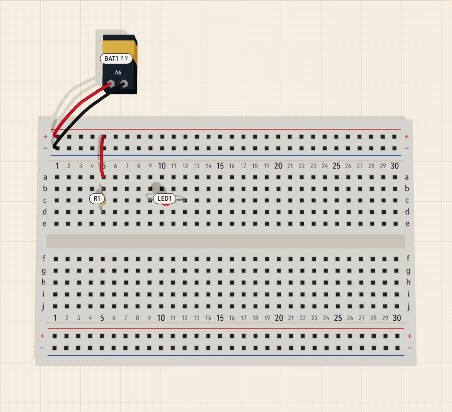
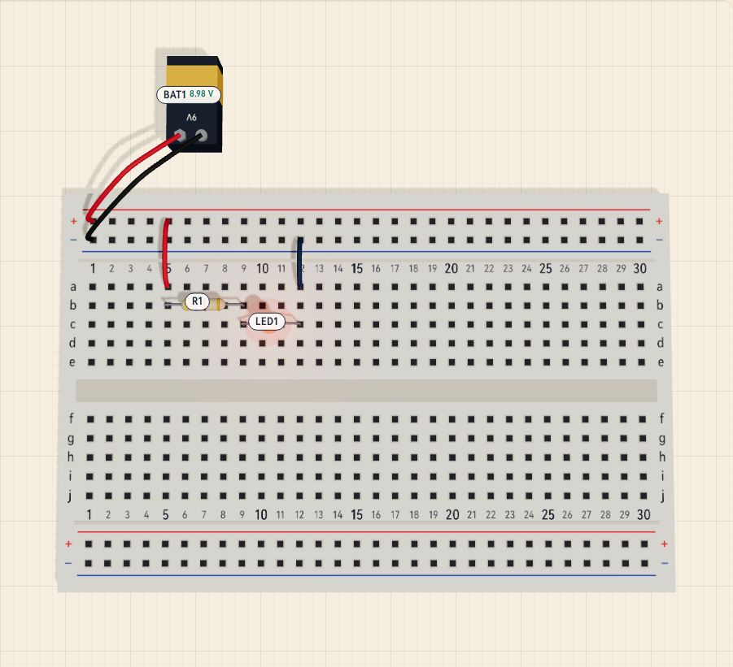
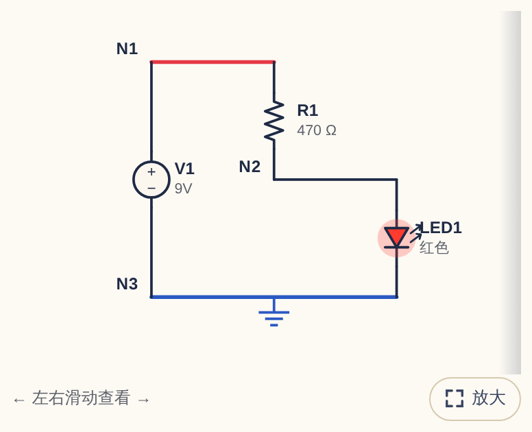
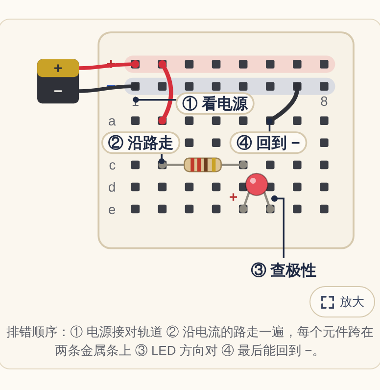

# 1.12 · 排错：这颗 LED 为什么不亮？

| 项目 | 内容 |
|---|---|
| id | `challenge-fix-the-circuit` |
| 文件 | `challenges/19-fix-the-circuit.json` |
| 类型 | 实验 / 挑战（没有分步，照目标电路图搭） · 难度 2/5 |
| 位置 | World 1 · 基础定律与直流分压 → 1.12 混联与排错（本节第 1 项） |
| 右侧面板 | 轨道由旧的四张卡片自动生成（还没手工精排） |
| 前后 | 上一项 [1.11 exp-current-divider](../w1/1.11-2-exp-current-divider.md) · 下一项 [1.12 challenge-series-parallel](../w1/1.12-2-challenge-series-parallel.md) |
| 先修 | — |
| 概念 | debugging 排错、node 结点、polarity 极性、return path 回路 |

**一句话概要**：面包板上已经有一个搭错的电路，里面藏着 3 处错误。按顺序查，把它修好。

## 1. 左侧工作台（3D 面包板 → 2D 俯视截图）

截图是程序里真实的 3D 面包板换成俯视角拍的；表格是同一块板的文字版（元件、参数、每只脚插在哪个孔）。

### 1.1 起点：打开这一课时板上已经有的

右侧显示的「起点」说明：

> **找错题**：板上已经有一个搭错的“电池 → 电阻 → LED → GND”电路。**为什么**：这道题练的是对照原理图检查面包板，而不是从头搭。**你要做**：找出所有错误（不止一处）并改好，让 LED 亮。

| 元件 | 类型 | 参数 | 引脚 → 孔 |
|---|---|---|---|
| BAT1 | battery | variant=9V | +→tp1 -→tn1 |
| W2 | wire |  | a→tp5 b→a5 |
| R1 | resistor | resistance=470 | 1→b5 2→d5 |
| LED1 | led | color=red | anode→c12 cathode→c9 |

### 1.3 参考答案（「看答案」载入的板子）

| 元件 | 类型 | 参数 | 引脚 → 孔 |
|---|---|---|---|
| BAT1 | battery | variant=9V | +→tp1 -→tn1 |
| W2 | wire |  | a→tp5 b→a5 |
| R1 | resistor | resistance=470 | 1→b5 2→b9 |
| LED1 | led | color=red | anode→c9 cathode→c12 |
| W5 | wire |  | a→a12 b→tn12 |

### 1.4 目标原理图（右侧「目标原理图」抽屉）

| 元件 | 类型 | 参数 |
|---|---|---|
| V1 | dc_source | voltage=9 |
| R1 | resistor | resistance=470 |
| LED1 | led | color=red |

连接（每个结点上的引脚）：

- **N1**：V1.+、R1.1
- **N2**：R1.2、LED1.anode
- **N3**：LED1.cathode、V1.-

## 2. 右侧面板：学生从上往下看到的内容（单轨流）

### 第 1 步 · 🔧 动手搭：它不亮

面包板上已经摆好了一个电路，**LED 不亮**。先别急着拔元件，看一看、摸一摸（把鼠标停在孔上，看哪些孔相通）。
你能找到几处不对？

### 第 2 步 · 💡 想明白：排错四步

1. **先看电源**：+ 和 − 是不是接到了正确的轨道？
2. **沿着电流的路走一遍**：从 + 出发，每经过一个元件，确认它的两只脚在**两条不同的金属条**上。
3. **查有极性的元件**：LED、二极管、电源的方向对不对？
4. **确认能回家**：电流最后能不能回到 −（GND）？

*图 `path`（breadboard）：排错顺序：① 电源接对轨道 ② 沿电流的路走一遍，每个元件跨在两条金属条上 ③ LED 方向对 ④ 最后能回到 −。*

小技巧：打开工具栏的**结点着色**——同一颜色就是同一个结点。

（这一步下面列着这节课的计算卡片，点开就地展开：`led-current`，全文见第 6 节）

### 第 3 步 · 🔧 动手搭：一处一处修

- 每修好一处，看看诊断有没有变化。
- 三处都修好，LED 就会亮。然后点「检查我的电路」。

### 第 4 步 · 📏 测一测：测一测：读你自己的仪表

**测量题 1 · `faults`**（选择题）

> 你修好的三处错误是：

- A. 电阻两只脚在同一列（被短路）、LED 插反了、LED 负极没有接回 GND ✅（正确）
- B. 电池接反了、电阻阻值错了、LED 颜色错了
- C. 跳线太长、LED 太暗、电池没电

答对后显示：

> 电阻插在 b5、d5（同一列，被金属条短路）；LED 长脚朝向了 GND 那边；LED 负极那一列没有跳线回到 − 轨。

### 第 5 步 · 🎒 带走：带走

- 排错要**有顺序**：电源 → 路径 → 极性 → 回路。乱拔乱插只会制造新问题。
- 有了万用表，还可以一列一列量结点电压：电压在哪里“断崖式”变化，问题就在哪里。
- 这三种错误（脚插在同一列、LED 插反、没接回 GND）是新手最常见的三种，以后自己搭电路时先查它们。

## 3. 测量题一览

| # | id | 题目 | 类型 | 单位 | 状态 | 参考读数 |
|---|---|---|---|---|---|---|
| 1 | faults | 你修好的三处错误是： | 选择 |  |  | 正确：A |

### 提示按钮（依次显示）

1. 先不要急着拔元件。打开结点着色（同一颜色 = 同一结点），从 +9 V 出发沿电流的路径走一遍：每个元件的两只脚是不是落在两种不同的颜色上？
2. 再看有极性的元件：LED 的长脚（阳极）应该朝向电流流来的一侧。最后确认电流能从 LED 之后一路回到蓝色 − 轨。
3. 还没找全？三处错误分别在：电阻两只脚的位置、LED 的方向、LED 负极那一列到 GND 的连接。

### 功能测试（「检查我的电路」时跑）

- LED 亮

## 5. 这一课的计算卡片

**计算卡片 `led-current`：LED 回路的电流 LED loop current**

- 公式 `I = \frac{V_s - ΣV_F}{R + Σr_d + R_{int}}`
- 用途：电源、电阻和一个或几个串联 LED：LED 实际流过多少电流。
- 输入：V_s（电源电动势，V）；V_F（所有 LED 的 V_F 之和（红 1.8、绿 2.1、蓝/白 3.0），V）；R（串联电阻（含电位器），Ω）；r_d（LED 内阻之和（每个 ≈ 12 Ω），Ω）；R_int（电源内阻（模块 ≈ 0、9 V 电池 1.5 Ω、纽扣电池 15 Ω），Ω） → I（回路电流（不够 ΣV_F 时为 0），A）

1. 导通的 LED 用折线模型看：一个电压源 $V_F$ 串一个小电阻 $r_d ≈ 12 Ω$（模拟器就是这样建模的）。
2. 整个回路串联，处处是同一个电流 I。
3. KVL：$V_s = I R_{int} + I R + ΣV_F + I Σr_d$。
4. 解出 $I = \frac{V_s - ΣV_F}{R + Σr_d + R_{int}}$。
5. 如果 $V_s < ΣV_F$，LED 根本不导通，I = 0：3 V 点不亮串联的红 + 绿 LED（需要 3.9 V）。
只用 $\frac{V_s - V_F}{R}$ 估算会偏大 1–2 mA，选电阻时够用；要和读数对比时把 $r_d$ 和内阻加上。

例子：- 挑战 1：9 V、220 Ω、红 + 绿：$I = \frac{9 - 3.9}{220 + 24} ≈ 21 mA$（只用 $V_F$ 估算是 23 mA）。
- 第 3 课：5 V、150 Ω、绿：$\frac{5 - 2.1}{150 + 12} ≈ 18 mA$，电阻上 $18 mA × 150 Ω ≈ 2.7 V$。
- 挑战 9：CR2032（3 V、15 Ω）、47 Ω、红：$\frac{3 - 1.8}{47 + 12 + 15} ≈ 16 mA$；不串电阻是 $\frac{1.2}{27} ≈ 44 mA$。
- 挑战 3：电位器转到 100 %：$\frac{5 - 1.8}{220 + 10k + 12} ≈ 0.31 mA$，灯灭。

- ⚠ 两个 LED 直接并联共用一个电阻：$V_F$ 小的先导通、把电压钳住，另一个几乎不亮——每个 LED 自己串一个电阻。
- ⚠ 电位器当可变电阻用时，它的阻值也在 R 里；转到 0 时只剩保护电阻。

## 6. English（界面英文版的同一份内容）

展开英文

### Node 1 · 🔧 Build：It won't light

A circuit is already on the board and **the LED is dark**. Don't start pulling parts yet — look first (hover over holes to see which ones are connected).
How many problems can you spot?

### Node 2 · 💡 Why：Four steps of fault-finding

1. **Supply first**: are + and − on the right rails?
2. **Walk the current path**: start at + and, at every part, check that its two legs sit on **two different metal strips**.
3. **Check polarised parts**: are the LEDs, diodes and supplies the right way round?
4. **Make sure it gets home**: can the current get back to − (GND)?

[figure `path`]

*Figure `path`（breadboard）：排错顺序：① 电源接对轨道 ② 沿电流的路走一遍，每个元件跨在两条金属条上 ③ LED 方向对 ④ 最后能回到 −。*

Tip: turn on **Node colours** in the toolbar — one colour is one node.

(This node lists the lesson’s calculation cards: `led-current`; full text in section 6)

### Node 3 · 🔧 Build：Fix them one at a time

- After each fix, see whether the diagnostics change.
- With all three fixed the LED lights. Then press Check my circuit.

### Node 4 · 📏 Measure：Measure: read your own instruments

**Question 1 · `faults`**（multiple choice）

> The three faults you fixed were:

- A. The resistor's legs in one column (shorted), the LED backwards, the LED's cathode not connected back to GND ✅ (right)
- B. The battery backwards, the wrong resistor value, the wrong LED colour
- C. A jumper too long, the LED too dim, a flat battery

Shown once right:

> The resistor sat in b5 and d5 (one column, shorted by the strip); the LED's long lead faced the GND side; the LED's cathode column had no jumper back to the − rail.

### Node 5 · 🎒 Take away：Take away

- Fault-finding needs **an order**: supply → path → polarity → way home. Random plugging and unplugging only makes new problems.
- With the multimeter you can also measure node voltages column by column: where the voltage falls off a cliff is where the problem is.
- These three faults (both legs in one column, an LED backwards, no way back to GND) are the three most common beginner mistakes — check for them first in your own circuits.

**Hints**

1. Don't pull anything yet. Turn on node colours (one colour = one node) and walk the current path from +9 V: does every part have its two legs on two different colours?
2. Then the polarised part: the LED's long lead (anode) should face where the current comes from. Finally check that the current can get from the LED all the way back to the blue − rail.
3. Still missing some? The three faults are: where the resistor's legs are, which way the LED points, and the connection from the LED's cathode column to GND.

