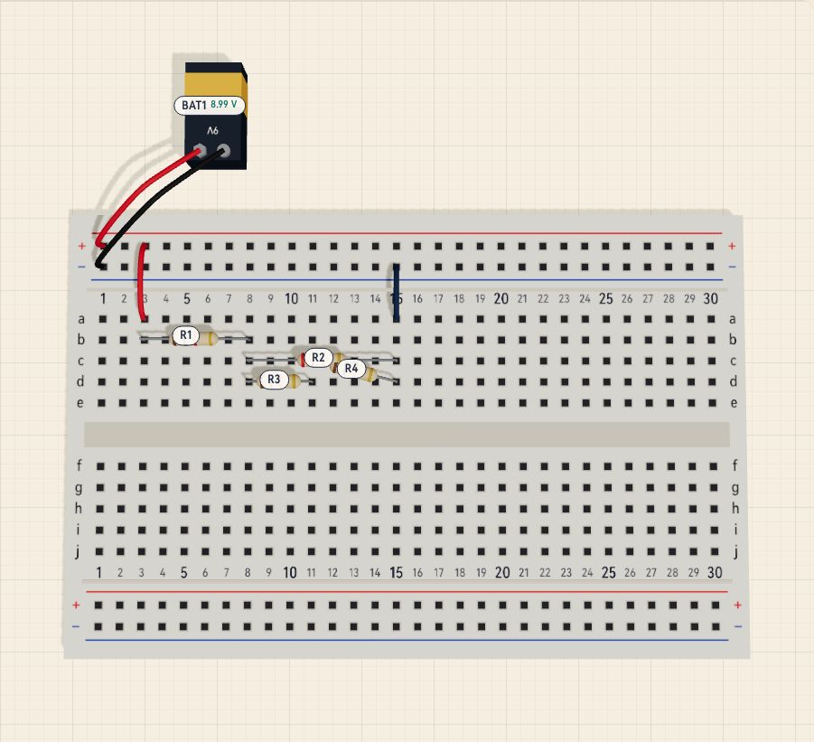
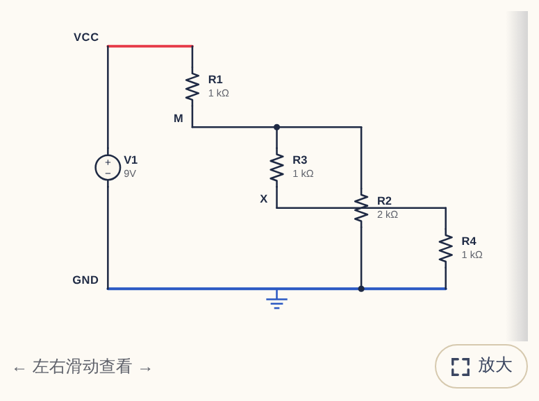
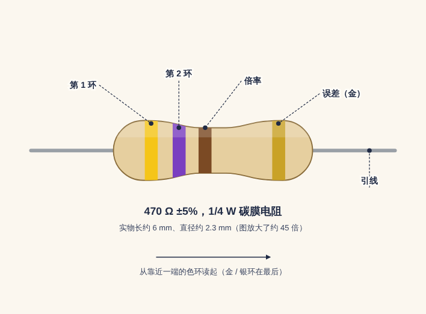
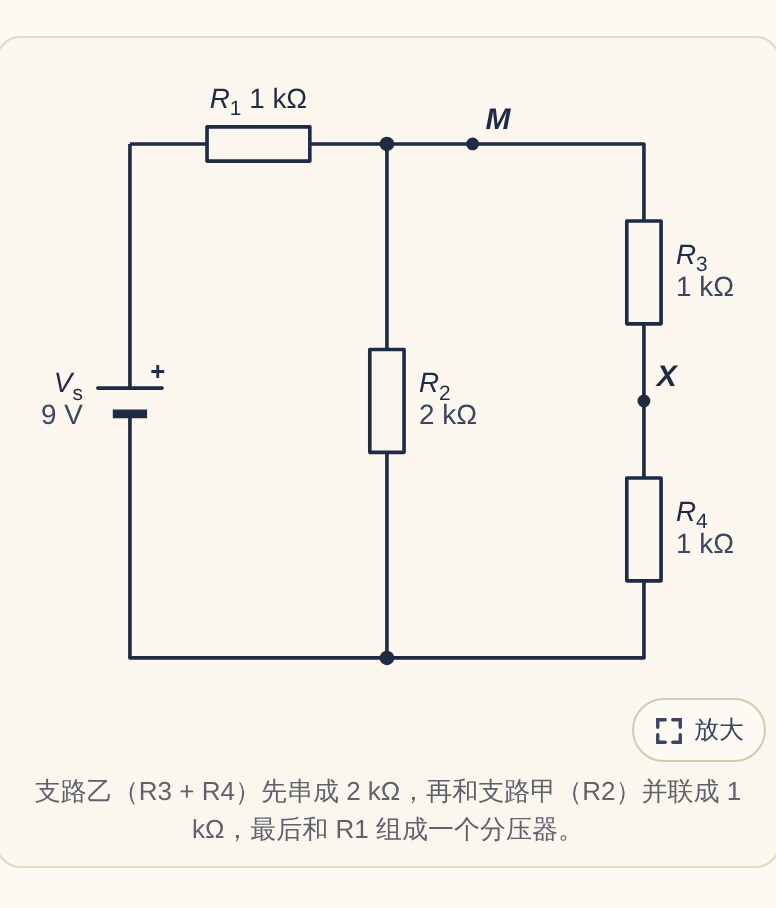

# 1.12 · 串并联混合网络

| 项目 | 内容 |
|---|---|
| id | `challenge-series-parallel` |
| 文件 | `challenges/15-series-parallel-network.json` |
| 类型 | 实验 / 挑战（没有分步，照目标电路图搭） · 难度 4/5 |
| 位置 | World 1 · 基础定律与直流分压 → 1.12 混联与排错（本节第 2 项） |
| 右侧面板 | 轨道由旧的四张卡片自动生成（还没手工精排） |
| 前后 | 上一项 [1.12 challenge-fix-the-circuit](../w1/1.12-1-challenge-fix-the-circuit.md) · 下一项 [1.12 exp-measure-req](../w1/1.12-3-exp-measure-req.md) |
| 先修 | — |
| 概念 | series-parallel 串并联、equivalent resistance 等效电阻、voltage divider 分压 |

**一句话概要**：先把网络一步步化简，算出两个结点的电压，再搭出来用万用表核对。

## 1. 左侧工作台（3D 面包板 → 2D 俯视截图）

截图是程序里真实的 3D 面包板换成俯视角拍的；表格是同一块板的文字版（元件、参数、每只脚插在哪个孔）。

### 1.1 起点：空面包板（学生从零开始搭）

### 1.3 参考答案（「看答案」载入的板子）

| 元件 | 类型 | 参数 | 引脚 → 孔 |
|---|---|---|---|
| BAT1 | battery | variant=9V | +→tp1 -→tn1 |
| W2 | wire |  | a→tp3 b→a3 |
| R1 | resistor | resistance=1000 | 1→b3 2→b8 |
| R2 | resistor | resistance=2000 | 1→c8 2→c15 |
| R3 | resistor | resistance=1000 | 1→d8 2→d11 |
| R4 | resistor | resistance=1000 | 1→c11 2→d15 |
| W7 | wire |  | a→a15 b→tn15 |

### 1.4 目标原理图（右侧「目标原理图」抽屉）

| 元件 | 类型 | 参数 |
|---|---|---|
| V1 | dc_source | voltage=9 |
| R1 | resistor | resistance=1000 |
| R2 | resistor | resistance=2000 |
| R3 | resistor | resistance=1000 |
| R4 | resistor | resistance=1000 |

连接（每个结点上的引脚）：

- **VCC**：V1.+、R1.1
- **M**：R1.2、R2.1、R3.1
- **X**：R3.2、R4.1
- **GND**：R2.2、R4.2、V1.-

## 2. 右侧面板：学生从上往下看到的内容（单轨流）

### 第 1 步 · 🔍 先看一眼：先认识它：电阻

**拆解「电阻 Resistor：一圈碳膜决定的数字」第 1 / 7 层：① 外形：两只脚、一段带色环的小棒**

这是课程里最常见的 **axial resistor（轴向引线电阻）**：一段 米黄色的小棒，两头各伸出一根 镀锡铜引线 lead。它 **没有极性**（polarity）：两只脚完全一样，怎么插都行。

小棒上印的不是数字，而是 4 条 **colour band（色环）**：
- 前两条 第 1 环、第 2 环 是阻值的两位 **有效数字**；
- 第 3 环 是 **倍率**（multiplier），即乘以 10 的几次方；
- 和其他环隔开一点的 第 4 环 是 **误差**（tolerance），金色 = ±5%。

为什么不直接印数字？电阻是圆柱，印的字转过去就看不见，而且只有几毫米长；色环 **从任何方向都能读**。大小则决定了它能承受的 **功率**：这种 6 mm 长的是 **1/4 W**（0.25 W），后面第 ⑥ 层会算它。

| 部位 | 是什么 | 图上这只（470 Ω） |
|---|---|---|
| 第 1 环 | 第一位有效数字 | 黄 = 4 |
| 第 2 环 | 第二位有效数字 | 紫 = 7 |
| 第 3 环 | 倍率 ×10ⁿ | 棕 = ×10¹ |
| 第 4 环 | 误差 | 金 = ±5% |
| 引线 | 镀锡铜线，无极性 | 插进面包板两条不同的金属条 |

### 第 2 步 · 🔧 动手搭：先算，再搭

这一题没有步骤。动手之前，先在纸上把网络**从最远处往回化简**，预测 M 和 X 的电压。

### 第 3 步 · 💡 想明白：一层一层化简

1. 支路乙是串联：$R_3 + R_4 = 2$ kΩ。
2. 支路甲和支路乙并联：$2\ \text{k} \parallel 2\ \text{k} = 1$ kΩ（两个一样的电阻并联，等于一半）。
3. 这 1 kΩ 再和 R1 串联，就是一个分压器：M 点 = 9 V × 1 / (1 + 1)。
4. X 在 R3、R4 中间，又是一个分压器：X = M × 1 / (1 + 1)。

*图 `network`（schematic）：支路乙（R3 + R4）先串成 2 kΩ，再和支路甲（R2）并联成 1 kΩ，最后和 R1 组成一个分压器。*

并联公式：$R_a \parallel R_b = \frac{R_a R_b}{R_a + R_b}$。

（这一步下面列着这节课的计算卡片，点开就地展开：`series-resistance`、`parallel-resistance`、`equivalent-resistance`，全文见第 6 节）

### 第 4 步 · 🔧 动手搭：搭好，量两个结点

- 先给每个结点分一条金属条：M、X 各一列，再加一列接 GND。
- R2 和（R3 + R4）的两端分别都在 M 和 GND 上。

### 第 5 步 · 📏 测一测：测一测：读你自己的仪表

**测量题 1 · `vm`**（读数题）

> 万用表：结点 M 对 GND 的电压

- 单位 V · 先写预测 · 参考答案的读数 **4.497 V** · 合理范围 [4.35, 4.6]

答对后显示：

> R2 ∥ (R3 + R4) = 1 kΩ，和 R1 分压：9 × 1 / 2 = 4.5 V。

**测量题 2 · `vx`**（读数题）

> 万用表：结点 X 对 GND 的电压

- 单位 V · 先写预测 · 参考答案的读数 **2.248 V** · 合理范围 [2.15, 2.32]

答对后显示：

> R3、R4 一样大，X 正好在 M 的一半：4.5 / 2 = 2.25 V。

### 第 6 步 · 🎒 带走：带走

- 化简口诀：**从离电源最远的地方开始，串联就加，并联就“积除以和”**，一层一层往回收。
- 化简只是为了算总电流或某个结点电压；算完要**回到原电路**去求支路里的电流和电压。

趁热练理论题：`equivalence`

## 3. 测量题一览

| # | id | 题目 | 类型 | 单位 | 状态 | 参考读数 |
|---|---|---|---|---|---|---|
| 1 | vm | 万用表：结点 M 对 GND 的电压 | voltage | V |  | 4.497 V |
| 2 | vx | 万用表：结点 X 对 GND 的电压 | voltage | V |  | 2.248 V |

### 提示按钮（依次显示）

1. 先给每个结点分一条金属条：M、X 各一列，再加一列接 GND。
2. R2 和（R3 + R4）的两端都分别在 M 和 GND 上。

### 功能测试（「检查我的电路」时跑）

- M、X 两个结点的电压合理

## 4. 用到的拆解（全部层的文字，供改写参考）

### 拆解 `resistor`：电阻 Resistor：一圈碳膜决定的数字

*从色环读数，到陶瓷棒上的碳膜（carbon film）和激光切出的螺旋，再到 R = ρL/A、欧姆定律的直线、额定功率和误差。看完你就知道“470 Ω”这个数字是怎么做出来的，以及它在什么时候不再可信。*

**拆解「电阻 Resistor：一圈碳膜决定的数字」第 1 / 7 层：① 外形：两只脚、一段带色环的小棒**

这是课程里最常见的 **axial resistor（轴向引线电阻）**：一段 米黄色的小棒，两头各伸出一根 镀锡铜引线 lead。它 **没有极性**（polarity）：两只脚完全一样，怎么插都行。

小棒上印的不是数字，而是 4 条 **colour band（色环）**：
- 前两条 第 1 环、第 2 环 是阻值的两位 **有效数字**；
- 第 3 环 是 **倍率**（multiplier），即乘以 10 的几次方；
- 和其他环隔开一点的 第 4 环 是 **误差**（tolerance），金色 = ±5%。

为什么不直接印数字？电阻是圆柱，印的字转过去就看不见，而且只有几毫米长；色环 **从任何方向都能读**。大小则决定了它能承受的 **功率**：这种 6 mm 长的是 **1/4 W**（0.25 W），后面第 ⑥ 层会算它。

| 部位 | 是什么 | 图上这只（470 Ω） |
|---|---|---|
| 第 1 环 | 第一位有效数字 | 黄 = 4 |
| 第 2 环 | 第二位有效数字 | 紫 = 7 |
| 第 3 环 | 倍率 ×10ⁿ | 棕 = ×10¹ |
| 第 4 环 | 误差 | 金 = ±5% |
| 引线 | 镀锡铜线，无极性 | 插进面包板两条不同的金属条 |

**拆解「电阻 Resistor：一圈碳膜决定的数字」第 2 / 7 层：② 读色环：470 Ω 和 10 kΩ**

规则只有一句：**阻值 = (第 1 环)(第 2 环) × 10^(第 3 环)**。每种颜色对应一个数字，见下表和 图下方的色卡。

**例 1**：黄 紫 棕 金（第 1 课、第 3 课用的那只）
$$R = 47 × 10^{1} = 470 Ω，误差 ±5% → 446.5 … 493.5 Ω$$
**例 2**：棕 黑 橙 金（电位器、分压实验里常见）
$$R = 10 × 10^{3} = 10 000 Ω = 10 kΩ，误差 ±5% → 9.5 … 10.5 kΩ$$

**从哪头读？** 金、银环一定在最后；第 1 环更靠近端头。拿不准时就两头都读一遍，读出的值不在标准系列（E12 / E24，见第 ⑦ 层）里的那个方向就是反的。

**蓝色身体、5 条环** 的是 **metal film resistor（金属膜电阻）**：前三条是有效数字，第 4 条是倍率，第 5 条是误差（棕 = ±1%）。例如 470 Ω ±1% = 黄 紫 黑 黑 棕（470 × 10⁰）。

记颜色的顺序：黑棕红橙黄绿蓝紫灰白，正好是彩虹（红→紫）夹在“黑棕”和“灰白”之间。

| 颜色 | 数字 | 倍率 | 误差 |
|---|---|---|---|
| 黑 | 0 | ×1 | — |
| 棕 | 1 | ×10 | ±1% |
| 红 | 2 | ×100 | ±2% |
| 橙 | 3 | ×1 k | — |
| 黄 | 4 | ×10 k | — |
| 绿 | 5 | ×100 k | ±0.5% |
| 蓝 | 6 | ×1 M | ±0.25% |
| 紫 | 7 | ×10 M | ±0.1% |
| 灰 | 8 | — | — |
| 白 | 9 | — | — |
| 金 | — | ×0.1 | ±5% |
| 银 | — | ×0.01 | ±10% |

- 公式 `R = (d_1 d_2) × 10^{m}`：黄紫棕：47 × 10¹ = 470 Ω；棕黑橙：10 × 10³ = 10 kΩ

**拆解「电阻 Resistor：一圈碳膜决定的数字」第 3 / 7 层：③ X 光：陶瓷棒、一层膜、一道螺旋槽**

把那层米黄色的 **epoxy paint（环氧漆）** 变透明，里面只有四样东西：
1. 陶瓷棒 ceramic core：绝缘、耐热，只是个“骨架”，电流不走它。
2. 导电膜 film：棒外面镀的一层很薄的膜，**电流全部从这层膜里流过**。碳膜电阻（carbon film，米黄色身体）镀的是碳，约 1 µm 厚；金属膜电阻（metal film，蓝色身体）镀的是镍铬合金（NiCr），只有几十 nm 厚。
3. 螺旋槽 spiral cut：工厂用激光沿螺旋线把膜切开，电流只能 **沿着螺旋绕圈** 从一头走到另一头。
4. 金属端帽 end cap：压在两端，把膜和 引线 连起来。

**阻值就是由这道螺旋决定的**：切得越密、绕的圈越多，电阻越大。生产时一边切一边测，测到 470 Ω 就停——这叫 **laser trimming（激光修调）**。下一层用公式解释为什么。

**拆解「电阻 Resistor：一圈碳膜决定的数字」第 4 / 7 层：④ 为什么螺旋决定阻值：R = ρL/A**

一段均匀导体的电阻由三件事决定：材料的 **resistivity（电阻率）ρ**、长度 L、截面积 A：
$$R = \frac{ρL}{A}$$
- 越 长，电子要走的路越远 → R ∝ L；
- 越 粗，并排能走的路越多 → R ∝ 1/A。

膜很薄（厚度 t），截面积 $A = w·t$（w 是膜的宽度），所以 $R = \frac{ρ}{t}·\frac{L}{w}$。$R_□ = \frac{ρ}{t}$ 叫 **sheet resistance（方块电阻）**，单位 Ω/□：一块 **正方形** 膜（L = w）不管多大，电阻都是 $R_□$。于是阻值 = $R_□$ × “这条膜有几个方块长”。

**带数字算一遍**（碳膜：ρ ≈ 3×10⁻⁵ Ω·m，t ≈ 1 µm → $R_□ ≈ 30 Ω/□$；棒长 6 mm，周长 6.3 mm）：
- 不切：电流沿 6 mm 长、6.3 mm 宽的一整张膜走，$R = 30 × \frac{6}{6.3} ≈ 29 Ω$；
- 螺旋切成 0.5 mm 宽、绕 12 圈：膜变成一条 12 × 6.3 ≈ 75 mm 长、0.5 mm 宽的窄带，$R = 30 × \frac{75}{0.5} = 30 × 150 = 4.5 kΩ$。

同一根棒、同一种膜，只靠切法就从 29 Ω 变到 4.5 kΩ——这就是 激光螺旋 的作用。要 MΩ 级就换 $R_□$ 更大的膜，要几 Ω 就用更厚的膜或金属丝绕（wirewound）。

- 公式 `R = \frac{ρL}{A} = R_□ · \frac{L}{w}`：$R_□$ = ρ / t：方块电阻
- 公式 `R = 30 Ω × \frac{75 mm}{0.5 mm} = 4.5 kΩ`：螺旋切后的膜：150 个方块

**拆解「电阻 Resistor：一圈碳膜决定的数字」第 5 / 7 层：⑤ 等效电路：一个 R，一条过原点的直线**

在电路里，电阻就是 一个参数 R（ANSI 画锯齿，IEC 画方框）。它的全部行为是 **Ohm’s law（欧姆定律）**：
$$V = R·I ⇔ I = \frac{V}{R}$$
注意参考方向：电流 I 从 V 的 + 端 流进（**关联参考方向** passive sign convention），这样公式里没有负号。

把它画成 **V–I 图**：每个电阻是一条 **过原点的直线**，斜率是 $\frac{1}{R}$（也叫 **conductance 电导** G，单位 S）：
- 470 Ω：9 V 时 $I = \frac{9}{470} = 19.1 mA$；
- 1 kΩ：9 V 时 9 mA；
- 10 kΩ：9 V 时只有 0.9 mA，线几乎贴着横轴。

“直线”是电阻最重要的性质——**linear（线性）**：电压加倍，电流也加倍；正反两个方向一样。后面的 LED、二极管就 **不是** 直线，这正是它们需要单独拆开讲的原因。

- 公式 `V = R·I`：关联参考方向（电流从 + 端流入）
- 公式 `G = \frac{1}{R} = \frac{1}{470 Ω} = 2.13 mS`：V–I 图里直线的斜率

**拆解「电阻 Resistor：一圈碳膜决定的数字」第 6 / 7 层：⑥ 电阻会发热：功率和 1/4 W 额定值**

电流流过膜时，电子不断撞上原子，电能全部变成 **热**（焦耳热 Joule heating）。每秒变成热的能量就是功率：
$$P = V·I = I^{2}R = \frac{V^{2}}{R}$$
三个式子是同一件事，用欧姆定律互换。哪个量已知就用哪个。

**第 1 课的 470 Ω**：9 V 电池、红 LED，电流约 14.9 mA，电阻两端约 7.0 V：
$$P = I^{2}R = (0.0149)^{2} × 470 ≈ 0.104 W$$
小于 额定值 0.25 W，安全。这时它比室温高约 $0.104 × 250 ≈ 26 °C$（250 °C/W 是这种小电阻的 **thermal resistance 热阻**）——摸上去温温的，正常。

**危险的情况**：把一个 220 Ω 直接接在 9 V 上，$P = \frac{81}{220} = 0.37 W$，超过额定值，会烫手、变色、冒烟，阻值永久漂移。100 Ω 直接接 9 V 是 0.81 W，几秒就烧焦。

**反过来算**：1/4 W 的 470 Ω 两端最多能加 $V = \sqrt{P·R} = \sqrt{0.25 × 470} ≈ 10.8 V$。经验是只用到额定值的一半，即 ≤ 0.125 W。

| 情况 | V | I | P | 1/4 W 行吗 |
|---|---|---|---|---|
| 第 1 课 470 Ω | 7.0 V | 14.9 mA | 0.10 W | ✔ 温温的 |
| 串联课 220 Ω | 3.5 V | 16 mA | 0.056 W | ✔ |
| 220 Ω 直接接 9 V | 9 V | 41 mA | 0.37 W | ✘ 过热 |
| 100 Ω 直接接 9 V | 9 V | 90 mA | 0.81 W | ✘ 烧焦 |

- 公式 `P = V·I = I^{2}R = \frac{V^{2}}{R}`：单位 W（瓦）= V·A
- 公式 `V_{max} = \sqrt{P_{rated}·R} = \sqrt{0.25 × 470} ≈ 10.8 V`

**拆解「电阻 Resistor：一圈碳膜决定的数字」第 7 / 7 层：⑦ 真实电阻差多少：误差、温漂、寄生参数**

**误差 tolerance**：金环 ±5% 的 470 Ω，真实值在 446.5–493.5 Ω 之间任何地方。所以电阻只做成 **标准值系列**：E12（±10%，每十倍 12 个值：10、12、15、18、22、27、33、39、47、56、68、82）和 E24（±5%，再插进 11、13、16、20、24、30、36、43、51、62、75、91）。相邻值的 误差带刚好接上，任何阻值都能找到一个“误差范围内”的标准件。算出 467 Ω → 选 470 Ω。

**温漂 temperature coefficient**：$R(T) = R_0(1 + α·ΔT)$。碳膜 α ≈ −300 ppm/°C（变热时阻值 **下降**），金属膜约 ±50 ppm/°C。前面那只热了 26 °C 的 470 Ω 只变了约 $470 × 300×10^{-6} × 26 ≈ 3.7 Ω$，比误差小得多。

**寄生参数 parasitics**：螺旋膜本身就是一个小 **线圈**，带来 串联电感 $L_s$ 几 nH；两个端帽像两块极板，带来 并联电容 $C_p$ 零点几 pF。它们只有在几十 MHz 以上才显出来；本课程最高到几百 kHz，可以忽略。

**仿真器里**：电阻是 理想的 R——精确等于标称值、没有误差、不发热、**不检查功率**。所以仿真里 100 Ω 接 9 V 不会冒烟，但真实的 1/4 W 电阻会。每次接线前都用上一层的 $P = \frac{V^{2}}{R}$ 检查一遍。

| 性质 | 碳膜（米黄） | 金属膜（蓝） | 仿真器 |
|---|---|---|---|
| 误差 | ±5% | ±1% | 0 |
| 温漂 α | ≈ −300 ppm/°C | ≈ ±50 ppm/°C | 0 |
| 额定功率 | 1/4 W | 1/4 W | 不检查 |
| 寄生 L / C | ≈ 5 nH / 0.3 pF | ≈ 5 nH / 0.3 pF | 无 |

- 公式 `R(T) = R_0 (1 + α·ΔT)`：碳膜 470 Ω、热 26 °C：约 −3.7 Ω

**一句话记住**：电阻 = 陶瓷棒上一层被螺旋切开的膜；**螺旋越长越窄，R = ρL/A 越大**。电路里它就是一条过原点的直线 $V = RI$，代价是发热 $P = I^{2}R$——1/4 W 的电阻要留一半余量。色环告诉你标称值和误差，仿真器把它当成精确、不会烧的理想电阻。

## 5. 这一课的计算卡片

**计算卡片 `series-resistance`：串联电阻 Series resistors**

- 公式 `R_{eq} = R_1 + R_2 + R_3`
- 用途：几个电阻首尾相连、流过同一个电流时，求总电阻。
- 输入：R1（R₁，Ω）；R2（R₂，Ω）；R3（R₃（没有就填 0），Ω） → R_eq（等效电阻，Ω）

串联 = 同一个电流 I 依次流过每个电阻。由 KVL，总电压是各段电压之和：
$$V = IR_1 + IR_2 + IR_3 = I(R_1 + R_2 + R_3)$$
所以对外看，它们等于一个 $R_{eq} = R_1 + R_2 + R_3$ 的电阻。串联总电阻 **一定比其中最大的还大**。

- ⚠ “首尾相连”不够：中间结点不能再接别的支路，否则就不是串联。

**计算卡片 `parallel-resistance`：并联电阻 Parallel resistors**

- 公式 `R_1 ∥ R_2 = \frac{R_1 R_2}{R_1 + R_2}`
- 用途：两个电阻接在同一对结点之间（两端电压相同）时，求总电阻。
- 输入：R1（R₁，Ω）；R2（R₂，Ω） → R_eq（等效电阻，Ω）

并联 = 两端是同一个电压 V。由 KCL，总电流是两条支路电流之和：
$$I = \frac{V}{R_1} + \frac{V}{R_2} = V(\frac{1}{R_1} + \frac{1}{R_2})$$
所以 $\frac{1}{R_{eq}} = \frac{1}{R_1} + \frac{1}{R_2}$，两个电阻时化简成“积除以和”。用 **电导** $G = \frac{1}{R}$ 想更直观：并联时电导相加。
**快速估算**：并联总电阻 **一定比最小的还小**；10 kΩ ∥ 1 kΩ ≈ 0.91 kΩ，大电阻几乎不起作用。

- ⚠ “积除以和”只适用于两个电阻；三个以上用倒数和。

**计算卡片 `equivalent-resistance`：串并联网络的等效电阻**

- 公式 `R_{eq} = R_1 + R_2 ∥ (R_3 + R_4 ∥ R_5)`
- 用途：从离电源最远的地方往回一层层化简，得到整个网络的等效电阻，再一层层往回求电流电压。
- 输入：R_1（R₁，Ω）；R_2（R₂，Ω）；R_3（R₃，Ω）；R_4（R₄，Ω）；R_5（R₅（没有就填 0），Ω） → R_eq（等效电阻，Ω）

判断规则：**串联** = 流过同一个电流（中间结点没有别的支路）；**并联** = 两端接在同一对结点上。
1. 最远处：R₄ 和 R₅ 都在 B 与 GND 之间，并联：$R_4 ∥ R_5$。
2. R₃ 和这一团流过同一个电流，串联：$R_3 + R_4 ∥ R_5$。
3. 这一支和 R₂ 都在 A 与 GND 之间，并联。
4. 再串上 R₁，得到 $R_{eq}$。
5. 往回走：$I = \frac{V_s}{R_{eq}}$，$V_A = V_s - IR_1$，$I_2 = \frac{V_A}{R_2}$，$I_3 = I - I_2$，$V_B = V_A - I_3R_3$……每一步都能用 KCL / KVL 核对。

例子：实验 1-7：$3.3 ∥ 4.7 ≈ 1.939 k$，$+ 1 = 2.939 k$，$∥ 2.2 ≈ 1.258 k$，$+ 1 ≈ 2.258 kΩ$；$I = \frac{9}{2.258} ≈ 3.99 mA$，$V_A ≈ 5.01 V$，$V_B ≈ 3.31 V$。挑战 7（R₅ 填 0）：$1k + 2k ∥ (1k + 1k) = 2 kΩ$，M 点 4.5 V，X 点 2.25 V。

- ⚠ 并联看的是“两端是不是同一对结点”，不是画出来是不是平行。
- ⚠ 真实电流表串在电路里会多出几欧，V/I 法测出的 $R_eq$ 偏大这么多。

## 6. English（界面英文版的同一份内容）

展开英文

### Node 1 · 🔍 Look first：Meet it first: Resistor

**Teardown「The resistor: a number set by a spiral of film」layer 1 of 7：① Outside: two leads and a little rod with coloured bands**

This is the most common resistor in the course, an **axial resistor**: a little beige rod with a tinned copper lead at each end. It has **no polarity**: the two leads are identical, plug it in either way.

The rod carries no digits but 4 **colour bands**:
- the first two, band 1 and band 2, are the two **significant digits** of the value;
- band 3 is the **multiplier**, the power of ten;
- band 4, set a little apart, is the **tolerance** — gold = ±5 %.

Why not print digits? A resistor is a cylinder a few millimetres long — printed text would be hidden on the far side. Bands **read from any angle**. The size sets the **power** it can take: this 6 mm one is a **1/4 W** (0.25 W) part, which layer ⑥ calculates with.

| Part | What it is | This one (470 Ω) |
|---|---|---|
| Band 1 | first digit | yellow = 4 |
| Band 2 | second digit | violet = 7 |
| Band 3 | multiplier ×10ⁿ | brown = ×10¹ |
| Band 4 | tolerance | gold = ±5 % |
| Leads | tinned copper, no polarity | into two different breadboard strips |

### Node 2 · 🔧 Build：Work it out, then build it

No steps here. Before you build, simplify the network on paper **from the far end back towards the source** and predict the voltages at M and X.

### Node 3 · 💡 Why：Simplify layer by layer

1. Branch B is in series: $R_3 + R_4 = 2$ kΩ.
2. Branches A and B in parallel: $2\ \text{k} \parallel 2\ \text{k} = 1$ kΩ (two equal resistors in parallel give half).
3. That 1 kΩ in series with R1 is a divider: M = 9 V × 1 / (1 + 1).
4. X sits between R3 and R4 — another divider: X = M × 1 / (1 + 1).

[figure `network`]

*Figure `network`（schematic）：支路乙（R3 + R4）先串成 2 kΩ，再和支路甲（R2）并联成 1 kΩ，最后和 R1 组成一个分压器。*

Parallel formula: $R_a \parallel R_b = \frac{R_a R_b}{R_a + R_b}$.

(This node lists the lesson’s calculation cards: `series-resistance`、`parallel-resistance`、`equivalent-resistance`; full text in section 6)

### Node 4 · 🔧 Build：Build it, measure two nodes

- Give each node a strip first: one column each for M and X, plus one to GND.
- R2 and (R3 + R4) both connect between M and GND.

### Node 5 · 📏 Measure：Measure: read your own instruments

**Question 1 · `vm`**（reading）

> Multimeter: node M relative to GND

- unit V · predict first · range [4.35, 4.6]

Shown once right:

> R2 ∥ (R3 + R4) = 1 kΩ, a divider with R1: 9 × 1 / 2 = 4.5 V.

**Question 2 · `vx`**（reading）

> Multimeter: node X relative to GND

- unit V · predict first · range [2.15, 2.32]

Shown once right:

> R3 and R4 are equal, so X sits at half of M: 4.5 / 2 = 2.25 V.

### Node 6 · 🎒 Take away：Take away

- The recipe: **start furthest from the source; in series add, in parallel "product over sum"**, and fold it back layer by layer.
- Simplifying only gives you the total current or a node voltage; to find a branch current or voltage, **go back to the original circuit**.

Practise：`equivalence`

**Hints**

1. Give each node a strip: one column each for M and X, plus one going to GND.
2. R2 and (R3 + R4) both have their ends on M and GND.

