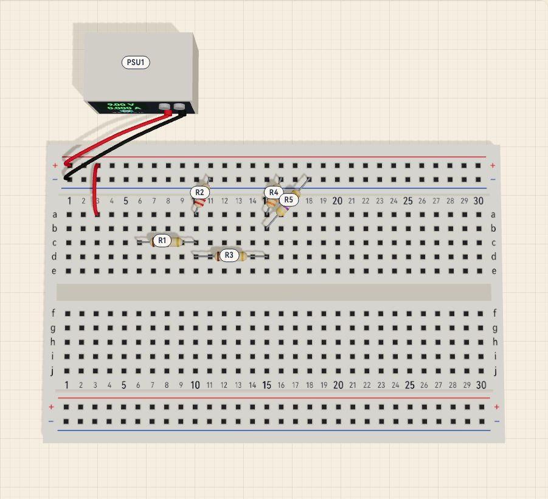
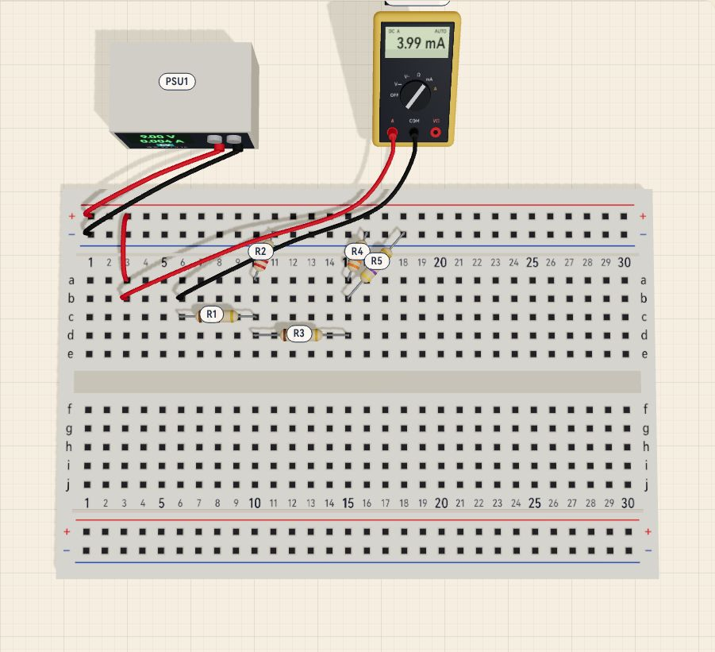
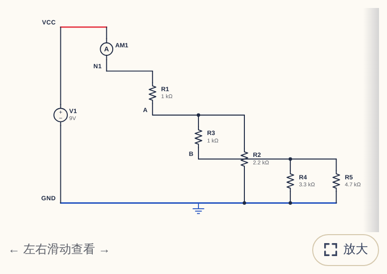
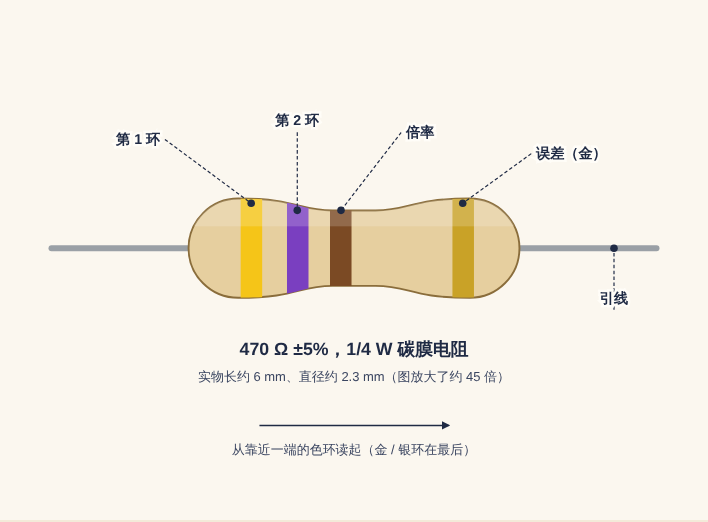
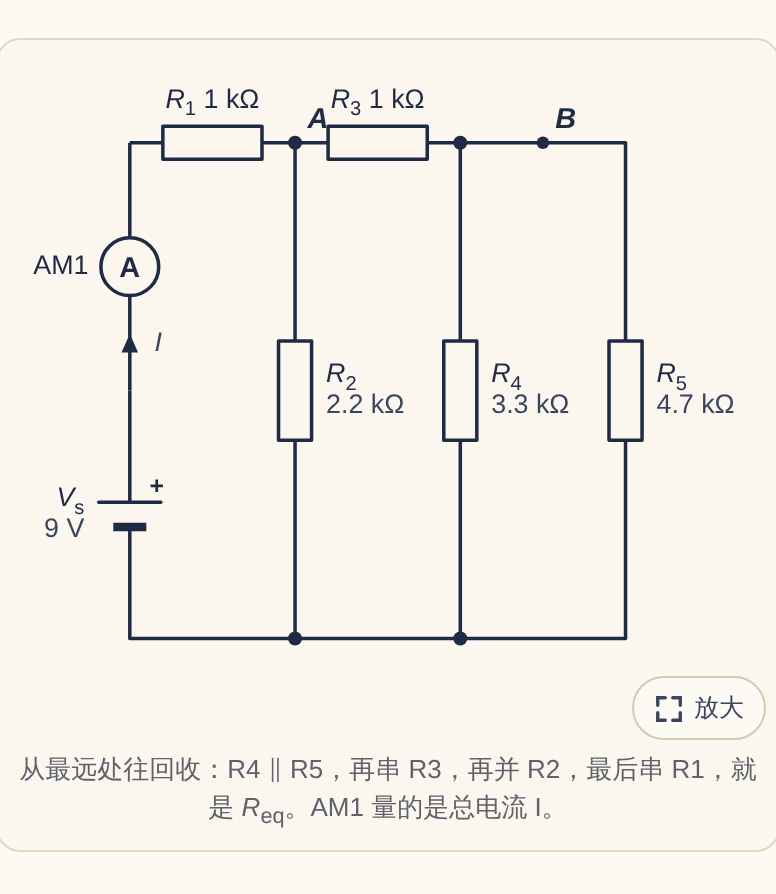

# 1.12 · 测出一个网络的等效电阻

| 项目 | 内容 |
|---|---|
| id | `exp-measure-req` |
| 文件 | `challenges/207-measure-req.json` |
| 类型 | 实验 / 挑战（没有分步，照目标电路图搭） · 难度 4/5 |
| 位置 | World 1 · 基础定律与直流分压 → 1.12 混联与排错（本节第 3 项） |
| 右侧面板 | 轨道由旧的四张卡片自动生成（还没手工精排） |
| 前后 | 上一项 [1.12 challenge-series-parallel](../w1/1.12-2-challenge-series-parallel.md) · 下一项 [2.1 exp-nodal-analysis](../w2/2.01-1-exp-nodal-analysis.md) |
| 先修 | lesson-ammeter、lesson-multimeter |
| 概念 | equivalent resistance 等效电阻、series-parallel 串并联、Ohm's law 欧姆定律、measured vs calculated 测量与计算 |

**一句话概要**：五个电阻的串并联网络：先算 Req，再用 Req = V / I 把它测出来。

## 1. 左侧工作台（3D 面包板 → 2D 俯视截图）

截图是程序里真实的 3D 面包板换成俯视角拍的；表格是同一块板的文字版（元件、参数、每只脚插在哪个孔）。

### 1.1 起点：打开这一课时板上已经有的

右侧显示的「起点」说明：

> **半成品**：五个电阻的串并联网络和电源都已搭好。**为什么**：这个实验要学的是“Req = U / I”的测法和逐条支路核对，网络的接法第 5、6 课练过。**你要做**：把电流表串在电源和网络之间（第 3 列 → 第 6 列），再用万用表量电压。

| 元件 | 类型 | 参数 | 引脚 → 孔 |
|---|---|---|---|
| PSU1 | bench_supply | voltage=9, currentLimit=0.1 | +→tp1 -→tn1 |
| W2 | wire |  | a→tp3 b→a3 |
| R1 | resistor | resistance=1000 | 1→c6 2→c10 |
| R2 | resistor | resistance=2200 | 1→a10 2→tn11 |
| R3 | resistor | resistance=1000 | 1→d10 2→d15 |
| R4 | resistor | resistance=3300 | 1→a15 2→tn16 |
| R5 | resistor | resistance=4700 | 1→b15 2→tn18 |

### 1.3 参考答案（「看答案」载入的板子）

| 元件 | 类型 | 参数 | 引脚 → 孔 |
|---|---|---|---|
| PSU1 | bench_supply | voltage=9, currentLimit=0.1 | +→tp1 -→tn1 |
| W2 | wire |  | a→tp3 b→a3 |
| AM1 | ammeter |  | +→b3 -→b6 |
| R1 | resistor | resistance=1000 | 1→c6 2→c10 |
| R2 | resistor | resistance=2200 | 1→a10 2→tn11 |
| R3 | resistor | resistance=1000 | 1→d10 2→d15 |
| R4 | resistor | resistance=3300 | 1→a15 2→tn16 |
| R5 | resistor | resistance=4700 | 1→b15 2→tn18 |

### 1.4 目标原理图（右侧「目标原理图」抽屉）

| 元件 | 类型 | 参数 |
|---|---|---|
| V1 | dc_source | voltage=9 |
| AM1 | ammeter |  |
| R1 | resistor | resistance=1000 |
| R2 | resistor | resistance=2200 |
| R3 | resistor | resistance=1000 |
| R4 | resistor | resistance=3300 |
| R5 | resistor | resistance=4700 |

连接（每个结点上的引脚）：

- **VCC**：V1.+、AM1.+
- **N1**：AM1.-、R1.1
- **A**：R1.2、R2.1、R3.1
- **B**：R3.2、R4.1、R5.1
- **GND**：R2.2、R4.2、R5.2、V1.-

## 2. 右侧面板：学生从上往下看到的内容（单轨流）

### 第 1 步 · 🔍 先看一眼：先认识它：电阻

**拆解「电阻 Resistor：一圈碳膜决定的数字」第 1 / 7 层：① 外形：两只脚、一段带色环的小棒**

这是课程里最常见的 **axial resistor（轴向引线电阻）**：一段 米黄色的小棒，两头各伸出一根 镀锡铜引线 lead。它 **没有极性**（polarity）：两只脚完全一样，怎么插都行。

小棒上印的不是数字，而是 4 条 **colour band（色环）**：
- 前两条 第 1 环、第 2 环 是阻值的两位 **有效数字**；
- 第 3 环 是 **倍率**（multiplier），即乘以 10 的几次方；
- 和其他环隔开一点的 第 4 环 是 **误差**（tolerance），金色 = ±5%。

为什么不直接印数字？电阻是圆柱，印的字转过去就看不见，而且只有几毫米长；色环 **从任何方向都能读**。大小则决定了它能承受的 **功率**：这种 6 mm 长的是 **1/4 W**（0.25 W），后面第 ⑥ 层会算它。

| 部位 | 是什么 | 图上这只（470 Ω） |
|---|---|---|
| 第 1 环 | 第一位有效数字 | 黄 = 4 |
| 第 2 环 | 第二位有效数字 | 紫 = 7 |
| 第 3 环 | 倍率 ×10ⁿ | 棕 = ×10¹ |
| 第 4 环 | 误差 | 金 = ±5% |
| 引线 | 镀锡铜线，无极性 | 插进面包板两条不同的金属条 |

### 第 2 步 · 🔧 动手搭：一个盒子，几个电阻？

照目标电路图搭好这个五电阻网络。想象把它装进一个盒子，只露出两根线：从外面看，它就像**一个**电阻。这个电阻是多少？

### 第 3 步 · 💡 想明白：从最远处往回收

- 先 $R_4 \parallel R_5$，再串 $R_3$，再与 $R_2$ 并联，最后串 $R_1$，得到 $R_{eq}$。

*图 `network`（schematic）：从最远处往回收：R4 ∥ R5，再串 R3，再并 R2，最后串 R1，就是 R_eq。AM1 量的是总电流 I。*

- 有了 $R_{eq}$，总电流 $I = \frac{9\ \text{V}}{R_{eq}}$；再一路往回算 A、B 两点的电压。
- 反过来，只要测出电压和电流，$R_{eq} = \frac{V}{I}$——不用拆盒子。

（这一步下面列着这节课的计算卡片，点开就地展开：`parallel-resistance`、`kcl`、`kvl`、`equivalent-resistance`、`ammeter-burden`，全文见第 6 节）

### 第 4 步 · 🔧 动手搭：量电流，算 Req，再量两个结点

- 读 AM1 的电流，用 9 V 除以它得到 Req。
- 再用万用表量 A、B 对 GND 的电压。检查通过后把读数填进测量题。

### 第 5 步 · 📏 测一测：测一测：读你自己的仪表

**测量题 1 · `i`**（读数题）

> 电流表 AM1 的读数 I（总电流）

- 单位 mA · 先写预测 · 参考答案的读数 **3.985 mA** · 合理范围 [0.00379, 0.00418]

答对后显示：

> I = 9 V / Req ≈ 9 / 2.258 kΩ ≈ 3.99 mA。

**测量题 2 · `req`**（计算题（用自己的读数算））

> 用你的读数算等效电阻 Req = 9 V / I

- 单位 kΩ · 先写预测 · 参考答案的读数 **2.258 kΩ** · 合理范围 [2150, 2370] · 公式 `9 / i`

答对后显示：

> 逐步化简：R4 ∥ R5 ≈ 1.939 kΩ，串 R3 得 2.939 kΩ，并 R2 得 1.258 kΩ，串 R1 得 ≈ 2.258 kΩ。

**测量题 3 · `va`**（读数题）

> 万用表：结点 A 对 GND 的电压 V(A)

- 单位 V · 先写预测 · 参考答案的读数 **5.014 V** · 合理范围 [4.76, 5.26]

答对后显示：

> V(A) = 9 − I × R1 ≈ 9 − 3.99 ≈ 5.01 V（也等于 I × 1.258 kΩ）。

**测量题 4 · `vb`**（读数题）

> 万用表：结点 B 对 GND 的电压 V(B)

- 单位 V · 先写预测 · 参考答案的读数 **3.308 V** · 合理范围 [3.14, 3.47]

答对后显示：

> V(B) = V(A) × 1.939 / 2.939 ≈ 3.31 V（R3 和 R4 ∥ R5 分压）。

### 第 6 步 · 🎒 带走：带走

- **等效电阻 = 从两个端口看进去的电阻。** 盒子里怎么接都行，外面只看到 V / I。
- 真实万用表也有欧姆档能直接量电阻，但必须**断电**测；通电时就用 V / I——就是这里的方法。
- 真实电流表的负担电阻有几欧到十几欧，会让 V / I 算出来的结果偏大这么多。

趁热练理论题：`equivalence`

## 3. 测量题一览

| # | id | 题目 | 类型 | 单位 | 状态 | 参考读数 |
|---|---|---|---|---|---|---|
| 1 | i | 电流表 AM1 的读数 I（总电流） | current | mA |  | 3.985 mA |
| 2 | req | 用你的读数算等效电阻 Req = 9 V / I | formula | kΩ |  | 2.258 kΩ |
| 3 | va | 万用表：结点 A 对 GND 的电压 V(A) | voltage | V |  | 5.014 V |
| 4 | vb | 万用表：结点 B 对 GND 的电压 V(B) | voltage | V |  | 3.308 V |

### 全部答完后显示的「对比」

**对比**：
1. R4 ∥ R5 = 3.3 × 4.7 / 8.0 ≈ 1.939kΩ；
2. 再串 R3：1.939 + 1 = 2.939kΩ；
3. 和 R2 并联：2.2 × 2.939 / 5.139 ≈ 1.258kΩ；
4. 再串 R1：**Req ≈ 2.258kΩ**。

AM1 ≈ **3.99 mA**，所以 Req = 9 V / 3.99 mA ≈ 2.26kΩ，和计算一致（电流表的 0.1Ω 只多出 0.004%）。再往里走：V(A) = 9 − 3.99 × 1 ≈ **5.01 V**，I2 = 5.01 / 2.2 ≈ 2.28 mA，I3 = 3.99 − 2.28 ≈ 1.71 mA，V(B) = 5.01 − 1.71 × 1 ≈ **3.31 V**，I4 ≈ 1.00 mA，I5 ≈ 0.70 mA。每一步都可以用 KCL（I1 = I2 + I3，I3 = I4 + I5）和 KVL 检查。

### 提示按钮（依次显示）

1. 给 A、B 各分一条金属条（一列），再用电阻跨接各列。
2. R2 的另一端、R4 和 R5 的另一端都接 GND（蓝轨）。
3. 电流表串在 +9V 和 R1 之间：红表笔接 +9V 那一侧。

### 功能测试（「检查我的电路」时跑）

- 总电流和 A、B 两点电压合理
- 各支路电流合理（KCL 成立）

## 4. 用到的拆解（全部层的文字，供改写参考）

### 拆解 `resistor`：电阻 Resistor：一圈碳膜决定的数字

*从色环读数，到陶瓷棒上的碳膜（carbon film）和激光切出的螺旋，再到 R = ρL/A、欧姆定律的直线、额定功率和误差。看完你就知道“470 Ω”这个数字是怎么做出来的，以及它在什么时候不再可信。*

**拆解「电阻 Resistor：一圈碳膜决定的数字」第 1 / 7 层：① 外形：两只脚、一段带色环的小棒**

这是课程里最常见的 **axial resistor（轴向引线电阻）**：一段 米黄色的小棒，两头各伸出一根 镀锡铜引线 lead。它 **没有极性**（polarity）：两只脚完全一样，怎么插都行。

小棒上印的不是数字，而是 4 条 **colour band（色环）**：
- 前两条 第 1 环、第 2 环 是阻值的两位 **有效数字**；
- 第 3 环 是 **倍率**（multiplier），即乘以 10 的几次方；
- 和其他环隔开一点的 第 4 环 是 **误差**（tolerance），金色 = ±5%。

为什么不直接印数字？电阻是圆柱，印的字转过去就看不见，而且只有几毫米长；色环 **从任何方向都能读**。大小则决定了它能承受的 **功率**：这种 6 mm 长的是 **1/4 W**（0.25 W），后面第 ⑥ 层会算它。

| 部位 | 是什么 | 图上这只（470 Ω） |
|---|---|---|
| 第 1 环 | 第一位有效数字 | 黄 = 4 |
| 第 2 环 | 第二位有效数字 | 紫 = 7 |
| 第 3 环 | 倍率 ×10ⁿ | 棕 = ×10¹ |
| 第 4 环 | 误差 | 金 = ±5% |
| 引线 | 镀锡铜线，无极性 | 插进面包板两条不同的金属条 |

**拆解「电阻 Resistor：一圈碳膜决定的数字」第 2 / 7 层：② 读色环：470 Ω 和 10 kΩ**

规则只有一句：**阻值 = (第 1 环)(第 2 环) × 10^(第 3 环)**。每种颜色对应一个数字，见下表和 图下方的色卡。

**例 1**：黄 紫 棕 金（第 1 课、第 3 课用的那只）
$$R = 47 × 10^{1} = 470 Ω，误差 ±5% → 446.5 … 493.5 Ω$$
**例 2**：棕 黑 橙 金（电位器、分压实验里常见）
$$R = 10 × 10^{3} = 10 000 Ω = 10 kΩ，误差 ±5% → 9.5 … 10.5 kΩ$$

**从哪头读？** 金、银环一定在最后；第 1 环更靠近端头。拿不准时就两头都读一遍，读出的值不在标准系列（E12 / E24，见第 ⑦ 层）里的那个方向就是反的。

**蓝色身体、5 条环** 的是 **metal film resistor（金属膜电阻）**：前三条是有效数字，第 4 条是倍率，第 5 条是误差（棕 = ±1%）。例如 470 Ω ±1% = 黄 紫 黑 黑 棕（470 × 10⁰）。

记颜色的顺序：黑棕红橙黄绿蓝紫灰白，正好是彩虹（红→紫）夹在“黑棕”和“灰白”之间。

| 颜色 | 数字 | 倍率 | 误差 |
|---|---|---|---|
| 黑 | 0 | ×1 | — |
| 棕 | 1 | ×10 | ±1% |
| 红 | 2 | ×100 | ±2% |
| 橙 | 3 | ×1 k | — |
| 黄 | 4 | ×10 k | — |
| 绿 | 5 | ×100 k | ±0.5% |
| 蓝 | 6 | ×1 M | ±0.25% |
| 紫 | 7 | ×10 M | ±0.1% |
| 灰 | 8 | — | — |
| 白 | 9 | — | — |
| 金 | — | ×0.1 | ±5% |
| 银 | — | ×0.01 | ±10% |

- 公式 `R = (d_1 d_2) × 10^{m}`：黄紫棕：47 × 10¹ = 470 Ω；棕黑橙：10 × 10³ = 10 kΩ

**拆解「电阻 Resistor：一圈碳膜决定的数字」第 3 / 7 层：③ X 光：陶瓷棒、一层膜、一道螺旋槽**

把那层米黄色的 **epoxy paint（环氧漆）** 变透明，里面只有四样东西：
1. 陶瓷棒 ceramic core：绝缘、耐热，只是个“骨架”，电流不走它。
2. 导电膜 film：棒外面镀的一层很薄的膜，**电流全部从这层膜里流过**。碳膜电阻（carbon film，米黄色身体）镀的是碳，约 1 µm 厚；金属膜电阻（metal film，蓝色身体）镀的是镍铬合金（NiCr），只有几十 nm 厚。
3. 螺旋槽 spiral cut：工厂用激光沿螺旋线把膜切开，电流只能 **沿着螺旋绕圈** 从一头走到另一头。
4. 金属端帽 end cap：压在两端，把膜和 引线 连起来。

**阻值就是由这道螺旋决定的**：切得越密、绕的圈越多，电阻越大。生产时一边切一边测，测到 470 Ω 就停——这叫 **laser trimming（激光修调）**。下一层用公式解释为什么。

**拆解「电阻 Resistor：一圈碳膜决定的数字」第 4 / 7 层：④ 为什么螺旋决定阻值：R = ρL/A**

一段均匀导体的电阻由三件事决定：材料的 **resistivity（电阻率）ρ**、长度 L、截面积 A：
$$R = \frac{ρL}{A}$$
- 越 长，电子要走的路越远 → R ∝ L；
- 越 粗，并排能走的路越多 → R ∝ 1/A。

膜很薄（厚度 t），截面积 $A = w·t$（w 是膜的宽度），所以 $R = \frac{ρ}{t}·\frac{L}{w}$。$R_□ = \frac{ρ}{t}$ 叫 **sheet resistance（方块电阻）**，单位 Ω/□：一块 **正方形** 膜（L = w）不管多大，电阻都是 $R_□$。于是阻值 = $R_□$ × “这条膜有几个方块长”。

**带数字算一遍**（碳膜：ρ ≈ 3×10⁻⁵ Ω·m，t ≈ 1 µm → $R_□ ≈ 30 Ω/□$；棒长 6 mm，周长 6.3 mm）：
- 不切：电流沿 6 mm 长、6.3 mm 宽的一整张膜走，$R = 30 × \frac{6}{6.3} ≈ 29 Ω$；
- 螺旋切成 0.5 mm 宽、绕 12 圈：膜变成一条 12 × 6.3 ≈ 75 mm 长、0.5 mm 宽的窄带，$R = 30 × \frac{75}{0.5} = 30 × 150 = 4.5 kΩ$。

同一根棒、同一种膜，只靠切法就从 29 Ω 变到 4.5 kΩ——这就是 激光螺旋 的作用。要 MΩ 级就换 $R_□$ 更大的膜，要几 Ω 就用更厚的膜或金属丝绕（wirewound）。

- 公式 `R = \frac{ρL}{A} = R_□ · \frac{L}{w}`：$R_□$ = ρ / t：方块电阻
- 公式 `R = 30 Ω × \frac{75 mm}{0.5 mm} = 4.5 kΩ`：螺旋切后的膜：150 个方块

**拆解「电阻 Resistor：一圈碳膜决定的数字」第 5 / 7 层：⑤ 等效电路：一个 R，一条过原点的直线**

在电路里，电阻就是 一个参数 R（ANSI 画锯齿，IEC 画方框）。它的全部行为是 **Ohm’s law（欧姆定律）**：
$$V = R·I ⇔ I = \frac{V}{R}$$
注意参考方向：电流 I 从 V 的 + 端 流进（**关联参考方向** passive sign convention），这样公式里没有负号。

把它画成 **V–I 图**：每个电阻是一条 **过原点的直线**，斜率是 $\frac{1}{R}$（也叫 **conductance 电导** G，单位 S）：
- 470 Ω：9 V 时 $I = \frac{9}{470} = 19.1 mA$；
- 1 kΩ：9 V 时 9 mA；
- 10 kΩ：9 V 时只有 0.9 mA，线几乎贴着横轴。

“直线”是电阻最重要的性质——**linear（线性）**：电压加倍，电流也加倍；正反两个方向一样。后面的 LED、二极管就 **不是** 直线，这正是它们需要单独拆开讲的原因。

- 公式 `V = R·I`：关联参考方向（电流从 + 端流入）
- 公式 `G = \frac{1}{R} = \frac{1}{470 Ω} = 2.13 mS`：V–I 图里直线的斜率

**拆解「电阻 Resistor：一圈碳膜决定的数字」第 6 / 7 层：⑥ 电阻会发热：功率和 1/4 W 额定值**

电流流过膜时，电子不断撞上原子，电能全部变成 **热**（焦耳热 Joule heating）。每秒变成热的能量就是功率：
$$P = V·I = I^{2}R = \frac{V^{2}}{R}$$
三个式子是同一件事，用欧姆定律互换。哪个量已知就用哪个。

**第 1 课的 470 Ω**：9 V 电池、红 LED，电流约 14.9 mA，电阻两端约 7.0 V：
$$P = I^{2}R = (0.0149)^{2} × 470 ≈ 0.104 W$$
小于 额定值 0.25 W，安全。这时它比室温高约 $0.104 × 250 ≈ 26 °C$（250 °C/W 是这种小电阻的 **thermal resistance 热阻**）——摸上去温温的，正常。

**危险的情况**：把一个 220 Ω 直接接在 9 V 上，$P = \frac{81}{220} = 0.37 W$，超过额定值，会烫手、变色、冒烟，阻值永久漂移。100 Ω 直接接 9 V 是 0.81 W，几秒就烧焦。

**反过来算**：1/4 W 的 470 Ω 两端最多能加 $V = \sqrt{P·R} = \sqrt{0.25 × 470} ≈ 10.8 V$。经验是只用到额定值的一半，即 ≤ 0.125 W。

| 情况 | V | I | P | 1/4 W 行吗 |
|---|---|---|---|---|
| 第 1 课 470 Ω | 7.0 V | 14.9 mA | 0.10 W | ✔ 温温的 |
| 串联课 220 Ω | 3.5 V | 16 mA | 0.056 W | ✔ |
| 220 Ω 直接接 9 V | 9 V | 41 mA | 0.37 W | ✘ 过热 |
| 100 Ω 直接接 9 V | 9 V | 90 mA | 0.81 W | ✘ 烧焦 |

- 公式 `P = V·I = I^{2}R = \frac{V^{2}}{R}`：单位 W（瓦）= V·A
- 公式 `V_{max} = \sqrt{P_{rated}·R} = \sqrt{0.25 × 470} ≈ 10.8 V`

**拆解「电阻 Resistor：一圈碳膜决定的数字」第 7 / 7 层：⑦ 真实电阻差多少：误差、温漂、寄生参数**

**误差 tolerance**：金环 ±5% 的 470 Ω，真实值在 446.5–493.5 Ω 之间任何地方。所以电阻只做成 **标准值系列**：E12（±10%，每十倍 12 个值：10、12、15、18、22、27、33、39、47、56、68、82）和 E24（±5%，再插进 11、13、16、20、24、30、36、43、51、62、75、91）。相邻值的 误差带刚好接上，任何阻值都能找到一个“误差范围内”的标准件。算出 467 Ω → 选 470 Ω。

**温漂 temperature coefficient**：$R(T) = R_0(1 + α·ΔT)$。碳膜 α ≈ −300 ppm/°C（变热时阻值 **下降**），金属膜约 ±50 ppm/°C。前面那只热了 26 °C 的 470 Ω 只变了约 $470 × 300×10^{-6} × 26 ≈ 3.7 Ω$，比误差小得多。

**寄生参数 parasitics**：螺旋膜本身就是一个小 **线圈**，带来 串联电感 $L_s$ 几 nH；两个端帽像两块极板，带来 并联电容 $C_p$ 零点几 pF。它们只有在几十 MHz 以上才显出来；本课程最高到几百 kHz，可以忽略。

**仿真器里**：电阻是 理想的 R——精确等于标称值、没有误差、不发热、**不检查功率**。所以仿真里 100 Ω 接 9 V 不会冒烟，但真实的 1/4 W 电阻会。每次接线前都用上一层的 $P = \frac{V^{2}}{R}$ 检查一遍。

| 性质 | 碳膜（米黄） | 金属膜（蓝） | 仿真器 |
|---|---|---|---|
| 误差 | ±5% | ±1% | 0 |
| 温漂 α | ≈ −300 ppm/°C | ≈ ±50 ppm/°C | 0 |
| 额定功率 | 1/4 W | 1/4 W | 不检查 |
| 寄生 L / C | ≈ 5 nH / 0.3 pF | ≈ 5 nH / 0.3 pF | 无 |

- 公式 `R(T) = R_0 (1 + α·ΔT)`：碳膜 470 Ω、热 26 °C：约 −3.7 Ω

**一句话记住**：电阻 = 陶瓷棒上一层被螺旋切开的膜；**螺旋越长越窄，R = ρL/A 越大**。电路里它就是一条过原点的直线 $V = RI$，代价是发热 $P = I^{2}R$——1/4 W 的电阻要留一半余量。色环告诉你标称值和误差，仿真器把它当成精确、不会烧的理想电阻。

## 5. 这一课的计算卡片

**计算卡片 `parallel-resistance`：并联电阻 Parallel resistors**

- 公式 `R_1 ∥ R_2 = \frac{R_1 R_2}{R_1 + R_2}`
- 用途：两个电阻接在同一对结点之间（两端电压相同）时，求总电阻。
- 输入：R1（R₁，Ω）；R2（R₂，Ω） → R_eq（等效电阻，Ω）

并联 = 两端是同一个电压 V。由 KCL，总电流是两条支路电流之和：
$$I = \frac{V}{R_1} + \frac{V}{R_2} = V(\frac{1}{R_1} + \frac{1}{R_2})$$
所以 $\frac{1}{R_{eq}} = \frac{1}{R_1} + \frac{1}{R_2}$，两个电阻时化简成“积除以和”。用 **电导** $G = \frac{1}{R}$ 想更直观：并联时电导相加。
**快速估算**：并联总电阻 **一定比最小的还小**；10 kΩ ∥ 1 kΩ ≈ 0.91 kΩ，大电阻几乎不起作用。

- ⚠ “积除以和”只适用于两个电阻；三个以上用倒数和。

**计算卡片 `kcl`：基尔霍夫电流定律 KCL**

- 公式 `Σ i_{in} = Σ i_{out}`
- 用途：一个结点上流进的电流之和等于流出的电流之和：知道几条支路，求剩下那一条。
- 输入：I_1（流进结点的电流，A）；I_2（流出的另一条支路，A） → I_3（剩下那条支路流出的电流，A）

1. 电荷不会在结点上堆起来，也不会凭空出现：每一时刻流进多少就流出多少。
2. 先给每条支路选一个 **参考方向**（画箭头），再写代数和，比如“流出为正”：$-I_1 + I_2 + I_3 = 0$。
3. 只剩一个未知量时直接解：$I_3 = I_1 - I_2$。
4. 算出负数不是算错：它说明真实电流和你画的箭头方向相反。

例子：实验 1-1：$I_1 = \frac{9 V}{330 + 1k ∥ 2.2k} = \frac{9}{1017.5} ≈ 8.84 mA$，$I_2 = \frac{6.08 V}{1 kΩ} ≈ 6.08 mA$，所以 $I_3 = 8.84 - 6.08 = 2.76 mA$——正好等于 $\frac{6.08 V}{2.2 kΩ}$。实验 1-8：电流源的 10 mA 里有 3.2 mA 进了负载，$R_N$ 分到 10 − 3.2 = 6.8 mA。

- ⚠ 电流表接反读数是负的：代进 KCL 时要连符号一起代。
- ⚠ 同一条支路上串联的几个元件电流相同，它们之间的连接点不算新的 KCL 方程。

**计算卡片 `kvl`：基尔霍夫电压定律 KVL**

- 公式 `Σ v = 0 ⇒ V_3 = V_s - V_1 - V_2`
- 用途：沿一个闭合回路走一圈，电压的升降加起来是 0：知道其它元件的电压，求剩下那一个。
- 输入：V_s（电源电压，V）；V_1（第一个元件上的电压，V）；V_2（第二个元件上的电压（没有就填 0），V） → V_3（最后一个元件上的电压，V）

1. 电压是两点的电位差。从一点出发沿回路走一圈回到原点，电位回到原来的值，所以一路上的电压升降之和为 0。
2. 选一个绕行方向：顺着走从 + 到 − 记为降（正），从 − 到 + 记为升（负）。
3. 只有一个未知量时直接解出：$V_3 = V_s - V_1 - V_2$。
4. KVL 只讲电压，不管元件是什么——LED 这种非线性元件也照样成立。没有电源的回路（两条并联支路）告诉你：**并联支路两端电压相同**。

例子：实验 1-2 回路③：$9.00 = 7.03 + 0.62 + V_{R3}$，所以 $V_{R3} ≈ 1.35 V$（读数 1.36 V，差在读数的末位）。第 9 课：$6.18 + 2.81 ≈ 9.0 V$。

- ⚠ 读数的符号由红黑表笔决定：写方程前先定好每个电压的参考方向。
- ⚠ 交流电路里 KVL 加的是相量，不是有效值或峰峰值（见“交流 KVL：相量相加”）。

**计算卡片 `equivalent-resistance`：串并联网络的等效电阻**

- 公式 `R_{eq} = R_1 + R_2 ∥ (R_3 + R_4 ∥ R_5)`
- 用途：从离电源最远的地方往回一层层化简，得到整个网络的等效电阻，再一层层往回求电流电压。
- 输入：R_1（R₁，Ω）；R_2（R₂，Ω）；R_3（R₃，Ω）；R_4（R₄，Ω）；R_5（R₅（没有就填 0），Ω） → R_eq（等效电阻，Ω）

判断规则：**串联** = 流过同一个电流（中间结点没有别的支路）；**并联** = 两端接在同一对结点上。
1. 最远处：R₄ 和 R₅ 都在 B 与 GND 之间，并联：$R_4 ∥ R_5$。
2. R₃ 和这一团流过同一个电流，串联：$R_3 + R_4 ∥ R_5$。
3. 这一支和 R₂ 都在 A 与 GND 之间，并联。
4. 再串上 R₁，得到 $R_{eq}$。
5. 往回走：$I = \frac{V_s}{R_{eq}}$，$V_A = V_s - IR_1$，$I_2 = \frac{V_A}{R_2}$，$I_3 = I - I_2$，$V_B = V_A - I_3R_3$……每一步都能用 KCL / KVL 核对。

例子：实验 1-7：$3.3 ∥ 4.7 ≈ 1.939 k$，$+ 1 = 2.939 k$，$∥ 2.2 ≈ 1.258 k$，$+ 1 ≈ 2.258 kΩ$；$I = \frac{9}{2.258} ≈ 3.99 mA$，$V_A ≈ 5.01 V$，$V_B ≈ 3.31 V$。挑战 7（R₅ 填 0）：$1k + 2k ∥ (1k + 1k) = 2 kΩ$，M 点 4.5 V，X 点 2.25 V。

- ⚠ 并联看的是“两端是不是同一对结点”，不是画出来是不是平行。
- ⚠ 真实电流表串在电路里会多出几欧，V/I 法测出的 $R_eq$ 偏大这么多。

**计算卡片 `ammeter-burden`：电流表的内阻（负担电压）Ammeter burden**

- 公式 `误差 = \frac{R_A}{R + R_A}, $V_A$ = I $R_A$`
- 用途：电流表串进回路会多出 R_A：电流变小多少？表上压降多大？
- 输入：R（回路里其余的电阻（含 LED、电源内阻），Ω）；R_A（电流表内阻（模拟 0.1 Ω，真实 mA 档几欧到十几欧），Ω） → err（电流读数偏小，%）

1. 电流表要 **串联**：电流必须从它里面流过。它里面是一个很小的分流电阻 $R_A$（加上保险丝）。
2. 回路电阻从 R 变成 $R + R_A$，电流从 $\frac{V}{R}$ 变成 $\frac{V}{R + R_A}$。
3. 相对误差：$1 - \frac{R}{R + R_A} = \frac{R_A}{R + R_A}$。
4. 表两端的压降（负担电压）$V_A = IR_A$；反过来 $R_A = \frac{V_A}{I}$——第 10 课就这样量内阻。
5. 电流表 **并联** 到元件上 = 用 $R_A$ 把它短路。

例子：第 10 课：回路 1012 Ω，0.1 Ω 的表让电流小 0.01 %，表上压降 $0.1 × 7.1 mA ≈ 0.71 mV$。换成 10 Ω 的真实 mA 档：小约 1 %。实验 2-2 的短路电流：$\frac{10}{1158 + 10} ≈ 0.86 %$，$R_eq$ 偏大这么多。

- ⚠ 把电流表并在电源两端：真实表会烧保险丝。
- ⚠ 低电压、低电阻的回路里负担电压最要命（几百 mV 就能让 LED 电流明显变小）。

## 6. English（界面英文版的同一份内容）

展开英文

### Node 1 · 🔍 Look first：Meet it first: Resistor

**Teardown「The resistor: a number set by a spiral of film」layer 1 of 7：① Outside: two leads and a little rod with coloured bands**

This is the most common resistor in the course, an **axial resistor**: a little beige rod with a tinned copper lead at each end. It has **no polarity**: the two leads are identical, plug it in either way.

The rod carries no digits but 4 **colour bands**:
- the first two, band 1 and band 2, are the two **significant digits** of the value;
- band 3 is the **multiplier**, the power of ten;
- band 4, set a little apart, is the **tolerance** — gold = ±5 %.

Why not print digits? A resistor is a cylinder a few millimetres long — printed text would be hidden on the far side. Bands **read from any angle**. The size sets the **power** it can take: this 6 mm one is a **1/4 W** (0.25 W) part, which layer ⑥ calculates with.

| Part | What it is | This one (470 Ω) |
|---|---|---|
| Band 1 | first digit | yellow = 4 |
| Band 2 | second digit | violet = 7 |
| Band 3 | multiplier ×10ⁿ | brown = ×10¹ |
| Band 4 | tolerance | gold = ±5 % |
| Leads | tinned copper, no polarity | into two different breadboard strips |

### Node 2 · 🔧 Build：A box with how many resistors?

Build this five-resistor network from the target schematic. Imagine it inside a box with only two wires showing: from the outside it looks like **one** resistor. What is its value?

### Node 3 · 💡 Why：Fold it back from the far end

- First $R_4 \parallel R_5$, add $R_3$, put that in parallel with $R_2$, finally add $R_1$: that is $R_{eq}$.

[figure `network`]

*Figure `network`（schematic）：从最远处往回收：R4 ∥ R5，再串 R3，再并 R2，最后串 R1，就是 R_eq。AM1 量的是总电流 I。*

- With $R_{eq}$ the total current is $I = \frac{9\ \text{V}}{R_{eq}}$; then work back to the voltages at A and B.
- The other way round: measure the voltage and the current and $R_{eq} = \frac{V}{I}$ — no need to open the box.

(This node lists the lesson’s calculation cards: `parallel-resistance`、`kcl`、`kvl`、`equivalent-resistance`、`ammeter-burden`; full text in section 6)

### Node 4 · 🔧 Build：Measure the current, work out Req, measure two nodes

- Read AM1's current and divide 9 V by it for Req.
- Then measure A and B relative to GND with the multimeter. When the check passes, fill in the questions.

### Node 5 · 📏 Measure：Measure: read your own instruments

**Question 1 · `i`**（reading）

> Ammeter AM1 reading I (the total current)

- unit mA · predict first · range [0.00379, 0.00418]

Shown once right:

> I = 9 V / Req ≈ 9 / 2.258 kΩ ≈ 3.99 mA.

**Question 2 · `req`**（calculation from own readings）

> From your reading, the equivalent resistance Req = 9 V / I

- unit kΩ · predict first · range [2150, 2370] · formula `9 / i`

Shown once right:

> Step by step: R4 ∥ R5 ≈ 1.939 kΩ, plus R3 = 2.939 kΩ, in parallel with R2 = 1.258 kΩ, plus R1 ≈ 2.258 kΩ.

**Question 3 · `va`**（reading）

> Multimeter: node A to GND, V(A)

- unit V · predict first · range [4.76, 5.26]

Shown once right:

> V(A) = 9 − I × R1 ≈ 9 − 3.99 ≈ 5.01 V (also I × 1.258 kΩ).

**Question 4 · `vb`**（reading）

> Multimeter: node B to GND, V(B)

- unit V · predict first · range [3.14, 3.47]

Shown once right:

> V(B) = V(A) × 1.939 / 2.939 ≈ 3.31 V (R3 and R4 ∥ R5 divide V(A)).

### Node 6 · 🎒 Take away：Take away

- **Equivalent resistance = the resistance seen looking into two terminals.** However the box is wired inside, outside you only see V / I.
- A real multimeter has an ohms range to measure resistance directly, but only with the **power off**; with power on, you use V / I — this method.
- A real ammeter's burden resistance of a few ohms to a dozen ohms makes V / I come out that much too high.

Practise：`equivalence`

**Compare**

**Compare**:
1. R4 ∥ R5 = 3.3 × 4.7 / 8.0 ≈ 1.939kΩ;
2. add R3 in series: 1.939 + 1 = 2.939kΩ;
3. in parallel with R2: 2.2 × 2.939 / 5.139 ≈ 1.258kΩ;
4. add R1 in series: **Req ≈ 2.258kΩ**.

AM1 ≈ **3.99 mA**, so Req = 9 V / 3.99 mA ≈ 2.26kΩ, matching the calculation (the ammeter's 0.1Ω adds only 0.004%). Going further in: V(A) = 9 − 3.99 × 1 ≈ **5.01 V**, I2 = 5.01 / 2.2 ≈ 2.28 mA, I3 = 3.99 − 2.28 ≈ 1.71 mA, V(B) = 5.01 − 1.71 × 1 ≈ **3.31 V**, I4 ≈ 1.00 mA, I5 ≈ 0.70 mA. Every step can be checked with KCL (I1 = I2 + I3, I3 = I4 + I5) and KVL.

**Hints**

1. Give A and B one metal strip (column) each, then bridge the columns with resistors.
2. The far ends of R2, R4 and R5 all go to GND (the blue rail).
3. The ammeter goes in series between +9V and R1: red lead on the +9V side.

