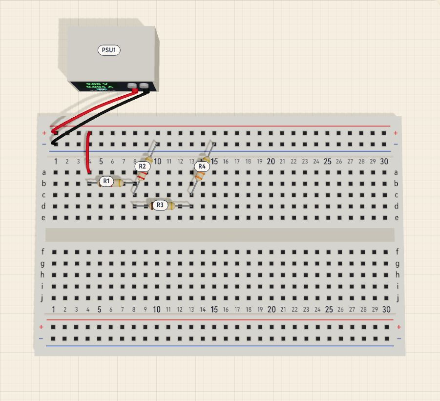
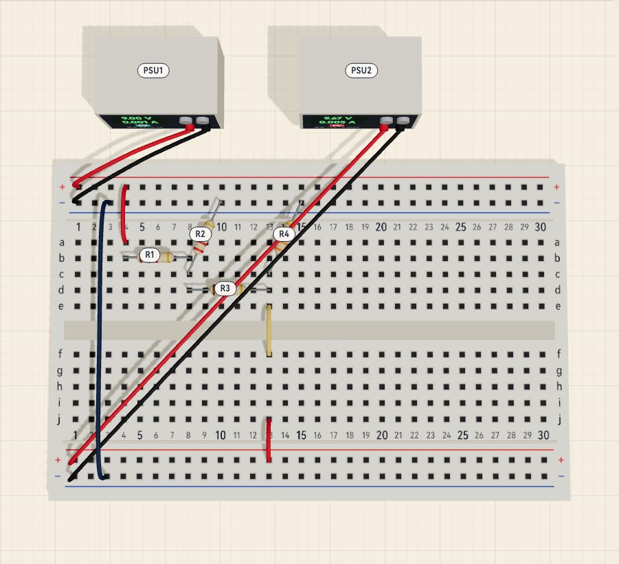
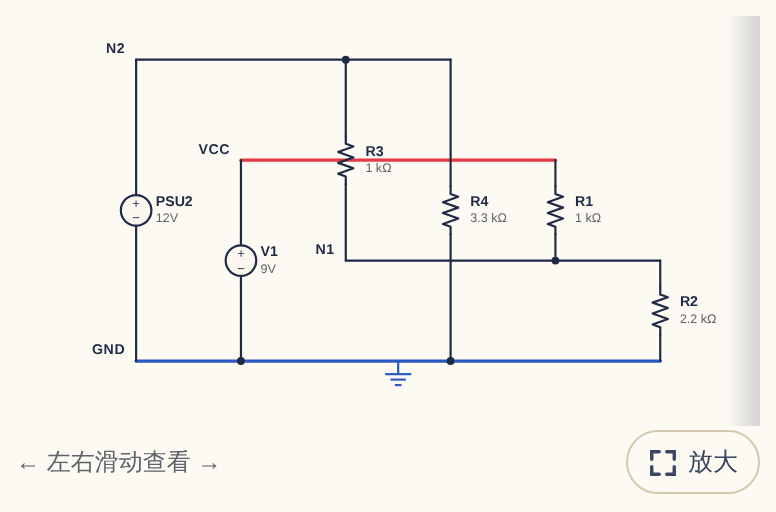
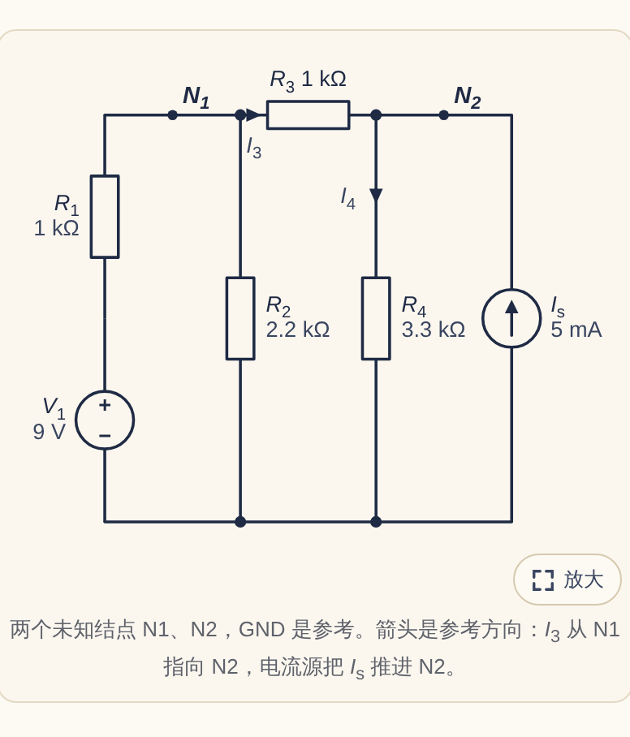

# 2.1 · 结点电压法：一个电压源加一个电流源

| 项目 | 内容 |
|---|---|
| id | `exp-nodal-analysis` |
| 文件 | `challenges/224-nodal-analysis.json` |
| 类型 | 实验 / 挑战（没有分步，照目标电路图搭） · 难度 4/5 |
| 位置 | World 2 · 网络分析与电路定理 → 2.1 结点电压法（本节第 1 项） |
| 右侧面板 | 轨道由旧的四张卡片自动生成（还没手工精排） |
| 前后 | 上一项 [1.12 exp-measure-req](../w1/1.12-3-exp-measure-req.md) · 下一项 [2.2 exp-superposition](../w2/2.02-1-exp-superposition.md) |
| 先修 | lesson-multimeter、lesson-ammeter |
| 概念 | nodal analysis 结点电压法、current source 电流源、reference direction 参考方向、negative current 负电流 |

**一句话概要**：9 V 电压源和 5 mA 电流源接在同一个网络上。先量两个结点，再列结点方程解释读数。

## 1. 左侧工作台（3D 面包板 → 2D 俯视截图）

截图是程序里真实的 3D 面包板换成俯视角拍的；表格是同一块板的文字版（元件、参数、每只脚插在哪个孔）。

### 1.1 起点：打开这一课时板上已经有的

右侧显示的「起点」说明：

> **半成品**：9 V 电压源 PSU1 和 R1–R4 的网络已经搭好。**为什么**：电阻网络是重复技能；这个实验的新东西是同时接一个电流源。**你要做**：放上第二台稳压电源 PSU2（下方轨道），设成 CC 模式 5 mA，接好 tn↔bn 的地线和把电流注入 R3、R4 之间那个结点（第 13 列）的两根跳线。

| 元件 | 类型 | 参数 | 引脚 → 孔 |
|---|---|---|---|
| PSU1 | bench_supply | voltage=9, currentLimit=0.1 | +→tp1 -→tn1 |
| W2 | wire |  | a→tp4 b→a4 |
| R1 | resistor | resistance=1000 | 1→b4 2→b8 |
| R2 | resistor | resistance=2200 | 1→c8 2→tn10 |
| R3 | resistor | resistance=1000 | 1→d8 2→d13 |
| R4 | resistor | resistance=3300 | 1→c13 2→tn15 |

### 1.3 参考答案（「看答案」载入的板子）

| 元件 | 类型 | 参数 | 引脚 → 孔 |
|---|---|---|---|
| PSU1 | bench_supply | voltage=9, currentLimit=0.1 | +→tp1 -→tn1 |
| PSU2 | bench_supply | voltage=12, currentLimit=0.005 | +→bp1 -→bn1 |
| W3 | wire |  | a→tn3 b→bn3 |
| W4 | wire |  | a→tp4 b→a4 |
| R1 | resistor | resistance=1000 | 1→b4 2→b8 |
| R2 | resistor | resistance=2200 | 1→c8 2→tn10 |
| R3 | resistor | resistance=1000 | 1→d8 2→d13 |
| R4 | resistor | resistance=3300 | 1→c13 2→tn15 |
| W9 | wire |  | a→e13 b→f13 |
| W10 | wire |  | a→j13 b→bp13 |

### 1.4 目标原理图（右侧「目标原理图」抽屉）

| 元件 | 类型 | 参数 |
|---|---|---|
| V1 | dc_source | voltage=9 |
| PSU2 | bench_supply | voltage=12, currentLimit=0.005 |
| R1 | resistor | resistance=1000 |
| R2 | resistor | resistance=2200 |
| R3 | resistor | resistance=1000 |
| R4 | resistor | resistance=3300 |

连接（每个结点上的引脚）：

- **VCC**：V1.+、R1.1
- **N1**：R1.2、R2.1、R3.1
- **N2**：R3.2、R4.1、PSU2.+
- **GND**：R2.2、R4.2、V1.-、PSU2.-

## 2. 右侧面板：学生从上往下看到的内容（单轨流）

### 第 1 步 · 🔧 动手搭：哪个结点更高？

照目标电路图搭。**PSU1** `9 V` 经 R1 接结点 **N1**。**PSU2** 当电流源：`12 V`、限流 **`0.005 A`**，+ 接结点 **N2**，− 接 GND。
两台电源要共用一个 GND：**用跳线把上下两条蓝轨连起来**。
**测 N1、N2 对 GND 的电压**。N2 只能经过 R3 和 N1 相连——两个结点哪个更高？

### 第 2 步 · 💡 想明白：每个结点记一笔账

- 把结点电压想成**水位**。水从高水位经过每根水管流向低水位，流量 = 水位差 ÷ 水管的电阻。
- 选 GND 作零水位，给其余结点起名字：这里是 $V_{N1}$ 和 $V_{N2}$。两个未知数，就要两个方程。
- 每个结点：**流出 = 流进**（KCL）。在 N2，电流经 R3 和 R4 流出，电流源把 $I_s$ 推进来：
$$\frac{V_{N2} - V_{N1}}{R_3} + \frac{V_{N2}}{R_4} = I_s$$
- 用 V、kΩ、mA 作单位：$\frac{V_{N2} - V_{N1}}{1} + \frac{V_{N2}}{3.3} = 5$。N1 的账照样写（R1 从 9 V 一侧来，R2 到 GND，R3 到 N2），两个方程联立求解。

*图 `nodes`（schematic）：两个未知结点 N1、N2，GND 是参考。箭头是参考方向：I_3 从 N1 指向 N2，电流源把 I_s 推进 N2。*

（这一步下面列着这节课的计算卡片，点开就地展开：`kcl`、`node-voltage`、`nodal-two-node`、`cc-current-source`，全文见第 6 节）

### 第 3 步 · 🔧 动手搭：量两个结点、两条支路

- **万用表**：红表笔先点 N1，再点 N2；黑表笔接 GND。
- **电流表串进 R3 支路**，红表笔在 N1 一侧：图里的箭头就是参考方向。读数可以是负的。
- **电流表串进 R4 支路**，红表笔在 N2 一侧。
- 电路检查通过后填测量题。最后一题用 N2 的 KCL，从你自己的读数算出电流源的电流。

### 第 4 步 · 📏 测一测：测一测：读你自己的仪表

**测量题 1 · `u1`**（读数题）

> 万用表：N1 对 GND 的电压 VN1

- 单位 V · 先写预测 · 参考答案的读数 **7.605 V** · 合理范围 [7.22, 7.98]

答对后显示：

> 解两个结点方程：2.4545 VN1 − VN2 = 9，−VN1 + 1.3030 VN2 = 5，得 VN1 ≈ 7.6 V。

**测量题 2 · `u2`**（读数题）

> 万用表：N2 对 GND 的电压 VN2

- 单位 V · 先写预测 · 参考答案的读数 **9.666 V** · 合理范围 [9.18, 10.1]

答对后显示：

> VN2 ≈ 9.67 V，比电压源的 9 V 还高：电流源会把结点推到需要的电压（只要低于 PSU2 设的 12 V）。

**测量题 3 · `ir3`**（读数题）

> 电流表串进 R3，红表笔在 N1 一侧：读数 I_R3（参考方向 N1 → N2）

- 单位 mA · 先写预测 · 参考答案的读数 **-2.061 mA** · 合理范围 [-0.00216, -0.00196]

答对后显示：

> I_R3 = (VN1 − VN2) / 1 kΩ ≈ −2.06 mA。负号说明电流实际从 N2 流向 N1。

**测量题 4 · `ir4`**（读数题）

> 电流表串进 R4：读数 I_R4（N2 → GND）

- 单位 mA · 先写预测 · 参考答案的读数 **2.929 mA** · 合理范围 [0.00278, 0.00308]

答对后显示：

> I_R4 = VN2 / 3.3 kΩ ≈ 2.93 mA。

**测量题 5 · `isrc`**（计算题（用自己的读数算））

> 用 N2 的 KCL 和你的两个读数算电流源的电流：Is = I_R4 − I_R3

- 单位 mA · 参考答案的读数 **4.99 mA** · 合理范围 [0.00474, 0.00524] · 公式 `ir4 - ir3`

答对后显示：

> 流进 N2：Is + I_R3；流出：I_R4。所以 Is = I_R4 − I_R3 ≈ 2.93 + 2.06 ≈ 4.99 mA，就是 PSU2 设的 5 mA（模型在 CC 模式下少 0.01 mA）。

### 第 5 步 · 🎒 带走：带走

- **结点电压法**：选参考结点，每个结点一个电压，对每个结点写 KCL，支路电流写成“电压差 ÷ R”。
- 电流源最好写：它的电流直接放到方程右边。
- 支路电流算出来是负的，只说明箭头猜反了。保留负号，不要去改方程。
- 真实电路里，电流源能把它的结点推得比其他电源都高——直到它自己的电压上限（这里是 PSU2 设的 12 V）。

趁热练理论题：`methods`

## 3. 测量题一览

| # | id | 题目 | 类型 | 单位 | 状态 | 参考读数 |
|---|---|---|---|---|---|---|
| 1 | u1 | 万用表：N1 对 GND 的电压 VN1 | voltage | V |  | 7.605 V |
| 2 | u2 | 万用表：N2 对 GND 的电压 VN2 | voltage | V |  | 9.666 V |
| 3 | ir3 | 电流表串进 R3，红表笔在 N1 一侧：读数 I_R3（参考方向 N1 → N2） | current | mA |  | -2.061 mA |
| 4 | ir4 | 电流表串进 R4：读数 I_R4（N2 → GND） | current | mA |  | 2.929 mA |
| 5 | isrc | 用 N2 的 KCL 和你的两个读数算电流源的电流：Is = I_R4 − I_R3 | formula | mA |  | 4.99 mA |

### 全部答完后显示的「对比」

**对比**：
- 结点方程（V、kΩ、mA）：N1：(1/1 + 1/2.2 + 1/1) VN1 − VN2 = 9，即 2.4545 VN1 − VN2 = 9；N2：−VN1 + (1/1 + 1/3.3) VN2 = 5，即 −VN1 + 1.3030 VN2 = 5。解得 **VN1 ≈ 7.61 V，VN2 ≈ 9.68 V**。
- 模拟器读数：VN1 ≈ 7.60 V，VN2 ≈ 9.67 V，电流源 ≈ 4.99 mA（CC 模式比 5 mA 少 0.01 mA，所以略低一点）。
- I_R1 = (9 − 7.60) / 1k ≈ **1.40 mA**；I_R3 = (VN1 − VN2) / 1k ≈ **−2.06 mA**（电流实际从 N2 流向 N1）；I_R4 = 9.67 / 3.3k ≈ **2.93 mA**；N2 的 KCL：4.99 = 2.06 + 2.93 ✔。

### 提示按钮（依次显示）

1. 两台电源：一台用上方电源轨，一台用下方电源轨，两条蓝轨用跳线连起来作为 GND。
2. PSU2 设 12 V、限流 0.005 A，它的 + 端接 N2（和 R3、R4 共用一列）。
3. 用一根跨凹槽的短跳线把同一列的上下两半连起来，就能把 N2 引到下方的电源轨。

### 功能测试（「检查我的电路」时跑）

- 结点电压合理；电流源输出它的限流值
- 支路电流的大小和方向合理

## 5. 这一课的计算卡片

**计算卡片 `kcl`：基尔霍夫电流定律 KCL**

- 公式 `Σ i_{in} = Σ i_{out}`
- 用途：一个结点上流进的电流之和等于流出的电流之和：知道几条支路，求剩下那一条。
- 输入：I_1（流进结点的电流，A）；I_2（流出的另一条支路，A） → I_3（剩下那条支路流出的电流，A）

1. 电荷不会在结点上堆起来，也不会凭空出现：每一时刻流进多少就流出多少。
2. 先给每条支路选一个 **参考方向**（画箭头），再写代数和，比如“流出为正”：$-I_1 + I_2 + I_3 = 0$。
3. 只剩一个未知量时直接解：$I_3 = I_1 - I_2$。
4. 算出负数不是算错：它说明真实电流和你画的箭头方向相反。

例子：实验 1-1：$I_1 = \frac{9 V}{330 + 1k ∥ 2.2k} = \frac{9}{1017.5} ≈ 8.84 mA$，$I_2 = \frac{6.08 V}{1 kΩ} ≈ 6.08 mA$，所以 $I_3 = 8.84 - 6.08 = 2.76 mA$——正好等于 $\frac{6.08 V}{2.2 kΩ}$。实验 1-8：电流源的 10 mA 里有 3.2 mA 进了负载，$R_N$ 分到 10 − 3.2 = 6.8 mA。

- ⚠ 电流表接反读数是负的：代进 KCL 时要连符号一起代。
- ⚠ 同一条支路上串联的几个元件电流相同，它们之间的连接点不算新的 KCL 方程。

**计算卡片 `node-voltage`：结点电压法（一个结点）Node voltage**

- 公式 `V_N = \frac{\frac{V_1}{R_1} + \frac{V_2}{R_2} + I_s}{\frac{1}{R_1} + \frac{1}{R_2} + \frac{1}{R_3}}`
- 用途：几条支路汇到一个结点：一条 KCL 方程直接求出这个结点的电压。
- 输入：V_1（电源 1（经 R₁ 接到 N），V）；R_1（R₁，Ω）；V_2（电源 2（经 R₂ 接到 N，没有就填 0），V）；R_2（R₂，Ω）；R_3（N 到地的电阻 R₃，Ω）；I_s（流进 N 的电流源（没有就填 0），A） → V_N（结点 N 的电压，V）

1. 选 GND 做参考结点，未知量只剩 $V_N$。
2. 对 N 写 KCL，每条支路电流都写成“从 N 流出”：$\frac{V_N - V_1}{R_1} + \frac{V_N - V_2}{R_2} + \frac{V_N}{R_3} - I_s = 0$。
3. 把含 $V_N$ 的项合并：左边系数是接在 N 上所有电导之和（**自电导**），右边是每个“电压源 ÷ 串联电阻”加上流进的电流源（**注入电流**）。
4. 解出 $V_N$，再用欧姆定律求每条支路的电流，比如 $I_3 = \frac{V_N}{R_3}$。
单位技巧：用 V、kΩ、mA，电导就是 mS。

例子：实验 2-1（两个电源都接上）：$V_N = \frac{9/1 + 5/2.2}{1 + 0.4545 + 0.3030} = \frac{11.27}{1.7576} ≈ 6.41 V$，$I_3 = \frac{6.41}{3.3} ≈ 1.94 mA$。

- ⚠ 电流源：流进结点为正，流出为负。
- ⚠ 和电流源串联的电阻不进自电导（它不影响电流源送进来的电流）。

**计算卡片 `nodal-two-node`：结点电压法（两个结点）Two-node analysis**

- 公式 `\mat{G_{11} & -G_{12} ; -G_{12} & G_{22}} \mat{V_1 ; V_2} = \mat{V_s/R_1 ; I_s}`
- 用途：实验 2-4 的电路：一个电压源、一个电流源、两个未知结点，写成 2×2 方程组求解。
- 输入：V_s（电压源（经 R₁ 接 N₁），V）；R_1（R₁，Ω）；R_2（N₁ 到地 R₂，Ω）；R_3（N₁ 到 N₂ 的 R₃，Ω）；R_4（N₂ 到地 R₄，Ω）；I_s（流进 N₂ 的电流源，A） → V_2（结点 N₂ 的电压，V）

1. GND 是参考结点，未知量是 $V_1$、$V_2$。
2. N₁ 的 KCL：$(\frac{1}{R_1} + \frac{1}{R_2} + \frac{1}{R_3})V_1 - \frac{1}{R_3}V_2 = \frac{V_s}{R_1}$
3. N₂ 的 KCL：$-\frac{1}{R_3}V_1 + (\frac{1}{R_3} + \frac{1}{R_4})V_2 = I_s$
4. 规律：对角线是 **自电导** $G_{11}$、$G_{22}$；非对角线是两个结点之间的 **互电导** 取负号；右边是注入电流。
5. 克拉默法则：$V_2 = \frac{G_{11} I_s + G_{12} V_s/R_1}{G_{11}G_{22} - G_{12}^{2}}$，$V_1 = \frac{G_{22} V_s/R_1 + G_{12} I_s}{G_{11}G_{22} - G_{12}^{2}}$。

例子：实验 2-4（V、kΩ、mA、mS）：$2.4545V_1 - V_2 = 9$，$-V_1 + 1.3030V_2 = 5$。行列式 $2.4545 × 1.3030 - 1 = 2.198$，$V_1 = \frac{9 × 1.3030 + 5}{2.198} ≈ 7.61 V$，$V_2 = \frac{2.4545 × 5 + 9}{2.198} ≈ 9.68 V$——比 9 V 电源还高：电流源会把它的结点推到需要的任何电压。$I_{R3} = \frac{7.61 - 9.68}{1k} ≈ -2.06 mA$。

- ⚠ 互电导项是负号：$-\frac{1}{R_3}$，写成正号整组解都错。
- ⚠ 稳压电源当电流源用时，结点电压必须低于它的电压设定（实验里是 12 V），否则它退回 CV。

**计算卡片 `cc-current-source`：稳压电源的 CV / CC：当电流源用**

- 公式 `I_{want} = \frac{V_{set} - V_F}{R} > I_{lim} ⇒ V = V_F + I_{lim} R`
- 用途：判断稳压电源工作在 CV 还是 CC，并算出它实际输出的电压。
- 输入：V_set（电压设定，V）；I_lim（限流设定，A）；R（负载电阻（含 LED 内阻），Ω）；V_F（负载里 LED 的 V_F（没有就填 0），V） → V（电源实际输出电压，V）

1. 稳压电源有两个“上限”：电压不超过 $V_{set}$，电流不超过 $I_{lim}$。哪个先碰到，哪个说了算。
2. 先假设 CV：输出 $V_{set}$，负载想要的电流 $I_{want} = \frac{V_{set} - V_F}{R}$。
3. $I_{want} ≤ I_{lim}$：确实是 CV，电压 = 设定，电流由负载决定。
4. $I_{want} > I_{lim}$：切到 CC，电流 = $I_{lim}$，电压降到刚好推动这个电流：$V = V_F + I_{lim}R$。
5. 当电流源用：限流设成想要的电流，电压设高一些（留余量）。它能带的最大负载是 $R_{max} = \frac{V_{set} - V_F}{I_{lim}}$，超过就退回 CV。

例子：- 第 11 课：12 V、10 mA、470 Ω：想要 25.5 mA > 10 mA → CC，$V = 10 mA × 470 = 4.70 V$；限流 20 mA → 9.4 V；100 mA → CV，12 V、25.5 mA。
- 实验 1-4：$1.8 + 10 mA × (470 + 12) ≈ 6.6 V$（CC）；RV1 = 1 kΩ 时需要 16.6 V > 12 V → CV，$I = \frac{12 - 1.8}{1482} ≈ 6.9 mA$。
- 挑战 10 电阻被短路：$6 V + 50 mA × 24 Ω = 7.2 V$，电源限住 50 mA。

- ⚠ 屏幕上小字 “SET …” 是旋钮设定，大字才是实际输出——CC 时两者不一样。
- ⚠ 电流源也有“顶”：负载太大时它给不出设定的电流（实验 1-4 的 100 %）。

## 6. English（界面英文版的同一份内容）

展开英文

### Node 1 · 🔧 Build：Which node is higher?

Build it from the target schematic. **PSU1** `9 V` feeds node **N1** through R1. **PSU2** is a current source: `12 V`, limit **`0.005 A`**, + on node **N2**, − on GND.
Two supplies need one shared GND: **join the two blue rails** with a jumper.
**Measure N1 and N2** against GND. N2 only gets its voltage through N1 and R3 — which of the two is higher?

### Node 2 · 💡 Why：Keep one account per node

- Think of node voltages as **water levels**. Water flows through every pipe from the higher level to the lower one, and the flow is the level difference divided by the pipe's resistance.
- Choose GND as the zero level. Give every other node a name: here $V_{N1}$ and $V_{N2}$. Two unknowns, so two equations.
- At each node, **flowing out = flowing in** (KCL). At N2, current leaves through R3 and R4, and the current source pushes $I_s$ in:
$$\frac{V_{N2} - V_{N1}}{R_3} + \frac{V_{N2}}{R_4} = I_s$$
- In V, kΩ and mA this is $\frac{V_{N2} - V_{N1}}{1} + \frac{V_{N2}}{3.3} = 5$. Write the account for N1 the same way (R1 from the 9 V side, R2 to GND, R3 to N2) and solve the pair.

[figure `nodes`]

*Figure `nodes`（schematic）：两个未知结点 N1、N2，GND 是参考。箭头是参考方向：I_3 从 N1 指向 N2，电流源把 I_s 推进 N2。*

(This node lists the lesson’s calculation cards: `kcl`、`node-voltage`、`nodal-two-node`、`cc-current-source`; full text in section 6)

### Node 3 · 🔧 Build：Measure two nodes and two branches

- **Multimeter**: red lead on N1, then on N2; black lead on GND.
- **Ammeter in R3's branch**, red lead on the N1 side: the arrow in the figure is your reference direction. A negative reading is allowed.
- **Ammeter in R4's branch**, red lead on the N2 side.
- Once the circuit check passes, fill in the questions. The last one uses KCL at N2 to find the source current from your own readings.

### Node 4 · 📏 Measure：Measure: read your own instruments

**Question 1 · `u1`**（reading）

> Multimeter: N1 to GND, VN1

- unit V · predict first · range [7.22, 7.98]

Shown once right:

> Solve the two node equations, 2.4545 VN1 − VN2 = 9 and −VN1 + 1.3030 VN2 = 5: VN1 ≈ 7.6 V.

**Question 2 · `u2`**（reading）

> Multimeter: N2 to GND, VN2

- unit V · predict first · range [9.18, 10.1]

Shown once right:

> VN2 ≈ 9.67 V, higher than the 9 V source: the current source lifts its node to whatever voltage it needs (as long as that stays below PSU2's 12 V).

**Question 3 · `ir3`**（reading）

> Ammeter in series with R3, red lead on the N1 side: reading I_R3 (reference N1 → N2)

- unit mA · predict first · range [-0.00216, -0.00196]

Shown once right:

> I_R3 = (VN1 − VN2) / 1 kΩ ≈ −2.06 mA. The minus sign says the current really flows from N2 to N1.

**Question 4 · `ir4`**（reading）

> Ammeter in series with R4: reading I_R4 (N2 → GND)

- unit mA · predict first · range [0.00278, 0.00308]

Shown once right:

> I_R4 = VN2 / 3.3 kΩ ≈ 2.93 mA.

**Question 5 · `isrc`**（calculation from own readings）

> KCL at N2 with your two readings gives the source current: Is = I_R4 − I_R3

- unit mA · range [0.00474, 0.00524] · formula `ir4 - ir3`

Shown once right:

> Into N2: Is + I_R3; out: I_R4. So Is = I_R4 − I_R3 ≈ 2.93 + 2.06 ≈ 4.99 mA — PSU2's 5 mA (the model gives 0.01 mA less in CC mode).

### Node 5 · 🎒 Take away：Take away

- **Nodal analysis**: reference node, one voltage per node, KCL at each node, branch currents as (voltage difference) / R.
- A current source is the easiest part to write: its current goes straight to the right-hand side.
- A negative branch current only means the guessed arrow points the wrong way. Keep the sign; don't flip the equation.
- In a real circuit a current source can lift its node above every other supply — up to its own voltage ceiling (here PSU2's 12 V).

Practise：`methods`

**Compare**

**Compare**:
- Node equations (V, kΩ, mA): N1: (1/1 + 1/2.2 + 1/1) VN1 − VN2 = 9, i.e. 2.4545 VN1 − VN2 = 9; N2: −VN1 + (1/1 + 1/3.3) VN2 = 5, i.e. −VN1 + 1.3030 VN2 = 5. Solution: **VN1 ≈ 7.61 V, VN2 ≈ 9.68 V**.
- Simulator: VN1 ≈ 7.60 V, VN2 ≈ 9.67 V, source ≈ 4.99 mA (CC mode gives 0.01 mA less than 5 mA, hence slightly lower).
- I_R1 = (9 − 7.60) / 1k ≈ **1.40 mA**; I_R3 = (VN1 − VN2) / 1k ≈ **−2.06 mA** (the current really flows from N2 to N1); I_R4 = 9.67 / 3.3k ≈ **2.93 mA**; KCL at N2: 4.99 = 2.06 + 2.93 ✔.

**Hints**

1. Two supplies: one on the top rails, one on the bottom rails; join the two blue rails with a jumper as GND.
2. PSU2: 12 V, current limit 0.005 A; its + goes to N2 (the column R3 and R4 share).
3. A short jumper across the trench joins the two halves of a column, so you can bring N2 down to the bottom rails.

