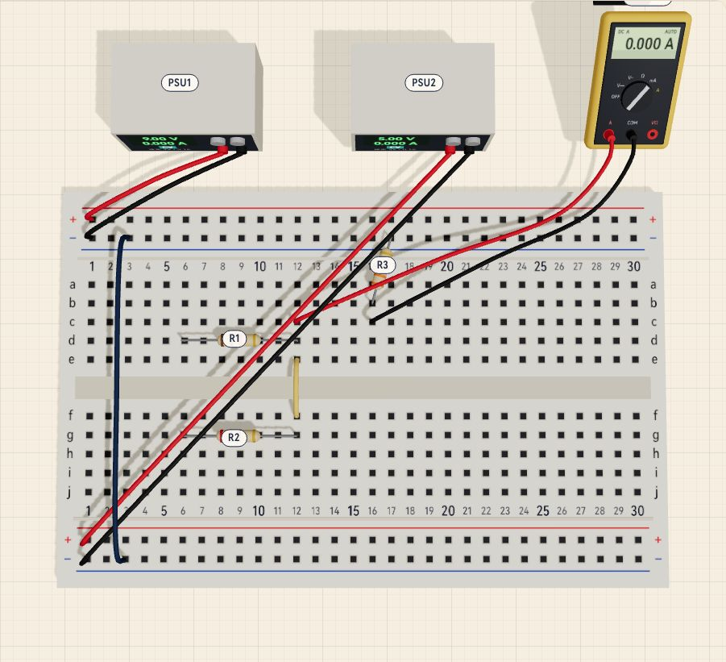
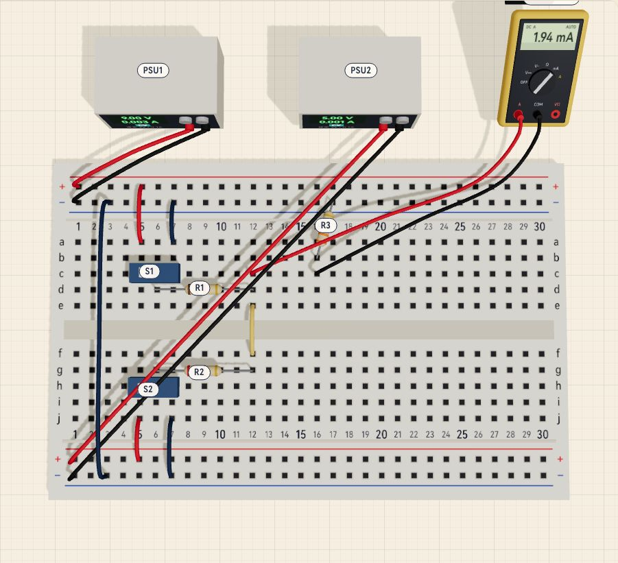
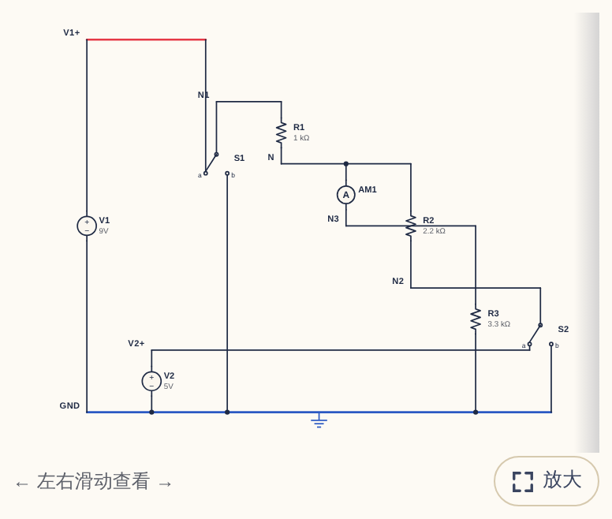
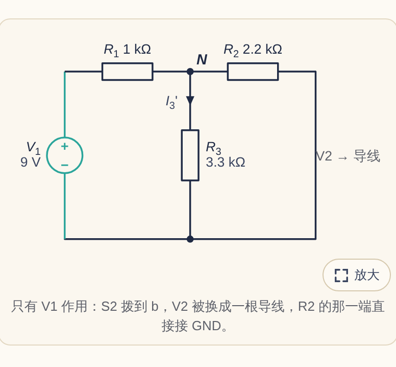

# 2.2 · 叠加定理：两台电源分别作用，再相加

| 项目 | 内容 |
|---|---|
| id | `exp-superposition` |
| 文件 | `challenges/221-superposition.json` |
| 类型 | 实验 / 挑战（没有分步，照目标电路图搭） · 难度 4/5 |
| 位置 | World 2 · 网络分析与电路定理 → 2.2 叠加与电源变换（本节第 1 项） |
| 右侧面板 | 轨道由旧的四张卡片自动生成（还没手工精排） |
| 前后 | 上一项 [2.1 exp-nodal-analysis](../w2/2.01-1-exp-nodal-analysis.md) · 下一项 [2.2 exp-source-transformation](../w2/2.02-2-exp-source-transformation.md) |
| 先修 | lesson-ammeter、lesson-multimeter |
| 概念 | superposition 叠加定理、zeroing a voltage source = short 电压源置零 = 短路、linearity 线性、power is not superposable 功率不能叠加 |

**一句话概要**：9 V 和 5 V 两台电源一起驱动 R3。用开关把电源换成导线，分别测、再一起测：电流正好相加，功率却不行。

## 1. 左侧工作台（3D 面包板 → 2D 俯视截图）

截图是程序里真实的 3D 面包板换成俯视角拍的；表格是同一块板的文字版（元件、参数、每只脚插在哪个孔）。

### 1.1 起点：打开这一课时板上已经有的

右侧显示的「起点」说明：

> **半成品**：两台电源、R1、R2、R3 和测 R3 电流的电流表已经搭好。**为什么**：叠加定理的关键操作是“把一个电源换成导线”，这正是两个拨动开关做的事。**你要做**：加上 S1、S2 和它们的四根跳线：每个开关的一侧接电源 +、另一侧接 GND，中间接电阻。

| 元件 | 类型 | 参数 | 引脚 → 孔 |
|---|---|---|---|
| PSU1 | bench_supply | voltage=9, currentLimit=0.1 | +→tp1 -→tn1 |
| PSU2 | bench_supply | voltage=5, currentLimit=0.1 | +→bp1 -→bn1 |
| W3 | wire |  | a→tn3 b→bn3 |
| R1 | resistor | resistance=1000 | 1→d6 2→d12 |
| R2 | resistor | resistance=2200 | 1→g6 2→g12 |
| W6 | wire |  | a→f12 b→e12 |
| AM1 | ammeter |  | +→c12 -→c16 |
| R3 | resistor | resistance=3300 | 1→b16 2→tn17 |

### 1.3 参考答案（「看答案」载入的板子）

| 元件 | 类型 | 参数 | 引脚 → 孔 |
|---|---|---|---|
| PSU1 | bench_supply | voltage=9, currentLimit=0.1 | +→tp1 -→tn1 |
| PSU2 | bench_supply | voltage=5, currentLimit=0.1 | +→bp1 -→bn1 |
| W3 | wire |  | a→tn3 b→bn3 |
| S1 | switch | position=a | a→c5 com→c6 b→c7 |
| W5 | wire |  | a→tp5 b→a5 |
| W6 | wire |  | a→a7 b→tn7 |
| R1 | resistor | resistance=1000 | 1→d6 2→d12 |
| S2 | switch | position=a | a→h5 com→h6 b→h7 |
| W9 | wire |  | a→bp5 b→j5 |
| W10 | wire |  | a→j7 b→bn7 |
| R2 | resistor | resistance=2200 | 1→g6 2→g12 |
| W12 | wire |  | a→f12 b→e12 |
| AM1 | ammeter |  | +→c12 -→c16 |
| R3 | resistor | resistance=3300 | 1→b16 2→tn17 |

### 1.4 目标原理图（右侧「目标原理图」抽屉）

| 元件 | 类型 | 参数 |
|---|---|---|
| V1 | dc_source | voltage=9 |
| V2 | dc_source | voltage=5 |
| S1 | switch |  |
| S2 | switch |  |
| R1 | resistor | resistance=1000 |
| R2 | resistor | resistance=2200 |
| R3 | resistor | resistance=3300 |
| AM1 | ammeter |  |

连接（每个结点上的引脚）：

- **V1+**：V1.+、S1.a
- **V2+**：V2.+、S2.a
- **N1**：S1.com、R1.1
- **N2**：S2.com、R2.1
- **N**：R1.2、R2.2、AM1.+
- **N3**：AM1.-、R3.1
- **GND**：V1.-、V2.-、S1.b、S2.b、R3.2

## 2. 右侧面板：学生从上往下看到的内容（单轨流）

### 第 1 步 · 🔧 动手搭：三次读数，找找关系

照目标电路图搭：**两台稳压电源**，`9 V` 和 `5 V`，两条蓝轨连起来当 GND。每个开关的 **a** 侧接电源 +，**b** 侧接 GND。
**S1 → a，S2 → b**：读电流表 **AM1**。
**S1 → b，S2 → a**：再读一次。然后**两个都拨到 a**：读第三次。
第三个读数和前两个有什么关系？

### 第 2 步 · 💡 想明白：各推各的，推力相加

- 开关拨到 **b**，电阻的那一端就接到了 GND：电源被换成了**一根导线**（0 V）。这就是“把电压源置零”——是短路，**不是**把线拔掉悬空。
- 只由电阻和电源组成的电路里，每个电源推动 R3 里的电流时，都好像另一个电源只是那根导线。一起作用时，推力直接相加：
$$I_3 = I_3' + I_3''$$

*图 `alone`（schematic）：只有 V1 作用：S2 拨到 b，V2 被换成一根导线，R2 的那一端直接接 GND。*

- 每一部分用 2.2 的结点电压来预测：只有 V1 时，$V_N' = \frac{V_1/R_1}{1/R_1 + 1/R_2 + 1/R_3}$，分母 $1 + 0.4545 + 0.3030 = 1.758$ mS。只有 V2 时照样算。
- 量之前想一想：R3 的**功率**也能这样相加吗？

（这一步下面列着这节课的计算卡片，点开就地展开：`node-voltage`、`superposition`，全文见第 6 节）

### 第 3 步 · 🔧 动手搭：三种组合，逐一读数

- **S1 → a、S2 → b**（只有 V1），**S1 → b、S2 → a**（只有 V2），**两个都 → a**：每次读 AM1。
- 两个都在 a 时，再用万用表**测 N 对 GND 的电压**。
- 电路检查通过后填测量题。最后一题把电流平方，算功率。

### 第 4 步 · 📏 测一测：测一测：读你自己的仪表

**测量题 1 · `i1`**（读数题）

> 只有 V1（S1 → a，S2 → b）：AM1 的读数 I3′

- 单位 mA · 先写预测 · 状态：把 S1 拨到 a 侧、把 S2 拨到 b 侧 · 参考答案的读数 **1.552 mA** · 合理范围 [0.00147, 0.00163]

答对后显示：

> V_N = 9 / 1.7576 ≈ 5.12 V，I3′ = V_N / 3.3 kΩ ≈ 1.55 mA。

**测量题 2 · `i2`**（读数题）

> 只有 V2（S1 → b，S2 → a）：AM1 的读数 I3″

- 单位 mA · 先写预测 · 状态：把 S1 拨到 b 侧、把 S2 拨到 a 侧 · 参考答案的读数 **0.3918 mA** · 合理范围 [0.000372, 0.000411]

答对后显示：

> V_N = (5 / 2.2) / 1.7576 ≈ 1.29 V，I3″ ≈ 0.39 mA。

**测量题 3 · `i12`**（读数题）

> 两个都接（a，a）：AM1 的读数 I3

- 单位 mA · 先写预测 · 状态：把 S1 拨到 a 侧、把 S2 拨到 a 侧 · 参考答案的读数 **1.944 mA** · 合理范围 [0.00185, 0.00204]

答对后显示：

> I3 = I3′ + I3″ ≈ 1.55 + 0.39 = 1.94 mA，叠加定理成立。

**测量题 4 · `un`**（读数题）

> 两个都接：N 对 GND 的电压 V_N

- 单位 V · 先写预测 · 状态：把 S1 拨到 a 侧、把 S2 拨到 a 侧 · 参考答案的读数 **6.414 V** · 合理范围 [6.09, 6.73]

答对后显示：

> V_N = (9/1 + 5/2.2) / 1.7576 ≈ 6.41 V = 5.12 + 1.29。电压也能叠加。

**测量题 5 · `power`**（选择题）

> 用你的三个电流读数算 R3 的功率 P = I²R：I3′²R + I3″²R 和 I3²R 相比，

- A. 单独作用的两个功率加起来，比一起作用时的功率小 ✅（正确）
- B. 两者相等：功率也满足叠加定理
- C. 单独作用的两个功率加起来，比一起作用时的功率大

答对后显示：

> ≈ 7.9 + 0.5 = 8.4 mW，而 1.94² × 3.3 ≈ 12.5 mW。(a + b)² = a² + b² + 2ab，多出的 2ab 就是差别：功率和电流是平方关系，不能叠加。

### 第 5 步 · 🎒 带走：带走

- **叠加定理**：线性电路里，几个电源产生的电流、电压可以相加。
- 置零：电压源换成**导线**，电流源换成**断开**。
- **功率不能叠加**：$P = I^2R$，而 $(a + b)^2 ≠ a^2 + b^2$。
- 坑：LED、二极管不是线性元件。路上有一颗，加法就不灵了。

趁热练理论题：`theorems`

## 3. 测量题一览

| # | id | 题目 | 类型 | 单位 | 状态 | 参考读数 |
|---|---|---|---|---|---|---|
| 1 | i1 | 只有 V1（S1 → a，S2 → b）：AM1 的读数 I3′ | current | mA | 把 S1 拨到 a 侧、把 S2 拨到 b 侧 | 1.552 mA |
| 2 | i2 | 只有 V2（S1 → b，S2 → a）：AM1 的读数 I3″ | current | mA | 把 S1 拨到 b 侧、把 S2 拨到 a 侧 | 0.3918 mA |
| 3 | i12 | 两个都接（a，a）：AM1 的读数 I3 | current | mA | 把 S1 拨到 a 侧、把 S2 拨到 a 侧 | 1.944 mA |
| 4 | un | 两个都接：N 对 GND 的电压 V_N | voltage | V | 把 S1 拨到 a 侧、把 S2 拨到 a 侧 | 6.414 V |
| 5 | power | 用你的三个电流读数算 R3 的功率 P = I²R：I3′²R + I3″²R 和 I3²R 相比， | 选择 |  |  | 正确：A |

### 全部答完后显示的「对比」

**对比**：分母 = 1 + 0.4545 + 0.3030 = 1.7576 mS。
- 只有 V1（S1 → a，S2 → b）：V_N = 9 / 1.7576 ≈ **5.12 V**，I3 ≈ **1.55 mA**。
- 只有 V2（S1 → b，S2 → a）：V_N = 2.273 / 1.7576 ≈ **1.29 V**，I3 ≈ **0.39 mA**。
- 两个都接（a，a）：V_N ≈ **6.41 V**，I3 ≈ **1.94 mA** = 1.55 + 0.39 ✔。

读数对不上时，先确认“置零”的那个开关拨到了 b（接 GND），而不是悬空。

**功率不能叠加**：单独作用时 1.55² × 3.3 ≈ 7.9 mW、0.39² × 3.3 ≈ 0.5 mW，加起来 8.4 mW；两个一起时是 1.94² × 3.3 ≈ 12.5 mW。

### 提示按钮（依次显示）

1. 两台电源：一台接上方电源轨，一台接下方电源轨，用跳线把两条蓝轨连起来当 GND。
2. 开关的 a 侧接电源 +，b 侧接 GND（一定要接 GND，不能空着），中间 com 接电阻。
3. 电流表红表笔接结点 N，黑表笔接 R3。

### 功能测试（「检查我的电路」时跑）

- 只有 V1（S1→a，S2→b）：I3 和 N 点电压合理
- 只有 V2（S1→b，S2→a）：I3 和 N 点电压合理
- 两个都接（a，a）：I3 等于两次单独作用之和

## 5. 这一课的计算卡片

**计算卡片 `node-voltage`：结点电压法（一个结点）Node voltage**

- 公式 `V_N = \frac{\frac{V_1}{R_1} + \frac{V_2}{R_2} + I_s}{\frac{1}{R_1} + \frac{1}{R_2} + \frac{1}{R_3}}`
- 用途：几条支路汇到一个结点：一条 KCL 方程直接求出这个结点的电压。
- 输入：V_1（电源 1（经 R₁ 接到 N），V）；R_1（R₁，Ω）；V_2（电源 2（经 R₂ 接到 N，没有就填 0），V）；R_2（R₂，Ω）；R_3（N 到地的电阻 R₃，Ω）；I_s（流进 N 的电流源（没有就填 0），A） → V_N（结点 N 的电压，V）

1. 选 GND 做参考结点，未知量只剩 $V_N$。
2. 对 N 写 KCL，每条支路电流都写成“从 N 流出”：$\frac{V_N - V_1}{R_1} + \frac{V_N - V_2}{R_2} + \frac{V_N}{R_3} - I_s = 0$。
3. 把含 $V_N$ 的项合并：左边系数是接在 N 上所有电导之和（**自电导**），右边是每个“电压源 ÷ 串联电阻”加上流进的电流源（**注入电流**）。
4. 解出 $V_N$，再用欧姆定律求每条支路的电流，比如 $I_3 = \frac{V_N}{R_3}$。
单位技巧：用 V、kΩ、mA，电导就是 mS。

例子：实验 2-1（两个电源都接上）：$V_N = \frac{9/1 + 5/2.2}{1 + 0.4545 + 0.3030} = \frac{11.27}{1.7576} ≈ 6.41 V$，$I_3 = \frac{6.41}{3.3} ≈ 1.94 mA$。

- ⚠ 电流源：流进结点为正，流出为负。
- ⚠ 和电流源串联的电阻不进自电导（它不影响电流源送进来的电流）。

**计算卡片 `superposition`：叠加定理 Superposition**

- 公式 `I_3 = I_3' + I_3''`
- 用途：几个独立源一起作用的响应 = 每个源单独作用的响应之和。
- 输入：V_1（电源 1，V）；V_2（电源 2，V）；R_1（R₁，Ω）；R_2（R₂，Ω）；R_3（R₃，Ω） → I_3（两个源一起时 R₃ 的电流，A）

1. 线性电路里，响应对每个独立源都是“成比例”的，所以可以分开算再相加。
2. 让一个源单独作用时，其余源 **置零**：电压源换成 **短路**，电流源换成 **开路**（受控源保留）。
3. 只有 V₁：$V_N' = \frac{V_1/R_1}{1/R_1 + 1/R_2 + 1/R_3}$，$I_3' = \frac{V_N'}{R_3}$。
4. 只有 V₂：$V_N'' = \frac{V_2/R_2}{1/R_1 + 1/R_2 + 1/R_3}$，$I_3'' = \frac{V_N''}{R_3}$。
5. 相加（带方向）：$I_3 = I_3' + I_3''$。
**功率不能叠加**：$P = I^{2}R$ 是平方，$(a + b)^{2} ≠ a^{2} + b^{2}$。

例子：实验 2-1：分母 1.7576 mS。只有 9 V：$V_N' ≈ 5.12 V$，$I_3' ≈ 1.55 mA$；只有 5 V：$V_N'' ≈ 1.29 V$，$I_3'' ≈ 0.39 mA$；一起：$1.55 + 0.39 = 1.94 mA$ ✔。R₃ 的功率：7.9 + 0.5 = 8.4 mW，但一起作用时是 $1.94^{2} × 3.3 ≈ 12.5 mW$。

- ⚠ “不作用”的电压源要 **短路**，不是拔掉（开路）——实验里开关拨到 GND，不是悬空。
- ⚠ 功率、能量不能叠加；电压、电流可以。

## 6. English（界面英文版的同一份内容）

展开英文

### Node 1 · 🔧 Build：Three readings — spot the pattern

Build it from the target schematic: **two bench supplies**, `9 V` and `5 V`, with their blue rails joined as GND. Each switch has its **a** side on a supply's + and its **b** side on GND.
**S1 → a, S2 → b**: read the ammeter **AM1**.
**S1 → b, S2 → a**: read AM1 again. Then **both on a**: read it a third time.
How does the third reading relate to the first two?

### Node 2 · 💡 Why：Each source pushes on its own; the pushes add

- With a switch on **b**, its end of the resistor goes to GND: the supply is replaced by **a plain wire** (0 V). That is what "turning a voltage source off" means — a short, **not** an open lead.
- In a circuit made of resistors and sources, each source pushes current through R3 as if the other were that wire. Together, the pushes simply add:
$$I_3 = I_3' + I_3''$$

[figure `alone`]

*Figure `alone`（schematic）：只有 V1 作用：S2 拨到 b，V2 被换成一根导线，R2 的那一端直接接 GND。*

- To predict each part, use the node voltage from 2.2: with only V1, $V_N' = \frac{V_1/R_1}{1/R_1 + 1/R_2 + 1/R_3}$. The bottom is $1 + 0.4545 + 0.3030 = 1.758$ mS. Do the same for V2 alone.
- Before you measure: will the **power** in R3 add the same way?

(This node lists the lesson’s calculation cards: `node-voltage`、`superposition`; full text in section 6)

### Node 3 · 🔧 Build：Three settings, one by one

- **S1 → a, S2 → b** (only V1), **S1 → b, S2 → a** (only V2), **both → a**: read AM1 each time.
- With both on a, also **measure N to GND** with the multimeter.
- Once the circuit check passes, fill in the questions. The last one squares your currents to get the power.

### Node 4 · 📏 Measure：Measure: read your own instruments

**Question 1 · `i1`**（reading）

> Only V1 (S1 → a, S2 → b): AM1 reading I3′

- unit mA · predict first · state：S1 is switched to side a and S2 is switched to side b · range [0.00147, 0.00163]

Shown once right:

> V_N = 9 / 1.7576 ≈ 5.12 V, I3′ = V_N / 3.3 kΩ ≈ 1.55 mA.

**Question 2 · `i2`**（reading）

> Only V2 (S1 → b, S2 → a): AM1 reading I3″

- unit mA · predict first · state：S1 is switched to side b and S2 is switched to side a · range [0.000372, 0.000411]

Shown once right:

> V_N = (5 / 2.2) / 1.7576 ≈ 1.29 V, I3″ ≈ 0.39 mA.

**Question 3 · `i12`**（reading）

> Both on (a, a): AM1 reading I3

- unit mA · predict first · state：S1 is switched to side a and S2 is switched to side a · range [0.00185, 0.00204]

Shown once right:

> I3 = I3′ + I3″ ≈ 1.55 + 0.39 = 1.94 mA: superposition holds.

**Question 4 · `un`**（reading）

> Both on: N to GND, V_N

- unit V · predict first · state：S1 is switched to side a and S2 is switched to side a · range [6.09, 6.73]

Shown once right:

> V_N = (9/1 + 5/2.2) / 1.7576 ≈ 6.41 V = 5.12 + 1.29. Voltages add too.

**Question 5 · `power`**（multiple choice）

> Square your three currents for R3's power P = I²R: I3′²R + I3″²R compared with I3²R is

- A. smaller than the power with both sources on ✅ (right)
- B. equal: power superposes too
- C. larger than the power with both sources on

Shown once right:

> ≈ 7.9 + 0.5 = 8.4 mW, but 1.94² × 3.3 ≈ 12.5 mW. (a + b)² = a² + b² + 2ab; the extra 2ab is the gap. Power goes with the square of the current, so it does not superpose.

### Node 5 · 🎒 Take away：Take away

- **Superposition**: in a linear circuit, currents and voltages from several sources add up.
- Turning a source off: a voltage source becomes a **wire**, a current source becomes an **open** gap.
- **Power does not superpose**: $P = I^2R$ and $(a + b)^2 ≠ a^2 + b^2$.
- Pitfall: an LED or a diode is not linear. Put one in the path and the sums stop working.

Practise：`theorems`

**Compare**

**Compare**: the bottom is 1 + 0.4545 + 0.3030 = 1.7576 mS.
- Only V1 (S1 → a, S2 → b): V_N = 9 / 1.7576 ≈ **5.12 V**, I3 ≈ **1.55 mA**.
- Only V2 (S1 → b, S2 → a): V_N = 2.273 / 1.7576 ≈ **1.29 V**, I3 ≈ **0.39 mA**.
- Both (a, a): V_N ≈ **6.41 V**, I3 ≈ **1.94 mA** = 1.55 + 0.39 ✔.

If the readings don't fit, first make sure the switch of the source you turned off is on b (GND), not left open.

**Power does not add**: alone, 1.55² × 3.3 ≈ 7.9 mW and 0.39² × 3.3 ≈ 0.5 mW, together 8.4 mW; with both on it is 1.94² × 3.3 ≈ 12.5 mW.

**Hints**

1. Two supplies: one on the top rails, one on the bottom rails; join the two blue rails with a jumper as GND.
2. Each switch: a side to the supply's +, b side to GND (it must be GND, not left open), middle com to the resistor.
3. Ammeter: red lead on node N, black lead on R3.

