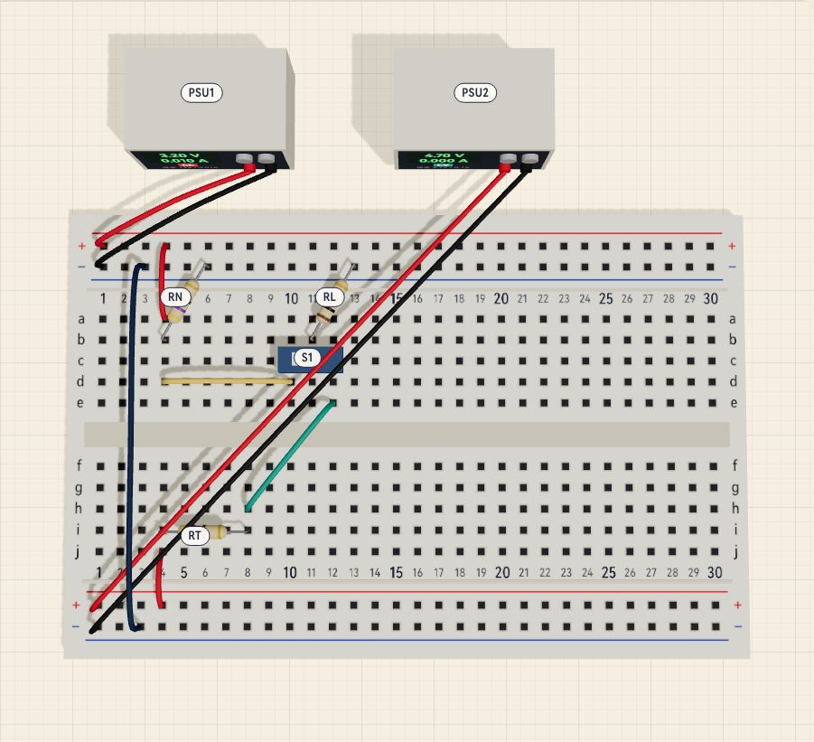
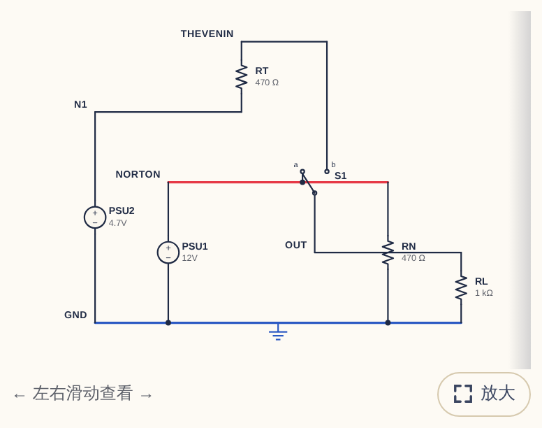
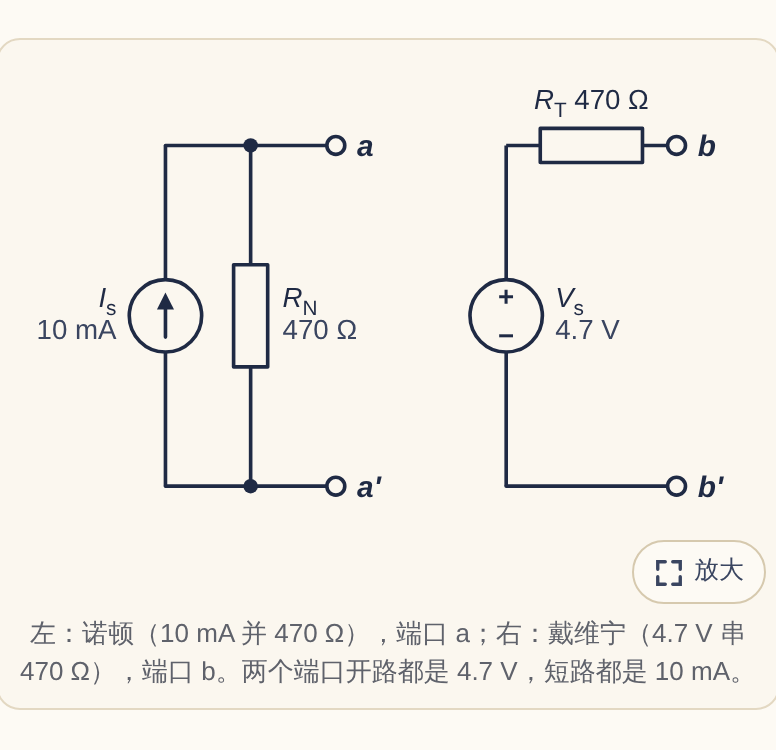

# 2.2 · 电源等效变换：诺顿 ⇄ 戴维宁

| 项目 | 内容 |
|---|---|
| id | `exp-source-transformation` |
| 文件 | `challenges/208-source-transformation.json` |
| 类型 | 实验 / 挑战（没有分步，照目标电路图搭） · 难度 5/5 |
| 位置 | World 2 · 网络分析与电路定理 → 2.2 叠加与电源变换（本节第 2 项） |
| 右侧面板 | 轨道由旧的四张卡片自动生成（还没手工精排） |
| 前后 | 上一项 [2.2 exp-superposition](../w2/2.02-1-exp-superposition.md) · 下一项 [2.3 exp-thevenin-measure](../w2/2.03-1-exp-thevenin-measure.md) |
| 先修 | lesson-multimeter |
| 概念 | source transformation 电源等效变换、Norton 诺顿（电流源 ∥ R）、Thevenin 戴维宁（电压源 + R）、equivalent to the outside 对外等效 |

**一句话概要**：10 mA 电流源并 470 Ω，和 4.7 V 电压源串 470 Ω：用开关轮流接同一个负载，负载分不出来——电源内部却很不一样。

## 1. 左侧工作台（3D 面包板 → 2D 俯视截图）

截图是程序里真实的 3D 面包板换成俯视角拍的；表格是同一块板的文字版（元件、参数、每只脚插在哪个孔）。

### 1.1 起点：空面包板（学生从零开始搭）

### 1.3 参考答案（「看答案」载入的板子）

| 元件 | 类型 | 参数 | 引脚 → 孔 |
|---|---|---|---|
| PSU1 | bench_supply | voltage=12, currentLimit=0.01 | +→tp1 -→tn1 |
| PSU2 | bench_supply | voltage=4.7, currentLimit=0.1 | +→bp1 -→bn1 |
| W3 | wire |  | a→tn3 b→bn3 |
| W4 | wire |  | a→tp4 b→a4 |
| RN | resistor | resistance=470 | 1→b4 2→tn6 |
| W6 | wire |  | a→bp4 b→j4 |
| RT | resistor | resistance=470 | 1→i4 2→i8 |
| S1 | switch | position=a | a→c10 com→c11 b→c12 |
| W9 | wire |  | a→d4 b→d10 |
| W10 | wire |  | a→h8 b→e12 |
| RL | resistor | resistance=1000 | 1→b11 2→tn13 |

### 1.4 目标原理图（右侧「目标原理图」抽屉）

| 元件 | 类型 | 参数 |
|---|---|---|
| PSU1 | bench_supply | voltage=12, currentLimit=0.01 |
| RN | resistor | resistance=470 |
| PSU2 | bench_supply | voltage=4.7 |
| RT | resistor | resistance=470 |
| S1 | switch |  |
| RL | resistor | resistance=1000 |

连接（每个结点上的引脚）：

- **NORTON**：PSU1.+、RN.1、S1.a
- **N1**：PSU2.+、RT.1
- **THEVENIN**：RT.2、S1.b
- **OUT**：S1.com、RL.1
- **GND**：PSU1.-、RN.2、PSU2.-、RL.2

## 2. 右侧面板：学生从上往下看到的内容（单轨流）

### 第 1 步 · 🔧 动手搭：负载认得出吗？

照目标电路图搭两个网络。**PSU1**：`12 V`、限流 **`0.01 A`**，两端并一个 **RN** `470 Ω`。**PSU2**：**`4.7 V`**，串一个 **RT** `470 Ω`。
两条蓝轨连起来当 GND。开关 **S1** 把负载 **RL** `1 kΩ` 接到第一个网络（**a**）或第二个网络（**b**）。
**把 S1 在 a、b 之间来回拨**，每次测 RL 两端的电压。
一个是电流源，一个是电压源。RL 认得出自己接的是哪一个吗？

### 第 2 步 · 💡 想明白：两个黑盒子，端口一模一样

- 只从两个端子看一个盒子。两个数就能描述它：端子**什么都不接**时的电压，和端子**短接**时的电流。
- 左边的盒子（诺顿）：开路时 10 mA 全走 RN，10 mA × 470 Ω = 4.7 V；短路时 10 mA 全部流出来。
- 右边的盒子（戴维宁）：开路时 4.7 V；短路时 4.7 V / 470 Ω = 10 mA。**两个数一样**，所以任何负载看到的都一样。

*图 `boxes`（schematic）：左：诺顿（10 mA 并 470 Ω），端口 a；右：戴维宁（4.7 V 串 470 Ω），端口 b。两个端口开路都是 4.7 V，短路都是 10 mA。*

- 规则：R 不变，电源用欧姆定律换算：
$$V_s = I_s\,R = 0.01 × 470 = 4.7\text{ V}$$
- 对外一样，不等于对内一样。预测一下：接上 RL 时，RN 和 RT 里各流过多少电流？

（这一步下面列着这节课的计算卡片，点开就地展开：`kcl`、`source-transformation`、`cc-current-source`，全文见第 6 节）

### 第 3 步 · 🔧 动手搭：看看盒子里面

- **S1 → a**：测 RL 两端的电压。再把电流表**串进 RN**，读数。
- **S1 → b**：测 RL 两端的电压。再把电流表**串进 RT**，读数。
- 电路检查通过后填测量题。

### 第 4 步 · 📏 测一测：测一测：读你自己的仪表

**测量题 1 · `va`**（读数题）

> S1 拨到 a（诺顿带负载）：RL 两端的电压

- 单位 V · 先写预测 · 状态：把 S1 拨到 a 侧 · 参考答案的读数 **3.196 V** · 合理范围 [3.04, 3.36]

答对后显示：

> 10 mA 分给 RN 和 RL：V = 10 mA × (470 ∥ 1000 = 319.7 Ω) ≈ 3.20 V。

**测量题 2 · `vb`**（读数题）

> S1 拨到 b（戴维宁带负载）：RL 两端的电压

- 单位 V · 先写预测 · 状态：把 S1 拨到 b 侧 · 参考答案的读数 **3.197 V** · 合理范围 [3.04, 3.36]

答对后显示：

> 4.7 V 在 RT 和 RL 上分压：4.7 × 1000 / 1470 ≈ 3.20 V，和诺顿一样。

**测量题 3 · `irn`**（读数题）

> S1 拨到 a：诺顿内阻 RN 里的电流

- 单位 mA · 先写预测 · 状态：把 S1 拨到 a 侧 · 参考答案的读数 **6.801 mA** · 合理范围 [0.00646, 0.00714]

答对后显示：

> 10 mA − 3.2 mA ≈ 6.8 mA，RN 发热约 21.7 mW。

**测量题 4 · `irt`**（读数题）

> S1 拨到 b：戴维宁内阻 RT 里的电流

- 单位 mA · 先写预测 · 状态：把 S1 拨到 b 侧 · 参考答案的读数 **3.197 mA** · 合理范围 [0.00304, 0.00336]

答对后显示：

> RT 和 RL 串联，电流就是负载电流，约 3.2 mA，RT 发热只有约 4.8 mW。

**测量题 5 · `equiv`**（选择题）

> 根据你的四个读数，电源等效变换是：

- A. 对负载等效（RL 上一样），但内阻里的电流和发热不一样 ✅（正确）
- B. 完全等效：内阻里的电流也一样
- C. 都不等效：负载电压也不一样

答对后显示：

> 等效变换只保证端口的电压–电流关系相同：对外等效，对内不等效。空载时诺顿的 RN 一直耗 47 mW，戴维宁的 RT 一点不耗。

### 第 5 步 · 🎒 带走：带走

- **电源等效变换**：$I_s$ 并 R ⇄ $V_s = I_sR$ 串同一个 R。
- 只是**对外**等效。内部电阻的电流和发热不一样。
- 用处是化简：把电源换成另一种形式，电阻就能串联或并联合并。
- 坑：空闲的诺顿网络也在内部电阻上耗电——这里什么都不接也有 47 mW；空闲的戴维宁网络一点不耗。

趁热练理论题：`theorems`

## 3. 测量题一览

| # | id | 题目 | 类型 | 单位 | 状态 | 参考读数 |
|---|---|---|---|---|---|---|
| 1 | va | S1 拨到 a（诺顿带负载）：RL 两端的电压 | voltage | V | 把 S1 拨到 a 侧 | 3.196 V |
| 2 | vb | S1 拨到 b（戴维宁带负载）：RL 两端的电压 | voltage | V | 把 S1 拨到 b 侧 | 3.197 V |
| 3 | irn | S1 拨到 a：诺顿内阻 RN 里的电流 | current | mA | 把 S1 拨到 a 侧 | 6.801 mA |
| 4 | irt | S1 拨到 b：戴维宁内阻 RT 里的电流 | current | mA | 把 S1 拨到 b 侧 | 3.197 mA |
| 5 | equiv | 根据你的四个读数，电源等效变换是： | 选择 |  |  | 正确：A |

### 全部答完后显示的「对比」

**对比**：
- 诺顿带负载：V = 10 mA × (470 ∥ 1000 = 319.7 Ω) ≈ **3.20 V**。
- 戴维宁带负载：V = 4.7 × 1000 / 1470 ≈ **3.20 V**。
- 空着的端口：诺顿 10 mA × 470 Ω = 4.70 V，戴维宁也是 4.70 V。

模拟器读数是 3.196 V 和 3.197 V，差别来自 CC 模式的 9.99 mA。电压差得多时，检查 PSU1 是不是真的进入了 CC 模式、PSU2 是不是设成了 4.7 V。

**但内部不一样**：带 1 kΩ 负载时，诺顿的 RN 流过 6.8 mA，发热约 21.7 mW；戴维宁的 RT 只流 3.2 mA，发热约 4.8 mW。

### 提示按钮（依次显示）

1. 两台电源：一台用上方的电源轨，另一台用下方的电源轨，再用一根跳线把两条蓝轨（−）连起来作为共同的 GND。
2. PSU1：12 V、限流 0.01 A（让它进 CC 模式）；PSU2：4.7 V。
3. S1 的 a 侧接诺顿端口（PSU1 + 和 RN 那一列），b 侧接 RT 的另一端，com 接 RL。

### 功能测试（「检查我的电路」时跑）

- 拨到 a（诺顿）：RL 上的电压、电流合理；戴维宁端口开路
- 拨到 b（戴维宁）：RL 上和拨到 a 时一样；诺顿端口开路

## 5. 这一课的计算卡片

**计算卡片 `kcl`：基尔霍夫电流定律 KCL**

- 公式 `Σ i_{in} = Σ i_{out}`
- 用途：一个结点上流进的电流之和等于流出的电流之和：知道几条支路，求剩下那一条。
- 输入：I_1（流进结点的电流，A）；I_2（流出的另一条支路，A） → I_3（剩下那条支路流出的电流，A）

1. 电荷不会在结点上堆起来，也不会凭空出现：每一时刻流进多少就流出多少。
2. 先给每条支路选一个 **参考方向**（画箭头），再写代数和，比如“流出为正”：$-I_1 + I_2 + I_3 = 0$。
3. 只剩一个未知量时直接解：$I_3 = I_1 - I_2$。
4. 算出负数不是算错：它说明真实电流和你画的箭头方向相反。

例子：实验 1-1：$I_1 = \frac{9 V}{330 + 1k ∥ 2.2k} = \frac{9}{1017.5} ≈ 8.84 mA$，$I_2 = \frac{6.08 V}{1 kΩ} ≈ 6.08 mA$，所以 $I_3 = 8.84 - 6.08 = 2.76 mA$——正好等于 $\frac{6.08 V}{2.2 kΩ}$。实验 1-8：电流源的 10 mA 里有 3.2 mA 进了负载，$R_N$ 分到 10 − 3.2 = 6.8 mA。

- ⚠ 电流表接反读数是负的：代进 KCL 时要连符号一起代。
- ⚠ 同一条支路上串联的几个元件电流相同，它们之间的连接点不算新的 KCL 方程。

**计算卡片 `source-transformation`：电源等效变换 Norton ⇄ Thevenin**

- 公式 `V_s = I_s R ⇔ I_s = \frac{V_s}{R}`
- 用途：电流源并电阻 ⇄ 电压源串同一个电阻：对外完全一样。计算器给出负载上的电压。
- 输入：I_s（诺顿电流源，A）；R（并联 / 串联电阻，Ω）；R_L（负载，Ω） → V_L（负载电压（两种接法一样），V）

1. 诺顿网络：端口电压 V 时，R 里流 $\frac{V}{R}$，端口电流 $I = I_s - \frac{V}{R}$。
2. 戴维宁网络：$V = V_s - IR$，也就是 $I = \frac{V_s}{R} - \frac{V}{R}$。
3. 两个式子完全相同的条件：$V_s = I_s R$，电阻相同。端口的 V–I 关系一样，接什么负载结果都一样。
4. 负载电压：诺顿看是 $I_s (R ∥ R_L)$，戴维宁看是 $V_s \frac{R_L}{R + R_L}$——同一个数。
5. 但 **内部不等效**：诺顿的 R 一直在耗电（空载时最多），戴维宁空载时一点不耗。

例子：实验 1-8：$V_s = 10 mA × 470 Ω = 4.7 V$。接 1 kΩ：$10 mA × (470 ∥ 1000) = 10 × 0.3197 ≈ 3.20 V$ = $4.7 × \frac{1000}{1470}$。内部：$R_N$ 流 6.8 mA、耗 21.7 mW；$R_T$ 只流 3.2 mA、耗 4.8 mW；空载时 $R_N$ 一直耗 47 mW。

- ⚠ 电流源箭头指向的那一端 = 等效电压源的 + 端。
- ⚠ 理想电压源（没有串联电阻）不能变成电流源，理想电流源也不能变成电压源。

**计算卡片 `cc-current-source`：稳压电源的 CV / CC：当电流源用**

- 公式 `I_{want} = \frac{V_{set} - V_F}{R} > I_{lim} ⇒ V = V_F + I_{lim} R`
- 用途：判断稳压电源工作在 CV 还是 CC，并算出它实际输出的电压。
- 输入：V_set（电压设定，V）；I_lim（限流设定，A）；R（负载电阻（含 LED 内阻），Ω）；V_F（负载里 LED 的 V_F（没有就填 0），V） → V（电源实际输出电压，V）

1. 稳压电源有两个“上限”：电压不超过 $V_{set}$，电流不超过 $I_{lim}$。哪个先碰到，哪个说了算。
2. 先假设 CV：输出 $V_{set}$，负载想要的电流 $I_{want} = \frac{V_{set} - V_F}{R}$。
3. $I_{want} ≤ I_{lim}$：确实是 CV，电压 = 设定，电流由负载决定。
4. $I_{want} > I_{lim}$：切到 CC，电流 = $I_{lim}$，电压降到刚好推动这个电流：$V = V_F + I_{lim}R$。
5. 当电流源用：限流设成想要的电流，电压设高一些（留余量）。它能带的最大负载是 $R_{max} = \frac{V_{set} - V_F}{I_{lim}}$，超过就退回 CV。

例子：- 第 11 课：12 V、10 mA、470 Ω：想要 25.5 mA > 10 mA → CC，$V = 10 mA × 470 = 4.70 V$；限流 20 mA → 9.4 V；100 mA → CV，12 V、25.5 mA。
- 实验 1-4：$1.8 + 10 mA × (470 + 12) ≈ 6.6 V$（CC）；RV1 = 1 kΩ 时需要 16.6 V > 12 V → CV，$I = \frac{12 - 1.8}{1482} ≈ 6.9 mA$。
- 挑战 10 电阻被短路：$6 V + 50 mA × 24 Ω = 7.2 V$，电源限住 50 mA。

- ⚠ 屏幕上小字 “SET …” 是旋钮设定，大字才是实际输出——CC 时两者不一样。
- ⚠ 电流源也有“顶”：负载太大时它给不出设定的电流（实验 1-4 的 100 %）。

## 6. English（界面英文版的同一份内容）

展开英文

### Node 1 · 🔧 Build：Can the load tell?

Build both networks from the target schematic. **PSU1**: `12 V`, limit **`0.01 A`**, with **RN** `470 Ω` across it. **PSU2**: **`4.7 V`**, with **RT** `470 Ω` in series.
Join the two blue rails as GND. Switch **S1** connects the load **RL** `1 kΩ` to the first network (**a**) or the second (**b**).
**Flip S1 between a and b** and measure the voltage across RL each time.
One network is a current source, the other a voltage source. Can RL tell which one it is on?

### Node 2 · 💡 Why：Two black boxes with the same terminals

- Judge a box only by its two terminals. Two numbers describe it: the voltage with **nothing connected** and the current with the terminals **shorted**.
- Left box (Norton): open, all 10 mA goes through RN, so 10 mA × 470 Ω = 4.7 V. Shorted, all 10 mA comes out.
- Right box (Thévenin): open, 4.7 V. Shorted, 4.7 V / 470 Ω = 10 mA. **Same two numbers**, so every load sees the same thing.

[figure `boxes`]

*Figure `boxes`（schematic）：左：诺顿（10 mA 并 470 Ω），端口 a；右：戴维宁（4.7 V 串 470 Ω），端口 b。两个端口开路都是 4.7 V，短路都是 10 mA。*

- The rule: keep R, and swap the source using Ohm's law:
$$V_s = I_s\,R = 0.01 × 470 = 4.7\text{ V}$$
- Equal outside does not mean equal inside. Predict the current in RN and in RT with RL connected.

(This node lists the lesson’s calculation cards: `kcl`、`source-transformation`、`cc-current-source`; full text in section 6)

### Node 3 · 🔧 Build：Look inside the boxes

- **S1 → a**: measure the voltage across RL. Then put the ammeter **in series with RN** and read it.
- **S1 → b**: measure the voltage across RL. Then put the ammeter **in series with RT** and read it.
- Once the circuit check passes, fill in the questions.

### Node 4 · 📏 Measure：Measure: read your own instruments

**Question 1 · `va`**（reading）

> S1 on a (Norton with the load): voltage across RL

- unit V · predict first · state：S1 is switched to side a · range [3.04, 3.36]

Shown once right:

> 10 mA shared by RN and RL: V = 10 mA × (470 ∥ 1000 = 319.7 Ω) ≈ 3.20 V.

**Question 2 · `vb`**（reading）

> S1 on b (Thévenin with the load): voltage across RL

- unit V · predict first · state：S1 is switched to side b · range [3.04, 3.36]

Shown once right:

> 4.7 V divided by RT and RL: 4.7 × 1000 / 1470 ≈ 3.20 V, the same as Norton.

**Question 3 · `irn`**（reading）

> S1 on a: current in the Norton resistor RN

- unit mA · predict first · state：S1 is switched to side a · range [0.00646, 0.00714]

Shown once right:

> 10 mA − 3.2 mA ≈ 6.8 mA; RN dissipates about 21.7 mW.

**Question 4 · `irt`**（reading）

> S1 on b: current in the Thévenin resistor RT

- unit mA · predict first · state：S1 is switched to side b · range [0.00304, 0.00336]

Shown once right:

> RT is in series with RL, so it carries the load current, about 3.2 mA; RT dissipates only about 4.8 mW.

**Question 5 · `equiv`**（multiple choice）

> From your four readings, source transformation is:

- A. equivalent for the load (RL sees the same), but the currents and heating in the internal resistors differ ✅ (right)
- B. fully equivalent: the internal resistors carry the same current too
- C. not equivalent at all: the load voltage differs too

Shown once right:

> A transformation only keeps the terminal voltage–current relation: equal outside, not inside. With no load, Norton's RN burns 47 mW all the time; Thévenin's RT burns nothing.

### Node 5 · 🎒 Take away：Take away

- **Source transformation**: $I_s$ in parallel with R ⇄ $V_s = I_sR$ in series with the same R.
- It is equal **outside** only. The current and heat in the inner resistor are different.
- Use it to simplify: turn a source into the form that lets you merge resistors in series or in parallel.
- Pitfall: an idle Norton network still burns power in its resistor — here 47 mW with nothing connected. An idle Thévenin network burns none.

Practise：`theorems`

**Compare**

**Compare**:
- Norton with the load: V = 10 mA × (470 ∥ 1000 = 319.7 Ω) ≈ **3.20 V**.
- Thévenin with the load: V = 4.7 × 1000 / 1470 ≈ **3.20 V**.
- The idle terminal: Norton 10 mA × 470 Ω = 4.70 V, Thévenin 4.70 V too.

The simulator reads 3.196 V and 3.197 V; the difference comes from the 9.99 mA of CC mode. If the voltages differ a lot, check that PSU1 really is in CC mode and that PSU2 is set to 4.7 V.

**Inside they differ**: with the 1 kΩ load, Norton's RN carries 6.8 mA and dissipates about 21.7 mW; Thévenin's RT carries only 3.2 mA, about 4.8 mW.

**Hints**

1. Two supplies: one on the top rails, the other on the bottom rails; a jumper joins the two blue (−) rails as the common GND.
2. PSU1: 12 V, current limit 0.01 A (so it runs in CC mode); PSU2: 4.7 V.
3. S1's a side goes to the Norton terminal (the column with PSU1 + and RN), its b side to RT's far end, com to RL.

