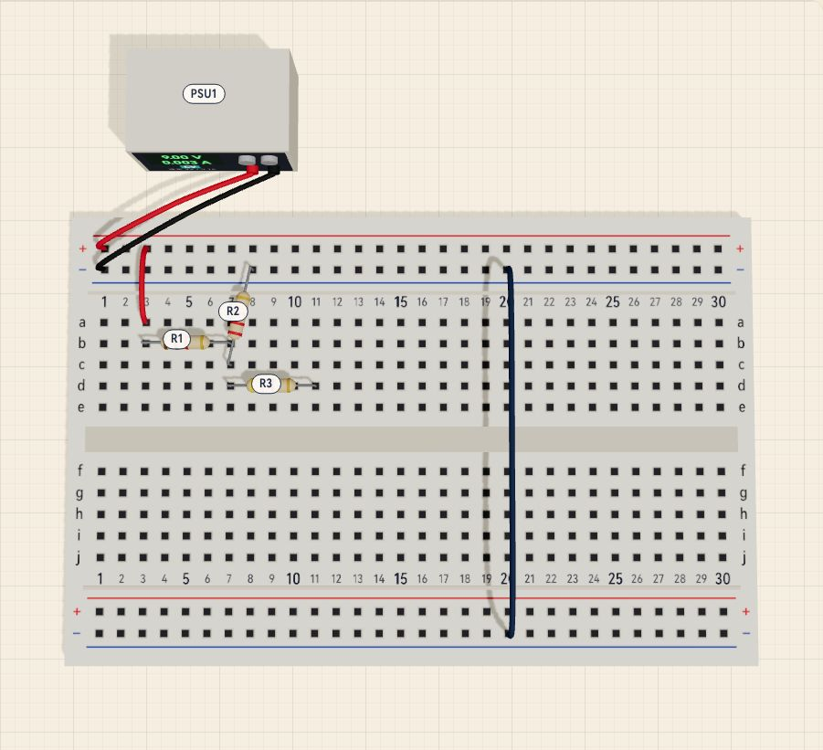
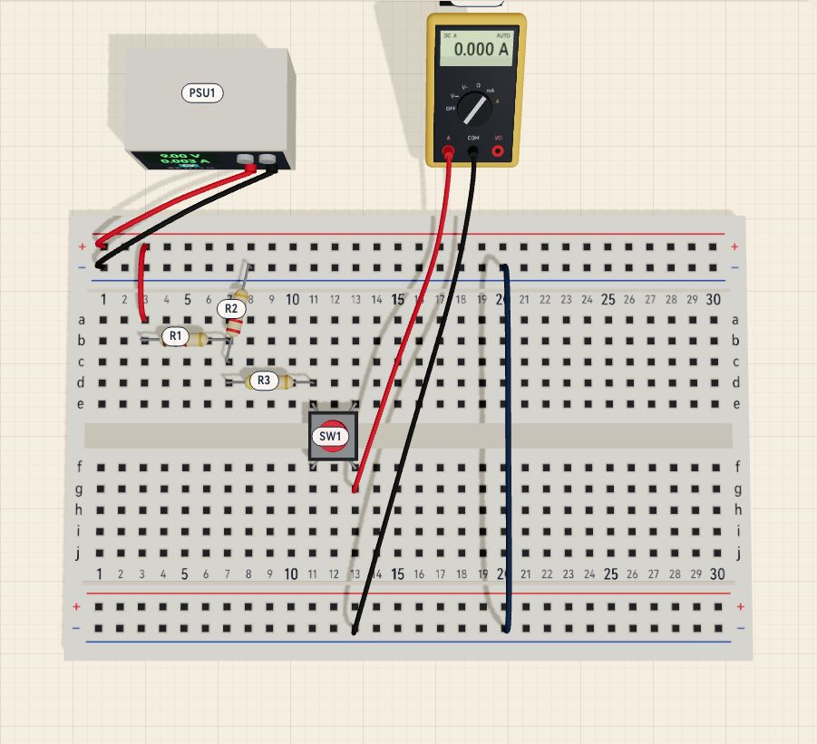
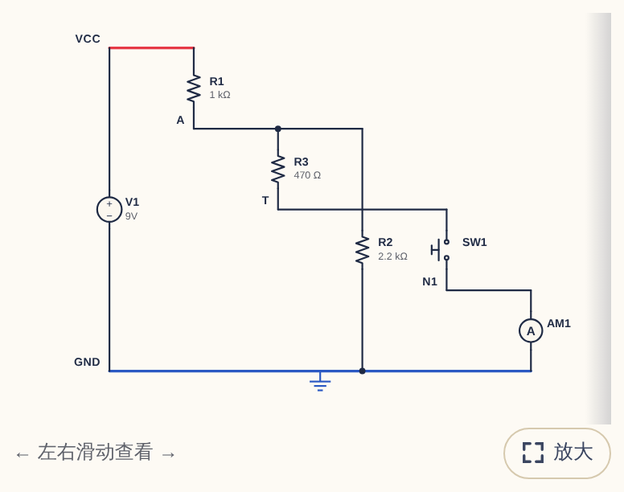
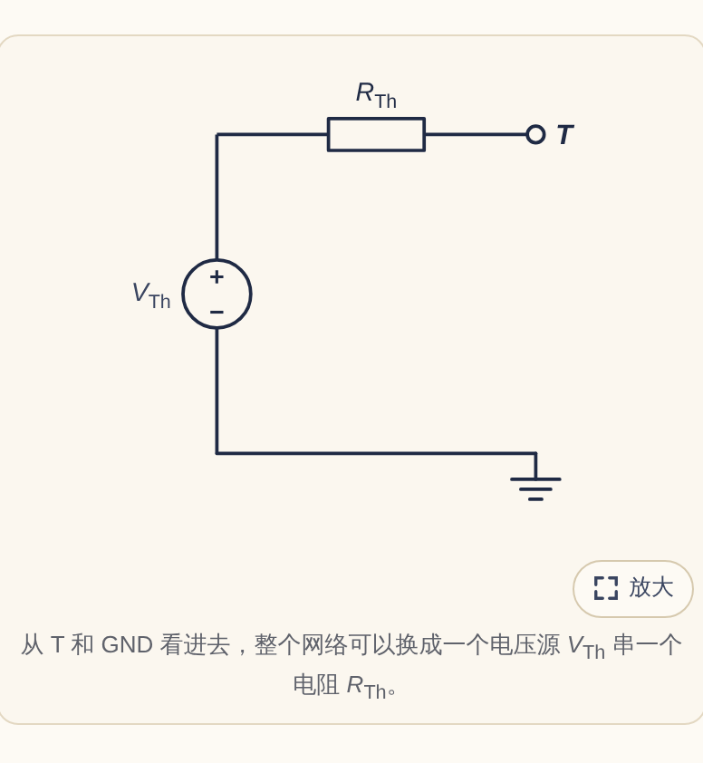
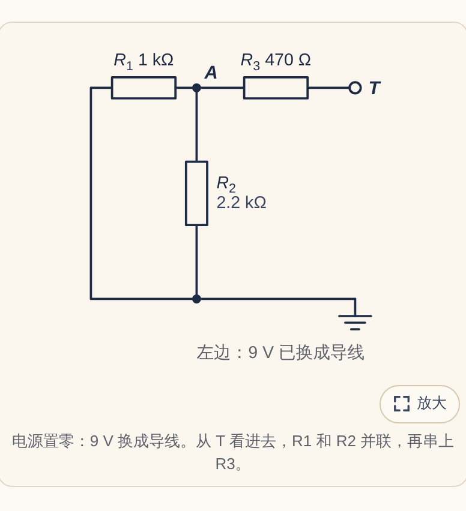

# 2.3 · 戴维宁等效：量开路电压和短路电流

| 项目 | 内容 |
|---|---|
| id | `exp-thevenin-measure` |
| 文件 | `challenges/222-thevenin-measure.json` |
| 类型 | 实验 / 挑战（没有分步，照目标电路图搭） · 难度 3/5 |
| 位置 | World 2 · 网络分析与电路定理 → 2.3 戴维宁等效与最大功率（本节第 1 项） |
| 右侧面板 | 轨道由旧的四张卡片自动生成（还没手工精排） |
| 前后 | 上一项 [2.2 exp-source-transformation](../w2/2.02-2-exp-source-transformation.md) · 下一项 [2.3 exp-max-power](../w2/2.03-2-exp-max-power.md) |
| 先修 | lesson-ammeter、lesson-multimeter |
| 概念 | Thevenin equivalent 戴维宁等效、open-circuit voltage 开路电压 Uoc、short-circuit current 短路电流 Isc、Req = Uoc / Isc |

**一句话概要**：一个电源和三个电阻组成的网络，从两个端子看出去，只需要两个数就能描述：开路电压和短路电流。

## 1. 左侧工作台（3D 面包板 → 2D 俯视截图）

截图是程序里真实的 3D 面包板换成俯视角拍的；表格是同一块板的文字版（元件、参数、每只脚插在哪个孔）。

### 1.1 起点：打开这一课时板上已经有的

右侧显示的「起点」说明：

> **半成品**：R1、R2、R3 组成的网络和电源已经搭好。**为什么**：网络只是第 5、6 课的串并联；这个实验要学的是测 Uoc 和 Isc 的方法。**你要做**：加上按键 SW1 和电流表：松开时量开路电压，按下时电流表把输出端短接到 GND，读短路电流。

| 元件 | 类型 | 参数 | 引脚 → 孔 |
|---|---|---|---|
| PSU1 | bench_supply | voltage=9, currentLimit=0.1 | +→tp1 -→tn1 |
| W2 | wire |  | a→tp3 b→a3 |
| R1 | resistor | resistance=1000 | 1→b3 2→b7 |
| R2 | resistor | resistance=2200 | 1→c7 2→tn8 |
| R3 | resistor | resistance=470 | 1→d7 2→d11 |
| W6 | wire |  | a→tn20 b→bn20 |

### 1.3 参考答案（「看答案」载入的板子）

| 元件 | 类型 | 参数 | 引脚 → 孔 |
|---|---|---|---|
| PSU1 | bench_supply | voltage=9, currentLimit=0.1 | +→tp1 -→tn1 |
| W2 | wire |  | a→tp3 b→a3 |
| R1 | resistor | resistance=1000 | 1→b3 2→b7 |
| R2 | resistor | resistance=2200 | 1→c7 2→tn8 |
| R3 | resistor | resistance=470 | 1→d7 2→d11 |
| SW1 | pushbutton | pressed=false | 1a→e11 2a→e13 1b→f11 2b→f13 |
| AM1 | ammeter |  | +→g13 -→bn13 |
| W8 | wire |  | a→tn20 b→bn20 |

### 1.4 目标原理图（右侧「目标原理图」抽屉）

| 元件 | 类型 | 参数 |
|---|---|---|
| V1 | dc_source | voltage=9 |
| R1 | resistor | resistance=1000 |
| R2 | resistor | resistance=2200 |
| R3 | resistor | resistance=470 |
| SW1 | pushbutton |  |
| AM1 | ammeter |  |

连接（每个结点上的引脚）：

- **VCC**：V1.+、R1.1
- **A**：R1.2、R2.1、R3.1
- **T**：R3.2、SW1.1
- **N1**：SW1.2、AM1.+
- **GND**：AM1.-、R2.2、V1.-

## 2. 右侧面板：学生从上往下看到的内容（单轨流）

### 第 1 步 · 🔧 动手搭：两个数，认出一个盒子

照目标电路图搭：`9 V` → **R1** → 结点 **A**；**R2** 从 A 到 GND；**R3** 从 A 到端子 **T**。
从 T 出发，按键 **SW1** 和电流表 **AM1** 通到 GND：按下按键，就是经过电流表把 T 短接到 GND。
**松开按键**：测 T 对 GND 的电压。**按住按键**：读 AM1。
假装看不到盒子里面。这两个数能告诉你什么？

### 第 2 步 · 💡 想明白：每个网络都是一节“带内阻的电池”

- 在 1.10 里，电池 = 一个电压加一个小内阻。**戴维宁定理**：任何由电源和电阻组成的网络，从两个端子看出去，都正好是这样。

*图 `equiv`（schematic）：从 T 和 GND 看进去，整个网络可以换成一个电压源 V_Th 串一个电阻 R_Th。*

- $V_{Th}$ 就是什么都不接时的电压（开路电压 $V_{oc}$）。把端子短接，只剩 $R_{Th}$ 限制电流，所以：
$$R_{Th} = \frac{V_{oc}}{I_{sc}}$$
- 拿 9 V 电池试试：$V_{oc} = 9$ V，$I_{sc} = 6$ A，$R_{Th} = 9 / 6 = 1.5$ Ω——正是电池的内阻。
- 第二种算法，不用表：把电源置零（9 V → 导线），从 T 看进去。这时 R1 和 R2 并联，再和 R3 串联。

*图 `lookin`（schematic）：电源置零：9 V 换成导线。从 T 看进去，R1 和 R2 并联，再串上 R3。*

（这一步下面列着这节课的计算卡片，点开就地展开：`thevenin`、`thevenin-resistance`、`ammeter-burden`，全文见第 6 节）

### 第 3 步 · 🔧 动手搭：开路一次，短路一次

- **松开按键**：万用表红表笔点 **T**，黑表笔接 GND。这就是 $V_{oc}$。
- **按住按键**：读 **AM1**。电流表只有 0.1 Ω，这就是 $I_{sc}$。
- 电路检查通过后填测量题；最后一题用你自己的两个读数相除。

### 第 4 步 · 📏 测一测：测一测：读你自己的仪表

**测量题 1 · `uoc`**（读数题）

> 按键松开：开路电压 Voc（万用表测 T 对 GND）

- 单位 V · 先写预测 · 状态：松开 SW1 · 参考答案的读数 **6.187 V** · 合理范围 [6, 6.35]

答对后显示：

> 端口开路时 R3 里没有电流，T 和 A 一样高：Voc = 9 × 2.2 / 3.2 ≈ 6.19 V。

**测量题 2 · `isc`**（读数题）

> 按住按键：短路电流 Isc（AM1 的读数）

- 单位 mA · 先写预测 · 状态：按下 SW1 · 参考答案的读数 **5.345 mA** · 合理范围 [0.0052, 0.0055]

答对后显示：

> Isc = Voc / R_Th ≈ 6.19 V / 1158 Ω ≈ 5.34 mA。

**测量题 3 · `req`**（计算题（用自己的读数算））

> 用你自己的两个读数算等效电阻 R_Th = Voc / Isc

- 单位 Ω · 先写预测 · 参考答案的读数 **1158 Ω** · 合理范围 [1100, 1220] · 公式 `uoc / isc`

答对后显示：

> 置零法：R3 + R1 ∥ R2 = 470 + 687.5 = 1157.5 Ω。测量值和它相差 1% 以内，说明两种方法得到的是同一个 R_Th。

### 第 5 步 · 🎒 带走：带走

- **戴维宁**：从两个端子看，任何线性网络 = $V_{Th}$ 串 $R_{Th}$。
- 求 $R_{Th}$ 两种方法：实验台上 $V_{oc}/I_{sc}$；纸上把电源置零、从端口看进去。两者一致。
- 坑：短路电流法只适合 $I_{sc}$ 很小的网络，比如这一个。**千万不要直接短路电池或电源的输出**去“测”它。
- 真实万用表 mA 档有几欧的负担电阻，测得的 $I_{sc}$ 会小约 1%。
- 下一步：什么样的负载能从这个盒子里拿到最多的功率？

趁热练理论题：`theorems`

## 3. 测量题一览

| # | id | 题目 | 类型 | 单位 | 状态 | 参考读数 |
|---|---|---|---|---|---|---|
| 1 | uoc | 按键松开：开路电压 Voc（万用表测 T 对 GND） | voltage | V | 松开 SW1 | 6.187 V |
| 2 | isc | 按住按键：短路电流 Isc（AM1 的读数） | current | mA | 按下 SW1 | 5.345 mA |
| 3 | req | 用你自己的两个读数算等效电阻 R_Th = Voc / Isc | formula | Ω |  | 1158 Ω |

### 全部答完后显示的「对比」

**对比**：Voc = 9 × 2.2 / 3.2 ≈ **6.19 V**；模拟器 Isc ≈ **5.34 mA**；R_Th = 6.19 V / 5.345 mA ≈ **1158 Ω**。置零法：R3 + (R1 ∥ R2) = 470 + 687.5 = 1157.5 Ω ✔。这个网络对外等效于“6.19 V 串 1.16 kΩ”，下一个实验用它找最大功率。

### 提示按钮（依次显示）

1. 按键横跨凹槽：一边接 T（R3 的另一端），另一边接电流表的红表笔。
2. 电流表黑表笔接 GND。
3. 松开按键时，用万用表测 T 对 GND 的电压，就是开路电压。

### 功能测试（「检查我的电路」时跑）

- 松开：端口开路，电流表读 0
- 按下：端口短路，端口电压 ≈ 0

## 5. 这一课的计算卡片

**计算卡片 `thevenin`：戴维宁等效：开路电压 + 短路电流**

- 公式 `R_{eq} = \frac{V_{oc}}{I_{sc}}`
- 用途：测出（或算出）端口的开路电压和短路电流，就得到整个网络的等效电阻。
- 输入：V_oc（开路电压，V）；I_sc（短路电流，A） → R_eq（等效电阻，Ω）

1. 任何含源线性二端网络，对外都等效成一个电压源 $V_{oc}$ 串一个电阻 $R_{eq}$。
2. 端口开路：没有电流流过 $R_{eq}$，它上面没有压降，端口电压就是 $V_{oc}$。
3. 端口短路：$I_{sc} = \frac{V_{oc}}{R_{eq}}$。
4. 两个测量相除：$R_{eq} = \frac{V_{oc}}{I_{sc}}$。（另一条路：把独立源置零，从端口看进去算电阻——见“戴维宁等效电阻”。）
5. 用法：接上负载 $R_L$，$V_L = V_{oc}\frac{R_L}{R_{eq} + R_L}$，一步就出来，不用再解整个网络。

例子：实验 2-2：$V_{oc} = 9 × \frac{2.2}{3.2} ≈ 6.19 V$，$I_{sc} ≈ 5.345 mA$，$R_{eq} ≈ 1158 Ω$ = $470 + 1k ∥ 2.2k$ ✔。实验 1-3 的分压器从 VOUT 看是“4.5 V 串 5 kΩ”：接 1 kΩ，$V = 4.5 × \frac{1}{6} = 0.75 V$。

- ⚠ 短路法只适合短路电流很小的网络——绝不要把电池或电源输出直接短路。
- ⚠ 真实电流表有几欧内阻，“短路”不彻底：$I_sc$ 偏小，算出的 $R_eq$ 偏大约 1 %。

**计算卡片 `thevenin-resistance`：戴维宁等效电阻（置零法）**

- 公式 `R_{eq} = R_3 + R_1 ∥ R_2`
- 用途：电源置零后从端口往里看的电阻——等效电路的内阻，也是电容 / 电感“看到”的电阻。
- 输入：R_1（电源和结点 A 之间的 R₁（含电源内阻），Ω）；R_2（A 到地的 R₂，Ω）；R_3（A 到端口的 R₃（没有就填 0），Ω） → R_eq（从端口看进去的电阻，Ω）

1. 把独立源置零：电压源换成 **导线**，电流源换成 **开路**。
2. 电压源变成导线以后，R₁ 的上端也接到了 GND，所以从 A 往下看，R₁ 和 R₂ **并联**。
3. 再串上 A 到端口的 R₃：$R_{eq} = R_3 + R_1 ∥ R_2$。
4. 开路电压另算：R₃ 里没有电流，$V_{oc} = V_s \frac{R_2}{R_1 + R_2}$。
5. 一阶电路里，电容 / 电感就是“端口”：$τ = R_{eq}C$ 或 $τ = \frac{L}{R_{eq}}$。

例子：- 实验 2-2：$470 + 1k ∥ 2.2k = 470 + 687.5 = 1157.5 Ω$。
- 实验 3-7：电容看到 $(10k + 50) ∥ 10k ≈ 5.01 kΩ$（R₃ = 0），$τ ≈ 0.50 ms$——只有单纯串联 RC 的一半。
- 实验 3-5 充电：$(220 + 50) ∥ (470 + 12) ≈ 173 Ω$，$τ ≈ 0.17 s$。
- 实验 5-4：ADC 看到 $100k ∥ 33k ≈ 24.8 kΩ$。

- ⚠ 信号发生器的 50 Ω 是电源的内阻：电源置零后它还在，串在 R₁ 里。
- ⚠ 电流源置零是开路，不是短路。

**计算卡片 `ammeter-burden`：电流表的内阻（负担电压）Ammeter burden**

- 公式 `误差 = \frac{R_A}{R + R_A}, $V_A$ = I $R_A$`
- 用途：电流表串进回路会多出 R_A：电流变小多少？表上压降多大？
- 输入：R（回路里其余的电阻（含 LED、电源内阻），Ω）；R_A（电流表内阻（模拟 0.1 Ω，真实 mA 档几欧到十几欧），Ω） → err（电流读数偏小，%）

1. 电流表要 **串联**：电流必须从它里面流过。它里面是一个很小的分流电阻 $R_A$（加上保险丝）。
2. 回路电阻从 R 变成 $R + R_A$，电流从 $\frac{V}{R}$ 变成 $\frac{V}{R + R_A}$。
3. 相对误差：$1 - \frac{R}{R + R_A} = \frac{R_A}{R + R_A}$。
4. 表两端的压降（负担电压）$V_A = IR_A$；反过来 $R_A = \frac{V_A}{I}$——第 10 课就这样量内阻。
5. 电流表 **并联** 到元件上 = 用 $R_A$ 把它短路。

例子：第 10 课：回路 1012 Ω，0.1 Ω 的表让电流小 0.01 %，表上压降 $0.1 × 7.1 mA ≈ 0.71 mV$。换成 10 Ω 的真实 mA 档：小约 1 %。实验 2-2 的短路电流：$\frac{10}{1158 + 10} ≈ 0.86 %$，$R_eq$ 偏大这么多。

- ⚠ 把电流表并在电源两端：真实表会烧保险丝。
- ⚠ 低电压、低电阻的回路里负担电压最要命（几百 mV 就能让 LED 电流明显变小）。

## 6. English（界面英文版的同一份内容）

展开英文

### Node 1 · 🔧 Build：Two numbers to know a box

Build it from the target schematic: `9 V` → **R1** → node **A**; **R2** from A to GND; **R3** from A to the terminal **T**.
From T, the button **SW1** and the ammeter **AM1** lead to GND: pressing the button shorts T to GND through the meter.
**Button released**: measure T to GND. **Button held**: read AM1.
Pretend you can't see inside. What do these two numbers tell you about the box?

### Node 2 · 💡 Why：Every network is a battery with internal resistance

- In 1.10 a battery was a voltage plus a small internal resistance. **Thévenin's theorem**: any network of sources and resistors looks exactly like that from two terminals.

[figure `equiv`]

*Figure `equiv`（schematic）：从 T 和 GND 看进去，整个网络可以换成一个电压源 V_Th 串一个电阻 R_Th。*

- $V_{Th}$ is the voltage with nothing connected (open circuit, $V_{oc}$). Shorting the terminals, only $R_{Th}$ limits the current, so:
$$R_{Th} = \frac{V_{oc}}{I_{sc}}$$
- Check it on a 9 V battery: $V_{oc} = 9$ V, $I_{sc} = 6$ A, so $R_{Th} = 9 / 6 = 1.5$ Ω — the battery's internal resistance.
- Second way, no meter needed: turn the source off (9 V → a wire) and look into T. R1 and R2 are then in parallel, in series with R3.

[figure `lookin`]

*Figure `lookin`（schematic）：电源置零：9 V 换成导线。从 T 看进去，R1 和 R2 并联，再串上 R3。*

(This node lists the lesson’s calculation cards: `thevenin`、`thevenin-resistance`、`ammeter-burden`; full text in section 6)

### Node 3 · 🔧 Build：Open once, short once

- **Button released**: multimeter red lead on **T**, black lead on GND. That is $V_{oc}$.
- **Button held**: read **AM1**. The meter is only 0.1 Ω, so this is $I_{sc}$.
- Once the circuit check passes, fill in the questions; the last one divides your own two readings.

### Node 4 · 📏 Measure：Measure: read your own instruments

**Question 1 · `uoc`**（reading）

> Button released: open-circuit voltage Voc (multimeter, T to GND)

- unit V · predict first · state：SW1 is released · range [6, 6.35]

Shown once right:

> With T open no current flows in R3, so T sits at A's voltage: Voc = 9 × 2.2 / 3.2 ≈ 6.19 V.

**Question 2 · `isc`**（reading）

> Button held: short-circuit current Isc (AM1 reading)

- unit mA · predict first · state：SW1 is pressed · range [0.0052, 0.0055]

Shown once right:

> Isc = Voc / R_Th ≈ 6.19 V / 1158 Ω ≈ 5.34 mA.

**Question 3 · `req`**（calculation from own readings）

> From your own two readings, the equivalent resistance R_Th = Voc / Isc

- unit Ω · predict first · range [1100, 1220] · formula `uoc / isc`

Shown once right:

> Sources off: R3 + R1 ∥ R2 = 470 + 687.5 = 1157.5 Ω. The measured value is within 1 %, so both methods give the same R_Th.

### Node 5 · 🎒 Take away：Take away

- **Thévenin**: from two terminals, any linear network = $V_{Th}$ in series with $R_{Th}$.
- Two ways to $R_{Th}$: $V_{oc}/I_{sc}$ on the bench, or sources off and look in on paper. They agree.
- Pitfall: the short-circuit test only suits networks with a small $I_{sc}$, like this one. **Never short a battery or a supply output** to "measure" it.
- A real mA range adds a few ohms, so the measured $I_{sc}$ comes out about 1 % low.
- Next: what load gets the most power out of this box?

Practise：`theorems`

**Compare**

**Compare**: Voc = 9 × 2.2 / 3.2 ≈ **6.19 V**; simulator Isc ≈ **5.34 mA**; R_Th = 6.19 V / 5.345 mA ≈ **1158 Ω**. Sources off: R3 + (R1 ∥ R2) = 470 + 687.5 = 1157.5 Ω ✔. From outside the network is "6.19 V in series with 1.16 kΩ"; the next lab uses it to find the maximum power.

**Hints**

1. The button straddles the trench: one side to T (R3's far end), the other to the ammeter's red lead.
2. The ammeter's black lead goes to GND.
3. With the button released, the multimeter reading from T to GND is the open-circuit voltage.

