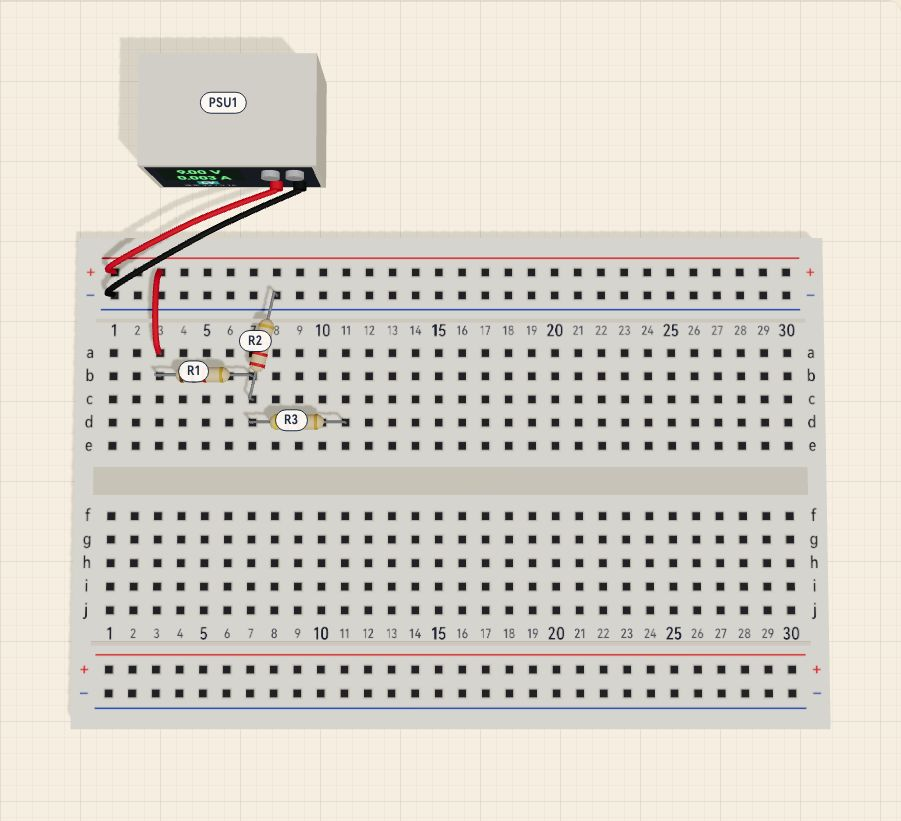
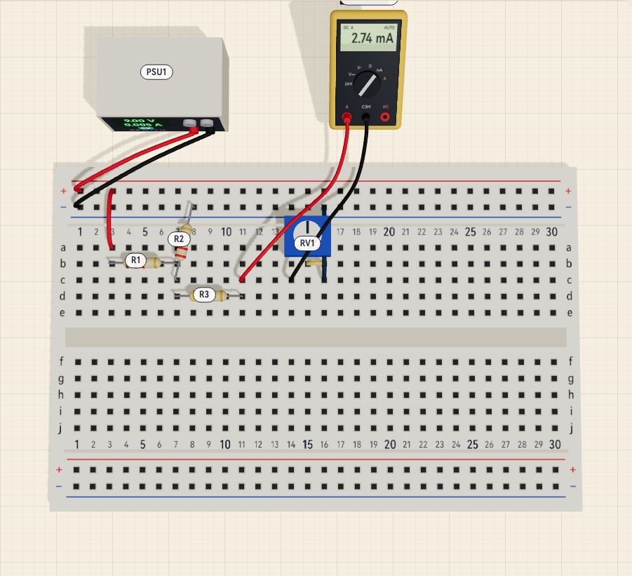
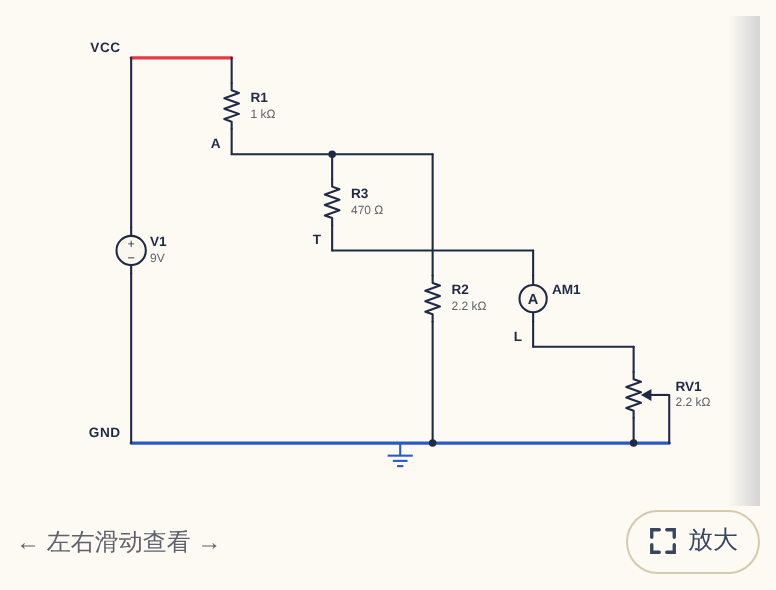
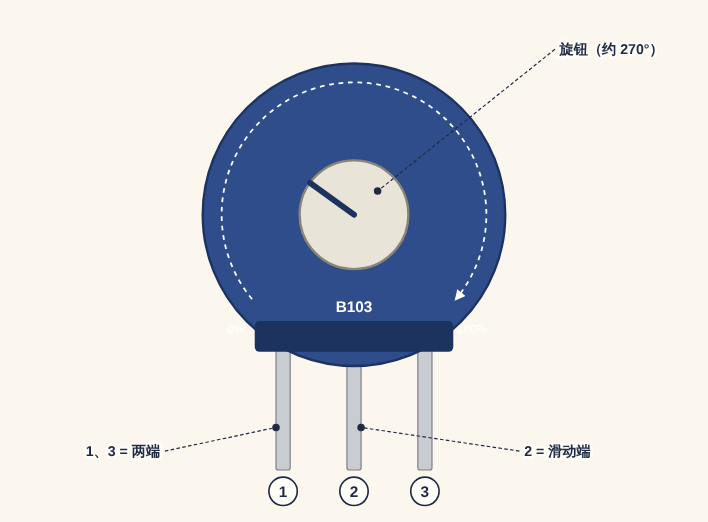
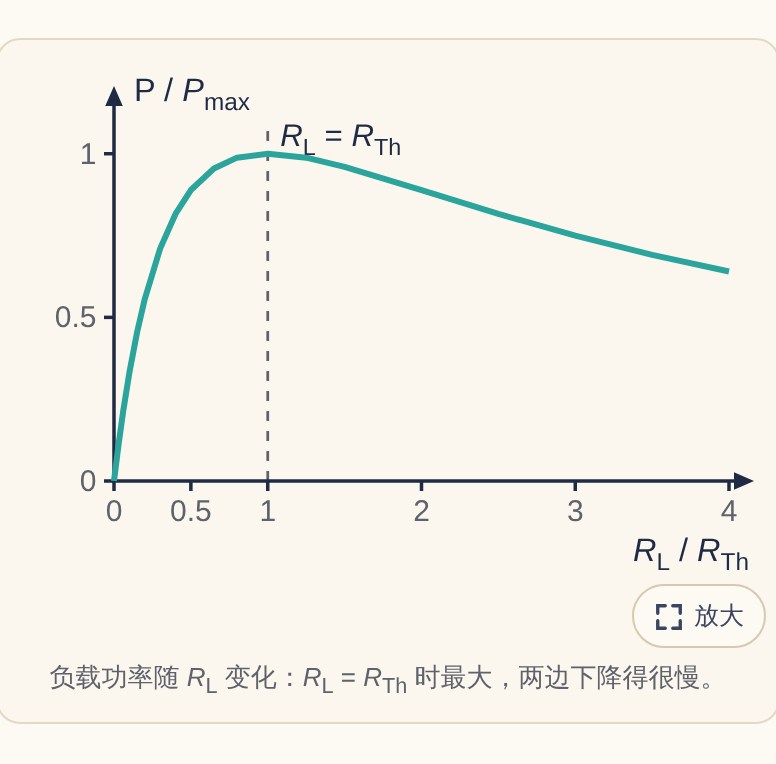

# 2.3 · 最大功率传输：转电位器，找功率最大的点

| 项目 | 内容 |
|---|---|
| id | `exp-max-power` |
| 文件 | `challenges/223-max-power.json` |
| 类型 | 实验 / 挑战（没有分步，照目标电路图搭） · 难度 4/5 |
| 位置 | World 2 · 网络分析与电路定理 → 2.3 戴维宁等效与最大功率（本节第 2 项） |
| 右侧面板 | 轨道由旧的四张卡片自动生成（还没手工精排） |
| 前后 | 上一项 [2.3 exp-thevenin-measure](../w2/2.03-1-exp-thevenin-measure.md) · 下一项 [2.4 exp-wheatstone-bridge](../w2/2.04-1-exp-wheatstone-bridge.md) |
| 先修 | lesson-ammeter、lesson-multimeter |
| 概念 | maximum power transfer 最大功率传输、RL = Req、Pmax = Uoc² / (4Req)、efficiency 效率 |

**一句话概要**：上一个实验的网络接一个可调负载：负载太小电压没了，太大电流没了，中间某处功率最大。

## 1. 左侧工作台（3D 面包板 → 2D 俯视截图）

截图是程序里真实的 3D 面包板换成俯视角拍的；表格是同一块板的文字版（元件、参数、每只脚插在哪个孔）。

### 1.1 起点：打开这一课时板上已经有的

右侧显示的「起点」说明：

> **半成品**：和实验 2-2 一样的 R1、R2、R3 网络已经搭好。**为什么**：网络上一个实验刚搭过；这里的新东西是可变负载和功率。**你要做**：加上电流表和电位器（当可变负载）以及电位器的两根跳线，然后转电位器、测电压和电流算功率。

| 元件 | 类型 | 参数 | 引脚 → 孔 |
|---|---|---|---|
| PSU1 | bench_supply | voltage=9, currentLimit=0.1 | +→tp1 -→tn1 |
| W2 | wire |  | a→tp3 b→a3 |
| R1 | resistor | resistance=1000 | 1→b3 2→b7 |
| R2 | resistor | resistance=2200 | 1→c7 2→tn8 |
| R3 | resistor | resistance=470 | 1→d7 2→d11 |

### 1.3 参考答案（「看答案」载入的板子）

| 元件 | 类型 | 参数 | 引脚 → 孔 |
|---|---|---|---|
| PSU1 | bench_supply | voltage=9, currentLimit=0.1 | +→tp1 -→tn1 |
| W2 | wire |  | a→tp3 b→a3 |
| R1 | resistor | resistance=1000 | 1→b3 2→b7 |
| R2 | resistor | resistance=2200 | 1→c7 2→tn8 |
| R3 | resistor | resistance=470 | 1→d7 2→d11 |
| AM1 | ammeter |  | +→c11 -→c14 |
| RV1 | potentiometer | resistance=2200, wiper=0.5 | 1→a14 2→a15 3→a16 |
| W8 | wire |  | a→b15 b→b16 |
| W9 | wire |  | a→c16 b→tn16 |

### 1.4 目标原理图（右侧「目标原理图」抽屉）

| 元件 | 类型 | 参数 |
|---|---|---|
| V1 | dc_source | voltage=9 |
| R1 | resistor | resistance=1000 |
| R2 | resistor | resistance=2200 |
| R3 | resistor | resistance=470 |
| AM1 | ammeter |  |
| RV1 | potentiometer | resistance=2200 |

连接（每个结点上的引脚）：

- **VCC**：V1.+、R1.1
- **A**：R1.2、R2.1、R3.1
- **T**：R3.2、AM1.+
- **L**：AM1.-、RV1.1
- **GND**：RV1.2、RV1.3、R2.2、V1.-

## 2. 右侧面板：学生从上往下看到的内容（单轨流）

### 第 1 步 · 🔍 先看一眼：先认识它：电位器

**拆解「电位器 Potentiometer：一个可以滑动的分压器」第 1 / 7 层：① 外形：一个旋钮、三只脚**

**potentiometer（电位器，常简称 pot）** 是一个可以调的电阻。从外面看：一个能转约 270° 的 旋钮 knob，下面三只排成一排的脚：
- 1 脚 和 3 脚：碳道的 **两端**，它们之间的电阻 **固定**，就是标称值（这里 10 kΩ）；
- 2 脚（中间）：**wiper（滑动端）**，跟着旋钮在碳道上移动。

旋钮位置用 **x** 表示（0 … 1，也就是 0% … 100%）：本课程（和仿真器）规定 x 是 **从 1 脚量起** 的比例。x = 0 时滑动端就在 1 脚上；x = 1 时在 3 脚上。

外壳 上印着 **B103**：B 表示线性，103 表示 10 kΩ（第 ⑦ 层解释）。在面包板上三只脚各占一列，绝对不能插在同一列里——那样三只脚被短接，电位器就没用了。

| 脚 | 名字 | 接在碳道哪里 | 对其他脚的电阻 |
|---|---|---|---|
| 1 | 端点 A（end） | 碳道起点（x = 0） | 到 3：R；到 2：R·x |
| 2 | 滑动端（wiper） | 跟着旋钮走 | 到 1：R·x；到 3：R·(1−x) |
| 3 | 端点 B（end） | 碳道终点（x = 1） | 到 1：R；到 2：R·(1−x) |

### 第 2 步 · 🔧 动手搭：电压和电流在拔河

搭上一个实验的网络（`9 V`、**R1**、**R2**、**R3** 接到端子 **T**）。从 T 出发，电流表 **AM1** 接到电位器 **RV1** `2.2 kΩ` 当可调负载：**中间脚和 3 脚连在一起**，接 GND。
**慢慢把 RV1** 从 `0%` 转到 `100%`。看电流表，再用万用表看 RV1 两端的电压。
`0%` 时电流很大、电压为零；`100%` 时正好反过来。功率 = 电压 × 电流。它在哪里最大？

### 第 3 步 · 💡 想明白：负载和内阻一样大时，功率最大

- 对负载来说，网络就是 $V_{Th}$ 串 $R_{Th}$（上一个实验）。电流 $= V_{Th}/(R_{Th} + R_L)$，负载得到 $P = I^2R_L$。
- $R_L$ 很小：电流大，电压几乎没有；$R_L$ 很大：电压有了，电流几乎没有。乘积在中间最大，就在 $R_L = R_{Th}$ 处：
$$P_{max} = \frac{V_{Th}^2}{4R_{Th}}$$
- 举例：9 V 电池（$R_{Th}$ = 1.5 Ω）接 1.5 Ω 的负载，得到 $9^2 / (4 × 1.5) = 13.5$ W——同时电池内部也烧掉 13.5 W。

*图 `peak`（plot）：负载功率随 R_L 变化：R_L = R_Th 时最大，两边下降得很慢。*

- 峰很平：负载是 $R_{Th}$ 的一半或两倍，功率仍有最大值的约 89%。用上一个实验的 $R_{Th}$ 预测旋钮的位置。

（这一步下面列着这节课的计算卡片，点开就地展开：`power`、`thevenin`、`thevenin-resistance`、`max-power`，全文见第 6 节）

### 第 4 步 · 🔧 动手搭：三个位置，算三个功率

- 把 RV1 转到 `25%`、`53%`、`100%`（愿意的话多试几个位置）。
- 每次**测 RV1 两端的电压**（1 脚对 GND），**读 AM1**，再相乘：$P = V × I$。
- 电路检查通过后，填 `53%` 和 `100%` 两个位置的测量题。

### 第 5 步 · 📏 测一测：测一测：读你自己的仪表

**测量题 1 · `u53`**（读数题）

> 旋钮在 `53%`：负载电压 V（RV1 的 1 脚对 GND）

- 单位 V · 状态：把 RV1 旋到 53% · 参考答案的读数 **3.105 V** · 合理范围 [2.98, 3.22]

**测量题 2 · `i53`**（读数题）

> 旋钮在 `53%`：电流 I（AM1 的读数）

- 单位 mA · 状态：把 RV1 旋到 53% · 参考答案的读数 **2.663 mA** · 合理范围 [0.00255, 0.0028]

**测量题 3 · `p53`**（计算题（用自己的读数算））

> 旋钮在 `53%`：负载功率 P = V × I（用你的读数算）

- 单位 mW · 先写预测 · 参考答案的读数 **8.268 mW** · 合理范围 [0.0078, 0.0087] · 公式 `u53 * i53`

答对后显示：

> 53% × 2.2 kΩ ≈ 1166 Ω ≈ R_Th：功率最大，P_max = 6.19² / (4 × 1158) ≈ 8.27 mW。

**测量题 4 · `u100`**（读数题）

> 旋钮在 `100%`：负载电压 V

- 单位 V · 状态：把 RV1 旋到 100% · 参考答案的读数 **4.054 V** · 合理范围 [4, 4.3]

**测量题 5 · `i100`**（读数题）

> 旋钮在 `100%`：电流 I

- 单位 mA · 状态：把 RV1 旋到 100% · 参考答案的读数 **1.843 mA** · 合理范围 [0.00175, 0.0019]

**测量题 6 · `p100`**（计算题（用自己的读数算））

> 旋钮在 `100%`：负载功率 P = V × I

- 单位 mW · 参考答案的读数 **7.471 mW** · 合理范围 [0.0071, 0.0079] · 公式 `u100 * i100`

答对后显示：

> R_L = 2.2 kΩ ≈ 1.9 R_Th：功率只比峰值少约 10%。

**测量题 7 · `peak`**（选择题）

> 比较你算出的功率（也可以多试几个位置）：P 在哪里最大？

- A. R_L ≈ R_Th ≈ 1.16 kΩ（约 53%） ✅（正确）
- B. R_L 越大越好：100% 时最大
- C. R_L 越小越好：越接近 0% 越大

答对后显示：

> R_L = R_Th 时 P 最大，P_max = V_Th² / (4R_Th)。峰很平缓：R_L 偏离 R_Th 一倍，P 也只少约 10%。

### 第 6 步 · 🎒 带走：带走

- **最大功率传输**：$R_L = R_{Th}$，这时 $P_{max} = V_{Th}^2 / (4R_{Th})$。
- 峰值时负载和 $R_{Th}$ 平分功率：效率最多 50%。这里真实的 9 V 电源效率更低——等效电路只对外等效，和 2.3 一样。
- 电网要效率，负载远大于 $R_{Th}$；无线电、音响、传感器要的是信号最大，所以讲究**匹配**。
- 坑：匹配时电池自己和负载一样发热。直接短路更糟：功率全部烧在电池里面。

趁热练理论题：`theorems`

## 3. 测量题一览

| # | id | 题目 | 类型 | 单位 | 状态 | 参考读数 |
|---|---|---|---|---|---|---|
| 1 | u53 | 旋钮在 `53%`：负载电压 V（RV1 的 1 脚对 GND） | voltage | V | 把 RV1 旋到 53% | 3.105 V |
| 2 | i53 | 旋钮在 `53%`：电流 I（AM1 的读数） | current | mA | 把 RV1 旋到 53% | 2.663 mA |
| 3 | p53 | 旋钮在 `53%`：负载功率 P = V × I（用你的读数算） | formula | mW |  | 8.268 mW |
| 4 | u100 | 旋钮在 `100%`：负载电压 V | voltage | V | 把 RV1 旋到 100% | 4.054 V |
| 5 | i100 | 旋钮在 `100%`：电流 I | current | mA | 把 RV1 旋到 100% | 1.843 mA |
| 6 | p100 | 旋钮在 `100%`：负载功率 P = V × I | formula | mW |  | 7.471 mW |
| 7 | peak | 比较你算出的功率（也可以多试几个位置）：P 在哪里最大？ | 选择 |  |  | 正确：A |

### 全部答完后显示的「对比」

**对比**：**R_L = R_Th** 时最大：P_max = V_Th² / (4R_Th) = 6.19² / 4632 ≈ **8.27 mW**。
- 25%（R_L = 550 Ω）：V ≈ 1.99 V，I ≈ 3.62 mA，P ≈ **7.2 mW**。
- 53%（R_L ≈ 1166 Ω ≈ R_Th）：V ≈ 3.10 V，I ≈ 2.66 mA，P ≈ **8.27 mW**（最大）。
- 100%（R_L = 2.2 kΩ）：V ≈ 4.05 V，I ≈ 1.84 mA，P ≈ **7.5 mW**。

**效率**：对等效电路来说，峰值时负载和 R_Th 各分一半，效率 50%。真实电路要重新算：53% 时 9 V 电源输出 4.64 mA，也就是 41.8 mW，只有 8.27 mW（约 20%）到了负载。

### 提示按钮（依次显示）

1. 先搭好上一个实验的网络（R1、R2、R3），端口是 R3 的另一端 T。
2. 电流表红表笔接 T，黑表笔接电位器的 1 脚；电位器中间脚和 3 脚连起来接 GND。
3. 旋钮 0% 时负载为 0（短路），100% 时负载是 2.2 kΩ。

### 功能测试（「检查我的电路」时跑）

- 25%（RL = 550 Ω）：电流、电压合理
- 53%（RL ≈ Req）：电流、电压合理
- 100%（RL = 2.2 kΩ）：电流、电压合理

## 4. 用到的拆解（全部层的文字，供改写参考）

### 拆解 `potentiometer`：电位器 Potentiometer：一个可以滑动的分压器

*三只脚、一条马蹄形碳道、一个在上面滑动的触点。拆开后它就是两个电阻 R·x 和 R·(1−x)。接法不同，它可以当分压器（输出可调电压），也可以当可变电阻（rheostat，调电流）。*

**拆解「电位器 Potentiometer：一个可以滑动的分压器」第 1 / 7 层：① 外形：一个旋钮、三只脚**

**potentiometer（电位器，常简称 pot）** 是一个可以调的电阻。从外面看：一个能转约 270° 的 旋钮 knob，下面三只排成一排的脚：
- 1 脚 和 3 脚：碳道的 **两端**，它们之间的电阻 **固定**，就是标称值（这里 10 kΩ）；
- 2 脚（中间）：**wiper（滑动端）**，跟着旋钮在碳道上移动。

旋钮位置用 **x** 表示（0 … 1，也就是 0% … 100%）：本课程（和仿真器）规定 x 是 **从 1 脚量起** 的比例。x = 0 时滑动端就在 1 脚上；x = 1 时在 3 脚上。

外壳 上印着 **B103**：B 表示线性，103 表示 10 kΩ（第 ⑦ 层解释）。在面包板上三只脚各占一列，绝对不能插在同一列里——那样三只脚被短接，电位器就没用了。

| 脚 | 名字 | 接在碳道哪里 | 对其他脚的电阻 |
|---|---|---|---|
| 1 | 端点 A（end） | 碳道起点（x = 0） | 到 3：R；到 2：R·x |
| 2 | 滑动端（wiper） | 跟着旋钮走 | 到 1：R·x；到 3：R·(1−x) |
| 3 | 端点 B（end） | 碳道终点（x = 1） | 到 1：R；到 2：R·(1−x) |

**拆解「电位器 Potentiometer：一个可以滑动的分压器」第 2 / 7 层：② X 光：马蹄形碳道和一个滑动触点**

把外壳变透明：
1. 碳道 resistive track：印在绝缘底板上的一条 **马蹄形** 碳膜（270° 的圆弧）。它的两端分别接 1 脚 和 3 脚。它就是一个 **被弯成弧形的电阻**：和上一个拆解里的螺旋膜一样，$R = \frac{ρL}{A}$，整条碳道 10 kΩ。
2. 滑动触点 wiper：一片铜弹片，固定在旋钮轴上，压在碳道表面。转旋钮，它就沿碳道滑动。
3. 集电环 collector ring：轴周围的一圈金属，滑片的另一端一直压着它；它接 2 脚。这样不管滑片转到哪，2 脚都和触点相连。

所以：从 1 脚走到触点，电流要走过碳道的 **x** 那一段；从触点走到 3 脚，走过剩下的 **1 − x**。电阻和长度成正比 → 下一层的等效电路。

**拆解「电位器 Potentiometer：一个可以滑动的分压器」第 3 / 7 层：③ 等效电路：两个电阻 R·x 和 R·(1−x)**

把碳道拉直，电阻和长度成正比（$R ∝ L$），所以滑动端把总电阻 R 切成两段：
$$R_{12} = R·x,   R_{23} = R·(1-x)$$
- 1–2 之间：$R·x$；
- 2–3 之间：$R·(1-x)$；
- 两段之和永远是 R：$R_{12} + R_{23} = R$。

**带数字**：10 kΩ、旋钮在 x = 0.3：$R_{12} = 3 kΩ$，$R_{23} = 7 kΩ$。转到 x = 0.9：$R_{12} = 9 kΩ$，$R_{23} = 1 kΩ$。

所以电位器 **不是** 一种新元件——它是两个串联电阻，中间那个结点（2 脚）引了出来，而且两个电阻的比例可以调。后面两层是它的两种用法：三只脚都用（分压器），或只用两只脚（可变电阻）。

- 公式 `R_{12} = R·x, R_{23} = R·(1-x)`：x 从 1 脚量起，0 … 1

**拆解「电位器 Potentiometer：一个可以滑动的分压器」第 4 / 7 层：④ 用法一：三只脚都接——可调的分压器**

1 脚接 +5 V，3 脚接 GND，从 2 脚取 输出电压。这就是 **voltage divider（分压器）**：两个串联电阻，取中间结点的电压。

推导（2 脚不接负载，没有电流流出）：
1. 两个电阻串联，电流相同：$I = \frac{V_s}{R·x + R(1-x)} = \frac{V_s}{R}$
2. 输出电压就是 下面那段 上的电压：$V_{out} = I·R(1-x)$
3. 代入：
$$V_{out} = V_s·\frac{R_{23}}{R_{12}+R_{23}} = V_s·(1-x)$$
**带数字**：$V_s = 5 V$，x = 0.3 → $V_{out} = 5 × 0.7 = 3.5 V$。x 从 0 转到 1，输出从 5 V **线性地** 降到 0 V（右图的直线）。想让顺时针转电压升高，就把 1、3 两只脚对调。

注意结果 **和 R 无关**：1 kΩ 还是 100 kΩ 的电位器，空载时输出一样。R 决定的是电位器自己耗多少电流：$\frac{5 V}{10 kΩ} = 0.5 mA$。

- 公式 `V_{out} = V_s·\frac{R_{23}}{R_{12} + R_{23}} = V_s·(1-x)`：空载（2 脚不取电流）
- 公式 `V_{out} = 5 V × (1 - 0.3) = 3.5 V`

**拆解「电位器 Potentiometer：一个可以滑动的分压器」第 5 / 7 层：⑤ 用法二：只用两只脚——可变电阻（调光实验）**

调光实验（challenge-pot-dimmer）这样接：+5 V → 1 脚；2 脚和 3 脚连在一起；再串 220 Ω 和 红色 LED 到 GND。

2、3 短接后，$R_{23}$ 被短路，只剩 $R_{12} = R·x$——电位器变成一个 **rheostat（可变电阻）**，从 0 调到 10 kΩ。为什么要把 2、3 连起来，而不是让 3 脚空着？如果滑片接触不良（旧电位器常见），电流还能走 3 脚，电阻最多是 R，**不会突然断路**。

用 LED 模型（红：1.8 V + 12 Ω）写 KVL：
$$I = \frac{V_s - V_F}{R·x + 220 + 12} = \frac{3.2 V}{232 Ω + 10 kΩ·x}$$
- x = 0：$I = \frac{3.2}{232} = 13.8 mA$，最亮；
- x = 0.1：2.6 mA；x = 0.25：1.17 mA；x = 0.5：0.61 mA；
- x = 1：$I = \frac{3.2}{10232} = 0.31 mA$，几乎灭。

曲线是 双曲线：大部分亮度变化挤在 x < 0.2 那一小段（这就是调光要用对数电位器的原因，见第 ⑦ 层）。**220 Ω 为什么不能省**：x = 0 时电位器是 0 Ω，没有它 LED 直接接在 5 V 上：$\frac{3.2}{12} ≈ 270 mA$，立刻烧掉。

最大功率实验（exp-max-power）用的是同一种接法：2.2 kΩ 电位器当负载 $R_L = 2.2 kΩ·x$，$R_L = R_{eq} = 1158 Ω$（x ≈ 53%）时负载功率最大。

| x | 电位器 R·x | 总电阻 | LED 电流 |
|---|---|---|---|
| 0 | 0 Ω | 232 Ω | 13.8 mA |
| 0.1 | 1 kΩ | 1.23 kΩ | 2.6 mA |
| 0.25 | 2.5 kΩ | 2.73 kΩ | 1.17 mA |
| 0.5 | 5 kΩ | 5.23 kΩ | 0.61 mA |
| 1 | 10 kΩ | 10.2 kΩ | 0.31 mA |

- 公式 `I = \frac{V_s - V_F}{R·x + R_{series} + 12 Ω}`：2、3 短接的可变电阻 + LED

**拆解「电位器 Potentiometer：一个可以滑动的分压器」第 6 / 7 层：⑥ 分压器接上负载，电压就掉**

第 ④ 层的 $V_{out} = V_s(1-x)$ 有个前提：**2 脚不取电流**。接上一个 负载 $R_L$，它和下面那段 $R_{23}$ **并联**，下面那段的等效电阻变小，输出就下降。

**例**：9 V，10 kΩ 电位器转到中间（5 k / 5 k），空载 4.5 V。
- $R_L = 100 kΩ$：$5k ∥ 100k = 4.76 kΩ$，$V_{out} = 9 × \frac{4.76}{5 + 4.76} = 4.39 V$（只掉 2%）；
- $R_L = 10 kΩ$：$5k ∥ 10k = 3.33 kΩ$，$V_{out} = 3.6 V$（掉 20%）；
- $R_L = 1 kΩ$：$5k ∥ 1k = 0.83 kΩ$，$V_{out} = 1.29 V$（掉 71%）！

**更快的看法：戴维宁（Thévenin）**。从 2 脚看进去，电位器等于 一个电压源串一个电阻：
$$V_{th} = V_s(1-x),   R_{th} = R_{12} ∥ R_{23} = R·x(1-x)$$
x = 0.5 时 $R_{th}$ 最大，$= \frac{R}{4} = 2.5 kΩ$。于是 $V_{out} = V_{th}·\frac{R_L}{R_{th}+R_L}$，一眼就能看出：**$R_L$ 要比 $R_th$ 大 10 倍以上**，误差才 < 10%。

所以电位器分压适合给“几乎不取电流”的输入（op-amp 输入、ADC、示波器）提供电压；要带 1 kΩ 这种重负载，要么换小阻值电位器，要么在后面加一个 op-amp 跟随器（voltage follower）。

- 公式 `R_{th} = R·x(1-x) ≤ \frac{R}{4}`：10 kΩ 电位器最多 2.5 kΩ
- 公式 `V_{out} = V_{th}·\frac{R_L}{R_{th} + R_L}`：$R_L$ = 1 kΩ：4.5 × 1 / 3.5 = 1.29 V

**拆解「电位器 Potentiometer：一个可以滑动的分压器」第 7 / 7 层：⑦ 型号、阻值曲线和真实电位器的局限**

**读型号**：B103——字母是 **taper（阻值曲线）**，数字是阻值：前两位是有效数字，第三位是 10 的几次方：103 = 10 × 10³ Ω = 10 kΩ，502 = 5 kΩ，104 = 100 kΩ。

**两种曲线**：
- B = 线性（linear）：$R_{12}$ 和转角成正比，本课程和仿真器都用这种；
- A = 对数（logarithmic / audio）：开始变得很慢，最后很快。人耳和人眼对强度的感觉是 **对数** 的，所以音量、调光用 A 型，转起来感觉才“均匀”。

**真实电位器的局限**：
- 滑片电流：所有电流都挤过一个小接触点，一般不超过几 mA；接触不良时会“沙沙”响、读数跳动（noise）。
- 额定功率 0.1–0.25 W 指的是 **整条碳道** 均匀发热。当可变电阻用、x 很小时，同样的电流只流过一小段碳道，那一小段会局部过热。所以调光电路一定要串保护电阻。
- 端点残余电阻：转到头也不是精确的 0 Ω，常有几 Ω 到几十 Ω；误差一般 ±20%。
- 寿命：碳膜电位器约 1 万次旋转。

**仿真器里**：电位器是理想的线性电位器：$R_{12} = R·x$ 精确成立，x 可以连续取 0 … 1，没有残余电阻、噪声和功率限制。

| 参数 | 常见真实值 | 仿真器 |
|---|---|---|
| 阻值误差 | ±20% | 0 |
| 曲线 | A（对数）或 B（线性） | B（线性） |
| 额定功率 | 0.1–0.25 W | 不检查 |
| 滑片电流 | ≤ 几 mA | 不限 |
| 端点残余电阻 | 几 Ω – 几十 Ω | 0 |

**一句话记住**：电位器 = 一条碳道 + 一个滑片 = **两个串联电阻 R·x 和 R·(1−x)**，中间结点引出来。三只脚都接是分压器 $V_{out} = V_s(1-x)$（只在空载时准，$R_L ≫ R_{th} = R·x(1-x)$）；2、3 短接是可变电阻 $R·x$，一定要串保护电阻。

## 5. 这一课的计算卡片

**计算卡片 `power`：功率 Power**

- 公式 `P = UI = I^{2}R = \frac{V^{2}}{R}`
- 用途：元件消耗多少瓦——选电阻功率、判断会不会烫。
- 输入：V（电阻两端电压，V）；R（电阻，Ω） → P（功率，W）

功率 = 每秒做的功 = 电压 × 电流：$P = UI$。把欧姆定律 $V = IR$ 代进去得到另外两种写法。
- 普通直插电阻是 **1/4 W**（0.25 W）。算出来超过它的一半，就换大功率电阻。
- 关联参考方向下 $P > 0$ 表示 **吸收** 功率，$P < 0$ 表示 **发出** 功率（电源）。

例子：5 V 加在 100 Ω 上：$P = \frac{25}{100} = 0.25 W$——1/4 W 电阻刚好满载，会很烫。

**计算卡片 `thevenin`：戴维宁等效：开路电压 + 短路电流**

- 公式 `R_{eq} = \frac{V_{oc}}{I_{sc}}`
- 用途：测出（或算出）端口的开路电压和短路电流，就得到整个网络的等效电阻。
- 输入：V_oc（开路电压，V）；I_sc（短路电流，A） → R_eq（等效电阻，Ω）

1. 任何含源线性二端网络，对外都等效成一个电压源 $V_{oc}$ 串一个电阻 $R_{eq}$。
2. 端口开路：没有电流流过 $R_{eq}$，它上面没有压降，端口电压就是 $V_{oc}$。
3. 端口短路：$I_{sc} = \frac{V_{oc}}{R_{eq}}$。
4. 两个测量相除：$R_{eq} = \frac{V_{oc}}{I_{sc}}$。（另一条路：把独立源置零，从端口看进去算电阻——见“戴维宁等效电阻”。）
5. 用法：接上负载 $R_L$，$V_L = V_{oc}\frac{R_L}{R_{eq} + R_L}$，一步就出来，不用再解整个网络。

例子：实验 2-2：$V_{oc} = 9 × \frac{2.2}{3.2} ≈ 6.19 V$，$I_{sc} ≈ 5.345 mA$，$R_{eq} ≈ 1158 Ω$ = $470 + 1k ∥ 2.2k$ ✔。实验 1-3 的分压器从 VOUT 看是“4.5 V 串 5 kΩ”：接 1 kΩ，$V = 4.5 × \frac{1}{6} = 0.75 V$。

- ⚠ 短路法只适合短路电流很小的网络——绝不要把电池或电源输出直接短路。
- ⚠ 真实电流表有几欧内阻，“短路”不彻底：$I_sc$ 偏小，算出的 $R_eq$ 偏大约 1 %。

**计算卡片 `thevenin-resistance`：戴维宁等效电阻（置零法）**

- 公式 `R_{eq} = R_3 + R_1 ∥ R_2`
- 用途：电源置零后从端口往里看的电阻——等效电路的内阻，也是电容 / 电感“看到”的电阻。
- 输入：R_1（电源和结点 A 之间的 R₁（含电源内阻），Ω）；R_2（A 到地的 R₂，Ω）；R_3（A 到端口的 R₃（没有就填 0），Ω） → R_eq（从端口看进去的电阻，Ω）

1. 把独立源置零：电压源换成 **导线**，电流源换成 **开路**。
2. 电压源变成导线以后，R₁ 的上端也接到了 GND，所以从 A 往下看，R₁ 和 R₂ **并联**。
3. 再串上 A 到端口的 R₃：$R_{eq} = R_3 + R_1 ∥ R_2$。
4. 开路电压另算：R₃ 里没有电流，$V_{oc} = V_s \frac{R_2}{R_1 + R_2}$。
5. 一阶电路里，电容 / 电感就是“端口”：$τ = R_{eq}C$ 或 $τ = \frac{L}{R_{eq}}$。

例子：- 实验 2-2：$470 + 1k ∥ 2.2k = 470 + 687.5 = 1157.5 Ω$。
- 实验 3-7：电容看到 $(10k + 50) ∥ 10k ≈ 5.01 kΩ$（R₃ = 0），$τ ≈ 0.50 ms$——只有单纯串联 RC 的一半。
- 实验 3-5 充电：$(220 + 50) ∥ (470 + 12) ≈ 173 Ω$，$τ ≈ 0.17 s$。
- 实验 5-4：ADC 看到 $100k ∥ 33k ≈ 24.8 kΩ$。

- ⚠ 信号发生器的 50 Ω 是电源的内阻：电源置零后它还在，串在 R₁ 里。
- ⚠ 电流源置零是开路，不是短路。

**计算卡片 `max-power`：最大功率传输 Maximum power transfer**

- 公式 `P_L = \frac{V_{oc}^{2} R_L}{(R_{eq} + R_L)^{2}}, P_{max} = \frac{V_{oc}^{2}}{4R_{eq}}`
- 用途：负载从一个电源网络能拿到多少功率；什么负载拿得最多。
- 输入：V_oc（等效电压源，V）；R_eq（等效电阻，Ω）；R_L（负载，Ω） → P_L（负载功率，W）

1. 先把网络换成戴维宁等效。负载电流 $I = \frac{V_{oc}}{R_{eq} + R_L}$，负载功率 $P = I^{2}R_L$。
2. $R_L$ 太小：电流大但电压小；太大：电压大但电流小。中间有个最大值。
3. 对 $R_L$ 求导令它为 0：$(R_{eq} + R_L) - 2R_L = 0$，即 **$R_L = R_{eq}$**（匹配）。
4. 代回去：$P_{max} = \frac{V_{oc}^{2}}{4R_{eq}}$。这时等效电路里 $R_{eq}$ 和负载各分一半，效率 50 %。
5. 峰很平：$R_L$ 偏离一倍，功率只少约 11 %。

例子：实验 2-3：$P_{max} = \frac{6.19^{2}}{4 × 1158} ≈ 8.27 mW$（电位器约 53 %）；$R_L = 550 Ω$（25 %）：7.2 mW；$R_L = 2.2 kΩ$（100 %）：7.5 mW。

- ⚠ 匹配让负载功率最大，不是让效率最高：电力系统要的是 $R_L ≫ R_{eq}$。
- ⚠ “效率 50 %”只对等效电路成立；真实的 9 V 电源送出的功率里，到负载的比例要用原电路算。

## 6. English（界面英文版的同一份内容）

展开英文

### Node 1 · 🔍 Look first：Meet it first: Potentiometer

**Teardown「The potentiometer: a voltage divider you can slide」layer 1 of 7：① Outside: one knob, three legs**

A **potentiometer** (pot) is an adjustable resistor. From outside: a knob that turns about 270°, and three legs in a row:
- leg 1 and leg 3: the **two ends** of the track; the resistance between them is **fixed** — the nominal value (here 10 kΩ);
- leg 2 (middle): the **wiper**, which moves along the track with the knob.

The knob position is called **x** (0 … 1, i.e. 0 % … 100 %). In this course (and in the simulator) x is measured **from leg 1**: at x = 0 the wiper sits on leg 1; at x = 1 on leg 3.

The case says **B103**: B means linear, 103 means 10 kΩ (layer ⑦). On the breadboard each leg gets its own column — never put them in one column, which would short all three and make the pot useless.

| Leg | Name | Where on the track | Resistance to other legs |
|---|---|---|---|
| 1 | end A | start of the track (x = 0) | to 3: R; to 2: R·x |
| 2 | wiper | moves with the knob | to 1: R·x; to 3: R·(1−x) |
| 3 | end B | end of the track (x = 1) | to 1: R; to 2: R·(1−x) |

### Node 2 · 🔧 Build：Voltage and current in a tug of war

Build the network from the last lab (`9 V`, **R1**, **R2**, **R3** to terminal **T**). From T, the ammeter **AM1** feeds the pot **RV1** `2.2 kΩ` as a variable load: **join its middle pin to pin 3** and take them to GND.
**Turn RV1 slowly** from `0%` to `100%`. Watch the ammeter, and the voltage across RV1 with the multimeter.
At `0%` there is plenty of current but no voltage; at `100%` it is the other way round. The power is voltage × current. Where is it largest?

### Node 3 · 💡 Why：The power peaks when the load matches the inner resistance

- To the load, the network is just $V_{Th}$ in series with $R_{Th}$ (last lab). The current is $V_{Th}/(R_{Th} + R_L)$, and the load gets $P = I^2R_L$.
- A tiny $R_L$ takes a big current but almost no voltage; a huge $R_L$ takes the voltage but almost no current. The product peaks in between, at $R_L = R_{Th}$:
$$P_{max} = \frac{V_{Th}^2}{4R_{Th}}$$
- Example, a 9 V battery ($R_{Th}$ = 1.5 Ω): a 1.5 Ω load gets $9^2 / (4 × 1.5) = 13.5$ W — and the battery burns the same 13.5 W inside itself.

[figure `peak`]

*Figure `peak`（plot）：负载功率随 R_L 变化：R_L = R_Th 时最大，两边下降得很慢。*

- The peak is flat: half or twice $R_{Th}$ still gives about 89 % of the maximum. Use the $R_{Th}$ from the last lab to predict the knob position.

(This node lists the lesson’s calculation cards: `power`、`thevenin`、`thevenin-resistance`、`max-power`; full text in section 6)

### Node 4 · 🔧 Build：Three positions, three powers

- Turn RV1 to `25%`, `53%` and `100%` (more positions if you like).
- Each time, **measure the voltage across RV1** (pin 1 to GND) and **read AM1**, then multiply: $P = V × I$.
- Once the circuit check passes, fill in the questions for `53%` and `100%`.

### Node 5 · 📏 Measure：Measure: read your own instruments

**Question 1 · `u53`**（reading）

> Knob at `53%`: load voltage V (RV1 pin 1 to GND)

- unit V · state：RV1 is turned to 53% · range [2.98, 3.22]

**Question 2 · `i53`**（reading）

> Knob at `53%`: current I (AM1 reading)

- unit mA · state：RV1 is turned to 53% · range [0.00255, 0.0028]

**Question 3 · `p53`**（calculation from own readings）

> Knob at `53%`: load power P = V × I (from your readings)

- unit mW · predict first · range [0.0078, 0.0087] · formula `u53 * i53`

Shown once right:

> 53% × 2.2 kΩ ≈ 1166 Ω ≈ R_Th: the peak, P_max = 6.19² / (4 × 1158) ≈ 8.27 mW.

**Question 4 · `u100`**（reading）

> Knob at `100%`: load voltage V

- unit V · state：RV1 is turned to 100% · range [4, 4.3]

**Question 5 · `i100`**（reading）

> Knob at `100%`: current I

- unit mA · state：RV1 is turned to 100% · range [0.00175, 0.0019]

**Question 6 · `p100`**（calculation from own readings）

> Knob at `100%`: load power P = V × I

- unit mW · range [0.0071, 0.0079] · formula `u100 * i100`

Shown once right:

> R_L = 2.2 kΩ ≈ 1.9 R_Th: only about 10 % below the peak.

**Question 7 · `peak`**（multiple choice）

> Compare your powers (try more positions if you like): where is P largest?

- A. R_L ≈ R_Th ≈ 1.16 kΩ (about 53%) ✅ (right)
- B. The larger R_L the better: largest at 100%
- C. The smaller R_L the better: largest near 0%

Shown once right:

> P peaks at R_L = R_Th, P_max = V_Th² / (4R_Th). The peak is gentle: twice or half R_Th costs only about 10 %.

### Node 6 · 🎒 Take away：Take away

- **Maximum power transfer**: $R_L = R_{Th}$, and then $P_{max} = V_{Th}^2 / (4R_{Th})$.
- At the peak the load and $R_{Th}$ share the power equally: 50 % efficiency at best. Here the real 9 V source does even worse — the equivalent is only equal outside, as in 2.3.
- Power grids want efficiency, so their loads are far larger than $R_{Th}$. Radio, audio and sensor circuits want the most signal, so they **match**.
- Pitfall: a matched battery heats up as much as its load. Shorting a battery is worse: all the power stays inside.

Practise：`theorems`

**Compare**

**Compare**: the peak is at **R_L = R_Th**: P_max = V_Th² / (4R_Th) = 6.19² / 4632 ≈ **8.27 mW**.
- 25% (R_L = 550 Ω): V ≈ 1.99 V, I ≈ 3.62 mA, P ≈ **7.2 mW**.
- 53% (R_L ≈ 1166 Ω ≈ R_Th): V ≈ 3.10 V, I ≈ 2.66 mA, P ≈ **8.27 mW** (the peak).
- 100% (R_L = 2.2 kΩ): V ≈ 4.05 V, I ≈ 1.84 mA, P ≈ **7.5 mW**.

**Efficiency**: in the equivalent circuit the load and R_Th share the peak power equally, 50 %. The real circuit needs its own sum: at 53% the 9 V source delivers 4.64 mA, i.e. 41.8 mW, and only 8.27 mW (about 20 %) reaches the load.

**Hints**

1. First build the last lab's network (R1, R2, R3); the terminal is R3's far end, T.
2. Ammeter red lead on T, black lead on the pot's pin 1; join the pot's middle pin and pin 3 and take them to GND.
3. At 0% the load is 0 (a short); at 100% it is 2.2 kΩ.

