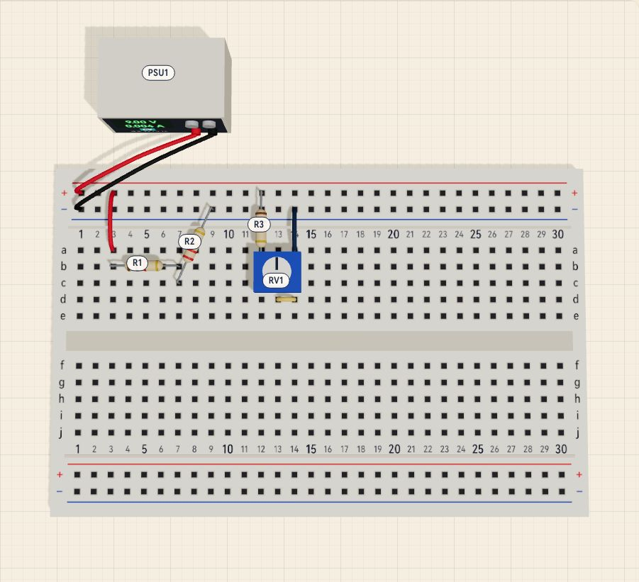
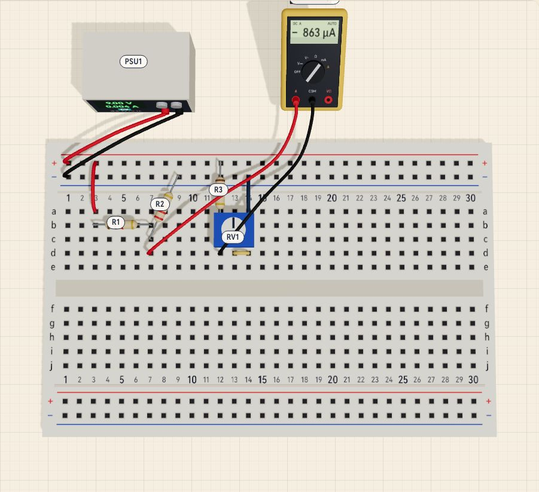
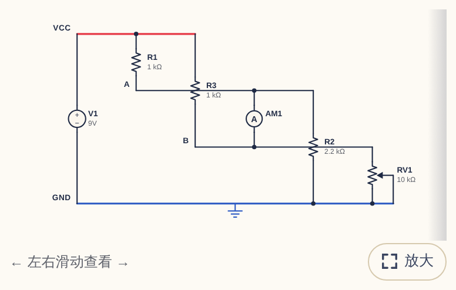
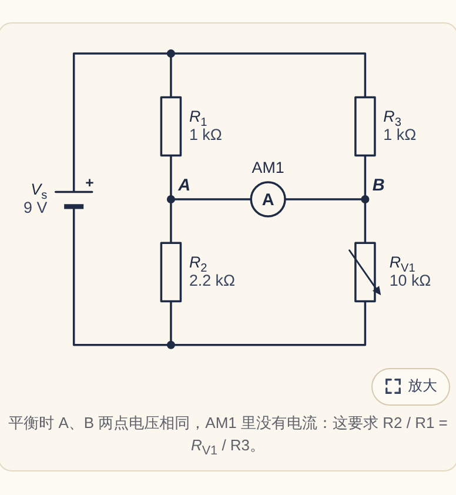

# 2.4 · 惠斯通电桥：把电流表调到零

| 项目 | 内容 |
|---|---|
| id | `exp-wheatstone-bridge` |
| 文件 | `challenges/206-wheatstone-bridge.json` |
| 类型 | 实验 / 挑战（没有分步，照目标电路图搭） · 难度 4/5 |
| 位置 | World 2 · 网络分析与电路定理 → 2.4 惠斯通电桥（本节第 1 项） |
| 右侧面板 | 轨道由旧的四张卡片自动生成（还没手工精排） |
| 前后 | 上一项 [2.3 exp-max-power](../w2/2.03-2-exp-max-power.md) · 下一项 [2.5 exp-loaded-divider](../w2/2.05-1-exp-loaded-divider.md) |
| 先修 | lesson-ammeter、lesson-multimeter |
| 概念 | Wheatstone bridge 惠斯通电桥、balance 平衡、null measurement 零点测量、R1/R2 = R3/Rx |

**一句话概要**：两个分压器并排，中点之间接一块电流表；转动电位器让读数归零，就测出了电阻。

## 1. 左侧工作台（3D 面包板 → 2D 俯视截图）

截图是程序里真实的 3D 面包板换成俯视角拍的；表格是同一块板的文字版（元件、参数、每只脚插在哪个孔）。

### 1.1 起点：打开这一课时板上已经有的

右侧显示的「起点」说明：

> **半成品**：电桥的两个分压器（R1 + R2，R3 + 电位器）和电源都已搭好。**为什么**：分压器在实验 1-3 练过；电桥的关键是两个中点之间的那块表。**你要做**：把电流表接在两个中点（第 7 列和第 12 列）之间，再转电位器把读数调到零。

| 元件 | 类型 | 参数 | 引脚 → 孔 |
|---|---|---|---|
| PSU1 | bench_supply | voltage=9, currentLimit=0.1 | +→tp1 -→tn1 |
| W2 | wire |  | a→tp3 b→a3 |
| R1 | resistor | resistance=1000 | 1→b3 2→b7 |
| R2 | resistor | resistance=2200 | 1→c7 2→tn9 |
| R3 | resistor | resistance=1000 | 1→tp12 2→b12 |
| RV1 | potentiometer | resistance=10000, wiper=0.5 | 1→c12 2→c13 3→c14 |
| W7 | wire |  | a→d13 b→d14 |
| W8 | wire |  | a→a14 b→tn14 |

### 1.3 参考答案（「看答案」载入的板子）

| 元件 | 类型 | 参数 | 引脚 → 孔 |
|---|---|---|---|
| PSU1 | bench_supply | voltage=9, currentLimit=0.1 | +→tp1 -→tn1 |
| W2 | wire |  | a→tp3 b→a3 |
| R1 | resistor | resistance=1000 | 1→b3 2→b7 |
| R2 | resistor | resistance=2200 | 1→c7 2→tn9 |
| R3 | resistor | resistance=1000 | 1→tp12 2→b12 |
| RV1 | potentiometer | resistance=10000, wiper=0.5 | 1→c12 2→c13 3→c14 |
| W7 | wire |  | a→d13 b→d14 |
| W8 | wire |  | a→a14 b→tn14 |
| AM1 | ammeter |  | +→d7 -→d12 |

### 1.4 目标原理图（右侧「目标原理图」抽屉）

| 元件 | 类型 | 参数 |
|---|---|---|
| V1 | dc_source | voltage=9 |
| R1 | resistor | resistance=1000 |
| R2 | resistor | resistance=2200 |
| R3 | resistor | resistance=1000 |
| RV1 | potentiometer | resistance=10000 |
| AM1 | ammeter |  |

连接（每个结点上的引脚）：

- **VCC**：V1.+、R1.1、R3.1
- **A**：R1.2、R2.1、AM1.+
- **B**：R3.2、RV1.1、AM1.-
- **GND**：R2.2、RV1.2、RV1.3、V1.-

## 2. 右侧面板：学生从上往下看到的内容（单轨流）

### 第 1 步 · 🔧 动手搭：找到让表归零的那一点

照目标电路图搭好。然后单击电位器，在「属性」里慢慢拖动旋钮，盯着 AM1：有没有一个位置，读数正好是 0？两边的读数一正一负吗？

### 第 2 步 · 💡 想明白：平衡 = 两个分压比相同

- A、B 两点电位相等时，电流表两端没有电压差，**里面没有电流**。

*图 `bridge`（schematic）：平衡时 A、B 两点电压相同，AM1 里没有电流：这要求 R2 / R1 = R_V1 / R3。*

- 这要求两个分压器的比例相同：$\frac{R_2}{R_1 + R_2} = \frac{R_{V1}}{R_3 + R_{V1}}$，也就是 $\frac{R_2}{R_1} = \frac{R_{V1}}{R_3}$。
- 动手前先算：平衡时 RV1 应是多少？旋钮在百分之几？RV1 比平衡值小或大时，AM1 是正还是负？

（这一步下面列着这节课的计算卡片，点开就地展开：`wheatstone`，全文见第 6 节）

### 第 3 步 · 🔧 动手搭：调零，再转到两侧

- RV1 当可变电阻用：1 脚接 B，滑动端和 3 脚连在一起接 GND，电阻 = 10 kΩ × 旋钮位置。
- 找到读数为零的位置，再分别转到 10% 和 50%，记下读数。

### 第 4 步 · 📏 测一测：测一测：读你自己的仪表

**测量题 1 · `ua`**（读数题）

> 旋钮在 22%（RV1 = 2.2 kΩ）：A 点对 GND 的电压 V_A

- 单位 V · 先写预测 · 状态：把 RV1 旋到 22% · 参考答案的读数 **6.187 V** · 合理范围 [6, 6.35]

**测量题 2 · `i10`**（读数题）

> 旋钮在 10%：AM1 的读数（带正负号）

- 单位 mA · 先写预测 · 状态：把 RV1 旋到 10% · 参考答案的读数 **1.421 mA** · 合理范围 [0.0013, 0.00155]

**测量题 3 · `i50`**（读数题）

> 旋钮在 50%：AM1 的读数（带正负号）

- 单位 mA · 先写预测 · 状态：把 RV1 旋到 50% · 参考答案的读数 **-0.8629 mA** · 合理范围 [-0.00095, -0.00078]

**测量题 4 · `dir`**（选择题）

> 50% 时读数是负的，说明：

- A. 电流从 B 流向 A：这时 B 点电位比 A 点高 ✅（正确）
- B. 电流表坏了，负的读数没有意义
- C. 电流仍从 A 流向 B，只是比 10% 时小

答对后显示：

> 读数的正负只表示电流方向相对于表笔方向（红进黑出）。RV1 大于平衡值时右臂分压比左臂高，B 点电位高于 A 点。

### 第 5 步 · 🎒 带走：带走

- 电桥准，是因为平衡点**只取决于电阻的比值**：和电源电压、电流表准不准都无关，只需要判断“是不是零”。
- 把 R2 换成一个未知电阻，调到平衡，就能算出它的值。电子秤、应变片测力用的也是电桥。
- 测出的电阻只和比较臂的电阻一样准：精密电桥要用精密电阻。

趁热练理论题：`equivalence`

## 3. 测量题一览

| # | id | 题目 | 类型 | 单位 | 状态 | 参考读数 |
|---|---|---|---|---|---|---|
| 1 | ua | 旋钮在 22%（RV1 = 2.2 kΩ）：A 点对 GND 的电压 V_A | voltage | V | 把 RV1 旋到 22% | 6.187 V |
| 2 | i10 | 旋钮在 10%：AM1 的读数（带正负号） | current | mA | 把 RV1 旋到 10% | 1.421 mA |
| 3 | i50 | 旋钮在 50%：AM1 的读数（带正负号） | current | mA | 把 RV1 旋到 50% | -0.8629 mA |
| 4 | dir | 50% 时读数是负的，说明： | 选择 |  |  | 正确：A |

### 全部答完后显示的「对比」

**对比**：平衡条件 R1 / R2 = R3 / RV1，所以 RV1 = R3 × R2 / R1 = **2.2kΩ**，也就是旋钮在 **22%**。此时 V(A) = V(B) = 9 × 2.2 / 3.2 ≈ **6.19 V**，AM1 ≈ 0。不平衡时（模拟器读数）：
- 10%（RV1 = 1kΩ）：右臂分压比左臂低（不接电流表时 B = 4.50 V，A = 6.19 V），电流从 A 流向 B，AM1 ≈ **+1.42 mA**；
- 50%（RV1 = 5kΩ）：右臂分压比左臂高（B = 7.50 V），电流反过来，AM1 ≈ **−0.86 mA**。

小提示：电流表只有 0.1Ω，不平衡时它也会把 A、B 两点“拉”到几乎同一个电压，所以这时用万用表量 A、B 看不出差别——要看电流表的读数。

### 提示按钮（依次显示）

1. 先搭两个分压器：左边 R1 + R2，右边 R3 + RV1，上端都接 +9V，下端都接 GND。
2. RV1 当可变电阻：1 脚接 B，滑动端和 3 脚连起来接 GND。旋到 22% 就是 2.2kΩ。
3. 电流表红表笔接 A（R1 和 R2 之间），黑表笔接 B（R3 和 RV1 之间）。

### 功能测试（「检查我的电路」时跑）

- RV1 在 22%：电桥平衡，AM1 ≈ 0
- RV1 在 10%：电流从 A 流向 B
- RV1 在 50%：电流反向

## 5. 这一课的计算卡片

**计算卡片 `wheatstone`：惠斯通电桥平衡 Wheatstone bridge**

- 公式 `\frac{R_1}{R_2} = \frac{R_3}{R_4} ⇒ R_4 = \frac{R_2 R_3}{R_1}`
- 用途：电桥中间电流为零时，四个电阻满足比例关系：用三个已知电阻求第四个。
- 输入：R_1（左上 R₁，Ω）；R_2（左下 R₂，Ω）；R_3（右上 R₃，Ω） → R_4（平衡时右下的电阻，Ω）

1. 电桥是并排的两个分压器：$V_A = V_s\frac{R_2}{R_1 + R_2}$，$V_B = V_s\frac{R_4}{R_3 + R_4}$。
2. 中间电流表没有电流 ⇔ A、B 等电位 ⇔ 两个分压比相等。
3. 化简：$R_2(R_3 + R_4) = R_4(R_1 + R_2)$ ⇒ $R_1R_4 = R_2R_3$。
4. 平衡条件里 **没有电源电压，也没有电流表的精度**：只要能看出“是不是零”。
5. 不平衡时：$R_4$ 偏大，B 比 A 高，电流从 B 流向 A（红表笔在 A 时读数为负）。

例子：实验 1-6：$R_4 = \frac{2.2k × 1k}{1k} = 2.2 kΩ$，10 kΩ 电位器转到 22 %；这时 $V_A = V_B = 9 × \frac{2.2}{3.2} ≈ 6.19 V$。转到 10 %（1 kΩ）：B 只有 4.5 V，电流 A → B 约 +1.42 mA；50 %（5 kΩ）：B = 7.5 V，约 −0.86 mA。

- ⚠ 比例写反：是“左上 : 左下 = 右上 : 右下”。
- ⚠ 不平衡时 0.1 Ω 的电流表把 A、B 几乎拉到同一电压，万用表量 A–B 看不出差别——看电流表。

## 6. English（界面英文版的同一份内容）

展开英文

### Node 1 · 🔧 Build：Find the point where the meter reads zero

Build it from the target schematic. Then click the pot and slowly drag its knob in Properties, watching AM1: is there a position where it reads exactly 0? Does it read positive on one side and negative on the other?

### Node 2 · 💡 Why：Balance = equal divider ratios

- When A and B are at the same potential, the ammeter has no voltage across it and **no current through it**.

[figure `bridge`]

*Figure `bridge`（schematic）：平衡时 A、B 两点电压相同，AM1 里没有电流：这要求 R2 / R1 = R_V1 / R3。*

- That needs both dividers to have the same ratio: $\frac{R_2}{R_1 + R_2} = \frac{R_{V1}}{R_3 + R_{V1}}$, i.e. $\frac{R_2}{R_1} = \frac{R_{V1}}{R_3}$.
- Work it out before you touch it: what must RV1 be at balance, what percentage is the knob at, and is AM1 positive or negative when RV1 is below or above that?

(This node lists the lesson’s calculation cards: `wheatstone`; full text in section 6)

### Node 3 · 🔧 Build：Null it, then turn to either side

- RV1 as a variable resistor: pin 1 to B, the wiper and pin 3 joined to GND; resistance = 10 kΩ × knob position.
- Find the zero reading, then turn to 10% and to 50% and note the readings.

### Node 4 · 📏 Measure：Measure: read your own instruments

**Question 1 · `ua`**（reading）

> Knob at 22% (RV1 = 2.2 kΩ): voltage V_A from A to GND

- unit V · predict first · state：RV1 is turned to 22% · range [6, 6.35]

**Question 2 · `i10`**（reading）

> Knob at 10%: AM1's reading (with its sign)

- unit mA · predict first · state：RV1 is turned to 10% · range [0.0013, 0.00155]

**Question 3 · `i50`**（reading）

> Knob at 50%: AM1's reading (with its sign)

- unit mA · predict first · state：RV1 is turned to 50% · range [-0.00095, -0.00078]

**Question 4 · `dir`**（multiple choice）

> At 50% the reading is negative. That means:

- A. Current flows from B to A: B is now at a higher potential than A ✅ (right)
- B. The ammeter is broken; a negative reading means nothing
- C. Current still flows from A to B, just less than at 10%

Shown once right:

> The sign only gives the current's direction relative to the leads (in at red, out at black). Above the balance value RV1 makes the right arm's divider higher, so B sits above A.

### Node 5 · 🎒 Take away：Take away

- A bridge is accurate because the balance point **depends only on resistance ratios**: not on the supply voltage, not on how accurate the ammeter is — you only need to see "zero or not".
- Put an unknown resistor in place of R2, balance the bridge, and you can work out its value. Kitchen scales and strain-gauge force sensors use bridges too.
- The result is only as accurate as the comparison resistors: precision bridges need precision resistors.

Practise：`equivalence`

**Compare**

**Compare**: balance needs R1 / R2 = R3 / RV1, so RV1 = R3 × R2 / R1 = **2.2kΩ**, i.e. the knob at **22%**. Then V(A) = V(B) = 9 × 2.2 / 3.2 ≈ **6.19 V** and AM1 ≈ 0. Out of balance (simulator readings):
- 10% (RV1 = 1kΩ): the right divider gives less than the left one (without the ammeter B = 4.50 V, A = 6.19 V), so current flows from A to B, AM1 ≈ **+1.42 mA**;
- 50% (RV1 = 5kΩ): the right divider gives more (B = 7.50 V), the current reverses, AM1 ≈ **−0.86 mA**.

Tip: the ammeter is only 0.1Ω, so even out of balance it pulls A and B to almost the same voltage. A multimeter across A and B shows no difference then; watch the ammeter instead.

**Hints**

1. Build the two dividers first: R1 + R2 on the left, R3 + RV1 on the right, tops to +9V, bottoms to GND.
2. RV1 as a variable resistor: pin 1 to B, wiper and pin 3 joined to GND. 22% is 2.2kΩ.
3. Ammeter red lead at A (between R1 and R2), black lead at B (between R3 and RV1).

