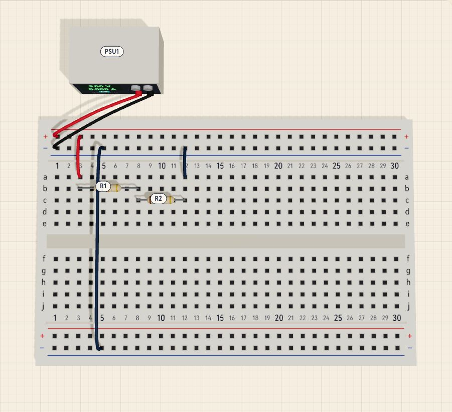
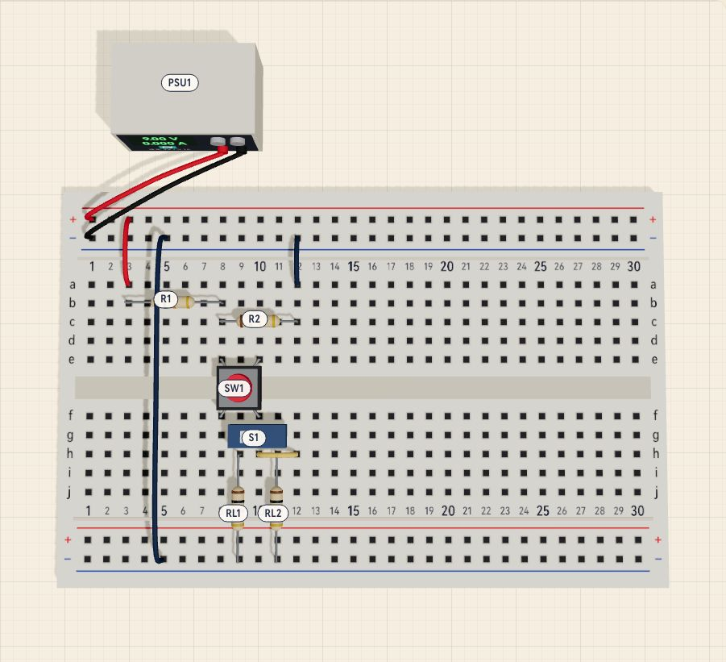
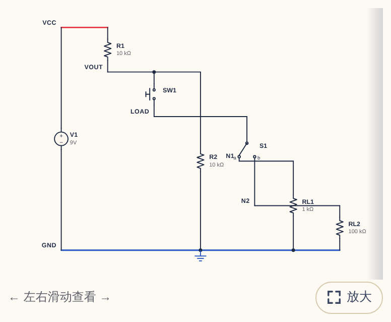
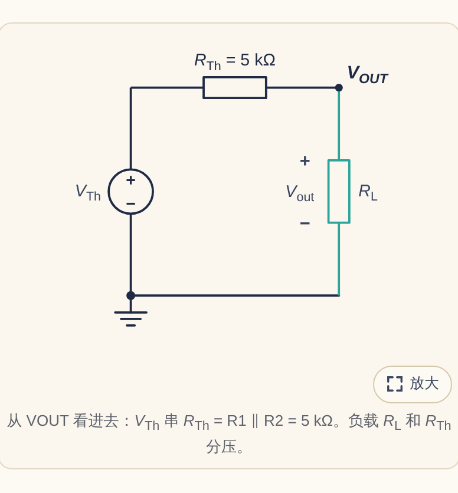

# 2.5 · 分压器接上负载会怎样

| 项目 | 内容 |
|---|---|
| id | `exp-loaded-divider` |
| 文件 | `challenges/203-loaded-divider.json` |
| 类型 | 实验 / 挑战（没有分步，照目标电路图搭） · 难度 3/5 |
| 位置 | World 2 · 网络分析与电路定理 → 2.5 被负载压垮的分压器（通往 World 3）（本节第 1 项） |
| 右侧面板 | 轨道由旧的四张卡片自动生成（还没手工精排） |
| 前后 | 上一项 [2.4 exp-wheatstone-bridge](../w2/2.04-1-exp-wheatstone-bridge.md) · 下一项 [3.1 w3-chip](../w3/3.01-1-w3-chip.md) |
| 先修 | lesson-multimeter |
| 概念 | voltage divider 分压器、load 负载、loading effect 负载效应、parallel resistance 并联电阻 |

**一句话概要**：10 kΩ + 10 kΩ 的分压器，先接 100 kΩ，再接 1 kΩ：一个几乎没影响，一个让电压塌掉。用戴维宁等效看懂为什么。

## 1. 左侧工作台（3D 面包板 → 2D 俯视截图）

截图是程序里真实的 3D 面包板换成俯视角拍的；表格是同一块板的文字版（元件、参数、每只脚插在哪个孔）。

### 1.1 起点：打开这一课时板上已经有的

右侧显示的「起点」说明：

> **半成品**：电源和两个 10kΩ 组成的分压器已经搭好（挑战 2 练过）。**为什么**：这个实验的新东西是“负载”，不是分压器。**你要做**：加上按键 SW1、拨动开关 S1、两个负载 RL1（1kΩ）和 RL2（100kΩ）以及 S1 和负载之间的跳线，让按键把选中的负载接到 VOUT 上。

| 元件 | 类型 | 参数 | 引脚 → 孔 |
|---|---|---|---|
| PSU1 | bench_supply | voltage=9, currentLimit=0.1 | +→tp1 -→tn1 |
| W2 | wire |  | a→tp3 b→a3 |
| R1 | resistor | resistance=10000 | 1→b3 2→b8 |
| R2 | resistor | resistance=10000 | 1→c8 2→c12 |
| W5 | wire |  | a→a12 b→tn12 |
| W6 | wire |  | a→tn5 b→bn5 |

### 1.3 参考答案（「看答案」载入的板子）

| 元件 | 类型 | 参数 | 引脚 → 孔 |
|---|---|---|---|
| PSU1 | bench_supply | voltage=9, currentLimit=0.1 | +→tp1 -→tn1 |
| W2 | wire |  | a→tp3 b→a3 |
| R1 | resistor | resistance=10000 | 1→b3 2→b8 |
| R2 | resistor | resistance=10000 | 1→c8 2→c12 |
| W5 | wire |  | a→a12 b→tn12 |
| SW1 | pushbutton | pressed=false | 1a→e8 2a→e10 1b→f8 2b→f10 |
| S1 | switch | position=a | a→g9 com→g10 b→g11 |
| W8 | wire |  | a→h10 b→h12 |
| RL1 | resistor | resistance=1000 | 1→h9 2→bn9 |
| RL2 | resistor | resistance=100000 | 1→h11 2→bn11 |
| W11 | wire |  | a→tn5 b→bn5 |

### 1.4 目标原理图（右侧「目标原理图」抽屉）

| 元件 | 类型 | 参数 |
|---|---|---|
| V1 | dc_source | voltage=9 |
| R1 | resistor | resistance=10000 |
| R2 | resistor | resistance=10000 |
| SW1 | pushbutton |  |
| S1 | switch |  |
| RL1 | resistor | resistance=1000 |
| RL2 | resistor | resistance=100000 |

连接（每个结点上的引脚）：

- **VCC**：V1.+、R1.1
- **VOUT**：R1.2、R2.1、SW1.1
- **LOAD**：SW1.2、S1.com
- **N1**：S1.a、RL1.1
- **N2**：S1.b、RL2.1
- **GND**：R2.2、RL1.2、RL2.2、V1.-

## 2. 右侧面板：学生从上往下看到的内容（单轨流）

### 第 1 步 · 🔧 动手搭：两个负载，哪个拉得动？

照目标电路图搭：`9 V` → **R1** `10 kΩ` → **VOUT** → **R2** `10 kΩ` → GND。
从 VOUT 出发，按键 **SW1** 通到开关 **S1** 的中间脚。S1 的 **a** 侧接 **RL1** `1 kΩ` 到 GND，**b** 侧接 **RL2** `100 kΩ`。
**松开按键，测 VOUT**。再**按住按键**，S1 先拨 **b**，再拨 **a**。
哪个负载把 VOUT 拉下来了？为什么是它？

### 第 2 步 · 💡 想明白：分压器也是一节“带内阻的电池”

- 2.4 学过：从 VOUT 和 GND 看进去，分压器就是一个戴维宁电源。$V_{Th}$ 是空载电压；$R_{Th}$ 是 9 V 换成导线后 R1 和 R2 的并联：$R_{Th} = 10\,k ∥ 10\,k = 5$ kΩ。

*图 `thevenin`（schematic）：从 VOUT 看进去：V_Th 串 R_Th = R1 ∥ R2 = 5 kΩ。负载 R_L 和 R_Th 分压。*

- 负载 $R_L$ 和这个内部的 5 kΩ 又组成一个分压器：
$$V_{out} = V_{Th}\,\frac{R_L}{R_{Th} + R_L}$$
- 接 10 kΩ 负载：$V_{out} = V_{Th} × \frac{10}{5 + 10}$，只剩空载值的三分之二。
- 所以要拿 5 kΩ 当尺子。预测一下：100 kΩ（大 20 倍）和 1 kΩ（小 5 倍）时的 VOUT。

（这一步下面列着这节课的计算卡片，点开就地展开：`voltage-divider`、`loaded-divider`、`thevenin`、`thevenin-resistance`、`voltmeter-loading`，全文见第 6 节）

### 第 3 步 · 🔧 动手搭：三种状态，三个读数

- **松开按键**（空载）：测 VOUT 对 GND。
- **按住按键、S1 拨 b**（100 kΩ）：测 VOUT。
- **按住按键、S1 拨 a**（1 kΩ）：测 VOUT。
- 电路检查通过后填测量题。

### 第 4 步 · 📏 测一测：测一测：读你自己的仪表

**测量题 1 · `v0`**（读数题）

> 松开按键（空载）：VOUT 对 GND 的电压

- 单位 V · 先写预测 · 状态：松开 SW1 · 参考答案的读数 **4.5 V** · 合理范围 [4.4, 4.6]

答对后显示：

> 9 × 10k / 20k = 4.50 V，就是 V_Th。

**测量题 2 · `v100k`**（读数题）

> 按住按键、S1 拨到 b（100 kΩ 负载）：VOUT

- 单位 V · 先写预测 · 状态：按下 SW1、把 S1 拨到 b 侧 · 参考答案的读数 **4.286 V** · 合理范围 [4.2, 4.38]

答对后显示：

> 4.50 × 100 / (5 + 100) ≈ 4.29 V，只低了约 5%。

**测量题 3 · `v1k`**（读数题）

> 按住按键、S1 拨到 a（1 kΩ 负载）：VOUT

- 单位 V · 先写预测 · 状态：按下 SW1、把 S1 拨到 a 侧 · 参考答案的读数 **0.75 V** · 合理范围 [0.71, 0.79]

答对后显示：

> 4.50 × 1 / (5 + 1) = 0.75 V，几乎全没了。

**测量题 4 · `why`**（选择题）

> 哪个负载让 VOUT 明显下降？为什么？

- A. 1 kΩ：它比从 VOUT 看进去的内阻 R1 ∥ R2 = 5 kΩ 小得多 ✅（正确）
- B. 100 kΩ：负载电阻越大，分走的电压越多
- C. 两个负载影响一样：分压公式里根本没有负载

答对后显示：

> 负载和分压器的内阻 R_Th = 5 kΩ 分压。负载比 5 kΩ 大得多时几乎没影响，比它小时电压就塌了。

### 第 5 步 · 🎒 带走：带走

- 分压公式是**空载**公式。负载和 R2 并联，把 VOUT 拉低。
- 经验：负载至少是分压器 $R_{Th}$ = R1 ∥ R2 的 **10 倍**。
- 万用表也是负载（一般 10 MΩ）。对这里 5 kΩ 的分压器没影响，测兆欧级的分压器时就要注意。
- 想让它带 1 kΩ 而不塌，就在中间加一个**电压跟随器**。下一项先认识 LM358，再来做这件事。

趁热练理论题：`theorems`

## 3. 测量题一览

| # | id | 题目 | 类型 | 单位 | 状态 | 参考读数 |
|---|---|---|---|---|---|---|
| 1 | v0 | 松开按键（空载）：VOUT 对 GND 的电压 | voltage | V | 松开 SW1 | 4.5 V |
| 2 | v100k | 按住按键、S1 拨到 b（100 kΩ 负载）：VOUT | voltage | V | 按下 SW1、把 S1 拨到 b 侧 | 4.286 V |
| 3 | v1k | 按住按键、S1 拨到 a（1 kΩ 负载）：VOUT | voltage | V | 按下 SW1、把 S1 拨到 a 侧 | 0.75 V |
| 4 | why | 哪个负载让 VOUT 明显下降？为什么？ | 选择 |  |  | 正确：A |

### 全部答完后显示的「对比」

**对比**：
1. 空载：9 × 10k / 20k = **4.50 V**。
2. 100 kΩ：下半边变成 10k ∥ 100k = 9.09 kΩ，VOUT = 9 × 9.09 / 19.09 ≈ **4.29 V**（只低了约 5%）。
3. 1 kΩ：下半边变成 10k ∥ 1k = 909 Ω，VOUT = 9 × 0.909 / 10.909 ≈ **0.75 V**（几乎全没了）。

用戴维宁算也一样：4.50 × R_L / (5k + R_L)。按下按键后电压不变时，检查 S1 的中间脚是不是接在按键后面、负载的另一端是不是接到了 GND。

### 提示按钮（依次显示）

1. S1 的三只脚在同一行连续三列，中间是 com。a 侧接 1 kΩ，b 侧接 100 kΩ——别接反，判分按这个来。
2. 按键横跨中间凹槽：一边接 VOUT，另一边接 S1 的 com。
3. RL1、RL2 的另一端都要回到 GND。用下方的蓝轨时，记得用跳线把上下两条蓝轨连起来。

### 功能测试（「检查我的电路」时跑）

- 松开按键（空载）：VOUT 是空载分压值
- 按下、拨到 b（100 kΩ 负载）：VOUT 只略微下降
- 按下、拨到 a（1 kΩ 负载）：VOUT 大幅下降

## 5. 这一课的计算卡片

**计算卡片 `voltage-divider`：分压器 Voltage divider**

- 公式 `V_{out} = V_s \frac{R_2}{R_1 + R_2}`
- 用途：用两个串联电阻从一个大电压里取出一个小电压。
- 输入：Vs（电源电压，V）；R1（上面的电阻 R₁，Ω）；R2（下面的电阻 R₂，Ω） → V_out（R₂ 上的电压，V）

三步推出来：
1. 串联：$I = \frac{V_s{R_1 + R_2}$
2. 欧姆定律用在 R₂ 上：$V_{out} = I R_2$
3. 代入：$V_{out} = V_s \frac{R_2}{R_1 + R_2}$

**前提**：R₁ 和 R₂ 流过 **同一个电流**——输出端不接负载（或负载电流远小于 I）。接了负载 R_L，下面的电阻就变成 $R_2 ∥ R_L$，输出会 **降低**（实验 1-3、2-5）。

例子：9 V，R₁ = 20 kΩ，R₂ = 10 kΩ：$V_{out} = 9 × \frac{10}{30} = 3 V$（挑战 2）。

- ⚠ 分子是 **输出所在的那个** 电阻（R₂），不是 R₁。
- ⚠ 接了负载以后公式里的 R₂ 要换成 R₂ ∥ R_L。

**计算卡片 `loaded-divider`：带负载的分压器 Loaded divider**

- 公式 `V_{out} = V_s \frac{R_2 ∥ R_L}{R_1 + R_2 ∥ R_L}`
- 用途：分压器输出接上负载后，输出会掉多少。
- 输入：Vs（电源电压，V）；R1（R₁，Ω）；R2（R₂，Ω）；RL（负载 R_L，Ω） → V_out（负载上的电压，V）

负载 R_L 和 R₂ 接在同一对结点之间，是 **并联**。所以先把它们合成一个电阻 $R_2 ∥ R_L$，再用普通分压公式。
负载越小（越“重”），$R_2 ∥ R_L$ 越小，输出越低。经验：要让输出基本不变，$R_L$ 至少是 $R_2$ 的 10 倍以上——否则就在中间加一个 **电压跟随器**（实验 2-5）。

例子：9 V、10 k / 10 k、R_L = 1 kΩ：$R_2 ∥ R_L = 909 Ω$，$V_{out} = 9 × \frac{909}{10909} ≈ 0.75 V$（空载 4.5 V）。

**计算卡片 `thevenin`：戴维宁等效：开路电压 + 短路电流**

- 公式 `R_{eq} = \frac{V_{oc}}{I_{sc}}`
- 用途：测出（或算出）端口的开路电压和短路电流，就得到整个网络的等效电阻。
- 输入：V_oc（开路电压，V）；I_sc（短路电流，A） → R_eq（等效电阻，Ω）

1. 任何含源线性二端网络，对外都等效成一个电压源 $V_{oc}$ 串一个电阻 $R_{eq}$。
2. 端口开路：没有电流流过 $R_{eq}$，它上面没有压降，端口电压就是 $V_{oc}$。
3. 端口短路：$I_{sc} = \frac{V_{oc}}{R_{eq}}$。
4. 两个测量相除：$R_{eq} = \frac{V_{oc}}{I_{sc}}$。（另一条路：把独立源置零，从端口看进去算电阻——见“戴维宁等效电阻”。）
5. 用法：接上负载 $R_L$，$V_L = V_{oc}\frac{R_L}{R_{eq} + R_L}$，一步就出来，不用再解整个网络。

例子：实验 2-2：$V_{oc} = 9 × \frac{2.2}{3.2} ≈ 6.19 V$，$I_{sc} ≈ 5.345 mA$，$R_{eq} ≈ 1158 Ω$ = $470 + 1k ∥ 2.2k$ ✔。实验 1-3 的分压器从 VOUT 看是“4.5 V 串 5 kΩ”：接 1 kΩ，$V = 4.5 × \frac{1}{6} = 0.75 V$。

- ⚠ 短路法只适合短路电流很小的网络——绝不要把电池或电源输出直接短路。
- ⚠ 真实电流表有几欧内阻，“短路”不彻底：$I_sc$ 偏小，算出的 $R_eq$ 偏大约 1 %。

**计算卡片 `thevenin-resistance`：戴维宁等效电阻（置零法）**

- 公式 `R_{eq} = R_3 + R_1 ∥ R_2`
- 用途：电源置零后从端口往里看的电阻——等效电路的内阻，也是电容 / 电感“看到”的电阻。
- 输入：R_1（电源和结点 A 之间的 R₁（含电源内阻），Ω）；R_2（A 到地的 R₂，Ω）；R_3（A 到端口的 R₃（没有就填 0），Ω） → R_eq（从端口看进去的电阻，Ω）

1. 把独立源置零：电压源换成 **导线**，电流源换成 **开路**。
2. 电压源变成导线以后，R₁ 的上端也接到了 GND，所以从 A 往下看，R₁ 和 R₂ **并联**。
3. 再串上 A 到端口的 R₃：$R_{eq} = R_3 + R_1 ∥ R_2$。
4. 开路电压另算：R₃ 里没有电流，$V_{oc} = V_s \frac{R_2}{R_1 + R_2}$。
5. 一阶电路里，电容 / 电感就是“端口”：$τ = R_{eq}C$ 或 $τ = \frac{L}{R_{eq}}$。

例子：- 实验 2-2：$470 + 1k ∥ 2.2k = 470 + 687.5 = 1157.5 Ω$。
- 实验 3-7：电容看到 $(10k + 50) ∥ 10k ≈ 5.01 kΩ$（R₃ = 0），$τ ≈ 0.50 ms$——只有单纯串联 RC 的一半。
- 实验 3-5 充电：$(220 + 50) ∥ (470 + 12) ≈ 173 Ω$，$τ ≈ 0.17 s$。
- 实验 5-4：ADC 看到 $100k ∥ 33k ≈ 24.8 kΩ$。

- ⚠ 信号发生器的 50 Ω 是电源的内阻：电源置零后它还在，串在 R₁ 里。
- ⚠ 电流源置零是开路，不是短路。

**计算卡片 `voltmeter-loading`：电压表的负载效应 Voltmeter loading**

- 公式 `V_{read} = V_{th} \frac{R_V}{R_{th} + R_V}, R_{th} = R_1 ∥ R_2`
- 用途：真实万用表约 10 MΩ：测高阻分压器时，表本身并在下电阻上，读数偏低。
- 输入：V_s（分压器电源，V）；R_1（上电阻 R₁，Ω）；R_2（下电阻 R₂（表测它两端），Ω）；R_V（电压表内阻（数字万用表 ≈ 10 MΩ），Ω） → V_read（表的读数，V）

1. 电压表不是“只看不碰”：它是一个大电阻 $R_V$，接上去就和被测元件并联。
2. 从表笔看进去，分压器是一个戴维宁源：$V_{th} = V_s\frac{R_2}{R_1 + R_2}$，$R_{th} = R_1 ∥ R_2$。
3. 表和 $R_{th}$ 再分一次压：$V_{read} = V_{th}\frac{R_V}{R_{th} + R_V}$。
4. 相对误差约 $\frac{R_{th}}{R_V}$：只要 $R_{th}$ 比表的内阻小 1000 倍，误差就在 0.1 % 以内。
模拟器里的万用表是理想的（不取电流）；示波器探头 ×1 档约 1 MΩ，影响更大。

例子：1 MΩ + 1 MΩ 分 9 V：应为 4.5 V，10 MΩ 的表读 $4.5 × \frac{10}{10.5} ≈ 4.29 V$（低 4.8 %）。第 9 课的 1 k / 2.2 k：$R_{th} ≈ 688 Ω$，误差只有 0.007 %，看不出。

- ⚠ 误差看的是戴维宁电阻 R₁ ∥ R₂，不是 R₂ 一个。

## 6. English（界面英文版的同一份内容）

展开英文

### Node 1 · 🔧 Build：Two loads — which one drags it down?

Build it from the target schematic: `9 V` → **R1** `10 kΩ` → **VOUT** → **R2** `10 kΩ` → GND.
From VOUT, the button **SW1** leads to the middle pin of switch **S1**. S1's **a** side has **RL1** `1 kΩ` to GND, its **b** side **RL2** `100 kΩ`.
**Measure VOUT** with the button released. Then **hold the button** with S1 on **b**, then on **a**.
Which load pulls VOUT down — and why that one?

### Node 2 · 💡 Why：A divider is a battery with internal resistance too

- From 2.4: seen from VOUT and GND, the divider is a Thévenin source. $V_{Th}$ is the no-load voltage. $R_{Th}$ is R1 and R2 in parallel, with the 9 V turned into a wire: $R_{Th} = 10\,k ∥ 10\,k = 5$ kΩ.

[figure `thevenin`]

*Figure `thevenin`（schematic）：从 VOUT 看进去：V_Th 串 R_Th = R1 ∥ R2 = 5 kΩ。负载 R_L 和 R_Th 分压。*

- A load $R_L$ makes a divider with that inner 5 kΩ:
$$V_{out} = V_{Th}\,\frac{R_L}{R_{Th} + R_L}$$
- With a 10 kΩ load: $V_{out} = V_{Th} × \frac{10}{5 + 10}$, two thirds of the no-load value.
- So the yardstick is 5 kΩ. Predict VOUT for 100 kΩ (twenty times bigger) and for 1 kΩ (five times smaller).

(This node lists the lesson’s calculation cards: `voltage-divider`、`loaded-divider`、`thevenin`、`thevenin-resistance`、`voltmeter-loading`; full text in section 6)

### Node 3 · 🔧 Build：Three states, three readings

- **Button released** (no load): measure VOUT to GND.
- **Button held, S1 on b** (100 kΩ): measure VOUT.
- **Button held, S1 on a** (1 kΩ): measure VOUT.
- Once the circuit check passes, fill in the questions.

### Node 4 · 📏 Measure：Measure: read your own instruments

**Question 1 · `v0`**（reading）

> Button released (no load): VOUT to GND

- unit V · predict first · state：SW1 is released · range [4.4, 4.6]

Shown once right:

> 9 × 10k / 20k = 4.50 V — that is V_Th.

**Question 2 · `v100k`**（reading）

> Button held, S1 on b (100 kΩ load): VOUT

- unit V · predict first · state：SW1 is pressed and S1 is switched to side b · range [4.2, 4.38]

Shown once right:

> 4.50 × 100 / (5 + 100) ≈ 4.29 V, only about 5 % lower.

**Question 3 · `v1k`**（reading）

> Button held, S1 on a (1 kΩ load): VOUT

- unit V · predict first · state：SW1 is pressed and S1 is switched to side a · range [0.71, 0.79]

Shown once right:

> 4.50 × 1 / (5 + 1) = 0.75 V — almost nothing left.

**Question 4 · `why`**（multiple choice）

> Which load pulls VOUT down a lot, and why?

- A. 1 kΩ: it is much smaller than the inner resistance seen from VOUT, R1 ∥ R2 = 5 kΩ ✅ (right)
- B. 100 kΩ: the bigger the load, the more voltage it takes
- C. Both the same: the divider formula has no load in it

Shown once right:

> The load divides with the divider's inner R_Th = 5 kΩ. A load much bigger than 5 kΩ hardly matters; a smaller one makes the voltage collapse.

### Node 5 · 🎒 Take away：Take away

- The divider formula is a **no-load** formula. A load sits in parallel with R2 and pulls VOUT down.
- Rule of thumb: the load should be at least **10 ×** the divider's $R_{Th}$ = R1 ∥ R2.
- A multimeter is a load too (typically 10 MΩ). Harmless on this 5 kΩ divider, noticeable on a megohm one.
- To feed a 1 kΩ load without the collapse, put a **voltage follower** in between. Next you meet the LM358, then you do exactly that.

Practise：`theorems`

**Compare**

**Compare**:
1. No load: 9 × 10k / 20k = **4.50 V**.
2. 100 kΩ: the bottom half becomes 10k ∥ 100k = 9.09 kΩ, VOUT = 9 × 9.09 / 19.09 ≈ **4.29 V** (only about 5 % lower).
3. 1 kΩ: the bottom half becomes 10k ∥ 1k = 909 Ω, VOUT = 9 × 0.909 / 10.909 ≈ **0.75 V** (almost nothing left).

Thévenin gives the same: 4.50 × R_L / (5k + R_L). If pressing the button changes nothing, check that S1's middle pin is behind the button and that the loads' far ends reach GND.

**Hints**

1. S1's three pins sit in three columns of one row; the middle one is com. The a side goes to 1 kΩ, the b side to 100 kΩ — the check expects this way round.
2. The button straddles the trench: one side to VOUT, the other to S1's com.
3. The far ends of RL1 and RL2 go back to GND. If you use the bottom blue rail, join the two blue rails with a jumper.

