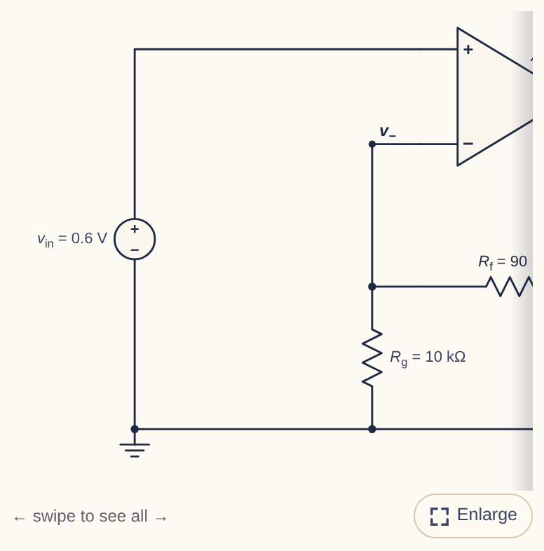

# 3.1 · 单元 5-chip：芯片与内部结构

| 项目 | 内容 |
|---|---|
| id | `w3-chip` |
| 文件 | `units/w3-chip.json` |
| 类型 | 理论单元（#/unit 页面，从上往下读的长页） |
| 位置 | World 3 · 运算放大器基础 → 3.1 认识芯片：LM358（本节第 1 项） |
| 这个单元回答的问题 | 一颗 LM358 怎么接？它里面有什么？ |
| 时长 | 15 分钟 |
| 接回 | challenge:lesson-lm358 |
| 前后 | 上一项 [2.5 exp-loaded-divider](../w2/2.05-1-exp-loaded-divider.md) · 下一项 [3.1 lesson-lm358](../w3/3.01-2-lesson-lm358.md) |

## ① 直觉：怎么用这颗芯片

**op-amp（运算放大器）**（op-amp，operational amplifier）是做在一颗芯片里的放大器。LM358 是最常见的一种。

一颗 LM358 里有**两个**一样的 op-amp（运算放大器），叫 A 和 B。它们共用两只电源脚，其余的脚各用各的。

# 引脚（DIP-8）

芯片有缺口或小圆点的一端朝左，左下角是 1 脚。从 1 脚开始**逆时针**数。

| 脚 | 名字 | 作用 |
|---|---|---|
| 1 | OUT A | A 的输出 |
| 2 | IN− A | A 的反相输入 |
| 3 | IN+ A | A 的同相输入 |
| 4 | GND / V− | 负电源；单电源时接地 |
| 5 | IN+ B | B 的同相输入 |
| 6 | IN− B | B 的反相输入 |
| 7 | OUT B | B 的输出 |
| 8 | V+ | 正电源 |

**同相输入**（+）：这里电压升高，输出跟着升高。**反相输入**（−）：这里电压升高，输出反而降低。

# 单电源和双电源

- **单电源**：8 脚接 +9 V，4 脚接地。输出只能在 0 V 到约 V+ − 1.5 V 之间。交流信号要先抬到中间（**半电源偏置**），否则负半周会丢掉。
- **双电源**：8 脚接 +9 V，4 脚接 −9 V，地是两个电源中间那一点。输出可正可负。实验 2-7（反相放大器）用的就是 ±9 V。

LM358 的电源范围（TI 数据手册）：单电源 3–32 V，或双电源 ±1.5 V 到 ±16 V。

> **提示** · **去耦电容**：一个 0.1 µF 陶瓷电容，从 8 脚（V+）直接接到地，越靠近 8 脚越好。双电源时，4 脚（V−）到地再接一个。
> 
> 为什么：电源线有电阻和电感。芯片突然要电流时，脚上的电压会抖。就近的小电容先顶上，像水龙头边上放一桶水。

# 真实的限制

下面是 TI LM358 数据手册里的**典型值**（25 °C）。每颗芯片会有差别；严格的设计要看表里的最小 / 最大值。

| 参数 | 典型值 | 意思 |
|---|---|---|
| 输出最高 | 约 V+ − 1.5 V（轻载） | 到不了正电源；负载电流越大越低 |
| 输出最低 | 约 5 mV（轻载） | 几乎能到地 |
| 输出电流 | 拉出约 30 mA，灌入约 20 mA | 负载电阻不能太小 |
| 输入共模范围 | 0 V 到 V+ − 1.5 V | 输入可以低到地，所以单电源能用 |
| 开环增益 A | 约 100 V/mV（10⁵） | 5a 的那个 A |
| 增益带宽积 | 约 0.7 MHz | 频率越高，A 越小 |
| 压摆率 | 约 0.3 V/µs | 输出变化的最快速度 |
| 输入失调电压 | 约 3 mV | 两个输入接在一起时，好像还差 3 mV |
| 输入偏置电流 | 约 20 nA | 输入几乎不取电流 |

**传送门** `chip-real-limits` → `pending:w7-slew-offset`（25 分钟）：压摆率和失调：现象、原因、怎么测。 · 回来时：LM358 的实际限制（压摆率、失调）在这里展开。

> **说明** · 本课程仿真里的 LM358 是简化模型：A = 10⁵；输出限制在 V− 到 V+ − 1.5 V 之间；输出电阻 10 Ω；输入不取电流。它没有压摆率、带宽和失调。

**预测题**：一个 op-amp（运算放大器）接成跟随器（输出 = 输入），V+ = 12 V 单电源。输入从 0 V 慢慢升到 12 V，输出最高到多少？

- 答案：10.5 V（误差 0.05）

揭晓：

> 输出最高约 V+ − 1.5 V = 10.5 V。输入超过 10.5 V 以后，输出就停住不动了。

**预测题**：V+ = 9 V 单电源，增益 10 的同相放大器。输入是峰值 1 V 的正弦，中心在 0 V（没有偏置）。输出会被削吗？

- A. 不会：输出是峰值 10 V 的正弦
- B. 会：上面在约 7.5 V 被削平；没有偏置，负半周也整个丢掉 ✅
- C. 会，但只丢负半周

揭晓：

> 想要的输出在 −10 V 到 +10 V 之间。上限只有 9 − 1.5 = 7.5 V，所以顶部被削平。下限是 0 V（单电源没有负电压），所以负半周全部变成 0 V。两边都出问题。

## ② 交互推导：芯片里面：三级

每个 op-amp（运算放大器）里面可以分成三级。信号从左往右走：

**差分输入级 → 高增益级（带补偿电容）→ 推挽输出级**

这里只看每一级做什么，不看晶体管的公式。

**① 差分输入级**：两个晶体管分一股固定的电流。v_{+} 比 v_{−} 高一点，电流就多流向一边。它只对差 v_{+} − v_{−} 敏感；两个输入一起升降，它不反应。

输入接在晶体管上，只取约 20 nA 的电流：这就是后面“虚断”的来源。LM358 的输入级用的是 PNP 晶体管，输入电压可以低到地，所以单电源也能放大接近 0 V 的信号。

它送给下一级的是：一个小小的电流差。

**传送门** `chip-input-stage` → `pending:w6-diff-pair`（25 分钟）：op-amp（运算放大器）的差分输入级：两个晶体管怎么分一股电流，为什么只对 v₊ − v₋ 敏感。 · 回来时：op-amp（运算放大器）最前面的差分输入级就是一个差分对。

**② 高增益级**：把那个小电流差变成很大的电压变化。10⁵ 的增益大部分来自这一级。

这一级上跨着一个片内的小电容，叫**补偿电容**。它让频率越高、增益越低，防止加了负反馈的电路自己振荡。代价是增益带宽积只有约 0.7 MHz。

**传送门** `chip-gain-stage` → `pending:w6-ce-amp`（30 分钟）：高增益级其实是一个共射放大器：增益从哪来。 · 回来时：op-amp（运算放大器）中间的高增益级就是一个共射放大器。

**传送门** `chip-compensation` → `pending:w7-gbw`（25 分钟）：补偿电容：为什么频率越高，op-amp（运算放大器）的增益越低。 · 回来时：op-amp（运算放大器）里的补偿电容决定了增益带宽积。

**③ 推挽输出级**：两个晶体管，一个往外推电流（拉电流），一个往里拉电流（灌电流），像两个人一推一拉一扇门。

它的电压增益约为 1。它的任务是给出电流，让输出电阻变小。晶体管自己要压掉一点电压，所以输出到不了 V+（差约 1.5 V）；它能给的电流也有上限（拉出约 30 mA）。

**传送门** `chip-output-stage` → `pending:w7-push-pull`（30 分钟）：推挽输出级：交越失真从哪来，输出为什么到不了电源轨。 · 回来时：op-amp（运算放大器）的输出级就是一个推挽放大器，LM358 到不了正电源轨的原因在这里。

# 从里面回到外面

| 里面 | 外面看到的 |
|---|---|
| 输入级只取 nA 级的电流 | 虚断：输入电流 ≈ 0 |
| 三级合起来 A ≈ 10⁵ | 加了负反馈 → 虚短 v_{+} ≈ v_{−}（5b） |
| 输出级到不了电源轨，电流有限 | 算完要检查摆幅和电流 |
| 补偿电容 | 频率高了 A 变小，虚短变差 |

# 五步法（5c–5h 每个单元都用）

1. **有负反馈吗？** 输出有没有经过导线或电阻接回**反相端**？没有就停下：不能用虚短（比较器，5i）。
2. **写虚短和虚断。** 虚短：v_{+} ≈ v_{−}。虚断：两个输入端都不取电流。
3. **在反相端列 KCL。** 流进 v_{−} 结点的电流加起来为 0；op-amp（运算放大器）输入那一支是 0。
4. **解出 v_o。**
5. **合理性检查。** v_o 在输出摆幅以内吗（单电源：0 V 到 V+ − 1.5 V）？有没有哪个电流超过输出能给的（约 20–30 mA）？超了，前面的答案就不成立。

*例题：9 V 单电源的同相放大器，带一个 100 Ω 负载。*

**分步推导：五步法走一遍**（一次揭开一步）

1. ① R_f 把输出接回反相端：有负反馈，可以继续。
2. ② 虚短：v_{−} = v_{+} = 0.6 V。虚断：反相端不取电流。
3. ③ 在 v_{−} 结点列 KCL：\frac{0 − v_{−}}{R_g} + \frac{v_o − v_{−}}{R_f} = 0。
4. ④ \frac{v_o − 0.6}{90k} = \frac{0.6}{10k}，所以 v_o = 0.6 + 5.4 = 6 V。
5. ⑤ 摆幅：6 V < 7.5 V，没问题。电流：负载要 6 V ÷ 100 Ω = 60 mA，比 LM358 能拉出的约 30 mA 大得多！输出会被拉低，6 V 这个答案不成立。
6. 修改：负载换成 1 kΩ 以上（6 mA），或者在输出后面加一个晶体管来供电流。

## ③ 仿真

**仿真：单电源放大一个正弦**

LM358 单电源。输入是峰值 v_p 的正弦，放大 G 倍；偏置电路把输出的中心放在 V_{mid}。输出只能在 0 V 到 V+ − 1.5 V 之间，超出的部分被削平。

| 参数 | 名称 | 默认 | 范围 | 单位 |
|---|---|---|---|---|
| Vs | 电源 V+ | 9 |  | V |
| G | 增益 G | 5 |  |  |
| vp | 输入峰值 v_p | 0.5 |  | V |
| vmid | 输出中心 V_{mid} | 4.5 |  | V |

| 输出 | 公式 | 单位 |
|---|---|---|
| 想要的最高点 | `vmid + G * vp` | V |
| 想要的最低点 | `vmid - G * vp` | V |
| 实际最高点 | `clamp(wt, 0, Vs - 1.5)` | V |
| 实际最低点 | `clamp(wb, 0, Vs - 1.5)` | V |
| 被削掉的（上 + 下） | `(wt - top) + (bot - wb)` | V |

- **情景「有偏置，增益 5」**（设定 ）：9 V 电源，中心 4.5 V，峰值 0.5 V × 5。输出会被削吗？
  - A. 不会 ✅
  - B. 上面被削
  - C. 下面被削
  - 解释：输出在 2 V 到 7 V 之间，都在 0–7.5 V 之内。完整的正弦。

- **情景「增益加到 10」**（设定 G=10, vp=0.4）：增益 10，峰值 0.4 V，中心还是 4.5 V。哪一边先被削？
  - A. 上面 ✅
  - B. 下面
  - C. 两边一起
  - 解释：想要 0.5 V 到 8.5 V。下面没事，上面超过 7.5 V 被削平。输出范围 0–7.5 V 的中点是 3.75 V，不是 4.5 V：中心放在 4.5 V，上面只剩 3 V 的空间。想要最大的不失真摆幅，中心放在约 \frac{V+ − 1.5 V}{2}。

- **情景「忘了偏置」**（设定 vmid=0）：中心在 0 V，峰值 0.5 V × 5。示波器上看到什么？
  - A. 完整的正弦
  - B. 只剩上半周，下半周变成 0 V 的平线 ✅
  - C. 整个波形倒过来
  - 解释：想要 −2.5 V 到 +2.5 V。单电源没有负电压，输出到不了 0 V 以下，负半周全部丢掉。这就是为什么单电源要加半电源偏置。

- **情景「电源换成 5 V」**（设定 Vs=5, vmid=2.5）：5 V 电源，中心 2.5 V，峰值 0.5 V × 5。输出怎样？
  - A. 没问题
  - B. 上面在约 3.5 V 被削平 ✅
  - C. 下面被削
  - 解释：上限只有 5 − 1.5 = 3.5 V，想要的 5 V 被削掉 1.5 V。电源越低，这 1.5 V 占的比例越大。需要输出接近电源时，换“轨到轨”（rail-to-rail）op-amp（运算放大器）。

# 故障排查

| 现象 | 原因 | 对应单元 |
|---|---|---|
| 输出停在一个值不动（约 0 V 或约 V+ − 1.5 V） | 饱和：没有负反馈、反馈接错端，或输入太大 | 5a、5b |
| 正弦波顶部被削平 | 增益 × 输入超出输出摆幅（上限约 V+ − 1.5 V） | 本单元、5d |
| 单电源时负半周不见了 | 没有半电源偏置，输出到不了 0 V 以下 | 本单元 |
| 频率一高，增益就掉 | 增益带宽积（约 0.7 MHz） | World 7 |
| 方波的边变斜，大信号变成三角波 | 压摆率（约 0.3 V/µs） | World 7 |
| 输入为 0，输出却不是 0 | 输入失调电压（约 3 mV × 增益） | World 7 |

## ④ 面包板

**去面包板** → [3.1 lesson-lm358](../w3/3.01-2-lesson-lm358.md)：真的插一次芯片：认出 1 脚，接好 8 脚（V+）和 4 脚（GND），搭一个跟随器，再把输入拧到顶，看输出停在约 7.5 V。

在真实的面包板上，记得再从 8 脚到地插一个 0.1 µF 电容。

## ⑤ 回链

**预测题**：仿真里，op-amp（运算放大器）的输出像一个电压源串 10 Ω。没有反馈时，里面的电压源是 5 V，外面接 1 kΩ 负载。负载上的电压是多少？

- 答案：4.95 V（误差 0.004）

揭晓：

> 分压器（World 1）：5 × \frac{1000}{1000 + 10} ≈ 4.95 V，少了 1 %。加上负反馈以后，op-amp（运算放大器）会自动把这 1 % 补回来（5b）。

**预测题**：LM358 的输出最多拉出约 30 mA（典型值）。v_o = 6 V 时，负载电阻最小可以是多少？

- 答案：200 Ω（误差 0.05）

揭晓：

> 欧姆定律：6 V ÷ 30 mA = 200 Ω。再小，电流就超了。设计时留余量，按最小值 20 mA 算是 300 Ω。

**预测题**：9 V 单电源，输出范围 0 V 到 7.5 V。要让正弦能摆得最大，输出中心应该放在多少伏？

- 答案：3.75 V（误差 0.05）

揭晓：

> 范围的正中间：7.5 ÷ 2 = 3.75 V。常见的做法是用两个相等的电阻从 9 V 分出 4.5 V（V+/2）：简单，只是上面的空间少一点。

## English

展开英文

## ① 直觉：How to use the chip

An **op-amp** (operational amplifier) is an amplifier built into one chip. The LM358 is one of the most common.

One LM358 holds **two** identical op-amps, called A and B. They share the two supply pins; every other pin belongs to one of them.

# Pins (DIP-8)

With the notch or dot on the left, pin 1 is at the bottom left. Count **anticlockwise** from pin 1.

| Pin | Name | What it is |
|---|---|---|
| 1 | OUT A | output of A |
| 2 | IN− A | inverting input of A |
| 3 | IN+ A | non-inverting input of A |
| 4 | GND / V− | negative supply; ground on a single supply |
| 5 | IN+ B | non-inverting input of B |
| 6 | IN− B | inverting input of B |
| 7 | OUT B | output of B |
| 8 | V+ | positive supply |

**Non-inverting input** (+): raise the voltage here and the output goes up. **Inverting input** (−): raise the voltage here and the output goes down.

# Single supply or dual supply

- **Single supply**: pin 8 to +9 V, pin 4 to ground. The output can only go from 0 V to about V+ − 1.5 V. An AC signal must first be lifted to the middle (**half-supply bias**), or its negative half is lost.
- **Dual supply**: pin 8 to +9 V, pin 4 to −9 V, and ground is the point between the two supplies. The output can go positive or negative. Lab 2-7 (inverting amplifier) uses ±9 V.

LM358 supply range (TI datasheet): 3–32 V single, or ±1.5 V to ±16 V dual.

> **提示** · **Decoupling capacitor**: a 0.1 µF ceramic capacitor from pin 8 (V+) straight to ground, as close to pin 8 as you can. With a dual supply, add a second one from pin 4 (V−) to ground.
> 
> Why: the supply wires have resistance and inductance. When the chip suddenly needs current, the voltage at its pin dips. A small capacitor right next to the pin covers it first, like a bucket of water next to the tap.

# Real limits

These are **typical values** from the TI LM358 datasheet (25 °C). Every chip differs a little; a careful design uses the table's min / max columns.

| Parameter | Typical | What it means |
|---|---|---|
| Highest output | about V+ − 1.5 V (light load) | can't reach the positive rail; lower with more load current |
| Lowest output | about 5 mV (light load) | gets almost to ground |
| Output current | sources about 30 mA, sinks about 20 mA | the load can't be too small a resistance |
| Input common-mode range | 0 V to V+ − 1.5 V | inputs may sit at ground, so a single supply works |
| Open-loop gain A | about 100 V/mV (10⁵) | the A of unit 5a |
| Gain-bandwidth product | about 0.7 MHz | A falls as frequency rises |
| Slew rate | about 0.3 V/µs | the fastest the output can change |
| Input offset voltage | about 3 mV | with the inputs tied together, it acts as if they differed by 3 mV |
| Input bias current | about 20 nA | the inputs draw almost no current |

**传送门** `chip-real-limits` → `pending:w7-slew-offset`（25 分钟）：Slew rate and offset: what you see, why, and how to measure them. · 回来时：The LM358's real limits (slew rate, offset) are worked out here.

> **说明** · The LM358 in this course's simulator is simplified: A = 10⁵; the output is held between V− and V+ − 1.5 V; 10 Ω output resistance; no input current. It has no slew-rate, bandwidth or offset limits.

**预测题**：An op-amp wired as a follower (output = input) runs on a single 12 V supply. The input rises slowly from 0 V to 12 V. How high does the output get?

- 答案：10.5 V（误差 0.05）

揭晓：

> The output tops out at about V+ − 1.5 V = 10.5 V. Once the input passes 10.5 V, the output stops moving.

**预测题**：Single 9 V supply, a non-inverting amplifier with gain 10. The input is a sine of 1 V peak centred on 0 V (no bias). Is the output clipped?

- A. no: the output is a 10 V-peak sine
- B. yes: the top flattens at about 7.5 V, and with no bias the whole negative half is lost too ✅
- C. yes, but only the negative half is lost

揭晓：

> The wanted output runs from −10 V to +10 V. The top limit is only 9 − 1.5 = 7.5 V, so the peaks are flattened. The bottom limit is 0 V (a single supply has no negative voltage), so the whole negative half becomes 0 V. Both sides go wrong.

## ② 交互推导：Inside the chip: three stages

Inside, each op-amp splits into three stages. The signal goes from left to right:

**differential input stage → high-gain stage (with the compensation capacitor) → push-pull output stage**

Here we only look at what each stage does, not at transistor equations.

**① Differential input stage**: two transistors share one fixed current. When v_{+} is a little above v_{−}, more of the current goes one way. It responds only to the difference v_{+} − v_{−}; move both inputs together and nothing happens.

The inputs go into transistors and draw only about 20 nA: this is where the "virtual open" comes from. The LM358's input stage uses PNP transistors, so the inputs can go down to ground, which is why it amplifies signals near 0 V on a single supply.

What it hands on: a small difference in current.

**传送门** `chip-input-stage` → `pending:w6-diff-pair`（25 分钟）：The op-amp's differential input stage: how two transistors share one current, and why only v₊ − v₋ matters. · 回来时：The op-amp's first stage, the differential input, is a differential pair.

**② High-gain stage**: turns that small current difference into a large voltage swing. Most of the 10⁵ gain comes from here.

A small on-chip capacitor, the **compensation capacitor**, bridges this stage. It makes the gain fall as frequency rises, so that a circuit with negative feedback doesn't oscillate by itself. The price: a gain-bandwidth product of only about 0.7 MHz.

**传送门** `chip-gain-stage` → `pending:w6-ce-amp`（30 分钟）：The high-gain stage is a common-emitter amplifier: where the gain comes from. · 回来时：The op-amp's middle, high-gain stage is a common-emitter amplifier.

**传送门** `chip-compensation` → `pending:w7-gbw`（25 分钟）：The compensation capacitor: why an op-amp's gain falls as frequency rises. · 回来时：The compensation capacitor inside the op-amp sets the gain-bandwidth product.

**③ Push-pull output stage**: two transistors, one pushing current out (sourcing) and one pulling it in (sinking), like two people pushing and pulling the same door.

Its voltage gain is about 1. Its job is to supply current and make the output resistance small. The transistors drop some voltage themselves, so the output can't reach V+ (it stays about 1.5 V short), and the current they can give is limited (about 30 mA sourced).

**传送门** `chip-output-stage` → `pending:w7-push-pull`（30 分钟）：The push-pull output stage: where crossover distortion comes from, and why the output can't reach the rails. · 回来时：The op-amp's output stage is a push-pull amplifier; this is why the LM358 can't reach its positive rail.

# From the inside back to the outside

| Inside | What you see outside |
|---|---|
| the input stage draws only nanoamps | virtual open: input current ≈ 0 |
| the three stages together give A ≈ 10⁵ | with negative feedback → virtual short v_{+} ≈ v_{−} (5b) |
| the output stage can't reach the rails, and its current is limited | after solving, check the swing and the current |
| the compensation capacitor | at high frequency A shrinks and the virtual short weakens |

# The five-step method (used in every unit from 5c to 5h)

1. **Is there negative feedback?** Does the output connect back to the **inverting input** through a wire or resistor? If not, stop: no virtual short (comparator, 5i).
2. **Write the virtual short and virtual open.** Virtual short: v_{+} ≈ v_{−}. Virtual open: neither input draws current.
3. **KCL at the inverting node.** The currents into the v_{−} node add up to 0; the branch into the op-amp input is 0.
4. **Solve for v_o.**
5. **Sanity check.** Is v_o inside the output swing (single supply: 0 V to V+ − 1.5 V)? Is any current more than the output can give (about 20–30 mA)? If so, the answer above doesn't hold.

[电路图]

*Example: a non-inverting amplifier on a single 9 V supply, driving a 100 Ω load.*

**分步推导：The five steps, once through**（一次揭开一步）

1. ① R_f connects the output back to the inverting input: negative feedback, so carry on.
2. ② Virtual short: v_{−} = v_{+} = 0.6 V. Virtual open: no current into the inverting input.
3. ③ KCL at the v_{−} node: \frac{0 − v_{−}}{R_g} + \frac{v_o − v_{−}}{R_f} = 0.
4. ④ \frac{v_o − 0.6}{90k} = \frac{0.6}{10k}, so v_o = 0.6 + 5.4 = 6 V.
5. ⑤ Swing: 6 V < 7.5 V, fine. Current: the load needs 6 V ÷ 100 Ω = 60 mA, far more than the roughly 30 mA an LM358 can source! The output gets dragged down, so the 6 V answer doesn't hold.
6. Fix: use a load of 1 kΩ or more (6 mA), or add a transistor after the output to supply the current.

## ③ 仿真

**仿真：Amplifying a sine on a single supply**

LM358 on a single supply. The input is a sine of peak v_p, amplified G times; a bias network puts the centre of the output at V_{mid}. The output can only go from 0 V to V+ − 1.5 V; anything beyond is flattened.

| 参数 | 名称 | 默认 | 范围 | 单位 |
|---|---|---|---|---|
| Vs | supply V+ | 9 |  | V |
| G | gain G | 5 |  |  |
| vp | input peak v_p | 0.5 |  | V |
| vmid | output centre V_{mid} | 4.5 |  | V |

| 输出 | 公式 | 单位 |
|---|---|---|
| wanted top | `vmid + G * vp` | V |
| wanted bottom | `vmid - G * vp` | V |
| actual top | `clamp(wt, 0, Vs - 1.5)` | V |
| actual bottom | `clamp(wb, 0, Vs - 1.5)` | V |
| clipped off (top + bottom) | `(wt - top) + (bot - wb)` | V |

- **情景「Biased, gain 5」**（设定 ）：9 V supply, centre 4.5 V, peak 0.5 V × 5. Is the output clipped?
  - A. no ✅
  - B. the top is clipped
  - C. the bottom is clipped
  - 解释：The output runs from 2 V to 7 V, all inside 0–7.5 V. A complete sine.

- **情景「Gain raised to 10」**（设定 G=10, vp=0.4）：Gain 10, peak 0.4 V, centre still 4.5 V. Which side clips first?
  - A. the top ✅
  - B. the bottom
  - C. both at once
  - 解释：It wants 0.5 V to 8.5 V. The bottom is fine; the top passes 7.5 V and is flattened. The middle of the 0–7.5 V range is 3.75 V, not 4.5 V: centred at 4.5 V, there is only 3 V of room above. For the largest clean swing, centre the output at about \frac{V+ − 1.5 V}{2}.

- **情景「Bias forgotten」**（设定 vmid=0）：Centred at 0 V, peak 0.5 V × 5. What do you see on the scope?
  - A. a complete sine
  - B. only the top halves; the bottom halves become a flat line at 0 V ✅
  - C. the whole wave upside down
  - 解释：It wants −2.5 V to +2.5 V. A single supply has no negative voltage, so the output can't go below 0 V and the whole negative half is lost. This is why a single supply needs half-supply bias.

- **情景「Supply changed to 5 V」**（设定 Vs=5, vmid=2.5）：5 V supply, centre 2.5 V, peak 0.5 V × 5. What happens to the output?
  - A. no problem
  - B. the top flattens at about 3.5 V ✅
  - C. the bottom is clipped
  - 解释：The top limit is only 5 − 1.5 = 3.5 V, so 1.5 V of the wanted 5 V is cut off. The lower the supply, the bigger the share that 1.5 V takes. When the output must get close to the supply, use a rail-to-rail op-amp.

# Troubleshooting

| Symptom | Cause | Unit |
|---|---|---|
| the output is stuck at one value (about 0 V or about V+ − 1.5 V) | saturation: no negative feedback, feedback to the wrong input, or too much input | 5a, 5b |
| the top of a sine wave is flattened | gain × input goes beyond the output swing (top about V+ − 1.5 V) | this unit, 5d |
| on a single supply the negative half disappears | no half-supply bias; the output can't go below 0 V | this unit |
| the gain drops at high frequency | gain-bandwidth product (about 0.7 MHz) | World 7 |
| square-wave edges slope; big signals turn into triangles | slew rate (about 0.3 V/µs) | World 7 |
| zero input, but the output isn't zero | input offset voltage (about 3 mV × gain) | World 7 |

## ④ 面包板

**去面包板** → [3.1 lesson-lm358](../w3/3.01-2-lesson-lm358.md)：Seat the chip for real: find pin 1, wire pin 8 (V+) and pin 4 (GND), build a follower, then turn the input all the way up and watch the output stop at about 7.5 V.

On a real breadboard, also add a 0.1 µF capacitor from pin 8 to ground.

## ⑤ 回链

**预测题**：In the simulator, the op-amp output is a voltage source with 10 Ω in series. With no feedback, the inner source is at 5 V and a 1 kΩ load is connected. What is the voltage across the load?

- 答案：4.95 V（误差 0.004）

揭晓：

> Voltage divider (World 1): 5 × \frac{1000}{1000 + 10} ≈ 4.95 V, 1 % short. With negative feedback, the op-amp makes up that 1 % by itself (5b).

**预测题**：An LM358 output sources at most about 30 mA (typical). With v_o = 6 V, what is the smallest load resistance it can drive?

- 答案：200 Ω（误差 0.05）

揭晓：

> Ohm's law: 6 V ÷ 30 mA = 200 Ω. Any smaller and the current is too much. To leave a margin, design with the 20 mA minimum: 300 Ω.

**预测题**：Single 9 V supply, output range 0 V to 7.5 V. Where should the output be centred for the biggest possible sine?

- 答案：3.75 V（误差 0.05）

揭晓：

> The middle of the range: 7.5 ÷ 2 = 3.75 V. A common shortcut is two equal resistors dividing 9 V down to 4.5 V (V+/2): simple, with a little less room at the top.

