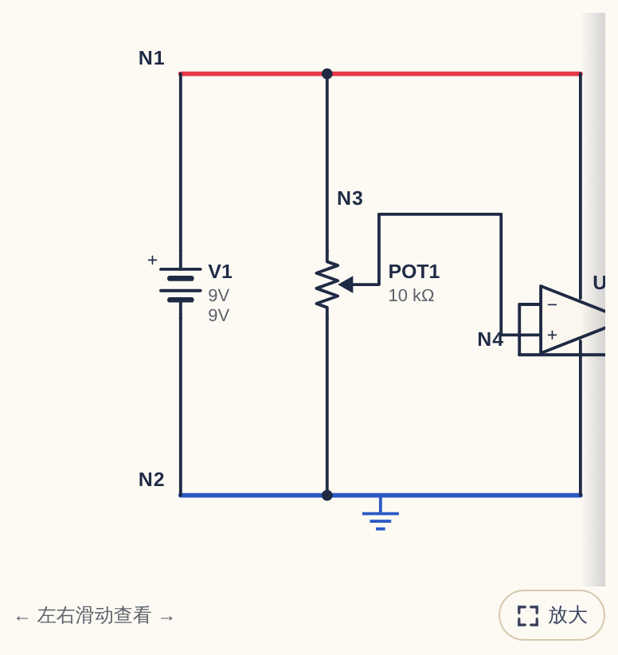
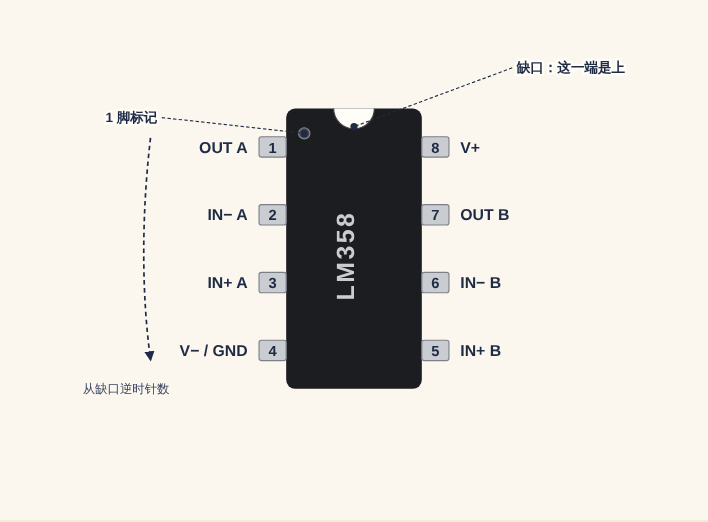
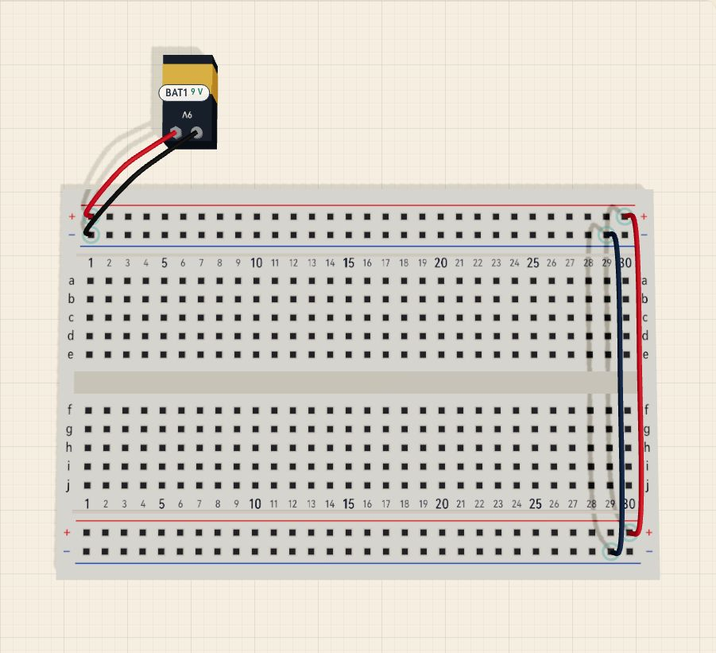
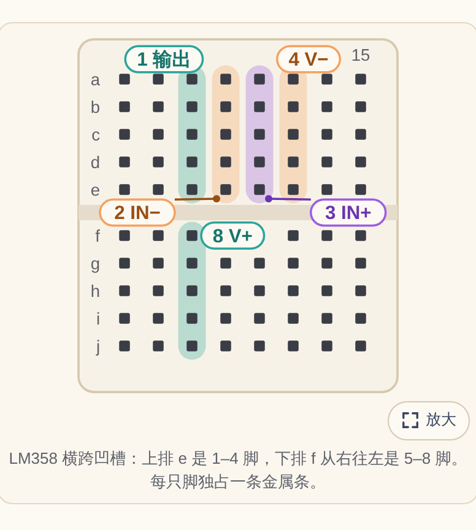
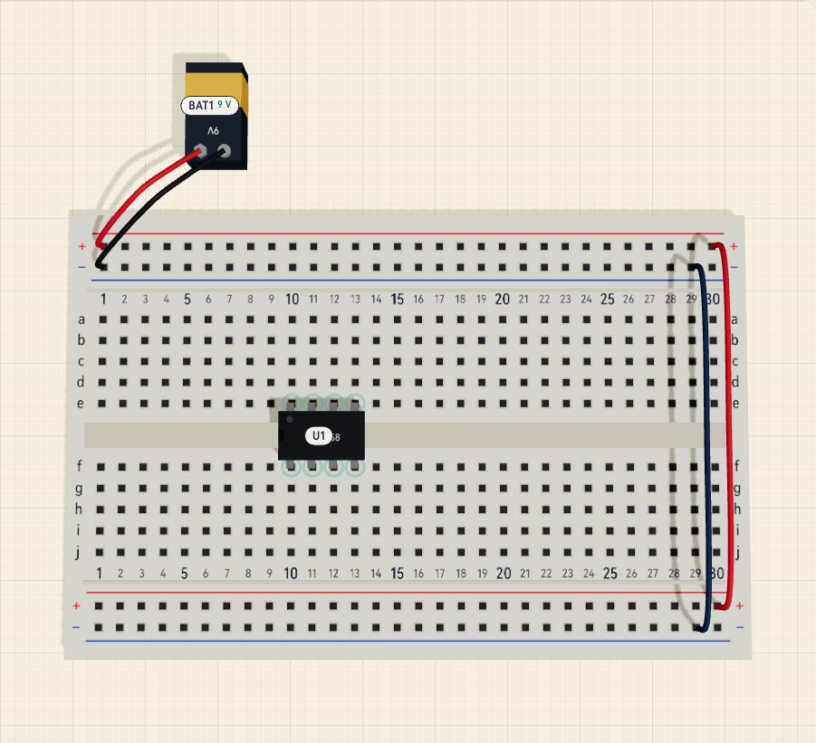
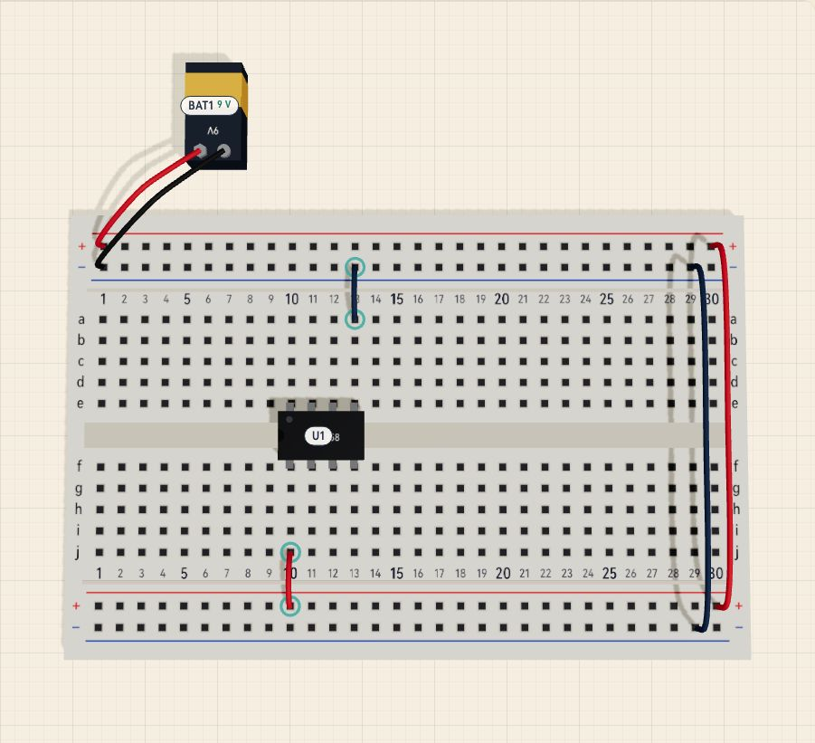
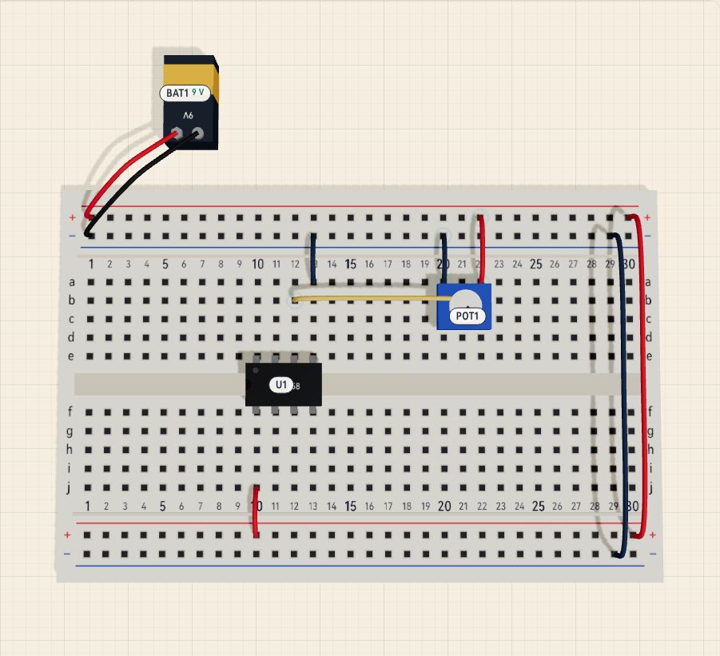
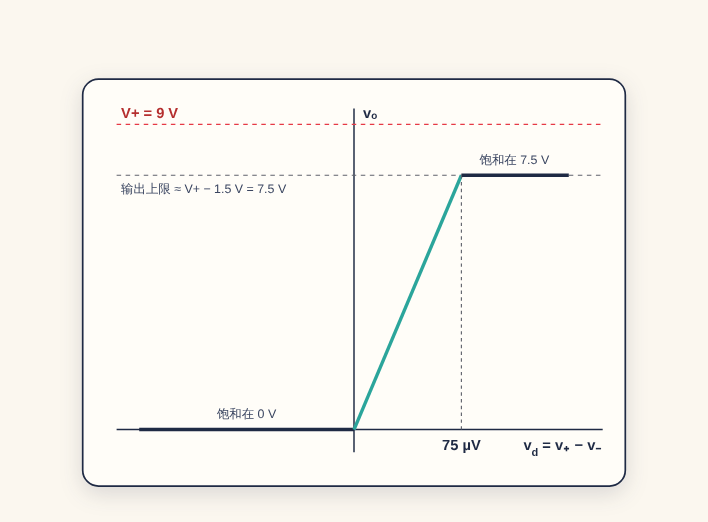
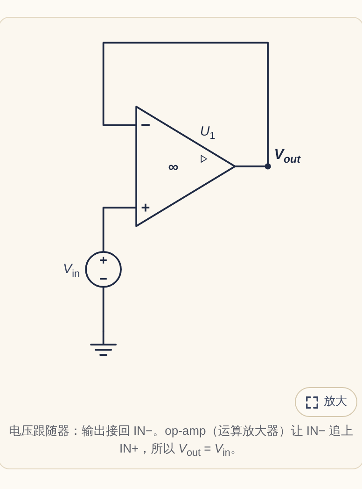
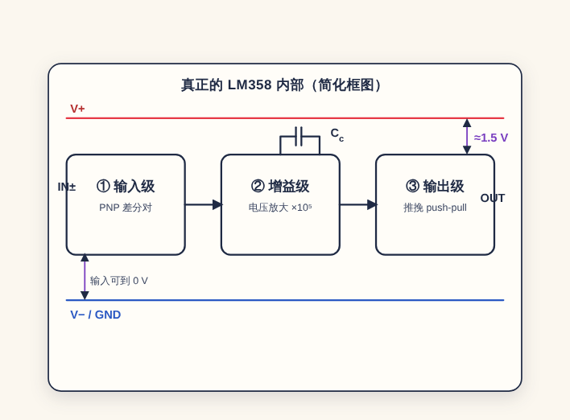

# 3.1 · LM358 上面包板：先不接反馈，再接成跟随器

| 项目 | 内容 |
|---|---|
| id | `lesson-lm358` |
| 文件 | `challenges/106-lesson-lm358.json` |
| 类型 | 课程（有分步，每步自动检查） · 难度 3/5 |
| 位置 | World 3 · 运算放大器基础 → 3.1 认识芯片：LM358（本节第 2 项） |
| 右侧面板 | 手写轨道（样板课） |
| 前后 | 上一项 [3.1 w3-chip](../w3/3.01-1-w3-chip.md) · 下一项 [3.2 w3-5a-black-box](../w3/3.02-1-w3-5a-black-box.md) |
| 先修 | — |
| 概念 | op-amp op-amp、LM358、DIP-8 pinout 引脚、voltage follower 电压跟随器、output swing 输出摆幅 |

**一句话概要**：芯片横跨凹槽、接好电源脚。先不接反馈线，看输出一下子顶到头；接上反馈，它就乖乖跟着输入走。

## 1. 左侧工作台（3D 面包板 → 2D 俯视截图）

截图是程序里真实的 3D 面包板换成俯视角拍的；表格是同一块板的文字版（元件、参数、每只脚插在哪个孔）。

### 1.1 起点：空面包板（学生从零开始搭）

### 1.2 每一步之后的面包板

见第 2 节每个步骤下面的截图（按步骤的自动检查重建：放 / 改 / 拔元件、移动万用表表笔）。

### 1.3 参考答案（「看答案」载入的板子）

| 元件 | 类型 | 参数 | 引脚 → 孔 |
|---|---|---|---|
| BAT1 | battery | variant=9V | +→tp1 -→tn1 |
| W2 | wire |  | a→tp30 b→bp30 |
| W3 | wire |  | a→tn29 b→bn29 |
| U1 | opamp |  | 1→e10 2→e11 3→e12 4→e13 5→f13 6→f12 7→f11 8→f10 |
| W5 | wire |  | a→j10 b→bp10 |
| W6 | wire |  | a→a13 b→tn13 |
| W7 | wire |  | a→a10 b→a11 |
| POT1 | potentiometer | resistance=10000, wiper=1 | 1→c20 2→c21 3→c22 |
| W9 | wire |  | a→a20 b→tn20 |
| W10 | wire |  | a→a22 b→tp22 |
| W11 | wire |  | a→b21 b→b12 |

### 1.4 目标原理图（右侧「目标原理图」抽屉）

| 元件 | 类型 | 参数 |
|---|---|---|
| V1 | battery | variant=9V |
| U1 | opamp |  |
| POT1 | potentiometer | resistance=10000 |

连接（每个结点上的引脚）：

- **N1**：V1.+、U1.v+、POT1.3
- **N2**：V1.-、U1.v-、POT1.1
- **N3**：POT1.2、U1.inA+
- **N4**：U1.outA、U1.inA-

## 2. 右侧面板：学生从上往下看到的内容（单轨流）

### 第 1 步 · 🔍 先看一眼：认识 LM358：缺口和 8 只脚

LM358 在一颗 8 脚芯片里装了**两个 op-amp（运算放大器）**。我们用第一个，叫 **A**。

**拆解「LM358：一颗芯片里的两个 op-amp」第 1 / 9 层：① 外形：8 只脚的黑色小芯片（DIP-8）**

LM358 装在 **DIP-8** 封装里（Dual In-line Package，两排直插，8 只脚）。怎么找 1 脚：
- 芯片一端有个 半圆缺口 notch，缺口朝上时，左上角有个 小圆点 的就是 **1 脚**；
- 从 1 脚开始 **逆时针** 数：左边一排从上往下 1、2、3、4，再从右边一排从下往上 5、6、7、8。

8 只脚分成三类：**A 号 op-amp 的 3 只脚**、**B 号 op-amp 的 3 只脚**、**两个 op-amp 共用的 2 只电源脚**。把鼠标放到下表每一行上，看它在芯片上的位置。

| 脚 | 名字 | 属于 | 它是什么 | 单电源时接哪 |
|---|---|---|---|---|
| 1 | OUT A | op-amp A | 输出（output） | 负载 / 反馈网络 |
| 2 | IN− A | op-amp A | 反相输入（inverting input） | 反馈回来的信号 |
| 3 | IN+ A | op-amp A | 同相输入（non-inverting input） | 要放大的信号 / 参考电压 |
| 4 | V− (GND) | A、B 共用 | 负电源 | GND |
| 5 | IN+ B | op-amp B | 同相输入 | 不用时接固定电压 |
| 6 | IN− B | op-amp B | 反相输入 | 不用时接 7 脚（跟随器） |
| 7 | OUT B | op-amp B | 输出 | — |
| 8 | V+ | A、B 共用 | 正电源 3–32 V | +5 V / +9 V |

| 脚 | 名字 | 属于 | 它是什么 | 这一课接到 |
|---|---|---|---|---|
| 1 | OUT A | op-amp A | 输出 | 先什么都不接；第 6 步接回 2 脚 |
| 2 | IN− A | op-amp A | 反相输入 | 反馈线（先不接） |
| 3 | IN+ A | op-amp A | 同相输入 | 电位器滑动端 |
| 4 | V− | A、B 共用 | 负电源 | GND |
| 8 | V+ | A、B 共用 | 正电源 | +9 V |
| 5 / 6 / 7 | IN+ B / IN− B / OUT B | op-amp B | 第二个 op-amp | 本课不用 |

### 第 2 步 · 🔧 动手搭：接电源，插芯片

芯片的 8 脚（V+）在下半区，所以上下两组电源轨都要有电。

**步骤 1**

**9 V 电池**：+ 接 **`tp1`**，− 接 **`tn1`**。芯片的 8 脚在下半区，下方轨道也要有电：红跳线 **`tp30`** → **`bp30`**，蓝跳线 **`tn29`** → **`bn29`**。

自动检查（做到这些才算完成）：把电池插到 tp1–tn1；把跳线插到 tp30–bp30；把跳线插到 tn29–bn29
板上高亮的孔：tp1、tn1、tp30、bp30、tn29、bn29

**步骤 2**

选**「op-amp（运算放大器）LM358」**，单击 **`e10`**（1 脚，缺口在左）。芯片横跨凹槽：1–4 脚在 `e10`–`e13`，8–5 脚在 `f10`–`f13`，每只脚独占一条金属条。

*图 `pins`（breadboard）：LM358 横跨凹槽：上排 e 是 1–4 脚，下排 f 从右往左是 5–8 脚。每只脚独占一条金属条。*

自动检查（做到这些才算完成）：把op-amp LM358插到 e10–e11–e12–e13–f13–f12–f11–f10
板上高亮的孔：e10、e11、e12、e13、f10、f11、f12、f13

**步骤 3**

**电源脚**：红跳线 **`j10`** → **`bp10`**（8 脚 V+ 接 +9 V），蓝跳线 **`a13`** → **`tn13`**（4 脚 V− 接 GND）。

自动检查（做到这些才算完成）：把跳线插到 j10–bp10；把跳线插到 a13–tn13
板上高亮的孔：j10、bp10、a13、tn13

### 第 3 步 · 🔧 动手搭：电位器给 IN+ 一个电压

电位器两端接 GND 和 +9 V，滑动端就能给出 0 到 9 V 之间的任意电压。

**步骤 4**

**电位器** `10 kΩ`，单击 **`c20`**（三只脚在 `c20`、`c21`、`c22`）。两端：蓝跳线 **`a20`** → **`tn20`**，红跳线 **`a22`** → **`tp22`**。滑动端接 IN+：跳线 **`b21`** → **`b12`**（3 脚）。

自动检查（做到这些才算完成）：把电位器插到 c20–c21–c22；把跳线插到 a20–tn20；把跳线插到 a22–tp22；把跳线插到 b21–b12
板上高亮的孔：c20、c21、c22、a20、tn20、a22、tp22、b21、b12

### 第 4 步 · 📏 测一测：先不接反馈：转旋钮，看输出

**步骤 5**

**先不接反馈线。** 万用表红表笔点 **`d10`**（1 脚，输出）。单击电位器，在「属性」里把滑动端从 `10%` 拖到 `90%`：输出怎么变？

自动检查（做到这些才算完成）：万用表红表笔点 d10（选“万用表”工具，单击孔）
板上高亮的孔：d10

**测量题 1 · `open`**（选择题）

> 不接反馈线时，把滑动端从 `10%` 拖到 `90%`，输出（`d10`）怎样？

- A. 一直停在一个比 9 V 低一截的地方，几乎不跟旋钮走 ✅（正确）
- B. 跟着旋钮，从低到高
- C. 一直是 0 V

- 第 5 步完成后就能答

答对后显示：

> IN− 悬空，差值被放大十万倍：输出撞到天花板，停在那里不动。下一步看为什么。

**拆解「LM358：一颗芯片里的两个 op-amp」第 5 / 9 层：⑤ 不接反馈会怎样？——输出一下子撞到电源**

用上一层的公式算一下。LM358 接 9 V 单电源，输出最多到约 7.5 V。要让输出在 0–7.5 V 之间（线性区），输入差只能是：
$$0 < v_d < \frac{7.5 V}{10^5} = 75 µV$$
75 微伏！你手一碰导线、电位器动一点点、甚至输入失调电压（LM358 典型 2 mV）都比它大几十倍。所以 **开环** 的 op-amp 几乎永远停在两头：
- $v₊ > v₋$（哪怕多 1 mV）→ 输出 顶到 ≈ V+ − 1.5 V
- $v₊ < v₋$ → 输出 掉到 ≈ 0 V

这叫 **饱和**（saturation）。这样用 op-amp 就成了 **比较器**（comparator）：只回答“哪个输入大”。想让它当放大器，必须加 **负反馈**——下面两层就讲为什么反馈能把 $v_d$ 稳稳地压在 75 µV 以内。

- 公式 `|v_d| < \frac{V_{sat}}{A} = \frac{7.5}{10^{5}} = 75 µV`：线性区有多窄

### 第 5 步 · 💡 想明白：一个放大十万倍的裁判

op-amp 比较两个输入，把它们的差 $v_d = V(IN+) − V(IN−)$ 乘上一个很大的增益 $A ≈ 100\,000$：
$$v_o = A\,v_d$$

**推导 `sat`：不接反馈时，输出为什么不跟旋钮走**（一次揭开一行）

1. IN− 什么都没接；IN+ 是滑动端的电压，比如 1 V。差 $v_d$ 大约就是 1 V。
2. $v_o = A\,v_d = 100\,000 × 1\text{ V} = 100\,000\text{ V}$
3. 电源只有 9 V，输出到不了这么高，只能停在它能到的最高处：比 V+ 低约 1.5 V。
4. 旋钮从 10% 拧到 90%，$v_d$ 一直是正的、而且远大于 0.1 mV，输出就一直贴在天花板上。这叫**饱和**。

### 第 6 步 · 🔧 动手搭：接上反馈：输出接回 IN−

**负反馈**：把输出接回 IN−。输出只升到 IN− 追上 IN+ 为止，然后停住。输出复制了输入，这就是**电压跟随器**。

*图 `follower`（schematic）：电压跟随器：输出接回 IN−。op-amp（运算放大器）让 IN− 追上 IN+，所以 V_out = V_in。*

**步骤 6**

**接上反馈**：跳线 **`a10`** → **`a11`**，把 1 脚（输出）接回 2 脚（IN−）。

自动检查（做到这些才算完成）：把跳线插到 a10–a11
板上高亮的孔：a10、a11

### 第 7 步 · 📏 测一测：比一比：输出和 IN+

**步骤 7**

再拖一次滑动端，看 **`d10`** 的读数；然后把红表笔移到 **`d12`**（3 脚，IN+）比一比。

自动检查（做到这些才算完成）：万用表红表笔点 d12（选“万用表”工具，单击孔）
板上高亮的孔：d10、d12

测量要在完整的电路上读：先点一次「检查我的电路」，读数框就会打开。

**测量题 2 · `vin`**（读数题）

> 滑动端 `70%`：IN+（3 脚所在的第 12 列）对 GND 的电压

- 单位 V · 先写预测 · 状态：把 POT1 旋到 70% · 参考答案的读数 **6.299 V** · 合理范围 [6.1, 6.5]

答对后显示：

> 电位器分压：0.7 × 9 V ≈ 6.3 V。

**测量题 3 · `vout`**（读数题）

> 同一状态：输出（1 脚所在的第 10 列）对 GND 的电压

- 单位 V · 先写预测 · 状态：把 POT1 旋到 70% · 参考答案的读数 **6.299 V** · 合理范围 [6.1, 6.5]

答对后显示：

> 跟随器：输出 = IN+。

### 第 8 步 · 📏 测一测：拧到 100%：撞上天花板

**步骤 8**

把滑动端拧到 **`100%`**（IN+ = 9 V），再看输出：它停在比 9 V 低一截的地方。「诊断」会提示输出饱和。

自动检查（做到这些才算完成）：把电位器插到 c20–c21–c22
板上高亮的孔：c21

**测量题 4 · `vtop`**（读数题）

> 滑动端拧到 `100%`：输出对 GND 的电压

- 单位 V · 先写预测 · 状态：把 POT1 旋到 100% · 参考答案的读数 **7.499 V** · 合理范围 [7.3, 7.6]

答对后显示：

> IN+ 已经是 9 V，可输出最高只有 V+ − 1.5 V ≈ 7.5 V。

**测量题 5 · `why`**（选择题）

> 为什么滑动端在 100% 时，输出不再等于输入？

- A. LM358 的输出到不了 V+，最高约 V+ − 1.5 V ✅（正确）
- B. 电位器坏了
- C. 跟随器的增益小于 1

答对后显示：

> 单电源 op-amp（运算放大器）的输出摆幅有限。要处理接近电源的信号，选“轨到轨”（rail-to-rail）op-amp，或者提高 V+。

**拆解「LM358：一颗芯片里的两个 op-amp」第 9 / 9 层：⑨ 再往里：三级晶体管电路，和它的“缺点”**

三角形里真正的东西是约 20 个晶体管，分三级：
1. 输入级：PNP 差分对——只放大两个输入的 **差**。LM358 用 PNP 管，所以 输入电压可以低到 0 V（GND），这就是它能单电源工作的原因；输入上限约 V+ − 1.5 V。
2. 增益级——提供 $10^5$ 倍的电压增益。里面的 补偿电容 C_c 让高频增益逐渐下降，防止接反馈后振荡，代价是 **带宽**：增益 × 带宽 ≈ 1 MHz（GBW）。
3. 输出级：推挽——一个管子往上推电流、一个往下拉，提供几十 mA。往上推的那一路有两个 $V_{BE}$ 压降，所以 输出到不了 V+，差约 1.5 V；往下拉的那一路能接近 0 V。

这一层解释了你在课里看到的三个“现象”：
- 第 14 课：输入 9 V，输出只有 7.5 V → 输出级的余量；
- 放大倍数做 100 倍时带宽只剩约 10 kHz → $GBW ≈ 1 MHz$；
- 方波边沿变成斜坡，约 0.3 V/µs → **压摆率**（slew rate），由 C_c 的充电电流决定。

| 参数 | LM358 典型值 | 影响什么 |
|---|---|---|
| 电源电压 | 3–32 V（±1.5–±16 V） | 能用的电源 |
| 输出摆幅 | 0 … V+ − 1.5 V | 输出最大值 |
| 共模输入范围 | 0 … V+ − 1.5 V | 输入能接多高 |
| 增益带宽积 GBW | ≈ 1 MHz | $f_{max} ≈ \frac{GBW}{增益}$ |
| 压摆率 SR | ≈ 0.3 V/µs | 大信号的最高频率 |
| 输入失调电压 | ≈ 2 mV | 直流误差 × 增益 |

- 公式 `f_{-3dB} ≈ \frac{GBW}{G}`：G = 闭环增益（同相放大器的 1 + R_f/R_1）
- 公式 `f_{max} = \frac{SR}{2π V_p}`：不失真的最大正弦频率

### 第 9 步 · 🎒 带走：带走

- 有了负反馈，两条规则几乎就够用：**$V(IN−) ≈ V(IN+)$**（虚短）和**输入端不取电流**（虚断）。
- 单电源 LM358 的输出只能从约 0 V 摆到约 **V+ − 1.5 V**。真实芯片的输入也最好低于这条线。
- 坑：别像第一次那样让 op-amp 的输入悬空，真实芯片会乱来。没用到的 B 半也接成跟随器，IN+ 接到一个固定电压。
- 下一步：用跟随器救一个被负载拉低的分压器。

趁热练理论题：`opamp`

## 3. 测量题一览

| # | id | 题目 | 类型 | 单位 | 状态 | 参考读数 |
|---|---|---|---|---|---|---|
| 1 | open | 不接反馈线时，把滑动端从 `10%` 拖到 `90%`，输出（`d10`）怎样？ | 选择 |  |  | 正确：A |
| 2 | vin | 滑动端 `70%`：IN+（3 脚所在的第 12 列）对 GND 的电压 | voltage | V | 把 POT1 旋到 70% | 6.299 V |
| 3 | vout | 同一状态：输出（1 脚所在的第 10 列）对 GND 的电压 | voltage | V | 把 POT1 旋到 70% | 6.299 V |
| 4 | vtop | 滑动端拧到 `100%`：输出对 GND 的电压 | voltage | V | 把 POT1 旋到 100% | 7.499 V |
| 5 | why | 为什么滑动端在 100% 时，输出不再等于输入？ | 选择 |  |  | 正确：A |

### 全部答完后显示的「对比」

**对比**：
- 滑动端 70 %：IN+ ≈ 0.7 × 9 V ≈ **6.3 V**，输出也是 **6.3 V**（跟随）；
- 滑动端 100 %：IN+ = 9 V，但输出到顶：9 V − 1.5 V = **7.5 V**。

### 提示按钮（依次显示）

1. 跟随器：输出接 IN−，信号接 IN+，op-amp（运算放大器）让两个输入相等。
2. 电位器 1 脚接 GND、3 脚接 9 V 时，滑动端的电压 = 滑动端位置 × 9 V。
3. 输出不会超过 V+ − 1.5 V。

### 功能测试（「检查我的电路」时跑）

- 滑动端在中间：输出跟着输入
- 滑动端到顶：输出被电源限制

## 4. 用到的拆解（全部层的文字，供改写参考）

### 拆解 `lm358`：LM358：一颗芯片里的两个 op-amp

*op-amp = operational amplifier（运算放大器）。我们从芯片外形一路拆到教授在黑板上画的那个三角形，再拆到三角形里面的等效电路，最后用它推出每一个放大器公式。*

**拆解「LM358：一颗芯片里的两个 op-amp」第 1 / 9 层：① 外形：8 只脚的黑色小芯片（DIP-8）**

LM358 装在 **DIP-8** 封装里（Dual In-line Package，两排直插，8 只脚）。怎么找 1 脚：
- 芯片一端有个 半圆缺口 notch，缺口朝上时，左上角有个 小圆点 的就是 **1 脚**；
- 从 1 脚开始 **逆时针** 数：左边一排从上往下 1、2、3、4，再从右边一排从下往上 5、6、7、8。

8 只脚分成三类：**A 号 op-amp 的 3 只脚**、**B 号 op-amp 的 3 只脚**、**两个 op-amp 共用的 2 只电源脚**。把鼠标放到下表每一行上，看它在芯片上的位置。

| 脚 | 名字 | 属于 | 它是什么 | 单电源时接哪 |
|---|---|---|---|---|
| 1 | OUT A | op-amp A | 输出（output） | 负载 / 反馈网络 |
| 2 | IN− A | op-amp A | 反相输入（inverting input） | 反馈回来的信号 |
| 3 | IN+ A | op-amp A | 同相输入（non-inverting input） | 要放大的信号 / 参考电压 |
| 4 | V− (GND) | A、B 共用 | 负电源 | GND |
| 5 | IN+ B | op-amp B | 同相输入 | 不用时接固定电压 |
| 6 | IN− B | op-amp B | 反相输入 | 不用时接 7 脚（跟随器） |
| 7 | OUT B | op-amp B | 输出 | — |
| 8 | V+ | A、B 共用 | 正电源 3–32 V | +5 V / +9 V |

**拆解「LM358：一颗芯片里的两个 op-amp」第 2 / 9 层：② X 光：硅片上有两个 op-amp，电源脚共用**

把黑色塑料变透明：中间是一小块 硅片 die，细细的 金线 bond wire 把硅片连到 8 只脚上。硅片上做了两个完全一样、互相独立的放大器：op-amp A 和 op-amp B。

“**Dual**（双）”就是这个意思。它们只共用两样东西：V+（8 脚） 和 V−（4 脚）。所以：
- 只要芯片插上电，A 和 B **都** 通电了，哪怕你只用 A；
- 不用的那一半不能让它的输入悬空——悬空的输入会让它乱跳甚至振荡，干扰另一半。通常把它接成跟随器（7 脚接 6 脚），5 脚接一个固定电压。

**拆解「LM358：一颗芯片里的两个 op-amp」第 3 / 9 层：③ 符号：教授画的那个三角形**

原理图里，一个 op-amp 画成一个 三角形，信号从左往右走：
- IN−（反相输入 inverting input）：标“−”的那只脚，它上面的电压记作 $v₋$；
- IN+（同相输入 non-inverting input）：标“+”的那只脚，电压记作 $v₊$；
- OUT（输出）：三角形的尖，电压 $v_o$；
- V+ 和 V−：电源脚。理论题里常常 **省略不画**，但真实电路里必须接，否则它不工作。

注意：“+”“−”不是电源正负极，而是“这只输入对输出的作用是同向还是反向”。op-amp 只关心两个输入之间的 **差**：
$$v_d = v₊ - v₋$$
v_d 叫 **差模输入电压**（differential input voltage）。

| 端子 | 符号 | LM358 A 的脚 | 作用 |
|---|---|---|---|
| IN+ | $v₊$ | 3 | $v₊$ 升高 → $v_o$ 升高 |
| IN− | $v₋$ | 2 | $v₋$ 升高 → $v_o$ 降低 |
| OUT | $v_o$ | 1 | 输出 $A·v_d$ |
| V+ / V− | — | 8 / 4 | 能量从这里来，也限制 $v_o$ 的范围 |

- 公式 `v_d = v₊ - v₋`：op-amp 唯一“看”的量

**拆解「LM358：一颗芯片里的两个 op-amp」第 4 / 9 层：④ 拆开三角形：三个元件的等效电路**

教授说“把 op-amp 拆成电路”，拆出来就是这三样（这是电路课里 op-amp 的 **线性模型**）：

1. 输入电阻 R_in：接在两个输入之间。LM358 的输入只取约 20 nA 的偏置电流，等效 $R_{in}$ 在 MΩ 以上，计算时可以当成 **开路**——输入端几乎不取电流。
2. 受控电压源 A·v_d：一个电压 **控制** 的电压源（VCVS），它的电压是输入差的 A 倍。A 叫 **开环增益**（open-loop gain），LM358 约 $10^5$（100 dB）。
3. 输出电阻 R_out：受控源到输出脚之间，几十 Ω 量级。

于是不接任何反馈时：
$$v_o = A·v_d = A(v₊ - v₋)$$
这个电路你在第 5 章“含运算放大器的电阻电路”和受控源那一节都能直接用结点法分析。

| 参数 | LM358（典型） | 理想 op-amp | 计算时 |
|---|---|---|---|
| 开环增益 A | ≈ 10⁵ (100 dB) | ∞ | 很大 → 得出“虚短” |
| 输入电阻 R_in | MΩ 以上（偏置 20 nA） | ∞ | 开路 → 得出“虚断” |
| 输出电阻 R_out | 几十 Ω（仿真 10 Ω） | 0 | 反馈后更小，可忽略 |

- 公式 `v_o = A(v₊ - v₋)`：开环（不接反馈），且输出没到电源边界时

**拆解「LM358：一颗芯片里的两个 op-amp」第 5 / 9 层：⑤ 不接反馈会怎样？——输出一下子撞到电源**

用上一层的公式算一下。LM358 接 9 V 单电源，输出最多到约 7.5 V。要让输出在 0–7.5 V 之间（线性区），输入差只能是：
$$0 < v_d < \frac{7.5 V}{10^5} = 75 µV$$
75 微伏！你手一碰导线、电位器动一点点、甚至输入失调电压（LM358 典型 2 mV）都比它大几十倍。所以 **开环** 的 op-amp 几乎永远停在两头：
- $v₊ > v₋$（哪怕多 1 mV）→ 输出 顶到 ≈ V+ − 1.5 V
- $v₊ < v₋$ → 输出 掉到 ≈ 0 V

这叫 **饱和**（saturation）。这样用 op-amp 就成了 **比较器**（comparator）：只回答“哪个输入大”。想让它当放大器，必须加 **负反馈**——下面两层就讲为什么反馈能把 $v_d$ 稳稳地压在 75 µV 以内。

- 公式 `|v_d| < \frac{V_{sat}}{A} = \frac{7.5}{10^{5}} = 75 µV`：线性区有多窄

**拆解「LM358：一颗芯片里的两个 op-amp」第 6 / 9 层：⑥ 理想 op-amp 的两条黄金法则：虚短、虚断**

把等效电路里的三个参数推到极限：$A → ∞$、$R_{in} → ∞$、$R_{out} → 0$。电路课的所有 op-amp 题都用这两条法则：

**法则 1 · 虚断（virtual open）**：$R_{in} → ∞$，所以 两个输入端都不取电流：
$$i_+ = i_- = 0$$
**法则 2 · 虚短（virtual short）**：有负反馈、输出没饱和时，$v_o$ 是有限值（几伏），而 $v_d = \frac{v_o}{A}$，A → ∞，所以 两个输入电压相等：
$$v₊ = v₋$$
“虚”的意思：两个输入 **电压相等，但并没有真的连在一起**（没有电流流过）。

⚠ 虚短 **只在有负反馈时成立**。上一层的开环电路里 $v₊ ≠ v₋$，输出是饱和的。

| 法则 | 式子 | 来自 | 什么时候成立 |
|---|---|---|---|
| 虚断 | $i_+ = i_- = 0$ | $R_{in} → ∞$ | 总是（输入电流 nA 级） |
| 虚短 | $v₊ = v₋$ | $A → ∞$ | 有负反馈且输出未饱和 |

**拆解「LM358：一颗芯片里的两个 op-amp」第 7 / 9 层：⑦ 负反馈第一例：电压跟随器，一步步推**

把 输出直接接回 IN−，信号接 IN+。先 **不用** 黄金法则，用 ④ 的模型硬算（忽略 $R_{out}$）：
1. 接线告诉我们：$v₊ = v_{in}$，$v₋ = v_o$
2. op-amp 的方程：$v_o = A(v₊ - v₋) = A(v_{in} - v_o)$
3. 移项：$v_o(1 + A) = A·v_{in}$
4. 所以 $v_o = \frac{A}{1+A}v_{in}$。代入 $A = 10^5$：$v_o = 0.99999 v_{in}$

再看反馈 **为什么能稳住**：如果 $v_o$ 偏低，$v_d = v_{in} - v_o$ 变大，A 倍放大后把 $v_o$ 往上推；偏高则往下拉。输出一直“追”着输入，$v_d$ 只剩 $\frac{v_o}{A}$——几十 µV。

用黄金法则一行就出来：虚短 $v₋ = v₊$，而 $v₋ = v_o$，所以 $v_o = v_{in}$。两种方法结果一致，这就是黄金法则的来历。

**用处**：输入几乎不取电流（虚断），输出能提供几十 mA——它把“带不动负载的信号”变成“能带负载的信号”，叫 **缓冲器**（buffer）。

- 公式 `v_o = \frac{A}{1+A} v_{in} ≈ v_{in}`：有限 A 的精确结果

**拆解「LM358：一颗芯片里的两个 op-amp」第 8 / 9 层：⑧ 负反馈第二例：同相放大器和反相放大器**

跟随器把 **全部** 输出送回 IN−。如果只送回 **一部分**，就能放大。用 R_f 和 R_1 分压，送回 IN− 的是 βvₒ：
$$β = \frac{R_1}{R_1 + R_f}$$
**同相放大器**（non-inverting），信号接 IN+：
1. 虚断：IN− 不取电流，所以 R_f、R_1 是简单的串联分压：$v₋ = β v_o$
2. 虚短：$v₋ = v₊ = v_{in}$
3. 所以 $β v_o = v_{in}$，$v_o = \frac{1}{β}v_{in} = (1 + \frac{R_f}{R_1})v_{in}$

用有限 A 推（同 ⑦ 的方法）得到 $v_o = \frac{A}{1+Aβ}v_{in}$：只要 $Aβ ≫ 1$，增益就只由 **两个电阻** 决定，和 op-amp 本身的 A 无关——这就是负反馈的价值。

**反相放大器**（inverting）：IN+ 接 GND，信号经 $R_1$ 接 IN−，$R_f$ 从 OUT 接回 IN−。
1. 虚短：$v₋ = v₊ = 0$，IN− 是 **虚地**（virtual ground）
2. 虚断：流进 $R_1$ 的电流全部流过 $R_f$：$\frac{v_{in} - 0}{R_1} = \frac{0 - v_o}{R_f}$
3. 所以 $v_o = -\frac{R_f}{R_1}v_{in}$（负号 = 反相）

| 电路 | 增益 vₒ / v_in | 输入电阻 | 实验 |
|---|---|---|---|
| 跟随器 | 1 | ∞ | 2-5 |
| 同相放大 | $1 + \frac{R_f}{R_1}$ | ∞ | 2-6 |
| 反相放大 | $-\frac{R_f}{R_1}$ | $R_1$ | 2-7 |
| 反相求和 | $-R_f(\frac{v_1}{R_1} + \frac{v_2}{R_2})$ | $R_1$, $R_2$ | 2-8 |

- 公式 `β = \frac{R_1}{R_1 + R_f}`：反馈系数：输出送回 IN− 的比例
- 公式 `v_o = \frac{A}{1 + Aβ} v_{in} ≈ \frac{1}{β} v_{in}`：Aβ ≫ 1 时增益只取决于电阻

**拆解「LM358：一颗芯片里的两个 op-amp」第 9 / 9 层：⑨ 再往里：三级晶体管电路，和它的“缺点”**

三角形里真正的东西是约 20 个晶体管，分三级：
1. 输入级：PNP 差分对——只放大两个输入的 **差**。LM358 用 PNP 管，所以 输入电压可以低到 0 V（GND），这就是它能单电源工作的原因；输入上限约 V+ − 1.5 V。
2. 增益级——提供 $10^5$ 倍的电压增益。里面的 补偿电容 C_c 让高频增益逐渐下降，防止接反馈后振荡，代价是 **带宽**：增益 × 带宽 ≈ 1 MHz（GBW）。
3. 输出级：推挽——一个管子往上推电流、一个往下拉，提供几十 mA。往上推的那一路有两个 $V_{BE}$ 压降，所以 输出到不了 V+，差约 1.5 V；往下拉的那一路能接近 0 V。

这一层解释了你在课里看到的三个“现象”：
- 第 14 课：输入 9 V，输出只有 7.5 V → 输出级的余量；
- 放大倍数做 100 倍时带宽只剩约 10 kHz → $GBW ≈ 1 MHz$；
- 方波边沿变成斜坡，约 0.3 V/µs → **压摆率**（slew rate），由 C_c 的充电电流决定。

| 参数 | LM358 典型值 | 影响什么 |
|---|---|---|
| 电源电压 | 3–32 V（±1.5–±16 V） | 能用的电源 |
| 输出摆幅 | 0 … V+ − 1.5 V | 输出最大值 |
| 共模输入范围 | 0 … V+ − 1.5 V | 输入能接多高 |
| 增益带宽积 GBW | ≈ 1 MHz | $f_{max} ≈ \frac{GBW}{增益}$ |
| 压摆率 SR | ≈ 0.3 V/µs | 大信号的最高频率 |
| 输入失调电压 | ≈ 2 mV | 直流误差 × 增益 |

- 公式 `f_{-3dB} ≈ \frac{GBW}{G}`：G = 闭环增益（同相放大器的 1 + R_f/R_1）
- 公式 `f_{max} = \frac{SR}{2π V_p}`：不失真的最大正弦频率

**一句话记住**：op-amp = 一个只看 $v₊ - v₋$ 的超高增益放大器。开环时它是比较器；加了负反馈，输出会调到让 $v₊ = v₋$（虚短），输入不取电流（虚断）——从这两条就能推出所有放大器公式。

## 5. 这一课的计算卡片

**计算卡片 `opamp-open-loop`：开环：vₒ = A·v_d（会不会饱和？）**

- 公式 `v_o = A(v₊ - v₋)`
- 用途：不接反馈时输出是多少；算出来超出电源范围就是饱和。
- 输入：vp（v₊，V）；vn（v₋，V）；A（开环增益 A，）；Vp（电源 V+，V） → vₒ（输出（LM358 夹在 0 … V+ − 1.5 V），V）

等效电路里的受控源：$v_o = A·v_d$。可 A ≈ $10^5$，1 mV 的输入差就要求 100 V 输出——电源给不了，输出就停在边界（饱和）。线性区只有 $|v_d| < \frac{V_{sat}}{A}$，几十 µV。
试试把 v₊ 改成 2.00005 V：这时 $v_d = 50 µV$，输出 5 V，才在线性区里。

**计算卡片 `opamp-follower`：电压跟随器 Voltage follower**

- 公式 `v_o = \frac{A}{1 + A} v_{in} ≈ v_{in}`
- 用途：增益 1 的缓冲器：输入不取电流，输出能带负载。
- 输入：vin（v_in，V）；A（开环增益 A，） → vₒ（输出，V）

接线：$v₊ = v_{in}$，$v₋ = v_o$。代入 $v_o = A(v₊ - v₋)$：
$$v_o = A(v_{in} - v_o) ⇒ v_o = \frac{A}{1+A}v_{in}$$
A = 10⁵ 时误差只有 $\frac{1}{1+A} ≈ 0.001 %$。黄金法则（虚短）直接给出 $v_o = v_{in}$。

- ⚠ LM358 单电源：$v_{in}$ 超过 V+ − 1.5 V 时输出跟不上（第 14 课）。

## 6. English（界面英文版的同一份内容）

展开英文

### Node 1 · 🔍 Look first：Meet the LM358: the notch and 8 pins

The LM358 holds **two op-amps** in one 8-pin chip. We use the first one, called **A**.

**Teardown「LM358: two op-amps in one chip」layer 1 of 9：① Package: a small black 8-pin chip (DIP-8)**

The LM358 comes in a **DIP-8** package (Dual In-line Package: two rows, 8 pins). Finding pin 1:
- one end has a half-moon notch; with the notch at the top, the corner with the little dot (top left) is **pin 1**;
- count **anticlockwise** from pin 1: down the left side 1, 2, 3, 4, then up the right side 5, 6, 7, 8.

The 8 pins fall into three groups: **3 pins of op-amp A**, **3 pins of op-amp B**, and **2 power pins shared by both**. Hover each row of the table to see where it is on the chip.

| Pin | Name | Belongs to | What it is | Single supply: connect to |
|---|---|---|---|---|
| 1 | OUT A | op-amp A | output | the load / feedback network |
| 2 | IN− A | op-amp A | inverting input | the feedback signal |
| 3 | IN+ A | op-amp A | non-inverting input | the signal / a reference |
| 4 | V− (GND) | shared | negative supply | GND |
| 5 | IN+ B | op-amp B | non-inverting input | unused: tie to a fixed voltage |
| 6 | IN− B | op-amp B | inverting input | unused: tie to pin 7 (follower) |
| 7 | OUT B | op-amp B | output | — |
| 8 | V+ | shared | positive supply 3–32 V | +5 V / +9 V |

| Pin | Name | Belongs to | What it is | In this lesson |
|---|---|---|---|---|
| 1 | OUT A | op-amp A | output | nothing yet; step 6 wires it back to pin 2 |
| 2 | IN− A | op-amp A | inverting input | the feedback wire (not yet) |
| 3 | IN+ A | op-amp A | non-inverting input | the pot's wiper |
| 4 | V− | shared by A and B | negative supply | GND |
| 8 | V+ | shared by A and B | positive supply | +9 V |
| 5 / 6 / 7 | IN+ B / IN− B / OUT B | op-amp B | the second op-amp | not used here |

### Node 2 · 🔧 Build：Power the rails, put in the chip

Pin 8 (V+) sits in the lower half, so both pairs of rails need power.

**Step 1**

**9 V battery**: + in **`tp1`**, − in **`tn1`**. Pin 8 sits in the bottom half, so the bottom rails need power too: red jumper **`tp30`** → **`bp30`**, blue jumper **`tn29`** → **`bn29`**.

Checked automatically：Place the Battery at tp1–tn1；Place the Jumper wire at tp30–bp30；Place the Jumper wire at tn29–bn29
Holes highlighted：tp1、tn1、tp30、bp30、tn29、bn29

**Step 2**

Pick **Op-amp LM358** and click **`e10`** (pin 1, notch on the left). The chip straddles the trench: pins 1–4 in `e10`–`e13`, pins 8–5 in `f10`–`f13`, each pin on its own strip.

[figure `pins`]

*Figure `pins`（breadboard）：LM358 横跨凹槽：上排 e 是 1–4 脚，下排 f 从右往左是 5–8 脚。每只脚独占一条金属条。*

Checked automatically：Place the Op-amp LM358 at e10–e11–e12–e13–f13–f12–f11–f10
Holes highlighted：e10、e11、e12、e13、f10、f11、f12、f13

**Step 3**

**Power pins**: red jumper **`j10`** → **`bp10`** (pin 8, V+, to +9 V), blue jumper **`a13`** → **`tn13`** (pin 4, V−, to GND).

Checked automatically：Place the Jumper wire at j10–bp10；Place the Jumper wire at a13–tn13
Holes highlighted：j10、bp10、a13、tn13

### Node 3 · 🔧 Build：A pot gives IN+ a voltage

With its ends on GND and +9 V, the pot's wiper gives any voltage from 0 to 9 V.

**Step 4**

**Potentiometer** `10 kΩ`, click **`c20`** (legs in `c20`, `c21`, `c22`). Its ends: blue jumper **`a20`** → **`tn20`**, red jumper **`a22`** → **`tp22`**. Wiper to IN+: jumper **`b21`** → **`b12`** (pin 3).

Checked automatically：Place the Potentiometer at c20–c21–c22；Place the Jumper wire at a20–tn20；Place the Jumper wire at a22–tp22；Place the Jumper wire at b21–b12
Holes highlighted：c20、c21、c22、a20、tn20、a22、tp22、b21、b12

### Node 4 · 📏 Measure：No feedback yet: turn the knob, watch the output

**Step 5**

**No feedback wire yet.** Put the multimeter's red probe on **`d10`** (pin 1, the output). Click the pot and drag its wiper in **Properties** from `10%` to `90%`: what does the output do?

Checked automatically：Multimeter red probe on d10 (pick the Multimeter tool, click the hole)
Holes highlighted：d10

**Question 1 · `open`**（multiple choice）

> With no feedback wire, drag the wiper from `10%` to `90%`. What does the output (`d10`) do?

- A. it sits at one level a little below 9 V and hardly follows the knob ✅ (right)
- B. it follows the knob from low to high
- C. it stays at 0 V

- answerable after step 5

Shown once right:

> IN− is open and the difference is multiplied by 100 000: the output hits the ceiling and stays there. The next step shows why.

**Teardown「LM358: two op-amps in one chip」layer 5 of 9：⑤ What without feedback? The output slams into a rail**

Use the formula from the last layer. On a 9 V single supply the LM358 output reaches about 7.5 V at most. For the output to stay between 0 and 7.5 V (the linear region) the input difference must be:
$$0 < v_d < \frac{7.5 V}{10^5} = 75 µV$$
75 microvolts! Touching a wire, nudging a pot, even the input offset voltage (2 mV typical for the LM358) is tens of times bigger. So an **open-loop** op-amp almost always sits at one end:
- $v₊ > v₋$ (by even 1 mV) → the output tops out at ≈ V+ − 1.5 V
- $v₊ < v₋$ → the output drops to ≈ 0 V

That is **saturation**. Used this way an op-amp is a **comparator**: it only says which input is larger. To make it an amplifier you need **negative feedback** — the next two layers show how feedback holds $v_d$ inside those 75 µV.

- 公式 `|v_d| < \frac{V_{sat}}{A} = \frac{7.5}{10^{5}} = 75 µV`：how narrow the linear region is

### Node 5 · 💡 Why：A referee that multiplies by 100 000

An op-amp compares its two inputs and multiplies the difference $v_d = V(IN+) − V(IN−)$ by a huge gain $A ≈ 100\,000$:
$$v_o = A\,v_d$$

**Derivation `sat`：Why the output ignores the knob without feedback**（revealed one line at a time）

1. IN− is connected to nothing; IN+ sits at the wiper's voltage, say 1 V. The difference $v_d$ is about 1 V.
2. $v_o = A\,v_d = 100\,000 × 1\text{ V} = 100\,000\text{ V}$
3. The supply is 9 V. The output can't go that high, so it stops at the highest it can reach: about 1.5 V below V+.
4. From 10% to 90% on the knob, $v_d$ stays positive and far above 0.1 mV, so the output stays stuck at the ceiling. That is **saturation**.

### Node 6 · 🔧 Build：Add the feedback: output back to IN−

**Negative feedback**: wire the output back to IN−. The output rises only until IN− has caught up with IN+, then holds. The output copies the input: a **voltage follower**.

[figure `follower`]

*Figure `follower`（schematic）：电压跟随器：输出接回 IN−。op-amp（运算放大器）让 IN− 追上 IN+，所以 V_out = V_in。*

**Step 6**

**Add the feedback**: jumper **`a10`** → **`a11`**, from pin 1 (output) back to pin 2 (IN−).

Checked automatically：Place the Jumper wire at a10–a11
Holes highlighted：a10、a11

### Node 7 · 📏 Measure：Compare: the output and IN+

**Step 7**

Drag the wiper again and watch **`d10`**; then move the red probe to **`d12`** (pin 3, IN+) and compare.

Checked automatically：Multimeter red probe on d12 (pick the Multimeter tool, click the hole)
Holes highlighted：d10、d12

Readings are taken on the whole circuit: press **Check my circuit** once and the reading boxes open.

**Question 2 · `vin`**（reading）

> Wiper at `70%`: IN+ (column 12, pin 3) to GND

- unit V · predict first · state：POT1 is turned to 70% · range [6.1, 6.5]

Shown once right:

> The pot divides: 0.7 × 9 V ≈ 6.3 V.

**Question 3 · `vout`**（reading）

> Same setting: the output (column 10, pin 1) to GND

- unit V · predict first · state：POT1 is turned to 70% · range [6.1, 6.5]

Shown once right:

> Follower: output = IN+.

### Node 8 · 📏 Measure：Turn it to 100%: the ceiling

**Step 8**

Turn the wiper to **`100%`** (IN+ = 9 V) and look at the output again: it stops well short of 9 V. **Diagnostics** reports the output as saturated.

Checked automatically：Place the Potentiometer at c20–c21–c22
Holes highlighted：c21

**Question 4 · `vtop`**（reading）

> Wiper at `100%`: the output to GND

- unit V · predict first · state：POT1 is turned to 100% · range [7.3, 7.6]

Shown once right:

> IN+ is at 9 V, but the output tops out at V+ − 1.5 V ≈ 7.5 V.

**Question 5 · `why`**（multiple choice）

> Why does the output stop following the input at 100%?

- A. the LM358's output can't reach V+; it tops out about 1.5 V below ✅ (right)
- B. the potentiometer is broken
- C. a follower's gain is below 1

Shown once right:

> A single-supply op-amp has a limited output swing. For signals close to the supply, pick a rail-to-rail op-amp or raise V+.

**Teardown「LM358: two op-amps in one chip」layer 9 of 9：⑨ Deeper: three transistor stages, and their limits**

What is really inside the triangle is about 20 transistors in three stages:
1. input stage: a PNP differential pair — amplifies only the **difference** of the inputs. The LM358 uses PNP transistors, so the inputs can go down to 0 V (GND) — that is why it works from a single supply; the input upper limit is about V+ − 1.5 V.
2. gain stage — provides the $10^5$ voltage gain. Its compensation capacitor C_c rolls the gain off at high frequency so the amplifier doesn't oscillate with feedback; the price is **bandwidth**: gain × bandwidth ≈ 1 MHz (GBW).
3. output stage: push-pull — one transistor pushes current up, one pulls it down, tens of mA. The upper path has two $V_{BE}$ drops, so the output can't reach V+; it stops about 1.5 V short; the lower path gets close to 0 V.

This layer explains three things you saw in the labs:
- lesson 14: 9 V in, only 7.5 V out → the output stage's headroom;
- at a gain of 100 the bandwidth is only about 10 kHz → $GBW ≈ 1 MHz$;
- square-wave edges turn into ramps of about 0.3 V/µs → the **slew rate**, set by the current that charges C_c.

| Parameter | LM358 typical | What it limits |
|---|---|---|
| supply | 3–32 V（±1.5–±16 V） | usable supplies |
| output swing | 0 … V+ − 1.5 V | the largest output |
| input common-mode range | 0 … V+ − 1.5 V | how high the inputs may go |
| gain-bandwidth GBW | ≈ 1 MHz | $f_{max} ≈ \frac{GBW}{gain}$ |
| slew rate SR | ≈ 0.3 V/µs | large-signal speed |
| input offset | ≈ 2 mV | DC error × gain |

- 公式 `f_{-3dB} ≈ \frac{GBW}{G}`：G = closed-loop gain (1 + R_f/R_1 for a non-inverting amp)
- 公式 `f_{max} = \frac{SR}{2π V_p}`：highest undistorted sine frequency

### Node 9 · 🎒 Take away：Take away

- With negative feedback, two rules do almost all the work: **$V(IN−) ≈ V(IN+)$** (virtual short) and **no current into the inputs** (virtual open).
- A single-supply LM358 swings its output from about 0 V up to about **V+ − 1.5 V**. A real one also wants its inputs below that line.
- Pitfall: never leave an op-amp input floating, as in the first try: a real chip then does anything. Wire the unused half B as a follower with its IN+ tied to a fixed voltage.
- Next: use the follower to rescue a divider that a load has pulled down.

Practise：`opamp`

**Compare**

**Compare**:
- wiper at 70 %: IN+ ≈ 0.7 × 9 V ≈ **6.3 V**, and the output is **6.3 V** too (it follows);
- wiper at 100 %: IN+ = 9 V, but the output tops out at 9 V − 1.5 V = **7.5 V**.

**Hints**

1. Follower: output to IN−, signal to IN+; the op-amp makes the two inputs equal.
2. With pin 1 on GND and pin 3 on 9 V, the wiper voltage = wiper position × 9 V.
3. The output never goes above V+ − 1.5 V.

