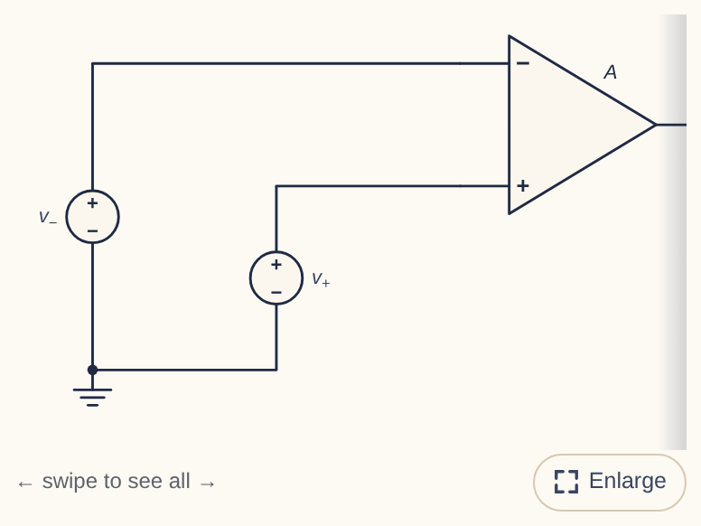
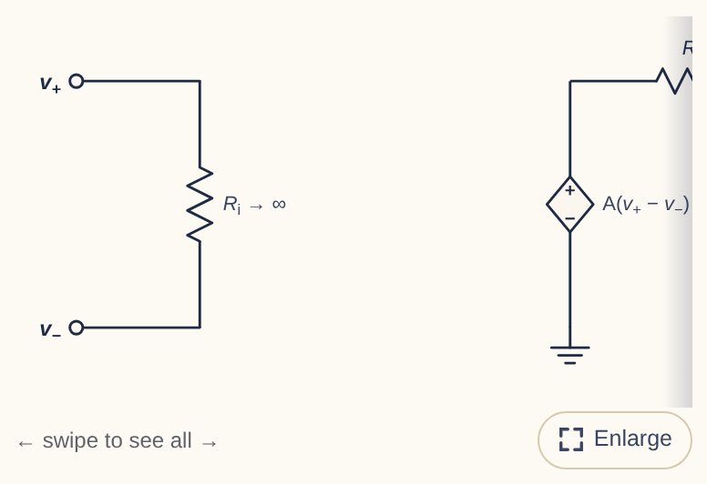

# 3.2 · 单元 5a：op-amp（运算放大器）只做一件事

| 项目 | 内容 |
|---|---|
| id | `w3-5a-black-box` |
| 文件 | `units/w3-5a-black-box.json` |
| 类型 | 理论单元（#/unit 页面，从上往下读的长页） |
| 位置 | World 3 · 运算放大器基础 → 3.2 黑箱与虚短（本节第 1 项） |
| 这个单元回答的问题 | op-amp（运算放大器）的输出由什么决定？不接反馈会怎样？ |
| 时长 | 12 分钟 |
| 接回 | challenge:lesson-lm358、chapter:methods |
| 前后 | 上一项 [3.1 lesson-lm358](../w3/3.01-2-lesson-lm358.md) · 下一项 [3.2 w3-5b-virtual-short](../w3/3.02-2-w3-5b-virtual-short.md) |

## ① 直觉

先把 op-amp（运算放大器）当成一个黑盒子，不管里面有什么。

它有两个输入端。**同相输入**的电压记作 v_{+}，**反相输入**的电压记作 v_{−}，都是对地测的。它有一个输出，电压记作 v_o。

*两个输入、一个输出。电源脚没有画出来，但它们一直接着。*

op-amp（运算放大器）只做一件事：

**v_o = A(v_{+} − v_{−})**

A 是**开环增益**：没有任何反馈时的放大倍数。LM358 的 A 约为 10⁵（十万）。

它只看两个输入的**差**。两个输入一起升高 1 V，差不变，输出也不变。

但输出跑不出电源。LM358 接 9 V 单电源时，输出只能在 0 V 到约 7.5 V（V+ − 1.5 V）之间。

算出来的 A(v_{+} − v_{−}) 超出这个范围，输出就停在边上不动。这叫**饱和**。

> **提示** · 类比：op-amp（运算放大器）像一台极其灵敏的秤。一边多放一粒米，指针就打到头。想让指针停在中间，两边必须几乎一样重。

**预测题**：A = 10⁵，v_{+} = 1.001 V，v_{−} = 1.000 V。先不管电源，A(v_{+} − v_{−}) 是多少？

- 答案：100 V（误差 0.05）

揭晓：

> 差是 1 mV。1 mV × 10⁵ = 100 V。可电源只有 9 V，所以真实的输出停在约 7.5 V：饱和了。

**预测题**：9 V 单电源，输出最高 7.5 V。v_{+} 比 v_{−} 最多能高多少，输出才不饱和？

- 答案：0.000075 V（误差 0.05）

揭晓：

> 7.5 V ÷ 10⁵ = 75 µV。这比普通万用表能分辨的还小。用手拧电位器，几乎不可能停在这么窄的范围里。所以开环的 op-amp（运算放大器）几乎总是饱和。

## ② 交互推导：op-amp（运算放大器）的电路模型

**分步推导**（一次揭开一步）

1. 输入端几乎不取电流。两个输入之间像一个非常大的电阻 R_i（LM358 的输入偏置电流只有约 20 nA）。理想化：R_i → ∞，输入电流 = 0。
2. 输出是一个电压源，它的电压由两个输入的差决定：A(v_{+} − v_{−})。
3. 由另一个电压控制的电压源，就是 Midterm 2 学过的**电压控制电压源（VCVS）**。op-amp（运算放大器）的模型就是一个 VCVS。
4. 真实的输出还串着一个小电阻 R_o（本课程的仿真里是 10 Ω）。理想化：R_o = 0。
5. 所以 op-amp（运算放大器）电路 = 电阻 + 一个 VCVS。结点法照样能解，不需要新定律。

*op-amp（运算放大器）的电路模型：输入之间是很大的 R_i；输出是一个受 v_{+} − v_{−} 控制的电压源（VCVS），串一个小 R_o。*

**传送门** `vcvs-model` → `problem:methods-13-nodal-grounded-vcvs`（15 分钟）：op-amp（运算放大器）的电路模型就是一个电压控制电压源（VCVS）：在结点法里怎么处理它。 · 回来时：这道题里的 VCVS 就是 op-amp（运算放大器）“黑盒子”模型的样子。

**滑块探索：开环：拖一拖输入**

| 参数 | 名称 | 默认 | 范围 | 单位 |
|---|---|---|---|---|
| A | 开环增益 A | 100000 | 10 … 100000（对数） |  |
| vp | 同相输入 v_{+} | 2 | 0 … 5 | V |
| vm | 反相输入 v_{−} | 2 | 0 … 5 | V |
| Vs | 电源 V+（单电源） | 9 | 5 … 15 | V |

| 输出 | 公式 | 单位 |
|---|---|---|
| 输入差 v₊ − v₋ | `vp - vm` | V |
| A(v₊ − v₋)，不管电源 | `A * vd` | V |
| 输出 v_o（0 到 V+ − 1.5 V） | `clamp(ideal, 0, Vs - 1.5)` | V |
| 饱和了吗？（1 = 是，0 = 否） | `step(abs(ideal - vo) - 0.000001)` |  |

先把 A 调到 10：v_{+} 比 v_{−} 高 0.5 V，输出才 5 V，能看到中间的线性区。再把 A 调回 10⁵：两个输入只要差一点点，输出就到 0 V 或顶到上限。

## ③ 仿真

**仿真：开环会怎样**

LM358，9 V 单电源，没有反馈：v_o = A(v_{+} − v_{−})，再被限制在 0 V 到 7.5 V 之间。先猜，再运行。

| 参数 | 名称 | 默认 | 范围 | 单位 |
|---|---|---|---|---|
| A | 开环增益 A | 100000 |  |  |
| Vs | 电源 V+ | 9 |  | V |
| vp | v_{+} | 2 |  | V |
| vm | v_{−} | 2 |  | V |
| Vos | 输入失调 V_{os} | 0 |  | V |

| 输出 | 公式 | 单位 |
|---|---|---|
| v₊ − v₋ | `vp - vm` | V |
| 输出 v_o | `clamp(A * (vd + Vos), 0, Vs - 1.5)` | V |

- **情景「v₊ 比 v₋ 高 10 mV」**（设定 vp=2.01）：输出是多少？
  - A. 约 10 mV
  - B. 约 1 V
  - C. 约 7.5 V，顶到上限 ✅
  - 解释：10 mV × 10⁵ = 1000 V，远超电源。输出停在 V+ − 1.5 V = 7.5 V。

- **情景「对调：v₊ 比 v₋ 低 10 mV」**（设定 vp=1.99）：现在输出是多少？
  - A. 约 −7.5 V
  - B. 约 0 V，到了下限 ✅
  - C. 还是 7.5 V
  - 解释：差变成负的：A(v_{+} − v_{−}) = −1000 V。单电源没有负电压，输出停在下限 0 V。两个输入一对调，输出就从一头跳到另一头。

- **情景「两个输入接在一起（真实芯片）」**（设定 Vos=0.003）：v_{+} = v_{−}，按公式输出应该是 0。真实的 LM358 会怎样？
  - A. 正好 0 V
  - B. 停在中间约 3.75 V
  - C. 顶到某一边，哪一边由芯片自己决定 ✅
  - 解释：真实芯片有约 3 mV 的**输入失调电压** V_{os}（TI LM358 数据手册的典型值）：芯片里面好像多了一个 3 mV 的差。3 mV × 10⁵ = 300 V，照样饱和。V_{os} 的正负每颗芯片不一样，所以哪一边说不准。

- **情景「如果 A 只有 10」**（设定 A=10, vp=2.3）：A = 10，v_{+} 比 v_{−} 高 0.3 V。输出是多少？
  - A. 3 V，在范围之内 ✅
  - B. 7.5 V，饱和
  - C. 0.3 V
  - 解释：10 × 0.3 V = 3 V，在 0–7.5 V 之内，没有饱和。A 越大，线性区越窄。真实 op-amp（运算放大器）的 A 很大，所以开环几乎只能饱和。要靠反馈把输出拉回中间：下一单元 5b。

## ④ 面包板

**去面包板** → [3.1 lesson-lm358](../w3/3.01-2-lesson-lm358.md)：这个实验搭的是跟随器（有反馈）。最后把滑动端拧到 100 %：输出停在约 7.5 V，不再跟着输入走。这就是饱和。

想亲眼看开环：搭完以后拆掉 a10 → a11 这根反馈跳线，再用一根跳线把 2 脚（IN−）接到 GND。慢慢拧电位器：滑动端一离开 0 %，输出就跳到约 7.5 V。

## ⑤ 回链

**预测题**：Midterm 2 的 VCVS：输出电压 = 增益 × 控制电压。在 op-amp（运算放大器）的模型里，控制电压是哪一个？

- A. v_{+} − v_{−} ✅
- B. v_o
- C. 电源电压 V+

揭晓：

> op-amp（运算放大器）就是一个控制电压为 v_{+} − v_{−}、增益为 A 的 VCVS。methods 一章里含 VCVS 的结点法题，解法和 op-amp 电路一样。

**预测题**：输入电流为零。在 v_{−} 结点列 KCL 时，流进 op-amp（运算放大器）反相端的那一项写多少？

- A. 0 ✅
- B. v_{−}/R_i，要先算出来
- C. 等于输出电流

揭晓：

> 输入电流为零，这一项直接写 0，只剩外面的电阻支路。这叫**虚断**，后面每个电路都要用。

**预测题**：A → ∞，可输出又要停在 0–7.5 V 之间的某个值。v_{+} − v_{−} 必须是多少？

- A. 几乎是 0 ✅
- B. 约 7.5 V
- C. 多少都行

揭晓：

> v_{+} − v_{−} = v_o/A。A 很大，这个差就很小。怎样让电路自己把差调到几乎为 0？靠负反馈：下一单元 5b。

## English

展开英文

## ① 直觉

Treat the op-amp as a black box for now. Ignore what is inside.

It has two inputs. The voltage at the **non-inverting input** is v_{+}; the voltage at the **inverting input** is v_{−}. Both are measured to ground. It has one output, at voltage v_o.

[电路图]

*Two inputs, one output. The supply pins are not drawn, but they are always connected.*

An op-amp does one thing:

**v_o = A(v_{+} − v_{−})**

A is the **open-loop gain**: the gain with no feedback at all. For the LM358, A is about 10⁵ (a hundred thousand).

It only looks at the **difference** between its inputs. Raise both inputs by 1 V and the difference stays the same, so the output does too.

But the output can't leave the supply. On a single 9 V supply, the LM358 output stays between 0 V and about 7.5 V (V+ − 1.5 V).

When A(v_{+} − v_{−}) comes out beyond that range, the output stops at the edge and stays there. This is called **saturation**.

> **提示** · Analogy: the op-amp is an extremely sensitive scale. Add one grain of rice to one side and the needle slams to the end. To keep the needle in the middle, both sides must weigh almost exactly the same.

**预测题**：A = 10⁵, v_{+} = 1.001 V, v_{−} = 1.000 V. Ignoring the supply for now, what is A(v_{+} − v_{−})?

- 答案：100 V（误差 0.05）

揭晓：

> The difference is 1 mV. 1 mV × 10⁵ = 100 V. The supply is only 9 V, so the real output stops at about 7.5 V: it saturates.

**预测题**：Single 9 V supply, output at most 7.5 V. How much higher than v_{−} can v_{+} be before the output saturates?

- 答案：0.000075 V（误差 0.05）

揭晓：

> 7.5 V ÷ 10⁵ = 75 µV. That is smaller than an ordinary multimeter can resolve. Turning a potentiometer by hand, you will almost never land inside such a narrow window. So an open-loop op-amp is almost always saturated.

## ② 交互推导：The op-amp's circuit model

**分步推导**（一次揭开一步）

1. The inputs draw almost no current. Between them sits a very large resistance R_i (the LM358's input bias current is only about 20 nA). Ideal version: R_i → ∞, input current = 0.
2. The output is a voltage source whose value is set by the input difference: A(v_{+} − v_{−}).
3. A voltage source controlled by another voltage is the **voltage-controlled voltage source (VCVS)** from Midterm 2. The op-amp model is a VCVS.
4. A real output also has a small resistance R_o in series (10 Ω in this course's simulator). Ideal version: R_o = 0.
5. So an op-amp circuit is just resistors plus one VCVS. Nodal analysis solves it as before. No new laws.

[电路图]

*The op-amp's circuit model: a very large R_i between the inputs; at the output, a voltage source controlled by v_{+} − v_{−} (a VCVS) with a small R_o in series.*

**传送门** `vcvs-model` → `problem:methods-13-nodal-grounded-vcvs`（15 分钟）：The op-amp's circuit model is a voltage-controlled voltage source (VCVS): how nodal analysis handles one. · 回来时：The VCVS in this problem is what the op-amp's black-box model looks like.

**滑块探索：Open loop: drag the inputs**

| 参数 | 名称 | 默认 | 范围 | 单位 |
|---|---|---|---|---|
| A | open-loop gain A | 100000 | 10 … 100000（对数） |  |
| vp | non-inverting input v_{+} | 2 | 0 … 5 | V |
| vm | inverting input v_{−} | 2 | 0 … 5 | V |
| Vs | supply V+ (single supply) | 9 | 5 … 15 | V |

| 输出 | 公式 | 单位 |
|---|---|---|
| input difference v₊ − v₋ | `vp - vm` | V |
| A(v₊ − v₋), ignoring the supply | `A * vd` | V |
| output v_o (0 to V+ − 1.5 V) | `clamp(ideal, 0, Vs - 1.5)` | V |
| saturated? (1 = yes, 0 = no) | `step(abs(ideal - vo) - 0.000001)` |  |

First set A to 10: v_{+} must be 0.5 V above v_{−} to give 5 V, so you can see the linear region in the middle. Then set A back to 10⁵: the slightest difference sends the output to 0 V or to the top.

## ③ 仿真

**仿真：What open loop does**

LM358 on a single 9 V supply, no feedback: v_o = A(v_{+} − v_{−}), held between 0 V and 7.5 V. Guess first, then run.

| 参数 | 名称 | 默认 | 范围 | 单位 |
|---|---|---|---|---|
| A | open-loop gain A | 100000 |  |  |
| Vs | supply V+ | 9 |  | V |
| vp | v_{+} | 2 |  | V |
| vm | v_{−} | 2 |  | V |
| Vos | input offset V_{os} | 0 |  | V |

| 输出 | 公式 | 单位 |
|---|---|---|
| v₊ − v₋ | `vp - vm` | V |
| output v_o | `clamp(A * (vd + Vos), 0, Vs - 1.5)` | V |

- **情景「v₊ is 10 mV above v₋」**（设定 vp=2.01）：What is the output?
  - A. about 10 mV
  - B. about 1 V
  - C. about 7.5 V, stuck at the top ✅
  - 解释：10 mV × 10⁵ = 1000 V, far beyond the supply. The output stops at V+ − 1.5 V = 7.5 V.

- **情景「Swapped: v₊ is 10 mV below v₋」**（设定 vp=1.99）：What is the output now?
  - A. about −7.5 V
  - B. about 0 V, at the bottom ✅
  - C. still 7.5 V
  - 解释：The difference is now negative: A(v_{+} − v_{−}) = −1000 V. A single supply has no negative voltage, so the output stops at the bottom, 0 V. Swap the inputs and the output jumps from one end to the other.

- **情景「Both inputs tied together (real chip)」**（设定 Vos=0.003）：v_{+} = v_{−}, so the formula says 0. What does a real LM358 do?
  - A. exactly 0 V
  - B. sits in the middle, about 3.75 V
  - C. goes to one end; the chip decides which ✅
  - 解释：A real chip has an **input offset voltage** V_{os} of about 3 mV (typical value, TI LM358 datasheet): as if a 3 mV difference were built in. 3 mV × 10⁵ = 300 V, so it saturates anyway. The sign of V_{os} differs from chip to chip, so you can't say which end.

- **情景「If A were only 10」**（设定 A=10, vp=2.3）：A = 10, v_{+} is 0.3 V above v_{−}. What is the output?
  - A. 3 V, inside the range ✅
  - B. 7.5 V, saturated
  - C. 0.3 V
  - 解释：10 × 0.3 V = 3 V, inside 0–7.5 V, so no saturation. The larger A is, the narrower the linear region. A real op-amp's A is huge, so open loop it almost always saturates. Feedback is what pulls the output back into the middle: next unit, 5b.

## ④ 面包板

**去面包板** → [3.1 lesson-lm358](../w3/3.01-2-lesson-lm358.md)：This lesson builds a follower (with feedback). At the end you turn the wiper to 100 %: the output stops at about 7.5 V and no longer follows the input. That is saturation.

To see open loop for yourself: after the build, remove the feedback jumper a10 → a11 and add a jumper from pin 2 (IN−) to GND. Turn the pot slowly: as soon as the wiper leaves 0 %, the output jumps to about 7.5 V.

## ⑤ 回链

**预测题**：The VCVS from Midterm 2: output voltage = gain × controlling voltage. In the op-amp model, which voltage is the controlling one?

- A. v_{+} − v_{−} ✅
- B. v_o
- C. the supply voltage V+

揭晓：

> The op-amp is a VCVS with controlling voltage v_{+} − v_{−} and gain A. The nodal-analysis problems with a VCVS in the methods chapter are solved exactly like op-amp circuits.

**预测题**：The input current is zero. In the KCL equation at the v_{−} node, what do you write for the current into the op-amp's inverting input?

- A. 0 ✅
- B. v_{−}/R_i, which you must work out
- C. the output current

揭晓：

> The input current is zero, so that term is simply 0 and only the outside resistor branches remain. This is the **virtual open**, used in every circuit that follows.

**预测题**：A → ∞, yet the output must sit somewhere between 0 and 7.5 V. What must v_{+} − v_{−} be?

- A. almost 0 ✅
- B. about 7.5 V
- C. anything

揭晓：

> v_{+} − v_{−} = v_o/A. With A huge, the difference is tiny. How does a circuit hold the difference near zero by itself? Negative feedback: next unit, 5b.

