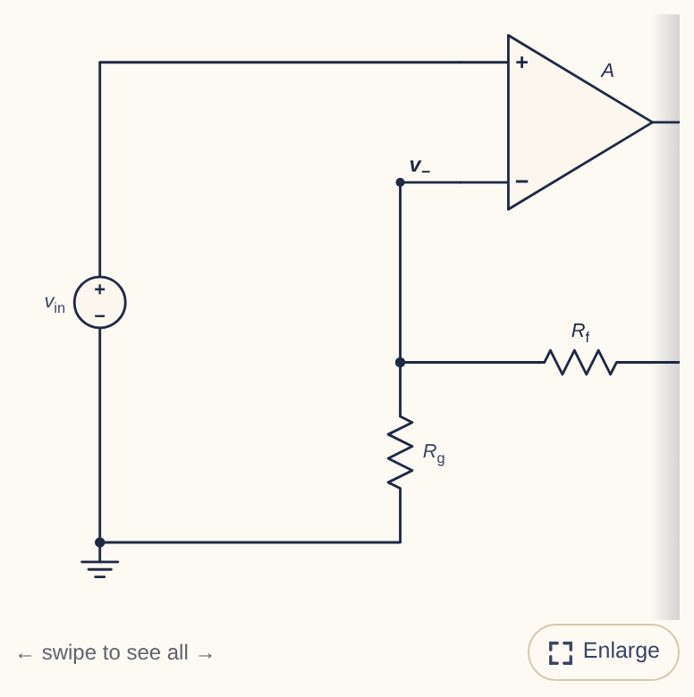

# 3.2 · 单元 5b：为什么有虚短

| 项目 | 内容 |
|---|---|
| id | `w3-5b-virtual-short` |
| 文件 | `units/w3-5b-virtual-short.json` |
| 类型 | 理论单元（#/unit 页面，从上往下读的长页） |
| 位置 | World 3 · 运算放大器基础 → 3.2 黑箱与虚短（本节第 2 项） |
| 这个单元回答的问题 | 负反馈为什么让 v₊ ≈ v₋？ |
| 时长 | 15 分钟 |
| 接回 | unit:w3-5a-black-box |
| 前后 | 上一项 [3.2 w3-5a-black-box](../w3/3.02-1-w3-5a-black-box.md) · 下一项 [3.3 w3-5c-follower](../w3/3.03-1-w3-5c-follower.md) |

## ① 直觉

5a 里，开环的 op-amp（运算放大器）几乎总是饱和：两个输入差几十微伏，输出就到头。

办法：把输出的一部分送回**反相输入**。这叫**负反馈**。

> **提示** · 类比：调淋浴的水温。水太热，你往冷的方向拧；太冷，往热的方向拧。很快就停在想要的温度。负反馈也一样：v_o 太高 → v_{−} 跟着升高 → v_{+} − v_{−} 变小 → v_o 往下走。

*同相放大器：v_{in} 接同相端；R_f 和 R_g 组成分压器，把 v_o 的一部分送回反相端。*

**β 是反馈系数**：输出有多少比例送回反相端。

这里 R_f 和 R_g 是一个分压器（World 1），所以 v_{−} = β v_o，β = \frac{R_g}{R_f + R_g}。

例如 R_f = 90 kΩ、R_g = 10 kΩ：β = 0.1，输出的十分之一送回去。

## ② 交互推导

**分步推导：一步一步推出虚短**（一次揭开一步）

1. op-amp（运算放大器）本身只做一件事（5a）：v_o = A(v_{+} − v_{−})。
2. 看电路：同相端接输入，v_{+} = v_{in}。反相端接分压器，v_{−} = β v_o。
3. 代进去：v_o = A(v_{in} − β v_o)。v_o 出现在两边，因为输出又影响了输入。
4. 把 v_o 都移到左边：v_o(1 + Aβ) = A v_{in}，所以 v_o = \frac{A}{1 + Aβ} v_{in}。这个比值叫**闭环增益**：有反馈时的增益。
5. Aβ 很大时，1 + Aβ ≈ Aβ，闭环增益 ≈ \frac{1}{β}。A 消失了！增益只由两个电阻决定，和芯片的 A 是 10⁴ 还是 10⁶ 无关。
6. 两个输入差多少？v_{+} − v_{−} = \frac{v_o}{A} = \frac{v_{in}}{1 + Aβ}。Aβ 很大，这个差几乎为零：**v_{+} ≈ v_{−}**。这就是**虚短**。
7. 虚短不是“两端用导线接在一起”。差很小，但不是零；正是这一点点差在驱动输出。

**预测题**：A = 100，β = 0.1。理想增益 1/β = 10。闭环增益接近 10 吗？

- A. 是，就是 10
- B. 不太接近：约 9.09，少了 9 % ✅
- C. 差得很远：约 1

揭晓：

> \frac{A}{1 + Aβ} = \frac{100}{1 + 10} ≈ 9.09。Aβ 只有 10，“1 + Aβ ≈ Aβ”这一步不够准。A 小的时候，1/β 只是一个粗略的估计。

**预测题**：LM358：A = 10⁵，β = 0.1，v_{in} = 1 V。v_{+} − v_{−} 是多少？

- 答案：0.0001 V（误差 0.05）

揭晓：

> \frac{v_{in}}{1 + Aβ} = \frac{1}{1 + 10^{4}} ≈ 100 µV。输入是 1 V，两个输入端只差 0.01 %。所以写 v_{+} = v_{−} 几乎不带来误差。

**滑块探索：把 A 从 10 拉到 10⁵**

| 参数 | 名称 | 默认 | 范围 | 单位 |
|---|---|---|---|---|
| A | 开环增益 A | 100 | 10 … 100000（对数） |  |
| beta | 反馈系数 β | 0.1 | 0.01 … 1 |  |
| vin | 输入 v_{in} | 0.5 | -1 … 1 | V |

| 输出 | 公式 | 单位 |
|---|---|---|
| 闭环增益 A/(1 + Aβ) | `A / (1 + A * beta)` |  |
| 理想值 1/β | `1 / beta` |  |
| 比 1/β 少了 | `(Gi - G) / Gi` |  |
| v₊ − v₋ | `vin / (1 + A * beta)` | V |
| 输出 v_o（先不管饱和） | `G * vin` | V |

看两件事：A 每大 10 倍，误差和 v₊ − v₋ 就小大约 10 倍；A = 10⁵ 时，v₊ − v₋ 只剩几十微伏。再把 β 拉到 1（跟随器）：Aβ 最大，误差最小。

> **说明** · Aβ 叫**环路增益**：信号绕反馈环走一圈被放大的倍数。误差就是 \frac{1}{1 + Aβ}。A = 10⁵、β = 0.1 时，Aβ = 10⁴，误差 0.01 %。

# 虚短什么时候不成立

- **A 不够大**：误差是 \frac{1}{1 + Aβ}。Aβ 只有 10 时，误差约 9 %。
- **频率太高**：A 随频率下降。LM358 的增益带宽积约 0.7 MHz（TI 数据手册典型值），10 kHz 时 A 只剩约 70，100 kHz 时约 7。增益为 10 的放大器到 100 kHz，Aβ ≈ 0.7，虚短完全失效。
- **输出饱和**：v_o 被电源卡住，不能再调整，v_{−} 就追不上 v_{+}。
- **反馈接错了端**：送回同相端是正反馈，输出会一路跑到电源。下面的仿真里试一试。

**传送门** `virtual-short-gbw` → `pending:w7-gbw`（25 分钟）：频率一高，开环增益 A 就变小，虚短不再成立：用增益带宽积算它在哪里失效。 · 回来时：虚短要求 A 足够大；这里讲 A 随频率下降时会怎样。

> **注意** · 合理性检查：写 v_{+} = v_{−} 之前先问两件事。有负反馈吗？输出在摆幅之内吗？两个都是“是”，虚短才成立。这就是五步法的第 ① 步和第 ⑤ 步（芯片单元）。

## ③ 仿真

**仿真：把反馈弄坏**

还是上面的同相放大器：β = 0.1，理想增益 10。LM358 接 ±9 V 双电源，输出能在 −9 V 到 7.5 V 之间。fb 表示反馈的接法：1 = 正常的负反馈，0 = 拔掉 R_f，−1 = 两个输入端对调。

| 参数 | 名称 | 默认 | 范围 | 单位 |
|---|---|---|---|---|
| A | 开环增益 A | 100000 |  |  |
| beta | 反馈系数 β | 0.1 |  |  |
| vin | 输入 v_{in} | 0.5 |  | V |
| fb | 反馈接法 fb | 1 |  |  |

| 输出 | 公式 | 单位 |
|---|---|---|
| 输出 v_o | `if(fb, clamp(A * vin / (1 + A * beta), -9, 7.5), if(fb + 1, clamp(A * vin, -9, 7.5), if(vin, -9, 7.5)))` | V |
| 同相端 v_{+} | `if(fb + 1, vin, beta * vo)` | V |
| 反相端 v_{−} | `if(fb, beta * vo, if(fb + 1, 0, vin))` | V |
| v₊ − v₋ | `vp - vm` | V |

- **情景「正常接法」**（设定 ）：v_{in} = 0.5 V。输出是多少？
  - A. 约 5 V ✅
  - B. 约 7.5 V，顶到上限
  - C. 约 0.5 V
  - 解释：增益 ≈ 1/β = 10，v_o ≈ 5 V。v_{−} = 0.1 × 5 V = 0.5 V，和 v_{+} 只差几十微伏：虚短成立。

- **情景「输入太大」**（设定 vin=1）：v_{in} = 1 V，想要 10 V 输出。v_{+} 和 v_{−} 还相等吗？
  - A. 相等，有负反馈就一定相等
  - B. 不相等：输出卡在 7.5 V，v_{−} 只有 0.75 V ✅
  - 解释：10 V 超出摆幅，输出停在 7.5 V。v_{−} = 0.1 × 7.5 = 0.75 V，比 v_{+} 低 0.25 V。输出一饱和，反馈就不起作用了，虚短跟着失效。

- **情景「拔掉反馈电阻 R_f」**（设定 fb=0）：R_f 拔掉了，v_{−} 经 R_g 接地。输出是多少？
  - A. 约 5 V，不变
  - B. 约 0.5 V
  - C. 约 7.5 V，顶到上限 ✅
  - 解释：没有反馈，就是 5a 的开环：10⁵ × 0.5 V，远超电源，输出顶到 7.5 V。

- **情景「两个输入端对调」**（设定 fb=-1）：v_{in} 接到反相端，分压器接到同相端。输出是多少？
  - A. 约 −5 V：只是反了个号
  - B. 约 −9 V，卡在负电源上 ✅
  - C. 约 5 V，不变
  - 解释：现在是**正反馈**：v_o 往下走 → v_{+} = β v_o 也往下走 → v_{+} − v_{−} 更负 → v_o 走得更快。没有东西把它拉回来，输出一直跑到 −9 V。

- **情景「A 太小」**（设定 A=20）：假设 A 只有 20。v_{in} = 0.5 V 时，输出还是 5 V 吗？
  - A. 是，增益由电阻决定
  - B. 不是：只有约 3.3 V ✅
  - 解释：\frac{20}{1 + 2} ≈ 6.7，v_o ≈ 3.3 V。Aβ = 2，不算大，“增益 = 1/β”就不成立。v_{+} − v_{−} 约 0.17 V，也不再是“几乎为零”。

## ④ 面包板

**去面包板** → [3.1 lesson-lm358](../w3/3.01-2-lesson-lm358.md)：跟随器就是 β = 1 的同相放大器：输出整个送回反相端。拧电位器时用万用表比一比 2 脚（IN−）和 3 脚（IN+）：两个读数一样，这就是虚短。拧到 100 % 输出饱和以后，再比一次：两个读数不一样了。

## ⑤ 回链

**预测题**：实验 2-6 的同相放大器用 R_F = 22 kΩ、R_G = 10 kΩ。β 是多少？

- 答案：0.3125（误差 0.02）

揭晓：

> 分压器：β = \frac{10}{22 + 10} ≈ 0.31。理想增益 1/β = 3.2，就是实验 2-6 测出来的增益。

**预测题**：把 R_f 换成导线，再拿掉 R_g：输出直接接回反相端。β 是多少？

- 答案：1（误差 0.05）

揭晓：

> v_{−} = v_o，输出全部送回，β = 1，增益 1/β = 1：v_o = v_{in}。这就是电压跟随器（5c）。

**预测题**：用了虚短和虚断以后，求 v_o 要在哪个结点列 KCL？

- A. 反相端 v_{−} ✅
- B. 输出端 v_o
- C. 电源脚

揭晓：

> op-amp（运算放大器）输出端的电流事先不知道，不能用来列 KCL。在反相端列：\frac{0 − v_{−}}{R_g} + \frac{v_o − v_{−}}{R_f} = 0。代入 v_{−} = v_{in}，得 v_o = (1 + \frac{R_f}{R_g}) v_{in} = \frac{v_{in}}{β}，和上面推导的结果一样。

**理论题**：一道难一点的题，用的是同样的推理：先假设虚短、虚断，再在输入端列 KCL。题目来自中文教材，电压写作 u（u_a 就是 v_a）。

注意：这个电路里 R_1 把输出送回**同相端**，是正反馈；R_2、R_3 送回反相端，是负反馈。题目按理想 op-amp（运算放大器）、线性工作来算。真实电路要求负反馈比正反馈强，否则输出会像上面的仿真一样跑到电源。

- `opamp-11-negative-resistance` 负阻抗变换器的输入电阻（opamp）

## English

展开英文

## ① 直觉

In 5a, an open-loop op-amp is almost always saturated: a difference of a few tens of microvolts sends the output to the end.

The fix: send part of the output back to the **inverting input**. This is called **negative feedback**.

> **提示** · Analogy: setting the shower temperature. Too hot, you turn towards cold; too cold, towards hot. You soon settle where you want. Negative feedback works the same way: v_o too high → v_{−} rises with it → v_{+} − v_{−} shrinks → v_o comes back down.

[电路图]

*Non-inverting amplifier: v_{in} drives the non-inverting input; R_f and R_g form a divider that sends part of v_o back to the inverting input.*

**β is the feedback factor**: the fraction of the output sent back to the inverting input.

Here R_f and R_g are a voltage divider (World 1), so v_{−} = β v_o with β = \frac{R_g}{R_f + R_g}.

For example, R_f = 90 kΩ and R_g = 10 kΩ give β = 0.1: one tenth of the output goes back.

## ② 交互推导

**分步推导：The virtual short, step by step**（一次揭开一步）

1. The op-amp itself does one thing (5a): v_o = A(v_{+} − v_{−}).
2. Read the circuit: the non-inverting input is the input, v_{+} = v_{in}. The inverting input sits on the divider, v_{−} = β v_o.
3. Substitute: v_o = A(v_{in} − β v_o). v_o appears on both sides, because the output feeds back into the input.
4. Collect v_o on the left: v_o(1 + Aβ) = A v_{in}, so v_o = \frac{A}{1 + Aβ} v_{in}. That ratio is the **closed-loop gain**: the gain with feedback.
5. When Aβ is large, 1 + Aβ ≈ Aβ and the closed-loop gain ≈ \frac{1}{β}. A has disappeared! The gain is set by two resistors alone, whether the chip's A is 10⁴ or 10⁶.
6. How far apart are the inputs? v_{+} − v_{−} = \frac{v_o}{A} = \frac{v_{in}}{1 + Aβ}. With Aβ large this is almost zero: **v_{+} ≈ v_{−}**. That is the **virtual short**.
7. A virtual short is not a wire between the inputs. The difference is tiny but not zero, and that tiny difference is what drives the output.

**预测题**：A = 100, β = 0.1. The ideal gain 1/β is 10. Is the closed-loop gain close to 10?

- A. yes, exactly 10
- B. not really: about 9.09, 9 % short ✅
- C. far off: about 1

揭晓：

> \frac{A}{1 + Aβ} = \frac{100}{1 + 10} ≈ 9.09. Aβ is only 10, so the step 1 + Aβ ≈ Aβ is not accurate. With a small A, 1/β is only a rough estimate.

**预测题**：LM358: A = 10⁵, β = 0.1, v_{in} = 1 V. What is v_{+} − v_{−}?

- 答案：0.0001 V（误差 0.05）

揭晓：

> \frac{v_{in}}{1 + Aβ} = \frac{1}{1 + 10^{4}} ≈ 100 µV. With a 1 V input, the two inputs differ by only 0.01 %. Writing v_{+} = v_{−} costs almost nothing.

**滑块探索：Drag A from 10 up to 10⁵**

| 参数 | 名称 | 默认 | 范围 | 单位 |
|---|---|---|---|---|
| A | open-loop gain A | 100 | 10 … 100000（对数） |  |
| beta | feedback factor β | 0.1 | 0.01 … 1 |  |
| vin | input v_{in} | 0.5 | -1 … 1 | V |

| 输出 | 公式 | 单位 |
|---|---|---|
| closed-loop gain A/(1 + Aβ) | `A / (1 + A * beta)` |  |
| ideal value 1/β | `1 / beta` |  |
| short of 1/β by | `(Gi - G) / Gi` |  |
| v₊ − v₋ | `vin / (1 + A * beta)` | V |
| output v_o (ignoring saturation) | `G * vin` | V |

Watch two things: every time A grows tenfold, the error and v₊ − v₋ shrink about tenfold; at A = 10⁵, v₊ − v₋ is down to tens of microvolts. Then pull β up to 1 (a follower): Aβ is largest and the error smallest.

> **说明** · Aβ is the **loop gain**: how much a signal is amplified going once round the feedback loop. The error is \frac{1}{1 + Aβ}. With A = 10⁵ and β = 0.1, Aβ = 10⁴ and the error is 0.01 %.

# When the virtual short fails

- **A is not large enough**: the error is \frac{1}{1 + Aβ}. With Aβ only 10, it is about 9 %.
- **The frequency is too high**: A falls as frequency rises. The LM358's gain-bandwidth product is about 0.7 MHz (typical, TI datasheet), so A is only about 70 at 10 kHz and about 7 at 100 kHz. A gain-of-10 amplifier at 100 kHz has Aβ ≈ 0.7: no virtual short at all.
- **The output is saturated**: v_o is pinned by the supply and can't adjust, so v_{−} can't catch up with v_{+}.
- **The feedback goes to the wrong input**: feeding the non-inverting input is positive feedback, and the output runs all the way to a supply rail. Try it in the simulation below.

**传送门** `virtual-short-gbw` → `pending:w7-gbw`（25 分钟）：At high frequency the open-loop gain A drops and the virtual short fails: the gain-bandwidth product tells you where. · 回来时：The virtual short needs a large A; this is what happens when A falls with frequency.

> **注意** · Sanity check: before writing v_{+} = v_{−}, ask two things. Is there negative feedback? Is the output inside its swing? Only when both answers are yes does the virtual short hold. These are steps ① and ⑤ of the five-step method (chip unit).

## ③ 仿真

**仿真：Break the feedback**

The same non-inverting amplifier: β = 0.1, ideal gain 10. The LM358 runs on a ±9 V dual supply, so the output can go from −9 V to 7.5 V. fb is how the feedback is wired: 1 = normal negative feedback, 0 = R_f removed, −1 = the two inputs swapped.

| 参数 | 名称 | 默认 | 范围 | 单位 |
|---|---|---|---|---|
| A | open-loop gain A | 100000 |  |  |
| beta | feedback factor β | 0.1 |  |  |
| vin | input v_{in} | 0.5 |  | V |
| fb | feedback wiring fb | 1 |  |  |

| 输出 | 公式 | 单位 |
|---|---|---|
| output v_o | `if(fb, clamp(A * vin / (1 + A * beta), -9, 7.5), if(fb + 1, clamp(A * vin, -9, 7.5), if(vin, -9, 7.5)))` | V |
| non-inverting input v_{+} | `if(fb + 1, vin, beta * vo)` | V |
| inverting input v_{−} | `if(fb, beta * vo, if(fb + 1, 0, vin))` | V |
| v₊ − v₋ | `vp - vm` | V |

- **情景「Wired correctly」**（设定 ）：v_{in} = 0.5 V. What is the output?
  - A. about 5 V ✅
  - B. about 7.5 V, at the top
  - C. about 0.5 V
  - 解释：Gain ≈ 1/β = 10, so v_o ≈ 5 V. v_{−} = 0.1 × 5 V = 0.5 V, within tens of microvolts of v_{+}: the virtual short holds.

- **情景「Input too large」**（设定 vin=1）：v_{in} = 1 V asks for a 10 V output. Are v_{+} and v_{−} still equal?
  - A. yes, negative feedback always makes them equal
  - B. no: the output is stuck at 7.5 V, so v_{−} is only 0.75 V ✅
  - 解释：10 V is beyond the swing, so the output stops at 7.5 V. v_{−} = 0.1 × 7.5 = 0.75 V, 0.25 V below v_{+}. Once the output saturates, the feedback can no longer act, and the virtual short goes with it.

- **情景「Remove the feedback resistor R_f」**（设定 fb=0）：R_f is out, so v_{−} goes to ground through R_g. What is the output?
  - A. about 5 V, unchanged
  - B. about 0.5 V
  - C. about 7.5 V, at the top ✅
  - 解释：With no feedback this is 5a's open loop again: 10⁵ × 0.5 V, far beyond the supply, so the output hits 7.5 V.

- **情景「Swap the two inputs」**（设定 fb=-1）：v_{in} now goes to the inverting input and the divider to the non-inverting input. What is the output?
  - A. about −5 V: just the sign flips
  - B. about −9 V, stuck at the negative rail ✅
  - C. about 5 V, unchanged
  - 解释：This is now **positive feedback**: v_o goes down → v_{+} = β v_o goes down too → v_{+} − v_{−} gets more negative → v_o falls faster. Nothing pulls it back, so the output runs all the way to −9 V.

- **情景「A too small」**（设定 A=20）：Suppose A is only 20. With v_{in} = 0.5 V, is the output still 5 V?
  - A. yes, the resistors set the gain
  - B. no: only about 3.3 V ✅
  - 解释：\frac{20}{1 + 2} ≈ 6.7, so v_o ≈ 3.3 V. Aβ = 2 is not large, so gain = 1/β no longer holds. v_{+} − v_{−} is about 0.17 V, far from almost zero.

## ④ 面包板

**去面包板** → [3.1 lesson-lm358](../w3/3.01-2-lesson-lm358.md)：A follower is the non-inverting amplifier with β = 1: all of the output goes back to the inverting input. As you turn the pot, compare pin 2 (IN−) and pin 3 (IN+) on the multimeter: they read the same. That is the virtual short. Turn to 100 % so the output saturates and compare again: now they differ.

## ⑤ 回链

**预测题**：The non-inverting amplifier of lab 2-6 uses R_F = 22 kΩ and R_G = 10 kΩ. What is β?

- 答案：0.3125（误差 0.02）

揭晓：

> Voltage divider: β = \frac{10}{22 + 10} ≈ 0.31. The ideal gain 1/β = 3.2, which is the gain you measure in lab 2-6.

**预测题**：Replace R_f with a wire and remove R_g, so the output goes straight back to the inverting input. What is β?

- 答案：1（误差 0.05）

揭晓：

> v_{−} = v_o: all of the output goes back, β = 1, and the gain 1/β = 1, so v_o = v_{in}. This is the voltage follower (5c).

**预测题**：With the virtual short and virtual open in hand, at which node do you write KCL to find v_o?

- A. the inverting input, v_{−} ✅
- B. the output, v_o
- C. a supply pin

揭晓：

> The current out of the op-amp's output is unknown, so KCL there gets you nowhere. At the inverting input: \frac{0 − v_{−}}{R_g} + \frac{v_o − v_{−}}{R_f} = 0. Put in v_{−} = v_{in} and you get v_o = (1 + \frac{R_f}{R_g}) v_{in} = \frac{v_{in}}{β}, the same result as the derivation above.

**理论题**：A harder circuit with the same reasoning: assume the virtual short and virtual open, then write KCL at the inputs. The problem comes from a Chinese textbook, so voltage is written u (u_a means v_a).

Note: in this circuit R_1 feeds the output back to the **non-inverting** input, which is positive feedback, while R_2 and R_3 feed the inverting input, which is negative feedback. The problem assumes an ideal op-amp working linearly. A real circuit needs the negative feedback to be stronger, or the output runs to a rail as in the simulation above.

- `opamp-11-negative-resistance` 负阻抗变换器的输入电阻（opamp）

