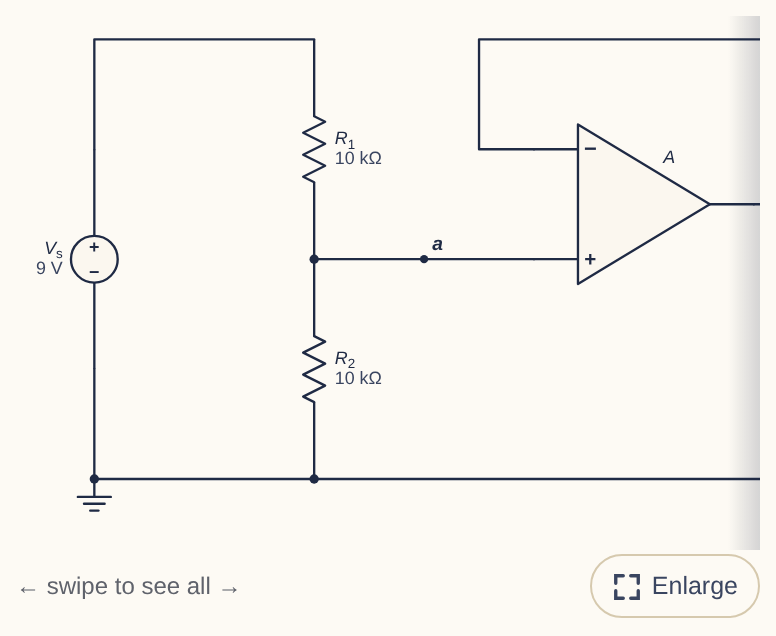

# 3.3 · 单元 5c：电压跟随器：增益 1 有什么用

| 项目 | 内容 |
|---|---|
| id | `w3-5c-follower` |
| 文件 | `units/w3-5c-follower.json` |
| 类型 | 理论单元（#/unit 页面，从上往下读的长页） |
| 位置 | World 3 · 运算放大器基础 → 3.3 电压跟随器：拯救分压器（本节第 1 项） |
| 这个单元回答的问题 | β = 1、输出等于输入的电路，到底有什么用？ |
| 时长 | 12 分钟 |
| 接回 | chapter:theorems、unit:w3-5b-virtual-short |
| 前后 | 上一项 [3.2 w3-5b-virtual-short](../w3/3.02-2-w3-5b-virtual-short.md) · 下一项 [3.3 exp-voltage-follower](../w3/3.03-2-exp-voltage-follower.md) |

## ① 直觉

跟随器把输出 v_o 用一根导线直接接回反相输入端 v_{−}。

反馈系数 β 是输出电压送回 v_{−} 的比例。这里整个 v_o 都送回去了，所以 β = 1，增益 1/β = 1：输出等于输入。

听起来没用。可以把它想成一个“复印员”：它盯着输入，用自己的电源造出一个一样大的电压。负载要的电流从 op-amp（运算放大器）的电源脚来，不从输入那里拿。

*实验 2-5 的电路：9 V 经 R_1、R_2（各 10 kΩ）分压，得到 a 点。跟随器把 a 点的电压复制到输出 v_o，再去驱动负载 R_L = 1 kΩ。*

用 Midterm 2 的戴维宁定理来看。

从 a 点看回去，分压器等效成 4.5 V 串一个 5 kΩ 的电阻（戴维宁电阻 R_{Th}）。直接接 1 kΩ 负载，大部分电压掉在这 5 kΩ 上。

跟随器的输出等效成 4.5 V 串一个约 0 Ω 的电阻。负载拿到全部 4.5 V。跟随器的作用就是**隔离**：把“软”的信号源变成“硬”的。

## ② 交互推导

**分步推导：五步法：跟随器带 1 kΩ 负载**（一次揭开一步）

1. **① 有负反馈吗？** 有。一根导线把输出接回 v_{−}。v_o 偏高一点，v_{−} 跟着变高，v_{+} − v_{−} 变小，op-amp（运算放大器）就把 v_o 往下拉。偏差自己被纠正，这就是负反馈。
2. **② 虚短、虚断。** 虚断：v_{+} 不取电流，所以分压器没有负载，v_{+} = 9 V × 10/(10 + 10) = 4.5 V。虚短：v_{−} ≈ v_{+} = 4.5 V。
3. **③ 在 v_{−} 列 KCL。** v_{−} 只连着一根导线，通到 v_o。虚断：没有电流流进 v_{−}，所以这根导线里的电流是 0。没有电流，导线两端电压相同：v_o = v_{−}。
4. **④ 解出 v_o。** v_o = v_{−} = 4.5 V。负载电流 i_L = 4.5 V / 1 kΩ = 4.5 mA，由 op-amp（运算放大器）的输出端供给。分压器里的电流仍是 9 V / 20 kΩ = 0.45 mA，和没接负载时一样。
5. **⑤ 合理性检查。** LM358 接单电源 9 V，输出范围约 0 V … 9 − 1.5 = 7.5 V：4.5 V 在里面 ✓。输出要供 4.5 mA，低于约 20 mA 的输出能力 ✓。两项都通过，答案可信。

**滑块探索：有缓冲和没缓冲，负载上的电压**

| 参数 | 名称 | 默认 | 范围 | 单位 |
|---|---|---|---|---|
| R | 分压电阻 R_1 = R_2 | 10000 | 1000 … 100000（对数） | Ω |
| RL | 负载 R_L | 1000 | 10 … 100000（对数） | Ω |

| 输出 | 公式 | 单位 |
|---|---|---|
| 从 a 点看回去的 R_{Th} | `R / 2` | Ω |
| 没缓冲：负载电压 | `4.5 * RL / (Rth + RL)` | V |
| 有缓冲：负载电压 | `min(4.5, 0.02 * RL)` | V |
| 有缓冲：负载电流（op-amp（运算放大器）供给） | `vbuf / RL` | A |
| op-amp（运算放大器）到了约 20 mA 的上限？（1 = 是） | `step(4.5 / RL - 0.02)` |  |

拖动 R_L。没缓冲时，负载越小，电压掉得越多。有缓冲时电压一直是 4.5 V，直到负载要的电流超过约 20 mA（R_L 小于 225 Ω）。那时第 ⑤ 步的电流检查就不通过了。

## ③ 仿真

**仿真**

先预测，再运行，再看为什么。op-amp（运算放大器）按 LM358 建模：单电源 9 V，输出 0 … 7.5 V，最多约 20 mA。

| 参数 | 名称 | 默认 | 范围 | 单位 |
|---|---|---|---|---|
| Vs |  | 9 |  |  |
| R1 |  | 10000 |  |  |
| R2 |  | 10000 |  |  |
| RL |  | 1000 |  |  |
| buf |  | 1 |  |  |
| swap |  | 0 |  |  |

| 输出 | 公式 | 单位 |
|---|---|---|
| 分压器空载电压 | `Vs * R2 / (R1 + R2)` | V |
| R_{Th} | `R1 * R2 / (R1 + R2)` | Ω |
| a 点电压 v_a | `if(buf, vth, vth * RL / (rth + RL))` | V |
| 负载电压 v_L | `if(buf, if(swap, 7.5, min(clamp(va, 0, 7.5), 0.02 * RL)), va)` | V |
| 负载电流 i_L | `vL / RL` | A |
| R_1 里的电流 | `(Vs - va) / R1` | A |

- **情景「做坏事：不用缓冲，分压器直接带负载」**（设定 buf=0）：把 1 kΩ 负载直接接到 a 点。v_L 是多少？
  - A. 4.5 V
  - B. 约 2.25 V
  - C. 约 0.75 V ✅
  - D. 0 V
  - 解释：从 a 点看，分压器是 4.5 V 串 5 kΩ。1 kΩ 负载只分到 4.5 × 1/(5 + 1) = 0.75 V。负载太“重”，把分压器拉垮了。

- **情景「加上跟随器」**（设定 buf=1）：跟随器放在 a 点和负载之间。v_L 和 R_1 里的电流会怎样？
  - A. v_L = 4.5 V，R_1 电流仍是 0.45 mA ✅
  - B. v_L = 4.5 V，R_1 电流变成约 4.95 mA
  - C. v_L 仍是 0.75 V
  - 解释：虚断：v_{+} 不取电流，分压器又变回空载，a 点是 4.5 V。虚短：v_o = 4.5 V。负载的 4.5 mA 从 op-amp（运算放大器）的电源脚来，分压器根本“看不见”负载。

- **情景「做坏事：负载太小」**（设定 buf=1, RL=100）：有跟随器，但负载换成 100 Ω。v_L 是多少？
  - A. 仍是 4.5 V
  - B. 约 2 V ✅
  - C. 约 0.09 V
  - 解释：4.5 V / 100 Ω 要 45 mA，超过 LM358 约 20 mA 的输出能力。输出被电流限住：v_L ≈ 20 mA × 100 Ω = 2 V。第 ⑤ 步查电流，就是为了发现这种情况。（真实芯片的上限每片不同，但量级是这样。）

- **情景「做坏事：对调两个输入端」**（设定 buf=1, swap=1）：把 a 点接到 v_{−}，把输出接回 v_{+}。v_L 会是多少？
  - A. 仍是 4.5 V
  - B. −4.5 V
  - C. 顶在 7.5 V（或 0 V）不动 ✅
  - 解释：现在是正反馈：v_o 高一点，v_{+} 也高一点，v_{+} − v_{−} 变大，v_o 再往上走，一直冲到 7.5 V 停住。（如果一开始 v_o 偏低，它会一路冲到 0 V。）第 ① 步不成立，虚短就不能用。

## ④ 面包板

**去面包板** → [3.3 exp-voltage-follower](../w3/3.03-2-exp-voltage-follower.md)：把 S1 在 a、b 之间来回拨：R_L 上的电压应该从约 0.75 V 跳到约 4.5 V，而 R_1 里的电流一直是约 0.45 mA。

## ⑤ 回链

**预测题**：（Midterm 2：戴维宁定理）从 a 点看回去，分压器（9 V、10 kΩ、10 kΩ）的戴维宁等效电路是什么？

- A. v_{Th} = 4.5 V，R_{Th} = 5 kΩ ✅
- B. v_{Th} = 9 V，R_{Th} = 20 kΩ
- C. v_{Th} = 4.5 V，R_{Th} = 10 kΩ
- D. v_{Th} = 9 V，R_{Th} = 5 kΩ

揭晓：

> 开路电压就是空载分压：4.5 V。把 9 V 电源置零（换成导线），R_1 和 R_2 并联：10 ∥ 10 = 5 kΩ。负载和 5 kΩ 差不多大或更小时，电压就掉得很厉害。

**预测题**：从跟随器的输出端看回去，戴维宁电阻是多少？

- A. 约 0 Ω ✅
- B. 5 kΩ
- C. 1 kΩ
- D. 无穷大

揭晓：

> 负载从 100 kΩ 换到 1 kΩ，v_o 都是 4.5 V。电流变了，电压不变，说明串联的电阻约为 0。负反馈一直把 v_o 拉回 v_{+}。所以跟随器把“4.5 V 串 5 kΩ”变成了“4.5 V 串约 0 Ω”。

**预测题**：（接 5b 的虚断）有跟随器、负载 1 kΩ 时，R_1 里的电流是多少 mA？

- 答案：0.45 mA（误差 0.05）

揭晓：

> 虚断：v_{+} 不取电流，所以 R_1、R_2 串联，电流 = 9 V / 20 kΩ = 0.45 mA，和没接负载时一样。负载的 4.5 mA 不经过分压器。

**理论题**：理论题沿用中文教材的记号：电压写作 u（u_o 就是这里的 v_o）。

- `opamp-03-voltage-follower` 电压跟随器的隔离作用（opamp）

## English

展开英文

## ① 直觉

A follower takes the output v_o and wires it straight back to the inverting input v_{−}.

The feedback factor β is the fraction of the output sent back to v_{−}. Here all of v_o goes back, so β = 1 and the gain 1/β = 1: the output equals the input.

That sounds useless. Think of it as a copier: it watches the input and builds the same voltage from its own supply. The load's current comes from the op-amp's supply pin, not from the input.

[电路图]

*The circuit of lab 2-5: 9 V divided by R_1 and R_2 (10 kΩ each) gives node a. The follower copies the voltage of a to its output v_o, which then drives the load R_L = 1 kΩ.*

Look at it with Thévenin's theorem from Midterm 2.

Seen from node a, the divider is 4.5 V in series with 5 kΩ (the Thévenin resistance R_{Th}). Hang 1 kΩ on it and most of the voltage is lost across that 5 kΩ.

The follower's output is 4.5 V in series with about 0 Ω. The load gets the full 4.5 V. That is the follower's job: **isolation**. It turns a "soft" source into a "stiff" one.

## ② 交互推导

**分步推导：The five steps: a follower driving 1 kΩ**（一次揭开一步）

1. **① Is there negative feedback?** Yes. A wire takes the output back to v_{−}. If v_o drifts a little high, v_{−} rises with it, v_{+} − v_{−} shrinks, and the op-amp pulls v_o back down. The error corrects itself: that is negative feedback.
2. **② Virtual short, virtual open.** Virtual open: v_{+} draws no current, so the divider is unloaded and v_{+} = 9 V × 10/(10 + 10) = 4.5 V. Virtual short: v_{−} ≈ v_{+} = 4.5 V.
3. **③ KCL at v_{−}.** Node v_{−} has only one wire, and it goes to v_o. Virtual open: no current enters v_{−}, so the wire carries zero current. With no current, both ends of the wire are at the same voltage: v_o = v_{−}.
4. **④ Solve for v_o.** v_o = v_{−} = 4.5 V. The load current i_L = 4.5 V / 1 kΩ = 4.5 mA comes from the op-amp output. The divider current is still 9 V / 20 kΩ = 0.45 mA, the same as with no load.
5. **⑤ Sanity check.** On a single 9 V supply the LM358 output swings from about 0 V to 9 − 1.5 = 7.5 V: 4.5 V is inside ✓. The output sources 4.5 mA, well below its roughly 20 mA limit ✓. Both pass, so the answer stands.

**滑块探索：Load voltage with and without the buffer**

| 参数 | 名称 | 默认 | 范围 | 单位 |
|---|---|---|---|---|
| R | divider resistors R_1 = R_2 | 10000 | 1000 … 100000（对数） | Ω |
| RL | load R_L | 1000 | 10 … 100000（对数） | Ω |

| 输出 | 公式 | 单位 |
|---|---|---|
| R_{Th} seen from node a | `R / 2` | Ω |
| no buffer: load voltage | `4.5 * RL / (Rth + RL)` | V |
| with buffer: load voltage | `min(4.5, 0.02 * RL)` | V |
| with buffer: load current (from the op-amp) | `vbuf / RL` | A |
| op-amp at its ~20 mA limit? (1 = yes) | `step(4.5 / RL - 0.02)` |  |

Drag R_L. Without the buffer, the smaller the load, the more the voltage drops. With the buffer it stays at 4.5 V, until the load asks for more than about 20 mA (R_L below 225 Ω). Then the current check in step ⑤ fails.

## ③ 仿真

**仿真**

Predict, run, then see why. The op-amp is modelled as an LM358 on a single 9 V supply: output 0 … 7.5 V, at most about 20 mA.

| 参数 | 名称 | 默认 | 范围 | 单位 |
|---|---|---|---|---|
| Vs |  | 9 |  |  |
| R1 |  | 10000 |  |  |
| R2 |  | 10000 |  |  |
| RL |  | 1000 |  |  |
| buf |  | 1 |  |  |
| swap |  | 0 |  |  |

| 输出 | 公式 | 单位 |
|---|---|---|
| divider open-circuit voltage | `Vs * R2 / (R1 + R2)` | V |
| R_{Th} | `R1 * R2 / (R1 + R2)` | Ω |
| node voltage v_a | `if(buf, vth, vth * RL / (rth + RL))` | V |
| load voltage v_L | `if(buf, if(swap, 7.5, min(clamp(va, 0, 7.5), 0.02 * RL)), va)` | V |
| load current i_L | `vL / RL` | A |
| current in R_1 | `(Vs - va) / R1` | A |

- **情景「Doing it wrong: the divider drives the load directly」**（设定 buf=0）：Connect the 1 kΩ load straight to node a. What is v_L?
  - A. 4.5 V
  - B. about 2.25 V
  - C. about 0.75 V ✅
  - D. 0 V
  - 解释：Seen from a, the divider is 4.5 V behind 5 kΩ. The 1 kΩ load gets only 4.5 × 1/(5 + 1) = 0.75 V. The load is too "heavy" and drags the divider down.

- **情景「Put the follower in」**（设定 buf=1）：The follower sits between node a and the load. What happens to v_L and to the current in R_1?
  - A. v_L = 4.5 V; R_1 still carries 0.45 mA ✅
  - B. v_L = 4.5 V; R_1 now carries about 4.95 mA
  - C. v_L is still 0.75 V
  - 解释：Virtual open: v_{+} draws no current, so the divider is unloaded again and node a is at 4.5 V. Virtual short: v_o = 4.5 V. The load's 4.5 mA comes from the op-amp's supply pin; the divider never "sees" the load.

- **情景「Doing it wrong: a load that is too small」**（设定 buf=1, RL=100）：The follower is in, but the load is now 100 Ω. What is v_L?
  - A. still 4.5 V
  - B. about 2 V ✅
  - C. about 0.09 V
  - 解释：4.5 V / 100 Ω needs 45 mA, more than the LM358's roughly 20 mA. The output is current-limited: v_L ≈ 20 mA × 100 Ω = 2 V. The current check in step ⑤ is there to catch exactly this. (The exact limit varies from chip to chip, but this is the size of it.)

- **情景「Doing it wrong: swap the two inputs」**（设定 buf=1, swap=1）：Connect node a to v_{−} and feed the output back to v_{+}. What will v_L be?
  - A. still 4.5 V
  - B. −4.5 V
  - C. stuck at 7.5 V (or 0 V) ✅
  - 解释：This is positive feedback: v_o goes up a little, v_{+} goes up with it, v_{+} − v_{−} grows, and v_o climbs further until it sticks at 7.5 V. (Had v_o started low, it would have run down to 0 V.) Step ① fails, so the virtual short does not apply.

## ④ 面包板

**去面包板** → [3.3 exp-voltage-follower](../w3/3.03-2-exp-voltage-follower.md)：Flip S1 between a and b: the voltage on R_L should jump from about 0.75 V to about 4.5 V, while the current in R_1 stays at about 0.45 mA.

## ⑤ 回链

**预测题**：(Midterm 2: Thévenin) Seen from node a, what is the Thévenin equivalent of the divider (9 V, 10 kΩ, 10 kΩ)?

- A. v_{Th} = 4.5 V, R_{Th} = 5 kΩ ✅
- B. v_{Th} = 9 V, R_{Th} = 20 kΩ
- C. v_{Th} = 4.5 V, R_{Th} = 10 kΩ
- D. v_{Th} = 9 V, R_{Th} = 5 kΩ

揭晓：

> The open-circuit voltage is the unloaded divider output, 4.5 V. Turn the 9 V source off (replace it with a wire) and R_1 is in parallel with R_2: 10 ∥ 10 = 5 kΩ. A load near 5 kΩ or smaller pulls the voltage down hard.

**预测题**：Looking back into the follower's output, what is the Thévenin resistance?

- A. about 0 Ω ✅
- B. 5 kΩ
- C. 1 kΩ
- D. infinite

揭晓：

> Change the load from 100 kΩ to 1 kΩ and v_o stays at 4.5 V. The current changes but the voltage does not, so the series resistance is about 0. Negative feedback keeps pulling v_o back to v_{+}. The follower turns "4.5 V behind 5 kΩ" into "4.5 V behind about 0 Ω".

**预测题**：(Back to the virtual open of 5b) With the follower in and a 1 kΩ load, what is the current in R_1, in mA?

- 答案：0.45 mA（误差 0.05）

揭晓：

> Virtual open: v_{+} draws no current, so R_1 and R_2 are in series and carry 9 V / 20 kΩ = 0.45 mA, the same as with no load. The load's 4.5 mA never passes through the divider.

**理论题**：The theory problems follow the Chinese textbook and write voltage as u (their u_o is our v_o).

- `opamp-03-voltage-follower` 电压跟随器的隔离作用（opamp）

