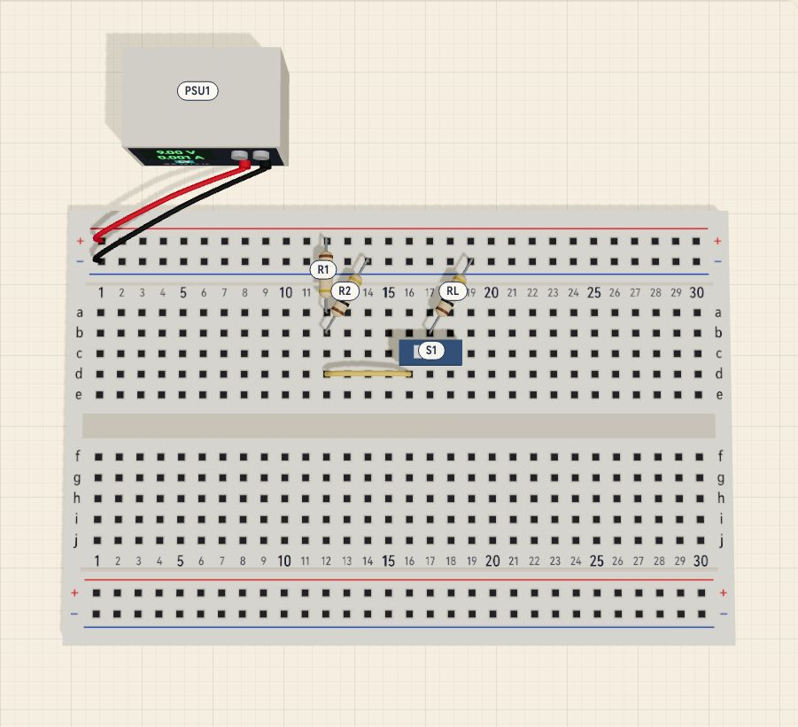
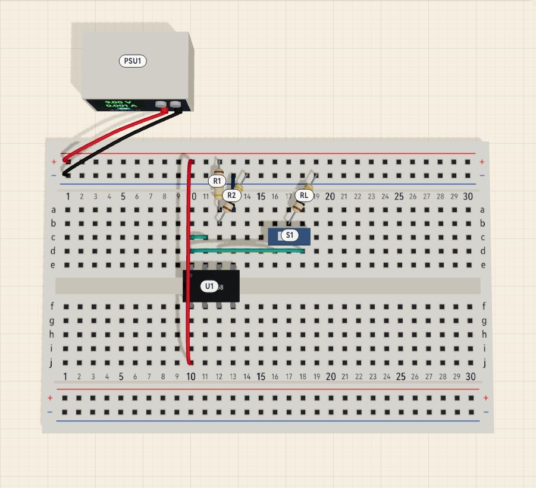
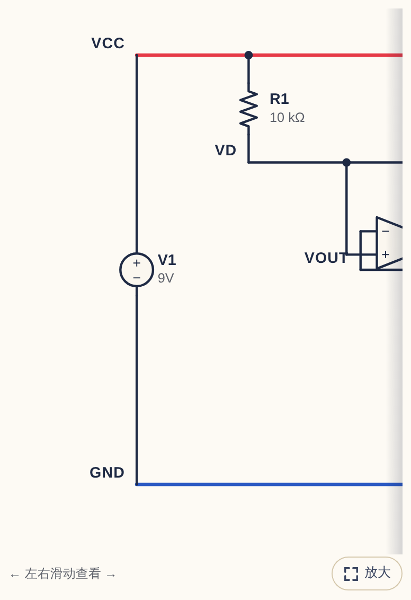
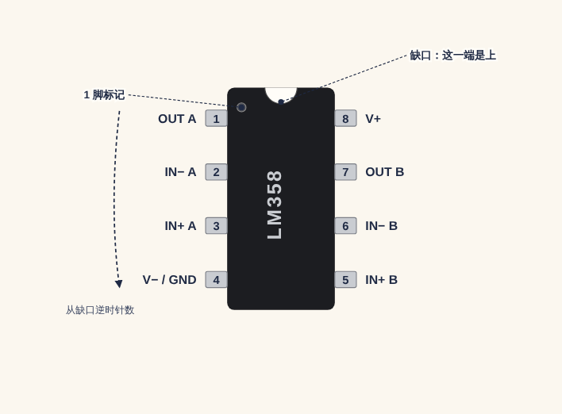
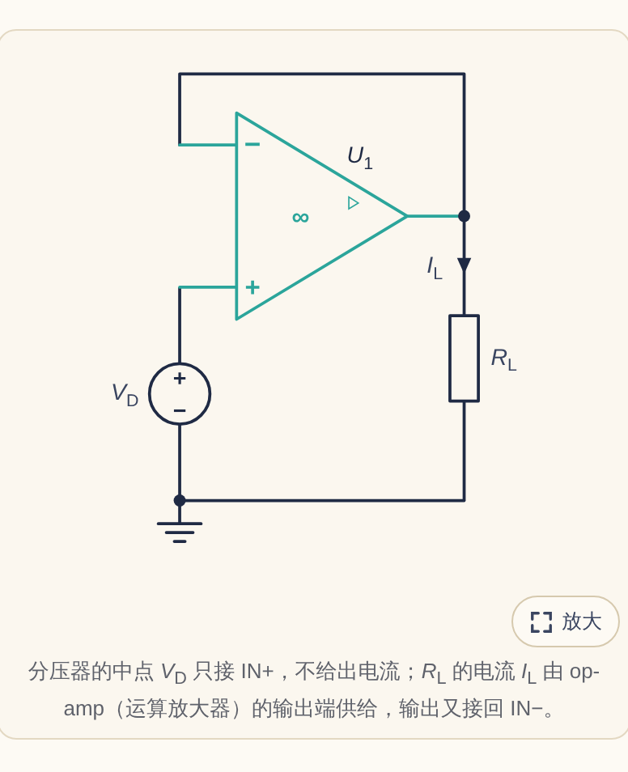

# 3.3 · 电压跟随器：把塌下去的电压救回来

| 项目 | 内容 |
|---|---|
| id | `exp-voltage-follower` |
| 文件 | `challenges/225-voltage-follower.json` |
| 类型 | 实验 / 挑战（没有分步，照目标电路图搭） · 难度 3/5 |
| 位置 | World 3 · 运算放大器基础 → 3.3 电压跟随器：拯救分压器（本节第 2 项） |
| 右侧面板 | 轨道由旧的四张卡片自动生成（还没手工精排） |
| 前后 | 上一项 [3.3 w3-5c-follower](../w3/3.03-1-w3-5c-follower.md) · 下一项 [3.4 w3-5d-noninverting](../w3/3.04-1-w3-5d-noninverting.md) |
| 先修 | lesson-lm358 |
| 概念 | voltage follower 电压跟随器、buffer 缓冲、op-amp LM358 op-amp、input / output resistance 输入 / 输出电阻 |

**一句话概要**：同一个分压器、同一个 1 kΩ 负载：直接接，电压塌掉；中间隔一个 LM358 跟随器，电压回来了。

## 1. 左侧工作台（3D 面包板 → 2D 俯视截图）

截图是程序里真实的 3D 面包板换成俯视角拍的；表格是同一块板的文字版（元件、参数、每只脚插在哪个孔）。

### 1.1 起点：打开这一课时板上已经有的

右侧显示的「起点」说明：

> **半成品**：电源、分压器 R1 + R2、负载 RL 和选择开关 S1（a 侧已经接 VD）都搭好了。**为什么**：这些就是实验 1-3 的电路；这里的新东西是跟随器。**你要做**：把 LM358 插在 e10，接电源脚（8 脚 → +9V，4 脚 → GND），1 脚接回 2 脚，再把 1 脚（OUT）接到 S1 的 b 侧。

| 元件 | 类型 | 参数 | 引脚 → 孔 |
|---|---|---|---|
| PSU1 | bench_supply | voltage=9, currentLimit=0.1 | +→tp1 -→tn1 |
| R1 | resistor | resistance=10000 | 1→tp12 2→a12 |
| R2 | resistor | resistance=10000 | 1→b12 2→tn14 |
| S1 | switch | position=a | a→c16 com→c17 b→c18 |
| W5 | wire |  | a→d12 b→d16 |
| RL | resistor | resistance=1000 | 1→b17 2→tn19 |

### 1.3 参考答案（「看答案」载入的板子）

| 元件 | 类型 | 参数 | 引脚 → 孔 |
|---|---|---|---|
| PSU1 | bench_supply | voltage=9, currentLimit=0.1 | +→tp1 -→tn1 |
| U1 | opamp |  | 1→e10 2→e11 3→e12 4→e13 5→f13 6→f12 7→f11 8→f10 |
| W3 | wire |  | a→tp10 b→j10 |
| W4 | wire |  | a→a13 b→tn13 |
| W5 | wire |  | a→c10 b→c11 |
| R1 | resistor | resistance=10000 | 1→tp12 2→a12 |
| R2 | resistor | resistance=10000 | 1→b12 2→tn14 |
| S1 | switch | position=a | a→c16 com→c17 b→c18 |
| W9 | wire |  | a→d12 b→d16 |
| W10 | wire |  | a→d10 b→d18 |
| RL | resistor | resistance=1000 | 1→b17 2→tn19 |

### 1.4 目标原理图（右侧「目标原理图」抽屉）

| 元件 | 类型 | 参数 |
|---|---|---|
| V1 | dc_source | voltage=9 |
| U1 | opamp |  |
| R1 | resistor | resistance=10000 |
| R2 | resistor | resistance=10000 |
| S1 | switch |  |
| RL | resistor | resistance=1000 |

连接（每个结点上的引脚）：

- **VCC**：V1.+、U1.v+、R1.1
- **VD**：R1.2、R2.1、U1.inA+、S1.a
- **VOUT**：U1.outA、U1.inA-、S1.b
- **LOAD**：S1.com、RL.1
- **GND**：V1.-、U1.v-、R2.2、RL.2

## 2. 右侧面板：学生从上往下看到的内容（单轨流）

### 第 1 步 · 🔍 先看一眼：先认识它：LM358 op-amp

**拆解「LM358：一颗芯片里的两个 op-amp」第 1 / 9 层：① 外形：8 只脚的黑色小芯片（DIP-8）**

LM358 装在 **DIP-8** 封装里（Dual In-line Package，两排直插，8 只脚）。怎么找 1 脚：
- 芯片一端有个 半圆缺口 notch，缺口朝上时，左上角有个 小圆点 的就是 **1 脚**；
- 从 1 脚开始 **逆时针** 数：左边一排从上往下 1、2、3、4，再从右边一排从下往上 5、6、7、8。

8 只脚分成三类：**A 号 op-amp 的 3 只脚**、**B 号 op-amp 的 3 只脚**、**两个 op-amp 共用的 2 只电源脚**。把鼠标放到下表每一行上，看它在芯片上的位置。

| 脚 | 名字 | 属于 | 它是什么 | 单电源时接哪 |
|---|---|---|---|---|
| 1 | OUT A | op-amp A | 输出（output） | 负载 / 反馈网络 |
| 2 | IN− A | op-amp A | 反相输入（inverting input） | 反馈回来的信号 |
| 3 | IN+ A | op-amp A | 同相输入（non-inverting input） | 要放大的信号 / 参考电压 |
| 4 | V− (GND) | A、B 共用 | 负电源 | GND |
| 5 | IN+ B | op-amp B | 同相输入 | 不用时接固定电压 |
| 6 | IN− B | op-amp B | 反相输入 | 不用时接 7 脚（跟随器） |
| 7 | OUT B | op-amp B | 输出 | — |
| 8 | V+ | A、B 共用 | 正电源 3–32 V | +5 V / +9 V |

### 第 2 步 · 🔧 动手搭：先让它塌一次

搭**分压器**（`9 V` → **R1** `10 kΩ` → **VD** → **R2** `10 kΩ` → GND）和 2.5 学过的 **LM358 跟随器**：8 脚、4 脚接电源，OUT 接 IN−，**IN+ 接 VD**。
开关 **S1** 给负载 **RL** `1 kΩ` 供电：**a** 侧直接接 VD，**b** 侧接 op-amp（运算放大器）的 OUT。
**S1 → a**：测 RL 两端的电压。它塌下去了，和上次一样。
现在**把 S1 拨到 b**，再测一次。电压怎么样了？

### 第 3 步 · 💡 想明白：跟随器是一个隔离的中间人

- **输入这一边**：IN+ 不取电流，分压器又回到了空载。VD 回到空载值。
- **输出这一边**：op-amp（运算放大器）让 OUT = IN+。RL 要多少电流，它都从 op-amp 自己的电源脚拿，不再找分压器要。

*图 `buffer`（schematic）：分压器的中点 V_D 只接 IN+，不给出电流；R_L 的电流 I_L 由 op-amp（运算放大器）的输出端供给，输出又接回 IN−。*

- 从负载看，电源变成了 op-amp（运算放大器）的输出端。op-amp 10 Ω 的输出电阻被负反馈缩小，大约缩小增益那么多倍：
$$R_{out} ≈ \frac{R_o}{A} = \frac{10\,Ω}{100\,000} = 0.1\text{ mΩ}$$
- 从 5 kΩ 降到不到一毫欧：1 kΩ 的负载根本拉不动。这就是**阻抗变换**——输入端电阻很大，输出端电阻很小。

（这一步下面列着这节课的计算卡片，点开就地展开：`loaded-divider`、`opamp-follower`，全文见第 6 节）

### 第 4 步 · 🔧 动手搭：拨到 b，看看谁在出力

- 测 RL 两端的电压：**S1 拨 a** 一次，**S1 拨 b** 一次。
- S1 在 b 时，把电流表**串进 R1**（分压器的电流），再**串进 RL**（负载的电流）。
- 电路检查通过后填测量题。比较两个电流：RL 的电流是谁给的？

### 第 5 步 · 📏 测一测：测一测：读你自己的仪表

**测量题 1 · `va`**（读数题）

> S1 拨到 a（分压器直接带 RL）：RL 两端的电压

- 单位 V · 先写预测 · 状态：把 S1 拨到 a 侧 · 参考答案的读数 **0.75 V** · 合理范围 [0.712, 0.787]

答对后显示：

> RL 和 R2 并联：10k ∥ 1k = 909 Ω，VD = 9 × 0.909 / 10.909 ≈ 0.75 V。

**测量题 2 · `vb`**（读数题）

> S1 拨到 b（经跟随器）：RL 两端的电压

- 单位 V · 先写预测 · 状态：把 S1 拨到 b 侧 · 参考答案的读数 **4.5 V** · 合理范围 [4.27, 4.72]

答对后显示：

> OUT = IN+ = VD，而 VD 不再被拉低：约 4.50 V。

**测量题 3 · `ir1`**（读数题）

> S1 拨到 b：分压器 R1 里的电流（电流表串进 R1）

- 单位 mA · 先写预测 · 状态：把 S1 拨到 b 侧 · 参考答案的读数 **0.45 mA** · 合理范围 [0.000428, 0.000473]

答对后显示：

> op-amp（运算放大器）输入不取电流，分压器仍是空载：9 V / 20 kΩ = 0.45 mA。

**测量题 4 · `irl`**（读数题）

> S1 拨到 b：负载 RL 里的电流

- 单位 mA · 先写预测 · 状态：把 S1 拨到 b 侧 · 参考答案的读数 **4.5 mA** · 合理范围 [0.00427, 0.00472]

答对后显示：

> 4.5 V / 1 kΩ = 4.5 mA，是分压器电流的 10 倍。

**测量题 5 · `src`**（选择题）

> 比较你的两个电流读数：S1 拨到 b 时，RL 的电流从哪里来？

- A. op-amp（运算放大器）的输出端（能量来自 op-amp 的 V+ 电源脚） ✅（正确）
- B. 分压器（经过 op-amp（运算放大器）的输入端）
- C. op-amp（运算放大器）的 IN− 输入端

答对后显示：

> 负反馈让 OUT 一直追着 IN+；输入几乎不取电流，输出电阻很小。跟随器做的是阻抗变换：高输入电阻、低输出电阻。

### 第 6 步 · 🎒 带走：带走

- **跟随器**（缓冲器）增益是 1，它的工作是隔离：输入电阻大，输出电阻小。
- 负载的电流来自 op-amp（运算放大器）的电源；分压器只负责定电压。
- 坑：单 9 V 电源时 LM358 的输出最高约 **7.5 V**，真实芯片的输入最好也低于它。分压器调到 7.5 V 以上，跟随器就跟不上了。
- 下一步：在反馈路径里放两个电阻，跟随器就变成了放大器。

趁热练理论题：`opamp`

## 3. 测量题一览

| # | id | 题目 | 类型 | 单位 | 状态 | 参考读数 |
|---|---|---|---|---|---|---|
| 1 | va | S1 拨到 a（分压器直接带 RL）：RL 两端的电压 | voltage | V | 把 S1 拨到 a 侧 | 0.75 V |
| 2 | vb | S1 拨到 b（经跟随器）：RL 两端的电压 | voltage | V | 把 S1 拨到 b 侧 | 4.5 V |
| 3 | ir1 | S1 拨到 b：分压器 R1 里的电流（电流表串进 R1） | current | mA | 把 S1 拨到 b 侧 | 0.45 mA |
| 4 | irl | S1 拨到 b：负载 RL 里的电流 | current | mA | 把 S1 拨到 b 侧 | 4.5 mA |
| 5 | src | 比较你的两个电流读数：S1 拨到 b 时，RL 的电流从哪里来？ | 选择 |  |  | 正确：A |

### 全部答完后显示的「对比」

**对比**：
- 拨到 a：和上一个实验一样，VD 跌到约 **0.75 V**（10k ∥ 1k = 909 Ω）。
- 拨到 b：负载上约 **4.50 V**，VD 也保持 4.50 V。RL 的 **4.5 mA** 由 op-amp（运算放大器）输出端提供（能量来自 op-amp 的 V+ 电源脚），分压器自己仍然只流 **0.45 mA**。

### 提示按钮（依次显示）

1. 先给 op-amp（运算放大器）供电：8 脚接 +9 V，4 脚接 GND。没有电源的 op-amp 什么都不做。
2. 跟随器：OUT（1 脚）和 IN−（2 脚）用一根短跳线连起来；IN+（3 脚）接分压器中点 VD。
3. S1 的 a 侧接 VD，b 侧接 OUT，中间 com 接 RL。

### 功能测试（「检查我的电路」时跑）

- 拨到 a（直接带 1 kΩ）：VD 被负载拉低
- 拨到 b（经跟随器）：负载上是空载分压值，分压器电流不变

## 4. 用到的拆解（全部层的文字，供改写参考）

### 拆解 `lm358`：LM358：一颗芯片里的两个 op-amp

*op-amp = operational amplifier（运算放大器）。我们从芯片外形一路拆到教授在黑板上画的那个三角形，再拆到三角形里面的等效电路，最后用它推出每一个放大器公式。*

**拆解「LM358：一颗芯片里的两个 op-amp」第 1 / 9 层：① 外形：8 只脚的黑色小芯片（DIP-8）**

LM358 装在 **DIP-8** 封装里（Dual In-line Package，两排直插，8 只脚）。怎么找 1 脚：
- 芯片一端有个 半圆缺口 notch，缺口朝上时，左上角有个 小圆点 的就是 **1 脚**；
- 从 1 脚开始 **逆时针** 数：左边一排从上往下 1、2、3、4，再从右边一排从下往上 5、6、7、8。

8 只脚分成三类：**A 号 op-amp 的 3 只脚**、**B 号 op-amp 的 3 只脚**、**两个 op-amp 共用的 2 只电源脚**。把鼠标放到下表每一行上，看它在芯片上的位置。

| 脚 | 名字 | 属于 | 它是什么 | 单电源时接哪 |
|---|---|---|---|---|
| 1 | OUT A | op-amp A | 输出（output） | 负载 / 反馈网络 |
| 2 | IN− A | op-amp A | 反相输入（inverting input） | 反馈回来的信号 |
| 3 | IN+ A | op-amp A | 同相输入（non-inverting input） | 要放大的信号 / 参考电压 |
| 4 | V− (GND) | A、B 共用 | 负电源 | GND |
| 5 | IN+ B | op-amp B | 同相输入 | 不用时接固定电压 |
| 6 | IN− B | op-amp B | 反相输入 | 不用时接 7 脚（跟随器） |
| 7 | OUT B | op-amp B | 输出 | — |
| 8 | V+ | A、B 共用 | 正电源 3–32 V | +5 V / +9 V |

**拆解「LM358：一颗芯片里的两个 op-amp」第 2 / 9 层：② X 光：硅片上有两个 op-amp，电源脚共用**

把黑色塑料变透明：中间是一小块 硅片 die，细细的 金线 bond wire 把硅片连到 8 只脚上。硅片上做了两个完全一样、互相独立的放大器：op-amp A 和 op-amp B。

“**Dual**（双）”就是这个意思。它们只共用两样东西：V+（8 脚） 和 V−（4 脚）。所以：
- 只要芯片插上电，A 和 B **都** 通电了，哪怕你只用 A；
- 不用的那一半不能让它的输入悬空——悬空的输入会让它乱跳甚至振荡，干扰另一半。通常把它接成跟随器（7 脚接 6 脚），5 脚接一个固定电压。

**拆解「LM358：一颗芯片里的两个 op-amp」第 3 / 9 层：③ 符号：教授画的那个三角形**

原理图里，一个 op-amp 画成一个 三角形，信号从左往右走：
- IN−（反相输入 inverting input）：标“−”的那只脚，它上面的电压记作 $v₋$；
- IN+（同相输入 non-inverting input）：标“+”的那只脚，电压记作 $v₊$；
- OUT（输出）：三角形的尖，电压 $v_o$；
- V+ 和 V−：电源脚。理论题里常常 **省略不画**，但真实电路里必须接，否则它不工作。

注意：“+”“−”不是电源正负极，而是“这只输入对输出的作用是同向还是反向”。op-amp 只关心两个输入之间的 **差**：
$$v_d = v₊ - v₋$$
v_d 叫 **差模输入电压**（differential input voltage）。

| 端子 | 符号 | LM358 A 的脚 | 作用 |
|---|---|---|---|
| IN+ | $v₊$ | 3 | $v₊$ 升高 → $v_o$ 升高 |
| IN− | $v₋$ | 2 | $v₋$ 升高 → $v_o$ 降低 |
| OUT | $v_o$ | 1 | 输出 $A·v_d$ |
| V+ / V− | — | 8 / 4 | 能量从这里来，也限制 $v_o$ 的范围 |

- 公式 `v_d = v₊ - v₋`：op-amp 唯一“看”的量

**拆解「LM358：一颗芯片里的两个 op-amp」第 4 / 9 层：④ 拆开三角形：三个元件的等效电路**

教授说“把 op-amp 拆成电路”，拆出来就是这三样（这是电路课里 op-amp 的 **线性模型**）：

1. 输入电阻 R_in：接在两个输入之间。LM358 的输入只取约 20 nA 的偏置电流，等效 $R_{in}$ 在 MΩ 以上，计算时可以当成 **开路**——输入端几乎不取电流。
2. 受控电压源 A·v_d：一个电压 **控制** 的电压源（VCVS），它的电压是输入差的 A 倍。A 叫 **开环增益**（open-loop gain），LM358 约 $10^5$（100 dB）。
3. 输出电阻 R_out：受控源到输出脚之间，几十 Ω 量级。

于是不接任何反馈时：
$$v_o = A·v_d = A(v₊ - v₋)$$
这个电路你在第 5 章“含运算放大器的电阻电路”和受控源那一节都能直接用结点法分析。

| 参数 | LM358（典型） | 理想 op-amp | 计算时 |
|---|---|---|---|
| 开环增益 A | ≈ 10⁵ (100 dB) | ∞ | 很大 → 得出“虚短” |
| 输入电阻 R_in | MΩ 以上（偏置 20 nA） | ∞ | 开路 → 得出“虚断” |
| 输出电阻 R_out | 几十 Ω（仿真 10 Ω） | 0 | 反馈后更小，可忽略 |

- 公式 `v_o = A(v₊ - v₋)`：开环（不接反馈），且输出没到电源边界时

**拆解「LM358：一颗芯片里的两个 op-amp」第 5 / 9 层：⑤ 不接反馈会怎样？——输出一下子撞到电源**

用上一层的公式算一下。LM358 接 9 V 单电源，输出最多到约 7.5 V。要让输出在 0–7.5 V 之间（线性区），输入差只能是：
$$0 < v_d < \frac{7.5 V}{10^5} = 75 µV$$
75 微伏！你手一碰导线、电位器动一点点、甚至输入失调电压（LM358 典型 2 mV）都比它大几十倍。所以 **开环** 的 op-amp 几乎永远停在两头：
- $v₊ > v₋$（哪怕多 1 mV）→ 输出 顶到 ≈ V+ − 1.5 V
- $v₊ < v₋$ → 输出 掉到 ≈ 0 V

这叫 **饱和**（saturation）。这样用 op-amp 就成了 **比较器**（comparator）：只回答“哪个输入大”。想让它当放大器，必须加 **负反馈**——下面两层就讲为什么反馈能把 $v_d$ 稳稳地压在 75 µV 以内。

- 公式 `|v_d| < \frac{V_{sat}}{A} = \frac{7.5}{10^{5}} = 75 µV`：线性区有多窄

**拆解「LM358：一颗芯片里的两个 op-amp」第 6 / 9 层：⑥ 理想 op-amp 的两条黄金法则：虚短、虚断**

把等效电路里的三个参数推到极限：$A → ∞$、$R_{in} → ∞$、$R_{out} → 0$。电路课的所有 op-amp 题都用这两条法则：

**法则 1 · 虚断（virtual open）**：$R_{in} → ∞$，所以 两个输入端都不取电流：
$$i_+ = i_- = 0$$
**法则 2 · 虚短（virtual short）**：有负反馈、输出没饱和时，$v_o$ 是有限值（几伏），而 $v_d = \frac{v_o}{A}$，A → ∞，所以 两个输入电压相等：
$$v₊ = v₋$$
“虚”的意思：两个输入 **电压相等，但并没有真的连在一起**（没有电流流过）。

⚠ 虚短 **只在有负反馈时成立**。上一层的开环电路里 $v₊ ≠ v₋$，输出是饱和的。

| 法则 | 式子 | 来自 | 什么时候成立 |
|---|---|---|---|
| 虚断 | $i_+ = i_- = 0$ | $R_{in} → ∞$ | 总是（输入电流 nA 级） |
| 虚短 | $v₊ = v₋$ | $A → ∞$ | 有负反馈且输出未饱和 |

**拆解「LM358：一颗芯片里的两个 op-amp」第 7 / 9 层：⑦ 负反馈第一例：电压跟随器，一步步推**

把 输出直接接回 IN−，信号接 IN+。先 **不用** 黄金法则，用 ④ 的模型硬算（忽略 $R_{out}$）：
1. 接线告诉我们：$v₊ = v_{in}$，$v₋ = v_o$
2. op-amp 的方程：$v_o = A(v₊ - v₋) = A(v_{in} - v_o)$
3. 移项：$v_o(1 + A) = A·v_{in}$
4. 所以 $v_o = \frac{A}{1+A}v_{in}$。代入 $A = 10^5$：$v_o = 0.99999 v_{in}$

再看反馈 **为什么能稳住**：如果 $v_o$ 偏低，$v_d = v_{in} - v_o$ 变大，A 倍放大后把 $v_o$ 往上推；偏高则往下拉。输出一直“追”着输入，$v_d$ 只剩 $\frac{v_o}{A}$——几十 µV。

用黄金法则一行就出来：虚短 $v₋ = v₊$，而 $v₋ = v_o$，所以 $v_o = v_{in}$。两种方法结果一致，这就是黄金法则的来历。

**用处**：输入几乎不取电流（虚断），输出能提供几十 mA——它把“带不动负载的信号”变成“能带负载的信号”，叫 **缓冲器**（buffer）。

- 公式 `v_o = \frac{A}{1+A} v_{in} ≈ v_{in}`：有限 A 的精确结果

**拆解「LM358：一颗芯片里的两个 op-amp」第 8 / 9 层：⑧ 负反馈第二例：同相放大器和反相放大器**

跟随器把 **全部** 输出送回 IN−。如果只送回 **一部分**，就能放大。用 R_f 和 R_1 分压，送回 IN− 的是 βvₒ：
$$β = \frac{R_1}{R_1 + R_f}$$
**同相放大器**（non-inverting），信号接 IN+：
1. 虚断：IN− 不取电流，所以 R_f、R_1 是简单的串联分压：$v₋ = β v_o$
2. 虚短：$v₋ = v₊ = v_{in}$
3. 所以 $β v_o = v_{in}$，$v_o = \frac{1}{β}v_{in} = (1 + \frac{R_f}{R_1})v_{in}$

用有限 A 推（同 ⑦ 的方法）得到 $v_o = \frac{A}{1+Aβ}v_{in}$：只要 $Aβ ≫ 1$，增益就只由 **两个电阻** 决定，和 op-amp 本身的 A 无关——这就是负反馈的价值。

**反相放大器**（inverting）：IN+ 接 GND，信号经 $R_1$ 接 IN−，$R_f$ 从 OUT 接回 IN−。
1. 虚短：$v₋ = v₊ = 0$，IN− 是 **虚地**（virtual ground）
2. 虚断：流进 $R_1$ 的电流全部流过 $R_f$：$\frac{v_{in} - 0}{R_1} = \frac{0 - v_o}{R_f}$
3. 所以 $v_o = -\frac{R_f}{R_1}v_{in}$（负号 = 反相）

| 电路 | 增益 vₒ / v_in | 输入电阻 | 实验 |
|---|---|---|---|
| 跟随器 | 1 | ∞ | 2-5 |
| 同相放大 | $1 + \frac{R_f}{R_1}$ | ∞ | 2-6 |
| 反相放大 | $-\frac{R_f}{R_1}$ | $R_1$ | 2-7 |
| 反相求和 | $-R_f(\frac{v_1}{R_1} + \frac{v_2}{R_2})$ | $R_1$, $R_2$ | 2-8 |

- 公式 `β = \frac{R_1}{R_1 + R_f}`：反馈系数：输出送回 IN− 的比例
- 公式 `v_o = \frac{A}{1 + Aβ} v_{in} ≈ \frac{1}{β} v_{in}`：Aβ ≫ 1 时增益只取决于电阻

**拆解「LM358：一颗芯片里的两个 op-amp」第 9 / 9 层：⑨ 再往里：三级晶体管电路，和它的“缺点”**

三角形里真正的东西是约 20 个晶体管，分三级：
1. 输入级：PNP 差分对——只放大两个输入的 **差**。LM358 用 PNP 管，所以 输入电压可以低到 0 V（GND），这就是它能单电源工作的原因；输入上限约 V+ − 1.5 V。
2. 增益级——提供 $10^5$ 倍的电压增益。里面的 补偿电容 C_c 让高频增益逐渐下降，防止接反馈后振荡，代价是 **带宽**：增益 × 带宽 ≈ 1 MHz（GBW）。
3. 输出级：推挽——一个管子往上推电流、一个往下拉，提供几十 mA。往上推的那一路有两个 $V_{BE}$ 压降，所以 输出到不了 V+，差约 1.5 V；往下拉的那一路能接近 0 V。

这一层解释了你在课里看到的三个“现象”：
- 第 14 课：输入 9 V，输出只有 7.5 V → 输出级的余量；
- 放大倍数做 100 倍时带宽只剩约 10 kHz → $GBW ≈ 1 MHz$；
- 方波边沿变成斜坡，约 0.3 V/µs → **压摆率**（slew rate），由 C_c 的充电电流决定。

| 参数 | LM358 典型值 | 影响什么 |
|---|---|---|
| 电源电压 | 3–32 V（±1.5–±16 V） | 能用的电源 |
| 输出摆幅 | 0 … V+ − 1.5 V | 输出最大值 |
| 共模输入范围 | 0 … V+ − 1.5 V | 输入能接多高 |
| 增益带宽积 GBW | ≈ 1 MHz | $f_{max} ≈ \frac{GBW}{增益}$ |
| 压摆率 SR | ≈ 0.3 V/µs | 大信号的最高频率 |
| 输入失调电压 | ≈ 2 mV | 直流误差 × 增益 |

- 公式 `f_{-3dB} ≈ \frac{GBW}{G}`：G = 闭环增益（同相放大器的 1 + R_f/R_1）
- 公式 `f_{max} = \frac{SR}{2π V_p}`：不失真的最大正弦频率

**一句话记住**：op-amp = 一个只看 $v₊ - v₋$ 的超高增益放大器。开环时它是比较器；加了负反馈，输出会调到让 $v₊ = v₋$（虚短），输入不取电流（虚断）——从这两条就能推出所有放大器公式。

## 5. 这一课的计算卡片

**计算卡片 `loaded-divider`：带负载的分压器 Loaded divider**

- 公式 `V_{out} = V_s \frac{R_2 ∥ R_L}{R_1 + R_2 ∥ R_L}`
- 用途：分压器输出接上负载后，输出会掉多少。
- 输入：Vs（电源电压，V）；R1（R₁，Ω）；R2（R₂，Ω）；RL（负载 R_L，Ω） → V_out（负载上的电压，V）

负载 R_L 和 R₂ 接在同一对结点之间，是 **并联**。所以先把它们合成一个电阻 $R_2 ∥ R_L$，再用普通分压公式。
负载越小（越“重”），$R_2 ∥ R_L$ 越小，输出越低。经验：要让输出基本不变，$R_L$ 至少是 $R_2$ 的 10 倍以上——否则就在中间加一个 **电压跟随器**（实验 2-5）。

例子：9 V、10 k / 10 k、R_L = 1 kΩ：$R_2 ∥ R_L = 909 Ω$，$V_{out} = 9 × \frac{909}{10909} ≈ 0.75 V$（空载 4.5 V）。

**计算卡片 `opamp-follower`：电压跟随器 Voltage follower**

- 公式 `v_o = \frac{A}{1 + A} v_{in} ≈ v_{in}`
- 用途：增益 1 的缓冲器：输入不取电流，输出能带负载。
- 输入：vin（v_in，V）；A（开环增益 A，） → vₒ（输出，V）

接线：$v₊ = v_{in}$，$v₋ = v_o$。代入 $v_o = A(v₊ - v₋)$：
$$v_o = A(v_{in} - v_o) ⇒ v_o = \frac{A}{1+A}v_{in}$$
A = 10⁵ 时误差只有 $\frac{1}{1+A} ≈ 0.001 %$。黄金法则（虚短）直接给出 $v_o = v_{in}$。

- ⚠ LM358 单电源：$v_{in}$ 超过 V+ − 1.5 V 时输出跟不上（第 14 课）。

## 6. English（界面英文版的同一份内容）

展开英文

### Node 1 · 🔍 Look first：Meet it first: LM358 op-amp

**Teardown「LM358: two op-amps in one chip」layer 1 of 9：① Package: a small black 8-pin chip (DIP-8)**

The LM358 comes in a **DIP-8** package (Dual In-line Package: two rows, 8 pins). Finding pin 1:
- one end has a half-moon notch; with the notch at the top, the corner with the little dot (top left) is **pin 1**;
- count **anticlockwise** from pin 1: down the left side 1, 2, 3, 4, then up the right side 5, 6, 7, 8.

The 8 pins fall into three groups: **3 pins of op-amp A**, **3 pins of op-amp B**, and **2 power pins shared by both**. Hover each row of the table to see where it is on the chip.

| Pin | Name | Belongs to | What it is | Single supply: connect to |
|---|---|---|---|---|
| 1 | OUT A | op-amp A | output | the load / feedback network |
| 2 | IN− A | op-amp A | inverting input | the feedback signal |
| 3 | IN+ A | op-amp A | non-inverting input | the signal / a reference |
| 4 | V− (GND) | shared | negative supply | GND |
| 5 | IN+ B | op-amp B | non-inverting input | unused: tie to a fixed voltage |
| 6 | IN− B | op-amp B | inverting input | unused: tie to pin 7 (follower) |
| 7 | OUT B | op-amp B | output | — |
| 8 | V+ | shared | positive supply 3–32 V | +5 V / +9 V |

### Node 2 · 🔧 Build：Let it sag once more

Build the **divider** (`9 V` → **R1** `10 kΩ` → **VD** → **R2** `10 kΩ` → GND) and the **LM358 follower** from 2.5: power on pins 8 and 4, OUT joined to IN−, **IN+ on VD**.
Switch **S1** feeds the load **RL** `1 kΩ`: side **a** from VD directly, side **b** from the op-amp's OUT.
**S1 → a**: measure the voltage across RL. It sags, just like last time.
Now **flip S1 to b** and measure again. What happened to the voltage?

### Node 3 · 💡 Why：The follower is a go-between that isolates

- **Input side**: IN+ takes no current, so the divider is unloaded again. VD goes back to its no-load value.
- **Output side**: the op-amp makes OUT = IN+. Whatever RL demands, it takes from the op-amp's own supply pin, not from the divider.

[figure `buffer`]

*Figure `buffer`（schematic）：分压器的中点 V_D 只接 IN+，不给出电流；R_L 的电流 I_L 由 op-amp（运算放大器）的输出端供给，输出又接回 IN−。*

- Seen by the load, the source is now the op-amp's output. Its 10 Ω output resistance is shrunk by the feedback, about by the gain:
$$R_{out} ≈ \frac{R_o}{A} = \frac{10\,Ω}{100\,000} = 0.1\text{ mΩ}$$
- From 5 kΩ down to a fraction of a milliohm: a 1 kΩ load can't pull that down. This is **impedance conversion** — a high-resistance input, a low-resistance output.

(This node lists the lesson’s calculation cards: `loaded-divider`、`opamp-follower`; full text in section 6)

### Node 4 · 🔧 Build：On b: who does the work?

- Measure the voltage across RL with **S1 on a**, then with **S1 on b**.
- With S1 on b, put the ammeter **in series with R1** (the divider's current), then **in series with RL** (the load's current).
- Once the circuit check passes, fill in the questions. Compare the two currents: who supplies RL?

### Node 5 · 📏 Measure：Measure: read your own instruments

**Question 1 · `va`**（reading）

> S1 on a (the divider drives RL directly): voltage across RL

- unit V · predict first · state：S1 is switched to side a · range [0.712, 0.787]

Shown once right:

> RL is in parallel with R2: 10k ∥ 1k = 909 Ω, VD = 9 × 0.909 / 10.909 ≈ 0.75 V.

**Question 2 · `vb`**（reading）

> S1 on b (through the follower): voltage across RL

- unit V · predict first · state：S1 is switched to side b · range [4.27, 4.72]

Shown once right:

> OUT = IN+ = VD, and VD is no longer pulled down: about 4.50 V.

**Question 3 · `ir1`**（reading）

> S1 on b: current in the divider's R1 (ammeter in series with R1)

- unit mA · predict first · state：S1 is switched to side b · range [0.000428, 0.000473]

Shown once right:

> The op-amp input takes no current, so the divider is unloaded: 9 V / 20 kΩ = 0.45 mA.

**Question 4 · `irl`**（reading）

> S1 on b: current in the load RL

- unit mA · predict first · state：S1 is switched to side b · range [0.00427, 0.00472]

Shown once right:

> 4.5 V / 1 kΩ = 4.5 mA, ten times the divider's current.

**Question 5 · `src`**（multiple choice）

> Compare your two current readings: with S1 on b, where does RL's current come from?

- A. the op-amp output (the energy comes in through its V+ supply pin) ✅ (right)
- B. the divider (through the op-amp input)
- C. the op-amp's IN− input

Shown once right:

> Negative feedback keeps OUT chasing IN+; the input takes almost no current and the output resistance is tiny. A follower converts impedance: high input resistance, low output resistance.

### Node 6 · 🎒 Take away：Take away

- A **follower** (buffer) has gain 1. Its job is to isolate: high input resistance, low output resistance.
- The load's current comes from the op-amp's supply. The divider only sets the voltage.
- Pitfall: on a single 9 V supply the LM358 output tops out near **7.5 V**, and a real chip wants its inputs below that too. A divider set above 7.5 V will not be followed.
- Next: put resistors in the feedback path and the follower becomes an amplifier.

Practise：`opamp`

**Compare**

**Compare**:
- On a: as in the last lab, VD drops to about **0.75 V** (10k ∥ 1k = 909 Ω).
- On b: about **4.50 V** on the load, and VD stays at 4.50 V. RL's **4.5 mA** comes from the op-amp's output (the energy from its V+ pin); the divider still carries only **0.45 mA**.

**Hints**

1. Power the op-amp first: pin 8 to +9 V, pin 4 to GND. An unpowered op-amp does nothing.
2. Follower: join OUT (pin 1) and IN− (pin 2) with a short jumper; IN+ (pin 3) goes to the divider's midpoint VD.
3. S1's a side to VD, b side to OUT, middle com to RL.

