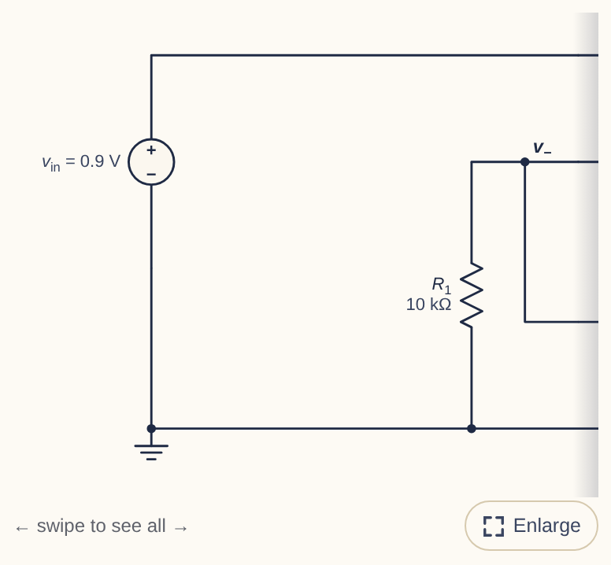

# 3.4 · 单元 5d：同相放大器：反馈网络就是一个分压器

| 项目 | 内容 |
|---|---|
| id | `w3-5d-noninverting` |
| 文件 | `units/w3-5d-noninverting.json` |
| 类型 | 理论单元（#/unit 页面，从上往下读的长页） |
| 位置 | World 3 · 运算放大器基础 → 3.4 同相放大器（本节第 1 项） |
| 这个单元回答的问题 | 为什么同相放大器的增益是 1 + R_f/R_1？ |
| 时长 | 12 分钟 |
| 接回 | chapter:basics、unit:w3-5b-virtual-short |
| 前后 | 上一项 [3.3 exp-voltage-follower](../w3/3.03-2-exp-voltage-follower.md) · 下一项 [3.4 exp-noninverting-amp](../w3/3.04-2-exp-noninverting-amp.md) |

## ① 直觉

看反馈那一半：R_f 和 R_1 从输出 v_o 串到地，中间的抽头接 v_{−}。这就是基本定律里的**分压器**（Sadiku 第 2 章）。

R_f 是反馈电阻（输出到 v_{−}），R_1 是 v_{−} 到地的电阻（实验里叫 RG）。分压器把 v_o 的一部分送回 v_{−}：v_{−} = β v_o，β = R_1/(R_1 + R_f)。

负反馈会一直调 v_o，直到抽头 v_{−} 等于输入 v_{in}。抽头只拿到 v_o 的 β 那一份，所以 v_o 必须是 v_{in} 的 1/β 倍。

*实验 2-6 的同相放大器：v_{in} 接 v_{+}；R_f = 22 kΩ 和 R_1 = 10 kΩ 组成从 v_o 到地的分压器，抽头接 v_{−}。*

> **提示** · 一句话记住：**增益 = 1/β = 分压比倒过来**。β = 10/32，增益 = 32/10 = 3.2 = 1 + R_f/R_1。

## ② 交互推导

**分步推导：五步法：v_{in} = 0.9 V（旋钮 10%）**（一次揭开一步）

1. **① 有负反馈吗？** 有。R_f 把输出接回 v_{−}（反相端）。v_o 变大，v_{−} 跟着变大，v_{+} − v_{−} 变小，v_o 又被拉回来。
2. **② 虚短、虚断。** 虚短：v_{−} = v_{+} = v_{in} = 0.9 V。虚断：没有电流流进 v_{−}，所以 R_f 和 R_1 里是同一个电流。
3. **③ 在 v_{−} 列 KCL。** 从 v_o 经 R_f 流进来的电流，等于经 R_1 流到地的电流：(v_o − v_{−})/R_f = v_{−}/R_1。右边 = 0.9 V / 10 kΩ = 0.09 mA。
4. **④ 解出 v_o。** v_o = v_{−} + R_f × 0.09 mA = 0.9 + 1.98 = 2.88 V。也就是 v_o = (1 + R_f/R_1) v_{in} = 3.2 × 0.9 V。用分压器的眼光：β = 10/32，v_o = v_{in}/β。
5. **⑤ 合理性检查。** 单电源 9 V，LM358 输出约 0 … 7.5 V：2.88 V 在里面 ✓。输出只需供反馈网络 2.88 V / 32 kΩ = 0.09 mA，远低于 20 mA ✓。再往前想一步：v_{in} 最大只能到 7.5 / 3.2 ≈ 2.34 V。旋钮转到 50%（4.5 V）时，算出来是 14.4 V，不可能，输出会顶在 7.5 V。

**滑块探索：改 R_f、R_1 和 v_{in}**

| 参数 | 名称 | 默认 | 范围 | 单位 |
|---|---|---|---|---|
| Rf | 反馈电阻 R_f | 22000 | 1000 … 100000（对数） | Ω |
| R1 | 接地电阻 R_1 | 10000 | 1000 … 100000（对数） | Ω |
| vin | 输入 v_{in} | 0.9 | 0 … 9 | V |

| 输出 | 公式 | 单位 |
|---|---|---|
| 反馈系数 β = R_1/(R_1 + R_f) | `R1 / (R1 + Rf)` |  |
| 增益 1/β | `1 / beta` |  |
| 公式给的 v_o | `G * vin` | V |
| 实际 v_o（0 … 7.5 V） | `clamp(vi, 0, 7.5)` | V |
| v_{−} = β v_o | `beta * vo` | V |
| 饱和了？（1 = 是） | `step(vi - 7.5)` |  |

把 v_{in} 往上拉，看 v_{−} 什么时候不再等于 v_{in}：那一刻输出顶到 7.5 V，负反馈失效，虚短也就不成立了。

## ③ 仿真

**仿真**

先预测，再运行，再看为什么。op-amp（运算放大器）按 LM358 建模：单电源 9 V，输出 0 … 7.5 V，开环增益 A = 100 000。

| 参数 | 名称 | 默认 | 范围 | 单位 |
|---|---|---|---|---|
| vin |  | 0.9 |  |  |
| R1 |  | 10000 |  |  |
| Rf |  | 22000 |  |  |
| A |  | 100000 |  |  |
| fb |  | 1 |  |  |
| swap |  | 0 |  |  |

| 输出 | 公式 | 单位 |
|---|---|---|
| 输出 v_o | `if(swap, 0, if(fb, clamp(vin * (1 + Rf / R1), 0, 7.5), clamp(A * vin, 0, 7.5)))` | V |
| 反相端 v_{−} | `if(swap, vin, if(fb, vo * R1 / (R1 + Rf), 0))` | V |
| 同相端 v_{+} | `if(swap, vo * R1 / (R1 + Rf), vin)` | V |
| v_{+} − v_{−} | `vp - vn` | V |

- **情景「正常：v_{in} = 0.9 V」**（设定 ）：v_o 是多少？
  - A. 约 1.98 V
  - B. 约 2.88 V ✅
  - C. 约 0.28 V
  - D. 7.5 V
  - 解释：增益是 1 + R_f/R_1 = 3.2，不是 R_f/R_1 = 2.2（那是反相放大器的大小）。0.9 × 3.2 = 2.88 V。分压器把它分回 0.9 V 送给 v_{−}，正好等于 v_{+}。

- **情景「做坏事：输入太大」**（设定 vin=4.5）：旋钮转到 50%，v_{in} = 4.5 V。v_o 是多少？
  - A. 14.4 V
  - B. 约 7.5 V（顶住了） ✅
  - C. 9 V
  - D. 0 V
  - 解释：公式要 14.4 V，但 LM358 输出最高只到 9 − 1.5 = 7.5 V。看 v_{−}：7.5 × 10/32 ≈ 2.34 V，不等于 v_{+} = 4.5 V。输出顶住以后，反馈再也调不动，虚短不成立。

- **情景「做坏事：拔掉 R_f」**（设定 fb=0）：把 R_f 拔掉（v_{−} 只经 R_1 接地）。v_{in} = 0.9 V 时 v_o 是多少？
  - A. 仍是 2.88 V
  - B. 0.9 V
  - C. 顶在 7.5 V ✅
  - 解释：没有反馈，op-amp（运算放大器）用开环增益放大：A × (0.9 − 0) = 90 000 V，远超电源，只能顶在 7.5 V。第 ① 步不成立。

- **情景「做坏事：对调两个输入端」**（设定 swap=1）：v_{in} 接到 v_{−}，分压器的抽头接到 v_{+}。v_o 会是多少？
  - A. 仍是 2.88 V
  - B. −2.88 V
  - C. 顶在一个电源轨上（这里是 0 V） ✅
  - 解释：现在是正反馈。从 v_o = 0 开始：v_{+} = 0，比 v_{−} = 0.9 V 低，op-amp（运算放大器）把 v_o 往下推，v_{+} 更低，于是停在 0 V。（若 v_o 一开始高于 2.88 V，它会冲到 7.5 V。）2.88 V 这个平衡点站不住。

## ④ 面包板

**去面包板** → [3.4 exp-noninverting-amp](../w3/3.04-2-exp-noninverting-amp.md)：旋钮 10% 时 v_o 约 2.88 V；转到 50% 时 v_o 停在约 7.5 V，而且 IN− 只有约 2.34 V，不再等于 IN+。

## ⑤ 回链

**预测题**：（基本定律：分压器）一个空载分压器，上面 R_f = 22 kΩ，下面 R_1 = 10 kΩ，两端加 3.2 V。抽头电压是多少 V？

- 答案：1 V（误差 0.05）

揭晓：

> 3.2 × 10/(10 + 22) = 1.0 V。同相放大器就是把这个题倒过来问：抽头必须是 v_{in}，顶端 v_o 要多大？

**预测题**：（接 5b）闭环增益是 A/(1 + Aβ)。A = 100 000、β = 10/32 时，增益是多少？

- 答案：3.2（误差 0.01）

揭晓：

> Aβ = 31 250，远大于 1，所以 A/(1 + Aβ) ≈ 1/β = 3.2（精确值 3.19990）。A 是多少几乎无所谓，增益只由分压器决定。

**预测题**：让 R_f → 0（换成导线），R_1 → ∞（拔掉）。同相放大器变成了什么？

- A. 电压跟随器（β = 1，增益 1） ✅
- B. 反相放大器
- C. 没有反馈的开环 op-amp（运算放大器）

揭晓：

> β = R_1/(R_1 + R_f) → 1，增益 1/β → 1。跟随器（5c）就是同相放大器最简单的特例。

**理论题**：理论题沿用中文教材的记号：电压写作 u（u_o 就是这里的 v_o）。

- `opamp-02-noninverting-amp` 同相比例放大器（opamp）

## English

展开英文

## ① 直觉

Look at the feedback half: R_f and R_1 run in series from the output v_o to ground, and the tap between them goes to v_{−}. That is the **voltage divider** from the basic laws (Sadiku Ch 2).

R_f is the feedback resistor (output to v_{−}); R_1 goes from v_{−} to ground (the lab calls it RG). The divider sends a fraction of v_o back to v_{−}: v_{−} = β v_o, with β = R_1/(R_1 + R_f).

Negative feedback keeps adjusting v_o until the tap v_{−} equals the input v_{in}. The tap gets only the fraction β of v_o, so v_o has to be 1/β times v_{in}.

[电路图]

*The non-inverting amplifier of lab 2-6: v_{in} drives v_{+}; R_f = 22 kΩ and R_1 = 10 kΩ form a divider from v_o to ground, with its tap on v_{−}.*

> **提示** · One line to remember: **gain = 1/β = the divider ratio turned upside down**. β = 10/32, so the gain is 32/10 = 3.2 = 1 + R_f/R_1.

## ② 交互推导

**分步推导：The five steps: v_{in} = 0.9 V (knob at 10%)**（一次揭开一步）

1. **① Is there negative feedback?** Yes. R_f takes the output back to v_{−}, the inverting input. If v_o grows, v_{−} grows, v_{+} − v_{−} shrinks, and v_o is pulled back.
2. **② Virtual short, virtual open.** Virtual short: v_{−} = v_{+} = v_{in} = 0.9 V. Virtual open: no current enters v_{−}, so R_f and R_1 carry the same current.
3. **③ KCL at v_{−}.** The current coming in from v_o through R_f equals the current leaving through R_1 to ground: (v_o − v_{−})/R_f = v_{−}/R_1. The right side is 0.9 V / 10 kΩ = 0.09 mA.
4. **④ Solve for v_o.** v_o = v_{−} + R_f × 0.09 mA = 0.9 + 1.98 = 2.88 V. That is v_o = (1 + R_f/R_1) v_{in} = 3.2 × 0.9 V. Through the divider lens: β = 10/32 and v_o = v_{in}/β.
5. **⑤ Sanity check.** On a single 9 V supply the LM358 output spans about 0 … 7.5 V: 2.88 V is inside ✓. The output only feeds the feedback network, 2.88 V / 32 kΩ = 0.09 mA, far below 20 mA ✓. One step further: v_{in} can go up to only 7.5 / 3.2 ≈ 2.34 V. At 50% on the knob (4.5 V) the formula says 14.4 V. That is impossible, so the output sticks at 7.5 V.

**滑块探索：Change R_f, R_1 and v_{in}**

| 参数 | 名称 | 默认 | 范围 | 单位 |
|---|---|---|---|---|
| Rf | feedback resistor R_f | 22000 | 1000 … 100000（对数） | Ω |
| R1 | ground resistor R_1 | 10000 | 1000 … 100000（对数） | Ω |
| vin | input v_{in} | 0.9 | 0 … 9 | V |

| 输出 | 公式 | 单位 |
|---|---|---|
| feedback factor β = R_1/(R_1 + R_f) | `R1 / (R1 + Rf)` |  |
| gain 1/β | `1 / beta` |  |
| v_o from the formula | `G * vin` | V |
| actual v_o (0 … 7.5 V) | `clamp(vi, 0, 7.5)` | V |
| v_{−} = β v_o | `beta * vo` | V |
| saturated? (1 = yes) | `step(vi - 7.5)` |  |

Push v_{in} up and watch when v_{−} stops equalling v_{in}: at that moment the output hits 7.5 V, the feedback stops working, and the virtual short no longer holds.

## ③ 仿真

**仿真**

Predict, run, then see why. The op-amp is an LM358 on a single 9 V supply: output 0 … 7.5 V, open-loop gain A = 100 000.

| 参数 | 名称 | 默认 | 范围 | 单位 |
|---|---|---|---|---|
| vin |  | 0.9 |  |  |
| R1 |  | 10000 |  |  |
| Rf |  | 22000 |  |  |
| A |  | 100000 |  |  |
| fb |  | 1 |  |  |
| swap |  | 0 |  |  |

| 输出 | 公式 | 单位 |
|---|---|---|
| output v_o | `if(swap, 0, if(fb, clamp(vin * (1 + Rf / R1), 0, 7.5), clamp(A * vin, 0, 7.5)))` | V |
| inverting input v_{−} | `if(swap, vin, if(fb, vo * R1 / (R1 + Rf), 0))` | V |
| non-inverting input v_{+} | `if(swap, vo * R1 / (R1 + Rf), vin)` | V |
| v_{+} − v_{−} | `vp - vn` | V |

- **情景「Normal: v_{in} = 0.9 V」**（设定 ）：What is v_o?
  - A. about 1.98 V
  - B. about 2.88 V ✅
  - C. about 0.28 V
  - D. 7.5 V
  - 解释：The gain is 1 + R_f/R_1 = 3.2, not R_f/R_1 = 2.2 (that is the inverting amplifier's size). 0.9 × 3.2 = 2.88 V. The divider brings that back down to 0.9 V at v_{−}, exactly equal to v_{+}.

- **情景「Doing it wrong: too big an input」**（设定 vin=4.5）：Turn the knob to 50%: v_{in} = 4.5 V. What is v_o?
  - A. 14.4 V
  - B. about 7.5 V (clipped) ✅
  - C. 9 V
  - D. 0 V
  - 解释：The formula wants 14.4 V, but the LM358 output tops out at 9 − 1.5 = 7.5 V. Look at v_{−}: 7.5 × 10/32 ≈ 2.34 V, not equal to v_{+} = 4.5 V. Once the output is stuck, feedback can no longer adjust anything, and the virtual short is gone.

- **情景「Doing it wrong: pull out R_f」**（设定 fb=0）：Remove R_f (v_{−} now goes to ground through R_1 only). With v_{in} = 0.9 V, what is v_o?
  - A. still 2.88 V
  - B. 0.9 V
  - C. stuck at 7.5 V ✅
  - 解释：With no feedback the op-amp multiplies by its open-loop gain: A × (0.9 − 0) = 90 000 V, far beyond the supply, so it sits at 7.5 V. Step ① fails.

- **情景「Doing it wrong: swap the two inputs」**（设定 swap=1）：Put v_{in} on v_{−} and the divider tap on v_{+}. What will v_o be?
  - A. still 2.88 V
  - B. −2.88 V
  - C. stuck at a rail (0 V here) ✅
  - 解释：This is positive feedback. Start from v_o = 0: v_{+} = 0 is below v_{−} = 0.9 V, so the op-amp pushes v_o down, v_{+} drops further, and it stays at 0 V. (Had v_o started above 2.88 V, it would have run up to 7.5 V.) The 2.88 V balance point cannot hold.

## ④ 面包板

**去面包板** → [3.4 exp-noninverting-amp](../w3/3.04-2-exp-noninverting-amp.md)：At 10% on the knob v_o is about 2.88 V; at 50% v_o stops at about 7.5 V, and IN− reads only about 2.34 V, no longer equal to IN+.

## ⑤ 回链

**预测题**：(Basic laws: the voltage divider) An unloaded divider has R_f = 22 kΩ on top and R_1 = 10 kΩ at the bottom, with 3.2 V across it. What is the tap voltage, in V?

- 答案：1 V（误差 0.05）

揭晓：

> 3.2 × 10/(10 + 22) = 1.0 V. The non-inverting amplifier asks this question backwards: the tap must equal v_{in}, so how big must the top, v_o, be?

**预测题**：(Back to 5b) The closed-loop gain is A/(1 + Aβ). With A = 100 000 and β = 10/32, what is the gain?

- 答案：3.2（误差 0.01）

揭晓：

> Aβ = 31 250, much bigger than 1, so A/(1 + Aβ) ≈ 1/β = 3.2 (exactly 3.19990). The exact value of A hardly matters; the divider alone sets the gain.

**预测题**：Let R_f → 0 (a wire) and R_1 → ∞ (removed). What does the non-inverting amplifier become?

- A. a voltage follower (β = 1, gain 1) ✅
- B. an inverting amplifier
- C. an open-loop op-amp with no feedback

揭晓：

> β = R_1/(R_1 + R_f) → 1, so the gain 1/β → 1. The follower (5c) is the simplest case of the non-inverting amplifier.

**理论题**：The theory problems follow the Chinese textbook and write voltage as u (their u_o is our v_o).

- `opamp-02-noninverting-amp` 同相比例放大器（opamp）

