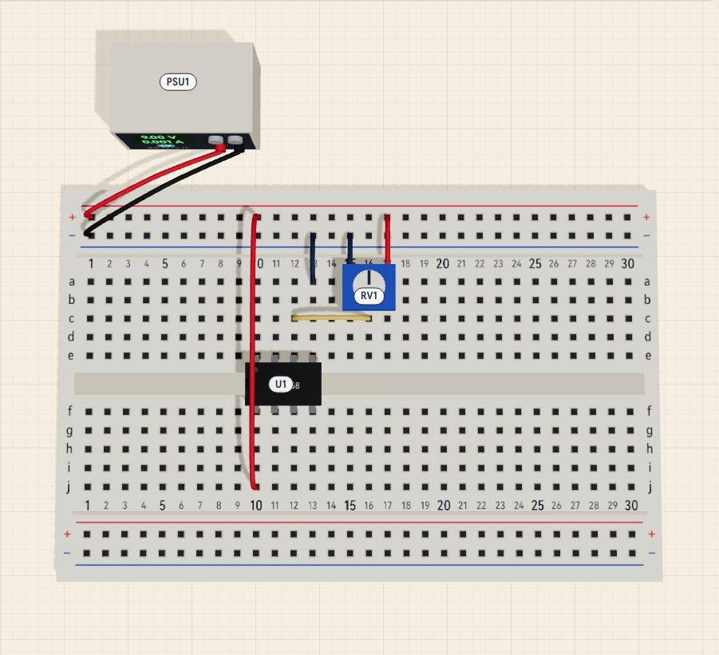
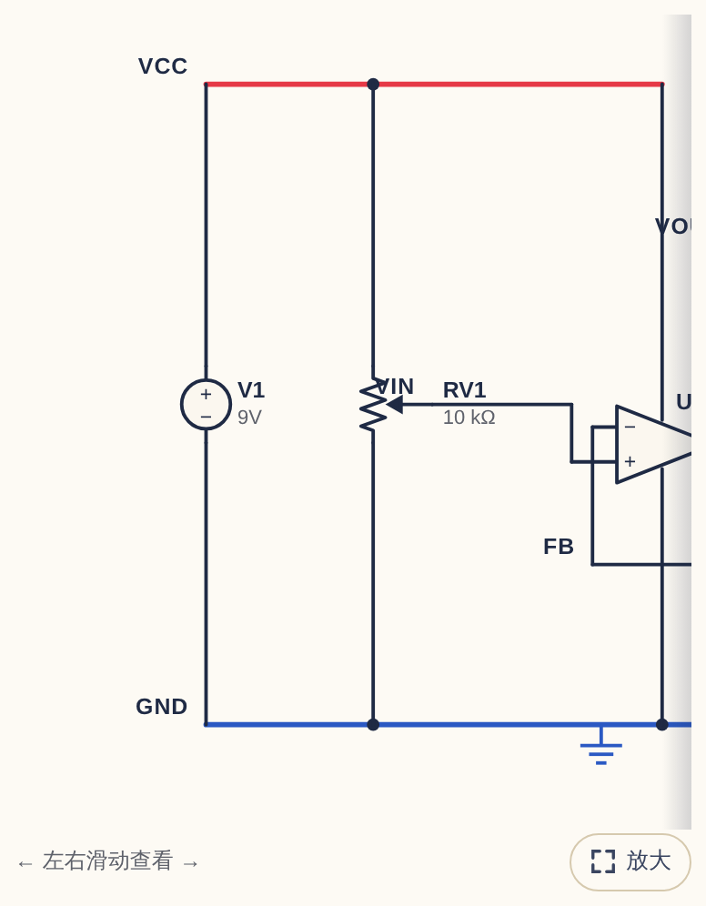
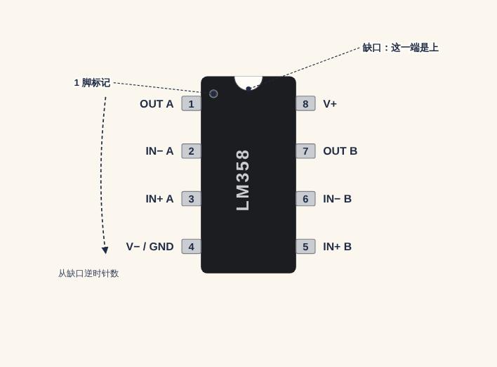
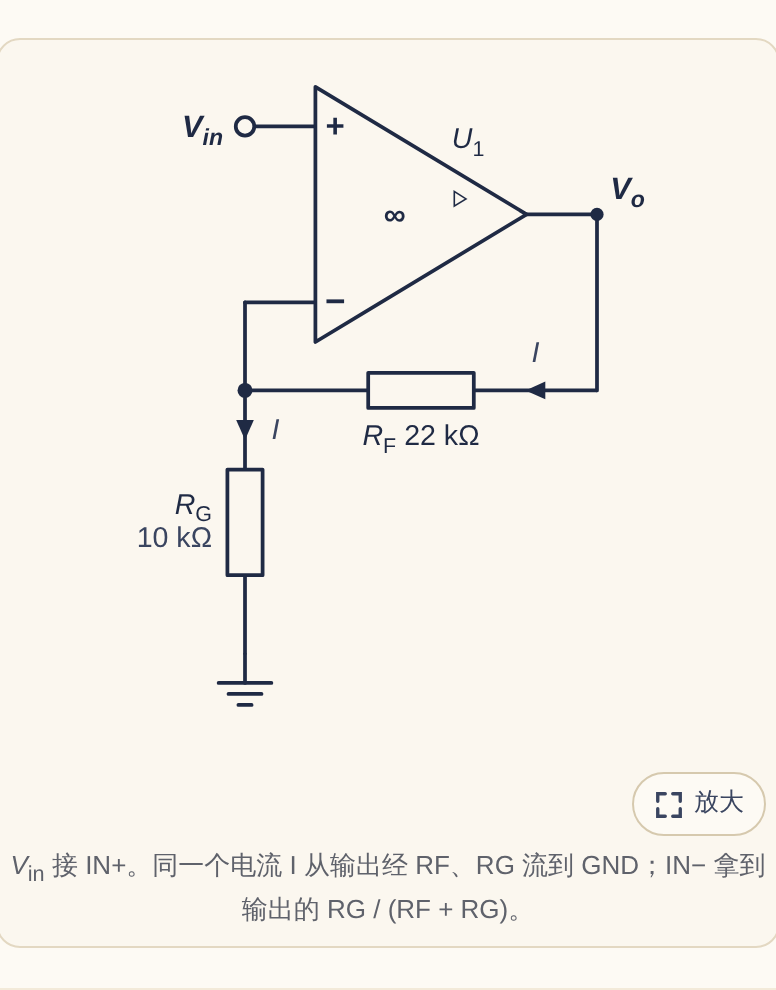

# 3.4 · 同相放大器：反馈里放两个电阻

| 项目 | 内容 |
|---|---|
| id | `exp-noninverting-amp` |
| 文件 | `challenges/226-noninverting-amp.json` |
| 类型 | 实验 / 挑战（没有分步，照目标电路图搭） · 难度 4/5 |
| 位置 | World 3 · 运算放大器基础 → 3.4 同相放大器（本节第 2 项） |
| 右侧面板 | 轨道由旧的四张卡片自动生成（还没手工精排） |
| 前后 | 上一项 [3.4 w3-5d-noninverting](../w3/3.04-1-w3-5d-noninverting.md) · 下一项 [3.5 lesson-generator-scope](../w3/3.05-1-lesson-generator-scope.md) |
| 先修 | lesson-lm358 |
| 概念 | non-inverting amplifier 同相放大器、gain = 1 + RF/RG、virtual short 虚短、saturation 饱和 |

**一句话概要**：把跟随器的反馈线换成 RF 22 kΩ 和 RG 10 kΩ：输出变成输入的好几倍。用电位器逐点测增益，再把输入调大，看输出顶到头。

## 1. 左侧工作台（3D 面包板 → 2D 俯视截图）

截图是程序里真实的 3D 面包板换成俯视角拍的；表格是同一块板的文字版（元件、参数、每只脚插在哪个孔）。

### 1.1 起点：打开这一课时板上已经有的

右侧显示的「起点」说明：

> **半成品**：LM358 已经插好、供好电（第 14 课练过），电位器也已接成 0–9 V 的输入、滑动端接 3 脚 IN+。**为什么**：增益由反馈网络决定，这才是这个实验要学的。**你要做**：加上 RF（22kΩ，1 脚 OUT → 2 脚 IN−）和 RG（10kΩ，2 脚 IN− → GND）。

| 元件 | 类型 | 参数 | 引脚 → 孔 |
|---|---|---|---|
| PSU1 | bench_supply | voltage=9, currentLimit=0.1 | +→tp1 -→tn1 |
| U1 | opamp |  | 1→e10 2→e11 3→e12 4→e13 5→f13 6→f12 7→f11 8→f10 |
| W3 | wire |  | a→tp10 b→j10 |
| W4 | wire |  | a→a13 b→tn13 |
| RV1 | potentiometer | resistance=10000, wiper=0.5 | 1→b15 2→b16 3→b17 |
| W6 | wire |  | a→a15 b→tn15 |
| W7 | wire |  | a→tp17 b→a17 |
| W8 | wire |  | a→c16 b→c12 |

### 1.3 参考答案（「看答案」载入的板子）

| 元件 | 类型 | 参数 | 引脚 → 孔 |
|---|---|---|---|
| PSU1 | bench_supply | voltage=9, currentLimit=0.1 | +→tp1 -→tn1 |
| U1 | opamp |  | 1→e10 2→e11 3→e12 4→e13 5→f13 6→f12 7→f11 8→f10 |
| W3 | wire |  | a→tp10 b→j10 |
| W4 | wire |  | a→a13 b→tn13 |
| RV1 | potentiometer | resistance=10000, wiper=0.5 | 1→b15 2→b16 3→b17 |
| W6 | wire |  | a→a15 b→tn15 |
| W7 | wire |  | a→tp17 b→a17 |
| W8 | wire |  | a→c16 b→c12 |
| RF | resistor | resistance=22000 | 1→b10 2→b11 |
| RG | resistor | resistance=10000 | 1→c11 2→tn11 |

### 1.4 目标原理图（右侧「目标原理图」抽屉）

| 元件 | 类型 | 参数 |
|---|---|---|
| V1 | dc_source | voltage=9 |
| U1 | opamp |  |
| RV1 | potentiometer | resistance=10000 |
| RF | resistor | resistance=22000 |
| RG | resistor | resistance=10000 |

连接（每个结点上的引脚）：

- **VCC**：V1.+、U1.v+、RV1.3
- **VIN**：RV1.2、U1.inA+
- **FB**：U1.inA-、RF.2、RG.1
- **VOUT**：U1.outA、RF.1
- **GND**：V1.-、U1.v-、RV1.1、RG.2

## 2. 右侧面板：学生从上往下看到的内容（单轨流）

### 第 1 步 · 🔍 先看一眼：先认识它：LM358 op-amp

**拆解「LM358：一颗芯片里的两个 op-amp」第 1 / 9 层：① 外形：8 只脚的黑色小芯片（DIP-8）**

LM358 装在 **DIP-8** 封装里（Dual In-line Package，两排直插，8 只脚）。怎么找 1 脚：
- 芯片一端有个 半圆缺口 notch，缺口朝上时，左上角有个 小圆点 的就是 **1 脚**；
- 从 1 脚开始 **逆时针** 数：左边一排从上往下 1、2、3、4，再从右边一排从下往上 5、6、7、8。

8 只脚分成三类：**A 号 op-amp 的 3 只脚**、**B 号 op-amp 的 3 只脚**、**两个 op-amp 共用的 2 只电源脚**。把鼠标放到下表每一行上，看它在芯片上的位置。

| 脚 | 名字 | 属于 | 它是什么 | 单电源时接哪 |
|---|---|---|---|---|
| 1 | OUT A | op-amp A | 输出（output） | 负载 / 反馈网络 |
| 2 | IN− A | op-amp A | 反相输入（inverting input） | 反馈回来的信号 |
| 3 | IN+ A | op-amp A | 同相输入（non-inverting input） | 要放大的信号 / 参考电压 |
| 4 | V− (GND) | A、B 共用 | 负电源 | GND |
| 5 | IN+ B | op-amp B | 同相输入 | 不用时接固定电压 |
| 6 | IN− B | op-amp B | 反相输入 | 不用时接 7 脚（跟随器） |
| 7 | OUT B | op-amp B | 输出 | — |
| 8 | V+ | A、B 共用 | 正电源 3–32 V | +5 V / +9 V |

### 第 2 步 · 🔧 动手搭：跟随器，但反馈打了折

从 2.5 的跟随器出发，IN+ 接电位器 **RV1** `10 kΩ`（1 脚接 GND，3 脚接 +9 V）。
把 OUT–IN− 那根线换掉：**RF** `22 kΩ` 从 OUT 接到 IN−，**RG** `10 kΩ` 从 IN− 接到 GND。
旋钮拨到 `10%`，测 **IN+** 和 **OUT** 对 GND 的电压。
输出是输入的几倍？

### 第 3 步 · 💡 想明白：输出必须把 IN− 抬到 IN+ 那么高

- RF 和 RG 从 OUT 到 GND 组成一个分压器。IN− 在中间，只拿到输出的一部分：$\frac{R_G}{R_F + R_G}$。
- op-amp（运算放大器）会一直推，直到 IN− 等于 IN+（虚短）。所以输出必须比输入大，大的倍数正好是这个比例的倒数。

*图 `amp`（schematic）：V_in 接 IN+。同一个电流 I 从输出经 RF、RG 流到 GND；IN− 拿到输出的 RG / (RF + RG)。*

- 用电流说也一样：IN− 不取电流（虚断），RG 里的电流 $V_{in}/R_G$ 全部也流过 RF。两段电压加起来：
$$V_o = \left(1 + \frac{R_F}{R_G}\right) V_{in}$$
- 如果 RF = RG = 10 kΩ，增益就是 $1 + 10/10 = 2$。用 RF = 22 kΩ 算出你的增益，再预测 `10%`、`20%`、`50%` 时的 OUT。别忘了 V+ − 1.5 V 的天花板。

（这一步下面列着这节课的计算卡片，点开就地展开：`opamp-noninverting`，全文见第 6 节）

### 第 4 步 · 🔧 动手搭：逐点测，直到顶到头

- 旋钮依次拨到 `10%`、`20%`、`50%`。
- 每次都测 **IN+**、**IN−**、**OUT** 对 GND 的电压。
- 在 `20%` 时把电流表先串进 **RG**、再串进 **RF**：电流一样吗？
- 电路检查通过后填测量题。

### 第 5 步 · 📏 测一测：测一测：读你自己的仪表

**测量题 1 · `ui`**（读数题）

> 旋钮 `10%`：IN+ 对 GND 的电压 Vi

- 单位 V · 状态：把 RV1 旋到 10% · 参考答案的读数 **0.9 V** · 合理范围 [0.855, 0.945]

**测量题 2 · `uo`**（读数题）

> 旋钮 `10%`：OUT 对 GND 的电压 Vo

- 单位 V · 先写预测 · 状态：把 RV1 旋到 10% · 参考答案的读数 **2.88 V** · 合理范围 [2.74, 3.02]

答对后显示：

> Vo = 3.2 × 0.90 ≈ 2.88 V。

**测量题 3 · `gain`**（计算题（用自己的读数算））

> 用你的两个读数算电压增益 Vo / Vi

- 先写预测 · 参考答案的读数 **3.2** · 合理范围 [3.04, 3.36] · 公式 `uo / ui`

答对后显示：

> 虚短 V(IN−) = Vi，虚断让 RG 的电流全部流过 RF：Vo = Vi + RF × Vi / RG = (1 + 22/10) Vi = 3.2 Vi。

**测量题 4 · `uo50`**（读数题）

> 旋钮 `50%`：OUT 对 GND 的电压

- 单位 V · 先写预测 · 状态：把 RV1 旋到 50% · 参考答案的读数 **7.498 V** · 合理范围 [7.12, 7.87]

答对后显示：

> 理论上 3.2 × 4.5 = 14.4 V，但 LM358 输出最高只有 V+ − 1.5 V ≈ 7.5 V：饱和（削顶）。

**测量题 5 · `un50`**（读数题）

> 旋钮 `50%`：IN− 对 GND 的电压（和 IN+ 比一比）

- 单位 V · 先写预测 · 状态：把 RV1 旋到 50% · 参考答案的读数 **2.343 V** · 合理范围 [2.23, 2.46]

答对后显示：

> IN− = 7.5 × 10 / 32 ≈ 2.34 V，不再等于 IN+ 的 4.5 V：饱和时负反馈调节不动了，虚短不成立。

### 第 6 步 · 🎒 带走：带走

- **同相放大器**：$V_o = (1 + R_F/R_G)\,V_{in}$，和输入同号，增益不小于 1。
- 虚短只在输出没出范围时成立。一饱和，IN− 就追不上 IN+，公式失效。
- 从外面看，带反馈的 op-amp（运算放大器）就是一个**电压控制电压源**：一个数值由另一个电压决定的电源。这就是理论题里的受控源。
- 坑：真实的 LM358 **输入端**也最好低于约 V+ − 1.5 V。这个电位器转过约 `83%`，真实芯片就不可靠了；仿真没有模拟这一点。

趁热练理论题：`opamp`、`dependent-sources`

## 3. 测量题一览

| # | id | 题目 | 类型 | 单位 | 状态 | 参考读数 |
|---|---|---|---|---|---|---|
| 1 | ui | 旋钮 `10%`：IN+ 对 GND 的电压 Vi | voltage | V | 把 RV1 旋到 10% | 0.9 V |
| 2 | uo | 旋钮 `10%`：OUT 对 GND 的电压 Vo | voltage | V | 把 RV1 旋到 10% | 2.88 V |
| 3 | gain | 用你的两个读数算电压增益 Vo / Vi | formula |  |  | 3.2 |
| 4 | uo50 | 旋钮 `50%`：OUT 对 GND 的电压 | voltage | V | 把 RV1 旋到 50% | 7.498 V |
| 5 | un50 | 旋钮 `50%`：IN− 对 GND 的电压（和 IN+ 比一比） | voltage | V | 把 RV1 旋到 50% | 2.343 V |

### 全部答完后显示的「对比」

**对比**：增益 Vo = Vi + RF × Vi / RG = (1 + 22/10) Vi = **3.2 Vi**。
- 10%：Vi ≈ 0.90 V → Vo ≈ **2.88 V**，IN− 也是 0.90 V（虚短）。
- 20%：Vi ≈ 1.80 V → Vo ≈ **5.76 V**；RG 的电流 = 1.80 / 10k = 0.18 mA，RF 里也是 0.18 mA。
- 50%：Vi = 4.50 V → 理论 14.4 V，但输出最高只有 V+ − 1.5 V = **7.5 V**，被削顶（饱和）。这时 IN− = 7.5 × 10 / 32 ≈ 2.34 V，不再等于 IN+。

### 提示按钮（依次显示）

1. 先给 op-amp（运算放大器）供电：8 脚接 +9 V，4 脚接 GND。
2. 电位器：1 脚接 GND，3 脚接 +9 V，中间滑动端接 IN+（3 脚）。接反了，旋钮方向也反了。
3. RF 接在 OUT 和 IN− 之间（不是 IN+），RG 从 IN− 接到 GND。

### 功能测试（「检查我的电路」时跑）

- 10%：OUT 按增益放大 IN+，IN− 跟着 IN+（虚短）
- 20%：OUT 仍在线性区；RG 的电流全部流过 RF
- 50%：输出饱和

## 4. 用到的拆解（全部层的文字，供改写参考）

### 拆解 `lm358`：LM358：一颗芯片里的两个 op-amp

*op-amp = operational amplifier（运算放大器）。我们从芯片外形一路拆到教授在黑板上画的那个三角形，再拆到三角形里面的等效电路，最后用它推出每一个放大器公式。*

**拆解「LM358：一颗芯片里的两个 op-amp」第 1 / 9 层：① 外形：8 只脚的黑色小芯片（DIP-8）**

LM358 装在 **DIP-8** 封装里（Dual In-line Package，两排直插，8 只脚）。怎么找 1 脚：
- 芯片一端有个 半圆缺口 notch，缺口朝上时，左上角有个 小圆点 的就是 **1 脚**；
- 从 1 脚开始 **逆时针** 数：左边一排从上往下 1、2、3、4，再从右边一排从下往上 5、6、7、8。

8 只脚分成三类：**A 号 op-amp 的 3 只脚**、**B 号 op-amp 的 3 只脚**、**两个 op-amp 共用的 2 只电源脚**。把鼠标放到下表每一行上，看它在芯片上的位置。

| 脚 | 名字 | 属于 | 它是什么 | 单电源时接哪 |
|---|---|---|---|---|
| 1 | OUT A | op-amp A | 输出（output） | 负载 / 反馈网络 |
| 2 | IN− A | op-amp A | 反相输入（inverting input） | 反馈回来的信号 |
| 3 | IN+ A | op-amp A | 同相输入（non-inverting input） | 要放大的信号 / 参考电压 |
| 4 | V− (GND) | A、B 共用 | 负电源 | GND |
| 5 | IN+ B | op-amp B | 同相输入 | 不用时接固定电压 |
| 6 | IN− B | op-amp B | 反相输入 | 不用时接 7 脚（跟随器） |
| 7 | OUT B | op-amp B | 输出 | — |
| 8 | V+ | A、B 共用 | 正电源 3–32 V | +5 V / +9 V |

**拆解「LM358：一颗芯片里的两个 op-amp」第 2 / 9 层：② X 光：硅片上有两个 op-amp，电源脚共用**

把黑色塑料变透明：中间是一小块 硅片 die，细细的 金线 bond wire 把硅片连到 8 只脚上。硅片上做了两个完全一样、互相独立的放大器：op-amp A 和 op-amp B。

“**Dual**（双）”就是这个意思。它们只共用两样东西：V+（8 脚） 和 V−（4 脚）。所以：
- 只要芯片插上电，A 和 B **都** 通电了，哪怕你只用 A；
- 不用的那一半不能让它的输入悬空——悬空的输入会让它乱跳甚至振荡，干扰另一半。通常把它接成跟随器（7 脚接 6 脚），5 脚接一个固定电压。

**拆解「LM358：一颗芯片里的两个 op-amp」第 3 / 9 层：③ 符号：教授画的那个三角形**

原理图里，一个 op-amp 画成一个 三角形，信号从左往右走：
- IN−（反相输入 inverting input）：标“−”的那只脚，它上面的电压记作 $v₋$；
- IN+（同相输入 non-inverting input）：标“+”的那只脚，电压记作 $v₊$；
- OUT（输出）：三角形的尖，电压 $v_o$；
- V+ 和 V−：电源脚。理论题里常常 **省略不画**，但真实电路里必须接，否则它不工作。

注意：“+”“−”不是电源正负极，而是“这只输入对输出的作用是同向还是反向”。op-amp 只关心两个输入之间的 **差**：
$$v_d = v₊ - v₋$$
v_d 叫 **差模输入电压**（differential input voltage）。

| 端子 | 符号 | LM358 A 的脚 | 作用 |
|---|---|---|---|
| IN+ | $v₊$ | 3 | $v₊$ 升高 → $v_o$ 升高 |
| IN− | $v₋$ | 2 | $v₋$ 升高 → $v_o$ 降低 |
| OUT | $v_o$ | 1 | 输出 $A·v_d$ |
| V+ / V− | — | 8 / 4 | 能量从这里来，也限制 $v_o$ 的范围 |

- 公式 `v_d = v₊ - v₋`：op-amp 唯一“看”的量

**拆解「LM358：一颗芯片里的两个 op-amp」第 4 / 9 层：④ 拆开三角形：三个元件的等效电路**

教授说“把 op-amp 拆成电路”，拆出来就是这三样（这是电路课里 op-amp 的 **线性模型**）：

1. 输入电阻 R_in：接在两个输入之间。LM358 的输入只取约 20 nA 的偏置电流，等效 $R_{in}$ 在 MΩ 以上，计算时可以当成 **开路**——输入端几乎不取电流。
2. 受控电压源 A·v_d：一个电压 **控制** 的电压源（VCVS），它的电压是输入差的 A 倍。A 叫 **开环增益**（open-loop gain），LM358 约 $10^5$（100 dB）。
3. 输出电阻 R_out：受控源到输出脚之间，几十 Ω 量级。

于是不接任何反馈时：
$$v_o = A·v_d = A(v₊ - v₋)$$
这个电路你在第 5 章“含运算放大器的电阻电路”和受控源那一节都能直接用结点法分析。

| 参数 | LM358（典型） | 理想 op-amp | 计算时 |
|---|---|---|---|
| 开环增益 A | ≈ 10⁵ (100 dB) | ∞ | 很大 → 得出“虚短” |
| 输入电阻 R_in | MΩ 以上（偏置 20 nA） | ∞ | 开路 → 得出“虚断” |
| 输出电阻 R_out | 几十 Ω（仿真 10 Ω） | 0 | 反馈后更小，可忽略 |

- 公式 `v_o = A(v₊ - v₋)`：开环（不接反馈），且输出没到电源边界时

**拆解「LM358：一颗芯片里的两个 op-amp」第 5 / 9 层：⑤ 不接反馈会怎样？——输出一下子撞到电源**

用上一层的公式算一下。LM358 接 9 V 单电源，输出最多到约 7.5 V。要让输出在 0–7.5 V 之间（线性区），输入差只能是：
$$0 < v_d < \frac{7.5 V}{10^5} = 75 µV$$
75 微伏！你手一碰导线、电位器动一点点、甚至输入失调电压（LM358 典型 2 mV）都比它大几十倍。所以 **开环** 的 op-amp 几乎永远停在两头：
- $v₊ > v₋$（哪怕多 1 mV）→ 输出 顶到 ≈ V+ − 1.5 V
- $v₊ < v₋$ → 输出 掉到 ≈ 0 V

这叫 **饱和**（saturation）。这样用 op-amp 就成了 **比较器**（comparator）：只回答“哪个输入大”。想让它当放大器，必须加 **负反馈**——下面两层就讲为什么反馈能把 $v_d$ 稳稳地压在 75 µV 以内。

- 公式 `|v_d| < \frac{V_{sat}}{A} = \frac{7.5}{10^{5}} = 75 µV`：线性区有多窄

**拆解「LM358：一颗芯片里的两个 op-amp」第 6 / 9 层：⑥ 理想 op-amp 的两条黄金法则：虚短、虚断**

把等效电路里的三个参数推到极限：$A → ∞$、$R_{in} → ∞$、$R_{out} → 0$。电路课的所有 op-amp 题都用这两条法则：

**法则 1 · 虚断（virtual open）**：$R_{in} → ∞$，所以 两个输入端都不取电流：
$$i_+ = i_- = 0$$
**法则 2 · 虚短（virtual short）**：有负反馈、输出没饱和时，$v_o$ 是有限值（几伏），而 $v_d = \frac{v_o}{A}$，A → ∞，所以 两个输入电压相等：
$$v₊ = v₋$$
“虚”的意思：两个输入 **电压相等，但并没有真的连在一起**（没有电流流过）。

⚠ 虚短 **只在有负反馈时成立**。上一层的开环电路里 $v₊ ≠ v₋$，输出是饱和的。

| 法则 | 式子 | 来自 | 什么时候成立 |
|---|---|---|---|
| 虚断 | $i_+ = i_- = 0$ | $R_{in} → ∞$ | 总是（输入电流 nA 级） |
| 虚短 | $v₊ = v₋$ | $A → ∞$ | 有负反馈且输出未饱和 |

**拆解「LM358：一颗芯片里的两个 op-amp」第 7 / 9 层：⑦ 负反馈第一例：电压跟随器，一步步推**

把 输出直接接回 IN−，信号接 IN+。先 **不用** 黄金法则，用 ④ 的模型硬算（忽略 $R_{out}$）：
1. 接线告诉我们：$v₊ = v_{in}$，$v₋ = v_o$
2. op-amp 的方程：$v_o = A(v₊ - v₋) = A(v_{in} - v_o)$
3. 移项：$v_o(1 + A) = A·v_{in}$
4. 所以 $v_o = \frac{A}{1+A}v_{in}$。代入 $A = 10^5$：$v_o = 0.99999 v_{in}$

再看反馈 **为什么能稳住**：如果 $v_o$ 偏低，$v_d = v_{in} - v_o$ 变大，A 倍放大后把 $v_o$ 往上推；偏高则往下拉。输出一直“追”着输入，$v_d$ 只剩 $\frac{v_o}{A}$——几十 µV。

用黄金法则一行就出来：虚短 $v₋ = v₊$，而 $v₋ = v_o$，所以 $v_o = v_{in}$。两种方法结果一致，这就是黄金法则的来历。

**用处**：输入几乎不取电流（虚断），输出能提供几十 mA——它把“带不动负载的信号”变成“能带负载的信号”，叫 **缓冲器**（buffer）。

- 公式 `v_o = \frac{A}{1+A} v_{in} ≈ v_{in}`：有限 A 的精确结果

**拆解「LM358：一颗芯片里的两个 op-amp」第 8 / 9 层：⑧ 负反馈第二例：同相放大器和反相放大器**

跟随器把 **全部** 输出送回 IN−。如果只送回 **一部分**，就能放大。用 R_f 和 R_1 分压，送回 IN− 的是 βvₒ：
$$β = \frac{R_1}{R_1 + R_f}$$
**同相放大器**（non-inverting），信号接 IN+：
1. 虚断：IN− 不取电流，所以 R_f、R_1 是简单的串联分压：$v₋ = β v_o$
2. 虚短：$v₋ = v₊ = v_{in}$
3. 所以 $β v_o = v_{in}$，$v_o = \frac{1}{β}v_{in} = (1 + \frac{R_f}{R_1})v_{in}$

用有限 A 推（同 ⑦ 的方法）得到 $v_o = \frac{A}{1+Aβ}v_{in}$：只要 $Aβ ≫ 1$，增益就只由 **两个电阻** 决定，和 op-amp 本身的 A 无关——这就是负反馈的价值。

**反相放大器**（inverting）：IN+ 接 GND，信号经 $R_1$ 接 IN−，$R_f$ 从 OUT 接回 IN−。
1. 虚短：$v₋ = v₊ = 0$，IN− 是 **虚地**（virtual ground）
2. 虚断：流进 $R_1$ 的电流全部流过 $R_f$：$\frac{v_{in} - 0}{R_1} = \frac{0 - v_o}{R_f}$
3. 所以 $v_o = -\frac{R_f}{R_1}v_{in}$（负号 = 反相）

| 电路 | 增益 vₒ / v_in | 输入电阻 | 实验 |
|---|---|---|---|
| 跟随器 | 1 | ∞ | 2-5 |
| 同相放大 | $1 + \frac{R_f}{R_1}$ | ∞ | 2-6 |
| 反相放大 | $-\frac{R_f}{R_1}$ | $R_1$ | 2-7 |
| 反相求和 | $-R_f(\frac{v_1}{R_1} + \frac{v_2}{R_2})$ | $R_1$, $R_2$ | 2-8 |

- 公式 `β = \frac{R_1}{R_1 + R_f}`：反馈系数：输出送回 IN− 的比例
- 公式 `v_o = \frac{A}{1 + Aβ} v_{in} ≈ \frac{1}{β} v_{in}`：Aβ ≫ 1 时增益只取决于电阻

**拆解「LM358：一颗芯片里的两个 op-amp」第 9 / 9 层：⑨ 再往里：三级晶体管电路，和它的“缺点”**

三角形里真正的东西是约 20 个晶体管，分三级：
1. 输入级：PNP 差分对——只放大两个输入的 **差**。LM358 用 PNP 管，所以 输入电压可以低到 0 V（GND），这就是它能单电源工作的原因；输入上限约 V+ − 1.5 V。
2. 增益级——提供 $10^5$ 倍的电压增益。里面的 补偿电容 C_c 让高频增益逐渐下降，防止接反馈后振荡，代价是 **带宽**：增益 × 带宽 ≈ 1 MHz（GBW）。
3. 输出级：推挽——一个管子往上推电流、一个往下拉，提供几十 mA。往上推的那一路有两个 $V_{BE}$ 压降，所以 输出到不了 V+，差约 1.5 V；往下拉的那一路能接近 0 V。

这一层解释了你在课里看到的三个“现象”：
- 第 14 课：输入 9 V，输出只有 7.5 V → 输出级的余量；
- 放大倍数做 100 倍时带宽只剩约 10 kHz → $GBW ≈ 1 MHz$；
- 方波边沿变成斜坡，约 0.3 V/µs → **压摆率**（slew rate），由 C_c 的充电电流决定。

| 参数 | LM358 典型值 | 影响什么 |
|---|---|---|
| 电源电压 | 3–32 V（±1.5–±16 V） | 能用的电源 |
| 输出摆幅 | 0 … V+ − 1.5 V | 输出最大值 |
| 共模输入范围 | 0 … V+ − 1.5 V | 输入能接多高 |
| 增益带宽积 GBW | ≈ 1 MHz | $f_{max} ≈ \frac{GBW}{增益}$ |
| 压摆率 SR | ≈ 0.3 V/µs | 大信号的最高频率 |
| 输入失调电压 | ≈ 2 mV | 直流误差 × 增益 |

- 公式 `f_{-3dB} ≈ \frac{GBW}{G}`：G = 闭环增益（同相放大器的 1 + R_f/R_1）
- 公式 `f_{max} = \frac{SR}{2π V_p}`：不失真的最大正弦频率

**一句话记住**：op-amp = 一个只看 $v₊ - v₋$ 的超高增益放大器。开环时它是比较器；加了负反馈，输出会调到让 $v₊ = v₋$（虚短），输入不取电流（虚断）——从这两条就能推出所有放大器公式。

## 5. 这一课的计算卡片

**计算卡片 `opamp-noninverting`：同相放大器 Non-inverting amplifier**

- 公式 `v_o = (1 + \frac{R_f}{R_1}) v_{in}`
- 用途：把信号放大、不反相，输入电阻极大。
- 输入：vin（v_in，V）；Rf（R_f，Ω）；R1（R₁，Ω） → vₒ（输出，V）

1. 虚断：IN− 不取电流，R_f 和 R₁ 串联分压：$v₋ = \frac{R_1}{R_1 + R_f}v_o = βv_o$
2. 虚短：$v₋ = v₊ = v_{in}$
3. 所以 $v_o = \frac{v_{in}}{β} = (1 + \frac{R_f}{R_1})v_{in}$

有限 A 时：$v_o = \frac{A}{1 + Aβ}v_{in}$，$Aβ ≫ 1$ 时就是上式。增益最小是 1（R_f = 0 就是跟随器）。

例子：R_f = 20 k、R₁ = 10 k：增益 3；0.5 V 进，1.5 V 出。

- ⚠ 是 1 + R_f/R₁，不是 R_f/R₁（那是反相放大器的大小）。
- ⚠ 输出不能超过 V+ − 1.5 V：先算再看会不会饱和。

## 6. English（界面英文版的同一份内容）

展开英文

### Node 1 · 🔍 Look first：Meet it first: LM358 op-amp

**Teardown「LM358: two op-amps in one chip」layer 1 of 9：① Package: a small black 8-pin chip (DIP-8)**

The LM358 comes in a **DIP-8** package (Dual In-line Package: two rows, 8 pins). Finding pin 1:
- one end has a half-moon notch; with the notch at the top, the corner with the little dot (top left) is **pin 1**;
- count **anticlockwise** from pin 1: down the left side 1, 2, 3, 4, then up the right side 5, 6, 7, 8.

The 8 pins fall into three groups: **3 pins of op-amp A**, **3 pins of op-amp B**, and **2 power pins shared by both**. Hover each row of the table to see where it is on the chip.

| Pin | Name | Belongs to | What it is | Single supply: connect to |
|---|---|---|---|---|
| 1 | OUT A | op-amp A | output | the load / feedback network |
| 2 | IN− A | op-amp A | inverting input | the feedback signal |
| 3 | IN+ A | op-amp A | non-inverting input | the signal / a reference |
| 4 | V− (GND) | shared | negative supply | GND |
| 5 | IN+ B | op-amp B | non-inverting input | unused: tie to a fixed voltage |
| 6 | IN− B | op-amp B | inverting input | unused: tie to pin 7 (follower) |
| 7 | OUT B | op-amp B | output | — |
| 8 | V+ | shared | positive supply 3–32 V | +5 V / +9 V |

### Node 2 · 🔧 Build：A follower with a discounted feedback

Start from the follower of 2.5, with pot **RV1** `10 kΩ` on IN+ (pin 1 to GND, pin 3 to +9 V).
Replace the OUT–IN− wire: **RF** `22 kΩ` from OUT to IN−, and **RG** `10 kΩ` from IN− to GND.
Set the knob to `10%` and measure **IN+** and **OUT** against GND.
How many times larger is the output than the input?

### Node 3 · 💡 Why：The output must lift IN− up to IN+

- RF and RG form a divider from OUT down to GND. IN− sits at its middle and only gets a fraction of the output: $\frac{R_G}{R_F + R_G}$.
- The op-amp keeps pushing until IN− equals IN+ (virtual short). So the output has to be larger than the input by exactly the inverse of that fraction.

[figure `amp`]

*Figure `amp`（schematic）：V_in 接 IN+。同一个电流 I 从输出经 RF、RG 流到 GND；IN− 拿到输出的 RG / (RF + RG)。*

- Same story with currents: IN− takes no current (virtual open), so the current through RG, $V_{in}/R_G$, all flows through RF too. Adding up the two voltage drops:
$$V_o = \left(1 + \frac{R_F}{R_G}\right) V_{in}$$
- With RF = RG = 10 kΩ the gain would be $1 + 10/10 = 2$. Work out yours with RF = 22 kΩ, then predict OUT at `10%`, `20%` and `50%`. Mind the ceiling at V+ − 1.5 V.

(This node lists the lesson’s calculation cards: `opamp-noninverting`; full text in section 6)

### Node 4 · 🔧 Build：Point by point, up to the ceiling

- Turn the knob to `10%`, `20%` and `50%`.
- Each time, measure **IN+**, **IN−** and **OUT** against GND.
- At `20%`, put the ammeter in series with **RG**, then with **RF**: same current?
- Once the circuit check passes, fill in the questions.

### Node 5 · 📏 Measure：Measure: read your own instruments

**Question 1 · `ui`**（reading）

> Knob at `10%`: IN+ to GND, Vi

- unit V · state：RV1 is turned to 10% · range [0.855, 0.945]

**Question 2 · `uo`**（reading）

> Knob at `10%`: OUT to GND, Vo

- unit V · predict first · state：RV1 is turned to 10% · range [2.74, 3.02]

Shown once right:

> Vo = 3.2 × 0.90 ≈ 2.88 V.

**Question 3 · `gain`**（calculation from own readings）

> From your two readings, the voltage gain Vo / Vi

- predict first · range [3.04, 3.36] · formula `uo / ui`

Shown once right:

> Virtual short V(IN−) = Vi; virtual open, so RG's current all flows through RF: Vo = Vi + RF × Vi / RG = (1 + 22/10) Vi = 3.2 Vi.

**Question 4 · `uo50`**（reading）

> Knob at `50%`: OUT to GND

- unit V · predict first · state：RV1 is turned to 50% · range [7.12, 7.87]

Shown once right:

> 3.2 × 4.5 = 14.4 V in theory, but the LM358 output tops out at V+ − 1.5 V ≈ 7.5 V: saturated (clipped).

**Question 5 · `un50`**（reading）

> Knob at `50%`: IN− to GND (compare it with IN+)

- unit V · predict first · state：RV1 is turned to 50% · range [2.23, 2.46]

Shown once right:

> IN− = 7.5 × 10 / 32 ≈ 2.34 V, no longer equal to IN+ = 4.5 V: saturated, the feedback can't regulate, so the virtual short fails.

### Node 6 · 🎒 Take away：Take away

- **Non-inverting amplifier**: $V_o = (1 + R_F/R_G)\,V_{in}$, same sign as the input. Gain at least 1.
- The virtual short holds only while the output is inside its range. Saturated, IN− falls behind IN+ and the formula stops.
- To the outside, an op-amp with feedback is a **voltage-controlled voltage source**: a source whose value is set by another voltage. That is the dependent source of the theory chapter.
- Pitfall: a real LM358 also wants its **inputs** below about V+ − 1.5 V. Above about `83%` on this pot a real chip misbehaves; the simulator doesn't model that.

Practise：`opamp`、`dependent-sources`

**Compare**

**Compare**: gain Vo = Vi + RF × Vi / RG = (1 + 22/10) Vi = **3.2 Vi**.
- 10%: Vi ≈ 0.90 V → Vo ≈ **2.88 V**, and IN− is 0.90 V too (virtual short).
- 20%: Vi ≈ 1.80 V → Vo ≈ **5.76 V**; RG's current = 1.80 / 10k = 0.18 mA, and RF carries 0.18 mA as well.
- 50%: Vi = 4.50 V → 14.4 V in theory, but the output tops out at V+ − 1.5 V = **7.5 V**: clipped (saturated). IN− is then 7.5 × 10 / 32 ≈ 2.34 V, no longer equal to IN+.

**Hints**

1. Power the op-amp first: pin 8 to +9 V, pin 4 to GND.
2. Pot: pin 1 to GND, pin 3 to +9 V, the middle wiper to IN+ (pin 3). Wired the other way, the knob turns backwards.
3. RF goes between OUT and IN− (not IN+); RG from IN− to GND.

