# 3.5 · 信号发生器里的 50 Ω，探头的接地夹

| 项目 | 内容 |
|---|---|
| id | `lesson-generator-load` |
| 文件 | `challenges/250-lesson-generator-load.json` |
| 类型 | 课程（有分步，每步自动检查） · 难度 3/5 |
| 位置 | World 3 · 运算放大器基础 → 3.5 信号发生器和示波器（本节第 2 项） |
| 右侧面板 | 轨道由旧的四张卡片自动生成（还没手工精排） |
| 前后 | 上一项 [3.5 lesson-generator-scope](../w3/3.05-1-lesson-generator-scope.md) · 下一项 [3.5 lesson-scope-two-channels](../w3/3.05-3-lesson-scope-two-channels.md) |
| 先修 | lesson-generator-scope |
| 概念 | output resistance 输出电阻、load 负载、voltage divider 分压、ground clip 接地夹 |

**一句话概要**：同一台信号发生器，接上小电阻，波形就变小：它里面串着 50 Ω。再故意把探头的接地夹夹错一次。

## 1. 左侧工作台（3D 面包板 → 2D 俯视截图）

截图是程序里真实的 3D 面包板换成俯视角拍的；表格是同一块板的文字版（元件、参数、每只脚插在哪个孔）。

### 1.1 起点：空面包板（学生从零开始搭）

### 1.2 每一步之后的面包板

见第 2 节每个步骤下面的截图（按步骤的自动检查重建：放 / 改 / 拔元件、移动万用表表笔）。

### 1.3 参考答案（「看答案」载入的板子）

| 元件 | 类型 | 参数 | 引脚 → 孔 |
|---|---|---|---|
| FG1 | function_gen | waveform=sine, frequency=1000, amplitude=1, offset=0 | +→a5 -→tn5 |
| P1 | scope_probe | channel=1 | tip→c5 gnd→tn8 |
| R1 | resistor | resistance=50 | 1→b5 2→tn12 |

### 1.4 目标原理图（右侧「目标原理图」抽屉）

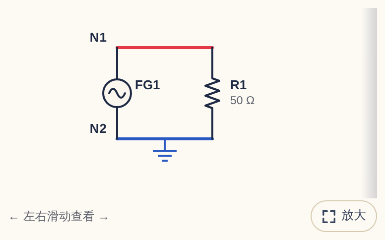

| 元件 | 类型 | 参数 |
|---|---|---|
| FG1 | function_gen |  |
| R1 | resistor | resistance=50 |

连接（每个结点上的引脚）：

- **N1**：FG1.+、R1.1
- **N2**：R1.2、FG1.-

## 2. 右侧面板：学生从上往下看到的内容（单轨流）

### 第 1 步 · 🔍 先看一眼：先认识它：信号发生器、示波器

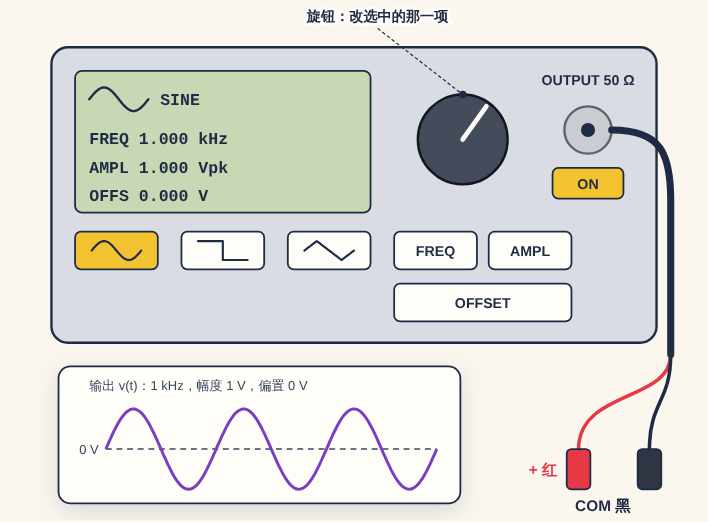

**拆解「信号发生器：一个会变的电压源 + 50 Ω」第 1 / 7 层：① 面板：波形、频率、幅度、偏置、输出**

信号发生器的面板只回答四个问题：**什么形状、多快、多大、中心在哪**，再加一个“开不开输出”。
- 波形按键：正弦（sine）、方波（square）、三角波（triangle）；
- 频率 FREQ：每秒重复多少次，单位 Hz；周期 $T = \frac{1}{f}$；
- 幅度 AMPL：波形最高点离中心线多远（峰值，peak）。很多仪器也可以按峰峰值 Vpp 或有效值 RMS 输入，**一定要看清单位**；
- 偏置 OFFSET：给整个波形加一个直流电压，把中心线上下平移；
- 输出 OUTPUT：一个 BNC 插座，旁边印着 **50 Ω**——这是输出电阻，第 ④ 层的主角。ON 键 打开输出。

下面的小图 是课程默认设定（1 kHz、幅度 1 V、偏置 0）输出的样子。在仿真里，这些设定都在元件的“属性”面板里；它有两根引线：红 + 和黑 COM，黑的那根接电路的 GND。

| 控件 | 设定什么 | 课程默认 | 在公式里是 |
|---|---|---|---|
| 波形 | 正弦 / 方波 / 三角波 | 正弦 | sin(·) 换成方波 / 三角函数 |
| 频率 FREQ | 每秒周期数 | 1 kHz | $f$，$T = 1/f$ = 1 ms |
| 幅度 AMPL | 峰值（离中心线） | 1 V | $A$ |
| 偏置 OFFSET | 直流平移 | 0 V | $V_{off}$ |
| 输出 OUTPUT | 开 / 关，内阻 50 Ω | ON | $R_o$ = 50 Ω |

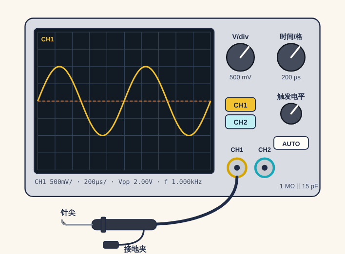

**拆解「示波器：会画图的电压表」第 1 / 7 层：① 面板：一块带格子的屏幕、三组旋钮、两个输入**

示波器的面板分成四块：
- 屏幕：横向 10 格、纵向 8 格的网格（division，简写 div）。曲线 CH1（黄色） 是电压随时间的变化；
- **垂直**（vertical）：V/div 旋钮——纵向 **每格代表多少伏**；
- **水平**（horizontal）：time/div 旋钮——横向 **每格代表多少时间**；
- **触发**（trigger）：触发电平——让画面静止的那条橙色虚线（第 ④ 层）。

两个输入 CH1、CH2 各接一根 探头：针尖 碰要看的点，接地夹 夹在电路的 GND。屏幕上画的是 **针尖 − 接地夹** 的电压。

仿真里两个旋钮默认是 自动（AUTO）：示波器自己挑合适的 V/div 和 time/div；屏幕下面直接列出 读数（Vpp、频率、RMS、相位差）。

| 控件 | 作用 | 单位 | 怎么用 |
|---|---|---|---|
| 屏幕网格 | 10 × 8 格 | div | 数格子 |
| V/div | 纵向每格的电压 | mV/div, V/div | 让波形占 4–6 格高 |
| time/div | 横向每格的时间 | µs/div, ms/div | 让屏幕上有 1–3 个周期 |
| 触发电平 | 从哪个电压开始画 | V | 放在波形中间 |
| CH1 / CH2 | 打开 / 关闭通道 | — | CH1 看输入，CH2 看输出 |
| 探头 | 针尖 + 接地夹 | ×1 / ×10 | 接地夹 **只** 夹 GND |

### 第 2 步 · 🔧 动手搭：换一个电阻，波形变小了

先搭出上一课的电路：信号发生器、**`100 kΩ`** 电阻、一个探头。
然后只把电阻换成 **`50 Ω`**，信号发生器一个旋钮都不碰。
屏幕上的波形怎么了？信号发生器的设定没变，为什么？

**步骤 1**

**信号发生器**：红夹子 **`a5`**，黑夹子 **`tn5`**。保持正弦、**`1 kHz`**、幅度 **`1 V`**、偏置 **`0 V`**。

自动检查（做到这些才算完成）：把信号发生器插到 a5–tn5
板上高亮的孔：a5、tn5

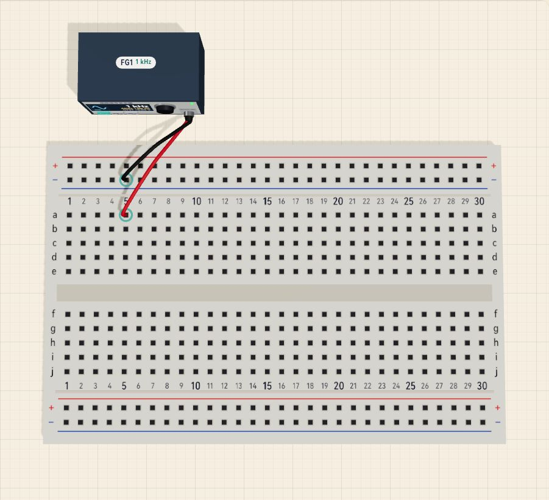

**步骤 2**

**示波器探头**：针尖 **`c5`**，接地夹 **`tn8`**。

自动检查（做到这些才算完成）：把示波器探头插到 c5–tn8
板上高亮的孔：c5、tn8

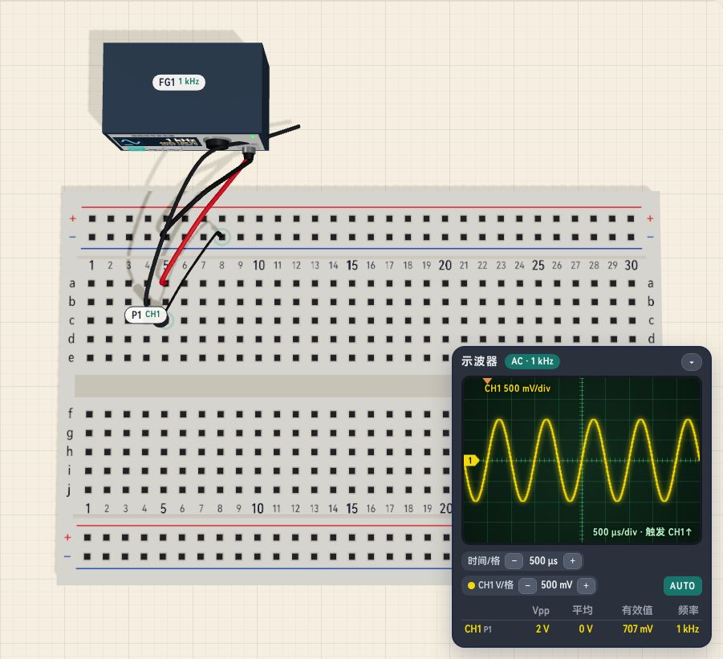

**步骤 3**

**电阻 R1**：**`b5`** 和 **`tn12`**，设 **`100 kΩ`**。记住波形有多高。

自动检查（做到这些才算完成）：把电阻插到 b5–tn12
板上高亮的孔：b5、tn12

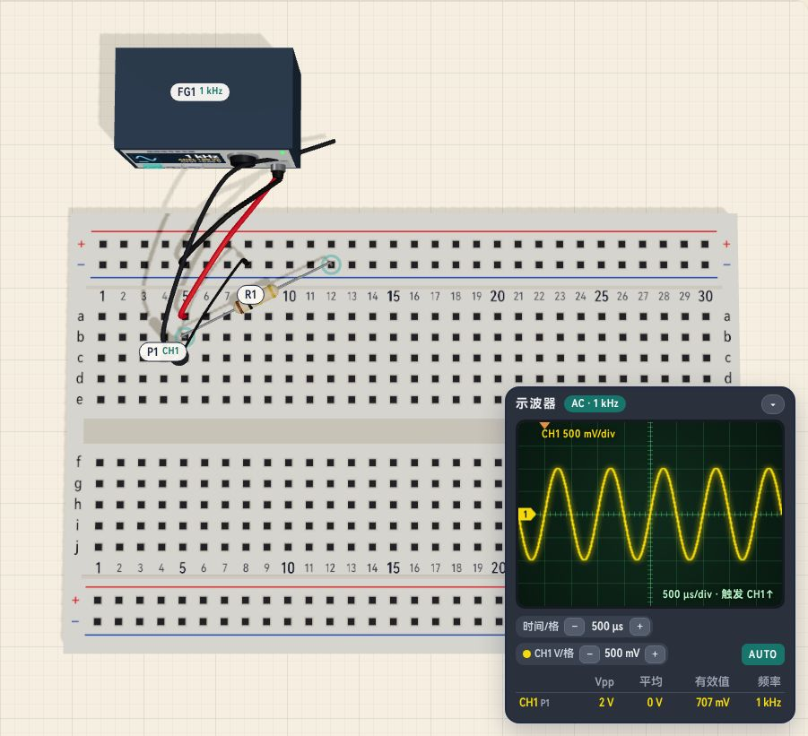

**步骤 4**

单击 R1，在「属性」里把阻值改成 **`50 Ω`**（自定义）。信号发生器不动。波形变成了什么样？

自动检查（做到这些才算完成）：把电阻插到 b5–tn12
板上高亮的孔：b5、tn12

### 第 3 步 · 💡 想明白：信号发生器里串着一个电阻

- 信号发生器里面不是一个理想的电压，而是**理想波形 + 一个 50 Ω 电阻**串在一起——就像 1.10 里 9 V 电池里有 1.5 Ω。
- 接上负载 R，这 50 Ω 和 R 组成一个**分压器**。例如负载 1 kΩ 时：
$$V_{out} = 2 Vpp × \frac{1000}{50 + 1000}$$

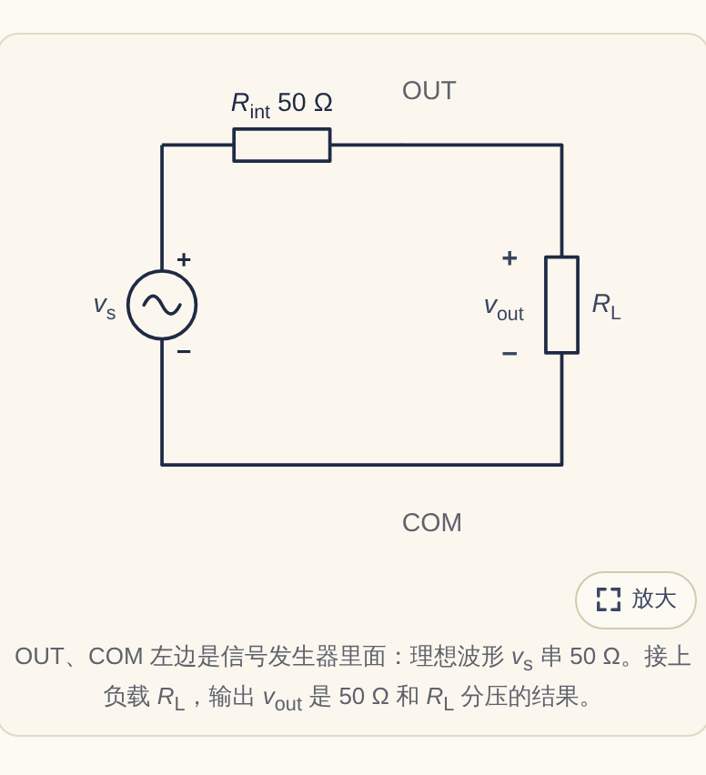

*图 `inside`（schematic）：OUT、COM 左边是信号发生器里面：理想波形 v_s 串 50 Ω。接上负载 R_L，输出 v_out 是 50 Ω 和 R_L 分压的结果。*

- R 比 50 Ω 大得多时几乎看不出；R 和 50 Ω 差不多时，波形就明显变小。
- 示波器测的是**针尖 − 接地夹**。接地夹要夹在 GND 上，读数才是“这一点对 GND”。

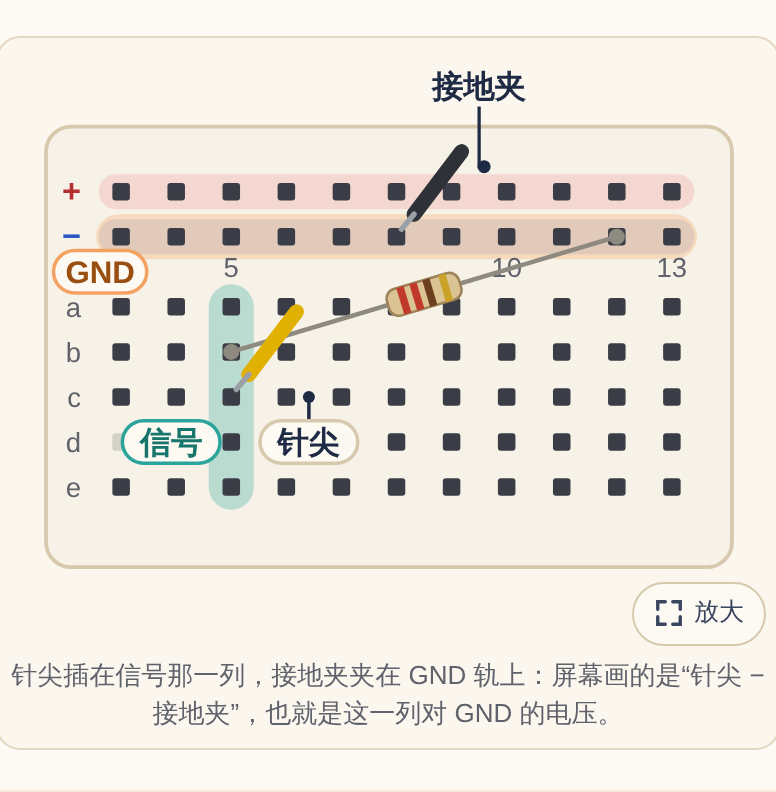

*图 `clip`（breadboard）：针尖插在信号那一列，接地夹夹在 GND 轨上：屏幕画的是“针尖 − 接地夹”，也就是这一列对 GND 的电压。*

（这一步下面列着这节课的计算卡片，点开就地展开：`generator-output`、`vpp-amplitude`，全文见第 6 节）

### 第 4 步 · 🔧 动手搭：夹错一次，再量分压

- 先**故意把接地夹夹错**：夹在和针尖同一列上。看「诊断」标签和屏幕。
- 改回来以后，再给信号加一个偏置。直流偏置也要经过那 50 Ω。
- 先在测量题里写预测，再读屏幕下面的读数。

**步骤 5**

**故意夹错一次**：删掉探头（选中它，按「删除」），重新放：针尖 **`c5`**，接地夹 **`d5`**——和针尖同一列，不是 GND。看「诊断」标签：它说什么？屏幕上剩下什么？

自动检查（做到这些才算完成）：把示波器探头插到 c5–d5
板上高亮的孔：c5、d5

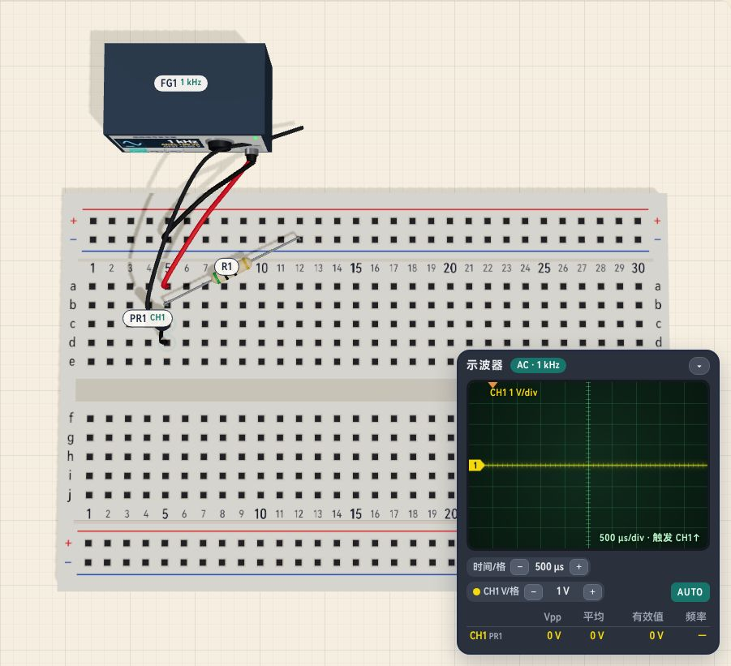

**步骤 6**

改回来：删掉探头，重新放，针尖 **`c5`**、接地夹 **`tn8`**。

自动检查（做到这些才算完成）：把示波器探头插到 c5–tn8
板上高亮的孔：c5、tn8

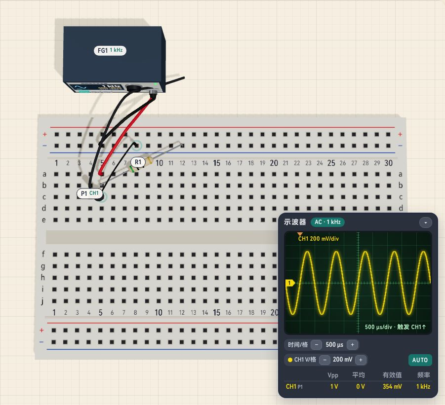

**步骤 7**

单击信号发生器，把**偏置**调到 **`+1 V`**。波形往上移了多少？先在测量题里写预测再看。

自动检查（做到这些才算完成）：把信号发生器插到 a5–tn5
板上高亮的孔：a5

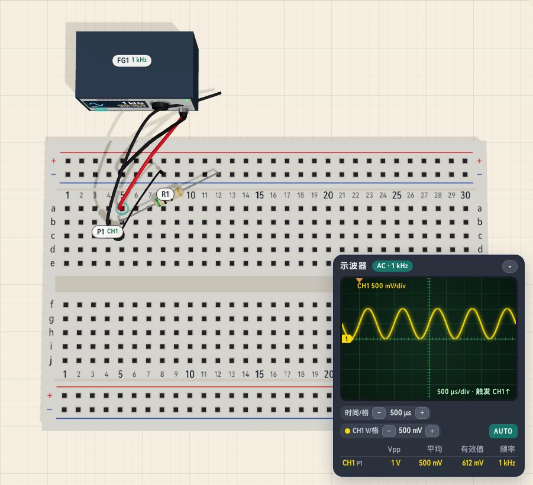

**步骤 8**

偏置调回 **`0 V`**。

自动检查（做到这些才算完成）：把信号发生器插到 a5–tn5
板上高亮的孔：a5

**步骤 9**

点**「检查我的电路」**，读示波器完成测量题（偏置那题先把偏置调到 `+1 V`）。

### 第 5 步 · 📏 测一测：测一测：读你自己的仪表

**测量题 1 · `vpp`**（读数题）

> 接着 50 Ω 负载、设定幅度 1 V：CH1 的峰峰值 Vpp

- 单位 V · 先写预测 · 状态：FG1 设为 信号发生器（正弦 1kHz 幅度 1V） · 参考答案的读数 **1 V** · 合理范围 [0.97, 1.03]

答对后显示：

> 2 Vpp × 50 / (50 + 50) = 1 Vpp：信号发生器自己的 50 Ω 和负载各分一半。

**测量题 2 · `rint`**（计算题（用自己的读数算））

> 用你的读数反算信号发生器里面的电阻：R_int = 50 Ω × (2 Vpp / 你的 Vpp − 1)

- 单位 Ω · 参考答案的读数 **50 Ω** · 合理范围 [45, 55] · 公式 `50 * (2 / vpp - 1)`

答对后显示：

> 分压 Vpp = 2 × 50 / (50 + R_int)，解出 R_int。读数是 1 Vpp 时正好 50 Ω。

**测量题 3 · `avg`**（读数题）

> 把偏置调到 +1 V：CH1 的平均值

- 单位 V · 先写预测 · 状态：FG1 设为 信号发生器（正弦 1kHz 幅度 1V） · 参考答案的读数 **0.5 V** · 合理范围 [0.48, 0.52]

答对后显示：

> 偏置是直流，同样被 50 Ω 和 50 Ω 分掉一半：0.5 V。

**测量题 4 · `clip`**（选择题）

> 接地夹夹在和针尖同一列时，屏幕上是什么？

- A. 还是原来的正弦波
- B. 一条 0 V 的直线 ✅（正确）
- C. 大一倍的正弦波

答对后显示：

> 针尖 − 接地夹 = 同一点减同一点 = 0。真实示波器还会把这一点短路到地。

### 第 6 步 · 🎒 带走：带走

- **信号发生器 = 理想波形 + 50 Ω。** 负载越小，输出被分掉得越多；直流偏置也一样。
- **接地夹只夹 GND。** 示波器只会测“针尖 − 接地夹”。
- **真实仪器**：很多信号发生器默认按“接 50 Ω 负载”显示幅度。接到高阻电路上，实际幅度是显示值的两倍——把输出设成 High-Z 显示才对。
- 真实示波器的接地夹都连到大地。夹在信号上，会把那一点直接短路到地。
- 下一课：两个探头一起用，比较两个电压谁先到。

## 3. 测量题一览

| # | id | 题目 | 类型 | 单位 | 状态 | 参考读数 |
|---|---|---|---|---|---|---|
| 1 | vpp | 接着 50 Ω 负载、设定幅度 1 V：CH1 的峰峰值 Vpp | scope | V | FG1 设为 信号发生器（正弦 1kHz 幅度 1V） | 1 V |
| 2 | rint | 用你的读数反算信号发生器里面的电阻：R_int = 50 Ω × (2 Vpp / 你的 Vpp − 1) | formula | Ω |  | 50 Ω |
| 3 | avg | 把偏置调到 +1 V：CH1 的平均值 | scope | V | FG1 设为 信号发生器（正弦 1kHz 幅度 1V） | 0.5 V |
| 4 | clip | 接地夹夹在和针尖同一列时，屏幕上是什么？ | 选择 |  |  | 正确：B |

### 全部答完后显示的「对比」

**对比**：设定 1 V 幅度（2 Vpp），接 50 Ω 负载后分压 50 / (50 + 50) = 1/2：峰峰值 **1.0 Vpp**，反算 R_int ≈ **50 Ω**；偏置 +1 V 时直流部分也被分掉一半，平均值 **0.5 V**。接地夹和针尖在同一点时，屏幕是 **0 V** 的直线。

### 提示按钮（依次显示）

1. 把信号发生器看成“理想波形 + 50 Ω”，和负载组成一个分压器。
2. 50 Ω 对 50 Ω 正好分一半：交流部分和直流偏置都一样。
3. 示波器画的是针尖减接地夹。两者在同一点上，差就是 0。

### 功能测试（「检查我的电路」时跑）

- 接上 50 Ω 负载后幅度变小

## 4. 用到的拆解（全部层的文字，供改写参考）

### 拆解 `function-generator`：信号发生器：一个会变的电压源 + 50 Ω

*function generator（信号发生器）按你的设定输出正弦波、方波或三角波。拆开看，它是一条“数字 → 模拟”的流水线；装回去，它就是电路课里的 **理想电压源 $v_s(t)$ 串联 50 Ω 内阻**——幅度、偏置、负载效应都从这个模型算出来。*

**拆解「信号发生器：一个会变的电压源 + 50 Ω」第 1 / 7 层：① 面板：波形、频率、幅度、偏置、输出**

信号发生器的面板只回答四个问题：**什么形状、多快、多大、中心在哪**，再加一个“开不开输出”。
- 波形按键：正弦（sine）、方波（square）、三角波（triangle）；
- 频率 FREQ：每秒重复多少次，单位 Hz；周期 $T = \frac{1}{f}$；
- 幅度 AMPL：波形最高点离中心线多远（峰值，peak）。很多仪器也可以按峰峰值 Vpp 或有效值 RMS 输入，**一定要看清单位**；
- 偏置 OFFSET：给整个波形加一个直流电压，把中心线上下平移；
- 输出 OUTPUT：一个 BNC 插座，旁边印着 **50 Ω**——这是输出电阻，第 ④ 层的主角。ON 键 打开输出。

下面的小图 是课程默认设定（1 kHz、幅度 1 V、偏置 0）输出的样子。在仿真里，这些设定都在元件的“属性”面板里；它有两根引线：红 + 和黑 COM，黑的那根接电路的 GND。

| 控件 | 设定什么 | 课程默认 | 在公式里是 |
|---|---|---|---|
| 波形 | 正弦 / 方波 / 三角波 | 正弦 | sin(·) 换成方波 / 三角函数 |
| 频率 FREQ | 每秒周期数 | 1 kHz | $f$，$T = 1/f$ = 1 ms |
| 幅度 AMPL | 峰值（离中心线） | 1 V | $A$ |
| 偏置 OFFSET | 直流平移 | 0 V | $V_{off}$ |
| 输出 OUTPUT | 开 / 关，内阻 50 Ω | ON | $R_o$ = 50 Ω |

**拆解「信号发生器：一个会变的电压源 + 50 Ω」第 2 / 7 层：② X 光：时钟 → DDS → DAC → 滤波 → 幅度 → 偏置 → 功放 → 50 Ω**

现代信号发生器里，波形是 **先算出来、再变成电压** 的。顺着信号走一遍：
1. 时钟：一颗晶振，给出非常稳定的 100 MHz 节拍——仪器频率准不准，全看它；
2. DDS（direct digital synthesis，直接数字合成）：每个节拍算出“现在走到一个周期的哪里”，再查表得到这一点的波形值（一个数字）；
3. DAC（digital-to-analog converter，数模转换器）：把数字变成电压，得到一串 **阶梯**；
4. 滤波器：低通滤波，把阶梯磨成光滑的曲线；
5. 幅度：衰减器 + 放大器，乘上你设的 A；
6. 加偏置：加上一个直流电压；
7. 功率放大器：能输出几十 mA，带得动负载；
8. 50 Ω 电阻：串在功放和 BNC 之间。它是 **故意放的**：高频电缆（同轴线）的特性阻抗是 50 Ω，源端串 50 Ω 可以吸收反射，波形不“振铃”。

前 4 块决定 **形状和频率**，后 4 块决定 **大小、位置和输出电阻**。下一层先看 DDS 怎么做出一个精确的频率。

| 方块 | 输入 → 输出 | 决定了 |
|---|---|---|
| 时钟 | — → 100 MHz 节拍 | 频率精度 |
| DDS | 节拍 → 波形值（数字） | 波形、频率 |
| DAC | 数字 → 阶梯电压 | 分辨率 |
| 滤波器 | 阶梯 → 平滑 | 正弦纯不纯 |
| 幅度 + 偏置 | × A, + offset | $A$, $V_{off}$ |
| 功放 + 50 Ω | → BNC | 输出电阻 $R_o$ |

**拆解「信号发生器：一个会变的电压源 + 50 Ω」第 3 / 7 层：③ DDS：频率 = 每个时钟转多少相位**

想象一个指针在圆上转（左图）：相位累加器 是一个 32 位的计数器，每来一个时钟就加上一个固定的数 M。计数器从 0 数到 $2^{32}$ 再回到 0，正好是 **一圈 = 一个周期**。指针的高度（投影）就是 $sin φ$——芯片里不算正弦，而是用 φ 去 **查一张存好的正弦表**。

一步步推频率：
1. 一圈有 $2^{32}$ 个单位，每个时钟走 M 个单位；
2. 转一圈要 $\frac{2^{32}}{M}$ 个时钟，每个时钟 $\frac{1}{f_{clk}}$ 秒；
3. 所以周期 $T = \frac{2^{32}}{M f_{clk}}$，频率
$$f_{out} = \frac{M f_{clk}}{2^{32}}$$
代数字（$f_{clk}$ = 100 MHz）：要 1 kHz，$M = \frac{1000 × 2^{32}}{10^{8}} ≈ 42950$；最小步进（M = 1）是 0.023 Hz。这就是为什么信号发生器能把频率设到小数点后好几位。

查表得到的数送进 DAC，出来的是阶梯；1 kHz 时一个周期有 $\frac{10^{8}}{10^{3}} = 100000$ 个台阶，细到看不见。频率越高，每周期台阶越少，所以要 滤波器 磨平。方波和三角波就是换一张表。

- 公式 `f_{out} = \frac{M f_{clk}}{2^{32}}`：DDS 的输出频率
- 公式 `Δf_{min} = \frac{f_{clk}}{2^{32}} = \frac{10^{8}}{4.29 × 10^{9}} ≈ 0.023 Hz`：频率分辨率

**拆解「信号发生器：一个会变的电压源 + 50 Ω」第 4 / 7 层：④ 等效电路：理想电压源串联 50 Ω**

把八个方块全部装回去，从红、黑两根引线看进去，信号发生器就是电路课里的 **戴维南模型**：
- 一个 理想电压源，电压随时间变化：
$$v_s(t) = V_{off} + A sin(2π f t)$$
- 串联一个 输出电阻 $R_o$ = 50 Ω。

右边的图 是 $V_{off}$ = 1 V、A = 1 V、f = 1 kHz：
- 偏置 把中心线抬到 1 V；
- 幅度 A 是中心线到波峰：1 V；
- 峰峰值 Vpp 是波谷到波峰：$Vpp = 2A$ = 2 V，波形在 0 V 和 2 V 之间。

**不接负载**（开路）时，50 Ω 上没有电流，也就没有压降，输出 就等于 $v_s(t)$——面板上设的值就是你在引线上看到的值（仿真里的设定就是这个“开路值”）。接上负载以后，第 ⑥ 层再算。

黑引线（COM）接电路的 GND。真实的仪器 COM 还连着外壳和电源插头的地线（大地），这一点在示波器那一篇很重要。

- 公式 `v_s(t) = V_{off} + A sin(2π f t)`：理想电压源的电压
- 公式 `v_{out} = v_s - i R_o`：开路时 $i = 0$，$v_{out} = v_s$

**拆解「信号发生器：一个会变的电压源 + 50 Ω」第 5 / 7 层：⑤ 幅度、峰峰值、有效值：三个数说的不是一回事**

同一个波形可以用三个数描述，弄混了读数就差 1.4 倍或 2 倍：
- **幅度 A**（amplitude，峰值 peak）：中心线到波峰；
- **峰峰值 Vpp**（peak-to-peak）：波谷到波峰，$Vpp = 2A$。示波器最容易读的就是它；
- **有效值 RMS**（root mean square，均方根）：在同一个电阻上产生 **同样热量** 的直流电压。万用表交流档读的就是它。

RMS 的定义一步步来：功率 $p = \frac{v^{2}}{R}$，取一个周期的平均，再问“多大的直流 V 给出同样的平均功率”：
$$V_{rms} = \sqrt{\frac{1}{T}∫_{0}^{T} v^{2} dt}$$
正弦：$sin^{2}$ 的平均是 $\frac{1}{2}$，所以 $V_{rms} = \frac{A}{\sqrt{2}}$。方波：$v^{2}$ 一直等于 $A^{2}$，$V_{rms} = A$。三角波：$v^{2}$ 的平均是 $\frac{A^{2}}{3}$，$V_{rms} = \frac{A}{\sqrt{3}}$。

正弦、方波、三角波 幅度都是 1 V（右图，绿色虚线是 RMS）。第 12 课接 50 Ω 负载后幅度 0.5 V：$V_{rms} = \frac{0.5}{\sqrt{2}} ≈ 0.354 V$。

| 波形 | 幅度 A | Vpp | RMS | A = 1 V 时 RMS | 平均值（无偏置） |
|---|---|---|---|---|---|
| 正弦 | A | 2A | $\frac{A}{\sqrt{2}}$ | 0.707 V | 0 |
| 方波 | A | 2A | A | 1.000 V | 0 |
| 三角波 | A | 2A | $\frac{A}{\sqrt{3}}$ | 0.577 V | 0 |

- 公式 `V_{rms} = \sqrt{\frac{1}{T}∫_{0}^{T} v^{2} dt}`：有效值的定义：等效发热
- 公式 `Vpp = 2A;  V_{rms,sine} = \frac{A}{\sqrt{2}}`：有偏置时 RMS 还要算上直流：$\sqrt{V_{off}^{2} + V_{rms,ac}^{2}}$

**拆解「信号发生器：一个会变的电压源 + 50 Ω」第 6 / 7 层：⑥ 接上负载：50 Ω 和负载电阻分压**

接上 负载电阻 $R_L$，回路里就有了电流，50 Ω 上开始有压降。这就是一个 **分压器**：
$$v_{out}(t) = v_s(t) \frac{R_L}{R_o + R_L}$$
注意它对 **每一个瞬间** 都成立，所以幅度、Vpp、RMS、偏置（直流部分）**都乘以同一个比例**，波形形状不变。

一步步代第 12 课的数字（设定 A = 1 V，即 2 Vpp）：
1. $R_L$ = 50 Ω：比例 $\frac{50}{50 + 50} = 0.5$，输出 1 Vpp，有效值 $\frac{0.5}{\sqrt{2}} = 0.354 V$；偏置设 1 V 时直流也只剩 0.5 V；
2. $R_L$ = 1 kΩ：比例 $\frac{1000}{1050} = 0.952$，1.905 Vpp；
3. 第 13 课的 RC（1 kHz 时阻抗约 1.88 kΩ）：比例 ≈ 0.974，CH1 ≈ 1.97 Vpp。

右图 是比例随 $R_L$ 的变化：$R_L$ 比 50 Ω 大 20 倍以上（> 1 kΩ），损失 < 5 %，课程里的 kΩ 级电路基本可以忽略 50 Ω；负载越接近 50 Ω，越不能忽略。

顺便：$R_L = R_o$ = 50 Ω 时负载得到的功率最大（最大功率传输），这正是射频世界都用 50 Ω 的原因之一。

| 负载 $R_L$ | 比例 | 输出（设 2 Vpp） | 哪里见到 |
|---|---|---|---|
| 开路 | 1 | 2 Vpp | 不接负载 |
| 50 Ω | 0.5 | 1 Vpp | 第 12 课 |
| 1 kΩ | 0.952 | 1.905 Vpp | RC 电路 |
| 1.88 kΩ | 0.974 | 1.97 Vpp | 第 13 课 CH1 |

- 公式 `v_{out} = v_s \frac{R_L}{R_o + R_L}`：对每个瞬间成立：幅度、偏置一起缩小

**拆解「信号发生器：一个会变的电压源 + 50 Ω」第 7 / 7 层：⑦ 局限：真实的信号发生器和仿真差在哪**

**最常见的坑**：很多真实信号发生器的幅度显示是 **按“接了 50 Ω 负载”算的**。你设 1 Vpp，它内部的 $v_s$ 其实是 2 Vpp，假设会被 50 Ω 负载分掉一半。接到 50 Ω 负载 上确实是 1 Vpp；但接到示波器、RC 电路这种 高阻负载 上，你看到的是 **2 Vpp**——“怎么大了一倍？”解决：把输出设置改成 **High-Z**，显示值就等于开路值。仿真里的设定就是开路值。

其他差别：
- 方波边沿 有上升时间（几 ns 到几十 ns），频率很高时方波会变圆；
- 输出有上限：高阻负载时约 ±10 V，最大电流几十 mA；
- 正弦有一点失真（谐波），DDS 的阶梯会在高频产生杂散；
- 仿真里第一个信号发生器决定时间基准，第二个最好是它的整数倍频率。

| 项目 | 真实信号发生器 | 仿真 |
|---|---|---|
| 幅度显示 | 常按 50 Ω 负载；High-Z 才等于开路值 | 开路值 |
| 输出电阻 | 50 Ω | 50 Ω |
| 方波边沿 | 上升时间几 ns–几十 ns | 按时间步长 |
| 最大输出 | ≈ ±10 V（高阻），几十 mA | 不限 |
| COM | 接外壳和大地 | 只是电路里的一个点 |

**一句话记住**：信号发生器 = 理想电压源 $v_s(t) = V_{off} + Asin(2πft)$ 串联 50 Ω。开路时输出就是设定值；接负载 $R_L$ 时整个波形乘以 $\frac{R_L}{50 + R_L}$。幅度是峰值，Vpp = 2A，正弦的 RMS = A/√2。

### 拆解 `oscilloscope`：示波器：会画图的电压表

*oscilloscope（示波器）每秒量电压几百万次，把 **电压随时间的变化** 画成一条曲线：纵轴是电压（V/div），横轴是时间（time/div）。拆开看它是衰减器 → 放大器 → ADC → 存储 → 显示，再加一个让画面静止的触发器；装回去，每个通道是一个对 **大地** 的高阻电压表——所以接地夹只能夹在 GND 上。*

**拆解「示波器：会画图的电压表」第 1 / 7 层：① 面板：一块带格子的屏幕、三组旋钮、两个输入**

示波器的面板分成四块：
- 屏幕：横向 10 格、纵向 8 格的网格（division，简写 div）。曲线 CH1（黄色） 是电压随时间的变化；
- **垂直**（vertical）：V/div 旋钮——纵向 **每格代表多少伏**；
- **水平**（horizontal）：time/div 旋钮——横向 **每格代表多少时间**；
- **触发**（trigger）：触发电平——让画面静止的那条橙色虚线（第 ④ 层）。

两个输入 CH1、CH2 各接一根 探头：针尖 碰要看的点，接地夹 夹在电路的 GND。屏幕上画的是 **针尖 − 接地夹** 的电压。

仿真里两个旋钮默认是 自动（AUTO）：示波器自己挑合适的 V/div 和 time/div；屏幕下面直接列出 读数（Vpp、频率、RMS、相位差）。

| 控件 | 作用 | 单位 | 怎么用 |
|---|---|---|---|
| 屏幕网格 | 10 × 8 格 | div | 数格子 |
| V/div | 纵向每格的电压 | mV/div, V/div | 让波形占 4–6 格高 |
| time/div | 横向每格的时间 | µs/div, ms/div | 让屏幕上有 1–3 个周期 |
| 触发电平 | 从哪个电压开始画 | V | 放在波形中间 |
| CH1 / CH2 | 打开 / 关闭通道 | — | CH1 看输入，CH2 看输出 |
| 探头 | 针尖 + 接地夹 | ×1 / ×10 | 接地夹 **只** 夹 GND |

**拆解「示波器：会画图的电压表」第 2 / 7 层：② 读屏幕：数格子 × 每格多少**

示波器上的一切读数都是 **格数 × 每格的值**：
- 纵向：波谷到波峰的格数 × V/div = 峰峰值 Vpp；
- 横向：一个周期的格数 × time/div = 周期 T；再取倒数得到频率。

用第 12 课的数字（1 kHz，设定幅度 1 V，接 50 Ω 负载）一步步来：
1. 示波器设在 200 mV/div、100 µs/div；
2. 波峰到波谷占 5 格：$Vpp = 5 × 200 mV = 1.0 V$（被 50 Ω 分掉了一半，第 ⑥ 层“信号发生器”）；
3. 一个周期占 10 格：$T = 10 × 100 µs = 1 ms$；
4. 频率 $f = \frac{1}{T} = \frac{1}{1 ms} = 1 kHz$；
5. 正弦的有效值 $V_{rms} = \frac{Vpp}{2\sqrt{2}} = \frac{1.0}{2.83} ≈ 0.354 V$。

屏幕下面的读数 就是示波器替你数好的结果。自己数一遍的意义在于：读数“看起来不对”时，你能从格子上一眼判断是波形不对，还是档位不对。

- 公式 `Vpp = N_{v} × (V/div)`：$N_v$ = 波谷到波峰的格数
- 公式 `T = N_{t} × (time/div);  f = \frac{1}{T}`：$N_t$ = 一个周期的格数

**拆解「示波器：会画图的电压表」第 3 / 7 层：③ X 光：衰减 → 放大 → ADC → 存储 → 显示，旁边一个触发器**

数字示波器（DSO，digital storage oscilloscope）里的信号路径：
1. 输入 BNC：对地 1 MΩ ∥ 15 pF；
2. 衰减器（attenuator）：大信号先除以 10 或 100，免得把后面烧坏；
3. 放大器：小信号放大，让它刚好占满 ADC 的输入范围。V/div 旋钮 实际上就是在选“衰减多少、放大多少”；
4. ADC：每隔一小段时间“拍一张”电压，变成 8 位数字（0–255）。time/div 决定隔多久拍一次（采样率）；
5. 存储器：存下一屏的采样点；
6. 显示：把点画成曲线，顺便算出 Vpp、频率、RMS；
7. 触发比较器：一直盯着信号，等它“向上穿过触发电平”的那一刻，告诉存储器“从这里开始记”。

还有一根看不见但最重要的线：输入 BNC 的 金属外壳接机壳，机壳接电源线的地线，也就是大地。探头的接地夹就连在这个外壳上。第 ⑥ 层会看到它的后果。

| 方块 | 作用 | 由哪个旋钮控制 |
|---|---|---|
| 衰减器 | 大信号 ÷10、÷100 | V/div |
| 放大器 | 小信号放大到满量程 | V/div |
| ADC | 采样 + 量化（8 位） | time/div（采样率） |
| 触发比较器 | 决定从哪一刻开始画 | 触发电平 |
| 存储 + 显示 | 画曲线、算读数 | — |

**拆解「示波器：会画图的电压表」第 4 / 7 层：④ 采样和触发：为什么画面能静止**

**采样**：屏幕上那条“连续”的线其实是一串点（橙色的点）。一屏有固定的点数（比如 1000 点），所以：
$$f_s = \frac{N}{10 × (time/div)}$$
100 µs/div 时一屏 1 ms、1000 点，采样率 $f_s$ = 1 MSa/s，每 1 µs 一个点——对 1 kHz 的正弦来说一个周期有 1000 个点，绰绰有余。规则：一个周期至少要有十几个点，波形才像样；少于 2 个点（奈奎斯特 Nyquist）就会画出一个假的、慢得多的波形（混叠 aliasing）。

**量化**：8 位 ADC 只有 $2^{8} = 256$ 级，分到 8 格上是每格 32 级。200 mV/div 时每级 $\frac{200 mV}{32} ≈ 6.3 mV$——这就是为什么要把波形调到占满屏幕：占得越满，读数越准。

**触发**：示波器一屏一屏地画，每秒画几十屏。如果每屏从随机时刻开始，波形就 在屏幕上乱跑。触发的规则是：信号向上穿过触发电平的那一刻放在屏幕正中。周期信号每个周期都会穿过一次，于是每屏都对齐在同一点，画面就静止了。触发电平放到波形范围之外（比如 5 V），就永远等不到触发，画面停住或乱跑。

- 公式 `f_s = \frac{N}{10 × (time/div)} = \frac{1000}{1 ms} = 1 MSa/s`：采样率
- 公式 `ΔV = \frac{8 × (V/div)}{2^{8}} = \frac{8 × 200 mV}{256} ≈ 6.3 mV`：8 位 ADC 的一级

**拆解「示波器：会画图的电压表」第 5 / 7 层：⑤ 一个通道的等效电路：对大地的 1 MΩ ∥ 15 pF**

从探头看进去，一个通道是：
- 理想电压表（只读电压，不取电流）；
- 并联 输入电阻 1 MΩ 和 输入电容约 15 pF；
- 另一端（接地夹）接 机壳，机壳接大地。

和万用表比：万用表是 **两端都浮空** 的 10 MΩ（红、黑都可以放在任何地方）；示波器的 **一端已经接地**——它量的是“针尖对大地”。

负载效应照样用戴维南算：$V_{meas} = V_{th}\frac{Z_{in}}{Z_{in} + R_{th}}$，只是 $Z_{in}$ 现在是 1 MΩ ∥ 15 pF，随频率变：
- 1 kHz：$X_C = \frac{1}{2π × 1000 × 15 pF} ≈ 10.6 MΩ$，主要是 1 MΩ 在起作用；量 1 kΩ 级的电路，误差约 $\frac{1 kΩ}{1 MΩ} = 0.1 %$；
- 1 MHz：$X_C ≈ 10.6 kΩ$，量 10 kΩ 级的高阻点就会明显变小、变慢。

所以高频、高阻时用 **×10 探头**（输入变成 10 MΩ ∥ 约 12 pF，信号缩小到 1/10，示波器自动乘回来）。仿真里的探头是理想的：没有 1 MΩ、没有 15 pF、接地夹也不接大地。

|  | 万用表（电压档） | 示波器通道（×1） | 仿真探头 |
|---|---|---|---|
| 输入电阻 | 10 MΩ | 1 MΩ | ∞ |
| 输入电容 | 不计 | ≈ 15 pF | 0 |
| 黑 / 接地端 | 浮空，放哪都行 | **接大地** | 不接大地 |
| 读的是 | 一个数（直流或 RMS） | 整条 v(t) 曲线 | 整条 v(t) 曲线 |

- 公式 `X_C = \frac{1}{2π f C_{in}}`：15 pF：1 kHz 时 10.6 MΩ，1 MHz 时 10.6 kΩ

**拆解「示波器：会画图的电压表」第 6 / 7 层：⑥ 接地夹为什么只能夹 GND**

上一层说了：接地夹 = 机壳 = 大地。信号发生器也一样，它的 COM 也通过电源线接大地。所以 **两台仪器的地，在插座里早就连在一起了**（图下方的 虚线）。

第 13 课的电路：信号发生器 → R1（1 kΩ）→ OUT → C1（100 nF）→ GND。如果把 CH2 的接地夹夹在 IN 点，会发生什么？一步步看：
1. 接地夹把 IN 连到示波器机壳 → 大地；
2. 大地经过插座连到信号发生器的 COM；
3. 所以 IN 和 COM 之间多了一根导线：信号发生器的输出被 **短路**，只剩它自己的 50 Ω 限流：
$$i = \frac{1 V}{50 Ω} = 20 mA（峰值）$$
4. IN 被拉到 0 V，CH1 看到一条平线，整个电路都变了。

能量大一点的电路（比如接市电的电源），这根“看不见的线”会烧掉探头甚至电路板。规则只有一句：**所有接地夹只夹在电路的 GND（信号发生器 COM 接的那一点）上。**

想看一个两端都不接地的元件（比如 R1）上的电压：两个探头都把接地夹放在 GND，CH1 量 IN、CH2 量 OUT，再用 MATH 功能看 CH1 − CH2。仿真里接地夹不接大地，夹错了也只是测“针尖 − 接地夹”，并给一条提示：这时 CH2 = OUT − IN = −V(R1)。

| 接地夹夹在 | 真实示波器 | 仿真 |
|---|---|---|
| 电路 GND | 正确 | 正确 |
| IN（信号发生器输出） | 输出被短路，IN = 0 V，20 mA | CH2 = OUT − IN，给提示 |
| 任何别的点 | 那一点被接地，电路变了 | 测两点之差，给提示 |

**拆解「示波器：会画图的电压表」第 7 / 7 层：⑦ 两个通道：峰峰值之比和相位差**

第 13 课：CH1 看 RC 的输入，CH2 看电容上的电压 OUT，两个接地夹都在 GND。同一个时基下，两条曲线可以直接比较。

**先算**（R = 1 kΩ，C = 100 nF，f = 1 kHz）：
1. 容抗 $X_C = \frac{1}{2π f C} = \frac{1}{2π × 1000 × 100 nF} ≈ 1592 Ω$；
2. 幅度比 $\frac{V_{OUT}}{V_{IN}} = \frac{X_C}{\sqrt{R^{2} + X_C^{2}}} = \frac{1592}{1880} ≈ 0.847$；
3. 输入端被信号发生器的 50 Ω 拉低一点：CH1 ≈ 1.97 Vpp，CH2 ≈ 0.847 × 1.97 ≈ 1.67 Vpp；
4. 相位 $φ = -arctan\frac{R}{X_C} = -arctan\frac{1000}{1592} ≈ -32°$。

**再在屏幕上读**：两个同频率的正弦，CH2 比 CH1 晚 Δt 到达波峰。一个 周期 T 对应 360°，所以
$$Δφ = -360° × \frac{Δt}{T}$$
反过来 $Δt = \frac{32°}{360°} × 1 ms ≈ 89 µs$，在 100 µs/div 下不到 1 格——要读准，可以把 time/div 调小，或者直接看屏幕下面的“相位差”读数。

负号 表示 CH2 **滞后**（lag）：电容要先充电，电压总是慢半拍。第 4 期的滤波器、相量实验都靠这个读数。

| 读数 | 预测 | 屏幕上怎么读 |
|---|---|---|
| CH1 Vpp | 1.97 V | ≈ 3.9 格 × 500 mV |
| CH2 Vpp | 1.67 V | ≈ 3.3 格 × 500 mV |
| T | 1 ms | 10 格 × 100 µs |
| Δt | 89 µs | ≈ 0.9 格 × 100 µs |
| 相位差 CH2 相对 CH1 | −32° | $-360° × \frac{Δt}{T}$ |

- 公式 `Δφ = -360° × \frac{Δt}{T} = -360° × \frac{89 µs}{1 ms} ≈ -32°`：CH2 晚到 → 负号（滞后）
- 公式 `\frac{V_{OUT}}{V_{IN}} = \frac{X_C}{\sqrt{R^{2} + X_C^{2}}} ≈ 0.847`：RC 低通在 1 kHz

**一句话记住**：示波器 = 每秒采样几百万次的电压表，画的是“针尖 − 接地夹”随时间的变化。读数 = 格数 × 每格的值：$Vpp = N_v × V/div$，$T = N_t × time/div$，$f = 1/T$，$Δφ = -360°·Δt/T$。每个通道是对 **大地** 的 1 MΩ ∥ 15 pF，所以接地夹只能夹 GND。

## 5. 这一课的计算卡片

**计算卡片 `generator-output`：信号发生器的 50 Ω 输出电阻**

- 公式 `V_{out} = V_{set} \frac{R_L}{50 Ω + R_L}`
- 用途：信号发生器 = 理想波形源串 50 Ω：接上负载以后输出比设定小多少。
- 输入：V_set（设定的幅度（或偏置），V）；R_o（输出电阻，Ω）；R_L（负载（电路的输入电阻），Ω） → V_out（端口上的实际值，V）

1. 发生器内部 = 一个理想波形源 + 串联的 50 Ω（$R_o$）。空载时端口电压就是设定值。
2. 接负载 $R_L$：$R_o$ 和 $R_L$ 分压，$V_{out} = V_{set}\frac{R_L}{R_o + R_L}$。交流部分和直流偏置都被同一个比例缩小。
3. $R_L ≫ 50 Ω$（几 kΩ 以上）时差别不到 1 %；50 Ω 负载正好减半。
4. 负载是 RC、RL 时用阻抗的模：$|V_{out}| = V_{set}\frac{|Z|}{|Z + R_o|}$，而且随频率变——所以滤波实验用端口电压（CH1）做参考。
5. 时间常数里要把 50 Ω 算进 R：$τ = (R + 50)C$。

例子：- 第 12 课：设 1 V，50 Ω 负载：0.5 V 幅度 = 1.0 Vpp；偏置 +1 V 也变成 0.5 V。
- 实验 2-7：反相放大器输入电阻 10 kΩ：$1 × \frac{10000}{10050} ≈ 0.995$，输出 2.19 Vpp 而不是 2.2。
- 实验 4-3：$|Z| = 142.5 Ω$，$|Z + 50| = |151 + j100.5| ≈ 181 Ω$：端口只有 $\frac{142.5}{181} ≈ 0.786 V$ 峰值（1.57 Vpp）。

- ⚠ 很多真实发生器按“接 50 Ω 负载”显示幅度：接高阻电路实际是显示值的两倍（除非设成 High-Z）。
- ⚠ 算 τ、谐振电流、RLC 阻尼时忘了这 50 Ω。

**计算卡片 `vpp-amplitude`：幅度、峰峰值与偏置 Amplitude and Vpp**

- 公式 `V_{pp} = 2A, V_{max} = V_{off} + A, V_{min} = V_{off} - A`
- 用途：信号发生器设的是幅度（峰值）和偏置，示波器读的是 Vpp、最大值、最小值：互相换算。
- 输入：A（幅度（中心线到波峰），V） → V_pp（峰峰值，V）

1. **幅度**（峰值）A：从中心线量到波峰。**峰峰值** Vpp：从波谷量到波峰，所以 $V_{pp} = 2A$。
2. **偏置** $V_{off}$：把整个波形上下平移，就是它的平均值（直流分量）。
3. 最大值 $V_{off} + A$，最小值 $V_{off} - A$。
4. 要一个 0 ↔ 5 V 的方波：$A = \frac{5 - 0}{2} = 2.5 V$，$V_{off} = \frac{5 + 0}{2} = 2.5 V$。
5. 在屏幕上数格：峰到谷的格数 × V/div = Vpp。

例子：实验 3-1：0–5 V 方波 = 幅度 2.5 V + 偏置 2.5 V，Vpp = 5 V。实验 3-5：0 ↔ 9 V = 幅度 4.5 V + 偏置 4.5 V。实验 2-7：幅度 0.5 V → 1 Vpp 输入，×2.2 → 2.2 Vpp 输出。

- ⚠ 把发生器的“幅度”当成 Vpp 设：信号大了一倍。

## 6. English（界面英文版的同一份内容）

展开英文

### Node 1 · 🔍 Look first：Meet it first: Function generator, Oscilloscope

**Teardown「Function generator: a time-varying source plus 50 Ω」layer 1 of 7：① Front panel: waveform, frequency, amplitude, offset, output**

A generator's front panel answers four questions — **what shape, how fast, how big, centred where** — plus "is the output on".
- waveform keys: sine, square, triangle;
- FREQ: repetitions per second, in Hz; period $T = \frac{1}{f}$;
- AMPL: how far the top of the wave is from the centre line (the peak). Many instruments also accept Vpp or RMS — **always check the unit**;
- OFFSET: adds a DC voltage to the whole wave, shifting its centre line up or down;
- OUTPUT: a BNC socket printed with **50 Ω** — the output resistance, the star of layer ④. The ON key enables it.

The little plot shows the course's default setting (1 kHz, amplitude 1 V, offset 0). In the simulator these settings are in the part's Properties; it has two leads, red + and black COM, and the black one goes to the circuit's GND.

| Control | Sets | Course default | In the formula |
|---|---|---|---|
| waveform | sine / square / triangle | sine | sin(·) or square / triangle |
| FREQ | periods per second | 1 kHz | $f$，$T = 1/f$ = 1 ms |
| AMPL | peak (from centre) | 1 V | $A$ |
| OFFSET | DC shift | 0 V | $V_{off}$ |
| OUTPUT | on / off, 50 Ω inside | ON | $R_o$ = 50 Ω |

**Teardown「Oscilloscope: a voltmeter that draws」layer 1 of 7：① Front: a gridded screen, three groups of knobs, two inputs**

A scope's front has four areas:
- the screen: a grid 10 divisions wide and 8 high (div). The trace CH1 (yellow) is the voltage against time;
- **vertical**: the V/div knob — **volts per division** up the screen;
- **horizontal**: the time/div knob — **time per division** across;
- **trigger**: the trigger level — the orange dashed line that makes the picture stand still (layer ④).

The two inputs CH1 and CH2 each take a probe: the tip touches the point you want, the ground clip goes on the circuit's GND. The screen shows **tip − ground clip**.

In the simulator both knobs default to AUTO: the scope picks a sensible V/div and time/div itself, and the readouts under the screen list Vpp, frequency, RMS and phase.

| Control | Does | Unit | How to use |
|---|---|---|---|
| screen grid | 10 × 8 divisions | div | count divisions |
| V/div | volts per vertical div | mV/div, V/div | make the wave 4–6 div tall |
| time/div | time per horizontal div | µs/div, ms/div | show 1–3 periods |
| trigger level | the voltage a sweep starts at | V | inside the waveform |
| CH1 / CH2 | channel on / off | — | CH1 input, CH2 output |
| probe | tip + ground clip | ×1 / ×10 | clip on GND **only** |

### Node 2 · 🔧 Build：Swap a resistor and the wave shrinks

First rebuild the last lesson's circuit: generator, a **`100 kΩ`** resistor, one probe.
Then change only the resistor, to **`50 Ω`**, without touching a single generator knob.
What happened to the wave? The generator's settings didn't change — so why?

**Step 1**

**Function generator**: red clip **`a5`**, black clip **`tn5`**. Keep sine, **`1 kHz`**, amplitude **`1 V`**, offset **`0 V`**.

Checked automatically：Place the Function generator at a5–tn5
Holes highlighted：a5、tn5

**Step 2**

**Scope probe**: tip **`c5`**, ground clip **`tn8`**.

Checked automatically：Place the Scope probe at c5–tn8
Holes highlighted：c5、tn8

**Step 3**

**Resistor R1**: **`b5`** and **`tn12`**, set to **`100 kΩ`**. Remember how tall the wave is.

Checked automatically：Place the Resistor at b5–tn12
Holes highlighted：b5、tn12

**Step 4**

Click R1 and change it to **`50 Ω`** (custom) in Properties. Leave the generator alone. What happened to the wave?

Checked automatically：Place the Resistor at b5–tn12
Holes highlighted：b5、tn12

### Node 3 · 💡 Why：A resistor sits inside the generator

- Inside, the generator is not an ideal voltage but an **ideal waveform in series with a 50 Ω resistor** — just like the 1.5 Ω inside the 9 V battery in 1.10.
- Connect a load R and the 50 Ω and R form a **voltage divider**. With a 1 kΩ load, for example:
$$V_{out} = 2 Vpp × \frac{1000}{50 + 1000}$$

[figure `inside`]

*Figure `inside`（schematic）：OUT、COM 左边是信号发生器里面：理想波形 v_s 串 50 Ω。接上负载 R_L，输出 v_out 是 50 Ω 和 R_L 分压的结果。*

- With R much larger than 50 Ω you hardly notice; with R near 50 Ω the wave clearly shrinks.
- The scope measures **tip − ground clip**. The clip has to be on GND for the reading to mean "this point relative to GND".

[figure `clip`]

*Figure `clip`（breadboard）：针尖插在信号那一列，接地夹夹在 GND 轨上：屏幕画的是“针尖 − 接地夹”，也就是这一列对 GND 的电压。*

(This node lists the lesson’s calculation cards: `generator-output`、`vpp-amplitude`; full text in section 6)

### Node 4 · 🔧 Build：Clip it wrong once, then measure the divider

- First **put the ground clip in the wrong place on purpose**: in the same column as the tip. Look at the Diagnostics tab and the screen.
- After fixing it, add an offset to the signal. The DC offset has to pass the 50 Ω too.
- Write your prediction in each question first, then read the numbers under the screen.

**Step 5**

**Clip it wrong once, on purpose**: delete the probe (select it, press Delete) and place it again: tip **`c5`**, ground clip **`d5`** — the tip's own column, not GND. Read the Diagnostics tab: what does it say? What is left on the screen?

Checked automatically：Place the Scope probe at c5–d5
Holes highlighted：c5、d5

**Step 6**

Fix it: delete the probe and place it again, tip **`c5`**, ground clip **`tn8`**.

Checked automatically：Place the Scope probe at c5–tn8
Holes highlighted：c5、tn8

**Step 7**

Click the generator and set the **offset** to **`+1 V`**. How far did the wave move up? Write your prediction in the questions first.

Checked automatically：Place the Function generator at a5–tn5
Holes highlighted：a5

**Step 8**

Set the offset back to **`0 V`**.

Checked automatically：Place the Function generator at a5–tn5
Holes highlighted：a5

**Step 9**

Press **Check my circuit** and answer the questions from the scope (set the offset to `+1 V` for the offset question).

### Node 5 · 📏 Measure：Measure: read your own instruments

**Question 1 · `vpp`**（reading）

> With the 50 Ω load and 1 V amplitude set: CH1 peak-to-peak Vpp

- unit V · predict first · state：FG1 is set to Function generator (sine 1kHz 1V peak) · range [0.97, 1.03]

Shown once right:

> 2 Vpp × 50 / (50 + 50) = 1 Vpp: the generator's own 50 Ω and the load take half each.

**Question 2 · `rint`**（calculation from own readings）

> From your reading, work back to the resistance inside the generator: R_int = 50 Ω × (2 Vpp / your Vpp − 1)

- unit Ω · range [45, 55] · formula `50 * (2 / vpp - 1)`

Shown once right:

> The divider gives Vpp = 2 × 50 / (50 + R_int); solve for R_int. A 1 Vpp reading gives exactly 50 Ω.

**Question 3 · `avg`**（reading）

> Offset at +1 V: CH1's average

- unit V · predict first · state：FG1 is set to Function generator (sine 1kHz 1V peak) · range [0.48, 0.52]

Shown once right:

> The offset is DC and is halved by the 50 Ω and 50 Ω as well: 0.5 V.

**Question 4 · `clip`**（multiple choice）

> With the ground clip in the same column as the tip, what was on the screen?

- A. the same sine as before
- B. a flat line at 0 V ✅ (right)
- C. a sine twice as tall

Shown once right:

> Tip − clip = the same point minus itself = 0. A real scope would also short that point to ground.

### Node 6 · 🎒 Take away：Take away

- **A generator = an ideal waveform + 50 Ω.** The smaller the load, the more of the output is lost; the DC offset too.
- **The ground clip goes on GND only.** A scope only ever measures "tip − clip".
- **Real instruments**: many generators display the amplitude assuming a 50 Ω load. Into a high-resistance circuit the real amplitude is twice the display — set the output to High-Z.
- A real scope's ground clips all go to mains earth. Clipped onto a signal, it shorts that point straight to ground.
- Next: two probes at once, to see which of two voltages arrives first.

**Compare**

**Compare**: 1 V amplitude set (2 Vpp); with the 50 Ω load the divider gives 50 / (50 + 50) = 1/2: **1.0 Vpp**, R_int ≈ **50 Ω** worked back; with +1 V offset the DC part is halved too, average **0.5 V**. With the clip on the tip's point the screen shows a flat **0 V** line.

**Hints**

1. Think of the generator as "ideal waveform + 50 Ω", forming a divider with the load.
2. 50 Ω against 50 Ω splits exactly in half: the AC part and the DC offset alike.
3. The scope draws tip minus clip. With both on the same point the difference is 0.

