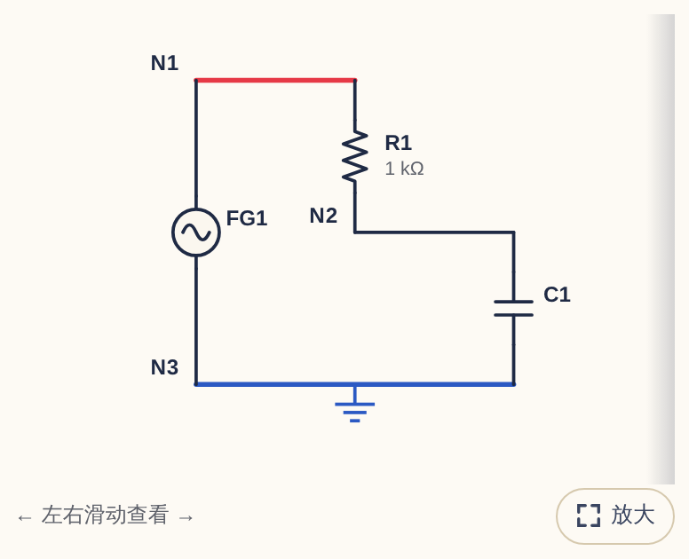
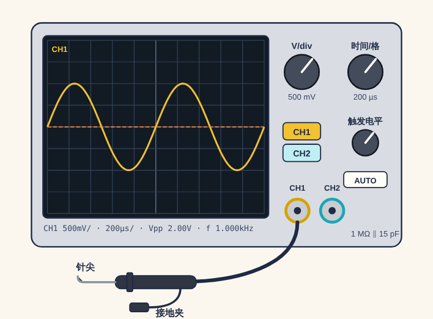
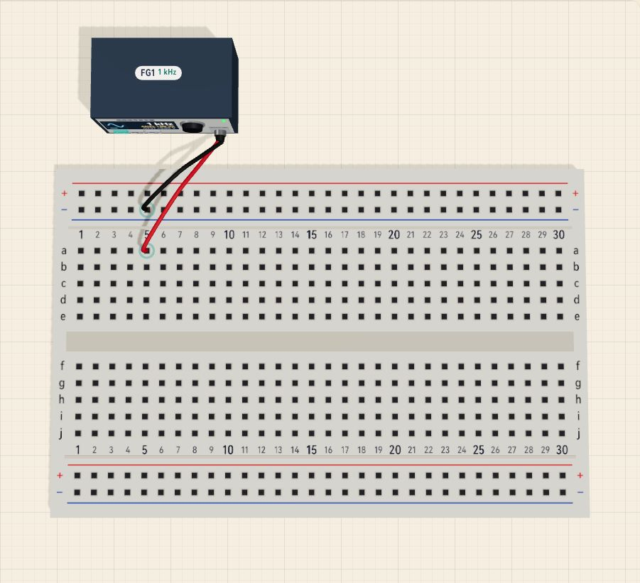
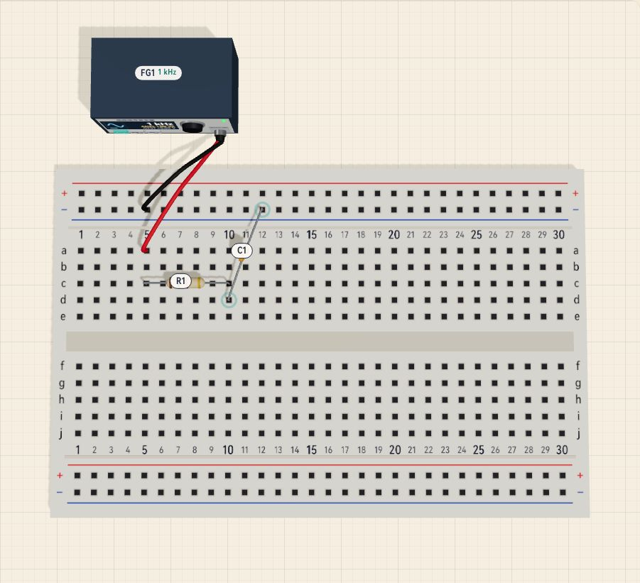
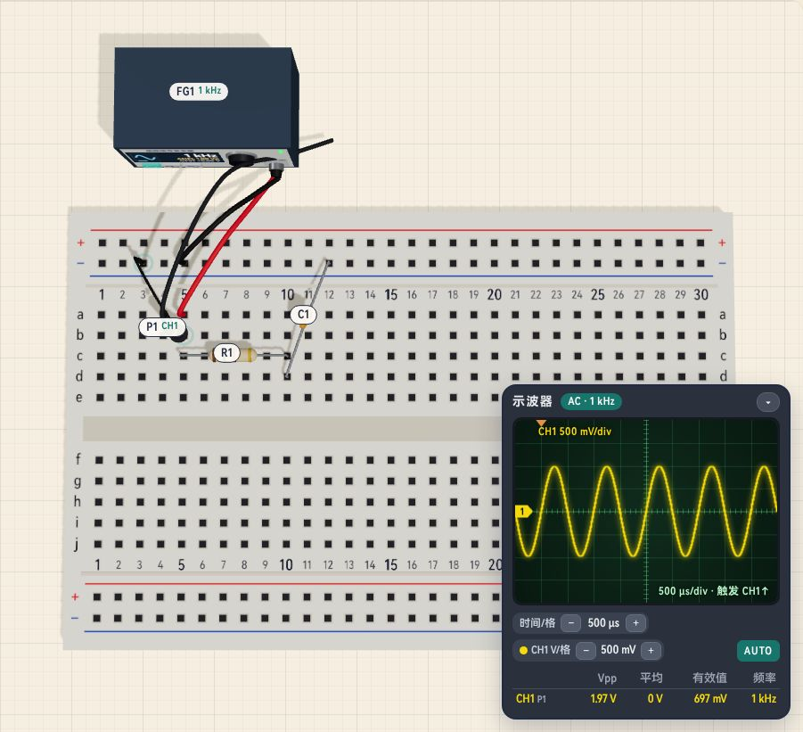
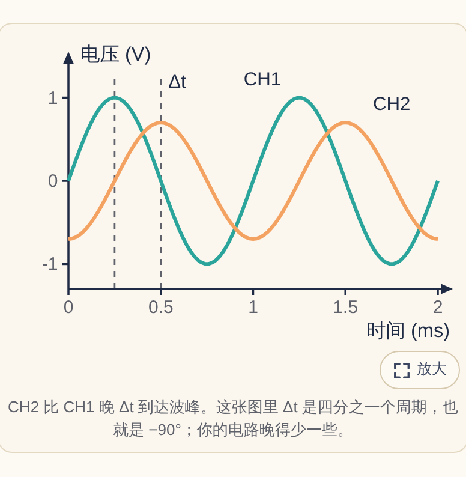
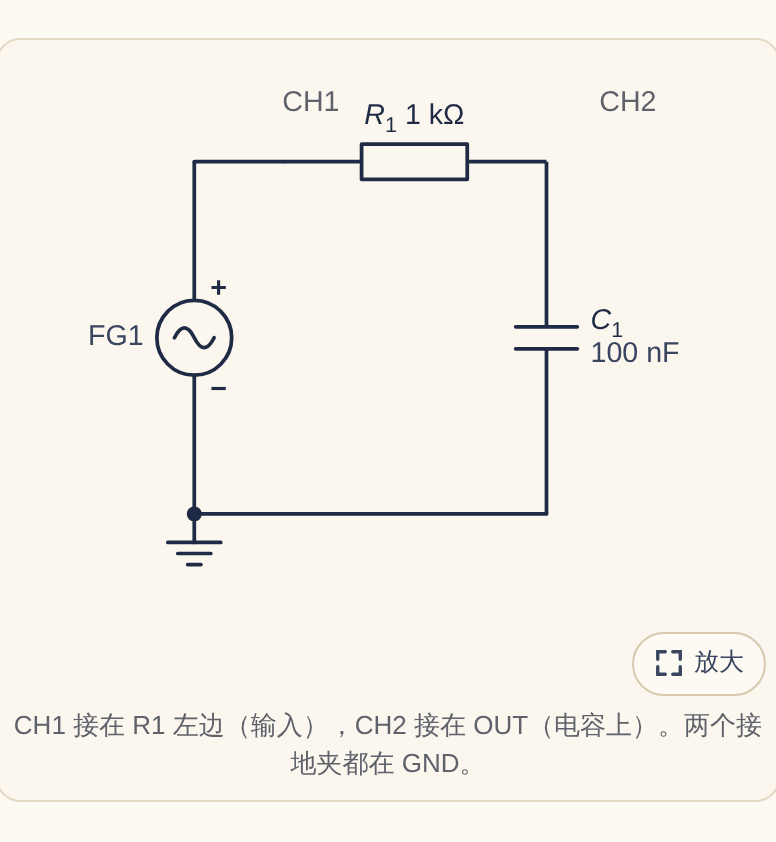
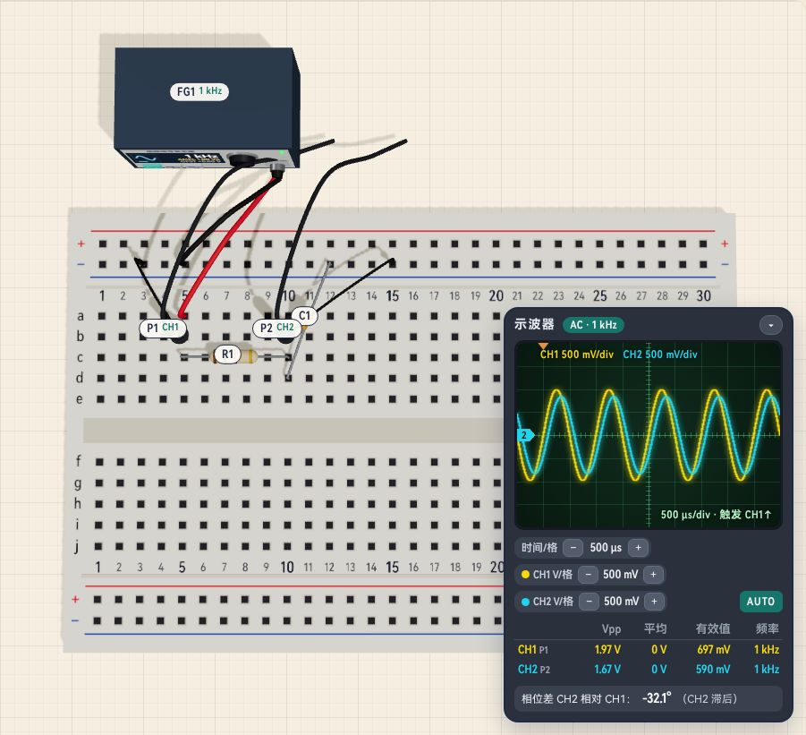

# 3.5 · 示波器双通道：谁先到、谁后到

| 项目 | 内容 |
|---|---|
| id | `lesson-scope-two-channels` |
| 文件 | `challenges/105-lesson-scope-two-channels.json` |
| 类型 | 课程（有分步，每步自动检查） · 难度 3/5 |
| 位置 | World 3 · 运算放大器基础 → 3.5 信号发生器和示波器（本节第 3 项） |
| 右侧面板 | 轨道由旧的四张卡片自动生成（还没手工精排） |
| 前后 | 上一项 [3.5 lesson-generator-load](../w3/3.05-2-lesson-generator-load.md) · 下一项 [3.6 w3-5e-inverting](../w3/3.06-1-w3-5e-inverting.md) |
| 先修 | lesson-generator-load |
| 概念 | oscilloscope 示波器、CH1 / CH2 双通道、phase difference 相位差、lag / lead 滞后 / 超前 |

**一句话概要**：CH1 看输入、CH2 看输出，同时比较两个电压的大小和时间：晚到的那个有一个相位差。

## 1. 左侧工作台（3D 面包板 → 2D 俯视截图）

截图是程序里真实的 3D 面包板换成俯视角拍的；表格是同一块板的文字版（元件、参数、每只脚插在哪个孔）。

### 1.1 起点：空面包板（学生从零开始搭）

### 1.2 每一步之后的面包板

见第 2 节每个步骤下面的截图（按步骤的自动检查重建：放 / 改 / 拔元件、移动万用表表笔）。

### 1.3 参考答案（「看答案」载入的板子）

| 元件 | 类型 | 参数 | 引脚 → 孔 |
|---|---|---|---|
| FG1 | function_gen | waveform=sine, frequency=1000, amplitude=1, offset=0 | +→a5 -→tn5 |
| R1 | resistor | resistance=1000 | 1→c5 2→c10 |
| C1 | capacitor | capacitance=1.0000000000000001e-7 | 1→d10 2→tn12 |
| P1 | scope_probe | channel=1 | tip→b5 gnd→tn3 |
| P2 | scope_probe | channel=2 | tip→b10 gnd→tn15 |

### 1.4 目标原理图（右侧「目标原理图」抽屉）

| 元件 | 类型 | 参数 |
|---|---|---|
| FG1 | function_gen |  |
| R1 | resistor | resistance=1000 |
| C1 | capacitor | capacitance=1.0000000000000001e-7 |

连接（每个结点上的引脚）：

- **N1**：FG1.+、R1.1
- **N2**：R1.2、C1.1
- **N3**：C1.2、FG1.-

## 2. 右侧面板：学生从上往下看到的内容（单轨流）

### 第 1 步 · 🔍 先看一眼：先认识它：示波器

**拆解「示波器：会画图的电压表」第 1 / 7 层：① 面板：一块带格子的屏幕、三组旋钮、两个输入**

示波器的面板分成四块：
- 屏幕：横向 10 格、纵向 8 格的网格（division，简写 div）。曲线 CH1（黄色） 是电压随时间的变化；
- **垂直**（vertical）：V/div 旋钮——纵向 **每格代表多少伏**；
- **水平**（horizontal）：time/div 旋钮——横向 **每格代表多少时间**；
- **触发**（trigger）：触发电平——让画面静止的那条橙色虚线（第 ④ 层）。

两个输入 CH1、CH2 各接一根 探头：针尖 碰要看的点，接地夹 夹在电路的 GND。屏幕上画的是 **针尖 − 接地夹** 的电压。

仿真里两个旋钮默认是 自动（AUTO）：示波器自己挑合适的 V/div 和 time/div；屏幕下面直接列出 读数（Vpp、频率、RMS、相位差）。

| 控件 | 作用 | 单位 | 怎么用 |
|---|---|---|---|
| 屏幕网格 | 10 × 8 格 | div | 数格子 |
| V/div | 纵向每格的电压 | mV/div, V/div | 让波形占 4–6 格高 |
| time/div | 横向每格的时间 | µs/div, ms/div | 让屏幕上有 1–3 个周期 |
| 触发电平 | 从哪个电压开始画 | V | 放在波形中间 |
| CH1 / CH2 | 打开 / 关闭通道 | — | CH1 看输入，CH2 看输出 |
| 探头 | 针尖 + 接地夹 | ×1 / ×10 | 接地夹 **只** 夹 GND |

### 第 2 步 · 🔧 动手搭：两个探头，两条波

搭一个电阻加一个**电容**的小电路。电容是 3.3 才正式认识的元件；现在只要知道：它要一点时间才能“充满”。
放两个探头：一个看输入，一个看电容。
屏幕上有黄、青两条波。哪一条先到达波峰？

**步骤 1**

**信号发生器**：红夹子 **`a5`**、黑夹子 **`tn5`**。保持正弦、**`1 kHz`**、幅度 **`1 V`**、偏置 **`0 V`**。

自动检查（做到这些才算完成）：把信号发生器插到 a5–tn5
板上高亮的孔：a5、tn5

**步骤 2**

**电阻 R1**：**`c5`** → **`c10`**，**`1 kΩ`**。

自动检查（做到这些才算完成）：把电阻插到 c5–c10
板上高亮的孔：c5、c10

**步骤 3**

**电容 C1**：单击 **`d10`** 和 **`tn12`**，**`100 nF`**（默认值）。第 10 列就是 **OUT**。

自动检查（做到这些才算完成）：把电容插到 d10–tn12
板上高亮的孔：d10、tn12

**步骤 4**

第一个**探头**（CH1，黄色）：针尖 **`b5`**（输入），接地夹 **`tn3`**（GND）。

自动检查（做到这些才算完成）：把示波器探头插到 b5–tn3
板上高亮的孔：b5、tn3

**步骤 5**

第二个**探头**（自动接 CH2，青色）：针尖 **`b10`**（OUT），接地夹 **`tn15`**（GND）。看屏幕：哪条波先到波峰？

自动检查（做到这些才算完成）：把示波器探头插到 b10–tn15
板上高亮的孔：b10、tn15

### 第 3 步 · 💡 想明白：晚到多少，用角度说

- 两条波频率一样、形状一样，只是一条**晚到**一点。晚的时间叫 Δt。
- 像两个人在操场上跑圈：跑完一圈是 360°，落后半圈就是 180°。所以晚到的时间换成角度：
$$φ = \frac{Δt}{T} × 360°$$
- 例如晚 0.25 ms、周期 1 ms：φ = 0.25 / 1 × 360° = 90°。

*图 `lag`（plot）：CH2 比 CH1 晚 Δt 到达波峰。这张图里 Δt 是四分之一个周期，也就是 −90°；你的电路晚得少一些。*

- CH2 比 CH1 晚，就说 CH2 **滞后**，相位差记成负数。屏幕下面直接显示“相位差 CH2 相对 CH1”。

*图 `rc`（schematic）：CH1 接在 R1 左边（输入），CH2 接在 OUT（电容上）。两个接地夹都在 GND。*

（这一步下面列着这节课的计算卡片，点开就地展开：`generator-output`、`phase-from-delay`、`capacitive-reactance`、`rc-impedance`、`ac-kvl`、`rc-lowpass`、`first-order-phase`，全文见第 6 节）

### 第 4 步 · 🔧 动手搭：读两个通道

- 把时间/格调到 **`100 µs`**，数一数两个波峰之间隔了几格。
- 两个电压的大小、相位差都在屏幕下面。电压小的那条也是晚到的那条吗？

**步骤 6**

把**时间/格**调到 **`100 µs`**、两个通道的**伏/格**都调到 **`0.5 V`**。两个波峰之间隔了几格？

自动检查（做到这些才算完成）：示波器时间/格调到 100 µs（现在是 AUTO，用 − / + 调）；示波器CH1 伏/格调到 500 mV（现在是 AUTO，用 − / + 调）；示波器CH2 伏/格调到 500 mV（现在是 AUTO，用 − / + 调）

**步骤 7**

点**「检查我的电路」**，读示波器屏幕下面的读数完成测量题。

### 第 5 步 · 📏 测一测：测一测：读你自己的仪表

**测量题 1 · `v1`**（读数题）

> CH1（输入）的峰峰值

- 单位 V · 状态：FG1 设为 信号发生器（正弦 1kHz 幅度 1V） · 参考答案的读数 **1.972 V** · 合理范围 [1.9, 2]

答对后显示：

> 比 2 Vpp 略小：信号发生器的 50 Ω 分掉了一点点（上一课）。

**测量题 2 · `v2`**（读数题）

> CH2（OUT，电容上）的峰峰值

- 单位 V · 状态：FG1 设为 信号发生器（正弦 1kHz 幅度 1V） · 参考答案的读数 **1.669 V** · 合理范围 [1.6, 1.74]

答对后显示：

> 比输入小：电容还没充满，输入就已经往回走了。

**测量题 3 · `ph`**（读数题）

> 相位差：CH2 相对 CH1（度，带符号）

- 单位 ° · 状态：FG1 设为 信号发生器（正弦 1kHz 幅度 1V） · 参考答案的读数 **-32.15 °** · 合理范围 [-35, -29]

答对后显示：

> 约 −32°：负号表示 CH2 滞后。

**测量题 4 · `dt`**（计算题（用自己的读数算））

> 用你读到的相位差算 CH2 比 CH1 晚多少时间：Δt = |φ| / 360° × T（T = 1 ms）

- 单位 µs · 参考答案的读数 **89.3 µs** · 合理范围 [0.00008, 0.000098] · 公式 `-ph / 360 / 1000`

答对后显示：

> 约 89 µs：在 100 µs/格 时还不到 1 格。

**测量题 5 · `late`**（选择题）

> 哪个通道先到达波峰？

- A. CH2 先到
- B. CH1 先到，CH2 滞后 ✅（正确）
- C. 同时到

答对后显示：

> CH1 先到。电容要时间充电，它两端的电压总是跟在输入后面。

### 第 6 步 · 🎒 带走：带走

- **CH1 看输入，CH2 看输出**，两个接地夹都夹 GND。
- **φ = Δt / T × 360°**；晚到的一方相位差为负（滞后）。
- 想看 R1 这种两端都不接地的元件的电压，用两个探头看 **CH1 − CH2**（很多示波器有 MATH 功能），不要把接地夹夹到中间去。
- 为什么正好是这个大小、这个角度？第 4 世界用相量来算。

## 3. 测量题一览

| # | id | 题目 | 类型 | 单位 | 状态 | 参考读数 |
|---|---|---|---|---|---|---|
| 1 | v1 | CH1（输入）的峰峰值 | scope | V | FG1 设为 信号发生器（正弦 1kHz 幅度 1V） | 1.972 V |
| 2 | v2 | CH2（OUT，电容上）的峰峰值 | scope | V | FG1 设为 信号发生器（正弦 1kHz 幅度 1V） | 1.669 V |
| 3 | ph | 相位差：CH2 相对 CH1（度，带符号） | scope | ° | FG1 设为 信号发生器（正弦 1kHz 幅度 1V） | -32.15 ° |
| 4 | dt | 用你读到的相位差算 CH2 比 CH1 晚多少时间：Δt = \|φ\| / 360° × T（T = 1 ms） | formula | µs |  | 89.3 µs |
| 5 | late | 哪个通道先到达波峰？ | 选择 |  |  | 正确：B |

### 全部答完后显示的「对比」

**对比**：CH1 ≈ **1.97 Vpp**（50 Ω 分掉一点），CH2 ≈ **1.67 Vpp**；相位差 ≈ **−32°**（CH2 滞后），Δt = 32 / 360 × 1 ms ≈ **89 µs**。这两个数怎么算出来：第 4 世界的相量。

### 提示按钮（依次显示）

1. CH1 是输入，CH2 是电容上的电压；两个接地夹都在 GND。
2. 相位差 = Δt / T × 360°。CH2 晚到，相位差为负。
3. Δt = |相位差| / 360° × 周期。

### 功能测试（「检查我的电路」时跑）

- 电容上的电压比输入小、比输入晚

## 4. 用到的拆解（全部层的文字，供改写参考）

### 拆解 `oscilloscope`：示波器：会画图的电压表

*oscilloscope（示波器）每秒量电压几百万次，把 **电压随时间的变化** 画成一条曲线：纵轴是电压（V/div），横轴是时间（time/div）。拆开看它是衰减器 → 放大器 → ADC → 存储 → 显示，再加一个让画面静止的触发器；装回去，每个通道是一个对 **大地** 的高阻电压表——所以接地夹只能夹在 GND 上。*

**拆解「示波器：会画图的电压表」第 1 / 7 层：① 面板：一块带格子的屏幕、三组旋钮、两个输入**

示波器的面板分成四块：
- 屏幕：横向 10 格、纵向 8 格的网格（division，简写 div）。曲线 CH1（黄色） 是电压随时间的变化；
- **垂直**（vertical）：V/div 旋钮——纵向 **每格代表多少伏**；
- **水平**（horizontal）：time/div 旋钮——横向 **每格代表多少时间**；
- **触发**（trigger）：触发电平——让画面静止的那条橙色虚线（第 ④ 层）。

两个输入 CH1、CH2 各接一根 探头：针尖 碰要看的点，接地夹 夹在电路的 GND。屏幕上画的是 **针尖 − 接地夹** 的电压。

仿真里两个旋钮默认是 自动（AUTO）：示波器自己挑合适的 V/div 和 time/div；屏幕下面直接列出 读数（Vpp、频率、RMS、相位差）。

| 控件 | 作用 | 单位 | 怎么用 |
|---|---|---|---|
| 屏幕网格 | 10 × 8 格 | div | 数格子 |
| V/div | 纵向每格的电压 | mV/div, V/div | 让波形占 4–6 格高 |
| time/div | 横向每格的时间 | µs/div, ms/div | 让屏幕上有 1–3 个周期 |
| 触发电平 | 从哪个电压开始画 | V | 放在波形中间 |
| CH1 / CH2 | 打开 / 关闭通道 | — | CH1 看输入，CH2 看输出 |
| 探头 | 针尖 + 接地夹 | ×1 / ×10 | 接地夹 **只** 夹 GND |

**拆解「示波器：会画图的电压表」第 2 / 7 层：② 读屏幕：数格子 × 每格多少**

示波器上的一切读数都是 **格数 × 每格的值**：
- 纵向：波谷到波峰的格数 × V/div = 峰峰值 Vpp；
- 横向：一个周期的格数 × time/div = 周期 T；再取倒数得到频率。

用第 12 课的数字（1 kHz，设定幅度 1 V，接 50 Ω 负载）一步步来：
1. 示波器设在 200 mV/div、100 µs/div；
2. 波峰到波谷占 5 格：$Vpp = 5 × 200 mV = 1.0 V$（被 50 Ω 分掉了一半，第 ⑥ 层“信号发生器”）；
3. 一个周期占 10 格：$T = 10 × 100 µs = 1 ms$；
4. 频率 $f = \frac{1}{T} = \frac{1}{1 ms} = 1 kHz$；
5. 正弦的有效值 $V_{rms} = \frac{Vpp}{2\sqrt{2}} = \frac{1.0}{2.83} ≈ 0.354 V$。

屏幕下面的读数 就是示波器替你数好的结果。自己数一遍的意义在于：读数“看起来不对”时，你能从格子上一眼判断是波形不对，还是档位不对。

- 公式 `Vpp = N_{v} × (V/div)`：$N_v$ = 波谷到波峰的格数
- 公式 `T = N_{t} × (time/div);  f = \frac{1}{T}`：$N_t$ = 一个周期的格数

**拆解「示波器：会画图的电压表」第 3 / 7 层：③ X 光：衰减 → 放大 → ADC → 存储 → 显示，旁边一个触发器**

数字示波器（DSO，digital storage oscilloscope）里的信号路径：
1. 输入 BNC：对地 1 MΩ ∥ 15 pF；
2. 衰减器（attenuator）：大信号先除以 10 或 100，免得把后面烧坏；
3. 放大器：小信号放大，让它刚好占满 ADC 的输入范围。V/div 旋钮 实际上就是在选“衰减多少、放大多少”；
4. ADC：每隔一小段时间“拍一张”电压，变成 8 位数字（0–255）。time/div 决定隔多久拍一次（采样率）；
5. 存储器：存下一屏的采样点；
6. 显示：把点画成曲线，顺便算出 Vpp、频率、RMS；
7. 触发比较器：一直盯着信号，等它“向上穿过触发电平”的那一刻，告诉存储器“从这里开始记”。

还有一根看不见但最重要的线：输入 BNC 的 金属外壳接机壳，机壳接电源线的地线，也就是大地。探头的接地夹就连在这个外壳上。第 ⑥ 层会看到它的后果。

| 方块 | 作用 | 由哪个旋钮控制 |
|---|---|---|
| 衰减器 | 大信号 ÷10、÷100 | V/div |
| 放大器 | 小信号放大到满量程 | V/div |
| ADC | 采样 + 量化（8 位） | time/div（采样率） |
| 触发比较器 | 决定从哪一刻开始画 | 触发电平 |
| 存储 + 显示 | 画曲线、算读数 | — |

**拆解「示波器：会画图的电压表」第 4 / 7 层：④ 采样和触发：为什么画面能静止**

**采样**：屏幕上那条“连续”的线其实是一串点（橙色的点）。一屏有固定的点数（比如 1000 点），所以：
$$f_s = \frac{N}{10 × (time/div)}$$
100 µs/div 时一屏 1 ms、1000 点，采样率 $f_s$ = 1 MSa/s，每 1 µs 一个点——对 1 kHz 的正弦来说一个周期有 1000 个点，绰绰有余。规则：一个周期至少要有十几个点，波形才像样；少于 2 个点（奈奎斯特 Nyquist）就会画出一个假的、慢得多的波形（混叠 aliasing）。

**量化**：8 位 ADC 只有 $2^{8} = 256$ 级，分到 8 格上是每格 32 级。200 mV/div 时每级 $\frac{200 mV}{32} ≈ 6.3 mV$——这就是为什么要把波形调到占满屏幕：占得越满，读数越准。

**触发**：示波器一屏一屏地画，每秒画几十屏。如果每屏从随机时刻开始，波形就 在屏幕上乱跑。触发的规则是：信号向上穿过触发电平的那一刻放在屏幕正中。周期信号每个周期都会穿过一次，于是每屏都对齐在同一点，画面就静止了。触发电平放到波形范围之外（比如 5 V），就永远等不到触发，画面停住或乱跑。

- 公式 `f_s = \frac{N}{10 × (time/div)} = \frac{1000}{1 ms} = 1 MSa/s`：采样率
- 公式 `ΔV = \frac{8 × (V/div)}{2^{8}} = \frac{8 × 200 mV}{256} ≈ 6.3 mV`：8 位 ADC 的一级

**拆解「示波器：会画图的电压表」第 5 / 7 层：⑤ 一个通道的等效电路：对大地的 1 MΩ ∥ 15 pF**

从探头看进去，一个通道是：
- 理想电压表（只读电压，不取电流）；
- 并联 输入电阻 1 MΩ 和 输入电容约 15 pF；
- 另一端（接地夹）接 机壳，机壳接大地。

和万用表比：万用表是 **两端都浮空** 的 10 MΩ（红、黑都可以放在任何地方）；示波器的 **一端已经接地**——它量的是“针尖对大地”。

负载效应照样用戴维南算：$V_{meas} = V_{th}\frac{Z_{in}}{Z_{in} + R_{th}}$，只是 $Z_{in}$ 现在是 1 MΩ ∥ 15 pF，随频率变：
- 1 kHz：$X_C = \frac{1}{2π × 1000 × 15 pF} ≈ 10.6 MΩ$，主要是 1 MΩ 在起作用；量 1 kΩ 级的电路，误差约 $\frac{1 kΩ}{1 MΩ} = 0.1 %$；
- 1 MHz：$X_C ≈ 10.6 kΩ$，量 10 kΩ 级的高阻点就会明显变小、变慢。

所以高频、高阻时用 **×10 探头**（输入变成 10 MΩ ∥ 约 12 pF，信号缩小到 1/10，示波器自动乘回来）。仿真里的探头是理想的：没有 1 MΩ、没有 15 pF、接地夹也不接大地。

|  | 万用表（电压档） | 示波器通道（×1） | 仿真探头 |
|---|---|---|---|
| 输入电阻 | 10 MΩ | 1 MΩ | ∞ |
| 输入电容 | 不计 | ≈ 15 pF | 0 |
| 黑 / 接地端 | 浮空，放哪都行 | **接大地** | 不接大地 |
| 读的是 | 一个数（直流或 RMS） | 整条 v(t) 曲线 | 整条 v(t) 曲线 |

- 公式 `X_C = \frac{1}{2π f C_{in}}`：15 pF：1 kHz 时 10.6 MΩ，1 MHz 时 10.6 kΩ

**拆解「示波器：会画图的电压表」第 6 / 7 层：⑥ 接地夹为什么只能夹 GND**

上一层说了：接地夹 = 机壳 = 大地。信号发生器也一样，它的 COM 也通过电源线接大地。所以 **两台仪器的地，在插座里早就连在一起了**（图下方的 虚线）。

第 13 课的电路：信号发生器 → R1（1 kΩ）→ OUT → C1（100 nF）→ GND。如果把 CH2 的接地夹夹在 IN 点，会发生什么？一步步看：
1. 接地夹把 IN 连到示波器机壳 → 大地；
2. 大地经过插座连到信号发生器的 COM；
3. 所以 IN 和 COM 之间多了一根导线：信号发生器的输出被 **短路**，只剩它自己的 50 Ω 限流：
$$i = \frac{1 V}{50 Ω} = 20 mA（峰值）$$
4. IN 被拉到 0 V，CH1 看到一条平线，整个电路都变了。

能量大一点的电路（比如接市电的电源），这根“看不见的线”会烧掉探头甚至电路板。规则只有一句：**所有接地夹只夹在电路的 GND（信号发生器 COM 接的那一点）上。**

想看一个两端都不接地的元件（比如 R1）上的电压：两个探头都把接地夹放在 GND，CH1 量 IN、CH2 量 OUT，再用 MATH 功能看 CH1 − CH2。仿真里接地夹不接大地，夹错了也只是测“针尖 − 接地夹”，并给一条提示：这时 CH2 = OUT − IN = −V(R1)。

| 接地夹夹在 | 真实示波器 | 仿真 |
|---|---|---|
| 电路 GND | 正确 | 正确 |
| IN（信号发生器输出） | 输出被短路，IN = 0 V，20 mA | CH2 = OUT − IN，给提示 |
| 任何别的点 | 那一点被接地，电路变了 | 测两点之差，给提示 |

**拆解「示波器：会画图的电压表」第 7 / 7 层：⑦ 两个通道：峰峰值之比和相位差**

第 13 课：CH1 看 RC 的输入，CH2 看电容上的电压 OUT，两个接地夹都在 GND。同一个时基下，两条曲线可以直接比较。

**先算**（R = 1 kΩ，C = 100 nF，f = 1 kHz）：
1. 容抗 $X_C = \frac{1}{2π f C} = \frac{1}{2π × 1000 × 100 nF} ≈ 1592 Ω$；
2. 幅度比 $\frac{V_{OUT}}{V_{IN}} = \frac{X_C}{\sqrt{R^{2} + X_C^{2}}} = \frac{1592}{1880} ≈ 0.847$；
3. 输入端被信号发生器的 50 Ω 拉低一点：CH1 ≈ 1.97 Vpp，CH2 ≈ 0.847 × 1.97 ≈ 1.67 Vpp；
4. 相位 $φ = -arctan\frac{R}{X_C} = -arctan\frac{1000}{1592} ≈ -32°$。

**再在屏幕上读**：两个同频率的正弦，CH2 比 CH1 晚 Δt 到达波峰。一个 周期 T 对应 360°，所以
$$Δφ = -360° × \frac{Δt}{T}$$
反过来 $Δt = \frac{32°}{360°} × 1 ms ≈ 89 µs$，在 100 µs/div 下不到 1 格——要读准，可以把 time/div 调小，或者直接看屏幕下面的“相位差”读数。

负号 表示 CH2 **滞后**（lag）：电容要先充电，电压总是慢半拍。第 4 期的滤波器、相量实验都靠这个读数。

| 读数 | 预测 | 屏幕上怎么读 |
|---|---|---|
| CH1 Vpp | 1.97 V | ≈ 3.9 格 × 500 mV |
| CH2 Vpp | 1.67 V | ≈ 3.3 格 × 500 mV |
| T | 1 ms | 10 格 × 100 µs |
| Δt | 89 µs | ≈ 0.9 格 × 100 µs |
| 相位差 CH2 相对 CH1 | −32° | $-360° × \frac{Δt}{T}$ |

- 公式 `Δφ = -360° × \frac{Δt}{T} = -360° × \frac{89 µs}{1 ms} ≈ -32°`：CH2 晚到 → 负号（滞后）
- 公式 `\frac{V_{OUT}}{V_{IN}} = \frac{X_C}{\sqrt{R^{2} + X_C^{2}}} ≈ 0.847`：RC 低通在 1 kHz

**一句话记住**：示波器 = 每秒采样几百万次的电压表，画的是“针尖 − 接地夹”随时间的变化。读数 = 格数 × 每格的值：$Vpp = N_v × V/div$，$T = N_t × time/div$，$f = 1/T$，$Δφ = -360°·Δt/T$。每个通道是对 **大地** 的 1 MΩ ∥ 15 pF，所以接地夹只能夹 GND。

## 5. 这一课的计算卡片

**计算卡片 `generator-output`：信号发生器的 50 Ω 输出电阻**

- 公式 `V_{out} = V_{set} \frac{R_L}{50 Ω + R_L}`
- 用途：信号发生器 = 理想波形源串 50 Ω：接上负载以后输出比设定小多少。
- 输入：V_set（设定的幅度（或偏置），V）；R_o（输出电阻，Ω）；R_L（负载（电路的输入电阻），Ω） → V_out（端口上的实际值，V）

1. 发生器内部 = 一个理想波形源 + 串联的 50 Ω（$R_o$）。空载时端口电压就是设定值。
2. 接负载 $R_L$：$R_o$ 和 $R_L$ 分压，$V_{out} = V_{set}\frac{R_L}{R_o + R_L}$。交流部分和直流偏置都被同一个比例缩小。
3. $R_L ≫ 50 Ω$（几 kΩ 以上）时差别不到 1 %；50 Ω 负载正好减半。
4. 负载是 RC、RL 时用阻抗的模：$|V_{out}| = V_{set}\frac{|Z|}{|Z + R_o|}$，而且随频率变——所以滤波实验用端口电压（CH1）做参考。
5. 时间常数里要把 50 Ω 算进 R：$τ = (R + 50)C$。

例子：- 第 12 课：设 1 V，50 Ω 负载：0.5 V 幅度 = 1.0 Vpp；偏置 +1 V 也变成 0.5 V。
- 实验 2-7：反相放大器输入电阻 10 kΩ：$1 × \frac{10000}{10050} ≈ 0.995$，输出 2.19 Vpp 而不是 2.2。
- 实验 4-3：$|Z| = 142.5 Ω$，$|Z + 50| = |151 + j100.5| ≈ 181 Ω$：端口只有 $\frac{142.5}{181} ≈ 0.786 V$ 峰值（1.57 Vpp）。

- ⚠ 很多真实发生器按“接 50 Ω 负载”显示幅度：接高阻电路实际是显示值的两倍（除非设成 High-Z）。
- ⚠ 算 τ、谐振电流、RLC 阻尼时忘了这 50 Ω。

**计算卡片 `phase-from-delay`：由时间差算相位差 Phase from time delay**

- 公式 `φ = -360° × \frac{Δt}{T} = -360° × Δt f`
- 用途：两个同频正弦，CH2 比 CH1 晚 Δt 到峰值：相位差是多少度（落后为负）。
- 输入：Δt（CH2 比 CH1 晚多少，s）；f（频率，Hz） → φ（CH2 相对 CH1 的相位（度），）

1. 一个整周期 T 对应 360°。
2. 晚了 Δt，就是晚了 $\frac{Δt}{T}$ 个周期 = $360° × \frac{Δt}{T}$。
3. 符号约定：CH2 **晚** 到（落后）记为负，**早** 到（超前）记为正。
4. 反过来：$Δt = \frac{|φ|}{360°} × T$。
5. 读 Δt：两个波形的过零点（同一方向）之间的格数 × time/div。

例子：第 13 课：1 kHz、1 kΩ + 100 nF，电容电压落后 $arctan\frac{1000}{1592}$ ≈ 32°，对应 $Δt = \frac{32}{360} × 1 ms ≈ 89 µs$。实验 4-1：在 $f_c$ 处 −45° = 晚八分之一周期。

- ⚠ Δt 超过半个周期时，“晚 Δt”也可以看成“早 T − Δt”：相位通常取 −180° … +180°。
- ⚠ 反相放大器的输出和输入差 180°，看起来像“晚了半个周期”。

**计算卡片 `capacitive-reactance`：容抗 Capacitive reactance**

- 公式 `X_C = \frac{1}{2π f C}`
- 用途：电容对某个频率的正弦信号“有多难通过”（单位 Ω）。
- 输入：f（频率，Hz）；C（电容，F） → X_C（容抗，Ω）

1. 电容的电流 $i = C\frac{dv}{dt}$。
2. 加正弦电压 $v = V_m sin(ωt)$，电流 $i = ωCU_m cos(ωt)$：幅度之比 $\frac{V_m}{I_m} = \frac{1}{ωC}$，其中 $ω = 2πf$。
3. 电流比电压 **超前 90°**（cos 比 sin 早四分之一周期）；相量写成 $Z_C = \frac{1}{jωC} = -jX_C$。
4. 频率越高、电容越大，容抗越小：**直流（f = 0）时电容是开路，高频时接近短路**。

例子：第 13 课：100 nF、1 kHz：$X_C = \frac{1}{2π × 1000 × 10^{-7}} ≈ 1.59 kΩ$，和 R₁ = 1 kΩ 差不多大。实验 4-1：100 nF 在 1061 Hz 正好 1.5 kΩ = R。

- ⚠ 用 f 代替 ω（少了 2π）：结果大了 6.28 倍。

**计算卡片 `rc-impedance`：RC 串联阻抗 Series RC impedance**

- 公式 `|Z| = \sqrt{R^{2} + X_C^{2}}, φ = -arctan\frac{X_C}{R}`
- 用途：电阻和电容串联后总的“阻碍”有多大，电流比电压超前多少。
- 输入：R（电阻，Ω）；C（电容，F）；f（频率，Hz） → |Z|（阻抗的模，Ω）

1. 相量：$Z = R + \frac{1}{jωC} = R - jX_C$。
2. 模：$|Z| = \sqrt{R^{2} + X_C^{2}}$——**不是** $R + X_C$，因为两者差 90°，像直角三角形的两条直角边。
3. 阻抗角 $φ_Z = -arctan\frac{X_C}{R}$：电压落后电流，也就是电流超前电压。
4. 电流 $I = \frac{V}{|Z|}$；电容分到 $V\frac{X_C}{|Z|}$，电阻分到 $V\frac{R}{|Z|}$。
5. 电容电压比输入落后 $arctan\frac{R}{X_C}$。

例子：第 13 课：1 kΩ + 100 nF、1 kHz：$X_C ≈ 1592 Ω$，$|Z| = \sqrt{1000^{2} + 1592^{2}} ≈ 1.88 kΩ$；电容电压 = 输入 × $\frac{1592}{1880} ≈ 0.847$，落后 $arctan\frac{1000}{1592} ≈ 32°$。

- ⚠ 直接把 R 和 $X_C$ 相加。

**计算卡片 `ac-kvl`：交流 KVL：相量相加**

- 公式 `V = \sqrt{V_R^{2} + V_X^{2}}`
- 用途：电阻电压和电感（或电容）电压差 90°：总电压是两者的“勾股和”，不是直接相加。
- 输入：V_R（电阻电压（Vpp 或有效值），V）；V_X（电感 / 电容电压（同一种量），V） → V（总电压，V）

1. 任何时刻 KVL 都成立：$v = v_R + v_L$（瞬时值相加）。
2. 但 $v_R$ 和 $v_L$ 的峰值不在同一时刻到达：电感电压比电阻电压超前 90°。
3. 用相量表示：$V̇ = V̇_R + V̇_L$，两个相量互相垂直，构成直角三角形（电压三角形）。
4. 所以幅度（或有效值、峰峰值）满足 $V = \sqrt{V_R^{2} + V_L^{2}}$，夹角 $arctan\frac{V_L}{V_R}$。

例子：实验 4-3：$v_R ≈ 1.10 Vpp$，$v_L ≈ 1.11 Vpp$：直接加是 2.21，但 $\sqrt{1.10^{2} + 1.11^{2}} ≈ 1.56 Vpp$ ≈ VIN 的 1.57 Vpp。实验 4-4 谐振时：$V_L$ 和 $V_C$ 大小相等、方向相反，互相抵消，KVL 仍成立。

- ⚠ 真实线圈有电阻 r，$v_L$ 和 $v_R$ 的夹角略小于 90°，勾股和只是近似。

**计算卡片 `rc-lowpass`：RC 低通的增益 |H|**

- 公式 `|H| = \frac{1}{\sqrt{1 + (f/f_c)^{2}}}, f_c = \frac{1}{2πRC}`
- 用途：RC 低通在某个频率下输出是输入的几倍。
- 输入：R（串联电阻，Ω）；C（对地电容，F）；f（信号频率，Hz） → |H|（幅度比 Vₒᵤₜ / V_in，）

1. $H = \frac{1}{1 + jωRC} = \frac{1}{1 + j f/f_c}$。
2. 模：$|H| = \frac{1}{\sqrt{1 + (f/f_c)^{2}}}$；相位 $∠H = -arctan\frac{f}{f_c}$（输出落后）。
3. 三个好记的点：$f_c/10$ → 0.995（−0.04 dB，−5.7°）；$f_c$ → 0.707（−3 dB，−45°）；$10f_c$ → 0.0995（−20 dB，−84.3°）。
4. 高频时 $|H| ≈ \frac{f_c}{f}$：频率每乘 10，幅度除以 10。

例子：实验 4-1：10.6 kHz：$\frac{1}{\sqrt{1 + 10^{2}}} ≈ 0.0995$；1061 Hz：0.707，VOUT ≈ 1.4 Vpp。第 13 课（1 kΩ、100 nF、1 kHz）：$f_c ≈ 1592 Hz$，$|H| ≈ 0.847$。实验 4-8：跟随器后的第一级在 f₀ 处 0.707∠−45°。

- ⚠ 拿输出和发生器的“设定值”比，而不是和端口电压（CH1）比：50 Ω 的压降随频率变。

**计算卡片 `first-order-phase`：一阶滤波器的相位**

- 公式 `φ_{LP} = -arctan\frac{f}{f_c}, φ_{HP} = 90° - arctan\frac{f}{f_c}`
- 用途：RC / RL 一阶电路的输出比输入超前或落后几度。
- 输入：f（信号频率，Hz）；f_c（截止频率，Hz）；k（类型：0 = 低通（电容电压），1 = 高通（电阻电压），） → φ（输出相对输入的相位（度），）

1. 低通 $H = \frac{1}{1 + jf/f_c}$：分母的角是 $arctan\frac{f}{f_c}$，所以 H 的角是它的负数。
2. 高通多一个分子 $jf/f_c$，多 +90°。
3. 低频：低通 0°、高通 +90°；在 $f_c$：−45° / +45°；高频：−90° / 0°。
4. RL 电路一样：电阻电压（电流）相对输入就是“低通”的相位，$f_c = \frac{R}{2πL}$。
5. 方波驱动的 RC“积分器”对基波落后 $arctan(ωτ)$，接近 −90°；“微分器”超前 $arctan\frac{1}{ωτ}$，接近 +90°。

例子：实验 4-1：106 Hz −5.7°、1061 Hz −45°、10.6 kHz −84.3°。实验 3-2：τ = 10 ms、500 Hz：$-arctan(2π × 500 × 0.01) ≈ -88°$。实验 4-6 的有源低通：反相再加 180°，1061 Hz 处 +135°。

- ⚠ 计算器要用“度”模式，或者把弧度 × 180/π。

## 6. English（界面英文版的同一份内容）

展开英文

### Node 1 · 🔍 Look first：Meet it first: Oscilloscope

**Teardown「Oscilloscope: a voltmeter that draws」layer 1 of 7：① Front: a gridded screen, three groups of knobs, two inputs**

A scope's front has four areas:
- the screen: a grid 10 divisions wide and 8 high (div). The trace CH1 (yellow) is the voltage against time;
- **vertical**: the V/div knob — **volts per division** up the screen;
- **horizontal**: the time/div knob — **time per division** across;
- **trigger**: the trigger level — the orange dashed line that makes the picture stand still (layer ④).

The two inputs CH1 and CH2 each take a probe: the tip touches the point you want, the ground clip goes on the circuit's GND. The screen shows **tip − ground clip**.

In the simulator both knobs default to AUTO: the scope picks a sensible V/div and time/div itself, and the readouts under the screen list Vpp, frequency, RMS and phase.

| Control | Does | Unit | How to use |
|---|---|---|---|
| screen grid | 10 × 8 divisions | div | count divisions |
| V/div | volts per vertical div | mV/div, V/div | make the wave 4–6 div tall |
| time/div | time per horizontal div | µs/div, ms/div | show 1–3 periods |
| trigger level | the voltage a sweep starts at | V | inside the waveform |
| CH1 / CH2 | channel on / off | — | CH1 input, CH2 output |
| probe | tip + ground clip | ×1 / ×10 | clip on GND **only** |

### Node 2 · 🔧 Build：Two probes, two waves

Build a small circuit of a resistor and a **capacitor**. You meet the capacitor properly in 3.3; for now all you need is that it takes a little time to "fill up".
Place two probes: one on the input, one on the capacitor.
There are a yellow and a cyan wave on the screen. Which one reaches its peak first?

**Step 1**

**Function generator**: red clip **`a5`**, black clip **`tn5`**. Keep sine, **`1 kHz`**, amplitude **`1 V`**, offset **`0 V`**.

Checked automatically：Place the Function generator at a5–tn5
Holes highlighted：a5、tn5

**Step 2**

**Resistor R1**: **`c5`** → **`c10`**, **`1 kΩ`**.

Checked automatically：Place the Resistor at c5–c10
Holes highlighted：c5、c10

**Step 3**

**Capacitor C1**: click **`d10`** and **`tn12`**, **`100 nF`** (the default). Column 10 is **OUT**.

Checked automatically：Place the Capacitor at d10–tn12
Holes highlighted：d10、tn12

**Step 4**

First **probe** (CH1, yellow): tip **`b5`** (input), ground clip **`tn3`** (GND).

Checked automatically：Place the Scope probe at b5–tn3
Holes highlighted：b5、tn3

**Step 5**

Second **probe** (CH2, cyan, automatically): tip **`b10`** (OUT), ground clip **`tn15`** (GND). Look at the screen: which wave peaks first?

Checked automatically：Place the Scope probe at b10–tn15
Holes highlighted：b10、tn15

### Node 3 · 💡 Why：How late, said as an angle

- The two waves have the same frequency and shape; one just arrives a bit **later**. The delay is Δt.
- Like two runners on a track: one lap is 360°, half a lap behind is 180°. So the delay becomes an angle:
$$φ = \frac{Δt}{T} × 360°$$
- For example 0.25 ms late with a 1 ms period: φ = 0.25 / 1 × 360° = 90°.

[figure `lag`]

*Figure `lag`（plot）：CH2 比 CH1 晚 Δt 到达波峰。这张图里 Δt 是四分之一个周期，也就是 −90°；你的电路晚得少一些。*

- When CH2 comes later than CH1, CH2 **lags** and the phase difference is negative. The screen shows "phase CH2 vs CH1" directly.

[figure `rc`]

*Figure `rc`（schematic）：CH1 接在 R1 左边（输入），CH2 接在 OUT（电容上）。两个接地夹都在 GND。*

(This node lists the lesson’s calculation cards: `generator-output`、`phase-from-delay`、`capacitive-reactance`、`rc-impedance`、`ac-kvl`、`rc-lowpass`、`first-order-phase`; full text in section 6)

### Node 4 · 🔧 Build：Read both channels

- Set time/div to **`100 µs`** and count the squares between the two peaks.
- Both sizes and the phase difference are under the screen. Is the smaller wave also the later one?

**Step 6**

Set **time/div** to **`100 µs`** and **V/div** of both channels to **`0.5 V`**. How many squares lie between the two peaks?

Checked automatically：Set the scope's Time/div to 100 µs (it is on AUTO now; use − / +)；Set the scope's CH1 V/div to 500 mV (it is on AUTO now; use − / +)；Set the scope's CH2 V/div to 500 mV (it is on AUTO now; use − / +)

**Step 7**

Press **Check my circuit** and answer the questions from the numbers under the scope screen.

### Node 5 · 📏 Measure：Measure: read your own instruments

**Question 1 · `v1`**（reading）

> CH1 (input) peak-to-peak

- unit V · state：FG1 is set to Function generator (sine 1kHz 1V peak) · range [1.9, 2]

Shown once right:

> A little under 2 Vpp: the generator's 50 Ω takes a little (last lesson).

**Question 2 · `v2`**（reading）

> CH2 (OUT, on the capacitor) peak-to-peak

- unit V · state：FG1 is set to Function generator (sine 1kHz 1V peak) · range [1.6, 1.74]

Shown once right:

> Smaller than the input: the input turns back before the capacitor has filled up.

**Question 3 · `ph`**（reading）

> Phase difference: CH2 relative to CH1 (degrees, with its sign)

- unit ° · state：FG1 is set to Function generator (sine 1kHz 1V peak) · range [-35, -29]

Shown once right:

> About −32°: the minus sign says CH2 lags.

**Question 4 · `dt`**（calculation from own readings）

> From your phase reading, how much later is CH2: Δt = |φ| / 360° × T (T = 1 ms)

- unit µs · range [0.00008, 0.000098] · formula `-ph / 360 / 1000`

Shown once right:

> About 89 µs: less than one square at 100 µs/div.

**Question 5 · `late`**（multiple choice）

> Which channel reaches its peak first?

- A. CH2 first
- B. CH1 first, CH2 lags ✅ (right)
- C. at the same time

Shown once right:

> CH1 first. The capacitor needs time to charge, so its voltage always follows the input.

### Node 6 · 🎒 Take away：Take away

- **CH1 on the input, CH2 on the output**, both ground clips on GND.
- **φ = Δt / T × 360°**; the late one has a negative phase difference (it lags).
- To see the voltage across a part with neither end on ground, such as R1, use two probes and look at **CH1 − CH2** (many scopes have a MATH key) — don't move a ground clip to the middle.
- Why exactly this size and this angle? World 4 works it out with phasors.

**Compare**

**Compare**: CH1 ≈ **1.97 Vpp** (the 50 Ω takes a little), CH2 ≈ **1.67 Vpp**; phase difference ≈ **−32°** (CH2 lags), Δt = 32 / 360 × 1 ms ≈ **89 µs**. How to calculate these two: phasors, World 4.

**Hints**

1. CH1 is the input, CH2 the capacitor voltage; both ground clips on GND.
2. Phase difference = Δt / T × 360°. CH2 arrives later, so it is negative.
3. Δt = |phase difference| / 360° × period.

