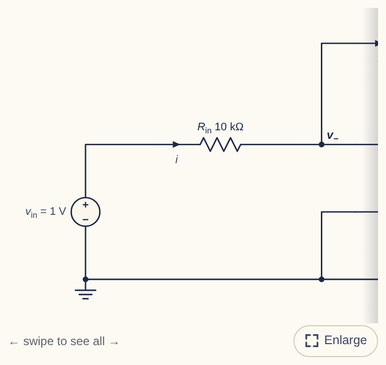

# 3.6 · 单元 5e：反相放大器：虚地和跷跷板

| 项目 | 内容 |
|---|---|
| id | `w3-5e-inverting` |
| 文件 | `units/w3-5e-inverting.json` |
| 类型 | 理论单元（#/unit 页面，从上往下读的长页） |
| 位置 | World 3 · 运算放大器基础 → 3.6 反相放大器（本节第 1 项） |
| 这个单元回答的问题 | 为什么反相放大器的输出是 −(R_f/R_{in}) v_{in}？ |
| 时长 | 13 分钟 |
| 接回 | chapter:methods |
| 前后 | 上一项 [3.5 lesson-scope-two-channels](../w3/3.05-3-lesson-scope-two-channels.md) · 下一项 [3.6 exp-inverting-amp](../w3/3.06-2-exp-inverting-amp.md) |

## ① 直觉

输入 v_{in} 经 R_{in}（输入电阻）接到 v_{−}；R_f（反馈电阻）从 v_{−} 接到输出 v_o；v_{+} 接地。

v_{+} 接地，虚短让 v_{−} 也是 0 V。v_{−} 没有用导线接地，却一直是 0 V，所以叫**虚地**。

*实验 2-7 的反相放大器：R_{in} = 10 kΩ，R_f = 22 kΩ，v_{+} 接地。同一个电流 i 先流过 R_{in}，再流过 R_f。*

把 R_{in} 和 R_f 想成一块**跷跷板**，虚地就是中间的支点，一直钉在 0 V。

左端是 v_{in}，离支点 R_{in} 那么远；右端是 v_o，离支点 R_f 那么远。同一个电流流过整块板，所以板上的电压和“距离”（电阻）成正比。

左端抬高 1 V，右端就压低 R_f/R_{in} = 2.2 倍：v_o = −2.2 V。负号就是“一头上、一头下”。

## ② 交互推导

**分步推导：五步法：v_{in} = 1 V**（一次揭开一步）

1. **① 有负反馈吗？** 有。R_f 把输出接回 v_{−}。v_o 往上走，v_{−} 跟着往上，v_{+} − v_{−} 变负，v_o 被拉回来。
2. **② 虚短、虚断。** v_{+} 接地，虚短：v_{−} = 0 V（虚地）。虚断：没有电流流进 v_{−}。
3. **③ 在 v_{−} 列 KCL。** 流进 v_{−} 的电流 = 流出的电流：(v_{in} − 0)/R_{in} = (0 − v_o)/R_f。左边 i = 1 V / 10 kΩ = 0.1 mA。
4. **④ 解出 v_o。** v_o = −R_f × i = −22 kΩ × 0.1 mA = −2.2 V。也就是 v_o = −(R_f/R_{in}) v_{in}。
5. **⑤ 合理性检查。** ±9 V 双电源，LM358 输出约 −9 V … +7.5 V：−2.2 V 在里面 ✓。0.1 mA 从 v_{in} 经 R_{in}、R_f 流**进**输出端，op-amp（运算放大器）吸收 0.1 mA，远低于约 10 mA 的吸收能力 ✓。再看范围：v_{in} 超过 9/2.2 ≈ 4.1 V（或低于 −7.5/2.2 ≈ −3.4 V）就会削顶。还有一点：信号源看到的输入电阻就是 R_{in} = 10 kΩ，不是无穷大。

**滑块探索：跷跷板：改两边的长度和输入**

| 参数 | 名称 | 默认 | 范围 | 单位 |
|---|---|---|---|---|
| Rf | 反馈电阻 R_f | 22000 | 1000 … 1000000（对数） | Ω |
| Rin | 输入电阻 R_{in} | 10000 | 1000 … 100000（对数） | Ω |
| vin | 输入 v_{in} | 1 | -5 … 5 | V |

| 输出 | 公式 | 单位 |
|---|---|---|
| 增益 −R_f/R_{in} | `-Rf / Rin` |  |
| 公式给的 v_o | `G * vin` | V |
| 实际 v_o（−9 … +7.5 V） | `clamp(vi, -9, 7.5)` | V |
| 支点 v_{−} | `(vin * Rf + vo * Rin) / (Rin + Rf)` | V |
| 输入电流 i | `(vin - vn) / Rin` | A |
| 饱和了？（1 = 是） | `step(vi - 7.5) + step(-9 - vi)` |  |

线性时支点 v_{−} 一直是 0 V。把 v_{in} 拉大到削顶，支点就“松”了：v_{−} 离开 0 V，跷跷板的比例不再成立。

## ③ 仿真

**仿真**

先预测，再运行，再看为什么。op-amp（运算放大器）按 LM358 建模：±9 V 双电源，输出 −9 … +7.5 V，开环增益 A = 100 000。

| 参数 | 名称 | 默认 | 范围 | 单位 |
|---|---|---|---|---|
| vin |  | 1 |  |  |
| Rin |  | 10000 |  |  |
| Rf |  | 22000 |  |  |
| A |  | 100000 |  |  |
| fb |  | 1 |  |  |
| swap |  | 0 |  |  |

| 输出 | 公式 | 单位 |
|---|---|---|
| 输出 v_o | `if(swap, if(vin, 7.5, -9), if(fb, clamp(-Rf / Rin * vin, -9, 7.5), clamp(-A * vin, -9, 7.5)))` | V |
| R_{in} 和 R_f 的连接点 | `if(fb, (vin * Rf + vo * Rin) / (Rin + Rf), vin)` | V |
| R_{in} 里的电流 | `(vin - vj) / Rin` | A |

- **情景「正常：v_{in} = 1 V」**（设定 ）：v_o 是多少？
  - A. −2.2 V ✅
  - B. +2.2 V
  - C. −3.2 V
  - D. 约 −0.45 V
  - 解释：跷跷板：支点 0 V，左端 +1 V，右端 −1 × 22/10 = −2.2 V。−3.2 是把同相放大器的 1 + R_f/R_{in} 套错了；−0.45 是把比例倒过来了。

- **情景「做坏事：输入太大」**（设定 vin=5）：v_{in} = 5 V。v_o 是多少？
  - A. −11 V
  - B. 约 −9 V（顶在负电源轨） ✅
  - C. 约 −7.5 V
  - D. +7.5 V
  - 解释：公式要 −11 V，但输出最低只到 V− = −9 V。这时支点 v_{−} = (5 × 22 − 9 × 10)/32 ≈ 0.63 V，不再是 0：虚地没了。在实验里用 10 Vpp 正弦，你会看到底部被削平在 −9 V、顶部削平在 +7.5 V。

- **情景「做坏事：拔掉 R_f」**（设定 fb=0）：拔掉 R_f，v_{in} = 1 V。v_o 是多少？
  - A. 仍是 −2.2 V
  - B. 0 V
  - C. 顶在 −9 V ✅
  - 解释：没有反馈，R_{in} 里没有电流，v_{−} = v_{in} = 1 V。op-amp（运算放大器）开环：A × (0 − 1) = −100 000 V，只能顶在 −9 V。第 ① 步不成立。

- **情景「做坏事：对调两个输入端」**（设定 swap=1）：把 R_{in} 和 R_f 的连接点接到 v_{+}，把 v_{−} 接地。v_o 会是多少？
  - A. 仍是 −2.2 V
  - B. +2.2 V
  - C. 顶在 +7.5 V ✅
  - 解释：现在 R_f 把输出送回了 v_{+}：正反馈。从 v_o = 0 开始，v_{+} = 1 × 22/32 ≈ 0.69 V > 0，v_o 往上走，v_{+} 更高，一直冲到 +7.5 V。没有负反馈，就没有虚地。

## ④ 面包板

**去面包板** → [3.6 exp-inverting-amp](../w3/3.06-2-exp-inverting-amp.md)：示波器上 CH2（输出）是 CH1（输入）放大 2.2 倍再上下翻转；输入调到 10 Vpp 时，输出顶部平在约 +7.5 V，底部平在约 −9 V。

## ⑤ 回链

**预测题**：（Midterm 2：结点法）在 v_{−} 这个结点列 KCL，哪个式子是对的？

- A. (v_{in} − v_{−})/R_{in} + (v_o − v_{−})/R_f = 0 ✅
- B. (v_{in} − v_{−})/R_{in} + (v_o − v_{−})/R_f + i_o = 0（i_o 是 op-amp（运算放大器）输出电流）
- C. v_{in}/R_{in} = v_o/R_f

揭晓：

> 和 Midterm 2 一样：流出结点的电流加起来为 0。v_{−} 只连着两个电阻；虚断说 op-amp（运算放大器）输入端不取电流，所以没有第三项。i_o 在输出结点，不在 v_{−}。代入 v_{−} = 0 就得到 v_o = −(R_f/R_{in}) v_{in}（第三个选项少了负号）。

**预测题**：能不能在 op-amp（运算放大器）的**输出**结点列 KCL 来求 v_o？

- A. 不能：op-amp（运算放大器）输出端的电流是未知的，多一个未知数 ✅
- B. 能：所有结点都可以列 KCL
- C. 能：虚断说输出端电流为 0

揭晓：

> 输出端像一个受控电压源，它要多少电流就给多少，事先不知道。所以只在**输入端**（v_{−}、v_{+}）列 KCL。虚断只管输入端，不管输出端。等 v_o 求出来以后，再在输出结点用 KCL 求 op-amp（运算放大器）的输出电流。

**预测题**：在 v_o 和地之间再接一个 2.2 kΩ 负载（v_{in} = 1 V）。从 op-amp（运算放大器）输出端**流出**的电流是多少 mA？（流进为负）

- 答案：-1.1 mA（误差 0.05）

揭晓：

> v_o 仍是 −2.2 V（输出电阻约为 0，负载不改变它）。在输出结点列 KCL：流出 op-amp（运算放大器）的电流 = 流进负载的 (−2.2)/2.2k = −1 mA，加上流进 R_f 的 (−2.2 − 0)/22k = −0.1 mA，共 −1.1 mA。op-amp 在吸收 1.1 mA，低于约 10 mA ✓。

**理论题**：理论题沿用中文教材的记号：电压写作 u（u_o 就是这里的 v_o）。04 题的输入是电流源；10 题的反馈是一个 T 形网络，要多列一个结点方程。 09 题把负载放在反馈支路里（v_{+} 接地，所以还是反相结构）：同样在 v_{−} 列 KCL，你会发现负载电流和负载大小无关。

- `opamp-01-inverting-amp` 反相比例放大器：虚短与虚断（opamp）
- `opamp-04-current-input-inverting` 反相放大器的输入电阻与输出电流（opamp）
- `opamp-10-t-network-feedback` T 形反馈网络的反相放大器（opamp）
- `opamp-09-vccs-floating-load` 浮地负载中的电流（opamp）

## English

展开英文

## ① 直觉

The input v_{in} goes through R_{in} (the input resistor) to v_{−}; R_f (the feedback resistor) runs from v_{−} to the output v_o; v_{+} is grounded.

v_{+} is grounded, so the virtual short holds v_{−} at 0 V too. No wire ties v_{−} to ground, yet it stays at 0 V. That is why it is called a **virtual ground**.

[电路图]

*The inverting amplifier of lab 2-7: R_{in} = 10 kΩ, R_f = 22 kΩ, v_{+} grounded. The same current i flows through R_{in} and then through R_f.*

Think of R_{in} and R_f as a **see-saw**. The virtual ground is the pivot in the middle, pinned at 0 V.

The left end is v_{in}, a "distance" R_{in} from the pivot; the right end is v_o, a distance R_f away. One current flows along the whole plank, so the voltage along it is proportional to distance (resistance).

Lift the left end by 1 V and the right end goes down by R_f/R_{in} = 2.2 times as much: v_o = −2.2 V. The minus sign is just "one end up, the other end down".

## ② 交互推导

**分步推导：The five steps: v_{in} = 1 V**（一次揭开一步）

1. **① Is there negative feedback?** Yes. R_f takes the output back to v_{−}. If v_o rises, v_{−} rises with it, v_{+} − v_{−} goes negative, and v_o is pulled back.
2. **② Virtual short, virtual open.** v_{+} is grounded, so by the virtual short v_{−} = 0 V (virtual ground). Virtual open: no current enters v_{−}.
3. **③ KCL at v_{−}.** Current in = current out: (v_{in} − 0)/R_{in} = (0 − v_o)/R_f. The left side is i = 1 V / 10 kΩ = 0.1 mA.
4. **④ Solve for v_o.** v_o = −R_f × i = −22 kΩ × 0.1 mA = −2.2 V. That is v_o = −(R_f/R_{in}) v_{in}.
5. **⑤ Sanity check.** On ±9 V the LM358 output spans about −9 V … +7.5 V: −2.2 V is inside ✓. The 0.1 mA flows from v_{in} through R_{in} and R_f **into** the output, so the op-amp sinks 0.1 mA, far below its roughly 10 mA sink limit ✓. Range: v_{in} above 9/2.2 ≈ 4.1 V (or below −7.5/2.2 ≈ −3.4 V) will clip. One more thing: the source sees an input resistance of R_{in} = 10 kΩ, not infinity.

**滑块探索：The see-saw: change both arms and the input**

| 参数 | 名称 | 默认 | 范围 | 单位 |
|---|---|---|---|---|
| Rf | feedback resistor R_f | 22000 | 1000 … 1000000（对数） | Ω |
| Rin | input resistor R_{in} | 10000 | 1000 … 100000（对数） | Ω |
| vin | input v_{in} | 1 | -5 … 5 | V |

| 输出 | 公式 | 单位 |
|---|---|---|
| gain −R_f/R_{in} | `-Rf / Rin` |  |
| v_o from the formula | `G * vin` | V |
| actual v_o (−9 … +7.5 V) | `clamp(vi, -9, 7.5)` | V |
| pivot v_{−} | `(vin * Rf + vo * Rin) / (Rin + Rf)` | V |
| input current i | `(vin - vn) / Rin` | A |
| saturated? (1 = yes) | `step(vi - 7.5) + step(-9 - vi)` |  |

While linear, the pivot v_{−} stays at 0 V. Push v_{in} until the output clips and the pivot comes loose: v_{−} leaves 0 V and the see-saw ratio no longer holds.

## ③ 仿真

**仿真**

Predict, run, then see why. The op-amp is an LM358 on ±9 V: output −9 … +7.5 V, open-loop gain A = 100 000.

| 参数 | 名称 | 默认 | 范围 | 单位 |
|---|---|---|---|---|
| vin |  | 1 |  |  |
| Rin |  | 10000 |  |  |
| Rf |  | 22000 |  |  |
| A |  | 100000 |  |  |
| fb |  | 1 |  |  |
| swap |  | 0 |  |  |

| 输出 | 公式 | 单位 |
|---|---|---|
| output v_o | `if(swap, if(vin, 7.5, -9), if(fb, clamp(-Rf / Rin * vin, -9, 7.5), clamp(-A * vin, -9, 7.5)))` | V |
| junction of R_{in} and R_f | `if(fb, (vin * Rf + vo * Rin) / (Rin + Rf), vin)` | V |
| current in R_{in} | `(vin - vj) / Rin` | A |

- **情景「Normal: v_{in} = 1 V」**（设定 ）：What is v_o?
  - A. −2.2 V ✅
  - B. +2.2 V
  - C. −3.2 V
  - D. about −0.45 V
  - 解释：See-saw: pivot at 0 V, left end +1 V, right end −1 × 22/10 = −2.2 V. −3.2 borrows the non-inverting 1 + R_f/R_{in}; −0.45 has the ratio upside down.

- **情景「Doing it wrong: too big an input」**（设定 vin=5）：v_{in} = 5 V. What is v_o?
  - A. −11 V
  - B. about −9 V (stuck at the negative rail) ✅
  - C. about −7.5 V
  - D. +7.5 V
  - 解释：The formula wants −11 V, but the output goes no lower than V− = −9 V. The pivot is now v_{−} = (5 × 22 − 9 × 10)/32 ≈ 0.63 V, not 0: the virtual ground is gone. With a 10 Vpp sine in the lab you see the bottom flattened at −9 V and the top at +7.5 V.

- **情景「Doing it wrong: pull out R_f」**（设定 fb=0）：Remove R_f, with v_{in} = 1 V. What is v_o?
  - A. still −2.2 V
  - B. 0 V
  - C. stuck at −9 V ✅
  - 解释：With no feedback, R_{in} carries no current, so v_{−} = v_{in} = 1 V. Open loop: A × (0 − 1) = −100 000 V, so the output sits at −9 V. Step ① fails.

- **情景「Doing it wrong: swap the two inputs」**（设定 swap=1）：Move the R_{in}–R_f junction to v_{+} and ground v_{−}. What will v_o be?
  - A. still −2.2 V
  - B. +2.2 V
  - C. stuck at +7.5 V ✅
  - 解释：Now R_f feeds the output back to v_{+}: positive feedback. Starting from v_o = 0, v_{+} = 1 × 22/32 ≈ 0.69 V > 0, so v_o rises, v_{+} rises more, and it runs all the way to +7.5 V. No negative feedback, no virtual ground.

## ④ 面包板

**去面包板** → [3.6 exp-inverting-amp](../w3/3.06-2-exp-inverting-amp.md)：On the scope, CH2 (output) is CH1 (input) made 2.2 times bigger and flipped upside down; at 10 Vpp in, the output's top flattens at about +7.5 V and its bottom at about −9 V.

## ⑤ 回链

**预测题**：(Midterm 2: nodal analysis) Which equation is the KCL at node v_{−}?

- A. (v_{in} − v_{−})/R_{in} + (v_o − v_{−})/R_f = 0 ✅
- B. (v_{in} − v_{−})/R_{in} + (v_o − v_{−})/R_f + i_o = 0 (i_o is the op-amp output current)
- C. v_{in}/R_{in} = v_o/R_f

揭晓：

> Just as in Midterm 2: the currents leaving the node add to zero. Node v_{−} touches only two resistors; the virtual open says the op-amp input draws nothing, so there is no third term. i_o belongs to the output node, not v_{−}. Put v_{−} = 0 and you get v_o = −(R_f/R_{in}) v_{in} (the third choice lost the minus sign).

**预测题**：Can you write KCL at the op-amp **output** node to find v_o?

- A. No: the current out of the op-amp output is unknown, one more unknown ✅
- B. Yes: every node gives a KCL equation
- C. Yes: the virtual open says the output current is 0

揭晓：

> The output acts like a controlled voltage source: it supplies whatever current is needed, unknown in advance. So write KCL only at the **inputs** (v_{−}, v_{+}). The virtual open is about the inputs, not the output. Once v_o is known, KCL at the output node gives the op-amp's output current.

**预测题**：Add a 2.2 kΩ load from v_o to ground (v_{in} = 1 V). What current flows **out of** the op-amp output, in mA? (Into it is negative.)

- 答案：-1.1 mA（误差 0.05）

揭晓：

> v_o is still −2.2 V (the output resistance is about 0, so the load does not change it). KCL at the output node: current out of the op-amp = into the load (−2.2)/2.2k = −1 mA, plus into R_f (−2.2 − 0)/22k = −0.1 mA, total −1.1 mA. The op-amp sinks 1.1 mA, under its roughly 10 mA ✓.

**理论题**：The theory problems follow the Chinese textbook and write voltage as u (their u_o is our v_o). Problem 04 has a current-source input; problem 10 has a T-shaped feedback network that needs one more node equation. Problem 09 puts the load in the feedback path (v_{+} is grounded, so it is still the inverting layout): the same KCL at v_{−} shows the load current does not depend on the load.

- `opamp-01-inverting-amp` 反相比例放大器：虚短与虚断（opamp）
- `opamp-04-current-input-inverting` 反相放大器的输入电阻与输出电流（opamp）
- `opamp-10-t-network-feedback` T 形反馈网络的反相放大器（opamp）
- `opamp-09-vccs-floating-load` 浮地负载中的电流（opamp）

