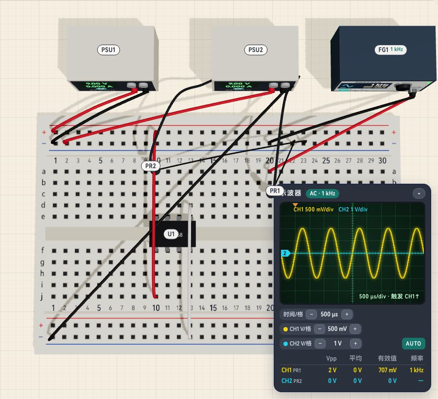
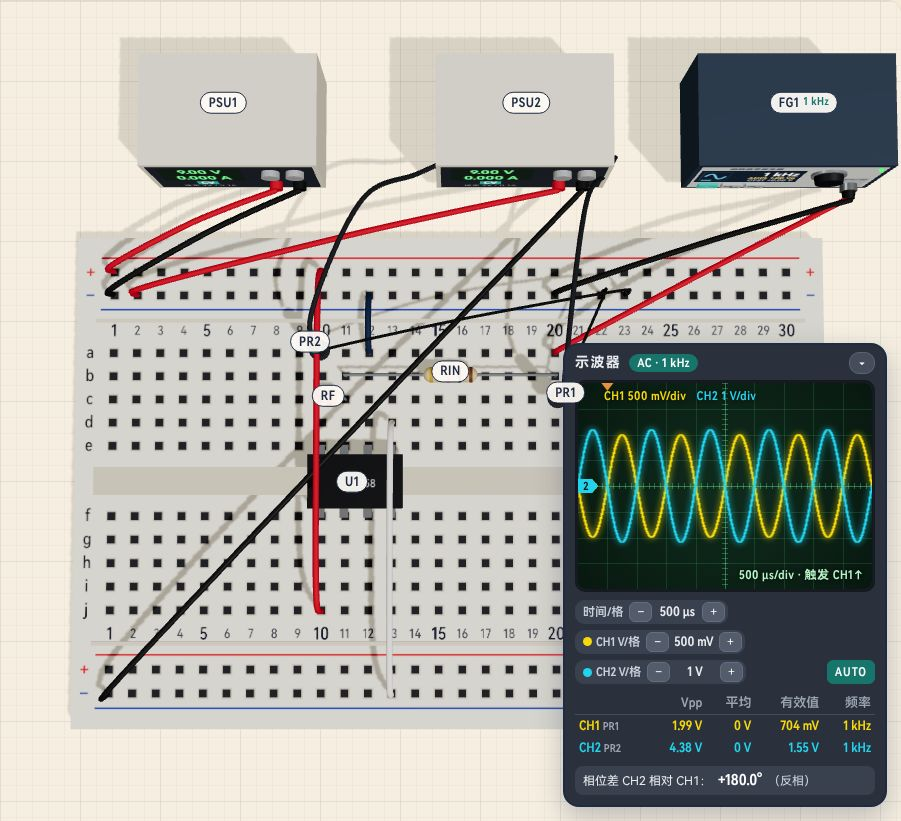
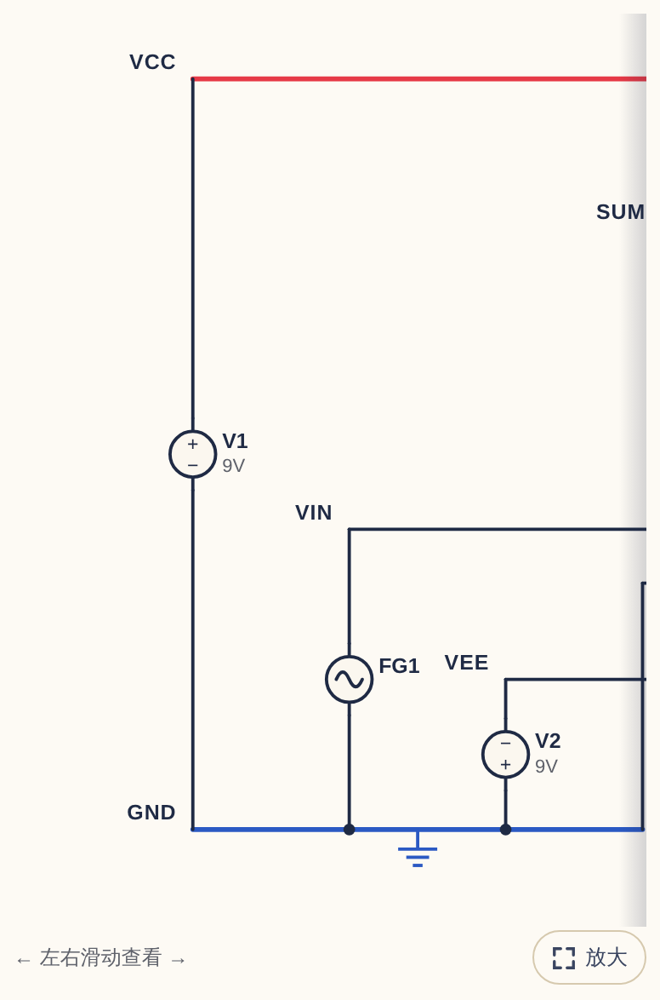
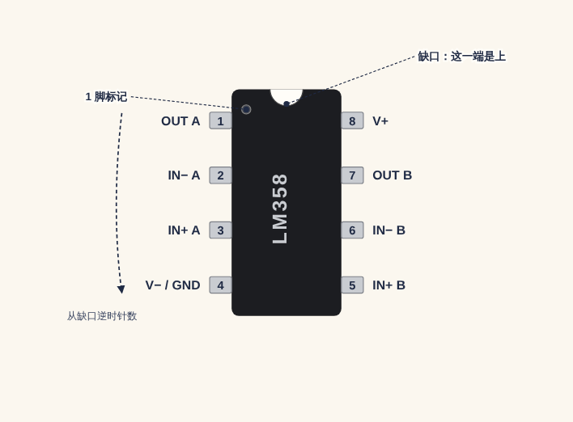
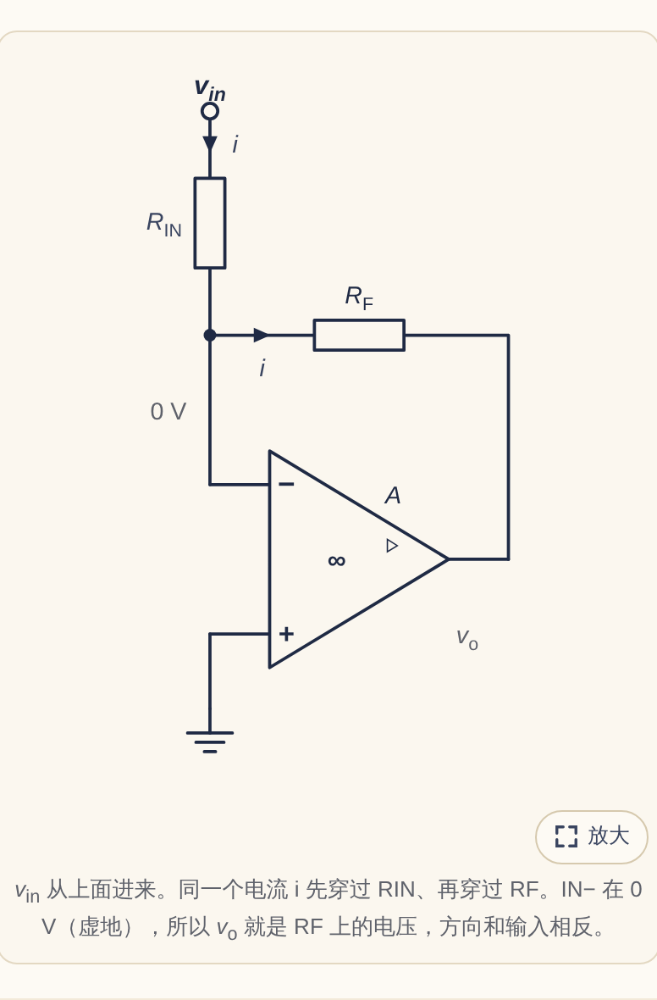
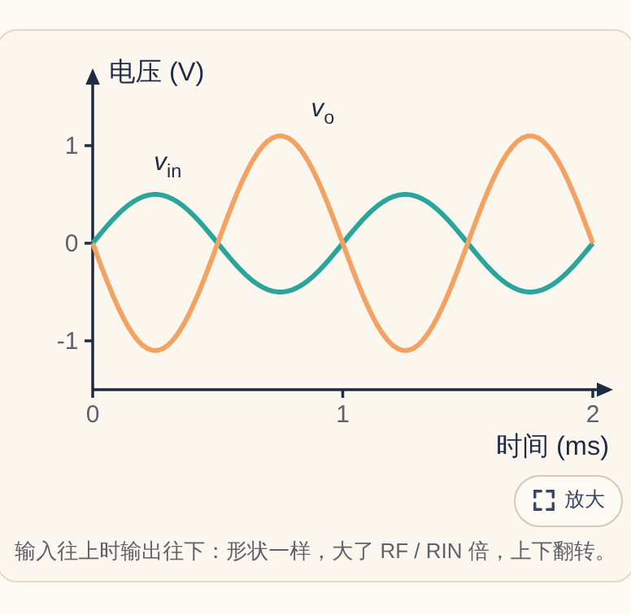

# 3.6 · 反相放大器：翻个身，再放大

| 项目 | 内容 |
|---|---|
| id | `exp-inverting-amp` |
| 文件 | `challenges/227-inverting-amp.json` |
| 类型 | 实验 / 挑战（没有分步，照目标电路图搭） · 难度 4/5 |
| 位置 | World 3 · 运算放大器基础 → 3.6 反相放大器（本节第 2 项） |
| 右侧面板 | 轨道由旧的四张卡片自动生成（还没手工精排） |
| 前后 | 上一项 [3.6 w3-5e-inverting](../w3/3.06-1-w3-5e-inverting.md) · 下一项 [3.7 w3-5f-summing](../w3/3.07-1-w3-5f-summing.md) |
| 先修 | lesson-lm358、lesson-scope-two-channels |
| 概念 | inverting amplifier 反相放大器、virtual ground 虚地、gain = −RF/RIN 增益、dual supply 双电源、clipping 削顶 |

**一句话概要**：LM358 接 ±9 V 双电源，RIN 10 kΩ、RF 22 kΩ：1 kHz 的正弦被放大、上下翻转；输入太大时，输出被削平。

## 1. 左侧工作台（3D 面包板 → 2D 俯视截图）

截图是程序里真实的 3D 面包板换成俯视角拍的；表格是同一块板的文字版（元件、参数、每只脚插在哪个孔）。

### 1.1 起点：打开这一课时板上已经有的

右侧显示的「起点」说明：

> **半成品**：±9 V 双电源、LM358 的电源脚、信号发生器和两个示波器探头都已接好。看一看双电源是怎么接的：PSU2 的 + 接 GND，− 接下方蓝轨，4 脚接到那里得到 −9 V。**为什么**：反相放大器的公式完全由 RIN、RF 和接地的 IN+ 决定。**你要做**：3 脚 IN+ 接 GND，加 RIN（信号发生器 → 2 脚）和 RF（2 脚 → 1 脚）。

| 元件 | 类型 | 参数 | 引脚 → 孔 |
|---|---|---|---|
| PSU1 | bench_supply | voltage=9, currentLimit=0.1 | +→tp1 -→tn1 |
| PSU2 | bench_supply | voltage=9, currentLimit=0.1 | +→tn2 -→bn1 |
| U1 | opamp |  | 1→e10 2→e11 3→e12 4→e13 5→f13 6→f12 7→f11 8→f10 |
| W4 | wire |  | a→tp10 b→j10 |
| W5 | wire |  | a→d13 b→bn13 |
| FG1 | function_gen | waveform=sine, frequency=1000, amplitude=1, offset=0 | +→a20 -→tn20 |
| PR1 | scope_probe | channel=1 | tip→c20 gnd→tn22 |
| PR2 | scope_probe | channel=2 | tip→a10 gnd→tn23 |

### 1.3 参考答案（「看答案」载入的板子）

| 元件 | 类型 | 参数 | 引脚 → 孔 |
|---|---|---|---|
| PSU1 | bench_supply | voltage=9, currentLimit=0.1 | +→tp1 -→tn1 |
| PSU2 | bench_supply | voltage=9, currentLimit=0.1 | +→tn2 -→bn1 |
| U1 | opamp |  | 1→e10 2→e11 3→e12 4→e13 5→f13 6→f12 7→f11 8→f10 |
| W4 | wire |  | a→tp10 b→j10 |
| W5 | wire |  | a→d13 b→bn13 |
| W6 | wire |  | a→a12 b→tn12 |
| FG1 | function_gen | waveform=sine, frequency=1000, amplitude=1, offset=0 | +→a20 -→tn20 |
| RIN | resistor | resistance=10000 | 1→b20 2→b11 |
| RF | resistor | resistance=22000 | 1→c10 2→c11 |
| PR1 | scope_probe | channel=1 | tip→c20 gnd→tn22 |
| PR2 | scope_probe | channel=2 | tip→a10 gnd→tn23 |

### 1.4 目标原理图（右侧「目标原理图」抽屉）

| 元件 | 类型 | 参数 |
|---|---|---|
| V1 | dc_source | voltage=9 |
| V2 | dc_source | voltage=9 |
| U1 | opamp |  |
| FG1 | function_gen |  |
| RIN | resistor | resistance=10000 |
| RF | resistor | resistance=22000 |

连接（每个结点上的引脚）：

- **VCC**：V1.+、U1.v+
- **GND**：V1.-、V2.+、U1.inA+、FG1.-
- **VEE**：V2.-、U1.v-
- **VIN**：FG1.+、RIN.1
- **SUM**：RIN.2、RF.2、U1.inA-
- **VOUT**：U1.outA、RF.1

## 2. 右侧面板：学生从上往下看到的内容（单轨流）

### 第 1 步 · 🔍 先看一眼：先认识它：LM358 op-amp

**拆解「LM358：一颗芯片里的两个 op-amp」第 1 / 9 层：① 外形：8 只脚的黑色小芯片（DIP-8）**

LM358 装在 **DIP-8** 封装里（Dual In-line Package，两排直插，8 只脚）。怎么找 1 脚：
- 芯片一端有个 半圆缺口 notch，缺口朝上时，左上角有个 小圆点 的就是 **1 脚**；
- 从 1 脚开始 **逆时针** 数：左边一排从上往下 1、2、3、4，再从右边一排从下往上 5、6、7、8。

8 只脚分成三类：**A 号 op-amp 的 3 只脚**、**B 号 op-amp 的 3 只脚**、**两个 op-amp 共用的 2 只电源脚**。把鼠标放到下表每一行上，看它在芯片上的位置。

| 脚 | 名字 | 属于 | 它是什么 | 单电源时接哪 |
|---|---|---|---|---|
| 1 | OUT A | op-amp A | 输出（output） | 负载 / 反馈网络 |
| 2 | IN− A | op-amp A | 反相输入（inverting input） | 反馈回来的信号 |
| 3 | IN+ A | op-amp A | 同相输入（non-inverting input） | 要放大的信号 / 参考电压 |
| 4 | V− (GND) | A、B 共用 | 负电源 | GND |
| 5 | IN+ B | op-amp B | 同相输入 | 不用时接固定电压 |
| 6 | IN− B | op-amp B | 反相输入 | 不用时接 7 脚（跟随器） |
| 7 | OUT B | op-amp B | 输出 | — |
| 8 | V+ | A、B 共用 | 正电源 3–32 V | +5 V / +9 V |

### 第 2 步 · 🔧 动手搭：搭好，看两条波

- **两台 9 V 电源串联**：中间那一点接 GND，上面是 +9 V（接 LM358 的 8 脚），下面是 −9 V（接 4 脚）。这样输出可以是负的。
- **IN+ 接 GND**；信号发生器 → **RIN** → **IN−**；**RF** 从 IN− 接回 OUT。引脚位置和 2.5 一样，用 A 半、B 半都行。
- 信号发生器：正弦、**`1 kHz`**、幅度 **`0.5 V`**。CH1 看输入，CH2 看 OUT。
两条波比一比：CH2 的大小和方向，和 CH1 有什么不同？

### 第 3 步 · 💡 想明白：虚地：IN− 被钉在 0 V

- 接成负反馈的 op-amp（运算放大器）会调整输出，让 **IN− 和 IN+ 一样高**。IN+ 接地，所以 IN− 也一直在 0 V，叫**虚地**。
- 输入电流 i = v_in / RIN 流到 IN− 无路可走（op-amp（运算放大器）输入不取电流），只能**全部穿过 RF** 流向 OUT。

*图 `inv`（schematic）：v_in 从上面进来。同一个电流 i 先穿过 RIN、再穿过 RF。IN− 在 0 V（虚地），所以 v_o 就是 RF 上的电压，方向和输入相反。*

- RF 一端在 0 V，所以输出就是 RF 上的电压，方向反过来：
$$v_o = -\frac{R_F}{R_{IN}} v_{in} = -\frac{22 kΩ}{10 kΩ} v_{in}$$
- 负号就是“翻个身”：输入往上走时，输出往下走。

*图 `wave`（plot）：输入往上时输出往下：形状一样，大了 RF / RIN 倍，上下翻转。*

（这一步下面列着这节课的计算卡片，点开就地展开：`generator-output`、`vpp-amplitude`、`opamp-inverting`，全文见第 6 节）

### 第 4 步 · 🔧 动手搭：量放大、反相和削顶

- 依次试三种输入：① 幅度 **`0.5 V`**；② 再加 **`1 V`** 偏置；③ 幅度改成 **`5 V`**、偏置 **`0 V`**。
- ② 用万用表直流档量 OUT 对 GND：直流也被放大、翻转了吗？
- ③ 按公式输出应该很大，屏幕上却被**削平**了。看看上下各平在哪里。
- 先在测量题里写预测，再读。

### 第 5 步 · 📏 测一测：测一测：读你自己的仪表

**测量题 1 · `vpp`**（读数题）

> ① 幅度 0.5 V：CH2（输出）的峰峰值

- 单位 V · 先写预测 · 状态：FG1 设为 信号发生器（正弦 1kHz 幅度 500mV） · 参考答案的读数 **2.189 V** · 合理范围 [2.08, 2.3]

答对后显示：

> |v_o| = 2.2 × 1 Vpp ≈ 2.2 Vpp。信号发生器的 50 Ω 和 10 kΩ 输入电阻分压，端口只有约 0.995 Vpp，所以约 2.19 Vpp。

**测量题 2 · `gain`**（读数题）

> 同一状态：输出幅度 / 输入幅度（CH2 / CH1，CH1 接在信号发生器的输出端）

- 先写预测 · 状态：FG1 设为 信号发生器（正弦 1kHz 幅度 500mV） · 参考答案的读数 **2.2** · 合理范围 [2.09, 2.31]

答对后显示：

> 按端口电压算 |v_o / v_in| = RF / RIN = 2.2。屏幕上两条波正好上下颠倒（相差 180°）。

**测量题 3 · `vdc`**（读数题）

> ② 加 1 V 偏置：万用表直流档测 OUT 对 GND

- 单位 V · 先写预测 · 状态：FG1 设为 信号发生器（正弦 1kHz 幅度 500mV） · 参考答案的读数 **-2.189 V** · 合理范围 [-2.3, -2.08]

答对后显示：

> 直流也被放大并反相：−2.2 × 0.995 ≈ −2.19 V。IN− 一直在 0 V（虚地）。

**测量题 4 · `vmax`**（读数题）

> ③ 幅度 5 V：输出的最大值

- 单位 V · 先写预测 · 状态：FG1 设为 信号发生器（正弦 1kHz 幅度 5V） · 参考答案的读数 **7.497 V** · 合理范围 [7.12, 7.87]

答对后显示：

> 按公式应到 +11 V，但输出最高只有 V+ − 1.5 V ≈ +7.5 V。

**测量题 5 · `vmin`**（读数题）

> 同一状态：输出的最小值

- 单位 V · 先写预测 · 状态：FG1 设为 信号发生器（正弦 1kHz 幅度 5V） · 参考答案的读数 **-8.996 V** · 合理范围 [-9.45, -8.55]

答对后显示：

> LM358 的输出能一直到负电源 V− = −9 V：上下削顶不对称。

### 第 6 步 · 🎒 带走：带走

- **虚地**：IN+ 接地时，IN− 也被拉到 0 V。所以这个放大器的输入电阻就是 RIN。
- **增益 = −RF / RIN**：负号表示反相；直流也一样被放大、翻转。
- **LM358 的输出到不了正电源**：最高只到约 V+ − 1.5 V，最低能到 V−，所以削顶上下不对称。
- **真实电路里**：LM358 的压摆率只有约 0.3–0.5 V/µs。频率升到几十 kHz、幅度又大时，正弦会变成三角波；仿真里没有这个限制。

趁热练理论题：`opamp`

## 3. 测量题一览

| # | id | 题目 | 类型 | 单位 | 状态 | 参考读数 |
|---|---|---|---|---|---|---|
| 1 | vpp | ① 幅度 0.5 V：CH2（输出）的峰峰值 | scope | V | FG1 设为 信号发生器（正弦 1kHz 幅度 500mV） | 2.189 V |
| 2 | gain | 同一状态：输出幅度 / 输入幅度（CH2 / CH1，CH1 接在信号发生器的输出端） | scope |  | FG1 设为 信号发生器（正弦 1kHz 幅度 500mV） | 2.2 |
| 3 | vdc | ② 加 1 V 偏置：万用表直流档测 OUT 对 GND | voltage | V | FG1 设为 信号发生器（正弦 1kHz 幅度 500mV） | -2.189 V |
| 4 | vmax | ③ 幅度 5 V：输出的最大值 | scope | V | FG1 设为 信号发生器（正弦 1kHz 幅度 5V） | 7.497 V |
| 5 | vmin | 同一状态：输出的最小值 | scope | V | FG1 设为 信号发生器（正弦 1kHz 幅度 5V） | -8.996 V |

### 全部答完后显示的「对比」

**对比**：v_o = −(RF / RIN) × v_in = **−2.2 v_in**，输入电阻就是 RIN = 10 kΩ。
1. 输出 ≈ **2.19 Vpp**，平均 0 V，和输入反相（相差 180°）。不是 2.2 Vpp：信号发生器的 50 Ω 和 10 kΩ 分压，端口只有约 0.995 Vpp，按端口电压算增益正好 2.20；
2. 输出平均值 ≈ **−2.19 V**：直流也被放大并反相；IN− 一直在 0 V；
3. 按公式输出 22 Vpp，但最高只到 V+ − 1.5 = **+7.5 V**，最低到 V− = **−9 V**：削顶上下不对称。

### 提示按钮（依次显示）

1. 双电源：两台 9 V 电源串联，中点是 GND。上面那台的 + 接 op-amp（运算放大器）8 脚，下面那台的 − 接 4 脚。
2. IN+（3 脚）接 GND；信号发生器 + → RIN → IN−（2 脚）；RF 在 IN− 和 OUT（1 脚）之间。
3. 放两个探头（CH1 输入、CH2 输出），接地夹都夹 GND。

### 功能测试（「检查我的电路」时跑）

- 1 kHz、1 Vpp 正弦：输出被放大、平均 0 V
- 加 1 V 偏置：直流也被放大并反相，IN− 是虚地
- 输入 10 Vpp：输出上下削顶

## 4. 用到的拆解（全部层的文字，供改写参考）

### 拆解 `lm358`：LM358：一颗芯片里的两个 op-amp

*op-amp = operational amplifier（运算放大器）。我们从芯片外形一路拆到教授在黑板上画的那个三角形，再拆到三角形里面的等效电路，最后用它推出每一个放大器公式。*

**拆解「LM358：一颗芯片里的两个 op-amp」第 1 / 9 层：① 外形：8 只脚的黑色小芯片（DIP-8）**

LM358 装在 **DIP-8** 封装里（Dual In-line Package，两排直插，8 只脚）。怎么找 1 脚：
- 芯片一端有个 半圆缺口 notch，缺口朝上时，左上角有个 小圆点 的就是 **1 脚**；
- 从 1 脚开始 **逆时针** 数：左边一排从上往下 1、2、3、4，再从右边一排从下往上 5、6、7、8。

8 只脚分成三类：**A 号 op-amp 的 3 只脚**、**B 号 op-amp 的 3 只脚**、**两个 op-amp 共用的 2 只电源脚**。把鼠标放到下表每一行上，看它在芯片上的位置。

| 脚 | 名字 | 属于 | 它是什么 | 单电源时接哪 |
|---|---|---|---|---|
| 1 | OUT A | op-amp A | 输出（output） | 负载 / 反馈网络 |
| 2 | IN− A | op-amp A | 反相输入（inverting input） | 反馈回来的信号 |
| 3 | IN+ A | op-amp A | 同相输入（non-inverting input） | 要放大的信号 / 参考电压 |
| 4 | V− (GND) | A、B 共用 | 负电源 | GND |
| 5 | IN+ B | op-amp B | 同相输入 | 不用时接固定电压 |
| 6 | IN− B | op-amp B | 反相输入 | 不用时接 7 脚（跟随器） |
| 7 | OUT B | op-amp B | 输出 | — |
| 8 | V+ | A、B 共用 | 正电源 3–32 V | +5 V / +9 V |

**拆解「LM358：一颗芯片里的两个 op-amp」第 2 / 9 层：② X 光：硅片上有两个 op-amp，电源脚共用**

把黑色塑料变透明：中间是一小块 硅片 die，细细的 金线 bond wire 把硅片连到 8 只脚上。硅片上做了两个完全一样、互相独立的放大器：op-amp A 和 op-amp B。

“**Dual**（双）”就是这个意思。它们只共用两样东西：V+（8 脚） 和 V−（4 脚）。所以：
- 只要芯片插上电，A 和 B **都** 通电了，哪怕你只用 A；
- 不用的那一半不能让它的输入悬空——悬空的输入会让它乱跳甚至振荡，干扰另一半。通常把它接成跟随器（7 脚接 6 脚），5 脚接一个固定电压。

**拆解「LM358：一颗芯片里的两个 op-amp」第 3 / 9 层：③ 符号：教授画的那个三角形**

原理图里，一个 op-amp 画成一个 三角形，信号从左往右走：
- IN−（反相输入 inverting input）：标“−”的那只脚，它上面的电压记作 $v₋$；
- IN+（同相输入 non-inverting input）：标“+”的那只脚，电压记作 $v₊$；
- OUT（输出）：三角形的尖，电压 $v_o$；
- V+ 和 V−：电源脚。理论题里常常 **省略不画**，但真实电路里必须接，否则它不工作。

注意：“+”“−”不是电源正负极，而是“这只输入对输出的作用是同向还是反向”。op-amp 只关心两个输入之间的 **差**：
$$v_d = v₊ - v₋$$
v_d 叫 **差模输入电压**（differential input voltage）。

| 端子 | 符号 | LM358 A 的脚 | 作用 |
|---|---|---|---|
| IN+ | $v₊$ | 3 | $v₊$ 升高 → $v_o$ 升高 |
| IN− | $v₋$ | 2 | $v₋$ 升高 → $v_o$ 降低 |
| OUT | $v_o$ | 1 | 输出 $A·v_d$ |
| V+ / V− | — | 8 / 4 | 能量从这里来，也限制 $v_o$ 的范围 |

- 公式 `v_d = v₊ - v₋`：op-amp 唯一“看”的量

**拆解「LM358：一颗芯片里的两个 op-amp」第 4 / 9 层：④ 拆开三角形：三个元件的等效电路**

教授说“把 op-amp 拆成电路”，拆出来就是这三样（这是电路课里 op-amp 的 **线性模型**）：

1. 输入电阻 R_in：接在两个输入之间。LM358 的输入只取约 20 nA 的偏置电流，等效 $R_{in}$ 在 MΩ 以上，计算时可以当成 **开路**——输入端几乎不取电流。
2. 受控电压源 A·v_d：一个电压 **控制** 的电压源（VCVS），它的电压是输入差的 A 倍。A 叫 **开环增益**（open-loop gain），LM358 约 $10^5$（100 dB）。
3. 输出电阻 R_out：受控源到输出脚之间，几十 Ω 量级。

于是不接任何反馈时：
$$v_o = A·v_d = A(v₊ - v₋)$$
这个电路你在第 5 章“含运算放大器的电阻电路”和受控源那一节都能直接用结点法分析。

| 参数 | LM358（典型） | 理想 op-amp | 计算时 |
|---|---|---|---|
| 开环增益 A | ≈ 10⁵ (100 dB) | ∞ | 很大 → 得出“虚短” |
| 输入电阻 R_in | MΩ 以上（偏置 20 nA） | ∞ | 开路 → 得出“虚断” |
| 输出电阻 R_out | 几十 Ω（仿真 10 Ω） | 0 | 反馈后更小，可忽略 |

- 公式 `v_o = A(v₊ - v₋)`：开环（不接反馈），且输出没到电源边界时

**拆解「LM358：一颗芯片里的两个 op-amp」第 5 / 9 层：⑤ 不接反馈会怎样？——输出一下子撞到电源**

用上一层的公式算一下。LM358 接 9 V 单电源，输出最多到约 7.5 V。要让输出在 0–7.5 V 之间（线性区），输入差只能是：
$$0 < v_d < \frac{7.5 V}{10^5} = 75 µV$$
75 微伏！你手一碰导线、电位器动一点点、甚至输入失调电压（LM358 典型 2 mV）都比它大几十倍。所以 **开环** 的 op-amp 几乎永远停在两头：
- $v₊ > v₋$（哪怕多 1 mV）→ 输出 顶到 ≈ V+ − 1.5 V
- $v₊ < v₋$ → 输出 掉到 ≈ 0 V

这叫 **饱和**（saturation）。这样用 op-amp 就成了 **比较器**（comparator）：只回答“哪个输入大”。想让它当放大器，必须加 **负反馈**——下面两层就讲为什么反馈能把 $v_d$ 稳稳地压在 75 µV 以内。

- 公式 `|v_d| < \frac{V_{sat}}{A} = \frac{7.5}{10^{5}} = 75 µV`：线性区有多窄

**拆解「LM358：一颗芯片里的两个 op-amp」第 6 / 9 层：⑥ 理想 op-amp 的两条黄金法则：虚短、虚断**

把等效电路里的三个参数推到极限：$A → ∞$、$R_{in} → ∞$、$R_{out} → 0$。电路课的所有 op-amp 题都用这两条法则：

**法则 1 · 虚断（virtual open）**：$R_{in} → ∞$，所以 两个输入端都不取电流：
$$i_+ = i_- = 0$$
**法则 2 · 虚短（virtual short）**：有负反馈、输出没饱和时，$v_o$ 是有限值（几伏），而 $v_d = \frac{v_o}{A}$，A → ∞，所以 两个输入电压相等：
$$v₊ = v₋$$
“虚”的意思：两个输入 **电压相等，但并没有真的连在一起**（没有电流流过）。

⚠ 虚短 **只在有负反馈时成立**。上一层的开环电路里 $v₊ ≠ v₋$，输出是饱和的。

| 法则 | 式子 | 来自 | 什么时候成立 |
|---|---|---|---|
| 虚断 | $i_+ = i_- = 0$ | $R_{in} → ∞$ | 总是（输入电流 nA 级） |
| 虚短 | $v₊ = v₋$ | $A → ∞$ | 有负反馈且输出未饱和 |

**拆解「LM358：一颗芯片里的两个 op-amp」第 7 / 9 层：⑦ 负反馈第一例：电压跟随器，一步步推**

把 输出直接接回 IN−，信号接 IN+。先 **不用** 黄金法则，用 ④ 的模型硬算（忽略 $R_{out}$）：
1. 接线告诉我们：$v₊ = v_{in}$，$v₋ = v_o$
2. op-amp 的方程：$v_o = A(v₊ - v₋) = A(v_{in} - v_o)$
3. 移项：$v_o(1 + A) = A·v_{in}$
4. 所以 $v_o = \frac{A}{1+A}v_{in}$。代入 $A = 10^5$：$v_o = 0.99999 v_{in}$

再看反馈 **为什么能稳住**：如果 $v_o$ 偏低，$v_d = v_{in} - v_o$ 变大，A 倍放大后把 $v_o$ 往上推；偏高则往下拉。输出一直“追”着输入，$v_d$ 只剩 $\frac{v_o}{A}$——几十 µV。

用黄金法则一行就出来：虚短 $v₋ = v₊$，而 $v₋ = v_o$，所以 $v_o = v_{in}$。两种方法结果一致，这就是黄金法则的来历。

**用处**：输入几乎不取电流（虚断），输出能提供几十 mA——它把“带不动负载的信号”变成“能带负载的信号”，叫 **缓冲器**（buffer）。

- 公式 `v_o = \frac{A}{1+A} v_{in} ≈ v_{in}`：有限 A 的精确结果

**拆解「LM358：一颗芯片里的两个 op-amp」第 8 / 9 层：⑧ 负反馈第二例：同相放大器和反相放大器**

跟随器把 **全部** 输出送回 IN−。如果只送回 **一部分**，就能放大。用 R_f 和 R_1 分压，送回 IN− 的是 βvₒ：
$$β = \frac{R_1}{R_1 + R_f}$$
**同相放大器**（non-inverting），信号接 IN+：
1. 虚断：IN− 不取电流，所以 R_f、R_1 是简单的串联分压：$v₋ = β v_o$
2. 虚短：$v₋ = v₊ = v_{in}$
3. 所以 $β v_o = v_{in}$，$v_o = \frac{1}{β}v_{in} = (1 + \frac{R_f}{R_1})v_{in}$

用有限 A 推（同 ⑦ 的方法）得到 $v_o = \frac{A}{1+Aβ}v_{in}$：只要 $Aβ ≫ 1$，增益就只由 **两个电阻** 决定，和 op-amp 本身的 A 无关——这就是负反馈的价值。

**反相放大器**（inverting）：IN+ 接 GND，信号经 $R_1$ 接 IN−，$R_f$ 从 OUT 接回 IN−。
1. 虚短：$v₋ = v₊ = 0$，IN− 是 **虚地**（virtual ground）
2. 虚断：流进 $R_1$ 的电流全部流过 $R_f$：$\frac{v_{in} - 0}{R_1} = \frac{0 - v_o}{R_f}$
3. 所以 $v_o = -\frac{R_f}{R_1}v_{in}$（负号 = 反相）

| 电路 | 增益 vₒ / v_in | 输入电阻 | 实验 |
|---|---|---|---|
| 跟随器 | 1 | ∞ | 2-5 |
| 同相放大 | $1 + \frac{R_f}{R_1}$ | ∞ | 2-6 |
| 反相放大 | $-\frac{R_f}{R_1}$ | $R_1$ | 2-7 |
| 反相求和 | $-R_f(\frac{v_1}{R_1} + \frac{v_2}{R_2})$ | $R_1$, $R_2$ | 2-8 |

- 公式 `β = \frac{R_1}{R_1 + R_f}`：反馈系数：输出送回 IN− 的比例
- 公式 `v_o = \frac{A}{1 + Aβ} v_{in} ≈ \frac{1}{β} v_{in}`：Aβ ≫ 1 时增益只取决于电阻

**拆解「LM358：一颗芯片里的两个 op-amp」第 9 / 9 层：⑨ 再往里：三级晶体管电路，和它的“缺点”**

三角形里真正的东西是约 20 个晶体管，分三级：
1. 输入级：PNP 差分对——只放大两个输入的 **差**。LM358 用 PNP 管，所以 输入电压可以低到 0 V（GND），这就是它能单电源工作的原因；输入上限约 V+ − 1.5 V。
2. 增益级——提供 $10^5$ 倍的电压增益。里面的 补偿电容 C_c 让高频增益逐渐下降，防止接反馈后振荡，代价是 **带宽**：增益 × 带宽 ≈ 1 MHz（GBW）。
3. 输出级：推挽——一个管子往上推电流、一个往下拉，提供几十 mA。往上推的那一路有两个 $V_{BE}$ 压降，所以 输出到不了 V+，差约 1.5 V；往下拉的那一路能接近 0 V。

这一层解释了你在课里看到的三个“现象”：
- 第 14 课：输入 9 V，输出只有 7.5 V → 输出级的余量；
- 放大倍数做 100 倍时带宽只剩约 10 kHz → $GBW ≈ 1 MHz$；
- 方波边沿变成斜坡，约 0.3 V/µs → **压摆率**（slew rate），由 C_c 的充电电流决定。

| 参数 | LM358 典型值 | 影响什么 |
|---|---|---|
| 电源电压 | 3–32 V（±1.5–±16 V） | 能用的电源 |
| 输出摆幅 | 0 … V+ − 1.5 V | 输出最大值 |
| 共模输入范围 | 0 … V+ − 1.5 V | 输入能接多高 |
| 增益带宽积 GBW | ≈ 1 MHz | $f_{max} ≈ \frac{GBW}{增益}$ |
| 压摆率 SR | ≈ 0.3 V/µs | 大信号的最高频率 |
| 输入失调电压 | ≈ 2 mV | 直流误差 × 增益 |

- 公式 `f_{-3dB} ≈ \frac{GBW}{G}`：G = 闭环增益（同相放大器的 1 + R_f/R_1）
- 公式 `f_{max} = \frac{SR}{2π V_p}`：不失真的最大正弦频率

**一句话记住**：op-amp = 一个只看 $v₊ - v₋$ 的超高增益放大器。开环时它是比较器；加了负反馈，输出会调到让 $v₊ = v₋$（虚短），输入不取电流（虚断）——从这两条就能推出所有放大器公式。

## 5. 这一课的计算卡片

**计算卡片 `generator-output`：信号发生器的 50 Ω 输出电阻**

- 公式 `V_{out} = V_{set} \frac{R_L}{50 Ω + R_L}`
- 用途：信号发生器 = 理想波形源串 50 Ω：接上负载以后输出比设定小多少。
- 输入：V_set（设定的幅度（或偏置），V）；R_o（输出电阻，Ω）；R_L（负载（电路的输入电阻），Ω） → V_out（端口上的实际值，V）

1. 发生器内部 = 一个理想波形源 + 串联的 50 Ω（$R_o$）。空载时端口电压就是设定值。
2. 接负载 $R_L$：$R_o$ 和 $R_L$ 分压，$V_{out} = V_{set}\frac{R_L}{R_o + R_L}$。交流部分和直流偏置都被同一个比例缩小。
3. $R_L ≫ 50 Ω$（几 kΩ 以上）时差别不到 1 %；50 Ω 负载正好减半。
4. 负载是 RC、RL 时用阻抗的模：$|V_{out}| = V_{set}\frac{|Z|}{|Z + R_o|}$，而且随频率变——所以滤波实验用端口电压（CH1）做参考。
5. 时间常数里要把 50 Ω 算进 R：$τ = (R + 50)C$。

例子：- 第 12 课：设 1 V，50 Ω 负载：0.5 V 幅度 = 1.0 Vpp；偏置 +1 V 也变成 0.5 V。
- 实验 2-7：反相放大器输入电阻 10 kΩ：$1 × \frac{10000}{10050} ≈ 0.995$，输出 2.19 Vpp 而不是 2.2。
- 实验 4-3：$|Z| = 142.5 Ω$，$|Z + 50| = |151 + j100.5| ≈ 181 Ω$：端口只有 $\frac{142.5}{181} ≈ 0.786 V$ 峰值（1.57 Vpp）。

- ⚠ 很多真实发生器按“接 50 Ω 负载”显示幅度：接高阻电路实际是显示值的两倍（除非设成 High-Z）。
- ⚠ 算 τ、谐振电流、RLC 阻尼时忘了这 50 Ω。

**计算卡片 `vpp-amplitude`：幅度、峰峰值与偏置 Amplitude and Vpp**

- 公式 `V_{pp} = 2A, V_{max} = V_{off} + A, V_{min} = V_{off} - A`
- 用途：信号发生器设的是幅度（峰值）和偏置，示波器读的是 Vpp、最大值、最小值：互相换算。
- 输入：A（幅度（中心线到波峰），V） → V_pp（峰峰值，V）

1. **幅度**（峰值）A：从中心线量到波峰。**峰峰值** Vpp：从波谷量到波峰，所以 $V_{pp} = 2A$。
2. **偏置** $V_{off}$：把整个波形上下平移，就是它的平均值（直流分量）。
3. 最大值 $V_{off} + A$，最小值 $V_{off} - A$。
4. 要一个 0 ↔ 5 V 的方波：$A = \frac{5 - 0}{2} = 2.5 V$，$V_{off} = \frac{5 + 0}{2} = 2.5 V$。
5. 在屏幕上数格：峰到谷的格数 × V/div = Vpp。

例子：实验 3-1：0–5 V 方波 = 幅度 2.5 V + 偏置 2.5 V，Vpp = 5 V。实验 3-5：0 ↔ 9 V = 幅度 4.5 V + 偏置 4.5 V。实验 2-7：幅度 0.5 V → 1 Vpp 输入，×2.2 → 2.2 Vpp 输出。

- ⚠ 把发生器的“幅度”当成 Vpp 设：信号大了一倍。

**计算卡片 `opamp-inverting`：反相放大器 Inverting amplifier**

- 公式 `v_o = -\frac{R_f}{R_1} v_{in}`
- 用途：放大并反相；IN− 是“虚地”。
- 输入：vin（v_in，V）；Rf（R_f，Ω）；R1（R₁，Ω） → vₒ（输出，V）

1. IN+ 接地，虚短：$v₋ = 0$（**虚地**）
2. 流过 R₁ 的电流：$i_1 = \frac{v_{in} - 0}{R_1}$
3. 虚断：这个电流不进 IN−，全部流过 R_f：$i_1 = \frac{0 - v_o}{R_f}$
4. 两式相等：$v_o = -\frac{R_f}{R_1}v_{in}$

输入电阻就是 $R_1$（信号源看进去，IN− 是 0 V）。单电源的 LM358 输出不能为负，所以实验 2-7 用 ±9 V 双电源。

## 6. English（界面英文版的同一份内容）

展开英文

### Node 1 · 🔍 Look first：Meet it first: LM358 op-amp

**Teardown「LM358: two op-amps in one chip」layer 1 of 9：① Package: a small black 8-pin chip (DIP-8)**

The LM358 comes in a **DIP-8** package (Dual In-line Package: two rows, 8 pins). Finding pin 1:
- one end has a half-moon notch; with the notch at the top, the corner with the little dot (top left) is **pin 1**;
- count **anticlockwise** from pin 1: down the left side 1, 2, 3, 4, then up the right side 5, 6, 7, 8.

The 8 pins fall into three groups: **3 pins of op-amp A**, **3 pins of op-amp B**, and **2 power pins shared by both**. Hover each row of the table to see where it is on the chip.

| Pin | Name | Belongs to | What it is | Single supply: connect to |
|---|---|---|---|---|
| 1 | OUT A | op-amp A | output | the load / feedback network |
| 2 | IN− A | op-amp A | inverting input | the feedback signal |
| 3 | IN+ A | op-amp A | non-inverting input | the signal / a reference |
| 4 | V− (GND) | shared | negative supply | GND |
| 5 | IN+ B | op-amp B | non-inverting input | unused: tie to a fixed voltage |
| 6 | IN− B | op-amp B | inverting input | unused: tie to pin 7 (follower) |
| 7 | OUT B | op-amp B | output | — |
| 8 | V+ | shared | positive supply 3–32 V | +5 V / +9 V |

### Node 2 · 🔧 Build：Build it, watch two waves

- **Two 9 V supplies in series**: the point between them is GND, the top is +9 V (to LM358 pin 8), the bottom −9 V (pin 4). Now the output can go negative.
- **IN+ to GND**; generator → **RIN** → **IN−**; **RF** from IN− back to OUT. The pins are as in 2.5; either half A or B works.
- Generator: sine, **`1 kHz`**, amplitude **`0.5 V`**. CH1 on the input, CH2 on OUT.
Compare the two waves: how do CH2's size and direction differ from CH1's?

### Node 3 · 💡 Why：Virtual ground: IN− pinned at 0 V

- An op-amp with negative feedback moves its output until **IN− is as high as IN+**. IN+ is on ground, so IN− stays at 0 V too: a **virtual ground**.
- The input current i = v_in / RIN reaches IN− and has nowhere else to go (the op-amp's inputs draw no current), so **all of it passes through RF** to OUT.

[figure `inv`]

*Figure `inv`（schematic）：v_in 从上面进来。同一个电流 i 先穿过 RIN、再穿过 RF。IN− 在 0 V（虚地），所以 v_o 就是 RF 上的电压，方向和输入相反。*

- One end of RF sits at 0 V, so the output is the voltage across RF, with the direction reversed:
$$v_o = -\frac{R_F}{R_{IN}} v_{in} = -\frac{22 kΩ}{10 kΩ} v_{in}$$
- The minus sign is the flip: when the input goes up, the output goes down.

[figure `wave`]

*Figure `wave`（plot）：输入往上时输出往下：形状一样，大了 RF / RIN 倍，上下翻转。*

(This node lists the lesson’s calculation cards: `generator-output`、`vpp-amplitude`、`opamp-inverting`; full text in section 6)

### Node 4 · 🔧 Build：Measure the gain, the flip and the clipping

- Try three inputs in turn: ① amplitude **`0.5 V`**; ② add a **`1 V`** offset; ③ amplitude **`5 V`**, offset **`0 V`**.
- In ② measure OUT to GND with the multimeter on DC: is the DC part enlarged and flipped too?
- In ③ the formula promises a big output, but the screen shows it **clipped flat**. Where are the top and bottom limits?
- Write your prediction in each question first, then read.

### Node 5 · 📏 Measure：Measure: read your own instruments

**Question 1 · `vpp`**（reading）

> ① Amplitude 0.5 V: CH2 (output) peak-to-peak

- unit V · predict first · state：FG1 is set to Function generator (sine 1kHz 500mV peak) · range [2.08, 2.3]

Shown once right:

> |v_o| = 2.2 × 1 Vpp ≈ 2.2 Vpp. The generator's 50 Ω and the 10 kΩ input resistance divide a little, so the port gives about 0.995 Vpp and you read about 2.19 Vpp.

**Question 2 · `gain`**（reading）

> Same state: output amplitude / input amplitude (CH2 / CH1, with CH1 on the generator's output)

- predict first · state：FG1 is set to Function generator (sine 1kHz 500mV peak) · range [2.09, 2.31]

Shown once right:

> On the port voltage |v_o / v_in| = RF / RIN = 2.2. On screen the two waves are exactly upside down to each other (180° apart).

**Question 3 · `vdc`**（reading）

> ② With a 1 V offset: OUT to GND on the multimeter's DC range

- unit V · predict first · state：FG1 is set to Function generator (sine 1kHz 500mV peak) · range [-2.3, -2.08]

Shown once right:

> DC is enlarged and inverted too: −2.2 × 0.995 ≈ −2.19 V. IN− stays at 0 V (virtual ground).

**Question 4 · `vmax`**（reading）

> ③ Amplitude 5 V: the output's maximum

- unit V · predict first · state：FG1 is set to Function generator (sine 1kHz 5V peak) · range [7.12, 7.87]

Shown once right:

> The formula says +11 V, but the output tops out at V+ − 1.5 V ≈ +7.5 V.

**Question 5 · `vmin`**（reading）

> Same state: the output's minimum

- unit V · predict first · state：FG1 is set to Function generator (sine 1kHz 5V peak) · range [-9.45, -8.55]

Shown once right:

> The LM358's output reaches all the way to V− = −9 V: lopsided clipping.

### Node 6 · 🎒 Take away：Take away

- **Virtual ground**: with IN+ on ground, IN− is held at 0 V too. So this amplifier's input resistance is just RIN.
- **Gain = −RF / RIN**: the minus means inverted; DC is enlarged and flipped the same way.
- **The LM358's output can't reach the positive supply**: it tops out near V+ − 1.5 V but reaches V−, so the clipping is lopsided.
- **In a real circuit**: the LM358 slews only about 0.3–0.5 V/µs. At tens of kHz and large swings a sine turns into a triangle; the simulation has no such limit.

Practise：`opamp`

**Compare**

**Compare**: v_o = −(RF / RIN) × v_in = **−2.2 v_in**; the input resistance is RIN = 10 kΩ.
1. Output ≈ **2.19 Vpp**, average 0 V, inverted (180°). Not 2.2 Vpp: the generator's 50 Ω divides against 10 kΩ, the port gives about 0.995 Vpp, and the gain on the port voltage is exactly 2.20;
2. Output average ≈ **−2.19 V**: DC is enlarged and inverted as well; IN− stays at 0 V;
3. The formula asks for 22 Vpp, but the output reaches only V+ − 1.5 = **+7.5 V** at the top and V− = **−9 V** at the bottom: lopsided clipping.

**Hints**

1. Dual supply: two 9 V supplies in series, the middle is GND. The upper one's + goes to op-amp pin 8, the lower one's − to pin 4.
2. IN+ (pin 3) to GND; generator + → RIN → IN− (pin 2); RF between IN− and OUT (pin 1).
3. Place two probes (CH1 input, CH2 output), both ground clips on GND.

