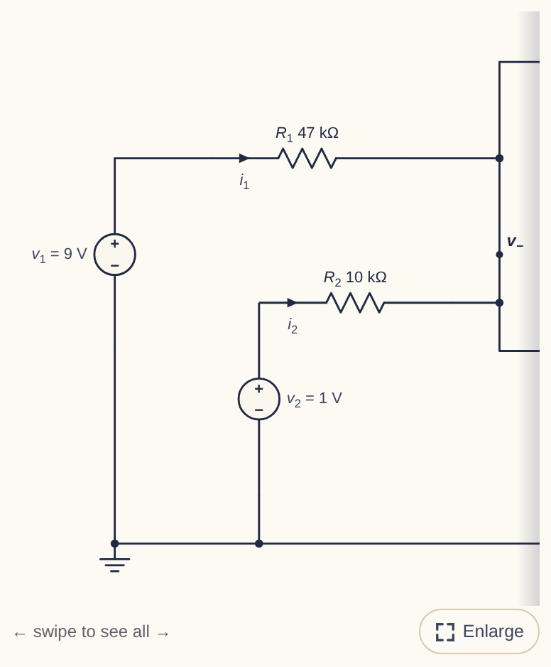

# 3.7 · 单元 5f：加法器：电流在虚地相加

| 项目 | 内容 |
|---|---|
| id | `w3-5f-summing` |
| 文件 | `units/w3-5f-summing.json` |
| 类型 | 理论单元（#/unit 页面，从上往下读的长页） |
| 位置 | World 3 · 运算放大器基础 → 3.7 求和与差分（本节第 1 项） |
| 这个单元回答的问题 | 为什么几路输入接到虚地上，就能互不干扰地加起来？ |
| 时长 | 12 分钟 |
| 接回 | chapter:basics、unit:w3-5e-inverting |
| 前后 | 上一项 [3.6 exp-inverting-amp](../w3/3.06-2-exp-inverting-amp.md) · 下一项 [3.7 exp-summing-amp](../w3/3.07-2-exp-summing-amp.md) |

## ① 直觉

加法器就是多了一路输入的反相放大器（5e）。每一路输入 v_1、v_2 各经自己的电阻 R_1、R_2 接到 v_{−}，R_f 从 v_{−} 接到 v_o。

v_{−} 是虚地，一直钉在 0 V。所以每一路的电流只看自己：i_1 = v_1/R_1，i_2 = v_2/R_2。别的输入怎么变，都改不了 v_{−}，也就改不了这个电流。

像几根水管通进一个排水口：排水口的水位不变，每根管子流多少只由它自己决定。所有的水都只能从一个出口 R_f 流走。

*实验 2-8 的反相加法器：v_1 = 9 V（开关拨到 a）经 R_1 = 47 kΩ，v_2 = 1 V 经 R_2 = 10 kΩ，两路电流在虚地汇合，一起流过 R_f = 10 kΩ。*

## ② 交互推导

**分步推导：五步法：v_1 = 9 V，v_2 = 1 V**（一次揭开一步）

1. **① 有负反馈吗？** 有。R_f 把输出接回 v_{−}。
2. **② 虚短、虚断。** v_{+} 接地，所以 v_{−} = 0 V（虚地）。虚断：没有电流流进 v_{−}。
3. **③ 在 v_{−} 列 KCL。** 流进来的：i_1 = 9 V / 47 kΩ ≈ 0.191 mA，i_2 = 1 V / 10 kΩ = 0.1 mA。流出去的只有 R_f 里的 i_f。KCL：i_f = i_1 + i_2 ≈ 0.291 mA。
4. **④ 解出 v_o。** v_o = 0 − R_f i_f = −10 kΩ × 0.291 mA ≈ −2.91 V。写成公式：v_o = −(R_f/R_1 · v_1 + R_f/R_2 · v_2) = −(1.91 + 1.00) V。每一路有自己的“权重” R_f/R_k。
5. **⑤ 合理性检查。** ±9 V 双电源，输出约 −9 … +7.5 V：−2.91 V 在里面 ✓。op-amp（运算放大器）吸收 0.29 mA，远低于约 10 mA ✓。v_2 是 ±1 V 的正弦时，输出在 −0.92 V 到 −2.91 V 之间摆动，也不会削顶。

**滑块探索：两路输入、三个电阻**

| 参数 | 名称 | 默认 | 范围 | 单位 |
|---|---|---|---|---|
| v1 | 输入 v_1 | 9 | -9 … 9 | V |
| v2 | 输入 v_2 | 1 | -5 … 5 | V |
| R1 | R_1 | 47000 | 1000 … 100000（对数） | Ω |
| R2 | R_2 | 10000 | 1000 … 100000（对数） | Ω |
| Rf | R_f | 10000 | 1000 … 100000（对数） | Ω |

| 输出 | 公式 | 单位 |
|---|---|---|
| i_1 = v_1/R_1 | `v1 / R1` | A |
| i_2 = v_2/R_2 | `v2 / R2` | A |
| i_f = i_1 + i_2 | `i1 + i2` | A |
| 公式给的 v_o = −R_f i_f | `-Rf * itot` | V |
| 实际 v_o（−9 … +7.5 V） | `clamp(vi, -9, 7.5)` | V |
| 饱和了？（1 = 是） | `step(vi - 7.5) + step(-9 - vi)` |  |

只动 v_2，看 i_1：它一动不动。这就是“互不干扰”。

## ③ 仿真

**仿真**

先预测，再运行，再看为什么。op-amp（运算放大器）按 LM358 建模：±9 V 双电源，输出 −9 … +7.5 V。“不用 op-amp”时，两个电阻直接接在一起，再经 10 kΩ 接地。

| 参数 | 名称 | 默认 | 范围 | 单位 |
|---|---|---|---|---|
| v1 |  | 9 |  |  |
| v2 |  | 1 |  |  |
| R1 |  | 47000 |  |  |
| R2 |  | 10000 |  |  |
| Rf |  | 10000 |  |  |
| op |  | 1 |  |  |

| 输出 | 公式 | 单位 |
|---|---|---|
| 汇合点电压 | `if(op, 0, (v1 / R1 + v2 / R2) / (1 / R1 + 1 / R2 + 1 / Rf))` | V |
| i_1 | `(v1 - vm) / R1` | A |
| i_2 | `(v2 - vm) / R2` | A |
| 输出 v_o | `if(op, clamp(-Rf * (i1 + i2), -9, 7.5), vm)` | V |

- **情景「两路都接上」**（设定 ）：v_1 = 9 V，v_2 = 1 V。v_o 是多少？
  - A. 约 −2.91 V ✅
  - B. 约 −1.91 V
  - C. −10 V
  - D. 约 +2.91 V
  - 解释：两路电流 0.191 mA 和 0.1 mA 在虚地相加，一起流过 10 kΩ：v_o = −2.91 V。−10 V 是直接把 9 V 和 1 V 加起来，忘了每路的权重 R_f/R_k。

- **情景「关掉 v_2」**（设定 v2=0）：v_2 变成 0。i_1 会怎样？
  - A. 不变，仍是约 0.191 mA ✅
  - B. 变大
  - C. 变小
  - 解释：v_{−} 一直是 0 V，i_1 = 9 V / 47 kΩ 只看 v_1 和 R_1。v_o 变成 −1.91 V，只是少了 v_2 那一份。

- **情景「做坏事：不用 op-amp（运算放大器），直接把电阻连在一起」**（设定 op=0）：去掉 op-amp（运算放大器），R_1、R_2 的另一端连在一起，经 10 kΩ 接地。i_2 是多少？
  - A. 仍是 0.1 mA
  - B. 约 −0.03 mA（倒着流） ✅
  - C. 0
  - 解释：汇合点不再钉在 0 V，而是被 v_1 抬到约 1.32 V，比 v_2 = 1 V 还高。电流从汇合点倒灌回 v_2。没有虚地，几路输入就互相干扰。

- **情景「做坏事：权重太大」**（设定 R1=10000）：把 R_1 换成 10 kΩ（v_1 = 9 V，v_2 = 1 V）。v_o 是多少？
  - A. −10 V
  - B. 约 −9 V（顶住了） ✅
  - C. 约 −2.91 V
  - 解释：公式要 −(9 + 1) = −10 V，但输出最低只到 −9 V。第 ⑤ 步的检查就是为了发现这种情况：和越大，越容易削顶。

## ④ 面包板

**去面包板** → [3.7 exp-summing-amp](../w3/3.07-2-exp-summing-amp.md)：S1 拨到 b 时，输出正弦以 0 V 为中心；拨到 a 时，整条正弦往下搬了约 1.91 V，形状不变。

## ⑤ 回链

**预测题**：（基本定律：KCL）三个电流在 v_{−} 相遇：i_1 = 0.191 mA 流进，i_2 = 0.100 mA 流进，i_f 经 R_f 流出，op-amp（运算放大器）输入端不取电流。i_f 是多少 mA？

- 答案：0.291 mA（误差 0.02）

揭晓：

> 流进 = 流出：i_f = 0.191 + 0.100 = 0.291 mA。加法器的“加”，就是 KCL 的“加”。

**预测题**：（接 5e）把 R_2 整个拔掉。v_1 这一路的增益是多少？

- A. −R_f/R_1 ≈ −0.213，和原来一样 ✅
- B. 变成 −R_f/(R_1 + R_2)
- C. 变成 −1

揭晓：

> 只剩一路，就是 5e 的反相放大器：−R_f/R_1 = −10/47。因为虚地，拔掉别的输入不影响这一路。加法器就是几个反相放大器共用一个 R_f。

**预测题**：想要 v_o = −(v_1 + v_2 + v_3)/3（三路求平均再取负），三个输入电阻都是 30 kΩ。R_f 应该是多少 kΩ？

- 答案：10 kΩ（误差 0.05）

揭晓：

> 每一路的权重是 R_f/30 kΩ，要等于 1/3，所以 R_f = 10 kΩ。

**理论题**：理论题沿用中文教材的记号：电压写作 u（u_o 就是这里的 v_o）。07 题是在 v_{+} 求和：那里不是虚地，几路输入会互相影响，要在 v_{+} 列结点方程。

- `opamp-05-inverting-summer` 反相加法器（opamp）
- `opamp-07-noninverting-summer` 同相加法器（弥尔曼定理）（opamp）

## English

展开英文

## ① 直觉

A summer is an inverting amplifier (5e) with one more input. Each input v_1, v_2 goes through its own resistor R_1, R_2 to v_{−}, and R_f runs from v_{−} to v_o.

v_{−} is a virtual ground, pinned at 0 V. So each input's current depends only on itself: i_1 = v_1/R_1, i_2 = v_2/R_2. Whatever the other input does, it cannot move v_{−}, so it cannot change this current.

Picture several pipes feeding one drain. The water level at the drain never changes, so each pipe's flow is set by that pipe alone. All the water has to leave through the one outlet, R_f.

[电路图]

*The inverting summer of lab 2-8: v_1 = 9 V (switch at a) through R_1 = 47 kΩ and v_2 = 1 V through R_2 = 10 kΩ. The two currents meet at the virtual ground and flow on together through R_f = 10 kΩ.*

## ② 交互推导

**分步推导：The five steps: v_1 = 9 V, v_2 = 1 V**（一次揭开一步）

1. **① Is there negative feedback?** Yes. R_f takes the output back to v_{−}.
2. **② Virtual short, virtual open.** v_{+} is grounded, so v_{−} = 0 V (virtual ground). Virtual open: no current enters v_{−}.
3. **③ KCL at v_{−}.** Coming in: i_1 = 9 V / 47 kΩ ≈ 0.191 mA and i_2 = 1 V / 10 kΩ = 0.1 mA. Going out: only i_f in R_f. KCL: i_f = i_1 + i_2 ≈ 0.291 mA.
4. **④ Solve for v_o.** v_o = 0 − R_f i_f = −10 kΩ × 0.291 mA ≈ −2.91 V. As a formula: v_o = −(R_f/R_1 · v_1 + R_f/R_2 · v_2) = −(1.91 + 1.00) V. Each input has its own "weight" R_f/R_k.
5. **⑤ Sanity check.** On ±9 V the output spans about −9 … +7.5 V: −2.91 V is inside ✓. The op-amp sinks 0.29 mA, far below its roughly 10 mA ✓. When v_2 is a ±1 V sine, the output swings between −0.92 V and −2.91 V, so nothing clips.

**滑块探索：Two inputs, three resistors**

| 参数 | 名称 | 默认 | 范围 | 单位 |
|---|---|---|---|---|
| v1 | input v_1 | 9 | -9 … 9 | V |
| v2 | input v_2 | 1 | -5 … 5 | V |
| R1 | R_1 | 47000 | 1000 … 100000（对数） | Ω |
| R2 | R_2 | 10000 | 1000 … 100000（对数） | Ω |
| Rf | R_f | 10000 | 1000 … 100000（对数） | Ω |

| 输出 | 公式 | 单位 |
|---|---|---|
| i_1 = v_1/R_1 | `v1 / R1` | A |
| i_2 = v_2/R_2 | `v2 / R2` | A |
| i_f = i_1 + i_2 | `i1 + i2` | A |
| v_o from the formula, −R_f i_f | `-Rf * itot` | V |
| actual v_o (−9 … +7.5 V) | `clamp(vi, -9, 7.5)` | V |
| saturated? (1 = yes) | `step(vi - 7.5) + step(-9 - vi)` |  |

Move only v_2 and watch i_1: it does not budge. That is what "no interaction" means.

## ③ 仿真

**仿真**

Predict, run, then see why. The op-amp is an LM358 on ±9 V: output −9 … +7.5 V. "No op-amp" means the two resistors are simply tied together and go to ground through 10 kΩ.

| 参数 | 名称 | 默认 | 范围 | 单位 |
|---|---|---|---|---|
| v1 |  | 9 |  |  |
| v2 |  | 1 |  |  |
| R1 |  | 47000 |  |  |
| R2 |  | 10000 |  |  |
| Rf |  | 10000 |  |  |
| op |  | 1 |  |  |

| 输出 | 公式 | 单位 |
|---|---|---|
| voltage at the junction | `if(op, 0, (v1 / R1 + v2 / R2) / (1 / R1 + 1 / R2 + 1 / Rf))` | V |
| i_1 | `(v1 - vm) / R1` | A |
| i_2 | `(v2 - vm) / R2` | A |
| output v_o | `if(op, clamp(-Rf * (i1 + i2), -9, 7.5), vm)` | V |

- **情景「Both inputs on」**（设定 ）：v_1 = 9 V, v_2 = 1 V. What is v_o?
  - A. about −2.91 V ✅
  - B. about −1.91 V
  - C. −10 V
  - D. about +2.91 V
  - 解释：The currents 0.191 mA and 0.1 mA add at the virtual ground and flow together through 10 kΩ: v_o = −2.91 V. −10 V adds 9 V and 1 V directly, forgetting each input's weight R_f/R_k.

- **情景「Turn v_2 off」**（设定 v2=0）：v_2 drops to 0. What happens to i_1?
  - A. unchanged, still about 0.191 mA ✅
  - B. it grows
  - C. it shrinks
  - 解释：v_{−} stays at 0 V, so i_1 = 9 V / 47 kΩ depends only on v_1 and R_1. v_o becomes −1.91 V; only v_2's share is gone.

- **情景「Doing it wrong: no op-amp, just tie the resistors together」**（设定 op=0）：Remove the op-amp: the far ends of R_1 and R_2 are tied together and go to ground through 10 kΩ. What is i_2?
  - A. still 0.1 mA
  - B. about −0.03 mA (flowing backwards) ✅
  - C. 0
  - 解释：The junction is no longer pinned at 0 V; v_1 lifts it to about 1.32 V, higher than v_2 = 1 V. Current flows backwards into v_2. Without a virtual ground the inputs fight each other.

- **情景「Doing it wrong: too much weight」**（设定 R1=10000）：Change R_1 to 10 kΩ (v_1 = 9 V, v_2 = 1 V). What is v_o?
  - A. −10 V
  - B. about −9 V (clipped) ✅
  - C. about −2.91 V
  - 解释：The formula wants −(9 + 1) = −10 V, but the output goes no lower than −9 V. Step ⑤ is where you catch this: the bigger the sum, the sooner it clips.

## ④ 面包板

**去面包板** → [3.7 exp-summing-amp](../w3/3.07-2-exp-summing-amp.md)：With S1 at b the output sine is centred on 0 V; at a, the whole sine shifts down by about 1.91 V and keeps its shape.

## ⑤ 回链

**预测题**：(Basic laws: KCL) Three currents meet at v_{−}: i_1 = 0.191 mA in, i_2 = 0.100 mA in, and i_f out through R_f; the op-amp input draws nothing. What is i_f, in mA?

- 答案：0.291 mA（误差 0.02）

揭晓：

> In = out: i_f = 0.191 + 0.100 = 0.291 mA. The "sum" in a summing amplifier is the sum in KCL.

**预测题**：(Back to 5e) Unplug R_2 completely. What gain does input v_1 see?

- A. −R_f/R_1 ≈ −0.213, the same as before ✅
- B. it becomes −R_f/(R_1 + R_2)
- C. it becomes −1

揭晓：

> With one input left it is the inverting amplifier of 5e: −R_f/R_1 = −10/47. Thanks to the virtual ground, removing another input does not affect this one. A summer is several inverting amplifiers sharing one R_f.

**预测题**：You want v_o = −(v_1 + v_2 + v_3)/3 (minus the average of three inputs), with all three input resistors 30 kΩ. What should R_f be, in kΩ?

- 答案：10 kΩ（误差 0.05）

揭晓：

> Each input's weight is R_f/30 kΩ, which must be 1/3, so R_f = 10 kΩ.

**理论题**：The theory problems follow the Chinese textbook and write voltage as u (their u_o is our v_o). Problem 07 sums at v_{+} instead: that node is not a virtual ground, the inputs do affect each other, so write a node equation at v_{+}.

- `opamp-05-inverting-summer` 反相加法器（opamp）
- `opamp-07-noninverting-summer` 同相加法器（弥尔曼定理）（opamp）

