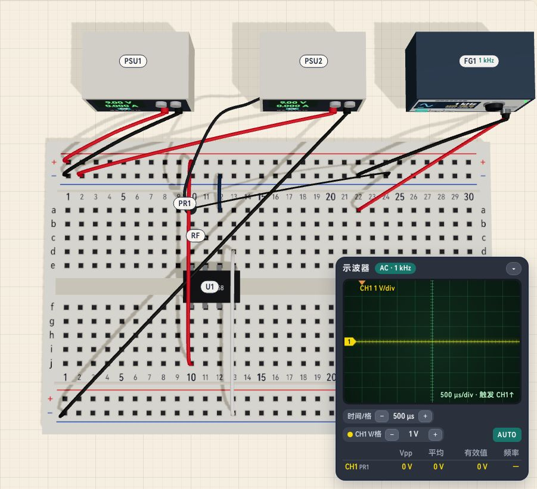
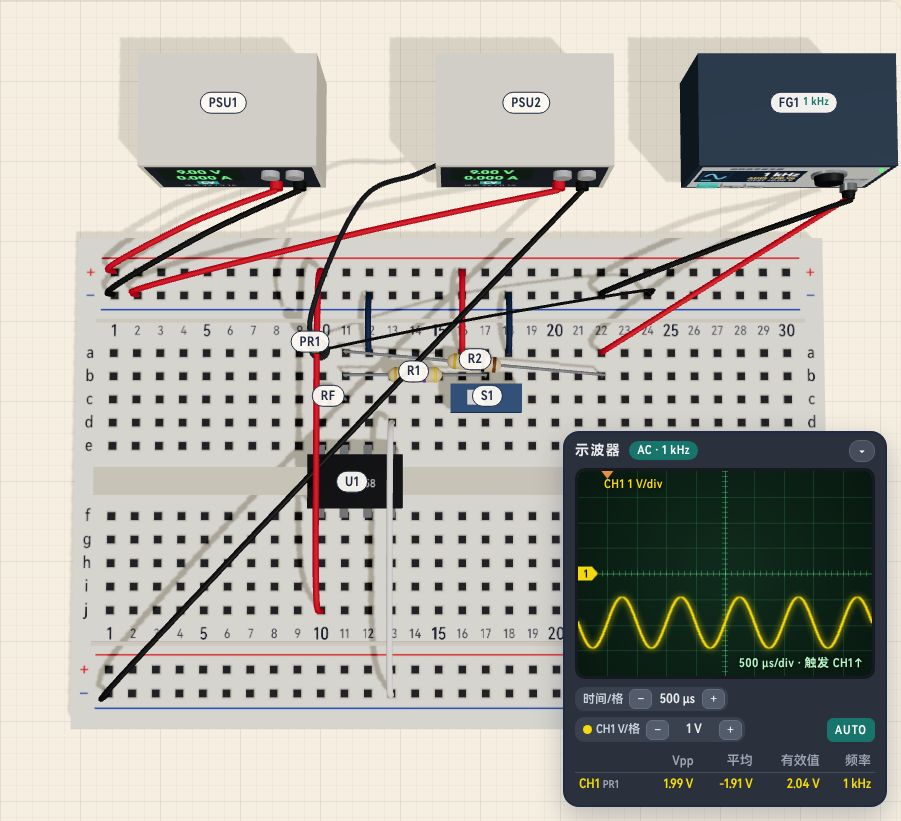
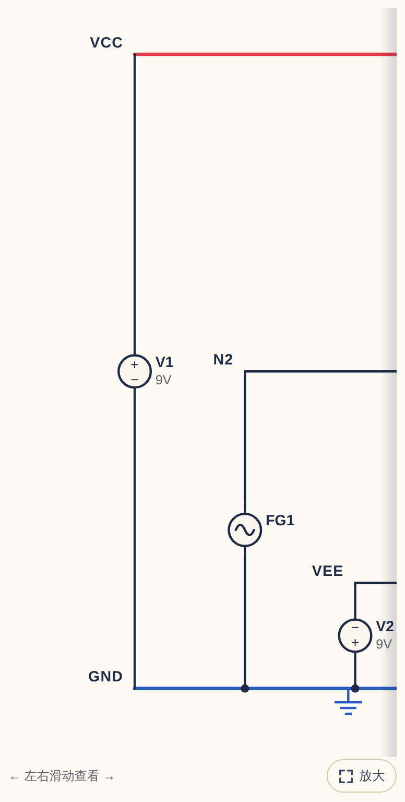
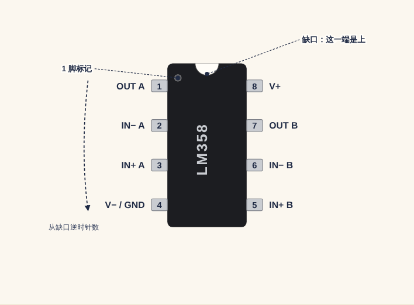
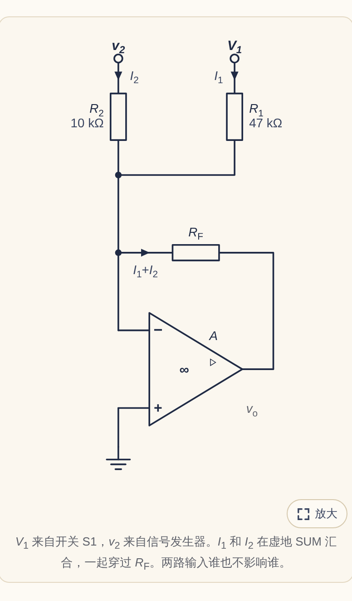
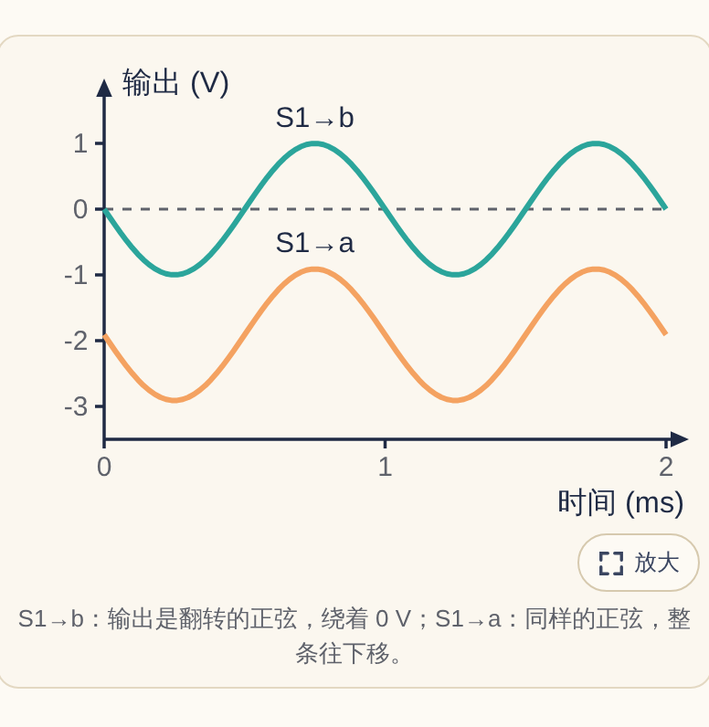

# 3.7 · 反相加法器：把直流和交流加在一起

| 项目 | 内容 |
|---|---|
| id | `exp-summing-amp` |
| 文件 | `challenges/228-summing-amp.json` |
| 类型 | 实验 / 挑战（没有分步，照目标电路图搭） · 难度 5/5 |
| 位置 | World 3 · 运算放大器基础 → 3.7 求和与差分（本节第 2 项） |
| 右侧面板 | 轨道由旧的四张卡片自动生成（还没手工精排） |
| 前后 | 上一项 [3.7 w3-5f-summing](../w3/3.07-1-w3-5f-summing.md) · 下一项 [3.7 w3-5g-difference](../w3/3.07-3-w3-5g-difference.md) |
| 先修 | lesson-lm358、lesson-scope-two-channels |
| 概念 | summing amplifier 加法器、virtual ground 虚地、KCL at the summing node 求和点 KCL、level shift 电平平移 |

**一句话概要**：两路输入经 47 kΩ 和 10 kΩ 汇到虚地：开关接通一路直流，信号发生器的正弦就整条被“搬”下去。

## 1. 左侧工作台（3D 面包板 → 2D 俯视截图）

截图是程序里真实的 3D 面包板换成俯视角拍的；表格是同一块板的文字版（元件、参数、每只脚插在哪个孔）。

### 1.1 起点：打开这一课时板上已经有的

右侧显示的「起点」说明：

> **半成品**：±9 V 双电源、LM358、IN+ 接地、反馈电阻 RF、信号发生器和示波器探头都已接好（实验 2-7 练过）。**为什么**：加法器的新东西是“几路输入汇到虚地”。**你要做**：加上两路输入：拨动开关 S1（a 侧接 +9V、b 侧接 GND）经 R1（47kΩ）到 2 脚，信号发生器经 R2（10kΩ）到 2 脚。

| 元件 | 类型 | 参数 | 引脚 → 孔 |
|---|---|---|---|
| PSU1 | bench_supply | voltage=9, currentLimit=0.1 | +→tp1 -→tn1 |
| PSU2 | bench_supply | voltage=9, currentLimit=0.1 | +→tn2 -→bn1 |
| U1 | opamp |  | 1→e10 2→e11 3→e12 4→e13 5→f13 6→f12 7→f11 8→f10 |
| W4 | wire |  | a→tp10 b→j10 |
| W5 | wire |  | a→d13 b→bn13 |
| W6 | wire |  | a→a12 b→tn12 |
| RF | resistor | resistance=10000 | 1→c10 2→c11 |
| FG1 | function_gen | waveform=sine, frequency=1000, amplitude=1, offset=0 | +→a22 -→tn22 |
| PR1 | scope_probe | channel=1 | tip→a10 gnd→tn24 |

### 1.3 参考答案（「看答案」载入的板子）

| 元件 | 类型 | 参数 | 引脚 → 孔 |
|---|---|---|---|
| PSU1 | bench_supply | voltage=9, currentLimit=0.1 | +→tp1 -→tn1 |
| PSU2 | bench_supply | voltage=9, currentLimit=0.1 | +→tn2 -→bn1 |
| U1 | opamp |  | 1→e10 2→e11 3→e12 4→e13 5→f13 6→f12 7→f11 8→f10 |
| W4 | wire |  | a→tp10 b→j10 |
| W5 | wire |  | a→d13 b→bn13 |
| W6 | wire |  | a→a12 b→tn12 |
| RF | resistor | resistance=10000 | 1→c10 2→c11 |
| S1 | switch | position=a | a→c16 com→c17 b→c18 |
| W9 | wire |  | a→tp16 b→a16 |
| W10 | wire |  | a→a18 b→tn18 |
| R1 | resistor | resistance=47000 | 1→b17 2→b11 |
| FG1 | function_gen | waveform=sine, frequency=1000, amplitude=1, offset=0 | +→a22 -→tn22 |
| R2 | resistor | resistance=10000 | 1→b22 2→a11 |
| PR1 | scope_probe | channel=1 | tip→a10 gnd→tn24 |

### 1.4 目标原理图（右侧「目标原理图」抽屉）

| 元件 | 类型 | 参数 |
|---|---|---|
| V1 | dc_source | voltage=9 |
| V2 | dc_source | voltage=9 |
| U1 | opamp |  |
| FG1 | function_gen |  |
| S1 | switch |  |
| R1 | resistor | resistance=47000 |
| R2 | resistor | resistance=10000 |
| RF | resistor | resistance=10000 |

连接（每个结点上的引脚）：

- **VCC**：V1.+、U1.v+、S1.a
- **GND**：V1.-、V2.+、U1.inA+、FG1.-、S1.b
- **VEE**：V2.-、U1.v-
- **N1**：S1.com、R1.1
- **N2**：FG1.+、R2.1
- **SUM**：R1.2、R2.2、RF.2、U1.inA-
- **VOUT**：U1.outA、RF.1

## 2. 右侧面板：学生从上往下看到的内容（单轨流）

### 第 1 步 · 🔍 先看一眼：先认识它：LM358 op-amp

**拆解「LM358：一颗芯片里的两个 op-amp」第 1 / 9 层：① 外形：8 只脚的黑色小芯片（DIP-8）**

LM358 装在 **DIP-8** 封装里（Dual In-line Package，两排直插，8 只脚）。怎么找 1 脚：
- 芯片一端有个 半圆缺口 notch，缺口朝上时，左上角有个 小圆点 的就是 **1 脚**；
- 从 1 脚开始 **逆时针** 数：左边一排从上往下 1、2、3、4，再从右边一排从下往上 5、6、7、8。

8 只脚分成三类：**A 号 op-amp 的 3 只脚**、**B 号 op-amp 的 3 只脚**、**两个 op-amp 共用的 2 只电源脚**。把鼠标放到下表每一行上，看它在芯片上的位置。

| 脚 | 名字 | 属于 | 它是什么 | 单电源时接哪 |
|---|---|---|---|---|
| 1 | OUT A | op-amp A | 输出（output） | 负载 / 反馈网络 |
| 2 | IN− A | op-amp A | 反相输入（inverting input） | 反馈回来的信号 |
| 3 | IN+ A | op-amp A | 同相输入（non-inverting input） | 要放大的信号 / 参考电压 |
| 4 | V− (GND) | A、B 共用 | 负电源 | GND |
| 5 | IN+ B | op-amp B | 同相输入 | 不用时接固定电压 |
| 6 | IN− B | op-amp B | 反相输入 | 不用时接 7 脚（跟随器） |
| 7 | OUT B | op-amp B | 输出 | — |
| 8 | V+ | A、B 共用 | 正电源 3–32 V | +5 V / +9 V |

### 第 2 步 · 🔧 动手搭：拨一下开关，整条波掉下去

- 在反相放大器的基础上，把 RF 换成 **`10 kΩ`**、RIN 换成 **R2 `10 kΩ`**，再从 IN− 多接一路：**R1 `47 kΩ`** → 开关 **S1** 的公共脚。S1 的 a 侧接 **+9 V**，b 侧接 **GND**。
- 信号发生器：正弦、**`1 kHz`**、幅度 **`1 V`**。CH2 看 OUT。
- **把 S1 从 b 拨到 a**，再拨回来。
波形的大小变了吗？变的是什么？

### 第 3 步 · 💡 想明白：两股电流在虚地汇合

- 求和点 SUM 是虚地（0 V）。每一路输入各自送来一股电流，I1 = V1 / R1，I2 = v2 / R2，互不影响。
- 两股电流在 SUM 汇合（KCL），op-amp（运算放大器）输入不取电流，它们只能一起穿过 RF：
$$v_o = -R_F (I_1 + I_2) = -10 kΩ × (\frac{V_1}{47 kΩ} + \frac{v_2}{10 kΩ})$$

*图 `sum`（schematic）：V_1 来自开关 S1，v_2 来自信号发生器。I_1 和 I_2 在虚地 SUM 汇合，一起穿过 R_F。两路输入谁也不影响谁。*

- S1 拨到 a，多了一股恒定的电流，整条波形被往下“搬”一段；拨到 b，这股电流没了，波形回到 0 V 上下。

*图 `shift`（plot）：S1→b：输出是翻转的正弦，绕着 0 V；S1→a：同样的正弦，整条往下移。*

（这一步下面列着这节课的计算卡片，点开就地展开：`generator-output`、`opamp-summing`，全文见第 6 节）

### 第 4 步 · 🔧 动手搭：量两股电流，算输出

- 三种状态：① S1→b；② S1→a；③ S1→a，信号改成幅度 **`0.5 V`**、偏置 **`1 V`**。
- ③ 里用电流表（直流档）分别串进 R1、R2，量两股电流，再用它们算输出。
- 最后用万用表直接量 OUT，核对你算的数。

### 第 5 步 · 📏 测一测：测一测：读你自己的仪表

**测量题 1 · `vdca`**（读数题）

> ② S1→a、幅度 1 V：万用表直流档测 OUT 对 GND（平均值）

- 单位 V · 先写预测 · 状态：把 S1 拨到 a 侧、FG1 设为 信号发生器（正弦 1kHz 幅度 1V） · 参考答案的读数 **-1.915 V** · 合理范围 [-2.01, -1.82]

答对后显示：

> 直流部分 = −10k × 9 / 47k ≈ −1.91 V；交流部分平均为 0。

**测量题 2 · `vmaxa`**（读数题）

> 同一状态：示波器上输出的最大值

- 单位 V · 先写预测 · 状态：把 S1 拨到 a 侧、FG1 设为 信号发生器（正弦 1kHz 幅度 1V） · 参考答案的读数 **-0.9198 V** · 合理范围 [-0.966, -0.874]

答对后显示：

> −1.91 V 加上增益 −1 的 ±0.995 V 正弦：最高 ≈ −0.92 V，最低 ≈ −2.91 V。

**测量题 3 · `i1`**（读数题）

> ③ S1→a、信号幅度 0.5 V 偏置 1 V：R1 的电流（电流表串进 R1，直流档）

- 单位 mA · 先写预测 · 状态：把 S1 拨到 a 侧、FG1 设为 信号发生器（正弦 1kHz 幅度 500mV） · 参考答案的读数 **0.1915 mA** · 合理范围 [0.000182, 0.000201]

答对后显示：

> SUM 是虚地：I1 = 9 V / 47 kΩ ≈ 0.19 mA。

**测量题 4 · `i2`**（读数题）

> 同一状态：R2 的电流（直流档 = 平均值）

- 单位 mA · 先写预测 · 状态：把 S1 拨到 a 侧、FG1 设为 信号发生器（正弦 1kHz 幅度 500mV） · 参考答案的读数 **0.0995 mA** · 合理范围 [0.0000945, 0.000104]

答对后显示：

> 平均 I2 = 1 V × 0.995 / 10 kΩ ≈ 0.10 mA（50 Ω 输出电阻让它略小于 0.1 mA）。

**测量题 5 · `uo`**（计算题（用自己的读数算））

> 用你的两个电流读数算输出平均值 v_o = −RF (I1 + I2)（RF = 10 kΩ）

- 单位 V · 先写预测 · 参考答案的读数 **-2.91 V** · 合理范围 [-3.06, -2.76] · 公式 `-10000 * (i1 + i2)`

答对后显示：

> 两路电流在虚地汇合后全部流过 RF：v_o ≈ −10 kΩ × 0.29 mA ≈ −2.91 V = −(1.91 + 1.00)。

### 第 6 步 · 🎒 带走：带走

- **虚地让每一路输入互不干扰**：多加一路输入，只是多一股电流流进 RF。
- 混音器、电平平移、数模转换器（DAC）都是这个原理。
- **真实电路里**：直接用几个电阻把几路信号连在一起也能“混合”，但各路会互相拉扯；加法器没有这个问题。输出范围仍是 V− 到 V+ − 1.5 V。

趁热练理论题：`opamp`

## 3. 测量题一览

| # | id | 题目 | 类型 | 单位 | 状态 | 参考读数 |
|---|---|---|---|---|---|---|
| 1 | vdca | ② S1→a、幅度 1 V：万用表直流档测 OUT 对 GND（平均值） | voltage | V | 把 S1 拨到 a 侧、FG1 设为 信号发生器（正弦 1kHz 幅度 1V） | -1.915 V |
| 2 | vmaxa | 同一状态：示波器上输出的最大值 | scope | V | 把 S1 拨到 a 侧、FG1 设为 信号发生器（正弦 1kHz 幅度 1V） | -0.9198 V |
| 3 | i1 | ③ S1→a、信号幅度 0.5 V 偏置 1 V：R1 的电流（电流表串进 R1，直流档） | current | mA | 把 S1 拨到 a 侧、FG1 设为 信号发生器（正弦 1kHz 幅度 500mV） | 0.1915 mA |
| 4 | i2 | 同一状态：R2 的电流（直流档 = 平均值） | current | mA | 把 S1 拨到 a 侧、FG1 设为 信号发生器（正弦 1kHz 幅度 500mV） | 0.0995 mA |
| 5 | uo | 用你的两个电流读数算输出平均值 v_o = −RF (I1 + I2)（RF = 10 kΩ） | formula | V |  | -2.91 V |

### 全部答完后显示的「对比」

**对比**：直流部分 = −10k × 9 / 47k ≈ **−1.91 V**；信号部分 = −(10k / 10k) × v2 = **−v2**（增益 −1）。
1. 只有交流：输出 ≈ **1.99 Vpp**、平均 0 V（不是 2.00 Vpp：信号发生器的 50 Ω）；
2. 同样 1.99 Vpp，但整条波形下移到 **−0.92 V ~ −2.91 V**，平均 −1.91 V；
3. 输出平均 ≈ **−2.91 V** = −(1.91 + 1.00)。R1 ≈ 0.19 mA，R2 平均 ≈ 0.10 mA，合起来 0.29 mA 全部流过 RF（从 SUM 流向 OUT）。

### 提示按钮（依次显示）

1. 双电源：两台 9 V 电源串联，中点为 GND；上面那台的 + 接 op-amp（运算放大器）8 脚，下面那台的 − 接 4 脚。IN+ 接 GND。
2. S1：a 侧接 +9 V，b 侧接 GND，公共脚经 R1（47 kΩ）接 IN−。
3. 信号发生器 + 经 R2（10 kΩ）接 IN−；RF（10 kΩ）在 IN− 和 OUT 之间。

### 功能测试（「检查我的电路」时跑）

- S1→b（只有交流）：输出是反相的信号，平均 0 V
- S1→a（加上直流）：峰峰值不变，整条波形下移
- S1→a、信号带 1 V 偏置：两路直流相加；两路输入电流全部流过 RF

## 4. 用到的拆解（全部层的文字，供改写参考）

### 拆解 `lm358`：LM358：一颗芯片里的两个 op-amp

*op-amp = operational amplifier（运算放大器）。我们从芯片外形一路拆到教授在黑板上画的那个三角形，再拆到三角形里面的等效电路，最后用它推出每一个放大器公式。*

**拆解「LM358：一颗芯片里的两个 op-amp」第 1 / 9 层：① 外形：8 只脚的黑色小芯片（DIP-8）**

LM358 装在 **DIP-8** 封装里（Dual In-line Package，两排直插，8 只脚）。怎么找 1 脚：
- 芯片一端有个 半圆缺口 notch，缺口朝上时，左上角有个 小圆点 的就是 **1 脚**；
- 从 1 脚开始 **逆时针** 数：左边一排从上往下 1、2、3、4，再从右边一排从下往上 5、6、7、8。

8 只脚分成三类：**A 号 op-amp 的 3 只脚**、**B 号 op-amp 的 3 只脚**、**两个 op-amp 共用的 2 只电源脚**。把鼠标放到下表每一行上，看它在芯片上的位置。

| 脚 | 名字 | 属于 | 它是什么 | 单电源时接哪 |
|---|---|---|---|---|
| 1 | OUT A | op-amp A | 输出（output） | 负载 / 反馈网络 |
| 2 | IN− A | op-amp A | 反相输入（inverting input） | 反馈回来的信号 |
| 3 | IN+ A | op-amp A | 同相输入（non-inverting input） | 要放大的信号 / 参考电压 |
| 4 | V− (GND) | A、B 共用 | 负电源 | GND |
| 5 | IN+ B | op-amp B | 同相输入 | 不用时接固定电压 |
| 6 | IN− B | op-amp B | 反相输入 | 不用时接 7 脚（跟随器） |
| 7 | OUT B | op-amp B | 输出 | — |
| 8 | V+ | A、B 共用 | 正电源 3–32 V | +5 V / +9 V |

**拆解「LM358：一颗芯片里的两个 op-amp」第 2 / 9 层：② X 光：硅片上有两个 op-amp，电源脚共用**

把黑色塑料变透明：中间是一小块 硅片 die，细细的 金线 bond wire 把硅片连到 8 只脚上。硅片上做了两个完全一样、互相独立的放大器：op-amp A 和 op-amp B。

“**Dual**（双）”就是这个意思。它们只共用两样东西：V+（8 脚） 和 V−（4 脚）。所以：
- 只要芯片插上电，A 和 B **都** 通电了，哪怕你只用 A；
- 不用的那一半不能让它的输入悬空——悬空的输入会让它乱跳甚至振荡，干扰另一半。通常把它接成跟随器（7 脚接 6 脚），5 脚接一个固定电压。

**拆解「LM358：一颗芯片里的两个 op-amp」第 3 / 9 层：③ 符号：教授画的那个三角形**

原理图里，一个 op-amp 画成一个 三角形，信号从左往右走：
- IN−（反相输入 inverting input）：标“−”的那只脚，它上面的电压记作 $v₋$；
- IN+（同相输入 non-inverting input）：标“+”的那只脚，电压记作 $v₊$；
- OUT（输出）：三角形的尖，电压 $v_o$；
- V+ 和 V−：电源脚。理论题里常常 **省略不画**，但真实电路里必须接，否则它不工作。

注意：“+”“−”不是电源正负极，而是“这只输入对输出的作用是同向还是反向”。op-amp 只关心两个输入之间的 **差**：
$$v_d = v₊ - v₋$$
v_d 叫 **差模输入电压**（differential input voltage）。

| 端子 | 符号 | LM358 A 的脚 | 作用 |
|---|---|---|---|
| IN+ | $v₊$ | 3 | $v₊$ 升高 → $v_o$ 升高 |
| IN− | $v₋$ | 2 | $v₋$ 升高 → $v_o$ 降低 |
| OUT | $v_o$ | 1 | 输出 $A·v_d$ |
| V+ / V− | — | 8 / 4 | 能量从这里来，也限制 $v_o$ 的范围 |

- 公式 `v_d = v₊ - v₋`：op-amp 唯一“看”的量

**拆解「LM358：一颗芯片里的两个 op-amp」第 4 / 9 层：④ 拆开三角形：三个元件的等效电路**

教授说“把 op-amp 拆成电路”，拆出来就是这三样（这是电路课里 op-amp 的 **线性模型**）：

1. 输入电阻 R_in：接在两个输入之间。LM358 的输入只取约 20 nA 的偏置电流，等效 $R_{in}$ 在 MΩ 以上，计算时可以当成 **开路**——输入端几乎不取电流。
2. 受控电压源 A·v_d：一个电压 **控制** 的电压源（VCVS），它的电压是输入差的 A 倍。A 叫 **开环增益**（open-loop gain），LM358 约 $10^5$（100 dB）。
3. 输出电阻 R_out：受控源到输出脚之间，几十 Ω 量级。

于是不接任何反馈时：
$$v_o = A·v_d = A(v₊ - v₋)$$
这个电路你在第 5 章“含运算放大器的电阻电路”和受控源那一节都能直接用结点法分析。

| 参数 | LM358（典型） | 理想 op-amp | 计算时 |
|---|---|---|---|
| 开环增益 A | ≈ 10⁵ (100 dB) | ∞ | 很大 → 得出“虚短” |
| 输入电阻 R_in | MΩ 以上（偏置 20 nA） | ∞ | 开路 → 得出“虚断” |
| 输出电阻 R_out | 几十 Ω（仿真 10 Ω） | 0 | 反馈后更小，可忽略 |

- 公式 `v_o = A(v₊ - v₋)`：开环（不接反馈），且输出没到电源边界时

**拆解「LM358：一颗芯片里的两个 op-amp」第 5 / 9 层：⑤ 不接反馈会怎样？——输出一下子撞到电源**

用上一层的公式算一下。LM358 接 9 V 单电源，输出最多到约 7.5 V。要让输出在 0–7.5 V 之间（线性区），输入差只能是：
$$0 < v_d < \frac{7.5 V}{10^5} = 75 µV$$
75 微伏！你手一碰导线、电位器动一点点、甚至输入失调电压（LM358 典型 2 mV）都比它大几十倍。所以 **开环** 的 op-amp 几乎永远停在两头：
- $v₊ > v₋$（哪怕多 1 mV）→ 输出 顶到 ≈ V+ − 1.5 V
- $v₊ < v₋$ → 输出 掉到 ≈ 0 V

这叫 **饱和**（saturation）。这样用 op-amp 就成了 **比较器**（comparator）：只回答“哪个输入大”。想让它当放大器，必须加 **负反馈**——下面两层就讲为什么反馈能把 $v_d$ 稳稳地压在 75 µV 以内。

- 公式 `|v_d| < \frac{V_{sat}}{A} = \frac{7.5}{10^{5}} = 75 µV`：线性区有多窄

**拆解「LM358：一颗芯片里的两个 op-amp」第 6 / 9 层：⑥ 理想 op-amp 的两条黄金法则：虚短、虚断**

把等效电路里的三个参数推到极限：$A → ∞$、$R_{in} → ∞$、$R_{out} → 0$。电路课的所有 op-amp 题都用这两条法则：

**法则 1 · 虚断（virtual open）**：$R_{in} → ∞$，所以 两个输入端都不取电流：
$$i_+ = i_- = 0$$
**法则 2 · 虚短（virtual short）**：有负反馈、输出没饱和时，$v_o$ 是有限值（几伏），而 $v_d = \frac{v_o}{A}$，A → ∞，所以 两个输入电压相等：
$$v₊ = v₋$$
“虚”的意思：两个输入 **电压相等，但并没有真的连在一起**（没有电流流过）。

⚠ 虚短 **只在有负反馈时成立**。上一层的开环电路里 $v₊ ≠ v₋$，输出是饱和的。

| 法则 | 式子 | 来自 | 什么时候成立 |
|---|---|---|---|
| 虚断 | $i_+ = i_- = 0$ | $R_{in} → ∞$ | 总是（输入电流 nA 级） |
| 虚短 | $v₊ = v₋$ | $A → ∞$ | 有负反馈且输出未饱和 |

**拆解「LM358：一颗芯片里的两个 op-amp」第 7 / 9 层：⑦ 负反馈第一例：电压跟随器，一步步推**

把 输出直接接回 IN−，信号接 IN+。先 **不用** 黄金法则，用 ④ 的模型硬算（忽略 $R_{out}$）：
1. 接线告诉我们：$v₊ = v_{in}$，$v₋ = v_o$
2. op-amp 的方程：$v_o = A(v₊ - v₋) = A(v_{in} - v_o)$
3. 移项：$v_o(1 + A) = A·v_{in}$
4. 所以 $v_o = \frac{A}{1+A}v_{in}$。代入 $A = 10^5$：$v_o = 0.99999 v_{in}$

再看反馈 **为什么能稳住**：如果 $v_o$ 偏低，$v_d = v_{in} - v_o$ 变大，A 倍放大后把 $v_o$ 往上推；偏高则往下拉。输出一直“追”着输入，$v_d$ 只剩 $\frac{v_o}{A}$——几十 µV。

用黄金法则一行就出来：虚短 $v₋ = v₊$，而 $v₋ = v_o$，所以 $v_o = v_{in}$。两种方法结果一致，这就是黄金法则的来历。

**用处**：输入几乎不取电流（虚断），输出能提供几十 mA——它把“带不动负载的信号”变成“能带负载的信号”，叫 **缓冲器**（buffer）。

- 公式 `v_o = \frac{A}{1+A} v_{in} ≈ v_{in}`：有限 A 的精确结果

**拆解「LM358：一颗芯片里的两个 op-amp」第 8 / 9 层：⑧ 负反馈第二例：同相放大器和反相放大器**

跟随器把 **全部** 输出送回 IN−。如果只送回 **一部分**，就能放大。用 R_f 和 R_1 分压，送回 IN− 的是 βvₒ：
$$β = \frac{R_1}{R_1 + R_f}$$
**同相放大器**（non-inverting），信号接 IN+：
1. 虚断：IN− 不取电流，所以 R_f、R_1 是简单的串联分压：$v₋ = β v_o$
2. 虚短：$v₋ = v₊ = v_{in}$
3. 所以 $β v_o = v_{in}$，$v_o = \frac{1}{β}v_{in} = (1 + \frac{R_f}{R_1})v_{in}$

用有限 A 推（同 ⑦ 的方法）得到 $v_o = \frac{A}{1+Aβ}v_{in}$：只要 $Aβ ≫ 1$，增益就只由 **两个电阻** 决定，和 op-amp 本身的 A 无关——这就是负反馈的价值。

**反相放大器**（inverting）：IN+ 接 GND，信号经 $R_1$ 接 IN−，$R_f$ 从 OUT 接回 IN−。
1. 虚短：$v₋ = v₊ = 0$，IN− 是 **虚地**（virtual ground）
2. 虚断：流进 $R_1$ 的电流全部流过 $R_f$：$\frac{v_{in} - 0}{R_1} = \frac{0 - v_o}{R_f}$
3. 所以 $v_o = -\frac{R_f}{R_1}v_{in}$（负号 = 反相）

| 电路 | 增益 vₒ / v_in | 输入电阻 | 实验 |
|---|---|---|---|
| 跟随器 | 1 | ∞ | 2-5 |
| 同相放大 | $1 + \frac{R_f}{R_1}$ | ∞ | 2-6 |
| 反相放大 | $-\frac{R_f}{R_1}$ | $R_1$ | 2-7 |
| 反相求和 | $-R_f(\frac{v_1}{R_1} + \frac{v_2}{R_2})$ | $R_1$, $R_2$ | 2-8 |

- 公式 `β = \frac{R_1}{R_1 + R_f}`：反馈系数：输出送回 IN− 的比例
- 公式 `v_o = \frac{A}{1 + Aβ} v_{in} ≈ \frac{1}{β} v_{in}`：Aβ ≫ 1 时增益只取决于电阻

**拆解「LM358：一颗芯片里的两个 op-amp」第 9 / 9 层：⑨ 再往里：三级晶体管电路，和它的“缺点”**

三角形里真正的东西是约 20 个晶体管，分三级：
1. 输入级：PNP 差分对——只放大两个输入的 **差**。LM358 用 PNP 管，所以 输入电压可以低到 0 V（GND），这就是它能单电源工作的原因；输入上限约 V+ − 1.5 V。
2. 增益级——提供 $10^5$ 倍的电压增益。里面的 补偿电容 C_c 让高频增益逐渐下降，防止接反馈后振荡，代价是 **带宽**：增益 × 带宽 ≈ 1 MHz（GBW）。
3. 输出级：推挽——一个管子往上推电流、一个往下拉，提供几十 mA。往上推的那一路有两个 $V_{BE}$ 压降，所以 输出到不了 V+，差约 1.5 V；往下拉的那一路能接近 0 V。

这一层解释了你在课里看到的三个“现象”：
- 第 14 课：输入 9 V，输出只有 7.5 V → 输出级的余量；
- 放大倍数做 100 倍时带宽只剩约 10 kHz → $GBW ≈ 1 MHz$；
- 方波边沿变成斜坡，约 0.3 V/µs → **压摆率**（slew rate），由 C_c 的充电电流决定。

| 参数 | LM358 典型值 | 影响什么 |
|---|---|---|
| 电源电压 | 3–32 V（±1.5–±16 V） | 能用的电源 |
| 输出摆幅 | 0 … V+ − 1.5 V | 输出最大值 |
| 共模输入范围 | 0 … V+ − 1.5 V | 输入能接多高 |
| 增益带宽积 GBW | ≈ 1 MHz | $f_{max} ≈ \frac{GBW}{增益}$ |
| 压摆率 SR | ≈ 0.3 V/µs | 大信号的最高频率 |
| 输入失调电压 | ≈ 2 mV | 直流误差 × 增益 |

- 公式 `f_{-3dB} ≈ \frac{GBW}{G}`：G = 闭环增益（同相放大器的 1 + R_f/R_1）
- 公式 `f_{max} = \frac{SR}{2π V_p}`：不失真的最大正弦频率

**一句话记住**：op-amp = 一个只看 $v₊ - v₋$ 的超高增益放大器。开环时它是比较器；加了负反馈，输出会调到让 $v₊ = v₋$（虚短），输入不取电流（虚断）——从这两条就能推出所有放大器公式。

## 5. 这一课的计算卡片

**计算卡片 `generator-output`：信号发生器的 50 Ω 输出电阻**

- 公式 `V_{out} = V_{set} \frac{R_L}{50 Ω + R_L}`
- 用途：信号发生器 = 理想波形源串 50 Ω：接上负载以后输出比设定小多少。
- 输入：V_set（设定的幅度（或偏置），V）；R_o（输出电阻，Ω）；R_L（负载（电路的输入电阻），Ω） → V_out（端口上的实际值，V）

1. 发生器内部 = 一个理想波形源 + 串联的 50 Ω（$R_o$）。空载时端口电压就是设定值。
2. 接负载 $R_L$：$R_o$ 和 $R_L$ 分压，$V_{out} = V_{set}\frac{R_L}{R_o + R_L}$。交流部分和直流偏置都被同一个比例缩小。
3. $R_L ≫ 50 Ω$（几 kΩ 以上）时差别不到 1 %；50 Ω 负载正好减半。
4. 负载是 RC、RL 时用阻抗的模：$|V_{out}| = V_{set}\frac{|Z|}{|Z + R_o|}$，而且随频率变——所以滤波实验用端口电压（CH1）做参考。
5. 时间常数里要把 50 Ω 算进 R：$τ = (R + 50)C$。

例子：- 第 12 课：设 1 V，50 Ω 负载：0.5 V 幅度 = 1.0 Vpp；偏置 +1 V 也变成 0.5 V。
- 实验 2-7：反相放大器输入电阻 10 kΩ：$1 × \frac{10000}{10050} ≈ 0.995$，输出 2.19 Vpp 而不是 2.2。
- 实验 4-3：$|Z| = 142.5 Ω$，$|Z + 50| = |151 + j100.5| ≈ 181 Ω$：端口只有 $\frac{142.5}{181} ≈ 0.786 V$ 峰值（1.57 Vpp）。

- ⚠ 很多真实发生器按“接 50 Ω 负载”显示幅度：接高阻电路实际是显示值的两倍（除非设成 High-Z）。
- ⚠ 算 τ、谐振电流、RLC 阻尼时忘了这 50 Ω。

**计算卡片 `opamp-summing`：反相求和 Inverting summer**

- 公式 `v_o = -R_f(\frac{v_1}{R_1} + \frac{v_2}{R_2})`
- 用途：把两个信号按权重相加（再反相）。
- 输入：v1（v₁，V）；R1（R₁，Ω）；v2（v₂，V）；R2（R₂，Ω）；Rf（R_f，Ω） → vₒ（输出，V）

IN− 是虚地，所以每个输入各自产生电流 $\frac{v_k}{R_k}$，互不影响。在 IN− 结点用 KCL（虚断：不流进 op-amp）：
$$\frac{v_1}{R_1} + \frac{v_2}{R_2} = \frac{0 - v_o}{R_f}$$
这就是“求和”：每路的权重是 $\frac{R_f}{R_k}$。

## 6. English（界面英文版的同一份内容）

展开英文

### Node 1 · 🔍 Look first：Meet it first: LM358 op-amp

**Teardown「LM358: two op-amps in one chip」layer 1 of 9：① Package: a small black 8-pin chip (DIP-8)**

The LM358 comes in a **DIP-8** package (Dual In-line Package: two rows, 8 pins). Finding pin 1:
- one end has a half-moon notch; with the notch at the top, the corner with the little dot (top left) is **pin 1**;
- count **anticlockwise** from pin 1: down the left side 1, 2, 3, 4, then up the right side 5, 6, 7, 8.

The 8 pins fall into three groups: **3 pins of op-amp A**, **3 pins of op-amp B**, and **2 power pins shared by both**. Hover each row of the table to see where it is on the chip.

| Pin | Name | Belongs to | What it is | Single supply: connect to |
|---|---|---|---|---|
| 1 | OUT A | op-amp A | output | the load / feedback network |
| 2 | IN− A | op-amp A | inverting input | the feedback signal |
| 3 | IN+ A | op-amp A | non-inverting input | the signal / a reference |
| 4 | V− (GND) | shared | negative supply | GND |
| 5 | IN+ B | op-amp B | non-inverting input | unused: tie to a fixed voltage |
| 6 | IN− B | op-amp B | inverting input | unused: tie to pin 7 (follower) |
| 7 | OUT B | op-amp B | output | — |
| 8 | V+ | shared | positive supply 3–32 V | +5 V / +9 V |

### Node 2 · 🔧 Build：Flip a switch, the whole wave drops

- Start from the inverting amplifier: RF becomes **`10 kΩ`**, RIN becomes **R2 `10 kΩ`**, and one more input goes to IN−: **R1 `47 kΩ`** → the common pin of switch **S1**. S1's a side goes to **+9 V**, its b side to **GND**.
- Generator: sine, **`1 kHz`**, amplitude **`1 V`**. CH2 on OUT.
- **Flip S1 from b to a**, and back.
Did the wave's size change? What did change?

### Node 3 · 💡 Why：Two currents meet at the virtual ground

- The summing node SUM is a virtual ground (0 V). Each input sends its own current, I1 = V1 / R1 and I2 = v2 / R2, without disturbing the other.
- They meet at SUM (KCL); the op-amp's input draws nothing, so they have to pass RF together:
$$v_o = -R_F (I_1 + I_2) = -10 kΩ × (\frac{V_1}{47 kΩ} + \frac{v_2}{10 kΩ})$$

[figure `sum`]

*Figure `sum`（schematic）：V_1 来自开关 S1，v_2 来自信号发生器。I_1 和 I_2 在虚地 SUM 汇合，一起穿过 R_F。两路输入谁也不影响谁。*

- With S1 on a there is one extra steady current and the whole wave is shifted down; on b that current is gone and the wave sits around 0 V again.

[figure `shift`]

*Figure `shift`（plot）：S1→b：输出是翻转的正弦，绕着 0 V；S1→a：同样的正弦，整条往下移。*

(This node lists the lesson’s calculation cards: `generator-output`、`opamp-summing`; full text in section 6)

### Node 4 · 🔧 Build：Measure both currents, work out the output

- Three states: ① S1→b; ② S1→a; ③ S1→a with the signal at amplitude **`0.5 V`**, offset **`1 V`**.
- In ③ put the ammeter (DC) in series with R1, then R2, to measure the two currents; then work out the output from them.
- Finally measure OUT directly with the multimeter to check your result.

### Node 5 · 📏 Measure：Measure: read your own instruments

**Question 1 · `vdca`**（reading）

> ② S1→a, amplitude 1 V: OUT to GND on the multimeter's DC range (the average)

- unit V · predict first · state：S1 is switched to side a and FG1 is set to Function generator (sine 1kHz 1V peak) · range [-2.01, -1.82]

Shown once right:

> DC part = −10k × 9 / 47k ≈ −1.91 V; the AC part averages to 0.

**Question 2 · `vmaxa`**（reading）

> Same state: the output's maximum on the scope

- unit V · predict first · state：S1 is switched to side a and FG1 is set to Function generator (sine 1kHz 1V peak) · range [-0.966, -0.874]

Shown once right:

> −1.91 V plus the ±0.995 V sine at gain −1: top ≈ −0.92 V, bottom ≈ −2.91 V.

**Question 3 · `i1`**（reading）

> ③ S1→a, signal 0.5 V amplitude, 1 V offset: the current in R1 (ammeter in series with R1, DC)

- unit mA · predict first · state：S1 is switched to side a and FG1 is set to Function generator (sine 1kHz 500mV peak) · range [0.000182, 0.000201]

Shown once right:

> SUM is a virtual ground: I1 = 9 V / 47 kΩ ≈ 0.19 mA.

**Question 4 · `i2`**（reading）

> Same state: the current in R2 (DC range = the average)

- unit mA · predict first · state：S1 is switched to side a and FG1 is set to Function generator (sine 1kHz 500mV peak) · range [0.0000945, 0.000104]

Shown once right:

> Average I2 = 1 V × 0.995 / 10 kΩ ≈ 0.10 mA (the 50 Ω output resistance makes it a hair under 0.1 mA).

**Question 5 · `uo`**（calculation from own readings）

> From your two current readings, the output average v_o = −RF (I1 + I2) (RF = 10 kΩ)

- unit V · predict first · range [-3.06, -2.76] · formula `-10000 * (i1 + i2)`

Shown once right:

> Both currents meet at the virtual ground and all pass RF: v_o ≈ −10 kΩ × 0.29 mA ≈ −2.91 V = −(1.91 + 1.00).

### Node 6 · 🎒 Take away：Take away

- **The virtual ground keeps the inputs apart**: one more input is just one more current into RF.
- Audio mixers, level shifters and digital-to-analogue converters (DACs) all work this way.
- **In a real circuit**: tying several signals together with plain resistors also "mixes" them, but they pull on each other; the summing amplifier doesn't. The output range is still V− to V+ − 1.5 V.

Practise：`opamp`

**Compare**

**Compare**: DC part = −10k × 9 / 47k ≈ **−1.91 V**; signal part = −(10k / 10k) × v2 = **−v2** (gain −1).
1. AC only: output ≈ **1.99 Vpp**, average 0 V (not 2.00 Vpp: the generator's 50 Ω);
2. The same 1.99 Vpp, but the whole wave moves down to between **−0.92 V and −2.91 V**, average −1.91 V;
3. Output average ≈ **−2.91 V** = −(1.91 + 1.00). R1 ≈ 0.19 mA, R2 on average ≈ 0.10 mA; together 0.29 mA, all through RF (from SUM to OUT).

**Hints**

1. Dual supply: two 9 V supplies in series, the middle is GND; the upper one's + to op-amp pin 8, the lower one's − to pin 4. IN+ to GND.
2. S1: a side to +9 V, b side to GND, common pin through R1 (47 kΩ) to IN−.
3. Generator + through R2 (10 kΩ) to IN−; RF (10 kΩ) between IN− and OUT.

