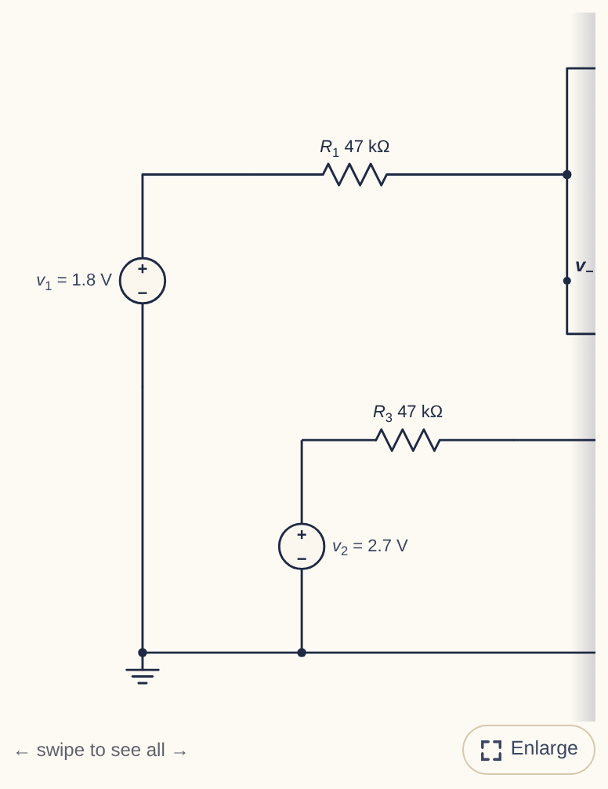

# 3.7 · 单元 5g：差分放大器：各自作用，再加起来

| 项目 | 内容 |
|---|---|
| id | `w3-5g-difference` |
| 文件 | `units/w3-5g-difference.json` |
| 类型 | 理论单元（#/unit 页面，从上往下读的长页） |
| 位置 | World 3 · 运算放大器基础 → 3.7 求和与差分（本节第 3 项） |
| 这个单元回答的问题 | 差分放大器为什么只放大 v_2 − v_1？ |
| 时长 | 14 分钟 |
| 接回 | chapter:theorems、unit:w3-5e-inverting、unit:w3-5d-noninverting |
| 前后 | 上一项 [3.7 exp-summing-amp](../w3/3.07-2-exp-summing-amp.md) · 下一项 [3.7 exp-difference-amp](../w3/3.07-4-exp-difference-amp.md) |

## ① 直觉

差分放大器有两路输入。v_1 经 R_1 接 v_{−}，R_2 从 v_{−} 接到 v_o；v_2 经 R_3 接 v_{+}，R_4 从 v_{+} 接地。

想象两个人从门的两边推门。v_2 从 v_{+} 那边把 v_o 往上推，v_1 从 v_{−} 那边把 v_o 往下推。两人用一样大的力，门不动；门只跟着两人力气的**差**走。

要知道门最后在哪，可以让两人轮流推：先只让一个人推，量一次；再只让另一个人推，量一次；两次加起来。这就是 Midterm 2 的**叠加定理**。

*实验 2-9 的差分放大器：R_1 = R_3 = 47 kΩ，R_2 = R_4 = 100 kΩ。两个旋钮分别在 20% 和 30%，所以 v_1 ≈ 1.8 V，v_2 ≈ 2.7 V。*

## ② 交互推导

**分步推导：五步法 + 叠加：v_1 = 1.8 V，v_2 = 2.7 V**（一次揭开一步）

1. **① 有负反馈吗？** 有。R_2 把输出接回 v_{−}。（R_4 接的是地，不是输出，所以 v_{+} 那边没有反馈。）
2. **② 虚短、虚断。** 虚断：v_{+} 不取电流，R_3、R_4 是空载分压器：v_{+} = 2.7 × 100/147 ≈ 1.84 V。虚短：v_{−} = v_{+} ≈ 1.84 V。
3. **③ 在 v_{−} 列 KCL。** 从 v_1 经 R_1 流进来的电流，全部经 R_2 流向 v_o：(v_1 − v_{−})/R_1 = (v_{−} − v_o)/R_2。
4. **④a 只有 v_1（v_2 接地）。** v_{+} = 0，v_{−} 是虚地，这就是 5e 的反相放大器：v_o′ = −(100/47) × 1.8 ≈ −3.83 V。
5. **④b 只有 v_2（v_1 接地）。** v_{+} ≈ 1.84 V；R_1、R_2 成了从 v_o 到地的分压器，这就是 5d 的同相放大器：v_o″ = 1.84 × (1 + 100/47) ≈ 5.74 V。
6. **④c 加起来。** v_o = v_o′ + v_o″ ≈ −3.83 + 5.74 = 1.91 V。因为 R_2/R_1 = R_4/R_3，可以化成 v_o = (R_2/R_1)(v_2 − v_1) = 2.13 × 0.9 ≈ 1.91 V。把 v_{−} = 1.84 V 代回 ③ 的 KCL，也得到 1.91 V。
7. **⑤ 合理性检查。** ±9 V 双电源，输出约 −9 … +7.5 V：三个结果 −3.83、+5.74、+1.91 V 都在里面 ✓。电流都只有几到几十 µA（R_3–R_4 支路 2.7 V / 147 kΩ ≈ 18 µA），远低于限制 ✓。最后一个检查：v_1 = v_2 时 v_o 应该是 0。

**滑块探索：两路输入和一个不准的电阻**

| 参数 | 名称 | 默认 | 范围 | 单位 |
|---|---|---|---|---|
| v1 | 输入 v_1 | 1.8 | 0 … 9 | V |
| v2 | 输入 v_2 | 2.7 | 0 … 9 | V |
| err | R_4 的误差（%） | 0 | -10 … 10 |  |

| 输出 | 公式 | 单位 |
|---|---|---|
| R_4 实际值 | `100000 * (1 + err / 100)` | Ω |
| v_{+}（= v_{−}） | `v2 * R4 / (47000 + R4)` | V |
| 只有 v_1：v_o′ | `-(100 / 47) * v1` | V |
| 只有 v_2：v_o″ | `vp * (1 + 100 / 47)` | V |
| 相加：v_o′ + v_o″ | `a + b` | V |
| 实际 v_o（−9 … +7.5 V） | `clamp(vi, -9, 7.5)` | V |
| 共模增益（v_1 = v_2 时 v_o 与输入之比） | `R4 / (47000 + R4) * (1 + 100 / 47) - 100 / 47` |  |
| 饱和了？（1 = 是） | `step(vi - 7.5) + step(-9 - vi)` |  |

先让 v_1 = v_2：误差为 0 时输出是 0。再把 R_4 的误差拉到 ±5%：两边推力不再一样大，相同的输入也会漏出一点输出，这叫**共模泄漏**。

## ③ 仿真

**仿真**

先预测，再运行，再看为什么。op-amp（运算放大器）按 LM358 建模：±9 V 双电源，输出 −9 … +7.5 V。

| 参数 | 名称 | 默认 | 范围 | 单位 |
|---|---|---|---|---|
| v1 |  | 1.8 |  |  |
| v2 |  | 2.7 |  |  |
| R1 |  | 47000 |  |  |
| R2 |  | 100000 |  |  |
| R3 |  | 47000 |  |  |
| R4 |  | 100000 |  |  |
| open1 |  | 0 |  |  |

| 输出 | 公式 | 单位 |
|---|---|---|
| v_{+} | `v2 * R4 / (R3 + R4)` | V |
| 输出 v_o | `if(open1, clamp(vp, -9, 7.5), clamp(vp * (1 + R2 / R1) - R2 / R1 * v1, -9, 7.5))` | V |
| R_1 里的电流 | `if(open1, 0, (v1 - vp) / R1)` | A |

- **情景「只有 v_1（v_2 接地）」**（设定 v2=0）：S2 拨到 b，v_2 接地。v_o 是多少？
  - A. 约 −3.83 V ✅
  - B. 约 +3.83 V
  - C. 约 −1.8 V
  - D. 0 V
  - 解释：v_{+} = 0，v_{−} 是虚地：反相放大器，增益 −100/47 ≈ −2.13。−2.13 × 1.8 ≈ −3.83 V。

- **情景「只有 v_2（v_1 接地）」**（设定 v1=0）：S1 拨到 b，v_1 接地。v_o 是多少？
  - A. 约 +5.74 V ✅
  - B. 约 +1.84 V
  - C. 约 +8.45 V
  - D. 约 −5.74 V
  - 解释：先分压：v_{+} = 2.7 × 100/147 ≈ 1.84 V。再按同相放大器乘 1 + 100/47 ≈ 3.13：≈ 5.74 V。1.84 V 是忘了乘增益；8.45 V 是忘了先分压（而且超过 7.5 V，会削顶）。

- **情景「做坏事：“关掉” v_1 时让 R_1 悬空」**（设定 open1=1）：不拨开关，而是把 R_1 从 v_1 上拔下来、让它悬空。v_o 是多少？
  - A. 仍是约 5.74 V
  - B. 约 1.84 V ✅
  - C. 0 V
  - 解释：R_1 悬空，就没有电流流过 R_1 和 R_2，R_2 两端电压为 0：v_o = v_{−} = v_{+} ≈ 1.84 V。电路变成了跟随器。叠加定理里电压源“置零”是换成导线（接地），不是断开。

- **情景「做坏事：电阻不匹配」**（设定 v1=2.7, R4=110000）：两个输入都是 2.7 V，但 R_4 错用了 110 kΩ（大了 10%）。v_o 是多少？
  - A. 0 V
  - B. 约 0.17 V ✅
  - C. 约 2.7 V
  - 解释：R_2/R_1 ≠ R_4/R_3，两边“推力”不再一样大。v_{+} 从 1.84 V 变成 1.89 V，v_2 那一份变大，抵消不完：漏出约 0.17 V。真实电阻有 1%–5% 的误差，所以实验里两个旋钮一样时，输出也不会正好是 0。

## ④ 面包板

**去面包板** → [3.7 exp-difference-amp](../w3/3.07-4-exp-difference-amp.md)：轮流把一个开关拨到 b（那一路接地），记下两次 v_o（约 −3.83 V 和 +5.74 V）；再两个都拨到 a，读数应该就是两次之和（约 1.91 V）。

## ⑤ 回链

**预测题**：（Midterm 2：叠加定理）要“关掉” v_1，应该怎么做？

- A. 把 v_1 换成导线：R_1 的那一端接地 ✅
- B. 把 v_1 断开：R_1 的那一端悬空
- C. 让 v_1 = v_2

揭晓：

> 电压源置零 = 0 V = 一根导线。实验里开关拨到 b 就是这样做的。断开是电流源置零的做法；在这里断开会得到 1.84 V，而不是 5.74 V（见仿真的第三个情景）。

**预测题**：（接 5e）v_2 接地时，从 v_1 看，这个电路是什么？

- A. 反相放大器，增益 −R_2/R_1 ✅
- B. 同相放大器，增益 1 + R_2/R_1
- C. 跟随器

揭晓：

> v_2 接地，R_3、R_4 里没有电流，v_{+} = 0，v_{−} 是虚地。剩下的就是 5e 的跷跷板：R_1 一边，R_2 另一边。

**预测题**：（接 5d）v_1 接地时 v_{+} ≈ 1.84 V。R_1、R_2 成了从 v_o 到地的分压器，β = 47/147。v_o 是多少 V？

- 答案：5.74 V（误差 0.02）

揭晓：

> v_o = v_{+}/β = 1.84 × 147/47 ≈ 5.74 V。这就是 5d 的“增益 = 分压比倒过来”。

**理论题**：理论题沿用中文教材的记号：电压写作 u（u_o 就是这里的 v_o）。12 题（Howland 电路）是差分放大器的变形：负载接在 v_{+} 上，要在 v_{+} 和 v_{−} 各列一个结点方程。

- `opamp-06-difference-amp` 减法器（差分放大电路）（opamp）
- `opamp-12-howland-current-source` 豪兰德（Howland）电路：接地负载的电流（opamp）

## English

展开英文

## ① 直觉

A difference amplifier has two inputs. v_1 goes through R_1 to v_{−}, and R_2 runs from v_{−} to v_o; v_2 goes through R_3 to v_{+}, and R_4 runs from v_{+} to ground.

Picture two people pushing a door from opposite sides. v_2 pushes v_o up from the v_{+} side; v_1 pushes it down from the v_{−} side. If they push equally hard, the door stays put. The door follows only the **difference** of their pushes.

To find where the door ends up, let them take turns: one pushes alone, measure; the other pushes alone, measure; add the two. That is Midterm 2's **superposition theorem**.

[电路图]

*The difference amplifier of lab 2-9: R_1 = R_3 = 47 kΩ, R_2 = R_4 = 100 kΩ. The two knobs sit at 20% and 30%, so v_1 ≈ 1.8 V and v_2 ≈ 2.7 V.*

## ② 交互推导

**分步推导：The five steps plus superposition: v_1 = 1.8 V, v_2 = 2.7 V**（一次揭开一步）

1. **① Is there negative feedback?** Yes. R_2 takes the output back to v_{−}. (R_4 goes to ground, not to the output, so there is no feedback on the v_{+} side.)
2. **② Virtual short, virtual open.** Virtual open: v_{+} draws no current, so R_3 and R_4 are an unloaded divider: v_{+} = 2.7 × 100/147 ≈ 1.84 V. Virtual short: v_{−} = v_{+} ≈ 1.84 V.
3. **③ KCL at v_{−}.** All the current coming in from v_1 through R_1 leaves through R_2 toward v_o: (v_1 − v_{−})/R_1 = (v_{−} − v_o)/R_2.
4. **④a v_1 alone (v_2 grounded).** v_{+} = 0, so v_{−} is a virtual ground: this is the inverting amplifier of 5e. v_o′ = −(100/47) × 1.8 ≈ −3.83 V.
5. **④b v_2 alone (v_1 grounded).** v_{+} ≈ 1.84 V; R_1 and R_2 now form a divider from v_o to ground: the non-inverting amplifier of 5d. v_o″ = 1.84 × (1 + 100/47) ≈ 5.74 V.
6. **④c Add them.** v_o = v_o′ + v_o″ ≈ −3.83 + 5.74 = 1.91 V. Because R_2/R_1 = R_4/R_3 this simplifies to v_o = (R_2/R_1)(v_2 − v_1) = 2.13 × 0.9 ≈ 1.91 V. Putting v_{−} = 1.84 V back into the KCL of ③ gives 1.91 V too.
7. **⑤ Sanity check.** On ±9 V the output spans about −9 … +7.5 V: all three results, −3.83, +5.74 and +1.91 V, are inside ✓. Every current is a few to a few tens of µA (the R_3–R_4 branch carries 2.7 V / 147 kΩ ≈ 18 µA), far below the limits ✓. One last check: with v_1 = v_2, v_o should be 0.

**滑块探索：Two inputs and one imperfect resistor**

| 参数 | 名称 | 默认 | 范围 | 单位 |
|---|---|---|---|---|
| v1 | input v_1 | 1.8 | 0 … 9 | V |
| v2 | input v_2 | 2.7 | 0 … 9 | V |
| err | error of R_4 (%) | 0 | -10 … 10 |  |

| 输出 | 公式 | 单位 |
|---|---|---|
| actual R_4 | `100000 * (1 + err / 100)` | Ω |
| v_{+} (= v_{−}) | `v2 * R4 / (47000 + R4)` | V |
| v_1 alone: v_o′ | `-(100 / 47) * v1` | V |
| v_2 alone: v_o″ | `vp * (1 + 100 / 47)` | V |
| sum: v_o′ + v_o″ | `a + b` | V |
| actual v_o (−9 … +7.5 V) | `clamp(vi, -9, 7.5)` | V |
| common-mode gain (v_o per volt when v_1 = v_2) | `R4 / (47000 + R4) * (1 + 100 / 47) - 100 / 47` |  |
| saturated? (1 = yes) | `step(vi - 7.5) + step(-9 - vi)` |  |

Set v_1 = v_2 first: with zero error the output is 0. Then give R_4 a ±5% error: the two pushes are no longer equal, and identical inputs leak a little output. This is called **common-mode leakage**.

## ③ 仿真

**仿真**

Predict, run, then see why. The op-amp is an LM358 on ±9 V: output −9 … +7.5 V.

| 参数 | 名称 | 默认 | 范围 | 单位 |
|---|---|---|---|---|
| v1 |  | 1.8 |  |  |
| v2 |  | 2.7 |  |  |
| R1 |  | 47000 |  |  |
| R2 |  | 100000 |  |  |
| R3 |  | 47000 |  |  |
| R4 |  | 100000 |  |  |
| open1 |  | 0 |  |  |

| 输出 | 公式 | 单位 |
|---|---|---|
| v_{+} | `v2 * R4 / (R3 + R4)` | V |
| output v_o | `if(open1, clamp(vp, -9, 7.5), clamp(vp * (1 + R2 / R1) - R2 / R1 * v1, -9, 7.5))` | V |
| current in R_1 | `if(open1, 0, (v1 - vp) / R1)` | A |

- **情景「v_1 alone (v_2 grounded)」**（设定 v2=0）：S2 to b: v_2 is grounded. What is v_o?
  - A. about −3.83 V ✅
  - B. about +3.83 V
  - C. about −1.8 V
  - D. 0 V
  - 解释：v_{+} = 0 and v_{−} is a virtual ground: an inverting amplifier with gain −100/47 ≈ −2.13. −2.13 × 1.8 ≈ −3.83 V.

- **情景「v_2 alone (v_1 grounded)」**（设定 v1=0）：S1 to b: v_1 is grounded. What is v_o?
  - A. about +5.74 V ✅
  - B. about +1.84 V
  - C. about +8.45 V
  - D. about −5.74 V
  - 解释：Divide first: v_{+} = 2.7 × 100/147 ≈ 1.84 V. Then multiply by the non-inverting gain 1 + 100/47 ≈ 3.13: ≈ 5.74 V. 1.84 V forgets the gain; 8.45 V forgets the divider (and would clip above 7.5 V anyway).

- **情景「Doing it wrong: "turn off" v_1 by leaving R_1 open」**（设定 open1=1）：Instead of using the switch, pull R_1 off v_1 and leave it floating. What is v_o?
  - A. still about 5.74 V
  - B. about 1.84 V ✅
  - C. 0 V
  - 解释：With R_1 floating, no current flows in R_1 or R_2, so R_2 drops nothing: v_o = v_{−} = v_{+} ≈ 1.84 V. The circuit has become a follower. In superposition, a voltage source is "turned off" by replacing it with a wire (to ground), not by opening it.

- **情景「Doing it wrong: mismatched resistors」**（设定 v1=2.7, R4=110000）：Both inputs are 2.7 V, but R_4 is 110 kΩ by mistake (10% high). What is v_o?
  - A. 0 V
  - B. about 0.17 V ✅
  - C. about 2.7 V
  - 解释：R_2/R_1 ≠ R_4/R_3, so the two pushes are no longer equal. v_{+} rises from 1.84 V to 1.89 V, v_2's share grows, and the two no longer cancel: about 0.17 V leaks out. Real resistors are off by 1%–5%, so in the lab the output is never exactly 0 with both knobs equal.

## ④ 面包板

**去面包板** → [3.7 exp-difference-amp](../w3/3.07-4-exp-difference-amp.md)：Flip one switch at a time to b (that input grounded) and note the two readings of v_o (about −3.83 V and +5.74 V); then put both at a: the reading should be their sum (about 1.91 V).

## ⑤ 回链

**预测题**：(Midterm 2: superposition) To "turn off" v_1, what do you do?

- A. replace v_1 with a wire: that end of R_1 goes to ground ✅
- B. open v_1: that end of R_1 is left floating
- C. set v_1 = v_2

揭晓：

> A voltage source set to zero is 0 V, which is a wire. Flipping the lab switch to b does exactly that. Opening is how you turn off a current source; here it would give 1.84 V instead of 5.74 V (see the third sim scenario).

**预测题**：(Back to 5e) With v_2 grounded, what does the circuit look like from v_1?

- A. an inverting amplifier, gain −R_2/R_1 ✅
- B. a non-inverting amplifier, gain 1 + R_2/R_1
- C. a follower

揭晓：

> With v_2 grounded, R_3 and R_4 carry no current, v_{+} = 0, and v_{−} is a virtual ground. What is left is the see-saw of 5e: R_1 on one side, R_2 on the other.

**预测题**：(Back to 5d) With v_1 grounded, v_{+} ≈ 1.84 V. R_1 and R_2 form a divider from v_o to ground with β = 47/147. What is v_o, in V?

- 答案：5.74 V（误差 0.02）

揭晓：

> v_o = v_{+}/β = 1.84 × 147/47 ≈ 5.74 V. That is 5d's "gain = the divider ratio upside down".

**理论题**：The theory problems follow the Chinese textbook and write voltage as u (their u_o is our v_o). Problem 12 (the Howland circuit) is a twist on the difference amplifier: the load hangs on v_{+}, so write one node equation at v_{+} and one at v_{−}.

- `opamp-06-difference-amp` 减法器（差分放大电路）（opamp）
- `opamp-12-howland-current-source` 豪兰德（Howland）电路：接地负载的电流（opamp）

