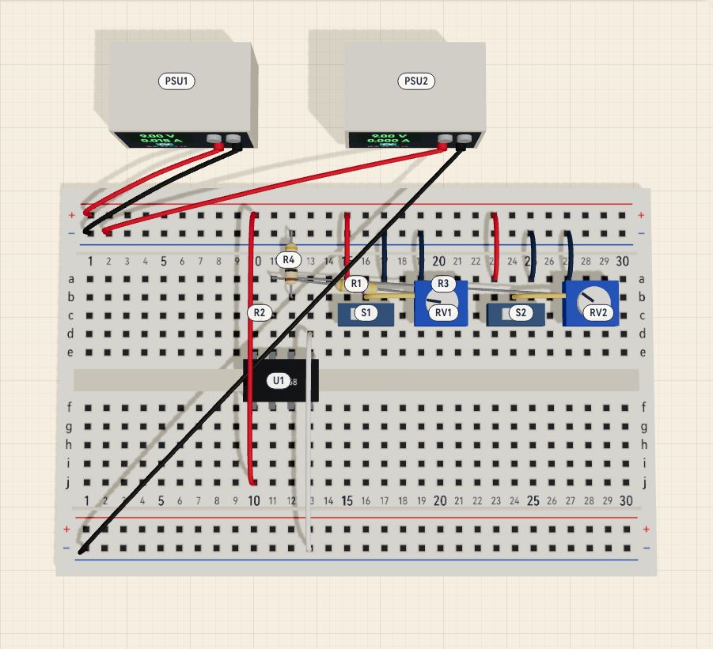
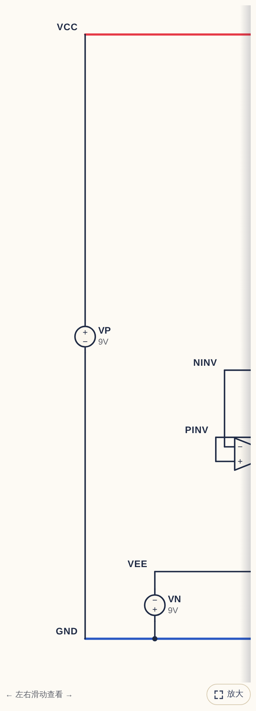

# 3.7 · 实验 2-9 · 差分放大器：两路输入分别作用，再加起来

| 项目 | 内容 |
|---|---|
| id | `exp-difference-amp` |
| 文件 | `challenges/229-difference-amp.json` |
| 类型 | 实验 / 挑战（没有分步，照目标电路图搭） · 难度 5/5 |
| 位置 | World 3 · 运算放大器基础 → 3.7 求和与差分（本节第 4 项） |
| 右侧面板 | 旧版面（文件里没有卡片） |
| 前后 | 上一项 [3.7 w3-5g-difference](../w3/3.07-3-w3-5g-difference.md) · 下一项 [3.8 w3-5h-cascade](../w3/3.08-1-w3-5h-cascade.md) |
| 先修 | lesson-lm358 |
| 概念 | difference amplifier 差分放大器、superposition 叠加定理、virtual short / virtual open 虚短 / 虚断、common mode 共模 |

**一句话概要**：LM358 + 四个电阻（47kΩ、100kΩ 各两个）做差分放大器：用开关轮流关掉一路输入，分别测输出，再一起测——两次结果正好相加，这就是叠加定理。

## 1. 左侧工作台（3D 面包板 → 2D 俯视截图）

截图是程序里真实的 3D 面包板换成俯视角拍的；表格是同一块板的文字版（元件、参数、每只脚插在哪个孔）。

### 1.1 起点：空面包板（学生从零开始搭）

### 1.3 参考答案（「看答案」载入的板子）

| 元件 | 类型 | 参数 | 引脚 → 孔 |
|---|---|---|---|
| PSU1 | bench_supply | voltage=9, currentLimit=0.1 | +→tp1 -→tn1 |
| PSU2 | bench_supply | voltage=9, currentLimit=0.1 | +→tn2 -→bn1 |
| U1 | opamp |  | 1→e10 2→e11 3→e12 4→e13 5→f13 6→f12 7→f11 8→f10 |
| W4 | wire |  | a→tp10 b→j10 |
| W5 | wire |  | a→d13 b→bn13 |
| R2 | resistor | resistance=100000 | 1→c10 2→c11 |
| R4 | resistor | resistance=100000 | 1→b12 2→tn12 |
| S1 | switch | position=a | a→c15 com→c16 b→c17 |
| W9 | wire |  | a→tp15 b→a15 |
| W10 | wire |  | a→a17 b→tn17 |
| RV1 | potentiometer | resistance=1000, wiper=0.2 | 1→c19 2→c20 3→c21 |
| W12 | wire |  | a→a19 b→tn19 |
| W13 | wire |  | a→b16 b→b21 |
| R1 | resistor | resistance=47000 | 1→b20 2→a11 |
| S2 | switch | position=a | a→c23 com→c24 b→c25 |
| W16 | wire |  | a→tp23 b→a23 |
| W17 | wire |  | a→a25 b→tn25 |
| RV2 | potentiometer | resistance=1000, wiper=0.3 | 1→c27 2→c28 3→c29 |
| W19 | wire |  | a→a27 b→tn27 |
| W20 | wire |  | a→b24 b→b29 |
| R3 | resistor | resistance=47000 | 1→b28 2→a12 |

### 1.4 目标原理图（右侧「目标原理图」抽屉）

| 元件 | 类型 | 参数 |
|---|---|---|
| VP | dc_source | voltage=9 |
| VN | dc_source | voltage=9 |
| U1 | opamp |  |
| S1 | switch |  |
| S2 | switch |  |
| RV1 | potentiometer | resistance=1000 |
| RV2 | potentiometer | resistance=1000 |
| R1 | resistor | resistance=47000 |
| R2 | resistor | resistance=100000 |
| R3 | resistor | resistance=47000 |
| R4 | resistor | resistance=100000 |

连接（每个结点上的引脚）：

- **VCC**：VP.+、U1.v+、S1.a、S2.a
- **GND**：VP.-、VN.+、S1.b、S2.b、RV1.1、RV2.1、R4.2
- **VEE**：VN.-、U1.v-
- **N1**：S1.com、RV1.3
- **N2**：S2.com、RV2.3
- **IN1**：RV1.2、R1.1
- **IN2**：RV2.2、R3.1
- **NINV**：R1.2、R2.2、U1.inA-
- **PINV**：R3.2、R4.1、U1.inA+
- **VOUT**：U1.outA、R2.1

## 2. 右侧面板：学生从上往下看到的内容（单轨流）

> 这个文件还没有卡片，界面是旧版面：题目说明 + 目标原理图 + 测量题。

### 题目说明

**目标**：差分放大器把两个输入电压“相减再放大”。当 R4/R3 = R2/R1 时，Uo = (R2/R1)(Ui2 − Ui1)。你会看到：两路输入各自起作用，最后加在一起——这就是刚用过的叠加定理。

**电路**（±9 V 双电源，接法同实验 2-7）：
- LM358：8 脚 V+ 接 +9V，4 脚 V− 接 −9V；
- 输入 1：开关 S1 的 a 侧接 +9V、b 侧接 GND，com 接电位器 RV1（1kΩ）的 3 脚；RV1 的 1 脚接 GND；滑动端的电压叫 Ui1，经 R1（47kΩ）接 IN−；
- 输入 2：S2、RV2 的接法和输入 1 完全一样；RV2 滑动端的电压叫 Ui2，经 R3（47kΩ）接 IN+；
- R2（100kΩ）从 IN− 接到 OUT；R4（100kΩ）从 IN+ 接到 GND。两个比值相等：R2/R1 = R4/R3 = 100/47。

LM358 横跨凹槽，每只脚独占一列：凹槽上方一排从左到右是 1 脚 OUT A、2 脚 IN− A、3 脚 IN+ A、4 脚 V−（这里接 −9V）；下方一排从左到右是 8 脚 V+、7 脚 OUT B、6 脚 IN− B、5 脚 IN+ B。用 A、B 哪一个都可以。

**怎么关掉一路输入**：开关拨到 b，电位器的上端就从 +9V 换到了 GND，滑动端也接到了 GND。这就是叠加定理里的“电压源置零 = 换成导线（接地）”，不是把线拔掉（断开）。旋钮不用动，拨回 a，这一路输入就回来了。

**为什么这样选值**：只有输入 1 时输出是负的，所以要用 ±9 V 双电源（单电源时输出不能为负）。电位器用 1kΩ：滑动端自己的电阻最多 250 Ω，比 47kΩ 小得多，几乎不影响输入电压。旋钮放在 20% 和 30%，是为了让最大的输出也留在 LM358 的输出范围里（−9 V 到 V+ − 1.5 V = +7.5 V）。

**先预测**：RV1 在 20%、RV2 在 30%，所以 Ui1 ≈ 9 V × 20%，Ui2 ≈ 9 V × 30%。每种情况都用同一套五步法：
1. 有负反馈吗？看 R2：它从 OUT 接回 IN−，所以有；
2. 有负反馈，就可以用虚短（U− ≈ U+）和虚断（IN+、IN− 都不取电流）。先用 R3、R4 分压算 U+，U− 就等于它；
3. 在 IN− 结点列 KCL：从 Ui1 经 R1 流进来的电流，全部经 R2 流向 OUT（虚断：没有电流流进运放）；
4. 解出 Uo；
5. 检查：Uo 在输出范围里吗？有没有哪个电流超过限制？
用它算出三种情况的 Uo：只有 Ui1、只有 Ui2、两个都接。前两个加起来，等于第三个吗？再想：两个旋钮转到同一位置（Ui1 = Ui2）时，Uo 是多少？

**测量**（RV1 放在 20%，RV2 放在 30%；万用表直流档测 OUT 对 GND）：
1. S1→a、S2→b：只有 Ui1；
2. S1→b、S2→a：只有 Ui2；
3. S1→a、S2→a：两个都接（也可以顺便测 IN+、IN−，看虚短）；
4. 两个开关都在 a，再把 RV1 也转到 30%。电路检查通过后，把读数填进下面的「测量」（以你自己的面包板为准）；答完后会显示计算对比。

**想一想**：“关掉”输入 1 时，如果不拨开关，而是把 R1 从滑动端拔下来、让它悬空（断开），只有 Ui2 时的输出还和第 2 步一样吗？用五步法算一算。

**真实电路里**：输出范围仿真里也有。仿真不限制 op-amp（运算放大器）的输出电流，真实 LM358 大约能输出或吸收 10 mA 以上；这个电路里 op-amp 只需要给 R2 提供几十 µA，差得很远。真实电阻有 1%–5% 的误差，所以 R2/R1 和 R4/R3 不会正好相等（见「对比」）。

**测量题 1 · `uo1`**（读数题）

> 只有 Ui1（S1→a，S2→b）：万用表测 OUT 对 GND

- 单位 V · 先写预测 · 状态：把 S1 拨到 a 侧、把 S2 拨到 b 侧、把 RV1 旋到 20%、把 RV2 旋到 30% · 参考答案的读数 **-3.817 V** · 合理范围 [-4, -3.65]

答对后显示：

> Ui2 接地，U+ = U− = 0（虚地），这就是反相放大器：Uo = −(100/47) × 1.8 ≈ −3.83 V。

**测量题 2 · `uo2`**（读数题）

> 只有 Ui2（S1→b，S2→a）：OUT 对 GND

- 单位 V · 先写预测 · 状态：把 S1 拨到 b 侧、把 S2 拨到 a 侧、把 RV1 旋到 20%、把 RV2 旋到 30% · 参考答案的读数 **5.723 V** · 合理范围 [5.45, 6]

答对后显示：

> U+ = 2.7 × 100/147 ≈ 1.84 V = U−；Ui1 接地，在 IN− 列 KCL：Uo = 1.84 × (1 + 100/47) ≈ 5.74 V，没超过 +7.5 V。

**测量题 3 · `uo12`**（读数题）

> 两个都接（S1→a，S2→a）：OUT 对 GND

- 单位 V · 先写预测 · 状态：把 S1 拨到 a 侧、把 S2 拨到 a 侧、把 RV1 旋到 20%、把 RV2 旋到 30% · 参考答案的读数 **1.906 V** · 合理范围 [1.8, 2]

答对后显示：

> Uo = (100/47)(2.7 − 1.8) ≈ 1.91 V。

**测量题 4 · `super`**（选择题）

> 把你的前两个读数加起来，和第三个读数比较：

- A. 两者相等（差别在读数误差以内） ✅（正确）
- B. 加起来明显比两个都接时小
- C. 加起来明显比两个都接时大

答对后显示：

> −3.83 + 5.74 ≈ 1.91：叠加定理。每一路输入单独作用（另一路接地），线性电路把两个作用相加。

**测量题 5 · `ucm`**（读数题）

> 两个开关都在 a，RV1 也转到 30%（Ui1 = Ui2）：OUT 对 GND

- 单位 V · 先写预测 · 状态：把 S1 拨到 a 侧、把 S2 拨到 a 侧、把 RV1 旋到 30%、把 RV2 旋到 30% · 参考答案的读数 **5.711e-9 V** · 合理范围 [-0.05, 0.05]

答对后显示：

> 两边输入相同（共模）：−2.13 × 2.7 + 2.13 × 2.7 = 0。能抵消，是因为 R2/R1 = R4/R3。

## 3. 测量题一览

| # | id | 题目 | 类型 | 单位 | 状态 | 参考读数 |
|---|---|---|---|---|---|---|
| 1 | uo1 | 只有 Ui1（S1→a，S2→b）：万用表测 OUT 对 GND | voltage | V | 把 S1 拨到 a 侧、把 S2 拨到 b 侧、把 RV1 旋到 20%、把 RV2 旋到 30% | -3.817 V |
| 2 | uo2 | 只有 Ui2（S1→b，S2→a）：OUT 对 GND | voltage | V | 把 S1 拨到 b 侧、把 S2 拨到 a 侧、把 RV1 旋到 20%、把 RV2 旋到 30% | 5.723 V |
| 3 | uo12 | 两个都接（S1→a，S2→a）：OUT 对 GND | voltage | V | 把 S1 拨到 a 侧、把 S2 拨到 a 侧、把 RV1 旋到 20%、把 RV2 旋到 30% | 1.906 V |
| 4 | super | 把你的前两个读数加起来，和第三个读数比较： | 选择 |  |  | 正确：A |
| 5 | ucm | 两个开关都在 a，RV1 也转到 30%（Ui1 = Ui2）：OUT 对 GND | voltage | V | 把 S1 拨到 a 侧、把 S2 拨到 a 侧、把 RV1 旋到 30%、把 RV2 旋到 30% | 5.711e-9 V |

### 全部答完后显示的「对比」

**对比**：R2/R1 = R4/R3 = 100/47 ≈ 2.13。下面用 Ui1 = 1.8 V、Ui2 = 2.7 V 算。电位器自己有几百 Ω，读数会比算出来的小约 0.3%。

**只有 Ui1**（S1→a，S2→b）：
1. R2 从 OUT 接回 IN−：有负反馈；
2. Ui2 接地，R3、R4 里没有电流：U+ = 0，虚短让 U− 也是 0；
3. IN− 的 KCL：(1.8 − 0) / 47k = (0 − Uo) / 100k，也就是 38 µA 从 R1 流进来、再经 R2 流走；
4. Uo = −(100/47) × 1.8 ≈ −3.83 V，读数约 **−3.82 V**：这就是一个反相放大器；
5. −3.83 V 比 −9 V 高很多，没问题。电流：R1、R2 里 38 µA，每个电位器约 9 mA，都很小。

**只有 Ui2**（S1→b，S2→a）：
1. 仍然有负反馈；
2. U+ = 2.7 × 100 / 147 ≈ 1.84 V，U− 也是 1.84 V；
3. Ui1 接地，IN− 的 KCL：(0 − 1.84) / 47k = (1.84 − Uo) / 100k；
4. Uo = 1.84 × (1 + 100/47) ≈ 5.74 V，读数约 **+5.72 V**：分压器后面接一个同相放大器；
5. 5.7 V 低于 +7.5 V，还有约 1.8 V 余量。这是本实验最大的输出，所以旋钮没有再往上转。

**两个都接**（S1→a，S2→a）：U+ = U− ≈ 1.84 V；KCL：(1.8 − 1.84) / 47k = (1.84 − Uo) / 100k，得 Uo ≈ **+1.91 V** = (100/47)(2.7 − 1.8)。读数上 −3.817 + 5.723 = 1.906 ✔：**叠加定理**。电路是线性的，两路输入的作用直接相加。前提是“关掉”= 接地：如果把 R1 悬空（断开），R1、R2 里都没有电流，电路变成跟随器，只有 Ui2 时输出就只是 U+ ≈ 1.84 V，而不是 5.7 V。

**两边输入相同**（两个旋钮都在 30%）：Uo ≈ **0 V**。两路的作用 −2.13 × 2.7 和 +2.13 × 2.7 正好抵消。两边共有的输入叫**共模**（common mode），放大器能“不理它”，全靠两个比值相等。如果 R4 错拿成 47kΩ，这时输出约 −1.5 V，而不是 0；用真实的 1% 电阻，也会剩下几十 mV。

### 提示按钮（依次显示）

1. 双电源：两台 9 V 电源串联，中点是 GND；+9V 接 op-amp（运算放大器）8 脚，−9V 接 4 脚。
2. 每一路输入：开关 a 侧接 +9V，b 侧接 GND（一定接 GND，不是空着），com 接电位器 3 脚；电位器 1 脚接 GND；滑动端经 47kΩ 电阻进 op-amp（运算放大器）。RV1 这一路进 IN−，RV2 这一路进 IN+。
3. R2（100kΩ）接在 IN− 和 OUT 之间，R4（100kΩ）从 IN+ 接到 GND。每种情况都先用 R3、R4 分压算 U+，再在 IN− 列 KCL。

### 功能测试（「检查我的电路」时跑）

- 只有 Ui1（S1→a，S2→b）：输出是 Ui1 被放大并反相
- 只有 Ui2（S1→b，S2→a）：IN− 跟着 IN+（虚短），输出为正
- 两个都接（a，a）：输出等于两次单独作用之和
- 两个旋钮都在 30%（共模）：输出约为零

## 4. 用到的拆解（全部层的文字，供改写参考）

### 拆解 `lm358`：LM358：一颗芯片里的两个 op-amp

*op-amp = operational amplifier（运算放大器）。我们从芯片外形一路拆到教授在黑板上画的那个三角形，再拆到三角形里面的等效电路，最后用它推出每一个放大器公式。*

**拆解「LM358：一颗芯片里的两个 op-amp」第 1 / 9 层：① 外形：8 只脚的黑色小芯片（DIP-8）**

LM358 装在 **DIP-8** 封装里（Dual In-line Package，两排直插，8 只脚）。怎么找 1 脚：
- 芯片一端有个 半圆缺口 notch，缺口朝上时，左上角有个 小圆点 的就是 **1 脚**；
- 从 1 脚开始 **逆时针** 数：左边一排从上往下 1、2、3、4，再从右边一排从下往上 5、6、7、8。

8 只脚分成三类：**A 号 op-amp 的 3 只脚**、**B 号 op-amp 的 3 只脚**、**两个 op-amp 共用的 2 只电源脚**。把鼠标放到下表每一行上，看它在芯片上的位置。

| 脚 | 名字 | 属于 | 它是什么 | 单电源时接哪 |
|---|---|---|---|---|
| 1 | OUT A | op-amp A | 输出（output） | 负载 / 反馈网络 |
| 2 | IN− A | op-amp A | 反相输入（inverting input） | 反馈回来的信号 |
| 3 | IN+ A | op-amp A | 同相输入（non-inverting input） | 要放大的信号 / 参考电压 |
| 4 | V− (GND) | A、B 共用 | 负电源 | GND |
| 5 | IN+ B | op-amp B | 同相输入 | 不用时接固定电压 |
| 6 | IN− B | op-amp B | 反相输入 | 不用时接 7 脚（跟随器） |
| 7 | OUT B | op-amp B | 输出 | — |
| 8 | V+ | A、B 共用 | 正电源 3–32 V | +5 V / +9 V |

**拆解「LM358：一颗芯片里的两个 op-amp」第 2 / 9 层：② X 光：硅片上有两个 op-amp，电源脚共用**

把黑色塑料变透明：中间是一小块 硅片 die，细细的 金线 bond wire 把硅片连到 8 只脚上。硅片上做了两个完全一样、互相独立的放大器：op-amp A 和 op-amp B。

“**Dual**（双）”就是这个意思。它们只共用两样东西：V+（8 脚） 和 V−（4 脚）。所以：
- 只要芯片插上电，A 和 B **都** 通电了，哪怕你只用 A；
- 不用的那一半不能让它的输入悬空——悬空的输入会让它乱跳甚至振荡，干扰另一半。通常把它接成跟随器（7 脚接 6 脚），5 脚接一个固定电压。

**拆解「LM358：一颗芯片里的两个 op-amp」第 3 / 9 层：③ 符号：教授画的那个三角形**

原理图里，一个 op-amp 画成一个 三角形，信号从左往右走：
- IN−（反相输入 inverting input）：标“−”的那只脚，它上面的电压记作 $v₋$；
- IN+（同相输入 non-inverting input）：标“+”的那只脚，电压记作 $v₊$；
- OUT（输出）：三角形的尖，电压 $v_o$；
- V+ 和 V−：电源脚。理论题里常常 **省略不画**，但真实电路里必须接，否则它不工作。

注意：“+”“−”不是电源正负极，而是“这只输入对输出的作用是同向还是反向”。op-amp 只关心两个输入之间的 **差**：
$$v_d = v₊ - v₋$$
v_d 叫 **差模输入电压**（differential input voltage）。

| 端子 | 符号 | LM358 A 的脚 | 作用 |
|---|---|---|---|
| IN+ | $v₊$ | 3 | $v₊$ 升高 → $v_o$ 升高 |
| IN− | $v₋$ | 2 | $v₋$ 升高 → $v_o$ 降低 |
| OUT | $v_o$ | 1 | 输出 $A·v_d$ |
| V+ / V− | — | 8 / 4 | 能量从这里来，也限制 $v_o$ 的范围 |

- 公式 `v_d = v₊ - v₋`：op-amp 唯一“看”的量

**拆解「LM358：一颗芯片里的两个 op-amp」第 4 / 9 层：④ 拆开三角形：三个元件的等效电路**

教授说“把 op-amp 拆成电路”，拆出来就是这三样（这是电路课里 op-amp 的 **线性模型**）：

1. 输入电阻 R_in：接在两个输入之间。LM358 的输入只取约 20 nA 的偏置电流，等效 $R_{in}$ 在 MΩ 以上，计算时可以当成 **开路**——输入端几乎不取电流。
2. 受控电压源 A·v_d：一个电压 **控制** 的电压源（VCVS），它的电压是输入差的 A 倍。A 叫 **开环增益**（open-loop gain），LM358 约 $10^5$（100 dB）。
3. 输出电阻 R_out：受控源到输出脚之间，几十 Ω 量级。

于是不接任何反馈时：
$$v_o = A·v_d = A(v₊ - v₋)$$
这个电路你在第 5 章“含运算放大器的电阻电路”和受控源那一节都能直接用结点法分析。

| 参数 | LM358（典型） | 理想 op-amp | 计算时 |
|---|---|---|---|
| 开环增益 A | ≈ 10⁵ (100 dB) | ∞ | 很大 → 得出“虚短” |
| 输入电阻 R_in | MΩ 以上（偏置 20 nA） | ∞ | 开路 → 得出“虚断” |
| 输出电阻 R_out | 几十 Ω（仿真 10 Ω） | 0 | 反馈后更小，可忽略 |

- 公式 `v_o = A(v₊ - v₋)`：开环（不接反馈），且输出没到电源边界时

**拆解「LM358：一颗芯片里的两个 op-amp」第 5 / 9 层：⑤ 不接反馈会怎样？——输出一下子撞到电源**

用上一层的公式算一下。LM358 接 9 V 单电源，输出最多到约 7.5 V。要让输出在 0–7.5 V 之间（线性区），输入差只能是：
$$0 < v_d < \frac{7.5 V}{10^5} = 75 µV$$
75 微伏！你手一碰导线、电位器动一点点、甚至输入失调电压（LM358 典型 2 mV）都比它大几十倍。所以 **开环** 的 op-amp 几乎永远停在两头：
- $v₊ > v₋$（哪怕多 1 mV）→ 输出 顶到 ≈ V+ − 1.5 V
- $v₊ < v₋$ → 输出 掉到 ≈ 0 V

这叫 **饱和**（saturation）。这样用 op-amp 就成了 **比较器**（comparator）：只回答“哪个输入大”。想让它当放大器，必须加 **负反馈**——下面两层就讲为什么反馈能把 $v_d$ 稳稳地压在 75 µV 以内。

- 公式 `|v_d| < \frac{V_{sat}}{A} = \frac{7.5}{10^{5}} = 75 µV`：线性区有多窄

**拆解「LM358：一颗芯片里的两个 op-amp」第 6 / 9 层：⑥ 理想 op-amp 的两条黄金法则：虚短、虚断**

把等效电路里的三个参数推到极限：$A → ∞$、$R_{in} → ∞$、$R_{out} → 0$。电路课的所有 op-amp 题都用这两条法则：

**法则 1 · 虚断（virtual open）**：$R_{in} → ∞$，所以 两个输入端都不取电流：
$$i_+ = i_- = 0$$
**法则 2 · 虚短（virtual short）**：有负反馈、输出没饱和时，$v_o$ 是有限值（几伏），而 $v_d = \frac{v_o}{A}$，A → ∞，所以 两个输入电压相等：
$$v₊ = v₋$$
“虚”的意思：两个输入 **电压相等，但并没有真的连在一起**（没有电流流过）。

⚠ 虚短 **只在有负反馈时成立**。上一层的开环电路里 $v₊ ≠ v₋$，输出是饱和的。

| 法则 | 式子 | 来自 | 什么时候成立 |
|---|---|---|---|
| 虚断 | $i_+ = i_- = 0$ | $R_{in} → ∞$ | 总是（输入电流 nA 级） |
| 虚短 | $v₊ = v₋$ | $A → ∞$ | 有负反馈且输出未饱和 |

**拆解「LM358：一颗芯片里的两个 op-amp」第 7 / 9 层：⑦ 负反馈第一例：电压跟随器，一步步推**

把 输出直接接回 IN−，信号接 IN+。先 **不用** 黄金法则，用 ④ 的模型硬算（忽略 $R_{out}$）：
1. 接线告诉我们：$v₊ = v_{in}$，$v₋ = v_o$
2. op-amp 的方程：$v_o = A(v₊ - v₋) = A(v_{in} - v_o)$
3. 移项：$v_o(1 + A) = A·v_{in}$
4. 所以 $v_o = \frac{A}{1+A}v_{in}$。代入 $A = 10^5$：$v_o = 0.99999 v_{in}$

再看反馈 **为什么能稳住**：如果 $v_o$ 偏低，$v_d = v_{in} - v_o$ 变大，A 倍放大后把 $v_o$ 往上推；偏高则往下拉。输出一直“追”着输入，$v_d$ 只剩 $\frac{v_o}{A}$——几十 µV。

用黄金法则一行就出来：虚短 $v₋ = v₊$，而 $v₋ = v_o$，所以 $v_o = v_{in}$。两种方法结果一致，这就是黄金法则的来历。

**用处**：输入几乎不取电流（虚断），输出能提供几十 mA——它把“带不动负载的信号”变成“能带负载的信号”，叫 **缓冲器**（buffer）。

- 公式 `v_o = \frac{A}{1+A} v_{in} ≈ v_{in}`：有限 A 的精确结果

**拆解「LM358：一颗芯片里的两个 op-amp」第 8 / 9 层：⑧ 负反馈第二例：同相放大器和反相放大器**

跟随器把 **全部** 输出送回 IN−。如果只送回 **一部分**，就能放大。用 R_f 和 R_1 分压，送回 IN− 的是 βvₒ：
$$β = \frac{R_1}{R_1 + R_f}$$
**同相放大器**（non-inverting），信号接 IN+：
1. 虚断：IN− 不取电流，所以 R_f、R_1 是简单的串联分压：$v₋ = β v_o$
2. 虚短：$v₋ = v₊ = v_{in}$
3. 所以 $β v_o = v_{in}$，$v_o = \frac{1}{β}v_{in} = (1 + \frac{R_f}{R_1})v_{in}$

用有限 A 推（同 ⑦ 的方法）得到 $v_o = \frac{A}{1+Aβ}v_{in}$：只要 $Aβ ≫ 1$，增益就只由 **两个电阻** 决定，和 op-amp 本身的 A 无关——这就是负反馈的价值。

**反相放大器**（inverting）：IN+ 接 GND，信号经 $R_1$ 接 IN−，$R_f$ 从 OUT 接回 IN−。
1. 虚短：$v₋ = v₊ = 0$，IN− 是 **虚地**（virtual ground）
2. 虚断：流进 $R_1$ 的电流全部流过 $R_f$：$\frac{v_{in} - 0}{R_1} = \frac{0 - v_o}{R_f}$
3. 所以 $v_o = -\frac{R_f}{R_1}v_{in}$（负号 = 反相）

| 电路 | 增益 vₒ / v_in | 输入电阻 | 实验 |
|---|---|---|---|
| 跟随器 | 1 | ∞ | 2-5 |
| 同相放大 | $1 + \frac{R_f}{R_1}$ | ∞ | 2-6 |
| 反相放大 | $-\frac{R_f}{R_1}$ | $R_1$ | 2-7 |
| 反相求和 | $-R_f(\frac{v_1}{R_1} + \frac{v_2}{R_2})$ | $R_1$, $R_2$ | 2-8 |

- 公式 `β = \frac{R_1}{R_1 + R_f}`：反馈系数：输出送回 IN− 的比例
- 公式 `v_o = \frac{A}{1 + Aβ} v_{in} ≈ \frac{1}{β} v_{in}`：Aβ ≫ 1 时增益只取决于电阻

**拆解「LM358：一颗芯片里的两个 op-amp」第 9 / 9 层：⑨ 再往里：三级晶体管电路，和它的“缺点”**

三角形里真正的东西是约 20 个晶体管，分三级：
1. 输入级：PNP 差分对——只放大两个输入的 **差**。LM358 用 PNP 管，所以 输入电压可以低到 0 V（GND），这就是它能单电源工作的原因；输入上限约 V+ − 1.5 V。
2. 增益级——提供 $10^5$ 倍的电压增益。里面的 补偿电容 C_c 让高频增益逐渐下降，防止接反馈后振荡，代价是 **带宽**：增益 × 带宽 ≈ 1 MHz（GBW）。
3. 输出级：推挽——一个管子往上推电流、一个往下拉，提供几十 mA。往上推的那一路有两个 $V_{BE}$ 压降，所以 输出到不了 V+，差约 1.5 V；往下拉的那一路能接近 0 V。

这一层解释了你在课里看到的三个“现象”：
- 第 14 课：输入 9 V，输出只有 7.5 V → 输出级的余量；
- 放大倍数做 100 倍时带宽只剩约 10 kHz → $GBW ≈ 1 MHz$；
- 方波边沿变成斜坡，约 0.3 V/µs → **压摆率**（slew rate），由 C_c 的充电电流决定。

| 参数 | LM358 典型值 | 影响什么 |
|---|---|---|
| 电源电压 | 3–32 V（±1.5–±16 V） | 能用的电源 |
| 输出摆幅 | 0 … V+ − 1.5 V | 输出最大值 |
| 共模输入范围 | 0 … V+ − 1.5 V | 输入能接多高 |
| 增益带宽积 GBW | ≈ 1 MHz | $f_{max} ≈ \frac{GBW}{增益}$ |
| 压摆率 SR | ≈ 0.3 V/µs | 大信号的最高频率 |
| 输入失调电压 | ≈ 2 mV | 直流误差 × 增益 |

- 公式 `f_{-3dB} ≈ \frac{GBW}{G}`：G = 闭环增益（同相放大器的 1 + R_f/R_1）
- 公式 `f_{max} = \frac{SR}{2π V_p}`：不失真的最大正弦频率

**一句话记住**：op-amp = 一个只看 $v₊ - v₋$ 的超高增益放大器。开环时它是比较器；加了负反馈，输出会调到让 $v₊ = v₋$（虚短），输入不取电流（虚断）——从这两条就能推出所有放大器公式。

## 5. 这一课的计算卡片

**计算卡片 `superposition`：叠加定理 Superposition**

- 公式 `I_3 = I_3' + I_3''`
- 用途：几个独立源一起作用的响应 = 每个源单独作用的响应之和。
- 输入：V_1（电源 1，V）；V_2（电源 2，V）；R_1（R₁，Ω）；R_2（R₂，Ω）；R_3（R₃，Ω） → I_3（两个源一起时 R₃ 的电流，A）

1. 线性电路里，响应对每个独立源都是“成比例”的，所以可以分开算再相加。
2. 让一个源单独作用时，其余源 **置零**：电压源换成 **短路**，电流源换成 **开路**（受控源保留）。
3. 只有 V₁：$V_N' = \frac{V_1/R_1}{1/R_1 + 1/R_2 + 1/R_3}$，$I_3' = \frac{V_N'}{R_3}$。
4. 只有 V₂：$V_N'' = \frac{V_2/R_2}{1/R_1 + 1/R_2 + 1/R_3}$，$I_3'' = \frac{V_N''}{R_3}$。
5. 相加（带方向）：$I_3 = I_3' + I_3''$。
**功率不能叠加**：$P = I^{2}R$ 是平方，$(a + b)^{2} ≠ a^{2} + b^{2}$。

例子：实验 2-1：分母 1.7576 mS。只有 9 V：$V_N' ≈ 5.12 V$，$I_3' ≈ 1.55 mA$；只有 5 V：$V_N'' ≈ 1.29 V$，$I_3'' ≈ 0.39 mA$；一起：$1.55 + 0.39 = 1.94 mA$ ✔。R₃ 的功率：7.9 + 0.5 = 8.4 mW，但一起作用时是 $1.94^{2} × 3.3 ≈ 12.5 mW$。

- ⚠ “不作用”的电压源要 **短路**，不是拔掉（开路）——实验里开关拨到 GND，不是悬空。
- ⚠ 功率、能量不能叠加；电压、电流可以。

**计算卡片 `opamp-difference`：差分放大器 Difference amplifier**

- 公式 `v_o = -\frac{R_2}{R_1}v_1 + (1 + \frac{R_2}{R_1})\frac{R_4}{R_3 + R_4}v_2 = \frac{R_2}{R_1}(v_2 - v_1)`
- 用途：把两个输入相减再放大；R₄/R₃ = R₂/R₁ 时只放大差值、抵消共模。
- 输入：v_1（经 R₁ 进 IN− 的输入，V）；v_2（经 R₃ 进 IN+ 的输入，V）；R_1（R₁，Ω）；R_2（反馈 R₂，Ω）；R_3（R₃，Ω）；R_4（IN+ 到地 R₄，Ω） → v_o（输出，V）

1. 有负反馈（R₂ 从 OUT 回到 IN−），所以可以用虚短、虚断。
2. IN+ 不取电流，R₃、R₄ 是普通分压器：$v_+ = v_2\frac{R_4}{R_3 + R_4}$；虚短 $v_- = v_+$。
3. IN− 结点的 KCL（虚断：电流全部流过 R₂）：$\frac{v_1 - v_-}{R_1} = \frac{v_- - v_o}{R_2}$。
4. 解出 $v_o = (1 + \frac{R_2}{R_1})v_+ - \frac{R_2}{R_1}v_1$——正好是“v₁ 单独作用的反相放大器”加“v₂ 单独作用的同相放大器”：**叠加定理**。
5. 两个比值相等（$\frac{R_4}{R_3} = \frac{R_2}{R_1}$）时化简成 $\frac{R_2}{R_1}(v_2 - v_1)$：两边加同一个电压（共模）输出为 0。

例子：实验 2-9（$\frac{100}{47} ≈ 2.13$，v₁ = 1.8 V，v₂ = 2.7 V）：只有 v₁：$-2.13 × 1.8 ≈ -3.83 V$；只有 v₂：$v_+ = 2.7 × \frac{100}{147} ≈ 1.84 V$，$1.84 × 3.13 ≈ 5.74 V$；一起：$-3.83 + 5.74 ≈ 1.91 V = 2.13 × (2.7 - 1.8)$。两个旋钮都在 30 %：0 V。

- ⚠ “关掉”一个输入要把它接地（短路），不是让电阻悬空：悬空时电路变成跟随器，只剩 v₊。
- ⚠ 比值不匹配时共模不能完全抵消：R₄ 错成 47 kΩ，两边都 2.7 V 时输出约 −1.5 V。

## 6. English（界面英文版的同一份内容）

展开英文

**Goal**: a difference amplifier subtracts two input voltages and amplifies the difference. When R4/R3 = R2/R1, Uo = (R2/R1)(Ui2 − Ui1). You will see each input act on its own and the results add up: that is the superposition theorem you just used.

**Circuit** (±9 V dual supply, wired as in Experiment 2-7):
- LM358: pin 8 V+ to +9V, pin 4 V− to −9V;
- input 1: switch S1 with side a to +9V and side b to GND, com to pin 3 of pot RV1 (1kΩ); RV1 pin 1 to GND; the wiper voltage is Ui1, and it goes through R1 (47kΩ) to IN−;
- input 2: S2 and RV2 wired exactly like input 1; RV2's wiper voltage is Ui2, and it goes through R3 (47kΩ) to IN+;
- R2 (100kΩ) from IN− to OUT; R4 (100kΩ) from IN+ to GND. The two ratios match: R2/R1 = R4/R3 = 100/47.

The LM358 straddles the gap, each pin on its own column: the row above the gap is, left to right, pin 1 OUT A, pin 2 IN− A, pin 3 IN+ A, pin 4 V− (−9V here); the row below is, left to right, pin 8 V+, pin 7 OUT B, pin 6 IN− B, pin 5 IN+ B. Either A or B is fine.

**How to switch an input off**: put its switch on b. The top of the pot moves from +9V to GND, so the wiper is on GND too. This is superposition's "set the voltage source to zero = replace it with a wire (ground it)", not pulling the wire out (opening it). You don't touch the knob: switch back to a and the input comes back.

**Why these values**: with input 1 alone the output is negative, so we need the ±9 V dual supply (on a single supply the output cannot go negative). The pots are 1kΩ: the wiper's own resistance is at most 250 Ω, tiny next to 47kΩ, so it hardly changes the input voltage. The knobs sit at 20% and 30% so that even the largest output stays inside the LM358's output range (−9 V up to V+ − 1.5 V = +7.5 V).

**Predict first**: RV1 is at 20% and RV2 at 30%, so Ui1 ≈ 9 V × 20% and Ui2 ≈ 9 V × 30%. Use the same five steps for every case:
1. Is there negative feedback? Look at R2: it goes from OUT back to IN−, so yes;
2. With negative feedback we can use the virtual short (U− ≈ U+) and the virtual open (IN+ and IN− draw no current). Work out U+ from the R3–R4 divider; U− equals it;
3. Write KCL at the IN− node: the current coming in from Ui1 through R1 all flows on through R2 toward OUT (virtual open: none goes into the op-amp);
4. Solve for Uo;
5. Check: is Uo inside the output range? Is any current over its limit?
Work out Uo for three cases: Ui1 only, Ui2 only, both on. Do the first two add up to the third? Then think: with both knobs at the same position (Ui1 = Ui2), what is Uo?

**Measure** (RV1 at 20%, RV2 at 30%; multimeter DC range, OUT to GND):
1. S1→a, S2→b: Ui1 only;
2. S1→b, S2→a: Ui2 only;
3. S1→a, S2→a: both on (you can also measure IN+ and IN− to see the virtual short);
4. both switches on a, and turn RV1 to 30% as well. Once the circuit check passes, type your readings into the Measurements below (whatever your own board shows); the worked comparison appears after you answer.

**Think about it**: to switch input 1 off, what if instead of flipping the switch you pull R1 off the wiper and leave it floating (open)? Is the Ui2-only output still the same as in step 2? Work it out with the five steps.

**In a real circuit**: the output range is in the simulator too. The simulator does not limit the op-amp's output current; a real LM358 can source or sink roughly 10 mA or more. Here the op-amp only has to feed R2 a few tens of µA, far below that. Real resistors are off by 1%–5%, so R2/R1 and R4/R3 are never exactly equal (see Compare).

**Question 1 · `uo1`**（reading）

> Ui1 only (S1→a, S2→b): multimeter, OUT to GND

- unit V · predict first · state：S1 is switched to side a and S2 is switched to side b and RV1 is turned to 20% and RV2 is turned to 30% · range [-4, -3.65]

Shown once right:

> Ui2 is grounded, U+ = U− = 0 (virtual ground), so it is an inverting amplifier: Uo = −(100/47) × 1.8 ≈ −3.83 V.

**Question 2 · `uo2`**（reading）

> Ui2 only (S1→b, S2→a): OUT to GND

- unit V · predict first · state：S1 is switched to side b and S2 is switched to side a and RV1 is turned to 20% and RV2 is turned to 30% · range [5.45, 6]

Shown once right:

> U+ = 2.7 × 100/147 ≈ 1.84 V = U−; KCL at IN− with Ui1 grounded: Uo = 1.84 × (1 + 100/47) ≈ 5.74 V, under the +7.5 V limit.

**Question 3 · `uo12`**（reading）

> Both on (S1→a, S2→a): OUT to GND

- unit V · predict first · state：S1 is switched to side a and S2 is switched to side a and RV1 is turned to 20% and RV2 is turned to 30% · range [1.8, 2]

Shown once right:

> Uo = (100/47)(2.7 − 1.8) ≈ 1.91 V.

**Question 4 · `super`**（multiple choice）

> Add your first two readings and compare the sum with your third reading:

- A. the sum equals the both-on reading (within reading error) ✅ (right)
- B. the sum is clearly smaller than the both-on reading
- C. the sum is clearly larger than the both-on reading

Shown once right:

> −3.83 + 5.74 ≈ 1.91: superposition. Each input acts on its own (the other one grounded), and the linear circuit adds the two effects.

**Question 5 · `ucm`**（reading）

> Both switches on a, RV1 also at 30% (Ui1 = Ui2): OUT to GND

- unit V · predict first · state：S1 is switched to side a and S2 is switched to side a and RV1 is turned to 30% and RV2 is turned to 30% · range [-0.05, 0.05]

Shown once right:

> Same input on both sides (common mode): −2.13 × 2.7 + 2.13 × 2.7 = 0. That only cancels because R2/R1 = R4/R3.

**Compare**

**Compare**: R2/R1 = R4/R3 = 100/47 ≈ 2.13. The working below uses Ui1 = 1.8 V and Ui2 = 2.7 V. The pots have a few hundred Ω of their own, so the readings come out about 0.3% lower.

**Ui1 only** (S1→a, S2→b):
1. R2 from OUT to IN−: negative feedback;
2. Ui2 is grounded, so no current in R3 and R4: U+ = 0, and by the virtual short U− = 0 as well;
3. KCL at IN−: (1.8 − 0) / 47k = (0 − Uo) / 100k, i.e. 38 µA flows in through R1 and on through R2;
4. Uo = −(100/47) × 1.8 ≈ −3.83 V, reading about **−3.82 V**: just an inverting amplifier;
5. −3.83 V is well above −9 V. Currents: 38 µA in R1 and R2, about 9 mA in each pot, all small.

**Ui2 only** (S1→b, S2→a):
1. still negative feedback;
2. U+ = 2.7 × 100 / 147 ≈ 1.84 V, and U− = 1.84 V too;
3. Ui1 is grounded: KCL at IN−: (0 − 1.84) / 47k = (1.84 − Uo) / 100k;
4. Uo = 1.84 × (1 + 100/47) ≈ 5.74 V, reading about **+5.72 V**: a non-inverting amplifier after a divider;
5. 5.7 V is under +7.5 V: about 1.8 V of margin. This is the largest output in the lab, which is why the knobs are not turned further.

**Both on** (S1→a, S2→a): U+ = U− ≈ 1.84 V again; KCL: (1.8 − 1.84) / 47k = (1.84 − Uo) / 100k, so Uo ≈ **+1.91 V** = (100/47)(2.7 − 1.8). In readings, −3.817 + 5.723 = 1.906 ✔: **superposition**. The circuit is linear, so each input's effect is added. That only works because "off" means grounded: if you leave R1 floating instead, no current flows in R1 or R2, the circuit becomes a follower and the Ui2-only output is just U+ ≈ 1.84 V, not 5.7 V.

**Same input on both sides** (both knobs at 30%): Uo ≈ **0 V**. The two contributions, −2.13 × 2.7 and +2.13 × 2.7, cancel exactly. An input common to both sides is called **common mode**, and the amplifier ignores it only because the two ratios match. If R4 were 47kΩ by mistake, the output here would be about −1.5 V instead of 0; with real 1% resistors you are left with a few tens of mV.

**Hints**

1. Dual supply: two 9 V supplies in series, the middle point is GND; +9V to op-amp pin 8, −9V to pin 4.
2. Each input: switch side a to +9V, side b to GND (really to GND, not left open), com to pot pin 3; pot pin 1 to GND; the wiper through a 47kΩ resistor to the op-amp. RV1's path goes to IN−, RV2's to IN+.
3. R2 (100kΩ) between IN− and OUT, R4 (100kΩ) from IN+ to GND. Then for each case: first U+ from the R3–R4 divider, then KCL at IN−.

