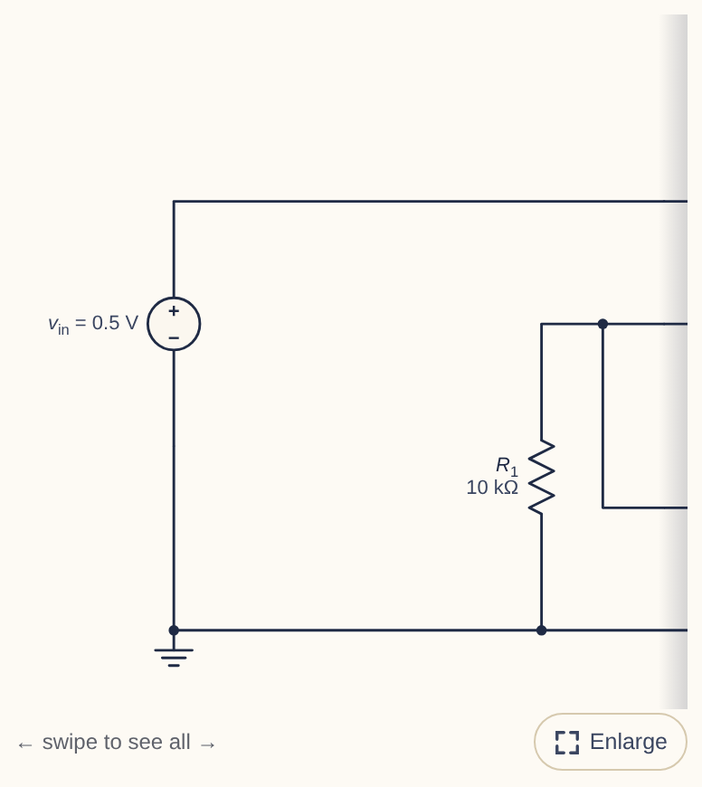

# 3.8 · 单元 5h：级联：为什么不用担心负载效应

| 项目 | 内容 |
|---|---|
| id | `w3-5h-cascade` |
| 文件 | `units/w3-5h-cascade.json` |
| 类型 | 理论单元（#/unit 页面，从上往下读的长页） |
| 位置 | World 3 · 运算放大器基础 → 3.8 级联、比较器与预告（本节第 1 项） |
| 这个单元回答的问题 | 把两级 op-amp（运算放大器）电路串起来，为什么总增益就是两级增益相乘？ |
| 时长 | 11 分钟 |
| 接回 | chapter:theorems、unit:w3-5c-follower |
| 前后 | 上一项 [3.7 exp-difference-amp](../w3/3.07-4-exp-difference-amp.md) · 下一项 [3.8 w3-5i-comparator](../w3/3.08-2-w3-5i-comparator.md) |

## ① 直觉

级联就是把第一级的输出 v_{o1} 接到第二级的输入。

用戴维宁定理看第一级的输出：它是一个电压源 v_{o1} 串一个输出电阻 R_{out}。负反馈让 R_{out} 约为 0（5c 里跟随器的输出就是这样）。

第二级是第一级的负载，它的输入电阻是 R_{in2}。负载拿到的电压是 v_{o1} × R_{in2}/(R_{in2} + R_{out})。R_{out} ≈ 0，这个比例就是 1：第二级拿到全部 v_{o1}，一点也不会被“拉低”。所以每一级可以单独算，再把增益乘起来。

*第一级是实验 2-6 的同相放大器（增益 3.2），第二级是实验 2-7 的反相放大器（增益 −2.2）。第二级的输入电阻就是 R_3 = 10 kΩ。*

## ② 交互推导

**分步推导：五步法，两级各走一遍：v_{in} = 0.5 V**（一次揭开一步）

1. **① 有负反馈吗？** 两级都有：R_{f1} 把 v_{o1} 接回 A1 的 v_{−}，R_{f2} 把 v_o 接回 A2 的 v_{−}。
2. **② 虚短、虚断。** A1：v_{−} = v_{+} = v_{in} = 0.5 V。A2：v_{+} 接地，v_{−} = 0（虚地）。两个 op-amp（运算放大器）的输入端都不取电流。
3. **③ 在两个 v_{−} 列 KCL。** A1：v_{in}/R_1 = (v_{o1} − v_{in})/R_{f1}。A2：v_{o1}/R_3 = (0 − v_o)/R_{f2}。
4. **④ 解出 v_o。** 第一级：v_{o1} = (1 + 22/10) × 0.5 = 1.6 V。第二级：v_o = −(22/10) × 1.6 = −3.52 V。总增益 3.2 × (−2.2) = −7.04。第二级从 v_{o1} 取了 1.6 V / 10 kΩ = 0.16 mA，但 v_{o1} 不变，因为 A1 的 R_{out} ≈ 0。
5. **⑤ 合理性检查。** ±9 V 双电源，输出约 −9 … +7.5 V：v_{o1} = 1.6 V ✓，v_o = −3.52 V ✓。**每一级都要查**。电流：A1 要供 0.16 mA（给 R_3）+ 0.05 mA（给自己的 R_{f1}、R_1）≈ 0.21 mA ✓；A2 吸收 0.16 mA ✓。v_{in} 再大到约 1.28 V 时，第二级先到 −9 V：先削顶的是后一级。

**滑块探索：第一级的输出电阻 vs 第二级的输入电阻**

| 参数 | 名称 | 默认 | 范围 | 单位 |
|---|---|---|---|---|
| Rout | 第一级输出电阻 R_{out} | 0.01 | 0.001 … 10000（对数） | Ω |
| Rin2 | 第二级输入电阻 R_{in2}（= R_3） | 10000 | 100 … 100000（对数） | Ω |

| 输出 | 公式 | 单位 |
|---|---|---|
| v_{o1} 传到第二级的比例 | `Rin2 / (Rin2 + Rout)` |  |
| 第二级输入端的电压 | `1.6 * f` | V |
| 带负载的总增益 | `-7.04 * f` |  |
| 理想总增益 | `3.2 * -2.2` |  |
| 增益误差 | `1 - f` |  |
| 第一级要供给第二级的电流 | `1.6 / (Rin2 + Rout)` | A |

第二级的增益固定为 −2.2（R_{f2} 跟着 R_3 一起变）。op-amp（运算放大器）级的 R_{out} 只有毫欧量级，误差小得看不见。把 R_{out} 拉到几 kΩ（像一个分压器或传感器那样），误差马上变大。负载效应只取决于 R_{out} 和 R_{in2} 的比。

## ③ 仿真

**仿真**

先预测，再运行，再看为什么。两级都按 LM358 建模：±9 V 双电源，输出 −9 … +7.5 V。

| 参数 | 名称 | 默认 | 范围 | 单位 |
|---|---|---|---|---|
| vin |  | 0.5 |  |  |
| R1 |  | 10000 |  |  |
| Rf1 |  | 22000 |  |  |
| R3 |  | 10000 |  |  |
| Rf2 |  | 22000 |  |  |
| Rout |  | 0 |  |  |
| order |  | 1 |  |  |

| 输出 | 公式 | 单位 |
|---|---|---|
| 第一级空载输出 | `if(order, clamp(vin * (1 + Rf1 / R1), -9, 7.5), clamp(-Rf2 / R3 * vin, -9, 7.5))` | V |
| 第一级输出端 v_{o1}（接上第二级后） | `if(order, vs1 * R3 / (Rout + R3), vs1)` | V |
| 输出 v_o | `if(order, clamp(-Rf2 * vs1 / (Rout + R3), -9, 7.5), clamp(vs1 * (1 + Rf1 / R1), -9, 7.5))` | V |
| 总增益 v_o/v_{in} | `vo / vin` |  |

- **情景「正常：v_{in} = 0.5 V」**（设定 ）：v_o 是多少？
  - A. −3.52 V ✅
  - B. +3.52 V
  - C. −1.1 V
  - D. −7.04 V
  - 解释：0.5 × 3.2 = 1.6 V，再 × (−2.2) = −3.52 V。−1.1 V 只算了第二级；−7.04 是总增益，不是电压。

- **情景「两级对调顺序」**（设定 order=0）：先过反相级，再过同相级。v_o 会怎样？
  - A. 一样，−3.52 V ✅
  - B. 变成 +3.52 V
  - C. 变小，因为负载变了
  - 解释：每级的输出电阻都约为 0，谁接谁都不会拉低，所以只是两个数相乘：(−2.2) × 3.2 = −7.04，顺序无关。（前提是中间那一级没有削顶：这里是 −1.1 V，没问题。）

- **情景「做坏事：第一级换成“软”信号源」**（设定 Rout=10000）：假设第一级的输出电阻是 10 kΩ（像分压器或传感器），空载仍是 1.6 V。v_o 是多少？
  - A. 仍是 −3.52 V
  - B. 约 −1.76 V ✅
  - C. 0 V
  - 解释：第二级的 v_{−} 是虚地，所以信号源的 10 kΩ 和 R_3 串在一起：电流 = 1.6/(10 k + 10 k) = 0.08 mA，v_o = −22 kΩ × 0.08 mA = −1.76 V。增益少了一半。解决办法：中间加一个跟随器（5c）。

- **情景「做坏事：输入太大」**（设定 vin=2）：v_{in} = 2 V。v_o 是多少？
  - A. 约 −14.1 V
  - B. 约 −9 V（第二级顶住了） ✅
  - C. 约 +7.5 V（第一级顶住了）
  - 解释：第一级：2 × 3.2 = 6.4 V，还在 7.5 V 以内。第二级：−2.2 × 6.4 = −14.1 V，超出 −9 V，顶住。第 ⑤ 步要每一级都查，不能只查最后的输出。

## ⑤ 回链

**预测题**：（Midterm 2：戴维宁定理）第一级等效成 1.6 V 串 R_{Th}，带 R_3 = 10 kΩ。要让 R_3 上的电压和 1.6 V 相差不到 1%，R_{Th} 大约要小于多少？

- A. 约 100 Ω ✅
- B. 约 1 kΩ
- C. 约 10 kΩ
- D. 必须正好是 0

揭晓：

> 分压：R_3/(R_3 + R_{Th}) ≥ 0.99，得 R_{Th} ≤ 10 kΩ/99 ≈ 101 Ω。经验法则：输出电阻比下一级输入电阻小 100 倍，就可以忽略负载效应。op-amp（运算放大器）级的输出电阻只有毫欧，远远满足。

**预测题**：（接 5c）一个传感器空载输出 1.6 V，内阻 10 kΩ，直接接到第二级（R_3 = 10 kΩ，R_{f2} = 22 kΩ）。最好的办法是？

- A. 在传感器和第二级之间加一个跟随器 ✅
- B. 把 R_3 换小一点
- C. 什么都不用做，op-amp（运算放大器）能解决

揭晓：

> 跟随器的输入不取电流，传感器不被拉低；它的输出电阻约为 0，第二级拿到全部 1.6 V。R_3 换小只会更糟：传感器的 10 kΩ 占的比例更大。

**预测题**：如果第二级是**同相**放大器，它的输入电阻是多少？

- A. 约为无穷大 ✅
- B. R_1
- C. R_1 + R_f

揭晓：

> 信号进的是 v_{+}，虚断：不取电流，输入电阻约为无穷大。所以同相级对前一级完全没有负载；反相级的输入电阻是 R_{in}，前一级必须是“硬”的（R_{out} ≈ 0）才行。

**理论题**：理论题沿用中文教材的记号：电压写作 u（u_o 就是这里的 v_o）。13 题有一条跨过两级的反馈，先数清楚绕一圈的符号，确认是负反馈；14 题的仪表放大器是两个同相级加一个差分放大器（5g）。

- `opamp-08-two-stage-cascade` 两级 op-amp的级联（opamp）
- `opamp-13-two-opamp-loop` 带级间反馈的两级 op-amp电路（opamp）
- `opamp-14-instrumentation-amp` 三 op-amp仪表放大器（opamp）

## English

展开英文

## ① 直觉

Cascading means feeding the first stage's output v_{o1} into the second stage's input.

Look at the first stage's output with Thévenin's theorem: a voltage source v_{o1} in series with an output resistance R_{out}. Negative feedback makes R_{out} about 0 (just like the follower's output in 5c).

The second stage is the first stage's load, with input resistance R_{in2}. The load gets v_{o1} × R_{in2}/(R_{in2} + R_{out}). With R_{out} ≈ 0 that fraction is 1: stage 2 gets all of v_{o1} and does not drag it down at all. So you can work out each stage on its own and multiply the gains.

[电路图]

*Stage 1 is the non-inverting amplifier of lab 2-6 (gain 3.2); stage 2 is the inverting amplifier of lab 2-7 (gain −2.2). Stage 2's input resistance is just R_3 = 10 kΩ.*

## ② 交互推导

**分步推导：The five steps, once per stage: v_{in} = 0.5 V**（一次揭开一步）

1. **① Is there negative feedback?** In both stages: R_{f1} takes v_{o1} back to A1's v_{−}, and R_{f2} takes v_o back to A2's v_{−}.
2. **② Virtual short, virtual open.** A1: v_{−} = v_{+} = v_{in} = 0.5 V. A2: v_{+} is grounded, so v_{−} = 0 (virtual ground). Neither op-amp's inputs draw current.
3. **③ KCL at both v_{−} nodes.** A1: v_{in}/R_1 = (v_{o1} − v_{in})/R_{f1}. A2: v_{o1}/R_3 = (0 − v_o)/R_{f2}.
4. **④ Solve for v_o.** Stage 1: v_{o1} = (1 + 22/10) × 0.5 = 1.6 V. Stage 2: v_o = −(22/10) × 1.6 = −3.52 V. Total gain 3.2 × (−2.2) = −7.04. Stage 2 draws 1.6 V / 10 kΩ = 0.16 mA from v_{o1}, yet v_{o1} does not move, because A1's R_{out} ≈ 0.
5. **⑤ Sanity check.** On ±9 V the output spans about −9 … +7.5 V: v_{o1} = 1.6 V ✓ and v_o = −3.52 V ✓. **Check every stage.** Currents: A1 sources 0.16 mA (into R_3) + 0.05 mA (into its own R_{f1} and R_1) ≈ 0.21 mA ✓; A2 sinks 0.16 mA ✓. Raise v_{in} to about 1.28 V and stage 2 reaches −9 V first: the later stage clips first.

**滑块探索：Stage 1 output resistance vs stage 2 input resistance**

| 参数 | 名称 | 默认 | 范围 | 单位 |
|---|---|---|---|---|
| Rout | stage 1 output resistance R_{out} | 0.01 | 0.001 … 10000（对数） | Ω |
| Rin2 | stage 2 input resistance R_{in2} (= R_3) | 10000 | 100 … 100000（对数） | Ω |

| 输出 | 公式 | 单位 |
|---|---|---|
| fraction of v_{o1} reaching stage 2 | `Rin2 / (Rin2 + Rout)` |  |
| voltage at stage 2's input | `1.6 * f` | V |
| overall gain, loaded | `-7.04 * f` |  |
| ideal overall gain | `3.2 * -2.2` |  |
| gain error | `1 - f` |  |
| current stage 1 feeds into stage 2 | `1.6 / (Rin2 + Rout)` | A |

Stage 2's gain stays −2.2 (R_{f2} moves together with R_3). An op-amp stage has R_{out} of milliohms, so the error is invisible. Drag R_{out} up to a few kΩ (like a divider or a sensor) and the error jumps. Loading depends only on the ratio of R_{out} to R_{in2}.

## ③ 仿真

**仿真**

Predict, run, then see why. Both stages are LM358s on ±9 V: output −9 … +7.5 V.

| 参数 | 名称 | 默认 | 范围 | 单位 |
|---|---|---|---|---|
| vin |  | 0.5 |  |  |
| R1 |  | 10000 |  |  |
| Rf1 |  | 22000 |  |  |
| R3 |  | 10000 |  |  |
| Rf2 |  | 22000 |  |  |
| Rout |  | 0 |  |  |
| order |  | 1 |  |  |

| 输出 | 公式 | 单位 |
|---|---|---|
| stage 1 output, unloaded | `if(order, clamp(vin * (1 + Rf1 / R1), -9, 7.5), clamp(-Rf2 / R3 * vin, -9, 7.5))` | V |
| stage 1 output v_{o1} (with stage 2 connected) | `if(order, vs1 * R3 / (Rout + R3), vs1)` | V |
| output v_o | `if(order, clamp(-Rf2 * vs1 / (Rout + R3), -9, 7.5), clamp(vs1 * (1 + Rf1 / R1), -9, 7.5))` | V |
| overall gain v_o/v_{in} | `vo / vin` |  |

- **情景「Normal: v_{in} = 0.5 V」**（设定 ）：What is v_o?
  - A. −3.52 V ✅
  - B. +3.52 V
  - C. −1.1 V
  - D. −7.04 V
  - 解释：0.5 × 3.2 = 1.6 V, then × (−2.2) = −3.52 V. −1.1 V uses only stage 2; −7.04 is the overall gain, not a voltage.

- **情景「Swap the order of the stages」**（设定 order=0）：Put the inverting stage first and the non-inverting stage second. What happens to v_o?
  - A. the same, −3.52 V ✅
  - B. it becomes +3.52 V
  - C. smaller, because the loading changed
  - 解释：Every stage has an output resistance of about 0, so neither one drags the other down; it is just two numbers multiplied: (−2.2) × 3.2 = −7.04, in either order. (As long as the middle point does not clip: here it is −1.1 V, fine.)

- **情景「Doing it wrong: a "soft" source as stage 1」**（设定 Rout=10000）：Suppose stage 1 has a 10 kΩ output resistance (like a divider or a sensor), still 1.6 V unloaded. What is v_o?
  - A. still −3.52 V
  - B. about −1.76 V ✅
  - C. 0 V
  - 解释：Stage 2's v_{−} is a virtual ground, so the source's 10 kΩ simply adds to R_3: current = 1.6/(10 k + 10 k) = 0.08 mA and v_o = −22 kΩ × 0.08 mA = −1.76 V. Half the gain is gone. The fix: put a follower (5c) in between.

- **情景「Doing it wrong: too big an input」**（设定 vin=2）：v_{in} = 2 V. What is v_o?
  - A. about −14.1 V
  - B. about −9 V (stage 2 clipped) ✅
  - C. about +7.5 V (stage 1 clipped)
  - 解释：Stage 1: 2 × 3.2 = 6.4 V, still under 7.5 V. Stage 2: −2.2 × 6.4 = −14.1 V, beyond −9 V, so it clips. Step ⑤ has to check every stage, not just the final output.

## ⑤ 回链

**预测题**：(Midterm 2: Thévenin) Stage 1 is 1.6 V behind R_{Th}, driving R_3 = 10 kΩ. For the voltage on R_3 to be within 1% of 1.6 V, R_{Th} must be below about…

- A. about 100 Ω ✅
- B. about 1 kΩ
- C. about 10 kΩ
- D. it must be exactly 0

揭晓：

> Divider: R_3/(R_3 + R_{Th}) ≥ 0.99 gives R_{Th} ≤ 10 kΩ/99 ≈ 101 Ω. Rule of thumb: if the output resistance is 100 times smaller than the next input resistance, ignore loading. An op-amp stage, at milliohms, clears that easily.

**预测题**：(Back to 5c) A sensor gives 1.6 V unloaded and has 10 kΩ inside. It drives stage 2 (R_3 = 10 kΩ, R_{f2} = 22 kΩ) directly. What is the best fix?

- A. put a follower between the sensor and stage 2 ✅
- B. make R_3 smaller
- C. nothing; the op-amp takes care of it

揭晓：

> The follower's input draws no current, so the sensor is not dragged down, and its output resistance is about 0, so stage 2 gets the full 1.6 V. A smaller R_3 only makes it worse: the sensor's 10 kΩ becomes a bigger share.

**预测题**：If stage 2 were a **non-inverting** amplifier, what would its input resistance be?

- A. about infinite ✅
- B. R_1
- C. R_1 + R_f

揭晓：

> The signal enters at v_{+}, and by the virtual open it draws no current: the input resistance is about infinite. So a non-inverting stage puts no load at all on the stage before it; an inverting stage has input resistance R_{in}, so the stage before it must be stiff (R_{out} ≈ 0).

**理论题**：The theory problems follow the Chinese textbook and write voltage as u (their u_o is our v_o). Problem 13 has feedback around both stages: count the signs around the loop to make sure it is negative. Problem 14, the instrumentation amplifier, is two non-inverting stages followed by a difference amplifier (5g).

- `opamp-08-two-stage-cascade` 两级 op-amp的级联（opamp）
- `opamp-13-two-opamp-loop` 带级间反馈的两级 op-amp电路（opamp）
- `opamp-14-instrumentation-amp` 三 op-amp仪表放大器（opamp）

