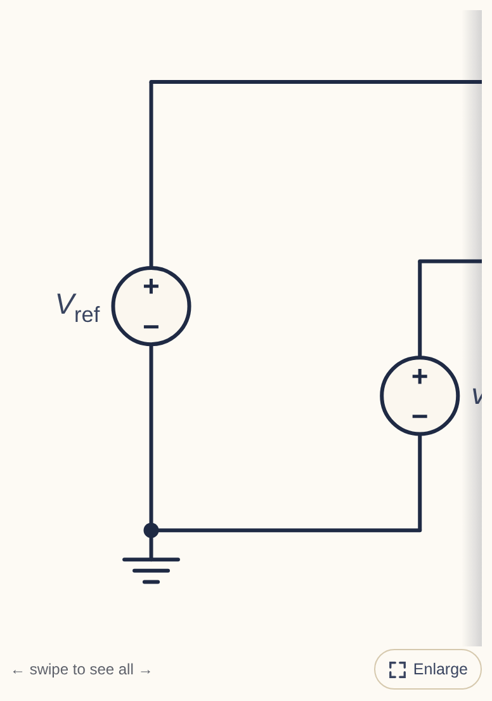

# 3.8 · 单元 5i：没有反馈：比较器

| 项目 | 内容 |
|---|---|
| id | `w3-5i-comparator` |
| 文件 | `units/w3-5i-comparator.json` |
| 类型 | 理论单元（#/unit 页面，从上往下读的长页） |
| 位置 | World 3 · 运算放大器基础 → 3.8 级联、比较器与预告（本节第 2 项） |
| 这个单元回答的问题 | 不接反馈的 op-amp（运算放大器）能拿来做什么？ |
| 时长 | 10 分钟 |
| 接回 | unit:w3-5a-black-box、challenge:lesson-lm358 |
| 前后 | 上一项 [3.8 w3-5h-cascade](../w3/3.08-1-w3-5h-cascade.md) · 下一项 [3.8 w3-5j-preview](../w3/3.08-3-w3-5j-preview.md) |

## ① 直觉

5a 说过：没有反馈，输出几乎只停在两个值上，要么顶到上限，要么到下限。

这可以变成好事：拿它来**比大小**。一个输入接要比较的信号 v_{in}，另一个接一个固定的**参考电压** V_{ref}（也叫阈值）。

*比较器：v_{in} 接同相端，V_{ref} 接反相端，输出没有接回任何输入。*

- v_{in} > V_{ref}：输出**高**，约 V+ − 1.5 V。
- v_{in} < V_{ref}：输出**低**，约 0 V。

输出只回答一个问题：“v_{in} 比 V_{ref} 大吗？”例如：电池电压低于 V_{ref} 时点亮报警灯。

**预测题**：LM358，9 V 单电源，V_{ref} = 4.5 V，v_{in} = 4.6 V。输出是多少？

- A. 约 0.1 V
- B. 约 4.6 V
- C. 约 7.5 V ✅

揭晓：

> 差 0.1 V × 10⁵ = 10 000 V，远超电源。输出顶到上限 9 − 1.5 = 7.5 V：“是，v_{in} 更大”。

## ② 交互推导

**分步推导**（一次揭开一步）

1. op-amp（运算放大器）照样只做一件事：v_o = A(v_{in} − V_{ref})，再被限制在 0 V 到 V+ − 1.5 V 之间。
2. 9 V 电源下，只要差超过 7.5 V ÷ 10⁵ = 75 µV，输出就到顶。差低于 0，输出就到底。
3. 75 µV 的过渡区窄到可以忽略。所以输出只有两种状态：高和低。
4. 这里没有负反馈。五步法的第 ① 步就停下：不能用虚短。v_{+} ≠ v_{−} 在这里是正常的。

> **注意** · 常见错误：看到 op-amp（运算放大器）就写 v_{+} = v_{−}。先找反馈：输出有没有接回反相端？比较器没有，所以不能用虚短。

> **说明** · LM358 能当比较器用，但不快。它的压摆率约 0.3 V/µs（TI 数据手册典型值），输出从 0 V 升到 7.5 V 大约要 25 µs。需要快的时候，用专门的比较器芯片，如 LM393。

## ③ 仿真

**仿真：带噪声的输入**

LM358 比较器，9 V 单电源，V_{ref} = 4.5 V。真实的信号上总叠着一点噪声：v_{in} 在 v_{in} − n 和 v_{in} + n 之间抖。s = 1 表示 v_{in} 接同相端；s = −1 表示两个输入对调。

| 参数 | 名称 | 默认 | 范围 | 单位 |
|---|---|---|---|---|
| A | 开环增益 A | 100000 |  |  |
| Vs | 电源 V+ | 9 |  | V |
| Vref | 阈值 V_{ref} | 4.5 |  | V |
| vin | 输入 v_{in} | 4.6 |  | V |
| n | 噪声峰值 n | 0 |  | V |
| s | 接法 s | 1 |  |  |

| 输出 | 公式 | 单位 |
|---|---|---|
| 输入在 v_{in} + n 时的输出 | `clamp(A * s * (vin + n - Vref), 0, Vs - 1.5)` | V |
| 输入在 v_{in} − n 时的输出 | `clamp(A * s * (vin - n - Vref), 0, Vs - 1.5)` | V |
| 输出来回跳的幅度 | `abs(a - b)` | V |

- **情景「干净的输入，高于阈值」**（设定 ）：v_{in} = 4.6 V，没有噪声。输出是？
  - A. 稳定的高（约 7.5 V） ✅
  - B. 稳定的低（约 0 V）
  - C. 4.6 V，跟着输入
  - 解释：v_{in} 比 V_{ref} 高 0.1 V，输出顶到上限。比较器不“跟随”，它只回答大还是小。

- **情景「干净的输入，低于阈值」**（设定 vin=4.4）：v_{in} = 4.4 V，没有噪声。输出是？
  - A. 稳定的高（约 7.5 V）
  - B. 稳定的低（约 0 V） ✅
  - C. 4.4 V，跟着输入
  - 解释：差是 −0.1 V，输出到下限 0 V。

- **情景「有噪声，离阈值很近」**（设定 vin=4.51, n=0.05）：v_{in} = 4.51 V，叠加 ±50 mV 的噪声。示波器上的输出是什么样？
  - A. 稳定的高
  - B. 在 0 V 和 7.5 V 之间来回乱跳 ✅
  - C. 停在中间约 3.75 V
  - 解释：输入在 4.46 V 到 4.56 V 之间抖，一会儿低于阈值、一会儿高于阈值。每跨一次，输出就翻一次：一串乱跳的脉冲。这叫**抖动**（chatter）。接一个 LED，它会闪；接数字电路，它会数错。

- **情景「同样的噪声，离阈值远」**（设定 vin=4.8, n=0.05）：v_{in} = 4.8 V，还是 ±50 mV 噪声。输出呢？
  - A. 稳定的高 ✅
  - B. 在 0 V 和 7.5 V 之间来回乱跳
  - 解释：最低也有 4.75 V，一直高于 4.5 V，输出稳稳地高。抖动只发生在输入慢慢经过阈值的那段时间。

- **情景「两个输入接反了」**（设定 s=-1）：v_{in} = 4.6 V 接到反相端，V_{ref} 接到同相端。输出是？
  - A. 约 7.5 V，和之前一样
  - B. 约 0 V ✅
  - 解释：比较的方向反了：现在 v_{in} 高于 V_{ref} 时输出低。这不一定是错，看你要哪一种；但接线前要想清楚。

怎么治抖动？给比较器加一点**正反馈**，让它有两个阈值：输入上升时到 4.6 V 才翻高，下降时到 4.4 V 才翻低。噪声比两个阈值的差小，输出就不会乱跳。

这样的电路叫**施密特触发器**。

**传送门** `comparator-schmitt` → `challenge:exp-schmitt-trigger`（25 分钟）：给比较器加一点正反馈，得到两个阈值：施密特触发器。 · 回来时：施密特触发器就是加了正反馈的比较器。

比较器的输出只有高和低两种。把高叫 1、低叫 0，就走进了数字电路。

**传送门** `comparator-logic` → `unit:w8-logic-gates`（15 分钟）：比较器的输出只有“高”和“低”：从这里走进 0 和 1 的数字世界。 · 回来时：比较器把模拟电压变成高 / 低两种状态，这就是数字逻辑的起点。

## ④ 面包板

**去面包板** → [3.1 lesson-lm358](../w3/3.01-2-lesson-lm358.md)：先按课程搭好跟随器。然后把它改成比较器：

1. 拆掉 a10 → a11 这根反馈跳线。
2. 用两个相等的电阻（例如 10 kΩ）从 +9 V 到 GND 分出 4.5 V，接到 2 脚（IN−）。这就是 V_{ref}。
3. 万用表测 1 脚（输出），慢慢拧电位器。滑动端过 50 % 的一瞬间，输出从约 0 V 跳到约 7.5 V，中间没有过渡。

## ⑤ 回链

**预测题**：V_{ref} 用分压器从 9 V 分出：上面 20 kΩ，下面 10 kΩ。V_{ref} 是多少？

- 答案：3 V（误差 0.05）

揭晓：

> 分压器（World 1）：9 × \frac{10}{20 + 10} = 3 V。比较器的输入不取电流，所以分压器不会被拖低。

**预测题**：输出高电平 7.5 V，经 1 kΩ 电阻点亮一个 LED（导通时约 2 V）。LED 的电流是多少？

- 答案：0.0055 A（误差 0.05）

揭晓：

> KVL 加欧姆定律：(7.5 − 2)/1 kΩ = 5.5 mA。比 LM358 能拉出的约 30 mA（典型值）小得多，没问题：这是五步法第 ⑤ 步的电流检查。

**预测题**：比较器能用五步法求 v_o 吗？

- A. 能，五步都照做
- B. 不能：第 ① 步就发现没有负反馈，虚短不成立 ✅

揭晓：

> 没有负反馈，就回到 5a 的 v_o = A(v_{+} − v_{−})：差是正的，输出高；差是负的，输出低。

## English

展开英文

## ① 直觉

From 5a: with no feedback the output sits at one of two values, the top or the bottom.

That can be put to use: **compare two voltages**. One input takes the signal v_{in}; the other takes a fixed **reference voltage** V_{ref}, also called the threshold.

[电路图]

*Comparator: v_{in} on the non-inverting input, V_{ref} on the inverting input, and the output goes back to neither input.*

- v_{in} > V_{ref}: the output is **high**, about V+ − 1.5 V.
- v_{in} < V_{ref}: the output is **low**, about 0 V.

The output answers one question: "is v_{in} bigger than V_{ref}?" For example, light a warning LED when a battery drops below V_{ref}.

**预测题**：LM358 on a single 9 V supply, V_{ref} = 4.5 V, v_{in} = 4.6 V. What is the output?

- A. about 0.1 V
- B. about 4.6 V
- C. about 7.5 V ✅

揭晓：

> A 0.1 V difference × 10⁵ = 10 000 V, far beyond the supply. The output goes to the top, 9 − 1.5 = 7.5 V: "yes, v_{in} is bigger".

## ② 交互推导

**分步推导**（一次揭开一步）

1. The op-amp still does one thing: v_o = A(v_{in} − V_{ref}), held between 0 V and V+ − 1.5 V.
2. On a 9 V supply, a difference above 7.5 V ÷ 10⁵ = 75 µV puts the output at the top. Any negative difference puts it at the bottom.
3. The 75 µV transition window is narrow enough to ignore. So the output has just two states: high and low.
4. There is no negative feedback here. The five-step method stops at step ①: no virtual short. Here v_{+} ≠ v_{−} is normal.

> **注意** · Common mistake: writing v_{+} = v_{−} for every op-amp. Look for the feedback first: does the output connect back to the inverting input? A comparator's doesn't, so no virtual short.

> **说明** · An LM358 works as a comparator, but slowly. Its slew rate is about 0.3 V/µs (typical, TI datasheet), so the output takes about 25 µs to rise from 0 V to 7.5 V. When speed matters, use a dedicated comparator chip such as the LM393.

## ③ 仿真

**仿真：A noisy input**

LM358 comparator, single 9 V supply, V_{ref} = 4.5 V. A real signal always carries a little noise: v_{in} wobbles between v_{in} − n and v_{in} + n. s = 1 means v_{in} is on the non-inverting input; s = −1 means the two inputs are swapped.

| 参数 | 名称 | 默认 | 范围 | 单位 |
|---|---|---|---|---|
| A | open-loop gain A | 100000 |  |  |
| Vs | supply V+ | 9 |  | V |
| Vref | threshold V_{ref} | 4.5 |  | V |
| vin | input v_{in} | 4.6 |  | V |
| n | noise peak n | 0 |  | V |
| s | wiring s | 1 |  |  |

| 输出 | 公式 | 单位 |
|---|---|---|
| output with the input at v_{in} + n | `clamp(A * s * (vin + n - Vref), 0, Vs - 1.5)` | V |
| output with the input at v_{in} − n | `clamp(A * s * (vin - n - Vref), 0, Vs - 1.5)` | V |
| how far the output jumps | `abs(a - b)` | V |

- **情景「Clean input, above the threshold」**（设定 ）：v_{in} = 4.6 V, no noise. What is the output?
  - A. a steady high (about 7.5 V) ✅
  - B. a steady low (about 0 V)
  - C. 4.6 V, following the input
  - 解释：v_{in} is 0.1 V above V_{ref}, so the output goes to the top. A comparator doesn't follow; it only answers bigger or smaller.

- **情景「Clean input, below the threshold」**（设定 vin=4.4）：v_{in} = 4.4 V, no noise. What is the output?
  - A. a steady high (about 7.5 V)
  - B. a steady low (about 0 V) ✅
  - C. 4.4 V, following the input
  - 解释：The difference is −0.1 V, so the output goes to the bottom, 0 V.

- **情景「Noisy, close to the threshold」**（设定 vin=4.51, n=0.05）：v_{in} = 4.51 V with ±50 mV of noise on it. What does the output look like on the scope?
  - A. a steady high
  - B. jumping back and forth between 0 V and 7.5 V ✅
  - C. sitting in the middle, about 3.75 V
  - 解释：The input wobbles between 4.46 V and 4.56 V, crossing the threshold again and again. Every crossing flips the output: a burst of random pulses. This is called **chatter**. An LED on the output flickers; a digital circuit miscounts.

- **情景「Same noise, far from the threshold」**（设定 vin=4.8, n=0.05）：v_{in} = 4.8 V, still ±50 mV of noise. And the output?
  - A. a steady high ✅
  - B. jumping back and forth between 0 V and 7.5 V
  - 解释：Even its lowest point, 4.75 V, stays above 4.5 V, so the output stays high. Chatter only happens while the input drifts slowly through the threshold.

- **情景「Inputs wired the other way round」**（设定 s=-1）：v_{in} = 4.6 V goes to the inverting input and V_{ref} to the non-inverting input. What is the output?
  - A. about 7.5 V, same as before
  - B. about 0 V ✅
  - 解释：The comparison is flipped: now the output is low when v_{in} is above V_{ref}. That isn't necessarily wrong; it depends on which you want. Decide before you wire it.

How do you cure chatter? Add a little **positive feedback** so the comparator has two thresholds: rising, it flips high only at 4.6 V; falling, it flips low only at 4.4 V. As long as the noise is smaller than the gap between them, the output stays put.

That circuit is called a **Schmitt trigger**.

**传送门** `comparator-schmitt` → `challenge:exp-schmitt-trigger`（25 分钟）：Add a little positive feedback to a comparator and get two thresholds: the Schmitt trigger. · 回来时：A Schmitt trigger is a comparator with positive feedback.

A comparator's output is only high or low. Call high 1 and low 0, and you are in digital electronics.

**传送门** `comparator-logic` → `unit:w8-logic-gates`（15 分钟）：A comparator's output is only high or low: from here into the digital world of 0 and 1. · 回来时：A comparator turns an analog voltage into high / low; that is where digital logic starts.

## ④ 面包板

**去面包板** → [3.1 lesson-lm358](../w3/3.01-2-lesson-lm358.md)：Build the follower as the lesson says. Then turn it into a comparator:

1. Remove the feedback jumper a10 → a11.
2. Make 4.5 V from +9 V and GND with two equal resistors (10 kΩ, say) and connect it to pin 2 (IN−). That is V_{ref}.
3. Measure pin 1 (output) and turn the pot slowly. The moment the wiper passes 50 %, the output jumps from about 0 V to about 7.5 V, with nothing in between.

## ⑤ 回链

**预测题**：V_{ref} comes from a divider on 9 V: 20 kΩ on top, 10 kΩ below. What is V_{ref}?

- 答案：3 V（误差 0.05）

揭晓：

> Voltage divider (World 1): 9 × \frac{10}{20 + 10} = 3 V. The comparator's input draws no current, so it doesn't load the divider.

**预测题**：A 7.5 V high output lights an LED (about 2 V when on) through a 1 kΩ resistor. What is the LED current?

- 答案：0.0055 A（误差 0.05）

揭晓：

> KVL and Ohm's law: (7.5 − 2)/1 kΩ = 5.5 mA. That is well below the roughly 30 mA (typical) an LM358 can source, so it's fine: this is the current check of step ⑤.

**预测题**：Can you find a comparator's v_o with the five-step method?

- A. yes, all five steps as usual
- B. no: step ① finds no negative feedback, so there is no virtual short ✅

揭晓：

> With no negative feedback you are back to 5a's v_o = A(v_{+} − v_{−}): a positive difference gives high, a negative one gives low.

