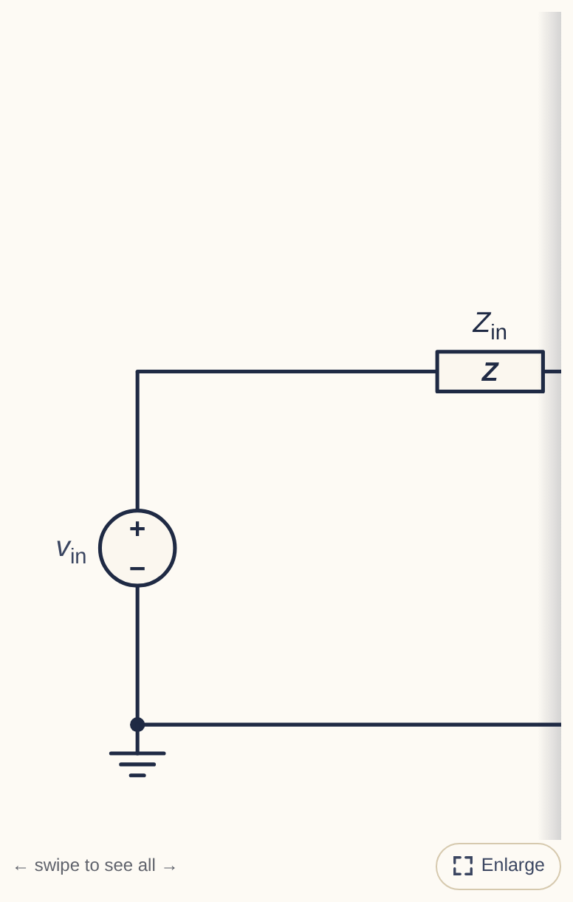
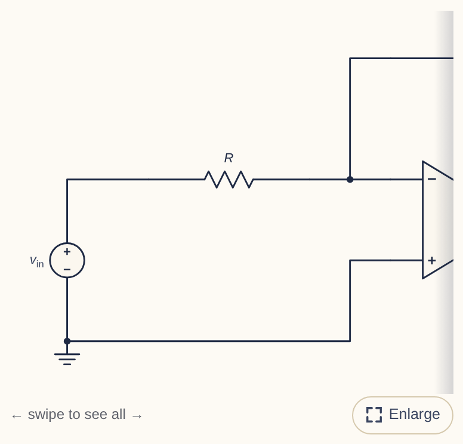

# 3.8 · 单元 5j：把电阻换成别的

| 项目 | 内容 |
|---|---|
| id | `w3-5j-preview` |
| 文件 | `units/w3-5j-preview.json` |
| 类型 | 理论单元（#/unit 页面，从上往下读的长页） |
| 位置 | World 3 · 运算放大器基础 → 3.8 级联、比较器与预告（本节第 3 项） |
| 这个单元回答的问题 | 反相放大器的 R_f 换成电容或阻抗 Z，会得到什么？ |
| 时长 | 5 分钟 |
| 接回 | unit:w3-5e-inverting |
| 前后 | 上一项 [3.8 w3-5i-comparator](../w3/3.08-2-w3-5i-comparator.md) · 下一项 [4.1 exp3-led-breathing](../w4/4.01-1-exp3-led-breathing.md) |

## ① 直觉

5e 的反相放大器：v_o = −\frac{R_f}{R_{in}} v_{in}。

推导只用了两件事：反相端是虚地（0 V）；流过 R_{in} 的电流全部流过 R_f。这两件事和元件是不是电阻无关。

把电阻推广成**阻抗 Z**：交流电路里的“电阻”，电容、电感都有（World 5 讲）。同样的 KCL 给出：

**v_o = −\frac{Z_f}{Z_{in}} v_{in}**

*反相放大器的一般形式：R_{in} 换成 Z_{in}，R_f 换成 Z_f。*

**Z_f 是一个电容 C**：电容的电流 i = C \frac{dv}{dt}。输出变成输入的积分：方波进，三角波出。这是积分器（Sadiku §6.6，World 4）。

*积分器：R_f 的位置放一个电容。*

**传送门** `preview-integrator` → `challenge:exp3-opamp-integrator`（30 分钟）：把反相放大器的 R_f 换成电容，就得到积分器：方波进，三角波出（Sadiku §6.6）。 · 回来时：这就是反相放大器把 R_f 换成电容的样子。

**Z_f 是 R_f 并 C**：低频时电容像断开，增益还是 −\frac{R_f}{R_{in}}；高频时电容把 R_f 短路，增益变小。这是有源低通滤波器。

**传送门** `preview-active-lowpass` → `challenge:exp4-active-lowpass`（30 分钟）：R_f 换成 R 并 C 的阻抗 Z_f，增益 −Z_f/Z_in 随频率变：有源低通。 · 回来时：反相放大器的 −R_f/R_in 推广成 −Z_f/Z_in，就是这个滤波器。

跟随器（5c）也能帮滤波器：两级 RC 滤波器中间插一个跟随器，后一级就不再拖累前一级。

**传送门** `preview-buffered-bandpass` → `challenge:exp4-buffered-bandpass`（30 分钟）：两级 RC 滤波器中间加一个跟随器，级与级不再互相拖累。 · 回来时：这里的跟随器就是 World 3 的 5c，用来隔离两级滤波器。

## ⑤ 回链

**预测题**：Z_f = R_f，Z_{in} = R_{in}。−\frac{Z_f}{Z_{in}} 变回什么？

- A. 反相放大器的增益 −\frac{R_f}{R_{in}} ✅
- B. 同相放大器的增益 1 + \frac{R_f}{R_g}

揭晓：

> 电阻就是虚部为零的阻抗。新公式包含旧公式，所以 5e 学的东西一点不浪费。

**预测题**：电容阻抗的大小是 \frac{1}{ωC}，频率越高越小。R_f 换成 C 以后，频率升高，增益的大小怎样？

- A. 变小 ✅
- B. 变大
- C. 不变

揭晓：

> 增益大小 = \frac{|Z_f|}{R} = \frac{1}{ωRC}。ω 越大，增益越小：频率每高 10 倍，增益小 10 倍。

## English

展开英文

## ① 直觉

The inverting amplifier of 5e: v_o = −\frac{R_f}{R_{in}} v_{in}.

The derivation used just two facts: the inverting input is a virtual ground (0 V), and all of the current through R_{in} flows on through R_f. Neither fact cares whether the parts are resistors.

Generalise resistance to **impedance Z**, the AC version of resistance that capacitors and inductors have too (World 5). The same KCL gives:

**v_o = −\frac{Z_f}{Z_{in}} v_{in}**

[电路图]

*The inverting amplifier in general form: R_{in} becomes Z_{in}, R_f becomes Z_f.*

**Z_f is a capacitor C**: a capacitor's current is i = C \frac{dv}{dt}, so the output becomes the integral of the input: square wave in, triangle wave out. This is the integrator (Sadiku §6.6, World 4).

[电路图]

*Integrator: a capacitor where R_f used to be.*

**传送门** `preview-integrator` → `challenge:exp3-opamp-integrator`（30 分钟）：Replace R_f of the inverting amplifier with a capacitor and you get an integrator: square wave in, triangle out (Sadiku §6.6). · 回来时：This is the inverting amplifier with R_f replaced by a capacitor.

**Z_f is R_f in parallel with C**: at low frequency the capacitor is nearly open and the gain is still −\frac{R_f}{R_{in}}; at high frequency the capacitor shorts out R_f and the gain falls. This is an active low-pass filter.

**传送门** `preview-active-lowpass` → `challenge:exp4-active-lowpass`（30 分钟）：Replace R_f with the impedance Z_f of R parallel C; the gain −Z_f/Z_in changes with frequency: an active low-pass. · 回来时：Generalise the inverting amplifier's −R_f/R_in to −Z_f/Z_in and you get this filter.

The follower (5c) helps filters too: put one between two RC filter stages and the second stage stops loading the first.

**传送门** `preview-buffered-bandpass` → `challenge:exp4-buffered-bandpass`（30 分钟）：A follower between two RC filter stages stops them from loading each other. · 回来时：The follower here is World 3's unit 5c, isolating the two filter stages.

## ⑤ 回链

**预测题**：Z_f = R_f and Z_{in} = R_{in}. What does −\frac{Z_f}{Z_{in}} turn back into?

- A. the inverting amplifier's gain −\frac{R_f}{R_{in}} ✅
- B. the non-inverting amplifier's gain 1 + \frac{R_f}{R_g}

揭晓：

> A resistor is an impedance with no imaginary part. The new formula contains the old one, so nothing from 5e is wasted.

**预测题**：A capacitor's impedance has size \frac{1}{ωC}, smaller at higher frequency. With C in place of R_f, what happens to the size of the gain as frequency rises?

- A. it falls ✅
- B. it rises
- C. it stays the same

揭晓：

> Gain size = \frac{|Z_f|}{R} = \frac{1}{ωRC}. The larger ω, the smaller the gain: ten times the frequency, one tenth the gain.

