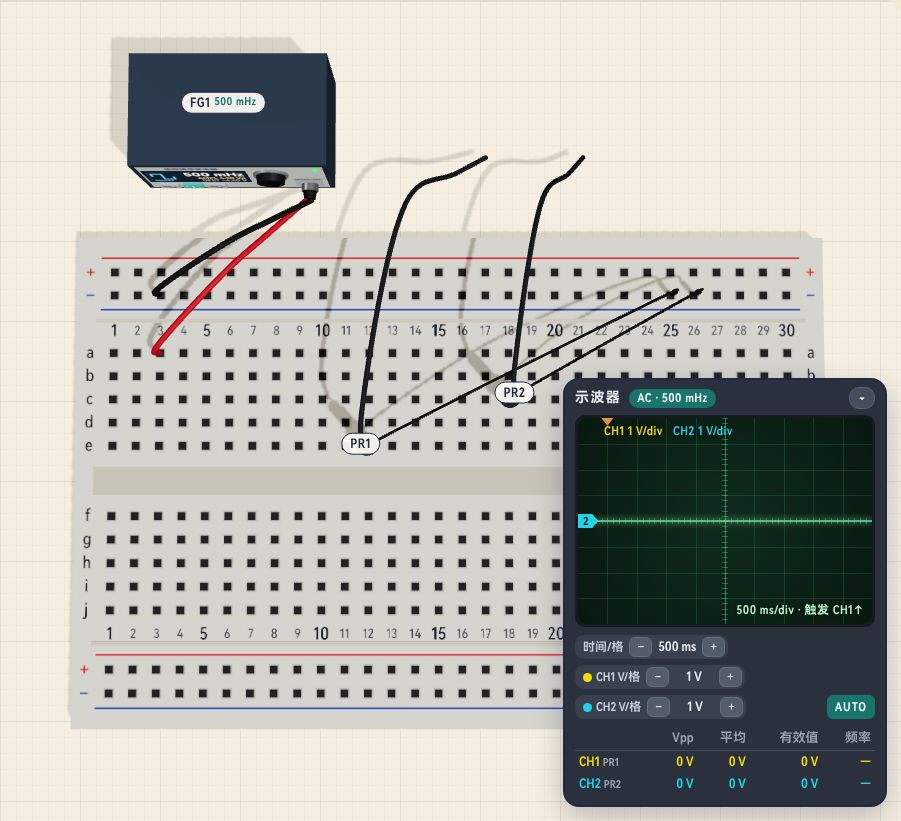
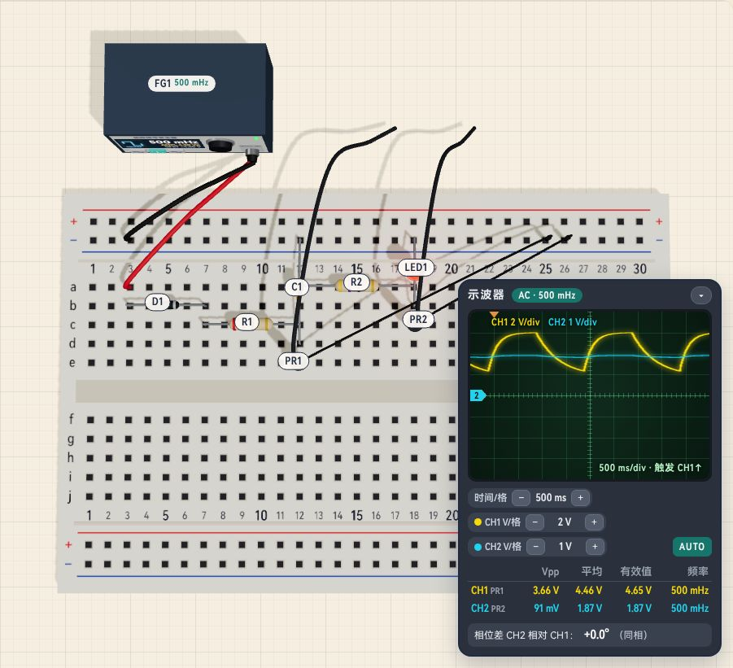
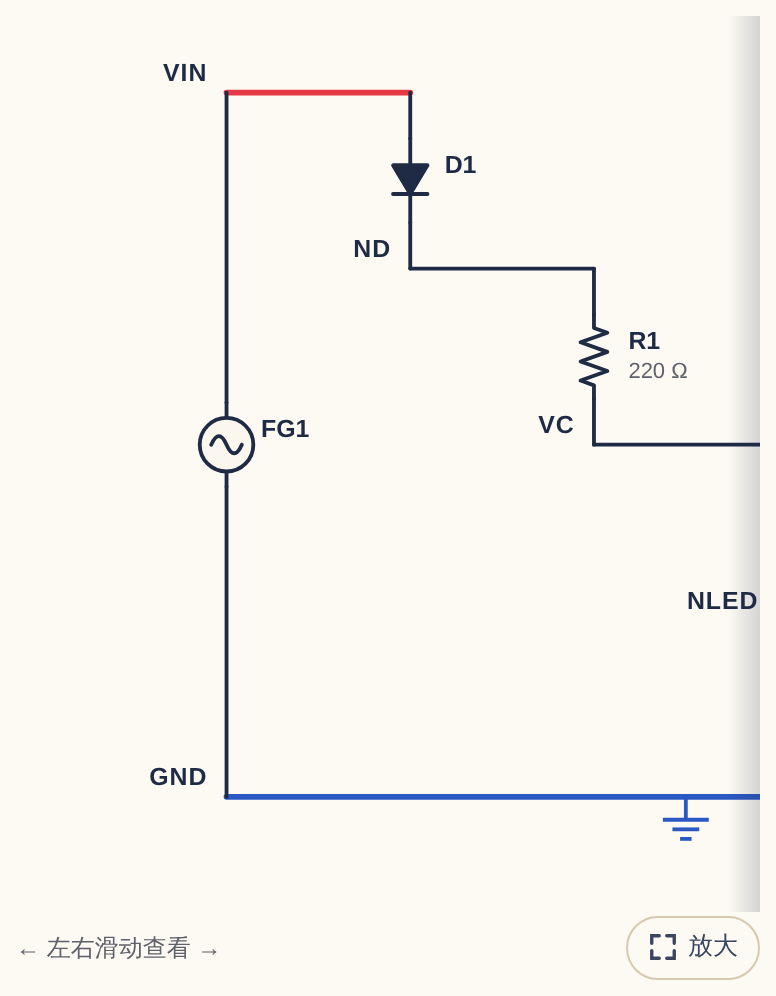
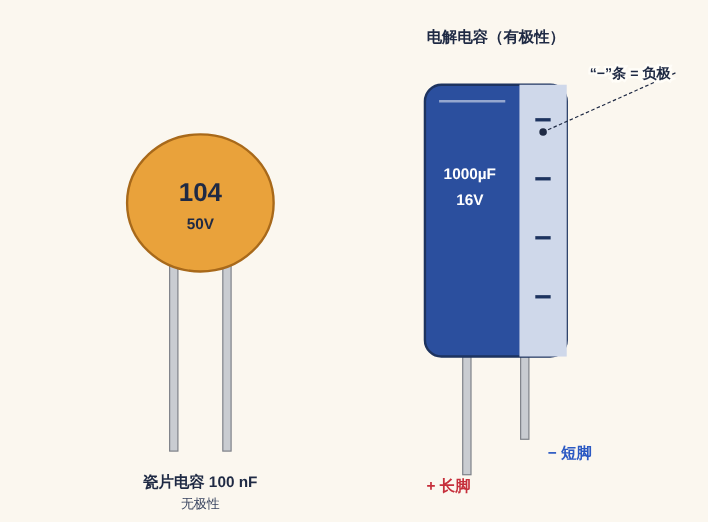
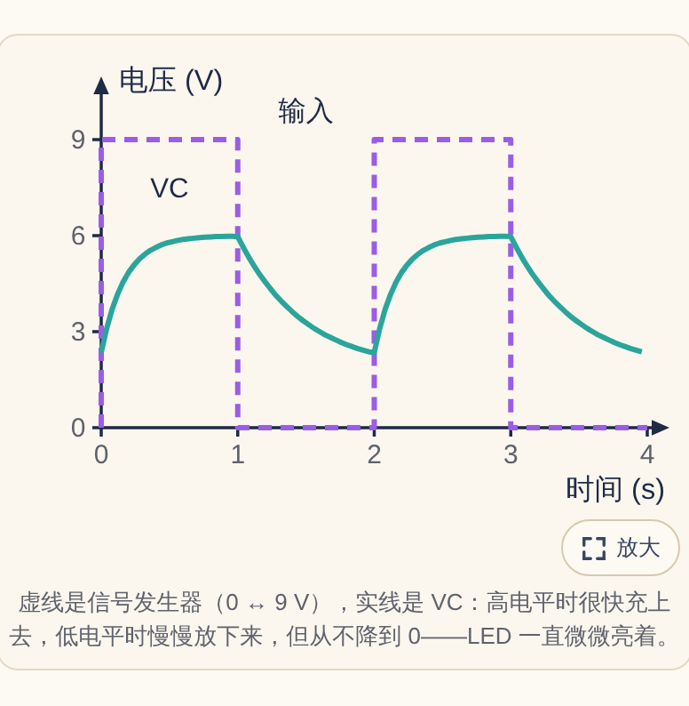
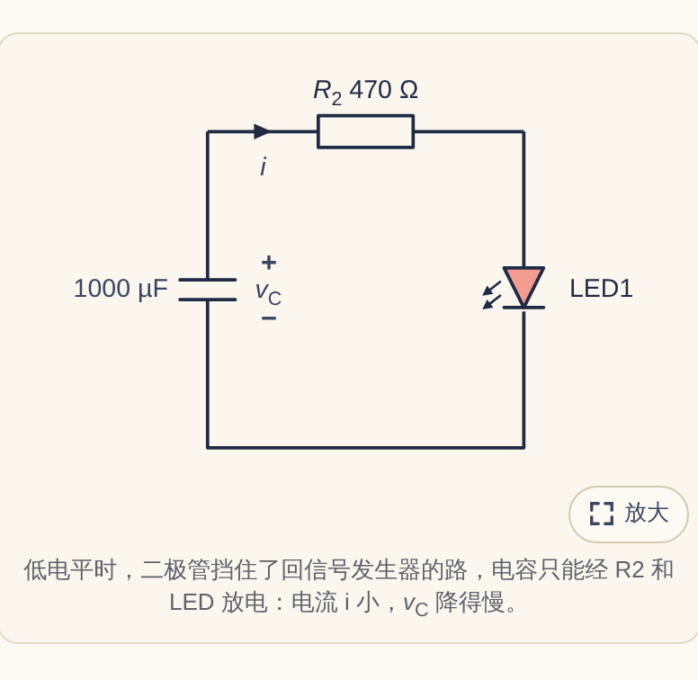

# 4.1 · 呼吸灯：电容让 LED 慢慢亮、慢慢暗

| 项目 | 内容 |
|---|---|
| id | `exp3-led-breathing` |
| 文件 | `challenges/245-led-breathing.json` |
| 类型 | 实验 / 挑战（没有分步，照目标电路图搭） · 难度 3/5 |
| 位置 | World 4 · 储能元件与一阶 / 二阶暂态 → 4.1 呼吸灯：看得见的充放电（本节第 1 项） |
| 右侧面板 | 轨道由旧的四张卡片自动生成（还没手工精排） |
| 前后 | 上一项 [3.8 w3-5j-preview](../w3/3.08-3-w3-5j-preview.md) · 下一项 [4.2 exp3-rc-square-charging](../w4/4.02-1-exp3-rc-square-charging.md) |
| 先修 | lesson-scope-two-channels |
| 概念 | capacitor 电容、dv/dt = i/C 电压变化率、charge / discharge 充电 / 放电、diode as a one-way valve 二极管单向导电、smoothing 滤波 |

**一句话概要**：0.5 Hz 的方波经二极管给 1000 µF 电容充电，电容再通过 470 Ω 点亮 LED：充得快、放得慢，LED 像呼吸一样一明一暗。

## 1. 左侧工作台（3D 面包板 → 2D 俯视截图）

截图是程序里真实的 3D 面包板换成俯视角拍的；表格是同一块板的文字版（元件、参数、每只脚插在哪个孔）。

### 1.1 起点：打开这一课时板上已经有的

右侧显示的「起点」说明：

> **半成品**：信号发生器（已经设好波形）和两个示波器探头已经接好。**为什么**：仪器的接法第 12、13 课练过，这个实验要看的是电路本身的波形。**你要做**：搭整个呼吸灯：D1 → R1（220Ω）→ C1（1000µF）到 GND，再从电容经 R2（470Ω）到 LED。注意二极管和 LED 的方向。

| 元件 | 类型 | 参数 | 引脚 → 孔 |
|---|---|---|---|
| FG1 | function_gen | waveform=square, frequency=0.5, amplitude=4.5, offset=4.5 | +→a3 -→tn3 |
| PR1 | scope_probe | channel=1 | tip→e12 gnd→tn25 |
| PR2 | scope_probe | channel=2 | tip→c18 gnd→tn26 |

### 1.3 参考答案（「看答案」载入的板子）

| 元件 | 类型 | 参数 | 引脚 → 孔 |
|---|---|---|---|
| FG1 | function_gen | waveform=square, frequency=0.5, amplitude=4.5, offset=4.5 | +→a3 -→tn3 |
| D1 | diode |  | anode→b3 cathode→b7 |
| R1 | resistor | resistance=220 | 1→c7 2→c12 |
| C1 | capacitor | capacitance=0.001 | 1→d12 2→tn12 |
| R2 | resistor | resistance=470 | 1→a12 2→a18 |
| LED1 | led | color=red | anode→b18 cathode→tn18 |
| PR1 | scope_probe | channel=1 | tip→e12 gnd→tn25 |
| PR2 | scope_probe | channel=2 | tip→c18 gnd→tn26 |

### 1.4 目标原理图（右侧「目标原理图」抽屉）

| 元件 | 类型 | 参数 |
|---|---|---|
| FG1 | function_gen |  |
| D1 | diode |  |
| R1 | resistor | resistance=220 |
| C1 | capacitor | capacitance=0.001 |
| R2 | resistor | resistance=470 |
| LED1 | led | color=red |

连接（每个结点上的引脚）：

- **VIN**：FG1.+、D1.anode
- **ND**：D1.cathode、R1.1
- **VC**：R1.2、C1.1、R2.1
- **NLED**：R2.2、LED1.anode
- **GND**：C1.2、LED1.cathode、FG1.-

## 2. 右侧面板：学生从上往下看到的内容（单轨流）

### 第 1 步 · 🔍 先看一眼：先认识它：电容

**拆解「电容 Capacitor：两块极板夹一层绝缘」第 1 / 7 层：① 外形：瓷片电容和电解电容**

课程里有两种电容：
- 瓷片电容 ceramic capacitor：橙色小圆片，**没有极性**，容量小（pF – 几 µF）。上面印 三位数代码，单位是 **pF**：前两位是有效数字，第三位是 10 的几次方。**104** = 10 × 10⁴ pF = 100 000 pF = **100 nF** = 0.1 µF。102 = 1 nF，103 = 10 nF，105 = 1 µF。
- 电解电容 electrolytic capacitor：铝壳圆柱，容量大（1 µF – 几万 µF），**有极性**：长脚是 +，外壳上 印着一串“−”的白条 那边是 −（短脚）。直接印着容量和耐压，比如 1000 µF 16 V。

两种电容的 **耐压**（rated voltage）都要大于电路里的最高电压，一般留 1.5–2 倍余量：9 V 电路用 16 V 或 25 V 的。

呼吸灯实验（exp3-led-breathing）用的 1000 µF 就是电解电容：长脚（+）接 VC，短脚接 GND。

| 类型 | 标记 | 极性 | 常见范围 | 课程里 |
|---|---|---|---|---|
| 瓷片 / 陶瓷 | 三位代码（pF）：104 = 100 nF | 无 | 1 pF – 10 µF | RC 实验的 100 nF |
| 铝电解 | 直接印 µF 和 V；“−”条 = 负极 | 有：长脚 + | 1 µF – 47 mF | 呼吸灯的 1000 µF |

### 第 2 步 · 🔧 动手搭：先看 LED 呼吸

- 这是第一个用到**电容**的电路。1000 µF 是电解电容，分正负：**长脚（+）接 VC**，短脚接 GND。
- 照目标电路搭：信号发生器 → **二极管 D1**（只让电流单向通过；带色环的一头朝 R1）→ **R1 `220 Ω`** → 结点 **VC**；VC 上接 **C1 `1000 µF`** 到 GND，还有 **R2 `470 Ω`** → **红色 LED** → GND。
- 信号发生器：**方波**、**`0.5 Hz`**、幅度 **`4.5 V`**、偏置 **`4.5 V`**（在 0 和 9 V 之间跳）。
盯着 LED 看几秒：它是一下亮、一下灭吗？变亮和变暗，哪个快？

### 第 3 步 · 💡 想明白：电容是一个装电荷的水桶

- 电容像一个**水桶**：电流往里灌，桶里的“水位”——电容两端的电压——慢慢升高；电流往外流，水位慢慢下降。
- 桶越大（电容 C 越大），同样的电流让水位变得越慢：
$$\frac{dv}{dt} = \frac{i}{C}$$
- 例如 5 mA 从 1000 µF 里流出：每秒只降 0.005 / 0.001 = 5 V。所以 LED 不会“啪”地灭掉，而是跟着水位慢慢变暗。

*图 `vc`（plot）：虚线是信号发生器（0 ↔ 9 V），实线是 VC：高电平时很快充上去，低电平时慢慢放下来，但从不降到 0——LED 一直微微亮着。*

- **二极管**是一个单向阀（LED 也是二极管，只是会发光；这一颗导通时压降约 0.65 V）。高电平时它放电流进来；低电平时它不让电容倒流回信号发生器，电容只能经 R2 和 LED 慢慢放电。

*图 `loop`（schematic）：低电平时，二极管挡住了回信号发生器的路，电容只能经 R2 和 LED 放电：电流 i 小，v_C 降得慢。*

（这一步下面列着这节课的计算卡片，点开就地展开：`led-current`、`thevenin-resistance`、`vpp-amplitude`、`rc-time-constant`、`rc-charging`、`diode-forward`，全文见第 6 节）

### 第 4 步 · 🔧 动手搭：用示波器看水位

- CH1 接 **VC**（电容上端），CH2 接 **LED 的长脚**。时间/格调到约 **`500 ms`**，看 VC 一快一慢地爬升、下滑。
- R2 两端的电压 = CH1 − CH2，除以 470 Ω 就是 LED 的电流。
- 最后把频率调到 **`20 Hz`**：电容来不及充放，VC 变成什么样？LED 呢？
- 想再故意做错一次？把 D1 换成一根导线，LED 还“呼吸”吗？试完换回来。

### 第 5 步 · 📏 测一测：测一测：读你自己的仪表

**测量题 1 · `vcmax`**（读数题）

> 0.5 Hz：CH1（VC）的最高值

- 单位 V · 先写预测 · 状态：FG1 设为 信号发生器（方波 500mHz 幅度 4.5V） · 参考答案的读数 **5.982 V** · 合理范围 [5.68, 6.28]

答对后显示：

> 高电平 1 s 里电容几乎充满：电流同时分给电容和 LED 支路，VC 停在约 6.0 V。

**测量题 2 · `vcmin`**（读数题）

> 0.5 Hz：CH1（VC）的最低值

- 单位 V · 先写预测 · 状态：FG1 设为 信号发生器（方波 500mHz 幅度 4.5V） · 参考答案的读数 **2.325 V** · 合理范围 [2.21, 2.44]

答对后显示：

> 低电平时 D1 挡住回路，电容只能经 R2 + LED 放电，而且 LED 低于约 1.8 V 就几乎不导通：VC 只降到约 2.3 V。

**测量题 3 · `vrmin`**（读数题）

> 0.5 Hz：R2 两端电压（CH1 − CH2）的最小值

- 单位 V · 状态：FG1 设为 信号发生器（方波 500mHz 幅度 4.5V） · 参考答案的读数 **0.5122 V** · 合理范围 [0.487, 0.538]

**测量题 4 · `imin`**（计算题（用自己的读数算））

> 用你的读数算 LED 最暗时的电流 I = V_R2 / 470 Ω

- 单位 mA · 先写预测 · 参考答案的读数 **1.09 mA** · 合理范围 [0.00104, 0.00114] · 公式 `vrmin / 470`

答对后显示：

> ≈ 0.5 V / 470 Ω ≈ 1.1 mA：电流从不降到 0，所以看起来是“呼吸”而不是“闪烁”。

**测量题 5 · `ripple`**（读数题）

> 调到 20 Hz：VC 的纹波（峰峰值）

- 单位 V · 先写预测 · 状态：FG1 设为 信号发生器（方波 20Hz 幅度 4.5V） · 参考答案的读数 **0.1599 V** · 合理范围 [0.152, 0.168]

答对后显示：

> 半个周期只有 25 ms，电容来不及充放：纹波只有约 0.16 Vpp，LED 稳定在约 6.4 mA。这就是电容滤波。

### 第 6 步 · 🎒 带走：带走

- **电容的电压不会突变**：dv/dt = i / C，电容越大，变得越慢。
- **进、出走不同的路，快慢就不同**：充电走 R1（快），放电只能走 R2 + LED（慢）。
- **频率高到电容来不及反应**，它的电压几乎是一条直线：这就是电容滤波，每个电源里都有。
- **真实电路里**：电解电容接反会漏电、发热，严重时鼓包。上电前先看清 + 脚；仿真里的电容没有极性。

趁热练理论题：`storage`

## 3. 测量题一览

| # | id | 题目 | 类型 | 单位 | 状态 | 参考读数 |
|---|---|---|---|---|---|---|
| 1 | vcmax | 0.5 Hz：CH1（VC）的最高值 | scope | V | FG1 设为 信号发生器（方波 500mHz 幅度 4.5V） | 5.982 V |
| 2 | vcmin | 0.5 Hz：CH1（VC）的最低值 | scope | V | FG1 设为 信号发生器（方波 500mHz 幅度 4.5V） | 2.325 V |
| 3 | vrmin | 0.5 Hz：R2 两端电压（CH1 − CH2）的最小值 | scope | V | FG1 设为 信号发生器（方波 500mHz 幅度 4.5V） | 0.5122 V |
| 4 | imin | 用你的读数算 LED 最暗时的电流 I = V_R2 / 470 Ω | formula | mA |  | 1.09 mA |
| 5 | ripple | 调到 20 Hz：VC 的纹波（峰峰值） | scope | V | FG1 设为 信号发生器（方波 20Hz 幅度 4.5V） | 0.1599 V |

### 全部答完后显示的「对比」

**对比**：
- **高电平（9 V）1 s**：电流经 D1、R1 给电容充电，同时点亮 LED；VC 很快升到约 **6.0 V**（两条支路分压）。
- **低电平（0 V）1 s**：D1 截止，电容只能经 R2 和 LED 放电：LED 电流 ≈ (VC − 1.8 V) / (470 + 12 Ω)，慢慢变小。VC 只降到约 **2.3 V**。
- R2 上的电压在约 0.5 V 和 4.1 V 之间，LED 电流在约 **1.1 mA** 和 8.7 mA 之间：从不熄灭，所以是“呼吸”。
- **D1 换成导线**：低电平时电容经 R1 快速倒流回信号发生器，VC 掉到 0.1 V 左右，LED 有一半时间完全熄灭——变成普通的慢闪。
- **20 Hz**：半个周期 25 ms，电容来不及充放，VC 几乎是一条直线（约 4.9 V，纹波约 **0.16 Vpp**），LED 稳定在约 6.4 mA。

### 提示按钮（依次显示）

1. 电容的长脚（+）接 VC，短脚接 GND；二极管带色环的一头朝 R1。
2. VC 是 R1、C1、R2 相交的那一点。LED 的短脚接 GND。
3. 充电时电流经 D1、R1 进来；放电时 D1 不让电流倒流，电容只能经 R2 + LED 放电。

### 功能测试（「检查我的电路」时跑）

- 0.5 Hz：LED 呼吸——电流起伏，但从不完全熄灭
- 0.5 Hz：VC 在两个电平之间来回
- 20 Hz：电容滤平——VC 纹波很小，LED 稳定地亮

## 4. 用到的拆解（全部层的文字，供改写参考）

### 拆解 `capacitor`：电容 Capacitor：两块极板夹一层绝缘

*电容储存的是电荷和电场能量。拆开是两块金属极板中间夹一层介质（dielectric）；由此推出 q = Cv、C = εA/d、i = C dv/dt、W = ½CV²，再推出 RC 充电的指数曲线（τ = RC）和“直流断路、高频短路”的容抗。最后看真实电容差在哪：ESR、漏电、极性。*

**拆解「电容 Capacitor：两块极板夹一层绝缘」第 1 / 7 层：① 外形：瓷片电容和电解电容**

课程里有两种电容：
- 瓷片电容 ceramic capacitor：橙色小圆片，**没有极性**，容量小（pF – 几 µF）。上面印 三位数代码，单位是 **pF**：前两位是有效数字，第三位是 10 的几次方。**104** = 10 × 10⁴ pF = 100 000 pF = **100 nF** = 0.1 µF。102 = 1 nF，103 = 10 nF，105 = 1 µF。
- 电解电容 electrolytic capacitor：铝壳圆柱，容量大（1 µF – 几万 µF），**有极性**：长脚是 +，外壳上 印着一串“−”的白条 那边是 −（短脚）。直接印着容量和耐压，比如 1000 µF 16 V。

两种电容的 **耐压**（rated voltage）都要大于电路里的最高电压，一般留 1.5–2 倍余量：9 V 电路用 16 V 或 25 V 的。

呼吸灯实验（exp3-led-breathing）用的 1000 µF 就是电解电容：长脚（+）接 VC，短脚接 GND。

| 类型 | 标记 | 极性 | 常见范围 | 课程里 |
|---|---|---|---|---|
| 瓷片 / 陶瓷 | 三位代码（pF）：104 = 100 nF | 无 | 1 pF – 10 µF | RC 实验的 100 nF |
| 铝电解 | 直接印 µF 和 V；“−”条 = 负极 | 有：长脚 + | 1 µF – 47 mF | 呼吸灯的 1000 µF |

**拆解「电容 Capacitor：两块极板夹一层绝缘」第 2 / 7 层：② 拆开：电极、介质，一层又一层**

每个电容不管长什么样，里面都是同一个结构：**两个互相绝缘的导体（电极 electrode），中间夹一层绝缘体（介质 dielectric）**。工厂做的事情，就是在小体积里把“面积做大、距离做小”。

**陶瓷电容（MLCC，多层陶瓷电容）**：几十到几百层 金属电极 和 陶瓷介质 交替叠在一起，单数层接左边的 端电极，双数层接右边——等于很多个电容 **并联**。陶瓷（钛酸钡）的相对介电常数 $ε_r$ 很大（X7R 约 2000），每层只有几 µm 厚。

**铝电解电容**：一条 阳极铝箔 和一条 阴极铝箔，中间夹 浸了电解液的纸，卷成一卷装进铝壳。真正的介质是阳极箔表面电化学生长出来的一层 氧化铝 Al₂O₃，只有十几 nm 厚；铝箔还被腐蚀得坑坑洼洼，实际表面积是平面的几十倍。所以它能在小体积里做出 1000 µF。

**极性的来源**：氧化层只在阳极箔上，而且只有阳极电压更高时才稳定。电压反过来，电化学反应会把它还原掉（第 ⑦ 层）。

**拆解「电容 Capacitor：两块极板夹一层绝缘」第 3 / 7 层：③ 模型：平行板，q = Cv，C = εA/d**

把电容理想化成两块面积为 A、距离为 d 的 平行金属板。加电压 v：电源从 下板 抽走电子送到上板的反面……结果是上板带 **+q**，下板带 **−q**，两板之间出现 电场。电荷和电压成正比，比例系数就是 **capacitance（电容）C**：
$$q = C·v$$
单位：法拉 F = C/V。1 F 很大，常用 µF（10⁻⁶）、nF（10⁻⁹）、pF（10⁻¹²）。

C 由几何和材料决定：
$$C = \frac{εA}{d},   ε = ε_r ε_0,   ε_0 = 8.85 pF/m$$
- 面积 A 越大 → 能放的电荷越多；
- 距离 d 越小 → 同样电压下电场越强、吸住的电荷越多；
- 介质 被电场 **极化**（polarization）：分子里的正负电荷被拉开，抵消掉一部分电场，于是同样的 v 能多放 $ε_r$ 倍的电荷。

**带数字**：空气、1 cm² 的两块板、相距 1 mm：$C = \frac{8.85×10^{-12} × 10^{-4}}{10^{-3}} ≈ 0.89 pF$——小得可怜。
一层 MLCC：$ε_r = 2000$，A = 2 mm × 1.2 mm，d = 5 µm：$C = \frac{8.85×10^{-12} × 2000 × 2.4×10^{-6}}{5×10^{-6}} ≈ 8.5 nF$；叠 12 层并联 ≈ **100 nF**。

- 公式 `q = C·v`：定义：每伏电压存多少库仑
- 公式 `C = \frac{ε_r ε_0 A}{d}`：平行板；MLCC 再乘层数

**拆解「电容 Capacitor：两块极板夹一层绝缘」第 4 / 7 层：④ i = C dv/dt：电流只看电压变化得多快**

对 $q = Cv$ 两边对时间求导，左边 $\frac{dq}{dt}$ 就是流进极板的电流：
$$i = C\frac{dv}{dt}$$
（关联参考方向：电流从 + 端流入）。这是电容 **唯一** 的 V–I 关系，三个推论都从这里来：

1. 电压不变 → 电流为 0。直流稳态下电容就是 **断路**（open circuit）。
2. 电压匀速上升 → 电流恒定：100 nF 在 1 ms 内从 0 升到 5 V，$i = 100 nF × \frac{5 V}{1 ms} = 0.5 mA$。下降得快一倍（0.5 ms），电流就是 −1 mA（反向流出）。
3. **电容电压不能跳变**：要在 0 秒内改变电压，需要无穷大的电流。所以开关动作的瞬间 $v_C(0^+) = v_C(0^-)$——这是一阶电路“三要素法”的出发点。

**储存的能量**：功率 $p = vi = Cv\frac{dv}{dt}$，从 0 充到 V 积分：
$$W = ∫_{0}^{V} Cv dv = \frac{1}{2}CV^{2}$$
- 100 nF 充到 5 V：$\frac{1}{2} × 10^{-7} × 25 = 1.25 µJ$；
- 1000 µF 充到 9 V：$\frac{1}{2} × 10^{-3} × 81 = 40.5 mJ$——足够让 LED 亮好几秒（呼吸灯实验）。

能量存在两板之间的 **电场** 里，不是“存了电流”。理想电容不消耗能量，只是借进来、再还回去。

- 公式 `i = C\frac{dv}{dt}`：直流稳态：dv/dt = 0 → i = 0（断路）
- 公式 `W = \frac{1}{2}CV^{2}`：1000 µF、9 V：40.5 mJ

**拆解「电容 Capacitor：两块极板夹一层绝缘」第 5 / 7 层：⑤ 通过电阻充电：τ = RC，1τ 走完 63%**

RC 方波实验（exp3-rc-square-charging）：信号发生器（内阻 50 Ω）→ 10 kΩ → 100 nF → GND，方波在 0 和 5 V 之间跳。

**推导**（方波刚跳到 5 V，电容从 0 V 开始）：
1. KVL：$V = Ri + v_C$；
2. 代入 $i = C\frac{dv_C}{dt}$：$RC\frac{dv_C}{dt} + v_C = V$，一阶线性微分方程；
3. 初值 $v_C(0) = 0$（电压不能跳），终值 $v_C(∞) = V$（充满后 i = 0），解是：
$$v_C(t) = V(1 - e^{-t/τ}),   τ = RC$$
4. 电流 $i = \frac{V - v_C}{R} = \frac{V}{R}e^{-t/τ}$：一开始最大（0.5 mA），然后指数衰减。开始瞬间电容像 **短路**，充满后像 **断路**。

**τ（time constant，时间常数）** 的意义：
- t = τ：$1 - e^{-1} = 63%$，到 3.16 V；
- t = 3τ：95%；t = 5τ：99.3%，工程上算“充满”；
- 起点的切线 恰好在 t = τ 时到达终值。

**带数字**：$τ = (10 kΩ + 50 Ω) × 100 nF ≈ 1.0 ms$。500 Hz 方波半周期 1 ms ≈ 1τ，电容只能充到约 63% 就开始放电；50 Hz 半周期 10 ms = 10τ，每次都充满放空，波形是完整的指数曲线；5 kHz 半周期 0.1τ，电容几乎来不及动，输出是一个小三角波。

| t | 已充到 | 5 V 方波时 $v_C$ | 电流 i |
|---|---|---|---|
| 0 | 0% | 0 V | 0.50 mA |
| 1τ = 1 ms | 63% | 3.16 V | 0.18 mA |
| 2τ | 86% | 4.32 V | 0.068 mA |
| 3τ | 95% | 4.75 V | 0.025 mA |
| 5τ | 99.3% | 4.97 V | 0.003 mA |

- 公式 `v_C(t) = V(1 - e^{-t/τ}), τ = RC`：充电；放电时 $v_C$ = V·e^{−t/τ}
- 公式 `τ = (10 kΩ + 50 Ω) × 100 nF ≈ 1.0 ms`

**拆解「电容 Capacitor：两块极板夹一层绝缘」第 6 / 7 层：⑥ 频率：直流断路，高频短路**

接正弦电压 $v = V_m sin ωt$，代入 $i = C\frac{dv}{dt}$：
$$i = ωCV_m cos ωt$$
两点结论：
- 电流的幅值是 $ωCV_m$，所以电压幅值 / 电流幅值 = $\frac{1}{ωC}$，这就是 **capacitive reactance（容抗）**：
$$X_C = \frac{1}{ωC} = \frac{1}{2πfC}$$
- cos 比 sin 早 90°：电容的 **电流超前电压 90°**。用相量写：$Z_C = \frac{1}{jωC}$。

容抗和频率成反比，在双对数坐标上是一条斜率 −1 的直线。对 100 nF：
- 50 Hz：31.8 kΩ；1 kHz：1.59 kΩ；100 kHz：15.9 Ω；
- f → 0（直流）：$X_C → ∞$，**断路**；
- f 很高：$X_C → 0$，接近 **短路**。

这就是电容的两大用途：**隔直流、通交流**（耦合电容 coupling capacitor），以及把高频噪声 **旁路到地**（去耦 / 旁路电容 bypass capacitor，每个芯片电源脚旁边那颗 100 nF）。RC 低通、高通滤波器的截止频率 $f_c = \frac{1}{2πRC}$ 就是 $X_C = R$ 的那个频率：10 kΩ 和 100 nF 时 $f_c ≈ 159 Hz$。

| f | $X_C$（100 nF） | 相当于 |
|---|---|---|
| 0（直流） | ∞ | 断路 |
| 50 Hz | 31.8 kΩ | 大电阻 |
| 159 Hz | 10 kΩ | = R：RC 截止频率 |
| 1 kHz | 1.59 kΩ | — |
| 100 kHz | 15.9 Ω | 接近短路 |

- 公式 `X_C = \frac{1}{2πfC}`：电流超前电压 90°；$Z_C$ = 1/(jωC)
- 公式 `f_c = \frac{1}{2πRC} = \frac{1}{2π × 10 kΩ × 100 nF} ≈ 159 Hz`

**拆解「电容 Capacitor：两块极板夹一层绝缘」第 7 / 7 层：⑦ 真实电容：ESR、ESL、漏电、极性**

真实电容 = 理想 C + 三个寄生元件：
- ESR（equivalent series resistance，等效串联电阻）：引线、电极和电解液的电阻。电解电容约 0.1–1 Ω，陶瓷电容只有几 mΩ。纹波电流流过它会发热：1 A 纹波、0.5 Ω → 0.5 W。
- ESL（equivalent series inductance，等效串联电感）：引线和卷绕带来的几 nH 到几十 nH。频率高到一定程度（**self-resonance 自谐振**，100 nF 陶瓷约 10–20 MHz），电容反而变成电感。所以去耦时大电容和小电容并联使用。
- 漏电电阻 $R_leak$：介质不是完美的绝缘体。电解电容的漏电流约 0.01CV（1000 µF、9 V 时几十 µA），充满的电解电容放几小时电压就掉下去了。

**电解电容接反**：阳极的氧化层被电化学反应还原掉，漏电流变大 → 发热 → 电解液汽化 → 外壳顶部的十字防爆纹 **鼓包、喷液甚至炸开**。几伏的反压就可能开始损坏。

**陶瓷电容的直流偏压效应**：X7R、Y5V 这类高介电常数陶瓷，加的直流电压越高，$ε_r$ 越小，实际容量可能只剩一半。精确的 RC 定时要用 C0G（NP0）陶瓷或薄膜电容。

**仿真器里**：电容是 **理想电容**——没有 ESR、ESL、漏电，也 **不区分电解电容的极性**（接反不会报错）。只有直流电源时它按断路处理；有信号发生器或 PWM 时按时域仿真。真实搭电路时，电解电容一定要按极性插。

| 参数 | 陶瓷 100 nF | 电解 1000 µF | 仿真器 |
|---|---|---|---|
| ESR | 几 mΩ | 0.1–1 Ω | 0 |
| ESL | ≈ 1–5 nH | ≈ 10–20 nH | 0 |
| 漏电 | nA | 几十 µA | 0 |
| 误差 | ±10% | ±20% | 0 |
| 极性 | 无 | 有，接反会坏 | 不检查 |

- 公式 `f_{SRF} = \frac{1}{2π\sqrt{ESL·C}}`：100 nF、1 nH：≈ 16 MHz。高于它电容就成了电感

**一句话记住**：电容 = 两块极板夹一层介质：$q = Cv$，$C = \frac{εA}{d}$。它的全部行为是 $i = C\frac{dv}{dt}$：电压不能跳变，直流稳态断路，储能 $\frac{1}{2}CV^{2}$；经电阻充电按 $τ = RC$ 指数变化（1τ 63%，5τ 充满）；交流下 $X_C = \frac{1}{2πfC}$，频率越高越接近短路。真实电容有 ESR、漏电，电解电容有极性——仿真器都不管，你得管。

## 5. 这一课的计算卡片

**计算卡片 `led-current`：LED 回路的电流 LED loop current**

- 公式 `I = \frac{V_s - ΣV_F}{R + Σr_d + R_{int}}`
- 用途：电源、电阻和一个或几个串联 LED：LED 实际流过多少电流。
- 输入：V_s（电源电动势，V）；V_F（所有 LED 的 V_F 之和（红 1.8、绿 2.1、蓝/白 3.0），V）；R（串联电阻（含电位器），Ω）；r_d（LED 内阻之和（每个 ≈ 12 Ω），Ω）；R_int（电源内阻（模块 ≈ 0、9 V 电池 1.5 Ω、纽扣电池 15 Ω），Ω） → I（回路电流（不够 ΣV_F 时为 0），A）

1. 导通的 LED 用折线模型看：一个电压源 $V_F$ 串一个小电阻 $r_d ≈ 12 Ω$（模拟器就是这样建模的）。
2. 整个回路串联，处处是同一个电流 I。
3. KVL：$V_s = I R_{int} + I R + ΣV_F + I Σr_d$。
4. 解出 $I = \frac{V_s - ΣV_F}{R + Σr_d + R_{int}}$。
5. 如果 $V_s < ΣV_F$，LED 根本不导通，I = 0：3 V 点不亮串联的红 + 绿 LED（需要 3.9 V）。
只用 $\frac{V_s - V_F}{R}$ 估算会偏大 1–2 mA，选电阻时够用；要和读数对比时把 $r_d$ 和内阻加上。

例子：- 挑战 1：9 V、220 Ω、红 + 绿：$I = \frac{9 - 3.9}{220 + 24} ≈ 21 mA$（只用 $V_F$ 估算是 23 mA）。
- 第 3 课：5 V、150 Ω、绿：$\frac{5 - 2.1}{150 + 12} ≈ 18 mA$，电阻上 $18 mA × 150 Ω ≈ 2.7 V$。
- 挑战 9：CR2032（3 V、15 Ω）、47 Ω、红：$\frac{3 - 1.8}{47 + 12 + 15} ≈ 16 mA$；不串电阻是 $\frac{1.2}{27} ≈ 44 mA$。
- 挑战 3：电位器转到 100 %：$\frac{5 - 1.8}{220 + 10k + 12} ≈ 0.31 mA$，灯灭。

- ⚠ 两个 LED 直接并联共用一个电阻：$V_F$ 小的先导通、把电压钳住，另一个几乎不亮——每个 LED 自己串一个电阻。
- ⚠ 电位器当可变电阻用时，它的阻值也在 R 里；转到 0 时只剩保护电阻。

**计算卡片 `thevenin-resistance`：戴维宁等效电阻（置零法）**

- 公式 `R_{eq} = R_3 + R_1 ∥ R_2`
- 用途：电源置零后从端口往里看的电阻——等效电路的内阻，也是电容 / 电感“看到”的电阻。
- 输入：R_1（电源和结点 A 之间的 R₁（含电源内阻），Ω）；R_2（A 到地的 R₂，Ω）；R_3（A 到端口的 R₃（没有就填 0），Ω） → R_eq（从端口看进去的电阻，Ω）

1. 把独立源置零：电压源换成 **导线**，电流源换成 **开路**。
2. 电压源变成导线以后，R₁ 的上端也接到了 GND，所以从 A 往下看，R₁ 和 R₂ **并联**。
3. 再串上 A 到端口的 R₃：$R_{eq} = R_3 + R_1 ∥ R_2$。
4. 开路电压另算：R₃ 里没有电流，$V_{oc} = V_s \frac{R_2}{R_1 + R_2}$。
5. 一阶电路里，电容 / 电感就是“端口”：$τ = R_{eq}C$ 或 $τ = \frac{L}{R_{eq}}$。

例子：- 实验 2-2：$470 + 1k ∥ 2.2k = 470 + 687.5 = 1157.5 Ω$。
- 实验 3-7：电容看到 $(10k + 50) ∥ 10k ≈ 5.01 kΩ$（R₃ = 0），$τ ≈ 0.50 ms$——只有单纯串联 RC 的一半。
- 实验 3-5 充电：$(220 + 50) ∥ (470 + 12) ≈ 173 Ω$，$τ ≈ 0.17 s$。
- 实验 5-4：ADC 看到 $100k ∥ 33k ≈ 24.8 kΩ$。

- ⚠ 信号发生器的 50 Ω 是电源的内阻：电源置零后它还在，串在 R₁ 里。
- ⚠ 电流源置零是开路，不是短路。

**计算卡片 `vpp-amplitude`：幅度、峰峰值与偏置 Amplitude and Vpp**

- 公式 `V_{pp} = 2A, V_{max} = V_{off} + A, V_{min} = V_{off} - A`
- 用途：信号发生器设的是幅度（峰值）和偏置，示波器读的是 Vpp、最大值、最小值：互相换算。
- 输入：A（幅度（中心线到波峰），V） → V_pp（峰峰值，V）

1. **幅度**（峰值）A：从中心线量到波峰。**峰峰值** Vpp：从波谷量到波峰，所以 $V_{pp} = 2A$。
2. **偏置** $V_{off}$：把整个波形上下平移，就是它的平均值（直流分量）。
3. 最大值 $V_{off} + A$，最小值 $V_{off} - A$。
4. 要一个 0 ↔ 5 V 的方波：$A = \frac{5 - 0}{2} = 2.5 V$，$V_{off} = \frac{5 + 0}{2} = 2.5 V$。
5. 在屏幕上数格：峰到谷的格数 × V/div = Vpp。

例子：实验 3-1：0–5 V 方波 = 幅度 2.5 V + 偏置 2.5 V，Vpp = 5 V。实验 3-5：0 ↔ 9 V = 幅度 4.5 V + 偏置 4.5 V。实验 2-7：幅度 0.5 V → 1 Vpp 输入，×2.2 → 2.2 Vpp 输出。

- ⚠ 把发生器的“幅度”当成 Vpp 设：信号大了一倍。

**计算卡片 `rc-time-constant`：RC 时间常数 τ = RC**

- 公式 `τ = R C`
- 用途：电容经电阻充放电有多快：过 1τ 走完 63 %，5τ 基本到头。
- 输入：R（电容看到的电阻（含发生器 50 Ω），Ω）；C（电容，F） → τ（时间常数，s）

1. 电容：$i = C\frac{dv_C}{dt}$，电压不能突变。
2. 充电回路的 KVL：$V_s = Ri + v_C = RC\frac{dv_C}{dt} + v_C$。
3. 这个一阶微分方程的解是指数：$v_C = V_s(1 - e^{-t/τ})$，其中 $τ = RC$（Ω × F = s）。
4. 经验值：1τ → 63 %，2τ → 86 %，3τ → 95 %，5τ → 99.3 %。
5. **R 是从电容两端看进去的戴维宁电阻**（电源置零）：要把信号发生器的 50 Ω、并联的电阻都算进去。

例子：- 实验 3-1：$(10k + 50) × 100 nF ≈ 1.0 ms$。
- 实验 3-2：微分 $10k × 10 nF = 0.1 ms$，积分 $10k × 1 µF = 10 ms$。
- 实验 3-5：充电 $1000 µF × 173 Ω ≈ 0.17 s$，放电 $1000 µF × 482 Ω ≈ 0.48 s$。
- 实验 5-14：$10k × 1 µF = 10 ms$；实验 5-16：$2.2k × 200 pF = 440 ns$。

- ⚠ 只用串联的那个 R：电容旁边还并着电阻时，τ 用的是 $R_1 ∥ R_2$（实验 3-7 只有一半）。
- ⚠ 单位：kΩ × µF = ms，kΩ × nF = µs。

**计算卡片 `rc-charging`：一阶电路的三要素法**

- 公式 `v(t) = v(∞) + [v(0_+) - v(∞)] e^{-t/τ}`
- 用途：任何一阶电路的任何电压 / 电流：知道初值、终值、τ，算出任意时刻的值。
- 输入：v_0（初值 v(0+)，V）；v_∞（终值 v(∞)，V）；τ（时间常数，s）；t（经过的时间，s） → v(t)（这一时刻的值，V）

1. 一阶电路里任何量 x 都满足 $τ\frac{dx}{dt} + x = x(∞)$，解就是“从初值指数地走向终值”。
2. **初值 v(0+)**：电容电压、电感电流不能突变，等于开关动作前一刻的值（方波：上半个周期结束时的值）。
3. **终值 v(∞)**：直流稳态，电容当 **开路**、电感当 **短路** 算出来。
4. **时间常数**：$τ = R_{eq}C$ 或 $τ = \frac{L}{R_{eq}}$，$R_eq$ 是从储能元件两端看进去的电阻。
5. 代进公式。反过来求“到某个值要多久”：$t = τ ln\frac{v(0_+) - v(∞)}{v(t) - v(∞)}$。

例子：- 实验 3-1 充电 1τ：$5 + (0 - 5)e^{-1} ≈ 3.16 V$（走完 63 %）。500 Hz 稳态放电：从 3.65 V 走向 0，1 ms 后 $3.65e^{-1} ≈ 1.34 V$。
- 实验 3-7：终值不是 5 V 而是 $5 × \frac{10}{20.05} ≈ 2.49 V$，τ ≈ 0.50 ms。
- 实验 5-14：占空比一变，VDAC 走向新值，4.6τ ≈ 46 ms 后误差小于 1 %。

- ⚠ 只有电容电压和电感电流连续；电阻电压、电容电流在 0+ 时刻可以跳变（微分电路的尖峰就是这样来的）。
- ⚠ 终值要用“电容开路”的电路算，别直接写电源电压。

**计算卡片 `diode-forward`：二极管的正向压降：过一个二极管少 0.7 V**

- 公式 `V_{out} = V_{in} - V_F - I r_d`
- 用途：电流经过一个导通的二极管（防反接、USB 二极管、续流钳位）以后电压变成多少。
- 输入：V_in（二极管前的电压，V）；V_F（导通压降（硅 0.65–0.7 V，肖特基 0.3 V），V）；I（电流，A）；r_d（二极管内阻（不知道就填 0），Ω） → V_out（二极管后的电压，V）

1. 二极管只让电流从阳极流向阴极（有条纹的一端）。正向导通后两端电压几乎固定：硅管约 0.65–0.7 V，肖特基约 0.3 V。
2. 折线模型：$V_F$ 串一个小电阻 $r_d$，所以电流大时压降稍大。
3. 串在电源后面（防反接）：输出 = 输入 − 一个 $V_F$；接反时它截止，后面的电路不通电。
4. 续流 / 钳位：二极管导通把某一点钳在“另一点 + $V_F$”上——继电器集电极最高 5 V + 0.7 V。

例子：挑战 6：9 V 经二极管 → 约 8.3 V。开发板 5V 引脚：USB 5 V 经肖特基 → 约 4.7 V。实验 5-9：线圈断电时集电极被钳在 4.65 + 0.7 ≈ 5.4 V。实验 3-5：低电平时 D1 反偏，电容不能倒灌回发生器。

- ⚠ 防反接二极管会一直吃掉 0.7 V 和 0.7 V × I 的功率；低压电路用肖特基或 P-MOSFET。

## 6. English（界面英文版的同一份内容）

展开英文

### Node 1 · 🔍 Look first：Meet it first: Capacitor

**Teardown「The capacitor: two plates and an insulator」layer 1 of 7：① Outside: ceramic and electrolytic**

Two kinds of capacitor appear in this course:
- ceramic capacitor: a small orange disc, **no polarity**, small values (pF – a few µF). It carries a three-digit code in **pF**: two digits and a power of ten. **104** = 10 × 10⁴ pF = 100 000 pF = **100 nF** = 0.1 µF. 102 = 1 nF, 103 = 10 nF, 105 = 1 µF.
- electrolytic capacitor: an aluminium can, large values (1 µF – tens of thousands of µF), **polarised**: the long leg is +, and the side of the sleeve with a white stripe of "−" signs is − (the short leg). Value and voltage are printed in full, e.g. 1000 µF 16 V.

For both, the **rated voltage** must exceed the highest voltage in the circuit, usually with a 1.5–2× margin: use 16 V or 25 V parts in a 9 V circuit.

The 1000 µF in the LED-breathing lab (exp3-led-breathing) is an electrolytic: long leg (+) to VC, short leg to GND.

| Type | Marking | Polarity | Typical range | In this course |
|---|---|---|---|---|
| ceramic | 3-digit code (pF): 104 = 100 nF | none | 1 pF – 10 µF | the 100 nF in the RC labs |
| aluminium electrolytic | µF and V printed; "−" stripe = negative | yes: long leg + | 1 µF – 47 mF | the 1000 µF in the breathing LED |

### Node 2 · 🔧 Build：Watch the LED breathe first

- This is the first circuit with a **capacitor**. A 1000 µF part is an electrolytic and has a polarity: **long leg (+) to VC**, short leg to GND.
- Build the target circuit: generator → **diode D1** (it lets current through one way only; the banded end towards R1) → **R1 `220 Ω`** → node **VC**; from VC, **C1 `1000 µF`** to GND, and **R2 `470 Ω`** → **red LED** → GND.
- Generator: **square**, **`0.5 Hz`**, amplitude **`4.5 V`**, offset **`4.5 V`** (jumping between 0 and 9 V).
Watch the LED for a few seconds: does it just blink on and off? Which is quicker, brightening or dimming?

### Node 3 · 💡 Why：A capacitor is a bucket of charge

- A capacitor is like a **bucket**: current pours in and the "water level" — the voltage across it — rises gradually; current flows out and the level falls gradually.
- The bigger the bucket (the larger C), the slower the same current moves the level:
$$\frac{dv}{dt} = \frac{i}{C}$$
- For example 5 mA flowing out of 1000 µF: the level drops only 0.005 / 0.001 = 5 V per second. So the LED doesn't snap off; it dims as the level falls.

[figure `vc`]

*Figure `vc`（plot）：虚线是信号发生器（0 ↔ 9 V），实线是 VC：高电平时很快充上去，低电平时慢慢放下来，但从不降到 0——LED 一直微微亮着。*

- The **diode** is a one-way valve (an LED is a diode too, one that glows; this one drops about 0.65 V when it conducts). At the high level it lets current in; at the low level it stops the capacitor draining back into the generator, so the only way out is slowly through R2 and the LED.

[figure `loop`]

*Figure `loop`（schematic）：低电平时，二极管挡住了回信号发生器的路，电容只能经 R2 和 LED 放电：电流 i 小，v_C 降得慢。*

(This node lists the lesson’s calculation cards: `led-current`、`thevenin-resistance`、`vpp-amplitude`、`rc-time-constant`、`rc-charging`、`diode-forward`; full text in section 6)

### Node 4 · 🔧 Build：Watch the level on the scope

- CH1 on **VC** (the capacitor's top), CH2 on the **LED's long leg**. Set time/div to about **`500 ms`** and watch VC climb fast and slide down slowly.
- The voltage across R2 is CH1 − CH2; divided by 470 Ω it is the LED current.
- Finally set **`20 Hz`**: the capacitor has no time to fill and empty. What does VC look like now? And the LED?
- Want one more deliberate mistake? Replace D1 with a wire: does the LED still breathe? Put D1 back afterwards.

### Node 5 · 📏 Measure：Measure: read your own instruments

**Question 1 · `vcmax`**（reading）

> 0.5 Hz: CH1 (VC) maximum

- unit V · predict first · state：FG1 is set to Function generator (square 500mHz 4.5V peak) · range [5.68, 6.28]

Shown once right:

> In the 1 s high level the capacitor nearly fills: the current is shared with the LED branch and VC settles near 6.0 V.

**Question 2 · `vcmin`**（reading）

> 0.5 Hz: CH1 (VC) minimum

- unit V · predict first · state：FG1 is set to Function generator (square 500mHz 4.5V peak) · range [2.21, 2.44]

Shown once right:

> At the low level D1 blocks the way back, the capacitor discharges only through R2 + LED, and below about 1.8 V the LED barely conducts: VC only drops to about 2.3 V.

**Question 3 · `vrmin`**（reading）

> 0.5 Hz: the minimum voltage across R2 (CH1 − CH2)

- unit V · state：FG1 is set to Function generator (square 500mHz 4.5V peak) · range [0.487, 0.538]

**Question 4 · `imin`**（calculation from own readings）

> From your reading, the LED current at its dimmest: I = V_R2 / 470 Ω

- unit mA · predict first · range [0.00104, 0.00114] · formula `vrmin / 470`

Shown once right:

> ≈ 0.5 V / 470 Ω ≈ 1.1 mA: the current never falls to 0, so it looks like breathing, not blinking.

**Question 5 · `ripple`**（reading）

> At 20 Hz: VC's ripple (peak-to-peak)

- unit V · predict first · state：FG1 is set to Function generator (square 20Hz 4.5V peak) · range [0.152, 0.168]

Shown once right:

> Half a period is only 25 ms, too short to fill or empty the capacitor: the ripple is only about 0.16 Vpp and the LED steadies at about 6.4 mA. That is capacitor smoothing.

### Node 6 · 🎒 Take away：Take away

- **A capacitor's voltage can't jump**: dv/dt = i / C; the larger C, the slower it changes.
- **Different paths in and out, different speeds**: charging goes through R1 (fast), discharging only through R2 + LED (slow).
- **When the frequency is too high for the capacitor to follow**, its voltage is almost flat: that is capacitor smoothing, found in every power supply.
- **In a real circuit**: an electrolytic fitted backwards leaks, heats up and can bulge. Check the + leg before power-up; the simulated capacitor has no polarity.

Practise：`storage`

**Compare**

**Compare**:
- **High level (9 V), 1 s**: current flows through D1 and R1, charging the capacitor and lighting the LED; VC quickly rises to about **6.0 V** (the two branches share it).
- **Low level (0 V), 1 s**: D1 is off, so the capacitor can discharge only through R2 and the LED: LED current ≈ (VC − 1.8 V) / (470 + 12 Ω), slowly shrinking. VC only drops to about **2.3 V**.
- The voltage across R2 swings between about 0.5 V and 4.1 V, the LED current between about **1.1 mA** and 8.7 mA: it never goes out, hence breathing.
- **D1 replaced by a wire**: at the low level the capacitor empties quickly back into the generator through R1, VC falls to about 0.1 V and the LED is fully off half the time — just a slow blink.
- **20 Hz**: half a period is 25 ms, too short to fill or empty the capacitor; VC is almost flat (about 4.9 V, ripple about **0.16 Vpp**) and the LED steadies at about 6.4 mA.

**Hints**

1. Capacitor long leg (+) to VC, short leg to GND; the diode's banded end towards R1.
2. VC is where R1, C1 and R2 meet. The LED's short leg goes to GND.
3. Charging current comes in through D1 and R1; on discharge D1 blocks the way back, so the capacitor empties only through R2 + LED.

